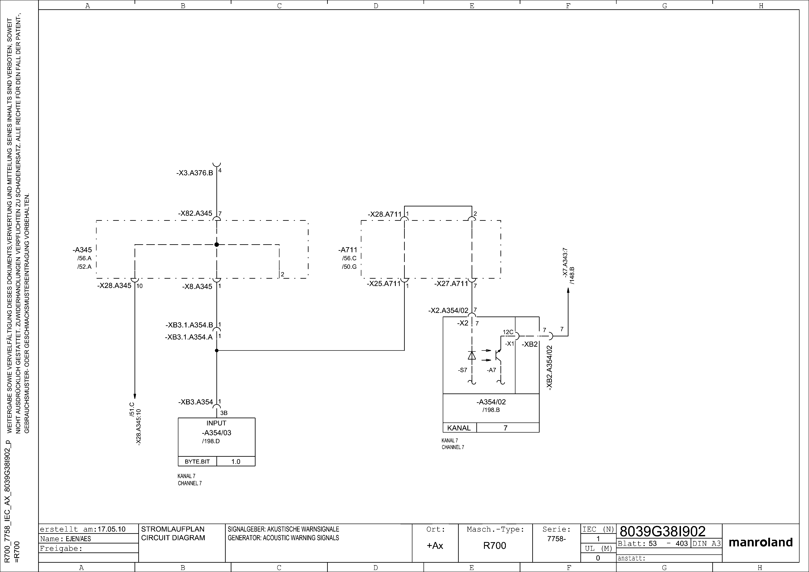

# +Ax — Sheet 53 of 403 — SIGNALGEBER: AKUSTISCHE WARNSIGNALE

**GENERATOR: ACOUSTIC WARNING SIGNALS**

> Part of the manroland **R700** printing press IEC/UL circuit diagrams.
> Drawing class: **Stromlaufplan / Circuit diagram** (DIN A3).
> Document `+Ax` covers the **Central control console** machine section.

## At a glance

| Field | Value |
|---|---|
| Document | `+Ax`  (8039G38I902) |
| Sheet | **53** of 403 |
| Section (DE) | SIGNALGEBER: AKUSTISCHE WARNSIGNALE |
| Section (EN) | GENERATOR: ACOUSTIC WARNING SIGNALS |
| Section type | CIRCUIT — Circuit diagram |
| Machine type | `R700` |
| Series | `7758` |
| Created | 17.05.10 |
| Replaces | — |
| Columns used | A, B, C, D, E, F |
| Path numbers | — |
| Labels on sheet | 58 |
| Cross-refs out | 8 |
| Cross-refs in | 22 |

**Previous:** [+Ax sheet 52](SHEET_0052.md) · **Next:** [+Ax sheet 54](SHEET_0054.md) · **Document TOC:** [_TOC.md](_TOC.md)  (+Ax) · **Master TOC:** [all sheets](../_MASTER_TOC.md)

## Sheet image (300 DPI, exact vector render)



_Rendered directly from the PDF vector layer at 300 DPI (1-bit), no OCR and no resampling. Use it to confirm anything ambiguous in the text below._

## Cross-references on this sheet

Each entry is a wire leaving this sheet. The printed token is `/sheet.column`; the link resolves to that sheet inside the same document.

| Ref | Target sheet | Col | Path | Destination on target | Target section | From col |
|---|---|---|---|---|---|---|
| `/148.B` | [+Ax sheet 148](SHEET_0148.md) | B | — | X7.A343:7 | ÜBERWACHUNGSRECHNER SICHERHEITSBUS | F |
| `/56.A` | [+Ax sheet 56](SHEET_0056.md) | A | — | — | LUFTVERSORGUNG | A |
| `/52.A` | [+Ax sheet 52](SHEET_0052.md) | A | — | — | SIGNALGEBER: AKUSTISCHE WARNSIGNALE | A |
| `/56.C` | [+Ax sheet 56](SHEET_0056.md) | C | — | — | LUFTVERSORGUNG | D |
| `/50.G` | [+Ax sheet 50](SHEET_0050.md) | G | — | — | STOP SICHERN | D |
| `/51.C` | [+Ax sheet 51](SHEET_0051.md) | C | — | — | SIGNALGEBER: AKUSTISCHE WARNSIGNALE | A |
| `/198.B` | [+Ax sheet 198](SHEET_0198.md) | B | — | — | REFERENZMODUL | E |
| `/198.D` | [+Ax sheet 198](SHEET_0198.md) | D | — | A354/03 | REFERENZMODUL | B |

### Incoming references (sheets that point here)

Every other sheet that sends a wire to this one. `Back-ref` is the token printed on *that* sheet; `Path` is its line number.

| From sheet | Cols | Back-ref | Path | Refs | What continues there |
|---|---|---|---|---|---|
| [+Ax#50](SHEET_0050.md) | G | `/50.G` | — | 1 | A711 |
| [+Ax#51](SHEET_0051.md) | C | `/51.C` | — | 1 | — |
| [+Ax#52](SHEET_0052.md) | A | `/52.A` | — | 1 | — |
| [+Ax#56](SHEET_0056.md) | A, C | `/56.A`, `/56.C` | — | 2 | A711 |
| [+Ax#148](SHEET_0148.md) | B | `/148.B` | — | 1 | X7.A343:7 |
| [+Ax#198](SHEET_0198.md) | B, D | `/198.B`, `/198.D` | — | 2 | — |
| [+Ax#219](SHEET_0219.md) | C, E | `/219.C`, `/219.E` | — | 2 | — |
| [+Ax#224](SHEET_0224.md) | A, B, C, F | `/224.A`, `/224.B`, `/224.C`, `/224.F` | — | 4 | — |
| [+Ax#238](SHEET_0238.md) | A | `/238.A` | — | 1 | — |
| [+Ax#268](SHEET_0268.md) | C | `/268.C` | — | 1 | — |
| [+Ax#271](SHEET_0271.md) | A | `/271.A` | — | 1 | — |
| [+Ax#272](SHEET_0272.md) | A, G | `/272.A`, `/272.G` | — | 3 | — |
| [+Ax#285](SHEET_0285.md) | A | `/285.A` | — | 1 | — |
| [+Ax#286](SHEET_0286.md) | F | `/286.F` | — | 1 | — |


## Devices on this sheet

| Tag | Class | Class meaning (IEC) | Col | Sub | Terminal | Sign |
|---|---|---|---|---|---|---|
| `A354/03` | A | Baugruppe / assembly, module, PC board | B | 03 | — | — |
| `A345` | A | Baugruppe / assembly, module, PC board | A | — | — | — |
| `S7` | S | Schalter / switch | E | — | — | — |
| `A7` | A | Baugruppe / assembly, module, PC board | E | — | — | — |
| `X1` | X | Klemme / terminal, plug connector | E | — | — | — |
| `X2` | X | Klemme / terminal, plug connector | E | — | — | — |
| `XB2` | XB |  | F | — | — | — |
| `A354/02` | A | Baugruppe / assembly, module, PC board | E | 02 | — | — |
| `A711` | A | Baugruppe / assembly, module, PC board | D | — | — | — |
| `1.0` | — | cross-device reference | C | — | — | — |
| `XB3.A354` | — | cross-device reference | B | — | — | — |
| `XB3.1.A354.B` | — | cross-device reference | B | — | — | — |
| `XB3.1.A354.A` | — | cross-device reference | B | — | — | — |
| `X3.A376.B` | — | cross-device reference | B | — | — | — |
| `X8.A345` | — | cross-device reference | B | — | — | — |
| `X28.A345` | — | cross-device reference | A | — | — | — |
| `X82.A345` | — | cross-device reference | B | — | — | — |
| `X27.A711` | — | cross-device reference | E | — | — | — |
| `X28.A711` | — | cross-device reference | D | — | — | — |
| `X25.A711` | — | cross-device reference | D | — | — | — |
| `X7.A343:7` | — | cross-device reference | F | — | 7 | — |
| `X28.A345:10` | — | cross-device reference | B | — | 10 | — |

## Potentials / nets

_No named potentials on this sheet._

## Wire-end annotations (grouped as printed)

A wire that continues elsewhere is annotated with a small cluster: the destination description, the path/line number `#NN`, and the `/sheet.column` cross reference. Each row below is one such cluster exactly as it is grouped on the drawing.

| Col | Y | Path | Cross-ref | Text on the wire |
|---|---|---|---|---|
| B | 246.9 | — | — | `X3.A376.B 4` |
| B | 309.3 | — | — | `X82.A345 7` |
| D | 310.7 | — | — | `X28.A711 1` |
| E | 310.7 | — | — | `2` |
| A | 363.1 | — | — | `A345` |
| D | 363.1 | — | — | `A711` |
| F | 364.5 | — | `/148.B` | `X7.A343:7` |
| A | 376.2 | — | `/56.A`, `/52.A` | — |
| D | 376.2 | — | `/56.C`, `/50.G` | — |
| C | 400.0 | — | — | `2` |
| D | 412.8 | — | — | `X25.A711 1` |
| E | 412.8 | — | — | `X27.A711 7` |
| A | 415.6 | — | — | `X28.A345 10` |
| B | 417.0 | — | — | `X8.A345 1` |
| E | 452.4 | — | — | `X2.A354/02 7` |
| E | 470.9 | — | — | `X2` |
| E | 472.3 | — | — | `7 7` |
| B | 473.7 | — | — | `XB3.1.A354.B 1` |
| F | 480.8 | — | — | `7` |
| E | 485.1 | — | — | `12C` |
| B | 490.7 | — | — | `XB3.1.A354.A 1` |
| E | 502.0 | — | — | `X1` |
| F | 502.1 | — | — | `XB2` |
| F | 508.2 | — | — | `XB2.A354/02` |
| E | 541.0 | — | — | `S7 A7` |
| B | 587.1 | — | — | `XB3.A354 1` |
| E | 587.1 | — | — | `A354/02` |
| A | 592.2 | — | `/51.C` | — |
| E | 599.4 | — | `/198.B` | — |
| B | 602.1 | — | — | `X28.A345:10` |
| B | 604.0 | — | — | `3B` |
| B | 618.6 | — | — | `INPUT` |
| E | 625.3 | — | — | `KANAL 7` |
| B | 632.4 | — | `/198.D` | `A354/03` |
| E | 645.7 | — | — | `KANAL 7 CHANNEL 7` |
| B | 675.3 | — | — | `BYTE.BIT 1.0` |
| B | 697.9 | — | — | `KANAL 7` |
| B | 708.6 | — | — | `CHANNEL 7` |


## Reconstructed tables

This sheet carries tabular content (pin map / terminal assignment / index). The grid below was rebuilt from the drawing's own rule lines, so each row is exactly one physical row of the table.

### Table 1 — 3 data rows × 3 columns (at x=198.4, y=360.0)

| 10 | X8.A345 XB3.1.A354.B XB3.1.A354.A | 1 1 1 |
|---|---|---|
|  | `XB3.A354` | `1 3B` |
| `X28.A345:10` | `INPUT A354/03 /198.D` |  |
|  | `BYTE.BIT` | `1.0` |


### Table 2 — 4 data rows × 6 columns (at x=595.3, y=303.3)

| 1 1 | X27.A711 X2.A354/02 | 2 7 7 |  |  | X7.A343:7 |
|---|---|---|---|---|---|
|  | `X2` | `7` | `12C X1` | `XB2` | `7 7` |
|  | `S7` | `A7` |  |  | `XB2.A354/02` |
|  |  | `A354/02 /198.B` |  |  |  |
|  | `KANAL` |  | `7` |  |  |


## Notes and free text on this sheet

| Text | Col | Y (pt) |
|---|---|---|
| `3B` | B | 604.05 |
| `INPUT` | B | 618.59 |
| `BYTE.BIT` | B | 675.84 |
| `KANAL 7` | B | 697.92 |
| `CHANNEL 7` | B | 708.6 |
| `KANAL 7` | E | 645.66 |
| `CHANNEL 7` | E | 655.61 |
| `12C` | E | 485.05 |
| `KANAL` | E | 625.34 |
| `X2.A354/02` | E | 452.44 |
| `XB2.A354/02` | F | 508.25 |

## Complete label inventory (exact text from the drawing)

Every text object inside the drawing area of this sheet, in DIN reading order (column A→H, then top→bottom). This is the authoritative list: if a string is not here it is not printed on this sheet.

| Col | Y | X | Dir | Type | Text |
|---|---|---|---|---|---|
| A | 363.1 | 106.9 | → | device tag | `A345` |
| A | 376.2 | 114.0 | → | cross-reference | `/56.A` |
| A | 388.6 | 114.0 | → | cross-reference | `/52.A` |
| A | 415.6 | 143.1 | → | device ref | `X28.A345` |
| A | 592.2 | 190.2 | ↕ | cross-reference | `/51.C` |
| B | 246.9 | 321.4 | → | number | `4` |
| B | 249.8 | 259.7 | → | device ref | `X3.A376.B` |
| B | 309.3 | 262.2 | → | device ref | `X82.A345` |
| B | 310.7 | 321.4 | → | number | `7` |
| B | 417.0 | 200.4 | → | number | `10` |
| B | 417.0 | 268.2 | → | device ref | `X8.A345` |
| B | 417.0 | 320.9 | → | number | `1` |
| B | 473.7 | 243.8 | → | device ref | `XB3.1.A354.B` |
| B | 473.7 | 320.9 | → | number | `1` |
| B | 490.7 | 320.9 | → | number | `1` |
| B | 491.4 | 242.9 | → | device ref | `XB3.1.A354.A` |
| B | 587.1 | 262.5 | → | device ref | `XB3.A354` |
| B | 587.1 | 320.9 | → | number | `1` |
| B | 602.1 | 200.1 | ↕ | device ref | `X28.A345:10` |
| B | 604.0 | 324.3 | → | text | `3B` |
| B | 618.6 | 304.0 | → | text | `INPUT` |
| B | 632.4 | 297.4 | → | device tag | `A354/03` |
| B | 645.5 | 297.6 | → | cross-reference | `/198.D` |
| B | 675.8 | 272.1 | → | text | `BYTE.BIT` |
| B | 697.9 | 261.4 | → | text | `KANAL 7` |
| B | 708.6 | 261.9 | → | text | `CHANNEL 7` |
| C | 400.0 | 413.6 | → | number | `2` |
| C | 675.3 | 340.2 | → | device ref | `1.0` |
| D | 310.7 | 541.4 | → | device ref | `X28.A711` |
| D | 310.7 | 597.3 | → | number | `1` |
| D | 363.1 | 498.0 | → | device tag | `A711` |
| D | 376.2 | 503.7 | → | cross-reference | `/56.C` |
| D | 388.6 | 503.4 | → | cross-reference | `/50.G` |
| D | 412.7 | 540.0 | → | device ref | `X25.A711` |
| D | 417.0 | 597.3 | → | number | `1` |
| E | 310.7 | 697.0 | → | number | `2` |
| E | 412.7 | 639.2 | → | device ref | `X27.A711` |
| E | 417.0 | 697.0 | → | number | `7` |
| E | 452.4 | 630.4 | → | text | `X2.A354/02` |
| E | 452.5 | 697.0 | → | number | `7` |
| E | 470.9 | 672.9 | → | device tag | `X2` |
| E | 472.3 | 699.9 | → | number | `7` |
| E | 485.1 | 739.8 | → | text | `12C` |
| E | 502.0 | 743.5 | → | device tag | `X1` |
| E | 541.0 | 674.1 | → | device tag | `S7` |
| E | 541.0 | 716.6 | → | device tag | `A7` |
| E | 587.1 | 701.4 | → | device tag | `A354/02` |
| E | 599.4 | 710.2 | → | cross-reference | `/198.B` |
| E | 625.3 | 658.2 | → | text | `KANAL` |
| E | 625.3 | 741.3 | → | number | `7` |
| E | 645.7 | 650.0 | → | text | `KANAL 7` |
| E | 655.6 | 650.3 | → | text | `CHANNEL 7` |
| F | 364.5 | 828.0 | ↕ | device ref | `X7.A343:7` |
| F | 392.6 | 837.9 | ↕ | cross-reference | `/148.B` |
| F | 480.8 | 824.6 | → | number | `7` |
| F | 482.2 | 799.1 | → | number | `7` |
| F | 502.1 | 767.9 | → | device tag | `XB2` |
| F | 508.3 | 803.9 | ↕ | text | `XB2.A354/02` |

## Reading-order text block

The same content as a plain block, grouped by DIN column — convenient to paste or to match against a visual description.

```text
=== Column A ===
 363.1  106.9  devtag       A345
 376.2  114.0  xref         /56.A
 388.6  114.0  xref         /52.A
 415.6  143.1  devref       X28.A345
 592.2  190.2  xref         /51.C
=== Column B ===
 246.9  321.4  numeric      4
 249.8  259.7  devref       X3.A376.B
 309.3  262.2  devref       X82.A345
 310.7  321.4  numeric      7
 417.0  200.4  numeric      10
 417.0  268.2  devref       X8.A345
 417.0  320.9  numeric      1
 473.7  243.8  devref       XB3.1.A354.B
 473.7  320.9  numeric      1
 490.7  320.9  numeric      1
 491.4  242.9  devref       XB3.1.A354.A
 587.1  262.5  devref       XB3.A354
 587.1  320.9  numeric      1
 602.1  200.1  devref       X28.A345:10
 604.0  324.3  text         3B
 618.6  304.0  text         INPUT
 632.4  297.4  devtag       A354/03
 645.5  297.6  xref         /198.D
 675.8  272.1  text         BYTE.BIT
 697.9  261.4  text         KANAL 7
 708.6  261.9  text         CHANNEL 7
=== Column C ===
 400.0  413.6  numeric      2
 675.3  340.2  devref       1.0
=== Column D ===
 310.7  541.4  devref       X28.A711
 310.7  597.3  numeric      1
 363.1  498.0  devtag       A711
 376.2  503.7  xref         /56.C
 388.6  503.4  xref         /50.G
 412.7  540.0  devref       X25.A711
 417.0  597.3  numeric      1
=== Column E ===
 310.7  697.0  numeric      2
 412.7  639.2  devref       X27.A711
 417.0  697.0  numeric      7
 452.4  630.4  text         X2.A354/02
 452.5  697.0  numeric      7
 470.9  672.9  devtag       X2
 472.3  699.9  numeric      7
 485.1  739.8  text         12C
 502.0  743.5  devtag       X1
 541.0  674.1  devtag       S7
 541.0  716.6  devtag       A7
 587.1  701.4  devtag       A354/02
 599.4  710.2  xref         /198.B
 625.3  658.2  text         KANAL
 625.3  741.3  numeric      7
 645.7  650.0  text         KANAL 7
 655.6  650.3  text         CHANNEL 7
=== Column F ===
 364.5  828.0  devref       X7.A343:7
 392.6  837.9  xref         /148.B
 480.8  824.6  numeric      7
 482.2  799.1  numeric      7
 502.1  767.9  devtag       XB2
 508.3  803.9  text         XB2.A354/02
```

---
_Generated from the PDF vector text layer; no OCR. Source: `R700_7758_IEC_AX_8039G38I902_p`, sheet 53._
