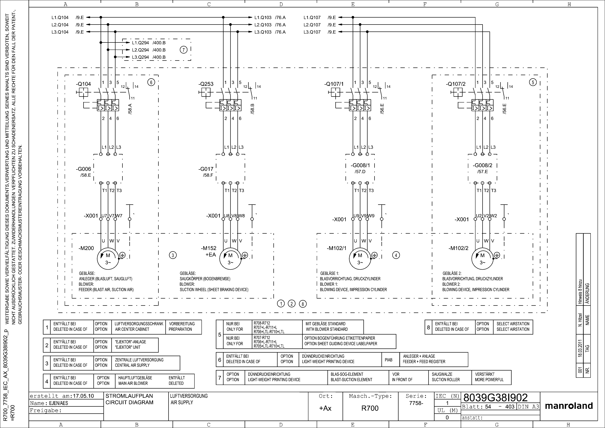

# +Ax — Sheet 54 of 403 — LUFTVERSORGUNG

**AIR SUPPLY**

> Part of the manroland **R700** printing press IEC/UL circuit diagrams.
> Drawing class: **Stromlaufplan / Circuit diagram** (DIN A3).
> Document `+Ax` covers the **Central control console** machine section.

## At a glance

| Field | Value |
|---|---|
| Document | `+Ax`  (8039G38I902) |
| Sheet | **54** of 403 |
| Section (DE) | LUFTVERSORGUNG |
| Section (EN) | AIR SUPPLY |
| Section type | CIRCUIT — Circuit diagram |
| Machine type | `R700` |
| Series | `7758` |
| Created | 17.05.10 |
| Replaces | — |
| Columns used | A, B, C, D, E, F, G, H |
| Path numbers | — |
| Labels on sheet | 233 |
| Cross-refs out | 20 |
| Cross-refs in | 20 |

**Previous:** [+Ax sheet 53](SHEET_0053.md) · **Next:** [+Ax sheet 55](SHEET_0055.md) · **Document TOC:** [_TOC.md](_TOC.md)  (+Ax) · **Master TOC:** [all sheets](../_MASTER_TOC.md)

## Sheet image (300 DPI, exact vector render)



_Rendered directly from the PDF vector layer at 300 DPI (1-bit), no OCR and no resampling. Use it to confirm anything ambiguous in the text below._

## Cross-references on this sheet

Each entry is a wire leaving this sheet. The printed token is `/sheet.column`; the link resolves to that sheet inside the same document.

| Ref | Target sheet | Col | Path | Destination on target | Target section | From col |
|---|---|---|---|---|---|---|
| `/9.E` | [+Ax sheet 9](SHEET_0009.md) | E | — | L1.Q104 L1.Q103 L1.Q107 | SPANNUNGSVERSORGUNG, SCHALTSCHRANKBELÜFTUNG | C |
| `/9.E` | [+Ax sheet 9](SHEET_0009.md) | E | — | L1.Q104 L1.Q103 L1.Q107 | SPANNUNGSVERSORGUNG, SCHALTSCHRANKBELÜFTUNG | C |
| `/76.A` | [+Ax sheet 76](SHEET_0076.md) | A | — | L1.Q104 L1.Q103 L1.Q107 | ANLEGER | C |
| `/9.E` | [+Ax sheet 9](SHEET_0009.md) | E | — | L2.Q104 L2.Q103 L2.Q107 | SPANNUNGSVERSORGUNG, SCHALTSCHRANKBELÜFTUNG | C |
| `/9.E` | [+Ax sheet 9](SHEET_0009.md) | E | — | L2.Q104 L2.Q103 L2.Q107 | SPANNUNGSVERSORGUNG, SCHALTSCHRANKBELÜFTUNG | C |
| `/76.A` | [+Ax sheet 76](SHEET_0076.md) | A | — | L2.Q104 L2.Q103 L2.Q107 | ANLEGER | C |
| `/9.E` | [+Ax sheet 9](SHEET_0009.md) | E | — | L3.Q104 L3.Q103 L3.Q107 | SPANNUNGSVERSORGUNG, SCHALTSCHRANKBELÜFTUNG | C |
| `/9.E` | [+Ax sheet 9](SHEET_0009.md) | E | — | L3.Q104 L3.Q103 L3.Q107 | SPANNUNGSVERSORGUNG, SCHALTSCHRANKBELÜFTUNG | C |
| `/76.A` | [+Ax sheet 76](SHEET_0076.md) | A | — | L3.Q104 L3.Q103 L3.Q107 | ANLEGER | C |
| `/400.B` | [+Ax sheet 400](SHEET_0400.md) | B | — | L1.Q294 | OPTION: DÜNNDRUCKEINRICHTUNG | B |
| `/400.B` | [+Ax sheet 400](SHEET_0400.md) | B | — | L2.Q294 | OPTION: DÜNNDRUCKEINRICHTUNG | B |
| `/400.B` | [+Ax sheet 400](SHEET_0400.md) | B | — | L3.Q294 | OPTION: DÜNNDRUCKEINRICHTUNG | B |
| `/56.E` | [+Ax sheet 56](SHEET_0056.md) | E | — | — | LUFTVERSORGUNG | E |
| `/56.E` | [+Ax sheet 56](SHEET_0056.md) | E | — | — | LUFTVERSORGUNG | G |
| `/58.B` | [+Ax sheet 58](SHEET_0058.md) | B | — | — | LUFTVERSORGUNG | D |
| `/58.A` | [+Ax sheet 58](SHEET_0058.md) | A | — | — | LUFTVERSORGUNG | B |
| `/57.E` | [+Ax sheet 57](SHEET_0057.md) | E | — | — | LUFTVERSORGUNG | G |
| `/57.D` | [+Ax sheet 57](SHEET_0057.md) | D | — | — | LUFTVERSORGUNG | E |
| `/58.E` | [+Ax sheet 58](SHEET_0058.md) | E | — | — | LUFTVERSORGUNG | A |
| `/58.F` | [+Ax sheet 58](SHEET_0058.md) | F | — | — | LUFTVERSORGUNG | C |

### Incoming references (sheets that point here)

Every other sheet that sends a wire to this one. `Back-ref` is the token printed on *that* sheet; `Path` is its line number.

| From sheet | Cols | Back-ref | Path | Refs | What continues there |
|---|---|---|---|---|---|
| [+Ax#9](SHEET_0009.md) | E | `/9.E` | — | 6 | L1.Q104; L1.Q107; L2.Q104; L2.Q107; L3.Q104; L3.Q107 |
| [+Ax#56](SHEET_0056.md) | E | `/56.E` | — | 2 | — |
| [+Ax#57](SHEET_0057.md) | D, E | `/57.D`, `/57.E` | — | 2 | — |
| [+Ax#58](SHEET_0058.md) | A, B, E, F | `/58.A`, `/58.B`, `/58.E`, `/58.F` | — | 4 | — |
| [+Ax#76](SHEET_0076.md) | A | `/76.A` | — | 3 | L1.Q103; L2.Q103; L3.Q103 |
| [+Ax#400](SHEET_0400.md) | B | `/400.B` | — | 3 | L1.Q294; L2.Q294; L3.Q294 |


## Devices on this sheet

| Tag | Class | Class meaning (IEC) | Col | Sub | Terminal | Sign |
|---|---|---|---|---|---|---|
| `M102/1` | M | Motor | E | 1 | — | — |
| `M102/2` | M | Motor | F | 2 | — | — |
| `V9` | V | Diode / semiconductor valve | E | — | — | — |
| `U9` | U | Umrichter / frequency converter | E | — | — | — |
| `X001` | X | Klemme / terminal, plug connector | E | — | — | — |
| `W9` | W | Kabel / cable, line, bus | E | — | — | — |
| `V2` | V | Diode / semiconductor valve | G | — | — | — |
| `U2` | U | Umrichter / frequency converter | G | — | — | — |
| `X001` | X | Klemme / terminal, plug connector | G | — | — | — |
| `W2` | W | Kabel / cable, line, bus | G | — | — | — |
| `U7` | U | Umrichter / frequency converter | B | — | — | — |
| `X001` | X | Klemme / terminal, plug connector | A | — | — | — |
| `V8` | V | Diode / semiconductor valve | C | — | — | — |
| `U8` | U | Umrichter / frequency converter | C | — | — | — |
| `X001` | X | Klemme / terminal, plug connector | C | — | — | — |
| `W8` | W | Kabel / cable, line, bus | C | — | — | — |
| `Q107/1` | Q | Leistungsschalter / power switching device | E | 1 | — | — |
| `Q107/2` | Q | Leistungsschalter / power switching device | F | 2 | — | — |
| `G008/1` | G | Stromversorgung / power supply | E | 1 | — | — |
| `G008/2` | G | Stromversorgung / power supply | G | 2 | — | — |
| `G006` | G | Stromversorgung / power supply | A | — | — | — |
| `G017` | G | Stromversorgung / power supply | C | — | — | — |
| `Q104` | Q | Leistungsschalter / power switching device | A | — | — | — |
| `Q253` | Q | Leistungsschalter / power switching device | C | — | — | — |
| `NR.` | — | cross-device reference | H | — | — | — |
| `18.03.2011` | — | cross-device reference | H | — | — | — |

## Potentials / nets

| Potential | Count | Columns | Attached devices | Terminals |
|---|---|---|---|---|
| `L1` | 4 | A, B, D | `Q103`, `Q104`, `Q107`, `Q294` | — |
| `L2` | 4 | A, B, D | `Q103`, `Q104`, `Q107`, `Q294` | — |
| `L3` | 4 | A, B, D | `Q103`, `Q104`, `Q107`, `Q294` | — |
| `M152` | 1 | C | — | — |
| `M200` | 1 | A | — | — |


A potential such as `L24+/4` or `M24+` is a named supply/return rail; every place it appears on this sheet is electrically common.

## Wire-end annotations (grouped as printed)

A wire that continues elsewhere is annotated with a small cluster: the destination description, the path/line number `#NN`, and the `/sheet.column` cross reference. Each row below is one such cluster exactly as it is grouped on the drawing.

| Col | Y | Path | Cross-ref | Text on the wire |
|---|---|---|---|---|
| C | 30.7 | — | `/9.E`, `/9.E`, `/76.A` | `L1.Q104 L1.Q103 L1.Q107` |
| C | 44.9 | — | `/9.E`, `/9.E`, `/76.A` | `L2.Q104 L2.Q103 L2.Q107` |
| C | 59.0 | — | `/9.E`, `/9.E`, `/76.A` | `L3.Q104 L3.Q103 L3.Q107` |
| B | 80.3 | — | `/400.B` | `L1.Q294` |
| B | 94.5 | — | `/400.B` | `L2.Q294` |
| C | 95.2 | — | — | `7` |
| B | 108.7 | — | `/400.B` | `L3.Q294` |
| B | 158.4 | — | — | `1` |
| B | 158.4 | — | — | `3` |
| B | 158.4 | — | — | `5` |
| C | 158.4 | — | — | `1` |
| C | 158.4 | — | — | `3` |
| C | 158.4 | — | — | `5` |
| E | 158.4 | — | — | `1` |
| E | 158.4 | — | — | `3` |
| E | 158.4 | — | — | `5` |
| G | 158.4 | — | — | `1` |
| G | 158.4 | — | — | `3` |
| G | 158.4 | — | — | `5` |
| E | 159.0 | — | — | `6 5` |
| A | 160.5 | — | — | `Q104` |
| C | 160.5 | — | — | `Q253` |
| E | 160.5 | — | — | `Q107/1` |
| F | 160.5 | — | — | `Q107/2` |
| B | 167.4 | — | — | `12 14` |
| D | 167.4 | — | — | `12 14` |
| E | 167.4 | — | — | `12 14` |
| G | 167.4 | — | — | `12 14` |
| B | 190.1 | — | — | `11` |
| D | 190.1 | — | — | `11` |
| E | 190.1 | — | — | `11` |
| G | 190.1 | — | — | `11` |
| E | 203.5 | — | `/56.E` | — |
| G | 203.5 | — | `/56.E` | — |
| D | 203.8 | — | `/58.B` | — |
| B | 204.1 | — | `/58.A` | — |
| B | 229.2 | — | — | `2` |
| B | 229.2 | — | — | `4` |
| B | 229.2 | — | — | `6` |
| C | 229.2 | — | — | `2` |
| C | 229.2 | — | — | `4` |
| C | 229.2 | — | — | `6` |
| E | 229.2 | — | — | `2` |
| E | 229.2 | — | — | `4` |
| E | 229.2 | — | — | `6` |
| G | 229.2 | — | — | `2` |
| G | 229.2 | — | — | `4` |
| G | 229.2 | — | — | `6` |
| B | 285.9 | — | — | `L1 L2 L3` |
| C | 285.9 | — | — | `L1 L2 L3` |
| E | 285.9 | — | — | `L1 L2 L3` |
| G | 285.9 | — | — | `L1 L2 L3` |
| E | 320.6 | — | — | `G008/1` |
| G | 320.6 | — | — | `G008/2` |
| A | 327.7 | — | — | `G006` |
| C | 327.7 | — | — | `G017` |
| E | 333.7 | — | `/57.D` | — |
| G | 333.7 | — | `/57.E` | — |
| A | 340.8 | — | `/58.E` | — |
| C | 340.8 | — | `/58.F` | — |
| B | 370.9 | — | — | `T1 T2 T3` |
| C | 370.9 | — | — | `T1 T2 T3` |
| E | 370.9 | — | — | `T1 T2 T3` |
| G | 370.9 | — | — | `T1 T2 T3` |
| D | 419.4 | — | — | `X001 U7 V7 W7 ' X001 U8 V8 W8 ' W2 '` |
| F | 419.4 | — | — | `W9 ' X001 U2 V2` |
| E | 420.5 | — | — | `X001 U9 V9` |
| B | 469.8 | — | — | `U W V` |
| C | 469.8 | — | — | `U W V` |
| E | 469.8 | — | — | `U W V` |
| G | 469.8 | — | — | `U W V` |
| A | 483.6 | — | — | `M200` |
| C | 483.6 | — | — | `M152` |
| E | 483.6 | — | — | `M102/1` |
| F | 483.6 | — | — | `M102/2` |
| C | 496.3 | — | — | `+EA` |
| B | 498.1 | — | — | `3~ M` |
| C | 498.1 | — | — | `3~ M` |
| E | 498.1 | — | — | `3~ M` |
| G | 498.1 | — | — | `3~ M` |
| B | 499.2 | — | — | `3` |
| F | 499.2 | — | — | `4` |
| B | 534.9 | — | — | `BLOWER: FEEDER (BLAST AIR, SUCTION AIR) GEBLÄSE: ANLEGER (BLASLUFT, SAUGLUFT)` |
| C | 534.9 | — | — | `BLOWER: GEBLÄSE: SAUGKÖRPER (BOGENBREMSE)` |
| E | 534.9 | — | — | `BLASVORRICHTUNG, DRUCKZYLINDER BLOWER 1: BLOWING DEVICE, IMPRESSION CYLINDER GEBLÄSE 1:` |
| G | 534.9 | — | — | `BLASVORRICHTUNG, DRUCKZYLINDER BLOWER 2: BLOWING DEVICE, IMPRESSION CYLINDER GEBLÄSE 2:` |
| H | 549.7 | — | — | `001 18.03.2011 N. Hitzel Hinweis 8 hinzu` |
| H | 557.2 | — | — | `NR. NAME TAG ÄNDERUNG` |
| C | 566.8 | — | — | `SUCTION WHEEL (SHEET BRAKING DEVICE)` |
| D | 593.9 | — | — | `1 2` |
| D | 595.1 | — | — | `8` |
| D | 632.8 | — | — | `R708 R712 R707+L R711+L R706+LTL R710+LTL` |
| B | 634.1 | — | — | `1 ENTFÄLLT BEI DELETED IN CASE OF LUFTVERSORGUNGSSCHRANK` |
| B | 634.1 | — | — | `OPTION OPTION PREPARATION VORBEREITUNG` |
| C | 634.1 | — | — | `NUR BEI` |
| G | 634.1 | — | — | `8 ENTFÄLLT BEI DELETED IN CASE OF OPTION OPTION SELECT AIRSTATION SELECT AIRSTATION` |
| E | 634.2 | — | — | `MIT GEBLÄSE STANDARD` |
| B | 644.8 | — | — | `AIR CENTER CABINET` |
| C | 644.8 | — | — | `ONLY FOR` |
| E | 644.8 | — | — | `WITH BLOWER STANDARD` |
| C | 653.7 | — | — | `5` |
| D | 661.1 | — | — | `R707 R712 R706+L R711+L R705+LTL R710+LTL` |
| C | 662.5 | — | — | `NUR BEI` |
| E | 662.5 | — | — | `OPTION BOGENFÜHRUNG ETIKETTENPAPIER OPTION SHEET GUIDING DEVICE LABELPAPER` |
| A | 669.6 | — | — | `2 ENTFÄLLT BEI DELETED IN CASE OF` |
| B | 669.6 | — | — | `OPTION OPTION "EJEKTOR" ANLAGE "EJEKTOR" UNIT` |
| C | 673.2 | — | — | `ONLY FOR` |
| C | 697.9 | — | — | `ENTFÄLLT BEI DELETED IN CASE OF` |
| D | 697.9 | — | — | `OPTION OPTION` |
| D | 698.0 | — | — | `6 DÜNNDRUCKEINRICHTUNG LIGHT WEIGHT PRINTING DEVICE` |
| F | 698.0 | — | — | `FEEDER + FEED REGISTER ANLEGER + ANLAGE` |
| E | 704.9 | — | — | `PIAB` |
| A | 705.0 | — | — | `3 ENTFÄLLT BEI DELETED IN CASE OF` |
| B | 705.0 | — | — | `OPTION OPTION CENTRAL AIR SUPPLY ZENTRALE LUFTVERSORGUNG` |
| F | 733.3 | — | — | `SAUGWALZE SUCTION ROLLER` |
| C | 733.4 | — | — | `7 OPTION OPTION` |
| D | 733.4 | — | — | `DÜNNDRUCKEINRICHTUNG LIGHT WEIGHT PRINTING DEVICE` |
| E | 733.4 | — | — | `BLAS SOG ELEMENT BLAST SUCTION ELEMENT` |
| F | 733.4 | — | — | `IN FRONT OF VOR` |
| G | 733.4 | — | — | `MORE POWERFUL VERSTÄRKT` |
| A | 740.4 | — | — | `ENTFÄLLT BEI DELETED IN CASE OF` |
| B | 740.4 | — | — | `OPTION OPTION` |
| B | 740.5 | — | — | `4 ENTFÄLLT DELETED` |
| B | 740.5 | — | — | `HAUPTLUFTGEBLÄSE MAIN AIR BLOWER` |


## Reconstructed tables

This sheet carries tabular content (pin map / terminal assignment / index). The grid below was rebuilt from the drawing's own rule lines, so each row is exactly one physical row of the table.

### Table 1 — 3 data rows × 1 columns (at x=99.2, y=34.0)

| C1 |
|---|
| `L1.Q104` |
| `L2.Q104` |
| `L3.Q104` |


### Table 2 — 5 data rows × 15 columns (at x=155.9, y=34.0) — **/9.E**

|  |  |  |  |  |  |  |  |  |  | L1.Q294 L2.Q294 L3.Q294 | /400.B /400.B 7 /400.B |  |  |  |
|---|---|---|---|---|---|---|---|---|---|---|---|---|---|---|
|  | `Q104` |  |  | `1` |  | `3` |  | `5` | `12` | `6 14` |  | `Q253` |  |  |
|  |  |  |  |  |  |  |  |  |  | `11` |  |  |  |  |
|  |  |  |  |  |  |  |  |  |  | `/58.A` |  |  |  |  |
|  | `G006 /58.E` | `X001` |  | `2 L1 U7` | `T1` | `4 L2` | `T2 V7` | `6 L3` | `T3 W7` | `'` |  | `G017` | `/58.F` | `X001` |
|  | `M200 GEBLÄSE: ANLEGER BLOWER: FEEDER` |  | `(BLAST` | `U (BLASLUFT,` | `M AIR,` | `3~` | `W` | `V` | `SAUGLUFT) SUCTION` | `AIR)` | `3 GEBLÄSE: SAUGKÖRPER BLOWER: SUCTION WHEEL` |  | `M152` | `+EA (BOGENBREMSE) (SHEET` |


### Table 3 — 8 data rows × 12 columns (at x=439.4, y=34.0)

|  |  |  |  |  |  | L1.Q103 | /76.A L1.Q107 |  | /9.E |  |  |
|---|---|---|---|---|---|---|---|---|---|---|---|
|  |  |  |  |  |  | `L2.Q103` | `/76.A L2.Q107` |  | `/9.E` |  |  |
|  |  |  |  |  |  | `L3.Q103` | `/76.A L3.Q107` |  | `/9.E` |  |  |
| `1` |  | `3` |  | `5` | `12` | `14` |  |  | `Q107/1` |  |  |
|  |  |  |  |  |  | `11` |  |  |  |  |  |
|  |  |  |  |  |  | `/58.B` |  |  |  |  |  |
| `2 L1 U8` | `T1` | `4 L2` | `T2 V8` | `6 L3` | `T3 W8` | `'` |  |  |  | `X001` |  |
| `U` | `BRAKING` | `M 3~` | `W` | `V` | `DEVICE)` |  |  | `GEBLÄSE BLOWER BLOWING` |  | `M102/1 1: BLASVORRICHTUNG, 1:` | `DEVICE,` |
|  |  |  |  |  |  |  | `1 2 8` |  |  |  |  |


### Table 4 — 2 data rows × 6 columns (at x=694.5, y=34.0)

| 1 |  | 3 |  | 5 | 12 |
|---|---|---|---|---|---|
| `2 L1 U9` | `T1` | `4 L2 G008/1 /57.D` | `T2 V9` | `6 L3` | `T3 W9` |
| `U` | `M IMPRESSION` | `3~` | `W DRUCKZYLINDER` | `V` | `CYLINDER` |


### Table 5 — 0 data rows × 3 columns (at x=892.9, y=34.0) — **Q107/2 X001**

_none_


### Table 6 — 4 data rows × 7 columns (at x=935.4, y=34.0)

| 1 |  | 3 |  | 5 | 12 | 14 |
|---|---|---|---|---|---|---|
|  |  |  |  |  |  | `11` |
|  |  |  |  |  |  | `/56.E` |
| `2 L1 U2` | `T1` | `4 L2 G008/2 /57.E` | `T2 V2` | `6 L3` | `T3 W2` | `'` |
| `U` | `IMPRESSION` | `M 3~` | `W DRUCKZYLINDER` | `V` | `CYLINDER` |  |


## Notes and free text on this sheet

| Text | Col | Y (pt) |
|---|---|---|
| `U` | E | 470.18 |
| `W V` | E | 469.81 |
| `M` | E | 498.06 |
| `GEBLÄSE 1:` | E | 534.92 |
| `BLASVORRICHTUNG, DRUCKZYLINDER` | E | 545.6 |
| `BLOWER 1:` | E | 556.14 |
| `BLOWING DEVICE, IMPRESSION CYLINDER` | E | 566.84 |
| `U` | G | 470.18 |
| `W V` | G | 469.81 |
| `M` | G | 498.06 |
| `GEBLÄSE 2:` | F | 534.92 |
| `BLASVORRICHTUNG, DRUCKZYLINDER` | G | 545.6 |
| `BLOWER 2:` | F | 556.14 |
| `BLOWING DEVICE, IMPRESSION CYLINDER` | G | 566.84 |
| `V7 W7` | B | 420.33 |
| `U` | B | 470.18 |
| `W V` | B | 469.81 |
| `M` | B | 498.06 |
| `GEBLÄSE:` | A | 534.91 |
| `ANLEGER (BLASLUFT, SAUGLUFT)` | B | 545.6 |
| `BLOWER:` | A | 556.13 |
| `FEEDER (BLAST AIR, SUCTION AIR)` | B | 566.85 |
| `U` | C | 470.18 |
| `W V` | C | 469.81 |
| `M` | C | 498.06 |
| `+EA` | C | 496.29 |
| `GEBLÄSE:` | C | 534.91 |
| `SAUGKÖRPER (BOGENBREMSE)` | C | 545.6 |
| `BLOWER:` | C | 556.13 |
| `SUCTION WHEEL (SHEET BRAKING DEVICE)` | C | 566.84 |
| `L1 L2 L3` | E | 285.91 |
| `T1 T2 T3` | E | 370.92 |
| `L1 L2 L3` | G | 285.91 |
| `T1 T2 T3` | G | 370.92 |
| `L1 L2 L3` | B | 285.91 |
| `T1 T2 T3` | B | 370.92 |
| `L1 L2 L3` | C | 285.91 |
| `T1 T2 T3` | C | 370.92 |
| `TAG` | H | 678.58 |
| `NAME` | H | 619.16 |
| `ÄNDERUNG` | H | 557.19 |
| `N. Hitzel` | H | 616.25 |
| `Hinweis 8 hinzu` | H | 549.74 |
| `ENTFÄLLT BEI` | A | 634.13 |
| `DELETED IN CASE OF` | A | 644.79 |
| `LUFTVERSORGUNGSSCHRANK` | B | 634.19 |
| `AIR CENTER CABINET` | B | 644.8 |
| `VORBEREITUNG` | C | 634.17 |
| `PREPARATION` | C | 644.77 |
| `OPTION` | A | 634.14 |
| `"EJEKTOR" ANLAGE` | B | 669.6 |
| `"EJEKTOR" UNIT` | B | 680.23 |
| `ZENTRALE LUFTVERSORGUNG` | B | 705.05 |
| `CENTRAL AIR SUPPLY` | B | 715.67 |
| `OPTION` | B | 740.44 |
| `HAUPTLUFTGEBLÄSE` | B | 740.46 |
| `MAIN AIR BLOWER` | B | 751.07 |
| `ENTFÄLLT` | C | 740.45 |
| `DELETED` | C | 751.08 |
| `NUR BEI` | C | 634.12 |
| `ONLY FOR` | C | 644.81 |
| `MIT GEBLÄSE STANDARD` | E | 634.17 |
| `WITH BLOWER STANDARD` | E | 644.77 |
| `R708 R712` | D | 632.77 |
| `R707+L R711+L` | D | 641.29 |
| `R706+LTL R710+LTL` | D | 649.79 |
| `R707 R712` | D | 661.12 |
| `R706+L R711+L` | D | 669.64 |
| `R705+LTL R710+LTL` | D | 678.14 |
| `OPTION BOGENFÜHRUNG ETIKETTENPAPIER` | E | 662.52 |
| `OPTION SHEET GUIDING DEVICE LABELPAPER` | E | 673.14 |
| `ENTFÄLLT BEI` | C | 697.91 |
| `DELETED IN CASE OF` | C | 708.57 |
| `OPTION` | D | 697.92 |
| `DÜNNDRUCKEINRICHTUNG` | E | 697.98 |
| `LIGHT WEIGHT PRINTING DEVICE` | E | 708.56 |
| `OPTION` | C | 733.35 |
| `DÜNNDRUCKEINRICHTUNG` | D | 733.41 |
| `LIGHT WEIGHT PRINTING DEVICE` | D | 744 |
| `BLAS SOG ELEMENT` | E | 733.38 |
| `BLAST SUCTION ELEMENT` | E | 744.02 |
| `VOR` | F | 733.39 |
| `IN FRONT OF` | F | 744.01 |
| `SAUGWALZE` | F | 733.33 |
| `SUCTION ROLLER` | F | 744.03 |
| `VERSTÄRKT` | G | 733.38 |
| `MORE POWERFUL` | G | 744 |
| `PIAB` | E | 704.93 |
| `ANLEGER + ANLAGE` | F | 697.95 |
| `FEEDER + FEED REGISTER` | F | 708.57 |
| `ENTFÄLLT BEI` | F | 634.13 |
| `DELETED IN CASE OF` | F | 644.79 |
| `SELECT AIRSTATION` | G | 634.15 |
| `OPTION` | G | 634.14 |

## Complete label inventory (exact text from the drawing)

Every text object inside the drawing area of this sheet, in DIN reading order (column A→H, then top→bottom). This is the authoritative list: if a string is not here it is not printed on this sheet.

| Col | Y | X | Dir | Type | Text |
|---|---|---|---|---|---|
| A | 30.7 | 149.1 | → | cross-reference | `/9.E` |
| A | 30.8 | 101.5 | → | potential | `L1.Q104` |
| A | 44.9 | 101.5 | → | potential | `L2.Q104` |
| A | 44.9 | 149.1 | → | cross-reference | `/9.E` |
| A | 59.0 | 149.1 | → | cross-reference | `/9.E` |
| A | 59.1 | 101.5 | → | potential | `L3.Q104` |
| A | 160.5 | 149.7 | → | device tag | `Q104` |
| A | 327.7 | 149.7 | → | device tag | `G006` |
| A | 340.8 | 158.5 | → | cross-reference | `/58.E` |
| A | 419.8 | 165.0 | → | device tag | `X001` |
| A | 483.6 | 154.8 | → | potential | `M200` |
| A | 534.9 | 155.6 | → | text | `GEBLÄSE:` |
| A | 556.1 | 155.1 | → | text | `BLOWER:` |
| A | 634.1 | 105.4 | → | text | `ENTFÄLLT BEI` |
| A | 634.1 | 186.8 | → | text | `OPTION` |
| A | 639.5 | 89.6 | → | number | `1` |
| A | 644.8 | 105.4 | → | text | `DELETED IN CASE OF` |
| A | 644.8 | 186.8 | → | text | `OPTION` |
| A | 669.6 | 105.4 | → | text | `ENTFÄLLT BEI` |
| A | 669.6 | 186.8 | → | text | `OPTION` |
| A | 674.9 | 89.3 | → | number | `2` |
| A | 680.2 | 105.4 | → | text | `DELETED IN CASE OF` |
| A | 680.2 | 186.8 | → | text | `OPTION` |
| A | 705.0 | 105.4 | → | text | `ENTFÄLLT BEI` |
| A | 705.0 | 186.8 | → | text | `OPTION` |
| A | 710.3 | 89.1 | → | number | `3` |
| A | 715.6 | 186.8 | → | text | `OPTION` |
| A | 715.7 | 105.4 | → | text | `DELETED IN CASE OF` |
| A | 740.4 | 105.4 | → | text | `ENTFÄLLT BEI` |
| A | 745.8 | 89.3 | → | number | `4` |
| A | 751.1 | 105.4 | → | text | `DELETED IN CASE OF` |
| B | 80.3 | 300.5 | → | cross-reference | `/400.B` |
| B | 80.4 | 259.9 | → | potential | `L1.Q294` |
| B | 94.5 | 300.5 | → | cross-reference | `/400.B` |
| B | 94.6 | 259.9 | → | potential | `L2.Q294` |
| B | 108.7 | 259.9 | → | potential | `L3.Q294` |
| B | 108.7 | 300.5 | → | cross-reference | `/400.B` |
| B | 158.4 | 200.4 | → | number | `1` |
| B | 158.4 | 215.1 | → | number | `3` |
| B | 158.4 | 229.3 | → | number | `5` |
| B | 159.0 | 295.6 | → | number | `6` |
| B | 167.4 | 237.5 | → | number | `12` |
| B | 167.4 | 264.5 | → | number | `14` |
| B | 190.1 | 257.4 | → | number | `11` |
| B | 204.1 | 251.8 | ↕ | cross-reference | `/58.A` |
| B | 229.2 | 201.0 | → | number | `2` |
| B | 229.2 | 215.1 | → | number | `4` |
| B | 229.2 | 229.3 | → | number | `6` |
| B | 285.9 | 200.4 | → | text | `L1 L2 L3` |
| B | 370.9 | 201.0 | → | text | `T1 T2 T3` |
| B | 419.4 | 261.6 | → | other | `'` |
| B | 420.3 | 214.4 | → | text | `V7 W7` |
| B | 420.6 | 199.7 | → | device tag | `U7` |
| B | 469.8 | 215.4 | → | text | `W V` |
| B | 470.2 | 200.4 | → | text | `U` |
| B | 498.1 | 208.5 | → | text | `M` |
| B | 499.2 | 338.2 | → | number | `3` |
| B | 512.3 | 207.2 | → | other | `3~` |
| B | 545.6 | 155.9 | → | text | `ANLEGER (BLASLUFT, SAUGLUFT)` |
| B | 566.8 | 155.1 | → | text | `FEEDER (BLAST AIR, SUCTION AIR)` |
| B | 634.2 | 225.9 | → | text | `LUFTVERSORGUNGSSCHRANK` |
| B | 644.8 | 226.8 | → | text | `AIR CENTER CABINET` |
| B | 669.6 | 226.5 | → | text | `"EJEKTOR" ANLAGE` |
| B | 680.2 | 226.5 | → | text | `"EJEKTOR" UNIT` |
| B | 705.1 | 226.8 | → | text | `ZENTRALE LUFTVERSORGUNG` |
| B | 715.7 | 226.5 | → | text | `CENTRAL AIR SUPPLY` |
| B | 740.4 | 191.1 | → | text | `OPTION` |
| B | 740.5 | 233.0 | → | text | `HAUPTLUFTGEBLÄSE` |
| B | 751.1 | 191.1 | → | text | `OPTION` |
| B | 751.1 | 233.3 | → | text | `MAIN AIR BLOWER` |
| C | 95.3 | 359.4 | → | number | `7` |
| C | 158.4 | 441.4 | → | number | `1` |
| C | 158.4 | 456.1 | → | number | `3` |
| C | 158.4 | 470.3 | → | number | `5` |
| C | 160.5 | 390.6 | → | device tag | `Q253` |
| C | 229.2 | 441.9 | → | number | `2` |
| C | 229.2 | 456.1 | → | number | `4` |
| C | 229.2 | 470.3 | → | number | `6` |
| C | 285.9 | 441.4 | → | text | `L1 L2 L3` |
| C | 327.7 | 390.6 | → | device tag | `G017` |
| C | 340.8 | 399.7 | → | cross-reference | `/58.F` |
| C | 370.9 | 441.9 | → | text | `T1 T2 T3` |
| C | 419.8 | 405.9 | → | device tag | `X001` |
| C | 420.3 | 468.0 | → | device tag | `W8` |
| C | 420.5 | 455.4 | → | device tag | `V8` |
| C | 420.6 | 440.6 | → | device tag | `U8` |
| C | 469.8 | 456.4 | → | text | `W V` |
| C | 470.2 | 441.4 | → | text | `U` |
| C | 483.6 | 395.7 | → | potential | `M152` |
| C | 496.3 | 404.5 | → | text | `+EA` |
| C | 498.1 | 449.4 | → | text | `M` |
| C | 512.3 | 448.2 | → | other | `3~` |
| C | 534.9 | 354.0 | → | text | `GEBLÄSE:` |
| C | 545.6 | 354.0 | → | text | `SAUGKÖRPER (BOGENBREMSE)` |
| C | 556.1 | 353.5 | → | text | `BLOWER:` |
| C | 566.8 | 354.0 | → | text | `SUCTION WHEEL (SHEET BRAKING DEVICE)` |
| C | 634.1 | 445.6 | → | text | `NUR BEI` |
| C | 634.2 | 333.1 | → | text | `VORBEREITUNG` |
| C | 644.8 | 332.2 | → | text | `PREPARATION` |
| C | 644.8 | 446.2 | → | text | `ONLY FOR` |
| C | 653.7 | 429.3 | → | number | `5` |
| C | 662.5 | 445.6 | → | text | `NUR BEI` |
| C | 673.2 | 446.2 | → | text | `ONLY FOR` |
| C | 697.9 | 445.6 | → | text | `ENTFÄLLT BEI` |
| C | 703.3 | 429.4 | → | number | `6` |
| C | 708.6 | 445.6 | → | text | `DELETED IN CASE OF` |
| C | 733.4 | 446.2 | → | text | `OPTION` |
| C | 738.7 | 429.4 | → | number | `7` |
| C | 740.5 | 332.2 | → | text | `ENTFÄLLT` |
| C | 744.0 | 446.2 | → | text | `OPTION` |
| C | 751.1 | 332.2 | → | text | `DELETED` |
| D | 30.7 | 541.4 | → | cross-reference | `/76.A` |
| D | 30.8 | 500.9 | → | potential | `L1.Q103` |
| D | 30.8 | 597.5 | → | potential | `L1.Q107` |
| D | 44.9 | 500.9 | → | potential | `L2.Q103` |
| D | 44.9 | 541.4 | → | cross-reference | `/76.A` |
| D | 44.9 | 597.5 | → | potential | `L2.Q107` |
| D | 59.1 | 500.9 | → | potential | `L3.Q103` |
| D | 59.1 | 541.4 | → | cross-reference | `/76.A` |
| D | 59.1 | 597.5 | → | potential | `L3.Q107` |
| D | 167.4 | 478.5 | → | number | `12` |
| D | 167.4 | 505.4 | → | number | `14` |
| D | 190.1 | 498.3 | → | number | `11` |
| D | 203.8 | 492.8 | ↕ | cross-reference | `/58.B` |
| D | 419.4 | 502.6 | → | other | `'` |
| D | 593.9 | 551.0 | → | number | `1` |
| D | 594.4 | 572.0 | → | number | `2` |
| D | 595.1 | 594.0 | → | number | `8` |
| D | 632.8 | 499.5 | → | text | `R708 R712` |
| D | 641.3 | 499.5 | → | text | `R707+L R711+L` |
| D | 649.8 | 499.5 | → | text | `R706+LTL R710+LTL` |
| D | 661.1 | 499.5 | → | text | `R707 R712` |
| D | 669.6 | 499.5 | → | text | `R706+L R711+L` |
| D | 678.1 | 499.5 | → | text | `R705+LTL R710+LTL` |
| D | 697.9 | 552.5 | → | text | `OPTION` |
| D | 708.6 | 552.5 | → | text | `OPTION` |
| D | 733.4 | 488.1 | → | text | `DÜNNDRUCKEINRICHTUNG` |
| D | 744.0 | 488.1 | → | text | `LIGHT WEIGHT PRINTING DEVICE` |
| E | 30.7 | 645.2 | → | cross-reference | `/9.E` |
| E | 44.9 | 645.2 | → | cross-reference | `/9.E` |
| E | 59.0 | 645.2 | → | cross-reference | `/9.E` |
| E | 158.4 | 696.5 | → | number | `1` |
| E | 158.4 | 711.2 | → | number | `3` |
| E | 158.4 | 725.4 | → | number | `5` |
| E | 160.5 | 638.4 | → | device tag | `Q107/1` |
| E | 167.4 | 733.6 | → | number | `12` |
| E | 167.4 | 760.5 | → | number | `14` |
| E | 190.1 | 753.4 | → | number | `11` |
| E | 203.5 | 747.9 | ↕ | cross-reference | `/56.E` |
| E | 229.2 | 697.0 | → | number | `2` |
| E | 229.2 | 711.2 | → | number | `4` |
| E | 229.2 | 725.4 | → | number | `6` |
| E | 285.9 | 696.5 | → | text | `L1 L2 L3` |
| E | 320.6 | 690.4 | → | device tag | `G008/1` |
| E | 333.7 | 698.3 | → | cross-reference | `/57.D` |
| E | 370.9 | 697.0 | → | text | `T1 T2 T3` |
| E | 419.4 | 757.7 | → | other | `'` |
| E | 420.3 | 723.1 | → | device tag | `W9` |
| E | 420.5 | 710.5 | → | device tag | `V9` |
| E | 420.6 | 695.8 | → | device tag | `U9` |
| E | 426.9 | 654.0 | → | device tag | `X001` |
| E | 469.8 | 711.5 | → | text | `W V` |
| E | 470.2 | 696.5 | → | text | `U` |
| E | 483.6 | 643.5 | → | device tag | `M102/1` |
| E | 498.1 | 704.6 | → | text | `M` |
| E | 512.3 | 703.3 | → | other | `3~` |
| E | 534.9 | 630.4 | → | text | `GEBLÄSE 1:` |
| E | 545.6 | 629.9 | → | text | `BLASVORRICHTUNG, DRUCKZYLINDER` |
| E | 556.1 | 629.9 | → | text | `BLOWER 1:` |
| E | 566.8 | 629.9 | → | text | `BLOWING DEVICE, IMPRESSION CYLINDER` |
| E | 634.2 | 601.8 | → | text | `MIT GEBLÄSE STANDARD` |
| E | 644.8 | 602.4 | → | text | `WITH BLOWER STANDARD` |
| E | 662.5 | 599.2 | → | text | `OPTION BOGENFÜHRUNG ETIKETTENPAPIER` |
| E | 673.1 | 599.2 | → | text | `OPTION SHEET GUIDING DEVICE LABELPAPER` |
| E | 698.0 | 594.4 | → | text | `DÜNNDRUCKEINRICHTUNG` |
| E | 704.9 | 757.4 | → | text | `PIAB` |
| E | 708.6 | 594.4 | → | text | `LIGHT WEIGHT PRINTING DEVICE` |
| E | 733.4 | 651.1 | → | text | `BLAS SOG ELEMENT` |
| E | 744.0 | 651.1 | → | text | `BLAST SUCTION ELEMENT` |
| F | 160.5 | 877.9 | → | device tag | `Q107/2` |
| F | 483.6 | 883.0 | → | device tag | `M102/2` |
| F | 499.2 | 777.5 | → | number | `4` |
| F | 534.9 | 871.4 | → | text | `GEBLÄSE 2:` |
| F | 556.1 | 870.8 | → | text | `BLOWER 2:` |
| F | 634.1 | 856.6 | → | text | `ENTFÄLLT BEI` |
| F | 639.5 | 840.3 | → | number | `8` |
| F | 644.8 | 856.6 | → | text | `DELETED IN CASE OF` |
| F | 697.9 | 793.7 | → | text | `ANLEGER + ANLAGE` |
| F | 708.6 | 792.9 | → | text | `FEEDER + FEED REGISTER` |
| F | 733.3 | 850.1 | → | text | `SAUGWALZE` |
| F | 733.4 | 772.4 | → | text | `VOR` |
| F | 744.0 | 771.6 | → | text | `IN FRONT OF` |
| F | 744.0 | 850.1 | → | text | `SUCTION ROLLER` |
| G | 158.4 | 937.4 | → | number | `1` |
| G | 158.4 | 952.2 | → | number | `3` |
| G | 158.4 | 966.3 | → | number | `5` |
| G | 159.0 | 1046.8 | → | number | `5` |
| G | 167.4 | 974.6 | → | number | `12` |
| G | 167.4 | 1001.5 | → | number | `14` |
| G | 190.1 | 994.4 | → | number | `11` |
| G | 203.5 | 988.8 | ↕ | cross-reference | `/56.E` |
| G | 229.2 | 938.0 | → | number | `2` |
| G | 229.2 | 952.2 | → | number | `4` |
| G | 229.2 | 966.3 | → | number | `6` |
| G | 285.9 | 937.4 | → | text | `L1 L2 L3` |
| G | 320.6 | 930.6 | → | device tag | `G008/2` |
| G | 333.7 | 939.5 | → | cross-reference | `/57.E` |
| G | 370.9 | 938.0 | → | text | `T1 T2 T3` |
| G | 419.4 | 998.6 | → | other | `'` |
| G | 420.3 | 964.2 | → | device tag | `W2` |
| G | 420.5 | 951.6 | → | device tag | `V2` |
| G | 420.6 | 936.9 | → | device tag | `U2` |
| G | 426.9 | 894.9 | → | device tag | `X001` |
| G | 469.8 | 952.4 | → | text | `W V` |
| G | 470.2 | 937.4 | → | text | `U` |
| G | 498.1 | 945.5 | → | text | `M` |
| G | 512.3 | 944.2 | → | other | `3~` |
| G | 545.6 | 870.8 | → | text | `BLASVORRICHTUNG, DRUCKZYLINDER` |
| G | 566.8 | 870.8 | → | text | `BLOWING DEVICE, IMPRESSION CYLINDER` |
| G | 634.1 | 938.0 | → | text | `OPTION` |
| G | 634.2 | 977.7 | → | text | `SELECT AIRSTATION` |
| G | 644.8 | 938.0 | → | text | `OPTION` |
| G | 644.8 | 977.7 | → | text | `SELECT AIRSTATION` |
| G | 733.4 | 935.4 | → | text | `VERSTÄRKT` |
| G | 744.0 | 934.9 | → | text | `MORE POWERFUL` |
| H | 549.7 | 1138.5 | ↕ | text | `Hinweis 8 hinzu` |
| H | 557.2 | 1152.7 | ↕ | text | `ÄNDERUNG` |
| H | 616.2 | 1138.5 | ↕ | text | `N. Hitzel` |
| H | 619.2 | 1152.6 | ↕ | text | `NAME` |
| H | 667.7 | 1138.4 | ↕ | device ref | `18.03.2011` |
| H | 678.6 | 1152.6 | ↕ | text | `TAG` |
| H | 721.6 | 1138.4 | ↕ | number | `001` |
| H | 722.0 | 1152.5 | ↕ | device ref | `NR.` |

## Reading-order text block

The same content as a plain block, grouped by DIN column — convenient to paste or to match against a visual description.

```text
=== Column A ===
  30.7  149.1  xref         /9.E
  30.8  101.5  net          L1.Q104
  44.9  101.5  net          L2.Q104
  44.9  149.1  xref         /9.E
  59.0  149.1  xref         /9.E
  59.1  101.5  net          L3.Q104
 160.5  149.7  devtag       Q104
 327.7  149.7  devtag       G006
 340.8  158.5  xref         /58.E
 419.8  165.0  devtag       X001
 483.6  154.8  net          M200
 534.9  155.6  text         GEBLÄSE:
 556.1  155.1  text         BLOWER:
 634.1  105.4  text         ENTFÄLLT BEI
 634.1  186.8  text         OPTION
 639.5   89.6  numeric      1
 644.8  105.4  text         DELETED IN CASE OF
 644.8  186.8  text         OPTION
 669.6  105.4  text         ENTFÄLLT BEI
 669.6  186.8  text         OPTION
 674.9   89.3  numeric      2
 680.2  105.4  text         DELETED IN CASE OF
 680.2  186.8  text         OPTION
 705.0  105.4  text         ENTFÄLLT BEI
 705.0  186.8  text         OPTION
 710.3   89.1  numeric      3
 715.6  186.8  text         OPTION
 715.7  105.4  text         DELETED IN CASE OF
 740.4  105.4  text         ENTFÄLLT BEI
 745.8   89.3  numeric      4
 751.1  105.4  text         DELETED IN CASE OF
=== Column B ===
  80.3  300.5  xref         /400.B
  80.4  259.9  net          L1.Q294
  94.5  300.5  xref         /400.B
  94.6  259.9  net          L2.Q294
 108.7  259.9  net          L3.Q294
 108.7  300.5  xref         /400.B
 158.4  200.4  numeric      1
 158.4  215.1  numeric      3
 158.4  229.3  numeric      5
 159.0  295.6  numeric      6
 167.4  237.5  numeric      12
 167.4  264.5  numeric      14
 190.1  257.4  numeric      11
 204.1  251.8  xref         /58.A
 229.2  201.0  numeric      2
 229.2  215.1  numeric      4
 229.2  229.3  numeric      6
 285.9  200.4  text         L1 L2 L3
 370.9  201.0  text         T1 T2 T3
 419.4  261.6  other        `
 420.3  214.4  text         V7 W7
 420.6  199.7  devtag       U7
 469.8  215.4  text         W V
 470.2  200.4  text         U
 498.1  208.5  text         M
 499.2  338.2  numeric      3
 512.3  207.2  other        3~
 545.6  155.9  text         ANLEGER (BLASLUFT, SAUGLUFT)
 566.8  155.1  text         FEEDER (BLAST AIR, SUCTION AIR)
 634.2  225.9  text         LUFTVERSORGUNGSSCHRANK
 644.8  226.8  text         AIR CENTER CABINET
 669.6  226.5  text         "EJEKTOR" ANLAGE
 680.2  226.5  text         "EJEKTOR" UNIT
 705.1  226.8  text         ZENTRALE LUFTVERSORGUNG
 715.7  226.5  text         CENTRAL AIR SUPPLY
 740.4  191.1  text         OPTION
 740.5  233.0  text         HAUPTLUFTGEBLÄSE
 751.1  191.1  text         OPTION
 751.1  233.3  text         MAIN AIR BLOWER
=== Column C ===
  95.3  359.4  numeric      7
 158.4  441.4  numeric      1
 158.4  456.1  numeric      3
 158.4  470.3  numeric      5
 160.5  390.6  devtag       Q253
 229.2  441.9  numeric      2
 229.2  456.1  numeric      4
 229.2  470.3  numeric      6
 285.9  441.4  text         L1 L2 L3
 327.7  390.6  devtag       G017
 340.8  399.7  xref         /58.F
 370.9  441.9  text         T1 T2 T3
 419.8  405.9  devtag       X001
 420.3  468.0  devtag       W8
 420.5  455.4  devtag       V8
 420.6  440.6  devtag       U8
 469.8  456.4  text         W V
 470.2  441.4  text         U
 483.6  395.7  net          M152
 496.3  404.5  text         +EA
 498.1  449.4  text         M
 512.3  448.2  other        3~
 534.9  354.0  text         GEBLÄSE:
 545.6  354.0  text         SAUGKÖRPER (BOGENBREMSE)
 556.1  353.5  text         BLOWER:
 566.8  354.0  text         SUCTION WHEEL (SHEET BRAKING DEVICE)
 634.1  445.6  text         NUR BEI
 634.2  333.1  text         VORBEREITUNG
 644.8  332.2  text         PREPARATION
 644.8  446.2  text         ONLY FOR
 653.7  429.3  numeric      5
 662.5  445.6  text         NUR BEI
 673.2  446.2  text         ONLY FOR
 697.9  445.6  text         ENTFÄLLT BEI
 703.3  429.4  numeric      6
 708.6  445.6  text         DELETED IN CASE OF
 733.4  446.2  text         OPTION
 738.7  429.4  numeric      7
 740.5  332.2  text         ENTFÄLLT
 744.0  446.2  text         OPTION
 751.1  332.2  text         DELETED
=== Column D ===
  30.7  541.4  xref         /76.A
  30.8  500.9  net          L1.Q103
  30.8  597.5  net          L1.Q107
  44.9  500.9  net          L2.Q103
  44.9  541.4  xref         /76.A
  44.9  597.5  net          L2.Q107
  59.1  500.9  net          L3.Q103
  59.1  541.4  xref         /76.A
  59.1  597.5  net          L3.Q107
 167.4  478.5  numeric      12
 167.4  505.4  numeric      14
 190.1  498.3  numeric      11
 203.8  492.8  xref         /58.B
 419.4  502.6  other        `
 593.9  551.0  numeric      1
 594.4  572.0  numeric      2
 595.1  594.0  numeric      8
 632.8  499.5  text         R708 R712
 641.3  499.5  text         R707+L R711+L
 649.8  499.5  text         R706+LTL R710+LTL
 661.1  499.5  text         R707 R712
 669.6  499.5  text         R706+L R711+L
 678.1  499.5  text         R705+LTL R710+LTL
 697.9  552.5  text         OPTION
 708.6  552.5  text         OPTION
 733.4  488.1  text         DÜNNDRUCKEINRICHTUNG
 744.0  488.1  text         LIGHT WEIGHT PRINTING DEVICE
=== Column E ===
  30.7  645.2  xref         /9.E
  44.9  645.2  xref         /9.E
  59.0  645.2  xref         /9.E
 158.4  696.5  numeric      1
 158.4  711.2  numeric      3
 158.4  725.4  numeric      5
 160.5  638.4  devtag       Q107/1
 167.4  733.6  numeric      12
 167.4  760.5  numeric      14
 190.1  753.4  numeric      11
 203.5  747.9  xref         /56.E
 229.2  697.0  numeric      2
 229.2  711.2  numeric      4
 229.2  725.4  numeric      6
 285.9  696.5  text         L1 L2 L3
 320.6  690.4  devtag       G008/1
 333.7  698.3  xref         /57.D
 370.9  697.0  text         T1 T2 T3
 419.4  757.7  other        `
 420.3  723.1  devtag       W9
 420.5  710.5  devtag       V9
 420.6  695.8  devtag       U9
 426.9  654.0  devtag       X001
 469.8  711.5  text         W V
 470.2  696.5  text         U
 483.6  643.5  devtag       M102/1
 498.1  704.6  text         M
 512.3  703.3  other        3~
 534.9  630.4  text         GEBLÄSE 1:
 545.6  629.9  text         BLASVORRICHTUNG, DRUCKZYLINDER
 556.1  629.9  text         BLOWER 1:
 566.8  629.9  text         BLOWING DEVICE, IMPRESSION CYLINDER
 634.2  601.8  text         MIT GEBLÄSE STANDARD
 644.8  602.4  text         WITH BLOWER STANDARD
 662.5  599.2  text         OPTION BOGENFÜHRUNG ETIKETTENPAPIER
 673.1  599.2  text         OPTION SHEET GUIDING DEVICE LABELPAPER
 698.0  594.4  text         DÜNNDRUCKEINRICHTUNG
 704.9  757.4  text         PIAB
 708.6  594.4  text         LIGHT WEIGHT PRINTING DEVICE
 733.4  651.1  text         BLAS SOG ELEMENT
 744.0  651.1  text         BLAST SUCTION ELEMENT
=== Column F ===
 160.5  877.9  devtag       Q107/2
 483.6  883.0  devtag       M102/2
 499.2  777.5  numeric      4
 534.9  871.4  text         GEBLÄSE 2:
 556.1  870.8  text         BLOWER 2:
 634.1  856.6  text         ENTFÄLLT BEI
 639.5  840.3  numeric      8
 644.8  856.6  text         DELETED IN CASE OF
 697.9  793.7  text         ANLEGER + ANLAGE
 708.6  792.9  text         FEEDER + FEED REGISTER
 733.3  850.1  text         SAUGWALZE
 733.4  772.4  text         VOR
 744.0  771.6  text         IN FRONT OF
 744.0  850.1  text         SUCTION ROLLER
=== Column G ===
 158.4  937.4  numeric      1
 158.4  952.2  numeric      3
 158.4  966.3  numeric      5
 159.0 1046.8  numeric      5
 167.4  974.6  numeric      12
 167.4 1001.5  numeric      14
 190.1  994.4  numeric      11
 203.5  988.8  xref         /56.E
 229.2  938.0  numeric      2
 229.2  952.2  numeric      4
 229.2  966.3  numeric      6
 285.9  937.4  text         L1 L2 L3
 320.6  930.6  devtag       G008/2
 333.7  939.5  xref         /57.E
 370.9  938.0  text         T1 T2 T3
 419.4  998.6  other        `
 420.3  964.2  devtag       W2
 420.5  951.6  devtag       V2
 420.6  936.9  devtag       U2
 426.9  894.9  devtag       X001
 469.8  952.4  text         W V
 470.2  937.4  text         U
 498.1  945.5  text         M
 512.3  944.2  other        3~
 545.6  870.8  text         BLASVORRICHTUNG, DRUCKZYLINDER
 566.8  870.8  text         BLOWING DEVICE, IMPRESSION CYLINDER
 634.1  938.0  text         OPTION
 634.2  977.7  text         SELECT AIRSTATION
 644.8  938.0  text         OPTION
 644.8  977.7  text         SELECT AIRSTATION
 733.4  935.4  text         VERSTÄRKT
 744.0  934.9  text         MORE POWERFUL
=== Column H ===
 549.7 1138.5  text         Hinweis 8 hinzu
 557.2 1152.7  text         ÄNDERUNG
 616.2 1138.5  text         N. Hitzel
 619.2 1152.6  text         NAME
 667.7 1138.4  devref       18.03.2011
 678.6 1152.6  text         TAG
 721.6 1138.4  numeric      001
 722.0 1152.5  devref       NR.
```

---
_Generated from the PDF vector text layer; no OCR. Source: `R700_7758_IEC_AX_8039G38I902_p`, sheet 54._
