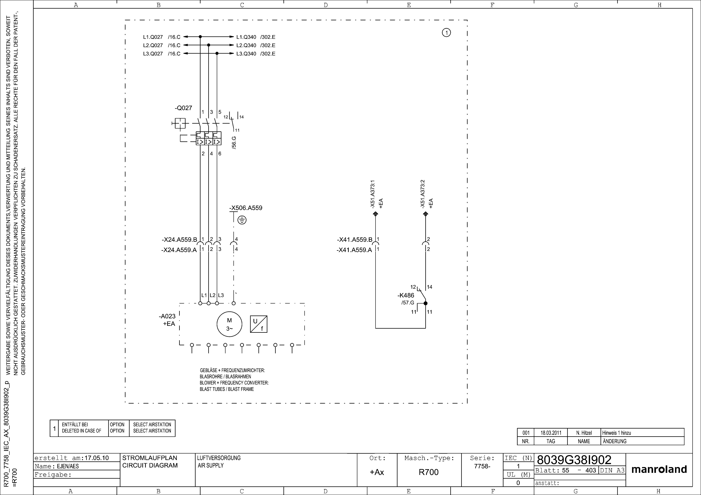

# +Ax — Sheet 55 of 403 — LUFTVERSORGUNG

**AIR SUPPLY**

> Part of the manroland **R700** printing press IEC/UL circuit diagrams.
> Drawing class: **Stromlaufplan / Circuit diagram** (DIN A3).
> Document `+Ax` covers the **Central control console** machine section.

## At a glance

| Field | Value |
|---|---|
| Document | `+Ax`  (8039G38I902) |
| Sheet | **55** of 403 |
| Section (DE) | LUFTVERSORGUNG |
| Section (EN) | AIR SUPPLY |
| Section type | CIRCUIT — Circuit diagram |
| Machine type | `R700` |
| Series | `7758` |
| Created | 17.05.10 |
| Replaces | — |
| Columns used | A, B, C, D, E, F, G |
| Path numbers | — |
| Labels on sheet | 78 |
| Cross-refs out | 8 |
| Cross-refs in | 19 |

**Previous:** [+Ax sheet 54](SHEET_0054.md) · **Next:** [+Ax sheet 56](SHEET_0056.md) · **Document TOC:** [_TOC.md](_TOC.md)  (+Ax) · **Master TOC:** [all sheets](../_MASTER_TOC.md)

## Sheet image (300 DPI, exact vector render)



_Rendered directly from the PDF vector layer at 300 DPI (1-bit), no OCR and no resampling. Use it to confirm anything ambiguous in the text below._

## Cross-references on this sheet

Each entry is a wire leaving this sheet. The printed token is `/sheet.column`; the link resolves to that sheet inside the same document.

| Ref | Target sheet | Col | Path | Destination on target | Target section | From col |
|---|---|---|---|---|---|---|
| `/302.E` | [+Ax sheet 302](SHEET_0302.md) | E | — | L1.Q340 | SPANNUNGSVERSORGUNG: LACKMODUL | C |
| `/16.C` | [+Ax sheet 16](SHEET_0016.md) | C | — | L1.Q027 | SPANNUNGSVERSORGUNG, SCHALTSCHRANKBELÜFTUNG | B |
| `/302.E` | [+Ax sheet 302](SHEET_0302.md) | E | — | L2.Q340 | SPANNUNGSVERSORGUNG: LACKMODUL | C |
| `/16.C` | [+Ax sheet 16](SHEET_0016.md) | C | — | L2.Q027 | SPANNUNGSVERSORGUNG, SCHALTSCHRANKBELÜFTUNG | B |
| `/302.E` | [+Ax sheet 302](SHEET_0302.md) | E | — | L3.Q340 | SPANNUNGSVERSORGUNG: LACKMODUL | C |
| `/16.C` | [+Ax sheet 16](SHEET_0016.md) | C | — | L3.Q027 | SPANNUNGSVERSORGUNG, SCHALTSCHRANKBELÜFTUNG | B |
| `/56.G` | [+Ax sheet 56](SHEET_0056.md) | G | — | — | LUFTVERSORGUNG | C |
| `/57.G` | [+Ax sheet 57](SHEET_0057.md) | G | — | — | LUFTVERSORGUNG | E |

### Incoming references (sheets that point here)

Every other sheet that sends a wire to this one. `Back-ref` is the token printed on *that* sheet; `Path` is its line number.

| From sheet | Cols | Back-ref | Path | Refs | What continues there |
|---|---|---|---|---|---|
| [+Ax#16](SHEET_0016.md) | D | `/16.D` | — | 3 | L1.Q027; L2.Q027; L3.Q027 |
| [+Ax#56](SHEET_0056.md) | G | `/56.G` | — | 1 | — |
| [+Ax#266](SHEET_0266.md) | E | `/266.E` | — | 8 | — |
| [+Ax#280](SHEET_0280.md) | F, G | `/280.F`, `/280.G` | — | 4 | — |
| [+Ax#302](SHEET_0302.md) | D | `/302.D` | — | 3 | L1.Q331 L1.Q340 L1.Q304; L2.Q331 L2.Q340 L2.Q304; L3.Q331 L3.Q340 L3.Q304 |


## Devices on this sheet

| Tag | Class | Class meaning (IEC) | Col | Sub | Terminal | Sign |
|---|---|---|---|---|---|---|
| `K486` | K | Relais / relay, contactor | E | — | — | — |
| `Q027` | Q | Leistungsschalter / power switching device | B | — | — | — |
| `A023` | A | Baugruppe / assembly, module, PC board | B | — | — | — |
| `X41.A559.B` | — | cross-device reference | D | — | — | — |
| `X41.A559.A` | — | cross-device reference | D | — | — | — |
| `X51.A373:1` | — | cross-device reference | E | — | 1 | — |
| `X51.A373:2` | — | cross-device reference | E | — | 2 | — |
| `X24.A559.B` | — | cross-device reference | B | — | — | — |
| `X24.A559.A` | — | cross-device reference | B | — | — | — |
| `NR.` | — | cross-device reference | F | — | — | — |
| `18.03.2011` | — | cross-device reference | G | — | — | — |
| `X506.A559` | — | cross-device reference | C | — | — | — |

## Potentials / nets

| Potential | Count | Columns | Attached devices | Terminals |
|---|---|---|---|---|
| `L1` | 2 | B, C | `Q027`, `Q340` | — |
| `L2` | 2 | B, C | `Q027`, `Q340` | — |
| `L3` | 2 | B, C | `Q027`, `Q340` | — |


A potential such as `L24+/4` or `M24+` is a named supply/return rail; every place it appears on this sheet is electrically common.

## Wire-end annotations (grouped as printed)

A wire that continues elsewhere is annotated with a small cluster: the destination description, the path/line number `#NN`, and the `/sheet.column` cross reference. Each row below is one such cluster exactly as it is grouped on the drawing.

| Col | Y | Path | Cross-ref | Text on the wire |
|---|---|---|---|---|
| E | 52.2 | — | — | `1` |
| B | 59.1 | — | `/16.C` | `L1.Q027` |
| C | 59.1 | — | `/302.E` | `L1.Q340` |
| B | 73.3 | — | `/16.C` | `L2.Q027` |
| C | 73.3 | — | `/302.E` | `L2.Q340` |
| C | 87.4 | — | `/302.E` | `L3.Q340` |
| B | 87.5 | — | `/16.C` | `L3.Q027` |
| B | 178.9 | — | — | `Q027` |
| C | 186.7 | — | — | `1` |
| C | 186.7 | — | — | `3` |
| C | 186.7 | — | — | `5` |
| C | 195.8 | — | — | `12 14` |
| C | 218.4 | — | — | `11` |
| C | 231.9 | — | `/56.G` | — |
| C | 257.6 | — | — | `2` |
| C | 257.6 | — | — | `4` |
| C | 257.6 | — | — | `6` |
| E | 305.9 | — | — | `X51.A373:1` |
| E | 305.9 | — | — | `X51.A373:2` |
| E | 337.6 | — | — | `+EA` |
| E | 337.6 | — | — | `+EA` |
| C | 349.0 | — | — | `X506.A559` |
| B | 402.8 | — | — | `X24.A559.B 1 2 3 4` |
| D | 402.8 | — | — | `X41.A559.B 1` |
| E | 402.8 | — | — | `2` |
| B | 419.9 | — | — | `X24.A559.A 1 2 3 4` |
| D | 419.9 | — | — | `X41.A559.A 1` |
| E | 419.9 | — | — | `2` |
| E | 484.3 | — | — | `K486 14` |
| E | 484.3 | — | — | `12` |
| C | 497.3 | — | — | `L1 L2 L3 '` |
| E | 510.9 | — | `/57.G` | — |
| E | 526.9 | — | — | `11 11` |
| B | 533.2 | — | — | `A023` |
| C | 540.6 | — | — | `3~ M U` |
| B | 545.9 | — | — | `+EA` |
| C | 554.6 | — | — | `f` |
| C | 627.1 | — | — | `BLASROHRE / BLASRAHMEN BLOWER + FREQUENCY CONVERTER: BLAST TUBES / BLAST FRAME GEBLÄSE + FREQUENZUMRICHTER:` |
| A | 719.2 | — | — | `1 ENTFÄLLT BEI DELETED IN CASE OF OPTION OPTION SELECT AIRSTATION SELECT AIRSTATION` |
| G | 733.0 | — | — | `001 18.03.2011 N. Hitzel Hinweis 1 hinzu` |
| G | 747.1 | — | — | `NR. TAG NAME ÄNDERUNG` |


## Notes and free text on this sheet

| Text | Col | Y (pt) |
|---|---|---|
| `+EA` | E | 337.61 |
| `L1 L2 L3` | C | 498.51 |
| `M` | C | 540.58 |
| `U` | C | 541.73 |
| `f` | C | 554.64 |
| `+EA` | B | 545.9 |
| `GEBLÄSE + FREQUENZUMRICHTER:` | C | 627.09 |
| `BLASROHRE / BLASRAHMEN` | C | 637.71 |
| `BLOWER + FREQUENCY CONVERTER:` | C | 648.34 |
| `BLAST TUBES / BLAST FRAME` | C | 658.96 |
| `TAG` | G | 747.27 |
| `NAME` | G | 747.25 |
| `ÄNDERUNG` | G | 747.31 |
| `N. Hitzel` | G | 733.14 |
| `Hinweis 1 hinzu` | G | 733.16 |
| `ENTFÄLLT BEI` | A | 719.17 |
| `DELETED IN CASE OF` | A | 729.83 |
| `SELECT AIRSTATION` | B | 719.19 |
| `OPTION` | A | 719.18 |

## Complete label inventory (exact text from the drawing)

Every text object inside the drawing area of this sheet, in DIN reading order (column A→H, then top→bottom). This is the authoritative list: if a string is not here it is not printed on this sheet.

| Col | Y | X | Dir | Type | Text |
|---|---|---|---|---|---|
| A | 719.2 | 105.4 | → | text | `ENTFÄLLT BEI` |
| A | 719.2 | 186.8 | → | text | `OPTION` |
| A | 724.5 | 89.6 | → | number | `1` |
| A | 729.8 | 105.4 | → | text | `DELETED IN CASE OF` |
| A | 729.8 | 186.8 | → | text | `OPTION` |
| B | 59.1 | 243.2 | → | potential | `L1.Q027` |
| B | 59.1 | 285.4 | → | cross-reference | `/16.C` |
| B | 73.3 | 243.2 | → | potential | `L2.Q027` |
| B | 73.3 | 285.4 | → | cross-reference | `/16.C` |
| B | 87.4 | 285.4 | → | cross-reference | `/16.C` |
| B | 87.5 | 243.2 | → | potential | `L3.Q027` |
| B | 178.9 | 297.1 | → | device tag | `Q027` |
| B | 402.8 | 275.0 | → | device ref | `X24.A559.B` |
| B | 420.5 | 274.1 | → | device ref | `X24.A559.A` |
| B | 533.2 | 269.9 | → | device tag | `A023` |
| B | 545.9 | 276.9 | → | text | `+EA` |
| B | 719.2 | 226.5 | → | text | `SELECT AIRSTATION` |
| B | 729.8 | 226.5 | → | text | `SELECT AIRSTATION` |
| C | 59.1 | 401.7 | → | potential | `L1.Q340` |
| C | 59.1 | 442.2 | → | cross-reference | `/302.E` |
| C | 73.3 | 401.7 | → | potential | `L2.Q340` |
| C | 73.3 | 442.2 | → | cross-reference | `/302.E` |
| C | 87.4 | 442.2 | → | cross-reference | `/302.E` |
| C | 87.5 | 401.7 | → | potential | `L3.Q340` |
| C | 186.7 | 342.1 | → | number | `1` |
| C | 186.7 | 356.9 | → | number | `3` |
| C | 186.7 | 371.1 | → | number | `5` |
| C | 195.8 | 379.3 | → | number | `12` |
| C | 195.8 | 406.2 | → | number | `14` |
| C | 218.4 | 399.1 | → | number | `11` |
| C | 231.9 | 393.6 | ↕ | cross-reference | `/56.G` |
| C | 257.6 | 342.7 | → | number | `2` |
| C | 257.6 | 356.9 | → | number | `4` |
| C | 257.6 | 371.1 | → | number | `6` |
| C | 349.0 | 389.5 | → | device ref | `X506.A559` |
| C | 402.8 | 342.1 | → | number | `1` |
| C | 402.8 | 356.9 | → | number | `2` |
| C | 402.8 | 371.1 | → | number | `3` |
| C | 402.8 | 399.4 | → | number | `4` |
| C | 419.9 | 342.1 | → | number | `1` |
| C | 419.9 | 356.9 | → | number | `2` |
| C | 419.9 | 371.1 | → | number | `3` |
| C | 419.9 | 399.4 | → | number | `4` |
| C | 497.3 | 399.1 | → | other | `'` |
| C | 498.5 | 342.1 | → | text | `L1 L2 L3` |
| C | 540.6 | 385.7 | → | text | `M` |
| C | 541.7 | 429.9 | → | text | `U` |
| C | 554.6 | 443.5 | → | text | `f` |
| C | 554.8 | 384.4 | → | other | `3~` |
| C | 627.1 | 339.9 | → | text | `GEBLÄSE + FREQUENZUMRICHTER:` |
| C | 637.7 | 339.3 | → | text | `BLASROHRE / BLASRAHMEN` |
| C | 648.3 | 339.3 | → | text | `BLOWER + FREQUENCY CONVERTER:` |
| C | 659.0 | 339.3 | → | text | `BLAST TUBES / BLAST FRAME` |
| D | 402.8 | 572.6 | → | device ref | `X41.A559.B` |
| D | 420.5 | 571.7 | → | device ref | `X41.A559.A` |
| E | 52.2 | 756.5 | → | number | `1` |
| E | 305.9 | 628.9 | ↕ | device ref | `X51.A373:1` |
| E | 305.9 | 713.9 | ↕ | device ref | `X51.A373:2` |
| E | 337.6 | 643.0 | ↕ | text | `+EA` |
| E | 337.6 | 728.0 | ↕ | text | `+EA` |
| E | 402.8 | 639.8 | → | number | `1` |
| E | 402.8 | 725.4 | → | number | `2` |
| E | 419.9 | 639.8 | → | number | `1` |
| E | 419.9 | 725.4 | → | number | `2` |
| E | 484.3 | 696.8 | → | number | `12` |
| E | 484.3 | 724.8 | → | number | `14` |
| E | 497.8 | 675.2 | → | device tag | `K486` |
| E | 510.9 | 682.0 | → | cross-reference | `/57.G` |
| E | 526.9 | 697.9 | → | number | `11` |
| E | 526.9 | 724.8 | → | number | `11` |
| F | 733.0 | 887.7 | → | number | `001` |
| F | 747.1 | 886.7 | → | device ref | `NR.` |
| G | 733.1 | 918.3 | → | device ref | `18.03.2011` |
| G | 733.1 | 978.8 | → | text | `N. Hitzel` |
| G | 733.2 | 1023.2 | → | text | `Hinweis 1 hinzu` |
| G | 747.3 | 928.3 | → | text | `TAG` |
| G | 747.3 | 981.7 | → | text | `NAME` |
| G | 747.3 | 1024.3 | → | text | `ÄNDERUNG` |

## Reading-order text block

The same content as a plain block, grouped by DIN column — convenient to paste or to match against a visual description.

```text
=== Column A ===
 719.2  105.4  text         ENTFÄLLT BEI
 719.2  186.8  text         OPTION
 724.5   89.6  numeric      1
 729.8  105.4  text         DELETED IN CASE OF
 729.8  186.8  text         OPTION
=== Column B ===
  59.1  243.2  net          L1.Q027
  59.1  285.4  xref         /16.C
  73.3  243.2  net          L2.Q027
  73.3  285.4  xref         /16.C
  87.4  285.4  xref         /16.C
  87.5  243.2  net          L3.Q027
 178.9  297.1  devtag       Q027
 402.8  275.0  devref       X24.A559.B
 420.5  274.1  devref       X24.A559.A
 533.2  269.9  devtag       A023
 545.9  276.9  text         +EA
 719.2  226.5  text         SELECT AIRSTATION
 729.8  226.5  text         SELECT AIRSTATION
=== Column C ===
  59.1  401.7  net          L1.Q340
  59.1  442.2  xref         /302.E
  73.3  401.7  net          L2.Q340
  73.3  442.2  xref         /302.E
  87.4  442.2  xref         /302.E
  87.5  401.7  net          L3.Q340
 186.7  342.1  numeric      1
 186.7  356.9  numeric      3
 186.7  371.1  numeric      5
 195.8  379.3  numeric      12
 195.8  406.2  numeric      14
 218.4  399.1  numeric      11
 231.9  393.6  xref         /56.G
 257.6  342.7  numeric      2
 257.6  356.9  numeric      4
 257.6  371.1  numeric      6
 349.0  389.5  devref       X506.A559
 402.8  342.1  numeric      1
 402.8  356.9  numeric      2
 402.8  371.1  numeric      3
 402.8  399.4  numeric      4
 419.9  342.1  numeric      1
 419.9  356.9  numeric      2
 419.9  371.1  numeric      3
 419.9  399.4  numeric      4
 497.3  399.1  other        `
 498.5  342.1  text         L1 L2 L3
 540.6  385.7  text         M
 541.7  429.9  text         U
 554.6  443.5  text         f
 554.8  384.4  other        3~
 627.1  339.9  text         GEBLÄSE + FREQUENZUMRICHTER:
 637.7  339.3  text         BLASROHRE / BLASRAHMEN
 648.3  339.3  text         BLOWER + FREQUENCY CONVERTER:
 659.0  339.3  text         BLAST TUBES / BLAST FRAME
=== Column D ===
 402.8  572.6  devref       X41.A559.B
 420.5  571.7  devref       X41.A559.A
=== Column E ===
  52.2  756.5  numeric      1
 305.9  628.9  devref       X51.A373:1
 305.9  713.9  devref       X51.A373:2
 337.6  643.0  text         +EA
 337.6  728.0  text         +EA
 402.8  639.8  numeric      1
 402.8  725.4  numeric      2
 419.9  639.8  numeric      1
 419.9  725.4  numeric      2
 484.3  696.8  numeric      12
 484.3  724.8  numeric      14
 497.8  675.2  devtag       K486
 510.9  682.0  xref         /57.G
 526.9  697.9  numeric      11
 526.9  724.8  numeric      11
=== Column F ===
 733.0  887.7  numeric      001
 747.1  886.7  devref       NR.
=== Column G ===
 733.1  918.3  devref       18.03.2011
 733.1  978.8  text         N. Hitzel
 733.2 1023.2  text         Hinweis 1 hinzu
 747.3  928.3  text         TAG
 747.3  981.7  text         NAME
 747.3 1024.3  text         ÄNDERUNG
```

---
_Generated from the PDF vector text layer; no OCR. Source: `R700_7758_IEC_AX_8039G38I902_p`, sheet 55._
