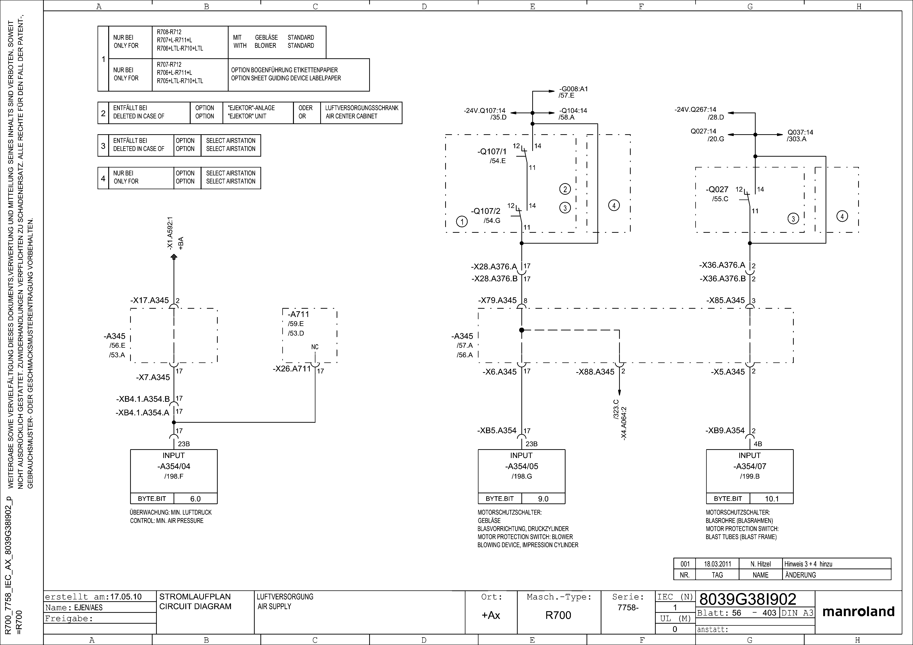

# +Ax — Sheet 56 of 403 — LUFTVERSORGUNG

**AIR SUPPLY**

> Part of the manroland **R700** printing press IEC/UL circuit diagrams.
> Drawing class: **Stromlaufplan / Circuit diagram** (DIN A3).
> Document `+Ax` covers the **Central control console** machine section.

## At a glance

| Field | Value |
|---|---|
| Document | `+Ax`  (8039G38I902) |
| Sheet | **56** of 403 |
| Section (DE) | LUFTVERSORGUNG |
| Section (EN) | AIR SUPPLY |
| Section type | CIRCUIT — Circuit diagram |
| Machine type | `R700` |
| Series | `7758` |
| Created | 17.05.10 |
| Replaces | — |
| Columns used | A, B, C, D, E, F, G, H |
| Path numbers | — |
| Labels on sheet | 161 |
| Cross-refs out | 19 |
| Cross-refs in | 36 |

**Previous:** [+Ax sheet 55](SHEET_0055.md) · **Next:** [+Ax sheet 57](SHEET_0057.md) · **Document TOC:** [_TOC.md](_TOC.md)  (+Ax) · **Master TOC:** [all sheets](../_MASTER_TOC.md)

## Sheet image (300 DPI, exact vector render)



_Rendered directly from the PDF vector layer at 300 DPI (1-bit), no OCR and no resampling. Use it to confirm anything ambiguous in the text below._

## Cross-references on this sheet

Each entry is a wire leaving this sheet. The printed token is `/sheet.column`; the link resolves to that sheet inside the same document.

| Ref | Target sheet | Col | Path | Destination on target | Target section | From col |
|---|---|---|---|---|---|---|
| `/57.E` | [+Ax sheet 57](SHEET_0057.md) | E | — | — | LUFTVERSORGUNG | E |
| `/28.D` | [+Ax sheet 28](SHEET_0028.md) | D | — | 24V.Q267:14 | SPANNUNGSVERSORGUNG, SCHALTSCHRANKBELÜFTUNG | G |
| `/35.D` | [+Ax sheet 35](SHEET_0035.md) | D | — | 24V.Q107:14 | SCHMIERUNG | E |
| `/58.A` | [+Ax sheet 58](SHEET_0058.md) | A | — | — | LUFTVERSORGUNG | E |
| `/20.G` | [+Ax sheet 20](SHEET_0020.md) | G | — | Q027:14 | SPANNUNGSVERSORGUNG, SCHALTSCHRANKBELÜFTUNG | G |
| `/303.A` | [+Ax sheet 303](SHEET_0303.md) | A | — | — | SPANNUNGSVERSORGUNG: LACKMODUL | G |
| `/54.E` | [+Ax sheet 54](SHEET_0054.md) | E | — | — | LUFTVERSORGUNG | E |
| `/55.C` | [+Ax sheet 55](SHEET_0055.md) | C | — | — | LUFTVERSORGUNG | G |
| `/54.G` | [+Ax sheet 54](SHEET_0054.md) | G | — | — | LUFTVERSORGUNG | E |
| `/59.E` | [+Ax sheet 59](SHEET_0059.md) | E | — | A711 | DRUCKLUFTANLAGE | C |
| `/53.D` | [+Ax sheet 53](SHEET_0053.md) | D | — | A711 | SIGNALGEBER: AKUSTISCHE WARNSIGNALE | C |
| `/56.E` | [+Ax sheet 56](SHEET_0056.md) | E | — | — | LUFTVERSORGUNG | A |
| `/53.A` | [+Ax sheet 53](SHEET_0053.md) | A | — | — | SIGNALGEBER: AKUSTISCHE WARNSIGNALE | A |
| `/57.A` | [+Ax sheet 57](SHEET_0057.md) | A | — | — | LUFTVERSORGUNG | D |
| `/56.A` | [+Ax sheet 56](SHEET_0056.md) | A | — | — | LUFTVERSORGUNG | D |
| `/323.C` | [+Ax sheet 323](SHEET_0323.md) | C | — | — | OPTION: "EJEKTOR" ANLAGE / SELECT AIRSTATION / | F |
| `/199.B` | [+Ax sheet 199](SHEET_0199.md) | B | — | — | REFERENZMODUL | G |
| `/198.F` | [+Ax sheet 198](SHEET_0198.md) | F | — | — | REFERENZMODUL | B |
| `/198.G` | [+Ax sheet 198](SHEET_0198.md) | G | — | — | REFERENZMODUL | E |

### Incoming references (sheets that point here)

Every other sheet that sends a wire to this one. `Back-ref` is the token printed on *that* sheet; `Path` is its line number.

| From sheet | Cols | Back-ref | Path | Refs | What continues there |
|---|---|---|---|---|---|
| [+Ax#20](SHEET_0020.md) | G | `/20.G` | — | 1 | — |
| [+Ax#28](SHEET_0028.md) | D | `/28.D` | — | 1 | — |
| [+Ax#35](SHEET_0035.md) | D | `/35.D` | — | 1 | — |
| [+Ax#53](SHEET_0053.md) | A, D | `/53.A`, `/53.D` | — | 2 | — |
| [+Ax#54](SHEET_0054.md) | E, G | `/54.E`, `/54.G` | — | 2 | — |
| [+Ax#55](SHEET_0055.md) | C | `/55.C` | — | 1 | — |
| [+Ax#56](SHEET_0056.md) | A, D | `/56.A`, `/56.D` | — | 2 | — |
| [+Ax#57](SHEET_0057.md) | A, D | `/57.A`, `/57.D` | — | 2 | G008:A1 |
| [+Ax#58](SHEET_0058.md) | A | `/58.A` | — | 1 | Q104:14 |
| [+Ax#59](SHEET_0059.md) | E | `/59.E` | — | 1 | A711 |
| [+Ax#198](SHEET_0198.md) | F, G | `/198.F`, `/198.G` | — | 2 | — |
| [+Ax#199](SHEET_0199.md) | B | `/199.B` | — | 1 | — |
| [+Ax#228](SHEET_0228.md) | A, B, C | `/228.A`, `/228.B`, `/228.C` | — | 3 | — |
| [+Ax#231](SHEET_0231.md) | A, E | `/231.A`, `/231.E` | — | 2 | — |
| [+Ax#233](SHEET_0233.md) | G | `/233.G` | — | 1 | — |
| [+Ax#235](SHEET_0235.md) | H | `/235.H` | — | 1 | — |
| [+Ax#242](SHEET_0242.md) | A | `/242.A` | — | 1 | — |
| [+Ax#255](SHEET_0255.md) | B | `/255.B` | — | 1 | — |
| [+Ax#269](SHEET_0269.md) | H | `/269.H` | — | 1 | — |
| [+Ax#271](SHEET_0271.md) | D, E | `/271.D`, `/271.E` | — | 2 | — |
| [+Ax#279](SHEET_0279.md) | A, B | `/279.A`, `/279.B` | — | 2 | — |
| [+Ax#286](SHEET_0286.md) | B | `/286.B` | — | 1 | — |
| [+Ax#287](SHEET_0287.md) | C | `/287.C` | — | 1 | — |
| [+Ax#289](SHEET_0289.md) | A | `/289.A` | — | 1 | — |
| [+Ax#303](SHEET_0303.md) | A | `/303.A` | — | 1 | Q037:14 |
| [+Ax#323](SHEET_0323.md) | C | `/323.C` | — | 1 | — |


## Devices on this sheet

| Tag | Class | Class meaning (IEC) | Col | Sub | Terminal | Sign |
|---|---|---|---|---|---|---|
| `A354/07` | A | Baugruppe / assembly, module, PC board | G | 07 | — | — |
| `A354/05` | A | Baugruppe / assembly, module, PC board | E | 05 | — | — |
| `Q027` | Q | Leistungsschalter / power switching device | G | — | — | — |
| `Q107/2` | Q | Leistungsschalter / power switching device | E | 2 | — | — |
| `Q107/1` | Q | Leistungsschalter / power switching device | E | 1 | — | — |
| `A345` | A | Baugruppe / assembly, module, PC board | D | — | — | — |
| `A354/04` | A | Baugruppe / assembly, module, PC board | B | 04 | — | — |
| `A345` | A | Baugruppe / assembly, module, PC board | A | — | — | — |
| `A711` | A | Baugruppe / assembly, module, PC board | C | — | — | — |
| `Q104:14` | Q | Leistungsschalter / power switching device | E | — | 14 | — |
| `G008:A1` | G | Stromversorgung / power supply | E | — | A1 | — |
| `Q027:14` | Q | Leistungsschalter / power switching device | G | — | 14 | — |
| `Q037:14` | Q | Leistungsschalter / power switching device | G | — | 14 | — |
| `10.1` | — | cross-device reference | G | — | — | — |
| `XB9.A354` | — | cross-device reference | G | — | — | — |
| `9.0` | — | cross-device reference | E | — | — | — |
| `XB5.A354` | — | cross-device reference | E | — | — | — |
| `X85.A345` | — | cross-device reference | G | — | — | — |
| `X36.A376.B` | — | cross-device reference | G | — | — | — |
| `X36.A376.A` | — | cross-device reference | G | — | — | — |
| `X79.A345` | — | cross-device reference | E | — | — | — |
| `X28.A376.B` | — | cross-device reference | E | — | — | — |
| `X28.A376.A` | — | cross-device reference | E | — | — | — |
| `X5.A345` | — | cross-device reference | G | — | — | — |
| `X6.A345` | — | cross-device reference | E | — | — | — |
| `X88.A345` | — | cross-device reference | F | — | — | — |
| `6.0` | — | cross-device reference | B | — | — | — |
| `X1.A592:1` | — | cross-device reference | B | — | 1 | — |
| `X17.A345` | — | cross-device reference | A | — | — | — |
| `X26.A711` | — | cross-device reference | C | — | — | — |
| `XB4.1.A354.B` | — | cross-device reference | A | — | — | — |
| `XB4.1.A354.A` | — | cross-device reference | A | — | — | — |
| `X7.A345` | — | cross-device reference | B | — | — | — |
| `X4.A064:2` | — | cross-device reference | F | — | 2 | — |
| `NR.` | — | cross-device reference | F | — | — | — |
| `18.03.2011` | — | cross-device reference | G | — | — | — |

## Potentials / nets

| Potential | Count | Columns | Attached devices | Terminals |
|---|---|---|---|---|
| `24V` | 2 | E, F | `Q107`, `Q267` | `14` |


A potential such as `L24+/4` or `M24+` is a named supply/return rail; every place it appears on this sheet is electrically common.

## Wire-end annotations (grouped as printed)

A wire that continues elsewhere is annotated with a small cluster: the destination description, the path/line number `#NN`, and the `/sheet.column` cross reference. Each row below is one such cluster exactly as it is grouped on the drawing.

| Col | Y | Path | Cross-ref | Text on the wire |
|---|---|---|---|---|
| B | 38.9 | — | — | `R708 R712 R707+L R711+L R706+LTL R710+LTL` |
| A | 45.9 | — | — | `NUR BEI` |
| B | 46.0 | — | — | `MIT` |
| C | 46.0 | — | — | `BLOWER GEBLÄSE` |
| C | 46.0 | — | — | `STANDARD STANDARD` |
| B | 56.5 | — | — | `WITH` |
| A | 56.6 | — | — | `ONLY FOR` |
| A | 72.5 | — | — | `1` |
| B | 81.4 | — | — | `R707 R712 R706+L R711+L R705+LTL R710+LTL` |
| A | 88.5 | — | — | `NUR BEI` |
| C | 88.5 | — | — | `OPTION BOGENFÜHRUNG ETIKETTENPAPIER OPTION SHEET GUIDING DEVICE LABELPAPER` |
| A | 99.1 | — | — | `ONLY FOR` |
| E | 112.3 | — | — | `G008:A1` |
| E | 120.7 | — | `/57.E` | — |
| B | 138.1 | — | — | `2 ENTFÄLLT BEI DELETED IN CASE OF OPTION OPTION` |
| B | 138.1 | — | — | `"EJEKTOR" ANLAGE "EJEKTOR" UNIT` |
| C | 138.1 | — | — | `ODER OR` |
| C | 138.1 | — | — | `LUFTVERSORGUNGSSCHRANK` |
| G | 139.2 | — | `/28.D` | `24V.Q267:14` |
| E | 140.6 | — | `/35.D` | `24V.Q107:14` |
| E | 140.6 | — | — | `Q104:14` |
| C | 148.7 | — | — | `AIR CENTER CABINET` |
| E | 149.1 | — | `/58.A` | — |
| G | 167.6 | — | `/20.G` | `Q027:14` |
| G | 169.0 | — | — | `Q037:14` |
| G | 177.4 | — | `/303.A` | — |
| B | 180.6 | — | — | `3 ENTFÄLLT BEI DELETED IN CASE OF OPTION OPTION SELECT AIRSTATION SELECT AIRSTATION` |
| E | 186.7 | — | — | `Q107/1 14` |
| E | 186.7 | — | — | `12` |
| E | 206.1 | — | `/54.E` | — |
| E | 215.1 | — | — | `11` |
| B | 223.1 | — | — | `4 ONLY FOR OPTION OPTION SELECT AIRSTATION SELECT AIRSTATION` |
| A | 223.1 | — | — | `NUR BEI` |
| G | 242.7 | — | — | `Q027 14` |
| G | 243.4 | — | — | `12` |
| E | 243.7 | — | — | `2` |
| G | 255.8 | — | `/55.C` | — |
| E | 264.6 | — | — | `Q107/2 14` |
| E | 264.6 | — | — | `12` |
| F | 265.3 | — | — | `4` |
| E | 268.4 | — | — | `3` |
| G | 271.7 | — | — | `11` |
| H | 279.5 | — | — | `4` |
| B | 282.3 | — | — | `X1.A592:1` |
| G | 282.6 | — | — | `3` |
| E | 284.1 | — | `/54.G` | — |
| D | 285.7 | — | — | `1` |
| E | 293.0 | — | — | `11` |
| B | 309.3 | — | — | `+BA` |
| G | 341.2 | — | — | `X36.A376.A 2` |
| E | 343.3 | — | — | `X28.A376.A 17` |
| E | 358.9 | — | — | `X28.A376.B 17` |
| G | 358.9 | — | — | `X36.A376.B 2` |
| B | 387.2 | — | — | `X17.A345 2` |
| E | 387.2 | — | — | `X79.A345 8` |
| G | 387.2 | — | — | `X85.A345 3` |
| C | 405.7 | — | `/59.E`, `/53.D` | `A711` |
| A | 434.0 | — | — | `A345` |
| D | 434.0 | — | — | `A345` |
| A | 447.1 | — | `/56.E`, `/53.A` | — |
| D | 447.1 | — | `/57.A`, `/56.A` | — |
| C | 449.9 | — | — | `NC` |
| C | 476.5 | — | — | `X26.A711 17` |
| B | 480.8 | — | — | `X7.A345 17` |
| F | 480.8 | — | — | `X6.A345 17 X88.A345 2 X5.A345 2` |
| A | 516.2 | — | — | `XB4.1.A354.B 17` |
| F | 521.3 | — | `/323.C` | — |
| F | 530.9 | — | — | `X4.A064:2` |
| A | 533.2 | — | — | `XB4.1.A354.A 17` |
| E | 557.3 | — | — | `XB5.A354 17` |
| G | 557.3 | — | — | `XB9.A354 2` |
| B | 558.8 | — | — | `17` |
| B | 575.7 | — | — | `23B` |
| E | 575.7 | — | — | `23B` |
| G | 575.7 | — | — | `4B` |
| B | 590.2 | — | — | `INPUT` |
| E | 590.2 | — | — | `INPUT` |
| G | 590.2 | — | — | `INPUT` |
| B | 604.1 | — | — | `A354/04` |
| E | 604.1 | — | — | `A354/05` |
| G | 604.1 | — | — | `A354/07` |
| B | 617.9 | — | `/198.F` | — |
| E | 617.9 | — | `/198.G` | — |
| G | 617.9 | — | `/199.B` | — |
| B | 646.9 | — | — | `BYTE.BIT 6.0` |
| E | 646.9 | — | — | `BYTE.BIT 9.0` |
| G | 646.9 | — | — | `BYTE.BIT 10.1` |
| B | 666.1 | — | — | `ÜBERWACHUNG: MIN. LUFTDRUCK` |
| E | 666.1 | — | — | `BLASVORRICHTUNG, DRUCKZYLINDER BLOWING DEVICE, IMPRESSION CYLINDER MOTORSCHUTZSCHALTER: MOTOR PROTECTION SWITCH: BLOWER GEBLÄSE` |
| G | 666.1 | — | — | `BLASROHRE (BLASRAHMEN) BLAST TUBES (BLAST FRAME) MOTORSCHUTZSCHALTER: MOTOR PROTECTION SWITCH:` |
| B | 676.7 | — | — | `CONTROL: MIN. AIR PRESSURE` |
| G | 733.0 | — | — | `001 18.03.2011 N. Hitzel Hinweis 3 + 4 hinzu` |
| G | 747.1 | — | — | `NR. TAG NAME ÄNDERUNG` |


## Reconstructed tables

This sheet carries tabular content (pin map / terminal assignment / index). The grid below was rebuilt from the drawing's own rule lines, so each row is exactly one physical row of the table.

### Table 1 — 1 data rows × 2 columns (at x=170.1, y=551.3) — **17 23B**

| INPUT | A354/04 /198.F |
|---|---|
| `BYTE.BIT` | `6.0` |


### Table 2 — 4 data rows × 6 columns (at x=623.6, y=161.6)

| 12 Q107/1 /54.E 12 Q107/2 /54.G | 11 | 11 14 | 14 | 2 3 | 4 |
|---|---|---|---|---|---|
| `X28.A376.A X28.A376.B X79.A345` | `17 17 8` |  |  |  |  |
| `X6.A345 XB5.A354` | `17 17` | `23B` |  | `X88.A345` | `/323.C` |
| `INPUT` | `A354/05 /198.G` |  |  |  |  |
| `BYTE.BIT` |  |  | `9.0` |  |  |


### Table 3 — 3 data rows × 4 columns (at x=921.3, y=204.1)

| Q027 12 /55.C | 11 | 14 | 3 |
|---|---|---|---|
| `X36.A376.A X36.A376.B X85.A345 X5.A345 XB9.A354` | `2 2 3 2 2` | `4B` |  |
| `INPUT` | `A354/07 /199.B` |  |  |
| `BYTE.BIT` |  | `10.1` |  |


## Notes and free text on this sheet

| Text | Col | Y (pt) |
|---|---|---|
| `4B` | G | 575.7 |
| `INPUT` | G | 590.24 |
| `BYTE.BIT` | G | 647.49 |
| `MOTORSCHUTZSCHALTER:` | G | 666.07 |
| `BLASROHRE (BLASRAHMEN)` | G | 676.7 |
| `MOTOR PROTECTION SWITCH:` | G | 687.31 |
| `BLAST TUBES (BLAST FRAME)` | G | 697.94 |
| `23B` | E | 575.72 |
| `INPUT` | E | 590.24 |
| `BYTE.BIT` | E | 647.49 |
| `MOTORSCHUTZSCHALTER:` | E | 666.07 |
| `GEBLÄSE` | E | 676.66 |
| `BLASVORRICHTUNG, DRUCKZYLINDER` | E | 687.34 |
| `MOTOR PROTECTION SWITCH: BLOWER` | E | 697.94 |
| `BLOWING DEVICE, IMPRESSION CYLINDER` | E | 708.58 |
| `23B` | B | 575.72 |
| `INPUT` | B | 590.24 |
| `BYTE.BIT` | A | 647.49 |
| `ÜBERWACHUNG: MIN. LUFTDRUCK` | B | 666.07 |
| `CONTROL: MIN. AIR PRESSURE` | B | 676.7 |
| `+BA` | B | 309.26 |
| `TAG` | G | 747.27 |
| `NAME` | G | 747.25 |
| `ÄNDERUNG` | G | 747.31 |
| `N. Hitzel` | G | 733.14 |
| `Hinweis 3 + 4 hinzu` | H | 733.15 |
| `ENTFÄLLT BEI` | A | 138.07 |
| `DELETED IN CASE OF` | A | 148.72 |
| `OPTION` | B | 138.08 |
| `"EJEKTOR" ANLAGE` | B | 138.1 |
| `"EJEKTOR" UNIT` | B | 148.73 |
| `ODER` | C | 138.11 |
| `OR` | C | 148.73 |
| `LUFTVERSORGUNGSSCHRANK` | C | 138.12 |
| `AIR CENTER CABINET` | C | 148.74 |
| `NUR BEI` | A | 45.93 |
| `ONLY FOR` | A | 56.62 |
| `R708 R712` | B | 38.92 |
| `R707+L R711+L` | B | 49.56 |
| `R706+LTL R710+LTL` | B | 60.19 |
| `MIT` | B | 45.95 |
| `WITH` | B | 56.48 |
| `GEBLÄSE` | C | 45.95 |
| `BLOWER` | C | 56.54 |
| `STANDARD` | C | 45.99 |
| `R707 R712` | B | 81.44 |
| `R706+L R711+L` | B | 92.08 |
| `R705+LTL R710+LTL` | B | 102.71 |
| `OPTION BOGENFÜHRUNG ETIKETTENPAPIER` | C | 88.5 |
| `OPTION SHEET GUIDING DEVICE LABELPAPER` | C | 99.13 |
| `NC` | C | 449.88 |
| `SELECT AIRSTATION` | B | 180.61 |

## Complete label inventory (exact text from the drawing)

Every text object inside the drawing area of this sheet, in DIN reading order (column A→H, then top→bottom). This is the authoritative list: if a string is not here it is not printed on this sheet.

| Col | Y | X | Dir | Type | Text |
|---|---|---|---|---|---|
| A | 45.9 | 148.0 | → | text | `NUR BEI` |
| A | 56.6 | 148.5 | → | text | `ONLY FOR` |
| A | 72.6 | 132.1 | → | number | `1` |
| A | 88.5 | 148.0 | → | text | `NUR BEI` |
| A | 99.1 | 148.5 | → | text | `ONLY FOR` |
| A | 138.1 | 148.0 | → | text | `ENTFÄLLT BEI` |
| A | 143.4 | 131.8 | → | number | `2` |
| A | 148.7 | 148.0 | → | text | `DELETED IN CASE OF` |
| A | 180.6 | 148.0 | → | text | `ENTFÄLLT BEI` |
| A | 185.9 | 131.7 | → | number | `3` |
| A | 191.2 | 148.0 | → | text | `DELETED IN CASE OF` |
| A | 223.1 | 148.0 | → | text | `NUR BEI` |
| A | 228.5 | 131.8 | → | number | `4` |
| A | 233.8 | 148.5 | → | text | `ONLY FOR` |
| A | 387.2 | 170.1 | → | device ref | `X17.A345` |
| A | 434.0 | 135.2 | → | device tag | `A345` |
| A | 447.1 | 142.9 | → | cross-reference | `/56.E` |
| A | 459.5 | 142.3 | → | cross-reference | `/53.A` |
| A | 516.2 | 151.7 | → | device ref | `XB4.1.A354.B` |
| A | 533.9 | 150.8 | → | device ref | `XB4.1.A354.A` |
| A | 647.5 | 180.0 | → | text | `BYTE.BIT` |
| B | 38.9 | 204.7 | → | text | `R708 R712` |
| B | 45.9 | 304.2 | → | text | `MIT` |
| B | 49.6 | 204.7 | → | text | `R707+L R711+L` |
| B | 56.5 | 304.7 | → | text | `WITH` |
| B | 60.2 | 204.7 | → | text | `R706+LTL R710+LTL` |
| B | 81.4 | 204.7 | → | text | `R707 R712` |
| B | 92.1 | 204.7 | → | text | `R706+L R711+L` |
| B | 102.7 | 204.7 | → | text | `R705+LTL R710+LTL` |
| B | 138.1 | 254.8 | → | text | `OPTION` |
| B | 138.1 | 297.4 | → | text | `"EJEKTOR" ANLAGE` |
| B | 148.7 | 254.8 | → | text | `OPTION` |
| B | 148.7 | 297.4 | → | text | `"EJEKTOR" UNIT` |
| B | 180.6 | 229.3 | → | text | `OPTION` |
| B | 180.6 | 269.0 | → | text | `SELECT AIRSTATION` |
| B | 191.2 | 229.3 | → | text | `OPTION` |
| B | 191.2 | 269.0 | → | text | `SELECT AIRSTATION` |
| B | 223.1 | 229.3 | → | text | `OPTION` |
| B | 223.1 | 269.0 | → | text | `SELECT AIRSTATION` |
| B | 233.8 | 229.3 | → | text | `OPTION` |
| B | 233.8 | 269.0 | → | text | `SELECT AIRSTATION` |
| B | 282.3 | 217.8 | ↕ | device ref | `X1.A592:1` |
| B | 309.3 | 232.0 | ↕ | text | `+BA` |
| B | 388.7 | 229.3 | → | number | `2` |
| B | 480.8 | 228.8 | → | number | `17` |
| B | 487.9 | 177.4 | → | device ref | `X7.A345` |
| B | 516.2 | 228.8 | → | number | `17` |
| B | 533.2 | 228.8 | → | number | `17` |
| B | 558.7 | 228.8 | → | number | `17` |
| B | 575.7 | 232.2 | → | text | `23B` |
| B | 590.2 | 211.9 | → | text | `INPUT` |
| B | 604.1 | 205.4 | → | device tag | `A354/04` |
| B | 617.9 | 214.4 | → | cross-reference | `/198.F` |
| B | 646.9 | 248.3 | → | device ref | `6.0` |
| B | 666.1 | 169.2 | → | text | `ÜBERWACHUNG: MIN. LUFTDRUCK` |
| B | 676.7 | 169.8 | → | text | `CONTROL: MIN. AIR PRESSURE` |
| C | 45.9 | 332.8 | → | text | `GEBLÄSE` |
| C | 46.0 | 375.3 | → | text | `STANDARD` |
| C | 56.5 | 332.2 | → | text | `BLOWER` |
| C | 56.6 | 375.3 | → | text | `STANDARD` |
| C | 88.5 | 301.6 | → | text | `OPTION BOGENFÜHRUNG ETIKETTENPAPIER` |
| C | 99.1 | 301.6 | → | text | `OPTION SHEET GUIDING DEVICE LABELPAPER` |
| C | 138.1 | 389.5 | → | text | `ODER` |
| C | 138.1 | 424.3 | → | text | `LUFTVERSORGUNGSSCHRANK` |
| C | 148.7 | 389.5 | → | text | `OR` |
| C | 148.7 | 425.2 | → | text | `AIR CENTER CABINET` |
| C | 405.7 | 375.3 | → | device tag | `A711` |
| C | 418.7 | 375.6 | → | cross-reference | `/59.E` |
| C | 431.1 | 375.6 | → | cross-reference | `/53.D` |
| C | 449.9 | 406.1 | → | text | `NC` |
| C | 476.5 | 355.7 | → | device ref | `X26.A711` |
| C | 480.8 | 413.0 | → | number | `17` |
| D | 285.7 | 600.2 | → | number | `1` |
| D | 434.0 | 588.8 | → | device tag | `A345` |
| D | 447.1 | 595.8 | → | cross-reference | `/57.A` |
| D | 459.5 | 595.8 | → | cross-reference | `/56.A` |
| E | 112.3 | 729.6 | → | device tag | `G008:A1` |
| E | 120.7 | 728.5 | → | cross-reference | `/57.E` |
| E | 140.6 | 604.9 | → | potential | `24V.Q107:14` |
| E | 140.6 | 729.6 | → | device tag | `Q104:14` |
| E | 149.1 | 639.8 | → | cross-reference | `/35.D` |
| E | 149.1 | 728.5 | → | cross-reference | `/58.A` |
| E | 186.7 | 668.4 | → | number | `12` |
| E | 186.7 | 696.5 | → | number | `14` |
| E | 193.1 | 622.8 | → | device tag | `Q107/1` |
| E | 206.1 | 638.9 | → | cross-reference | `/54.E` |
| E | 215.0 | 689.4 | → | number | `11` |
| E | 243.7 | 734.9 | → | number | `2` |
| E | 264.7 | 661.3 | → | number | `12` |
| E | 264.7 | 689.4 | → | number | `14` |
| E | 268.5 | 735.0 | → | number | `3` |
| E | 271.0 | 614.3 | → | device tag | `Q107/2` |
| E | 284.1 | 631.0 | → | cross-reference | `/54.G` |
| E | 293.0 | 682.3 | → | number | `11` |
| E | 343.3 | 614.3 | → | device ref | `X28.A376.A` |
| E | 343.3 | 682.3 | → | number | `17` |
| E | 358.9 | 615.1 | → | device ref | `X28.A376.B` |
| E | 360.3 | 682.3 | → | number | `17` |
| E | 387.2 | 623.6 | → | device ref | `X79.A345` |
| E | 388.7 | 682.9 | → | number | `8` |
| E | 480.8 | 629.6 | → | device ref | `X6.A345` |
| E | 480.8 | 682.3 | → | number | `17` |
| E | 557.3 | 622.5 | → | device ref | `XB5.A354` |
| E | 558.7 | 682.3 | → | number | `17` |
| E | 575.7 | 685.7 | → | text | `23B` |
| E | 590.2 | 665.4 | → | text | `INPUT` |
| E | 604.1 | 658.9 | → | device tag | `A354/05` |
| E | 617.9 | 667.4 | → | cross-reference | `/198.G` |
| E | 646.9 | 701.9 | → | device ref | `9.0` |
| E | 647.5 | 633.5 | → | text | `BYTE.BIT` |
| E | 666.1 | 623.1 | → | text | `MOTORSCHUTZSCHALTER:` |
| E | 676.7 | 623.3 | → | text | `GEBLÄSE` |
| E | 687.3 | 622.8 | → | text | `BLASVORRICHTUNG, DRUCKZYLINDER` |
| E | 697.9 | 623.1 | → | text | `MOTOR PROTECTION SWITCH: BLOWER` |
| E | 708.6 | 622.8 | → | text | `BLOWING DEVICE, IMPRESSION CYLINDER` |
| F | 139.2 | 879.9 | → | potential | `24V.Q267:14` |
| F | 265.3 | 798.8 | → | number | `4` |
| F | 480.8 | 751.2 | → | device ref | `X88.A345` |
| F | 480.8 | 810.4 | → | number | `2` |
| F | 521.3 | 799.7 | ↕ | cross-reference | `/323.C` |
| F | 530.9 | 809.6 | ↕ | device ref | `X4.A064:2` |
| F | 733.0 | 887.7 | → | number | `001` |
| F | 747.1 | 886.7 | → | device ref | `NR.` |
| G | 149.1 | 923.2 | → | cross-reference | `/28.D` |
| G | 167.5 | 900.9 | → | device tag | `Q027:14` |
| G | 169.0 | 1027.3 | → | device tag | `Q037:14` |
| G | 177.4 | 923.0 | → | cross-reference | `/20.G` |
| G | 177.4 | 1026.1 | → | cross-reference | `/303.A` |
| G | 242.7 | 920.7 | → | device tag | `Q027` |
| G | 243.4 | 959.0 | → | number | `12` |
| G | 243.4 | 987.0 | → | number | `14` |
| G | 255.8 | 928.9 | → | cross-reference | `/55.C` |
| G | 271.7 | 979.9 | → | number | `11` |
| G | 282.6 | 1032.7 | → | number | `3` |
| G | 341.2 | 911.9 | → | device ref | `X36.A376.A` |
| G | 343.3 | 980.5 | → | number | `2` |
| G | 358.9 | 912.8 | → | device ref | `X36.A376.B` |
| G | 360.3 | 980.5 | → | number | `2` |
| G | 387.2 | 921.3 | → | device ref | `X85.A345` |
| G | 388.7 | 980.5 | → | number | `3` |
| G | 480.8 | 927.2 | → | device ref | `X5.A345` |
| G | 480.8 | 980.5 | → | number | `2` |
| G | 557.3 | 920.1 | → | device ref | `XB9.A354` |
| G | 558.7 | 980.5 | → | number | `2` |
| G | 575.7 | 983.3 | → | text | `4B` |
| G | 590.2 | 963.1 | → | text | `INPUT` |
| G | 604.1 | 956.6 | → | device tag | `A354/07` |
| G | 617.9 | 965.3 | → | cross-reference | `/199.B` |
| G | 646.9 | 997.4 | → | device ref | `10.1` |
| G | 647.5 | 931.2 | → | text | `BYTE.BIT` |
| G | 666.1 | 920.7 | → | text | `MOTORSCHUTZSCHALTER:` |
| G | 676.7 | 920.4 | → | text | `BLASROHRE (BLASRAHMEN)` |
| G | 687.3 | 920.7 | → | text | `MOTOR PROTECTION SWITCH:` |
| G | 697.9 | 920.4 | → | text | `BLAST TUBES (BLAST FRAME)` |
| G | 733.1 | 918.3 | → | device ref | `18.03.2011` |
| G | 733.1 | 978.8 | → | text | `N. Hitzel` |
| G | 747.3 | 928.3 | → | text | `TAG` |
| G | 747.3 | 981.7 | → | text | `NAME` |
| G | 747.3 | 1024.3 | → | text | `ÄNDERUNG` |
| H | 279.5 | 1096.4 | → | number | `4` |
| H | 733.2 | 1023.2 | → | text | `Hinweis 3 + 4 hinzu` |

## Reading-order text block

The same content as a plain block, grouped by DIN column — convenient to paste or to match against a visual description.

```text
=== Column A ===
  45.9  148.0  text         NUR BEI
  56.6  148.5  text         ONLY FOR
  72.6  132.1  numeric      1
  88.5  148.0  text         NUR BEI
  99.1  148.5  text         ONLY FOR
 138.1  148.0  text         ENTFÄLLT BEI
 143.4  131.8  numeric      2
 148.7  148.0  text         DELETED IN CASE OF
 180.6  148.0  text         ENTFÄLLT BEI
 185.9  131.7  numeric      3
 191.2  148.0  text         DELETED IN CASE OF
 223.1  148.0  text         NUR BEI
 228.5  131.8  numeric      4
 233.8  148.5  text         ONLY FOR
 387.2  170.1  devref       X17.A345
 434.0  135.2  devtag       A345
 447.1  142.9  xref         /56.E
 459.5  142.3  xref         /53.A
 516.2  151.7  devref       XB4.1.A354.B
 533.9  150.8  devref       XB4.1.A354.A
 647.5  180.0  text         BYTE.BIT
=== Column B ===
  38.9  204.7  text         R708 R712
  45.9  304.2  text         MIT
  49.6  204.7  text         R707+L R711+L
  56.5  304.7  text         WITH
  60.2  204.7  text         R706+LTL R710+LTL
  81.4  204.7  text         R707 R712
  92.1  204.7  text         R706+L R711+L
 102.7  204.7  text         R705+LTL R710+LTL
 138.1  254.8  text         OPTION
 138.1  297.4  text         "EJEKTOR" ANLAGE
 148.7  254.8  text         OPTION
 148.7  297.4  text         "EJEKTOR" UNIT
 180.6  229.3  text         OPTION
 180.6  269.0  text         SELECT AIRSTATION
 191.2  229.3  text         OPTION
 191.2  269.0  text         SELECT AIRSTATION
 223.1  229.3  text         OPTION
 223.1  269.0  text         SELECT AIRSTATION
 233.8  229.3  text         OPTION
 233.8  269.0  text         SELECT AIRSTATION
 282.3  217.8  devref       X1.A592:1
 309.3  232.0  text         +BA
 388.7  229.3  numeric      2
 480.8  228.8  numeric      17
 487.9  177.4  devref       X7.A345
 516.2  228.8  numeric      17
 533.2  228.8  numeric      17
 558.7  228.8  numeric      17
 575.7  232.2  text         23B
 590.2  211.9  text         INPUT
 604.1  205.4  devtag       A354/04
 617.9  214.4  xref         /198.F
 646.9  248.3  devref       6.0
 666.1  169.2  text         ÜBERWACHUNG: MIN. LUFTDRUCK
 676.7  169.8  text         CONTROL: MIN. AIR PRESSURE
=== Column C ===
  45.9  332.8  text         GEBLÄSE
  46.0  375.3  text         STANDARD
  56.5  332.2  text         BLOWER
  56.6  375.3  text         STANDARD
  88.5  301.6  text         OPTION BOGENFÜHRUNG ETIKETTENPAPIER
  99.1  301.6  text         OPTION SHEET GUIDING DEVICE LABELPAPER
 138.1  389.5  text         ODER
 138.1  424.3  text         LUFTVERSORGUNGSSCHRANK
 148.7  389.5  text         OR
 148.7  425.2  text         AIR CENTER CABINET
 405.7  375.3  devtag       A711
 418.7  375.6  xref         /59.E
 431.1  375.6  xref         /53.D
 449.9  406.1  text         NC
 476.5  355.7  devref       X26.A711
 480.8  413.0  numeric      17
=== Column D ===
 285.7  600.2  numeric      1
 434.0  588.8  devtag       A345
 447.1  595.8  xref         /57.A
 459.5  595.8  xref         /56.A
=== Column E ===
 112.3  729.6  devtag       G008:A1
 120.7  728.5  xref         /57.E
 140.6  604.9  net          24V.Q107:14
 140.6  729.6  devtag       Q104:14
 149.1  639.8  xref         /35.D
 149.1  728.5  xref         /58.A
 186.7  668.4  numeric      12
 186.7  696.5  numeric      14
 193.1  622.8  devtag       Q107/1
 206.1  638.9  xref         /54.E
 215.0  689.4  numeric      11
 243.7  734.9  numeric      2
 264.7  661.3  numeric      12
 264.7  689.4  numeric      14
 268.5  735.0  numeric      3
 271.0  614.3  devtag       Q107/2
 284.1  631.0  xref         /54.G
 293.0  682.3  numeric      11
 343.3  614.3  devref       X28.A376.A
 343.3  682.3  numeric      17
 358.9  615.1  devref       X28.A376.B
 360.3  682.3  numeric      17
 387.2  623.6  devref       X79.A345
 388.7  682.9  numeric      8
 480.8  629.6  devref       X6.A345
 480.8  682.3  numeric      17
 557.3  622.5  devref       XB5.A354
 558.7  682.3  numeric      17
 575.7  685.7  text         23B
 590.2  665.4  text         INPUT
 604.1  658.9  devtag       A354/05
 617.9  667.4  xref         /198.G
 646.9  701.9  devref       9.0
 647.5  633.5  text         BYTE.BIT
 666.1  623.1  text         MOTORSCHUTZSCHALTER:
 676.7  623.3  text         GEBLÄSE
 687.3  622.8  text         BLASVORRICHTUNG, DRUCKZYLINDER
 697.9  623.1  text         MOTOR PROTECTION SWITCH: BLOWER
 708.6  622.8  text         BLOWING DEVICE, IMPRESSION CYLINDER
=== Column F ===
 139.2  879.9  net          24V.Q267:14
 265.3  798.8  numeric      4
 480.8  751.2  devref       X88.A345
 480.8  810.4  numeric      2
 521.3  799.7  xref         /323.C
 530.9  809.6  devref       X4.A064:2
 733.0  887.7  numeric      001
 747.1  886.7  devref       NR.
=== Column G ===
 149.1  923.2  xref         /28.D
 167.5  900.9  devtag       Q027:14
 169.0 1027.3  devtag       Q037:14
 177.4  923.0  xref         /20.G
 177.4 1026.1  xref         /303.A
 242.7  920.7  devtag       Q027
 243.4  959.0  numeric      12
 243.4  987.0  numeric      14
 255.8  928.9  xref         /55.C
 271.7  979.9  numeric      11
 282.6 1032.7  numeric      3
 341.2  911.9  devref       X36.A376.A
 343.3  980.5  numeric      2
 358.9  912.8  devref       X36.A376.B
 360.3  980.5  numeric      2
 387.2  921.3  devref       X85.A345
 388.7  980.5  numeric      3
 480.8  927.2  devref       X5.A345
 480.8  980.5  numeric      2
 557.3  920.1  devref       XB9.A354
 558.7  980.5  numeric      2
 575.7  983.3  text         4B
 590.2  963.1  text         INPUT
 604.1  956.6  devtag       A354/07
 617.9  965.3  xref         /199.B
 646.9  997.4  devref       10.1
 647.5  931.2  text         BYTE.BIT
 666.1  920.7  text         MOTORSCHUTZSCHALTER:
 676.7  920.4  text         BLASROHRE (BLASRAHMEN)
 687.3  920.7  text         MOTOR PROTECTION SWITCH:
 697.9  920.4  text         BLAST TUBES (BLAST FRAME)
 733.1  918.3  devref       18.03.2011
 733.1  978.8  text         N. Hitzel
 747.3  928.3  text         TAG
 747.3  981.7  text         NAME
 747.3 1024.3  text         ÄNDERUNG
=== Column H ===
 279.5 1096.4  numeric      4
 733.2 1023.2  text         Hinweis 3 + 4 hinzu
```

---
_Generated from the PDF vector text layer; no OCR. Source: `R700_7758_IEC_AX_8039G38I902_p`, sheet 56._
