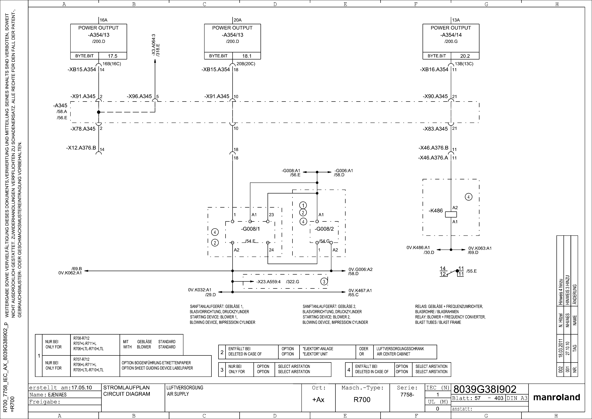

# +Ax — Sheet 57 of 403 — LUFTVERSORGUNG

**AIR SUPPLY**

> Part of the manroland **R700** printing press IEC/UL circuit diagrams.
> Drawing class: **Stromlaufplan / Circuit diagram** (DIN A3).
> Document `+Ax` covers the **Central control console** machine section.

## At a glance

| Field | Value |
|---|---|
| Document | `+Ax`  (8039G38I902) |
| Sheet | **57** of 403 |
| Section (DE) | LUFTVERSORGUNG |
| Section (EN) | AIR SUPPLY |
| Section type | CIRCUIT — Circuit diagram |
| Machine type | `R700` |
| Series | `7758` |
| Created | 17.05.10 |
| Replaces | — |
| Columns used | A, B, C, D, E, F, G, H |
| Path numbers | — |
| Labels on sheet | 165 |
| Cross-refs out | 17 |
| Cross-refs in | 33 |

**Previous:** [+Ax sheet 56](SHEET_0056.md) · **Next:** [+Ax sheet 58](SHEET_0058.md) · **Document TOC:** [_TOC.md](_TOC.md)  (+Ax) · **Master TOC:** [all sheets](../_MASTER_TOC.md)

## Sheet image (300 DPI, exact vector render)



_Rendered directly from the PDF vector layer at 300 DPI (1-bit), no OCR and no resampling. Use it to confirm anything ambiguous in the text below._

## Cross-references on this sheet

Each entry is a wire leaving this sheet. The printed token is `/sheet.column`; the link resolves to that sheet inside the same document.

| Ref | Target sheet | Col | Path | Destination on target | Target section | From col |
|---|---|---|---|---|---|---|
| `/318.E` | [+Ax sheet 318](SHEET_0318.md) | E | — | X3.A064:3 | OPTION: "EJEKTOR" ANLAGE / SELECT AIRSTATION / | B |
| `/200.G` | [+Ax sheet 200](SHEET_0200.md) | G | — | — | REFERENZMODUL | G |
| `/200.D` | [+Ax sheet 200](SHEET_0200.md) | D | — | — | REFERENZMODUL | A |
| `/200.D` | [+Ax sheet 200](SHEET_0200.md) | D | — | — | REFERENZMODUL | C |
| `/58.A` | [+Ax sheet 58](SHEET_0058.md) | A | — | — | LUFTVERSORGUNG | A |
| `/56.E` | [+Ax sheet 56](SHEET_0056.md) | E | — | — | LUFTVERSORGUNG | A |
| `/56.E` | [+Ax sheet 56](SHEET_0056.md) | E | — | G008:A1 | LUFTVERSORGUNG | D |
| `/58.D` | [+Ax sheet 58](SHEET_0058.md) | D | — | — | LUFTVERSORGUNG | E |
| `/54.E` | [+Ax sheet 54](SHEET_0054.md) | E | — | — | LUFTVERSORGUNG | D |
| `/54.G` | [+Ax sheet 54](SHEET_0054.md) | G | — | — | LUFTVERSORGUNG | E |
| `/30.D` | [+Ax sheet 30](SHEET_0030.md) | D | — | 0V.K486:A1 | SPANNUNGSVERSORGUNG, SCHALTSCHRANKBELÜFTUNG | F |
| `/69.D` | [+Ax sheet 69](SHEET_0069.md) | D | — | — | SAUGBÄNDERTISCH | G |
| `/69.B` | [+Ax sheet 69](SHEET_0069.md) | B | — | 0V.K062:A1 | SAUGBÄNDERTISCH | A |
| `/58.D` | [+Ax sheet 58](SHEET_0058.md) | D | — | — | LUFTVERSORGUNG | E |
| `/322.G` | [+Ax sheet 322](SHEET_0322.md) | G | — | X23.A559:4 | OPTION: "EJEKTOR" ANLAGE / SELECT AIRSTATION / | D |
| `/29.D` | [+Ax sheet 29](SHEET_0029.md) | D | — | 0V.K032:A1 | SPANNUNGSVERSORGUNG, SCHALTSCHRANKBELÜFTUNG | C |
| `/65.C` | [+Ax sheet 65](SHEET_0065.md) | C | — | — | DRUCKLUFTANLAGE | E |

### Incoming references (sheets that point here)

Every other sheet that sends a wire to this one. `Back-ref` is the token printed on *that* sheet; `Path` is its line number.

| From sheet | Cols | Back-ref | Path | Refs | What continues there |
|---|---|---|---|---|---|
| [+Ax#29](SHEET_0029.md) | D | `/29.D` | — | 1 | — |
| [+Ax#30](SHEET_0030.md) | D | `/30.D` | — | 1 | — |
| [+Ax#54](SHEET_0054.md) | E, G | `/54.E`, `/54.G` | — | 2 | — |
| [+Ax#55](SHEET_0055.md) | E | `/55.E` | — | 1 | — |
| [+Ax#56](SHEET_0056.md) | D, E | `/56.D`, `/56.E` | — | 2 | — |
| [+Ax#58](SHEET_0058.md) | A, D | `/58.A`, `/58.D` | — | 3 | 0V.G006:A2; G006:A1 |
| [+Ax#65](SHEET_0065.md) | B | `/65.B` | — | 1 | 0V.K467:A1 |
| [+Ax#69](SHEET_0069.md) | C | `/69.C` | — | 2 | 0V.K062:A1 0V.K063:A1 0V.K564:A1 |
| [+Ax#200](SHEET_0200.md) | D, F | `/200.D`, `/200.F` | — | 3 | — |
| [+Ax#248](SHEET_0248.md) | G, H | `/248.G`, `/248.H` | — | 3 | — |
| [+Ax#253](SHEET_0253.md) | B | `/253.B` | — | 2 | — |
| [+Ax#254](SHEET_0254.md) | F | `/254.F` | — | 1 | — |
| [+Ax#283](SHEET_0283.md) | A, B | `/283.A`, `/283.B` | — | 2 | — |
| [+Ax#286](SHEET_0286.md) | A | `/286.A` | — | 2 | — |
| [+Ax#287](SHEET_0287.md) | A | `/287.A` | — | 1 | — |
| [+Ax#289](SHEET_0289.md) | C, E | `/289.C`, `/289.E` | — | 3 | — |
| [+Ax#290](SHEET_0290.md) | B | `/290.B` | — | 1 | — |
| [+Ax#318](SHEET_0318.md) | E | `/318.E` | — | 1 | X3.A064:3 |
| [+Ax#322](SHEET_0322.md) | G | `/322.G` | — | 1 | X23.A559:4 |


## Devices on this sheet

| Tag | Class | Class meaning (IEC) | Col | Sub | Terminal | Sign |
|---|---|---|---|---|---|---|
| `A354/13` | A | Baugruppe / assembly, module, PC board | A | 13 | — | — |
| `G008/2` | G | Stromversorgung / power supply | E | 2 | — | — |
| `A2` | A | Baugruppe / assembly, module, PC board | E | — | — | — |
| `G008/1` | G | Stromversorgung / power supply | D | 1 | — | — |
| `A2` | A | Baugruppe / assembly, module, PC board | C | — | — | — |
| `A1` | A | Baugruppe / assembly, module, PC board | D | — | — | — |
| `A1` | A | Baugruppe / assembly, module, PC board | E | — | — | — |
| `A354/13` | A | Baugruppe / assembly, module, PC board | C | 13 | — | — |
| `A354/14` | A | Baugruppe / assembly, module, PC board | G | 14 | — | — |
| `A2` | A | Baugruppe / assembly, module, PC board | G | — | — | — |
| `A1` | A | Baugruppe / assembly, module, PC board | G | — | — | — |
| `K486` | K | Relais / relay, contactor | F | — | — | — |
| `A345` | A | Baugruppe / assembly, module, PC board | A | — | — | — |
| `G008:A1` | G | Stromversorgung / power supply | D | — | A1 | — |
| `G006:A1` | G | Stromversorgung / power supply | E | — | A1 | — |
| `X12.A376.B` | — | cross-device reference | A | — | — | — |
| `17.5` | — | cross-device reference | B | — | — | — |
| `XB15.A354` | — | cross-device reference | A | — | — | — |
| `18.1` | — | cross-device reference | D | — | — | — |
| `XB15.A354` | — | cross-device reference | C | — | — | — |
| `20.2` | — | cross-device reference | G | — | — | — |
| `XB16.A354` | — | cross-device reference | F | — | — | — |
| `X46.A376.B` | — | cross-device reference | F | — | — | — |
| `X46.A376.A` | — | cross-device reference | F | — | — | — |
| `X78.A345` | — | cross-device reference | A | — | — | — |
| `X91.A345` | — | cross-device reference | A | — | — | — |
| `X96.A345` | — | cross-device reference | B | — | — | — |
| `X91.A345` | — | cross-device reference | C | — | — | — |
| `X90.A345` | — | cross-device reference | F | — | — | — |
| `X83.A345` | — | cross-device reference | F | — | — | — |
| `NR.` | — | cross-device reference | H | — | — | — |
| `27.10.10` | — | cross-device reference | H | — | — | — |
| `X23.A559:4` | — | cross-device reference | D | — | 4 | — |
| `X3.A064:3` | — | cross-device reference | B | — | 3 | — |
| `18.03.2011` | — | cross-device reference | H | — | — | — |

## Potentials / nets

| Potential | Count | Columns | Attached devices | Terminals |
|---|---|---|---|---|
| `0V` | 6 | A, C, E, F, G | `G006`, `K032`, `K062`, `K063`, `K467`, `K486` | `A1`, `A2` |


A potential such as `L24+/4` or `M24+` is a named supply/return rail; every place it appears on this sheet is electrically common.

## Wire-end annotations (grouped as printed)

A wire that continues elsewhere is annotated with a small cluster: the destination description, the path/line number `#NN`, and the `/sheet.column` cross reference. Each row below is one such cluster exactly as it is grouped on the drawing.

| Col | Y | Path | Cross-ref | Text on the wire |
|---|---|---|---|---|
| B | 36.4 | — | — | `16A` |
| C | 36.4 | — | — | `20A` |
| G | 36.4 | — | — | `13A` |
| A | 51.6 | — | — | `POWER OUTPUT` |
| C | 51.6 | — | — | `POWER OUTPUT` |
| F | 51.6 | — | — | `POWER OUTPUT` |
| A | 65.5 | — | — | `A354/13` |
| C | 65.5 | — | — | `A354/13` |
| G | 65.5 | — | — | `A354/14` |
| B | 68.3 | — | `/318.E` | `X3.A064:3` |
| A | 79.3 | — | `/200.D` | — |
| C | 79.3 | — | `/200.D` | — |
| G | 79.3 | — | `/200.G` | — |
| A | 108.3 | — | — | `BYTE.BIT 17.5` |
| C | 108.3 | — | — | `BYTE.BIT 18.1` |
| F | 108.3 | — | — | `BYTE.BIT 20.2` |
| B | 124.3 | — | — | `16B(16C)` |
| D | 124.3 | — | — | `20B(20C)` |
| G | 124.3 | — | — | `13B(13C)` |
| A | 134.9 | — | — | `XB15.A354 14` |
| C | 134.9 | — | — | `XB15.A354 18` |
| F | 134.9 | — | — | `XB16.A354 11` |
| B | 188.8 | — | — | `X91.A345 2 X96.A345 5` |
| E | 188.8 | — | — | `X91.A345 10 X90.A345 21` |
| A | 207.2 | — | — | `A345` |
| A | 220.3 | — | `/58.A` | — |
| A | 232.7 | — | `/56.E` | — |
| A | 254.0 | — | — | `X78.A345 2` |
| C | 254.0 | — | — | `10` |
| F | 254.0 | — | — | `X83.A345 21` |
| A | 292.3 | — | — | `X12.A376.B 14` |
| F | 292.3 | — | — | `X46.A376.B 11` |
| C | 296.5 | — | — | `18` |
| F | 312.1 | — | — | `X46.A376.A 11` |
| C | 313.6 | — | — | `18` |
| D | 339.0 | — | `/56.E` | `G008:A1` |
| E | 339.0 | — | — | `G006:A1` |
| E | 347.5 | — | `/58.D` | — |
| G | 392.9 | — | — | `4` |
| D | 409.1 | — | — | `1 2` |
| G | 413.4 | — | — | `A2` |
| F | 418.4 | — | — | `K486` |
| D | 427.6 | — | — | `1 A1 23 A1` |
| G | 441.8 | — | — | `A1` |
| D | 442.5 | — | — | `4` |
| D | 455.3 | — | — | `G008/1` |
| E | 455.3 | — | — | `G008/2` |
| C | 463.8 | — | — | `4` |
| D | 480.7 | — | `/54.E` | — |
| E | 480.7 | — | `/54.G` | — |
| C | 485.0 | — | — | `2` |
| F | 493.5 | — | `/30.D` | `0V.K486:A1` |
| G | 494.9 | — | — | `0V.K063:A1` |
| C | 498.5 | — | — | `A2` |
| D | 498.5 | — | — | `24 1 A2` |
| G | 503.4 | — | `/69.D` | — |
| G | 534.6 | — | — | `14 12 11 11 /55.E` |
| A | 536.0 | — | `/69.B` | `0V.K062:A1` |
| E | 537.4 | — | — | `0V.G006:A2` |
| E | 546.0 | — | `/58.D` | — |
| H | 552.8 | — | — | `001 HINWEIS 3 HINZU NHI/AES 27.10.10` |
| H | 560.4 | — | — | `002 18.03.2011 Hinweis 4 hinzu N. Hitzel` |
| D | 562.2 | — | `/322.G` | `X23.A559:4` |
| E | 563.0 | — | — | `3` |
| H | 571.4 | — | — | `NR. NAME TAG ÄNDERUNG` |
| C | 578.5 | — | `/29.D` | `0V.K032:A1` |
| E | 580.0 | — | — | `0V.K467:A1` |
| E | 588.5 | — | `/65.C` | — |
| C | 612.9 | — | — | `BLASVORRICHTUNG, DRUCKZYLINDER SANFTANLAUFGERÄT: GEBLÄSE 1,` |
| E | 612.9 | — | — | `BLASVORRICHTUNG, DRUCKZYLINDER SANFTANLAUFGERÄT: GEBLÄSE 2,` |
| F | 612.9 | — | — | `RELAIS: GEBLÄSE + FREQUENZUMRICHTER, BLASROHRE / BLASRAHMEN RELAY: BLOWER + FREQUENCY CONVERTER, BLAST TUBES / BLAST FRAME` |
| C | 634.1 | — | — | `BLOWING DEVICE, IMPRESSION CYLINDER STARTING DEVICE: BLOWER 1,` |
| E | 634.1 | — | — | `BLOWING DEVICE, IMPRESSION CYLINDER STARTING DEVICE: BLOWER 2,` |
| A | 676.7 | — | — | `R708 R712 R707+L R711+L R706+LTL R710+LTL` |
| A | 683.7 | — | — | `NUR BEI` |
| B | 683.7 | — | — | `BLOWER GEBLÄSE` |
| B | 683.8 | — | — | `MIT` |
| B | 683.8 | — | — | `STANDARD STANDARD` |
| B | 694.3 | — | — | `WITH` |
| A | 694.4 | — | — | `ONLY FOR` |
| E | 697.9 | — | — | `2 "EJEKTOR" ANLAGE "EJEKTOR" UNIT LUFTVERSORGUNGSSCHRANK` |
| D | 697.9 | — | — | `ENTFÄLLT BEI DELETED IN CASE OF` |
| D | 697.9 | — | — | `OPTION OPTION` |
| F | 698.0 | — | — | `ODER OR AIR CENTER CABINET` |
| A | 710.4 | — | — | `1` |
| A | 719.2 | — | — | `R707 R712 R706+L R711+L R705+LTL R710+LTL` |
| A | 726.2 | — | — | `NUR BEI` |
| B | 726.3 | — | — | `OPTION BOGENFÜHRUNG ETIKETTENPAPIER OPTION SHEET GUIDING DEVICE LABELPAPER` |
| C | 733.3 | — | — | `NUR BEI` |
| D | 733.4 | — | — | `3 ONLY FOR OPTION OPTION` |
| D | 733.4 | — | — | `SELECT AIRSTATION SELECT AIRSTATION` |
| F | 733.4 | — | — | `4 ENTFÄLLT BEI DELETED IN CASE OF OPTION OPTION SELECT AIRSTATION SELECT AIRSTATION` |
| A | 736.9 | — | — | `ONLY FOR` |


## Reconstructed tables

This sheet carries tabular content (pin map / terminal assignment / index). The grid below was rebuilt from the drawing's own rule lines, so each row is exactly one physical row of the table.

### Table 1 — 6 data rows × 7 columns (at x=141.7, y=48.2)

| POWER | OUTPUT A354/13 /200.D | X3.A064:3 | /318.E | POWER | OUTPUT A354/13 /200.D |  |
|---|---|---|---|---|---|---|
| `BYTE.BIT` | `17.5` |  |  | `BYTE.BIT` | `18.1` |  |
| `XB15.A354 X91.A345` | `16B(16C) 14 2` | `X96.A345` | `5` | `XB15.A354 X91.A345` | `20B(20C) 18 10` |  |
| `X78.A345 X12.A376.B` | `2 14` |  |  |  | `10 18 18` |  |
|  |  |  |  | `4 2` | `1 A2` | `A1 G008/1 /54.E` |
| `/69.B` |  |  |  |  |  |  |
|  |  |  | `0V.K032:A1` |  |  |  |


### Table 2 — 1 data rows × 2 columns (at x=538.6, y=48.2) — **G008:A1 /56.E**

| 1 2 23 4 24 | A1 G008/2 /54.G 1 |
|---|---|
| `/322.G X23.A559:4` | `3` |


### Table 3 — 1 data rows × 2 columns (at x=850.4, y=48.2)

| POWER | OUTPUT A354/14 /200.G |
|---|---|
| `BYTE.BIT` | `20.2` |


## Notes and free text on this sheet

| Text | Col | Y (pt) |
|---|---|---|
| `16A` | B | 36.43 |
| `16B(16C)` | B | 124.34 |
| `POWER OUTPUT` | A | 51.59 |
| `BYTE.BIT` | A | 108.91 |
| `SANFTANLAUFGERÄT: GEBLÄSE 2,` | E | 612.9 |
| `BLASVORRICHTUNG, DRUCKZYLINDER` | E | 623.56 |
| `STARTING DEVICE: BLOWER 2,` | E | 634.15 |
| `BLOWING DEVICE, IMPRESSION CYLINDER` | E | 644.8 |
| `SANFTANLAUFGERÄT: GEBLÄSE 1,` | C | 612.9 |
| `BLASVORRICHTUNG, DRUCKZYLINDER` | C | 623.56 |
| `STARTING DEVICE: BLOWER 1,` | C | 634.15 |
| `BLOWING DEVICE, IMPRESSION CYLINDER` | C | 644.8 |
| `20A` | C | 36.43 |
| `20B(20C)` | D | 124.34 |
| `POWER OUTPUT` | C | 51.59 |
| `BYTE.BIT` | C | 108.91 |
| `13A` | G | 36.43 |
| `13B(13C)` | G | 124.34 |
| `POWER OUTPUT` | F | 51.59 |
| `BYTE.BIT` | F | 108.91 |
| `11 /55.E` | G | 540.96 |
| `RELAIS: GEBLÄSE + FREQUENZUMRICHTER,` | F | 612.91 |
| `BLASROHRE / BLASRAHMEN` | F | 623.54 |
| `RELAY: BLOWER + FREQUENCY CONVERTER,` | F | 634.16 |
| `BLAST TUBES / BLAST FRAME` | F | 644.79 |
| `TAG` | H | 692.75 |
| `NAME` | H | 633.34 |
| `ÄNDERUNG` | H | 571.36 |
| `NHI/AES` | H | 629.51 |
| `HINWEIS 3 HINZU` | H | 552.76 |
| `N. Hitzel` | H | 629.72 |
| `Hinweis 4 hinzu` | H | 560.41 |
| `NUR BEI` | A | 683.73 |
| `ONLY FOR` | A | 694.42 |
| `R708 R712` | A | 676.71 |
| `R707+L R711+L` | A | 687.36 |
| `R706+LTL R710+LTL` | A | 697.99 |
| `MIT` | B | 683.75 |
| `WITH` | B | 694.28 |
| `GEBLÄSE` | B | 683.74 |
| `BLOWER` | B | 694.33 |
| `STANDARD` | B | 683.78 |
| `R707 R712` | A | 719.23 |
| `R706+L R711+L` | A | 729.88 |
| `R705+LTL R710+LTL` | A | 740.51 |
| `OPTION BOGENFÜHRUNG ETIKETTENPAPIER` | B | 726.3 |
| `OPTION SHEET GUIDING DEVICE LABELPAPER` | B | 736.92 |
| `ENTFÄLLT BEI` | C | 697.91 |
| `DELETED IN CASE OF` | D | 708.57 |
| `OPTION` | D | 697.92 |
| `"EJEKTOR" ANLAGE` | E | 697.94 |
| `"EJEKTOR" UNIT` | E | 708.57 |
| `LUFTVERSORGUNGSSCHRANK` | F | 697.97 |
| `AIR CENTER CABINET` | F | 708.58 |
| `ODER` | E | 697.96 |
| `OR` | E | 708.58 |
| `NUR BEI` | C | 733.33 |
| `ONLY FOR` | C | 744.02 |
| `SELECT AIRSTATION` | D | 733.37 |
| `ENTFÄLLT BEI` | E | 733.35 |
| `DELETED IN CASE OF` | E | 744 |
| `SELECT AIRSTATION` | F | 733.37 |
| `OPTION` | F | 733.35 |

## Complete label inventory (exact text from the drawing)

Every text object inside the drawing area of this sheet, in DIN reading order (column A→H, then top→bottom). This is the authoritative list: if a string is not here it is not printed on this sheet.

| Col | Y | X | Dir | Type | Text |
|---|---|---|---|---|---|
| A | 51.6 | 157.6 | → | text | `POWER OUTPUT` |
| A | 65.5 | 177.0 | → | device tag | `A354/13` |
| A | 79.3 | 185.7 | → | cross-reference | `/200.D` |
| A | 108.9 | 151.7 | → | text | `BYTE.BIT` |
| A | 134.9 | 136.1 | → | device ref | `XB15.A354` |
| A | 188.8 | 141.7 | → | device ref | `X91.A345` |
| A | 207.2 | 106.9 | → | device tag | `A345` |
| A | 220.3 | 114.0 | → | cross-reference | `/58.A` |
| A | 232.7 | 114.5 | → | cross-reference | `/56.E` |
| A | 254.0 | 141.7 | → | device ref | `X78.A345` |
| A | 292.3 | 133.2 | → | device ref | `X12.A376.B` |
| A | 536.0 | 144.0 | → | cross-reference | `/69.B` |
| A | 544.5 | 117.6 | → | potential | `0V.K062:A1` |
| A | 676.7 | 148.0 | → | text | `R708 R712` |
| A | 683.7 | 91.3 | → | text | `NUR BEI` |
| A | 687.4 | 148.0 | → | text | `R707+L R711+L` |
| A | 694.4 | 91.8 | → | text | `ONLY FOR` |
| A | 698.0 | 148.0 | → | text | `R706+LTL R710+LTL` |
| A | 710.3 | 75.4 | → | number | `1` |
| A | 719.2 | 148.0 | → | text | `R707 R712` |
| A | 726.2 | 91.3 | → | text | `NUR BEI` |
| A | 729.9 | 148.0 | → | text | `R706+L R711+L` |
| A | 736.9 | 91.8 | → | text | `ONLY FOR` |
| A | 740.5 | 148.0 | → | text | `R705+LTL R710+LTL` |
| B | 36.4 | 200.4 | → | text | `16A` |
| B | 68.3 | 305.0 | ↕ | device ref | `X3.A064:3` |
| B | 87.9 | 313.5 | ↕ | cross-reference | `/318.E` |
| B | 108.3 | 217.0 | → | device ref | `17.5` |
| B | 124.3 | 206.1 | → | text | `16B(16C)` |
| B | 136.4 | 200.4 | → | number | `14` |
| B | 188.8 | 255.1 | → | device ref | `X96.A345` |
| B | 190.2 | 201.0 | → | number | `2` |
| B | 190.2 | 314.4 | → | number | `5` |
| B | 254.0 | 201.0 | → | number | `2` |
| B | 296.5 | 200.4 | → | number | `14` |
| B | 683.7 | 247.5 | → | text | `MIT` |
| B | 683.7 | 276.1 | → | text | `GEBLÄSE` |
| B | 683.8 | 318.6 | → | text | `STANDARD` |
| B | 694.3 | 248.0 | → | text | `WITH` |
| B | 694.3 | 275.5 | → | text | `BLOWER` |
| B | 694.4 | 318.6 | → | text | `STANDARD` |
| B | 726.3 | 244.9 | → | text | `OPTION BOGENFÜHRUNG ETIKETTENPAPIER` |
| B | 736.9 | 244.9 | → | text | `OPTION SHEET GUIDING DEVICE LABELPAPER` |
| C | 36.4 | 470.3 | → | text | `20A` |
| C | 51.6 | 426.9 | → | text | `POWER OUTPUT` |
| C | 65.5 | 446.3 | → | device tag | `A354/13` |
| C | 79.3 | 455.0 | → | cross-reference | `/200.D` |
| C | 108.9 | 420.9 | → | text | `BYTE.BIT` |
| C | 134.9 | 405.4 | → | device ref | `XB15.A354` |
| C | 136.4 | 469.7 | → | number | `18` |
| C | 188.8 | 411.0 | → | device ref | `X91.A345` |
| C | 190.2 | 469.7 | → | number | `10` |
| C | 254.0 | 469.7 | → | number | `10` |
| C | 296.5 | 469.7 | → | number | `18` |
| C | 313.6 | 469.7 | → | number | `18` |
| C | 427.6 | 469.7 | → | number | `1` |
| C | 463.8 | 430.3 | → | number | `4` |
| C | 485.0 | 430.3 | → | number | `2` |
| C | 498.5 | 470.6 | → | device tag | `A2` |
| C | 578.5 | 378.4 | → | potential | `0V.K032:A1` |
| C | 588.5 | 413.0 | → | cross-reference | `/29.D` |
| C | 612.9 | 382.4 | → | text | `SANFTANLAUFGERÄT: GEBLÄSE 1,` |
| C | 623.6 | 381.8 | → | text | `BLASVORRICHTUNG, DRUCKZYLINDER` |
| C | 634.1 | 382.4 | → | text | `STARTING DEVICE: BLOWER 1,` |
| C | 644.8 | 381.8 | → | text | `BLOWING DEVICE, IMPRESSION CYLINDER` |
| C | 697.9 | 459.8 | → | text | `ENTFÄLLT BEI` |
| C | 703.3 | 443.6 | → | number | `2` |
| C | 733.3 | 459.8 | → | text | `NUR BEI` |
| C | 738.7 | 443.5 | → | number | `3` |
| C | 744.0 | 460.3 | → | text | `ONLY FOR` |
| D | 108.3 | 487.1 | → | device ref | `18.1` |
| D | 124.3 | 475.9 | → | text | `20B(20C)` |
| D | 339.0 | 566.6 | → | device tag | `G008:A1` |
| D | 347.5 | 583.7 | → | cross-reference | `/56.E` |
| D | 409.0 | 607.3 | → | number | `1` |
| D | 424.4 | 607.5 | → | number | `2` |
| D | 427.6 | 506.0 | → | device tag | `A1` |
| D | 427.6 | 541.1 | → | number | `23` |
| D | 442.5 | 608.2 | → | number | `4` |
| D | 455.3 | 484.9 | → | device tag | `G008/1` |
| D | 480.7 | 493.1 | → | cross-reference | `/54.E` |
| D | 498.5 | 541.1 | → | number | `24` |
| D | 562.2 | 575.4 | → | cross-reference | `/322.G` |
| D | 562.3 | 515.6 | → | device ref | `X23.A559:4` |
| D | 697.9 | 566.6 | → | text | `OPTION` |
| D | 708.6 | 459.8 | → | text | `DELETED IN CASE OF` |
| D | 708.6 | 566.6 | → | text | `OPTION` |
| D | 733.4 | 517.0 | → | text | `OPTION` |
| D | 733.4 | 559.6 | → | text | `SELECT AIRSTATION` |
| D | 744.0 | 517.0 | → | text | `OPTION` |
| D | 744.0 | 559.6 | → | text | `SELECT AIRSTATION` |
| E | 339.0 | 672.9 | → | device tag | `G006:A1` |
| E | 347.5 | 671.8 | → | cross-reference | `/58.D` |
| E | 427.6 | 640.6 | → | device tag | `A1` |
| E | 455.3 | 633.0 | → | device tag | `G008/2` |
| E | 480.7 | 641.5 | → | cross-reference | `/54.G` |
| E | 498.5 | 639.8 | → | number | `1` |
| E | 498.5 | 669.0 | → | device tag | `A2` |
| E | 537.4 | 701.3 | → | potential | `0V.G006:A2` |
| E | 546.0 | 700.2 | → | cross-reference | `/58.D` |
| E | 563.0 | 650.0 | → | number | `3` |
| E | 580.0 | 701.3 | → | potential | `0V.K467:A1` |
| E | 588.5 | 700.2 | → | cross-reference | `/65.C` |
| E | 612.9 | 609.2 | → | text | `SANFTANLAUFGERÄT: GEBLÄSE 2,` |
| E | 623.6 | 608.6 | → | text | `BLASVORRICHTUNG, DRUCKZYLINDER` |
| E | 634.1 | 609.2 | → | text | `STARTING DEVICE: BLOWER 2,` |
| E | 644.8 | 608.6 | → | text | `BLOWING DEVICE, IMPRESSION CYLINDER` |
| E | 697.9 | 609.2 | → | text | `"EJEKTOR" ANLAGE` |
| E | 698.0 | 722.6 | → | text | `ODER` |
| E | 708.6 | 609.2 | → | text | `"EJEKTOR" UNIT` |
| E | 708.6 | 722.6 | → | text | `OR` |
| E | 733.3 | 714.9 | → | text | `ENTFÄLLT BEI` |
| E | 738.7 | 698.7 | → | number | `4` |
| E | 744.0 | 714.9 | → | text | `DELETED IN CASE OF` |
| F | 51.6 | 866.3 | → | text | `POWER OUTPUT` |
| F | 108.9 | 860.3 | → | text | `BYTE.BIT` |
| F | 134.9 | 844.7 | → | device ref | `XB16.A354` |
| F | 188.8 | 850.4 | → | device ref | `X90.A345` |
| F | 254.0 | 850.4 | → | device ref | `X83.A345` |
| F | 292.3 | 841.9 | → | device ref | `X46.A376.B` |
| F | 312.1 | 841.0 | → | device ref | `X46.A376.A` |
| F | 418.4 | 862.3 | → | device tag | `K486` |
| F | 493.5 | 817.8 | → | potential | `0V.K486:A1` |
| F | 503.4 | 852.4 | → | cross-reference | `/30.D` |
| F | 534.6 | 884.4 | → | number | `14` |
| F | 545.9 | 884.4 | → | number | `12` |
| F | 612.9 | 835.4 | → | text | `RELAIS: GEBLÄSE + FREQUENZUMRICHTER,` |
| F | 623.5 | 835.4 | → | text | `BLASROHRE / BLASRAHMEN` |
| F | 634.2 | 835.4 | → | text | `RELAY: BLOWER + FREQUENCY CONVERTER,` |
| F | 644.8 | 835.4 | → | text | `BLAST TUBES / BLAST FRAME` |
| F | 698.0 | 757.4 | → | text | `LUFTVERSORGUNGSSCHRANK` |
| F | 708.6 | 758.3 | → | text | `AIR CENTER CABINET` |
| F | 733.4 | 796.3 | → | text | `OPTION` |
| F | 733.4 | 835.9 | → | text | `SELECT AIRSTATION` |
| F | 744.0 | 796.3 | → | text | `OPTION` |
| F | 744.0 | 835.9 | → | text | `SELECT AIRSTATION` |
| G | 36.4 | 909.1 | → | text | `13A` |
| G | 65.5 | 885.7 | → | device tag | `A354/14` |
| G | 79.3 | 894.2 | → | cross-reference | `/200.G` |
| G | 108.3 | 925.9 | → | device ref | `20.2` |
| G | 124.3 | 914.7 | → | text | `13B(13C)` |
| G | 136.4 | 909.1 | → | number | `11` |
| G | 190.2 | 909.6 | → | number | `21` |
| G | 254.0 | 909.6 | → | number | `21` |
| G | 296.5 | 909.1 | → | number | `11` |
| G | 313.6 | 909.1 | → | number | `11` |
| G | 392.9 | 940.5 | → | number | `4` |
| G | 413.4 | 909.9 | → | device tag | `A2` |
| G | 441.8 | 909.9 | → | device tag | `A1` |
| G | 494.9 | 942.2 | → | potential | `0V.K063:A1` |
| G | 503.4 | 941.1 | → | cross-reference | `/69.D` |
| G | 534.6 | 921.5 | → | number | `11` |
| G | 541.0 | 921.5 | → | text | `11 /55.E` |
| H | 552.8 | 1138.5 | ↕ | text | `HINWEIS 3 HINZU` |
| H | 560.4 | 1124.2 | ↕ | text | `Hinweis 4 hinzu` |
| H | 571.4 | 1152.7 | ↕ | text | `ÄNDERUNG` |
| H | 629.5 | 1138.5 | ↕ | text | `NHI/AES` |
| H | 629.7 | 1124.2 | ↕ | text | `N. Hitzel` |
| H | 633.3 | 1152.6 | ↕ | text | `NAME` |
| H | 680.4 | 1124.0 | ↕ | device ref | `18.03.2011` |
| H | 686.6 | 1138.5 | ↕ | device ref | `27.10.10` |
| H | 692.7 | 1152.6 | ↕ | text | `TAG` |
| H | 735.8 | 1138.4 | ↕ | number | `001` |
| H | 736.2 | 1124.0 | ↕ | number | `002` |
| H | 736.2 | 1152.5 | ↕ | device ref | `NR.` |

## Reading-order text block

The same content as a plain block, grouped by DIN column — convenient to paste or to match against a visual description.

```text
=== Column A ===
  51.6  157.6  text         POWER OUTPUT
  65.5  177.0  devtag       A354/13
  79.3  185.7  xref         /200.D
 108.9  151.7  text         BYTE.BIT
 134.9  136.1  devref       XB15.A354
 188.8  141.7  devref       X91.A345
 207.2  106.9  devtag       A345
 220.3  114.0  xref         /58.A
 232.7  114.5  xref         /56.E
 254.0  141.7  devref       X78.A345
 292.3  133.2  devref       X12.A376.B
 536.0  144.0  xref         /69.B
 544.5  117.6  net          0V.K062:A1
 676.7  148.0  text         R708 R712
 683.7   91.3  text         NUR BEI
 687.4  148.0  text         R707+L R711+L
 694.4   91.8  text         ONLY FOR
 698.0  148.0  text         R706+LTL R710+LTL
 710.3   75.4  numeric      1
 719.2  148.0  text         R707 R712
 726.2   91.3  text         NUR BEI
 729.9  148.0  text         R706+L R711+L
 736.9   91.8  text         ONLY FOR
 740.5  148.0  text         R705+LTL R710+LTL
=== Column B ===
  36.4  200.4  text         16A
  68.3  305.0  devref       X3.A064:3
  87.9  313.5  xref         /318.E
 108.3  217.0  devref       17.5
 124.3  206.1  text         16B(16C)
 136.4  200.4  numeric      14
 188.8  255.1  devref       X96.A345
 190.2  201.0  numeric      2
 190.2  314.4  numeric      5
 254.0  201.0  numeric      2
 296.5  200.4  numeric      14
 683.7  247.5  text         MIT
 683.7  276.1  text         GEBLÄSE
 683.8  318.6  text         STANDARD
 694.3  248.0  text         WITH
 694.3  275.5  text         BLOWER
 694.4  318.6  text         STANDARD
 726.3  244.9  text         OPTION BOGENFÜHRUNG ETIKETTENPAPIER
 736.9  244.9  text         OPTION SHEET GUIDING DEVICE LABELPAPER
=== Column C ===
  36.4  470.3  text         20A
  51.6  426.9  text         POWER OUTPUT
  65.5  446.3  devtag       A354/13
  79.3  455.0  xref         /200.D
 108.9  420.9  text         BYTE.BIT
 134.9  405.4  devref       XB15.A354
 136.4  469.7  numeric      18
 188.8  411.0  devref       X91.A345
 190.2  469.7  numeric      10
 254.0  469.7  numeric      10
 296.5  469.7  numeric      18
 313.6  469.7  numeric      18
 427.6  469.7  numeric      1
 463.8  430.3  numeric      4
 485.0  430.3  numeric      2
 498.5  470.6  devtag       A2
 578.5  378.4  net          0V.K032:A1
 588.5  413.0  xref         /29.D
 612.9  382.4  text         SANFTANLAUFGERÄT: GEBLÄSE 1,
 623.6  381.8  text         BLASVORRICHTUNG, DRUCKZYLINDER
 634.1  382.4  text         STARTING DEVICE: BLOWER 1,
 644.8  381.8  text         BLOWING DEVICE, IMPRESSION CYLINDER
 697.9  459.8  text         ENTFÄLLT BEI
 703.3  443.6  numeric      2
 733.3  459.8  text         NUR BEI
 738.7  443.5  numeric      3
 744.0  460.3  text         ONLY FOR
=== Column D ===
 108.3  487.1  devref       18.1
 124.3  475.9  text         20B(20C)
 339.0  566.6  devtag       G008:A1
 347.5  583.7  xref         /56.E
 409.0  607.3  numeric      1
 424.4  607.5  numeric      2
 427.6  506.0  devtag       A1
 427.6  541.1  numeric      23
 442.5  608.2  numeric      4
 455.3  484.9  devtag       G008/1
 480.7  493.1  xref         /54.E
 498.5  541.1  numeric      24
 562.2  575.4  xref         /322.G
 562.3  515.6  devref       X23.A559:4
 697.9  566.6  text         OPTION
 708.6  459.8  text         DELETED IN CASE OF
 708.6  566.6  text         OPTION
 733.4  517.0  text         OPTION
 733.4  559.6  text         SELECT AIRSTATION
 744.0  517.0  text         OPTION
 744.0  559.6  text         SELECT AIRSTATION
=== Column E ===
 339.0  672.9  devtag       G006:A1
 347.5  671.8  xref         /58.D
 427.6  640.6  devtag       A1
 455.3  633.0  devtag       G008/2
 480.7  641.5  xref         /54.G
 498.5  639.8  numeric      1
 498.5  669.0  devtag       A2
 537.4  701.3  net          0V.G006:A2
 546.0  700.2  xref         /58.D
 563.0  650.0  numeric      3
 580.0  701.3  net          0V.K467:A1
 588.5  700.2  xref         /65.C
 612.9  609.2  text         SANFTANLAUFGERÄT: GEBLÄSE 2,
 623.6  608.6  text         BLASVORRICHTUNG, DRUCKZYLINDER
 634.1  609.2  text         STARTING DEVICE: BLOWER 2,
 644.8  608.6  text         BLOWING DEVICE, IMPRESSION CYLINDER
 697.9  609.2  text         "EJEKTOR" ANLAGE
 698.0  722.6  text         ODER
 708.6  609.2  text         "EJEKTOR" UNIT
 708.6  722.6  text         OR
 733.3  714.9  text         ENTFÄLLT BEI
 738.7  698.7  numeric      4
 744.0  714.9  text         DELETED IN CASE OF
=== Column F ===
  51.6  866.3  text         POWER OUTPUT
 108.9  860.3  text         BYTE.BIT
 134.9  844.7  devref       XB16.A354
 188.8  850.4  devref       X90.A345
 254.0  850.4  devref       X83.A345
 292.3  841.9  devref       X46.A376.B
 312.1  841.0  devref       X46.A376.A
 418.4  862.3  devtag       K486
 493.5  817.8  net          0V.K486:A1
 503.4  852.4  xref         /30.D
 534.6  884.4  numeric      14
 545.9  884.4  numeric      12
 612.9  835.4  text         RELAIS: GEBLÄSE + FREQUENZUMRICHTER,
 623.5  835.4  text         BLASROHRE / BLASRAHMEN
 634.2  835.4  text         RELAY: BLOWER + FREQUENCY CONVERTER,
 644.8  835.4  text         BLAST TUBES / BLAST FRAME
 698.0  757.4  text         LUFTVERSORGUNGSSCHRANK
 708.6  758.3  text         AIR CENTER CABINET
 733.4  796.3  text         OPTION
 733.4  835.9  text         SELECT AIRSTATION
 744.0  796.3  text         OPTION
 744.0  835.9  text         SELECT AIRSTATION
=== Column G ===
  36.4  909.1  text         13A
  65.5  885.7  devtag       A354/14
  79.3  894.2  xref         /200.G
 108.3  925.9  devref       20.2
 124.3  914.7  text         13B(13C)
 136.4  909.1  numeric      11
 190.2  909.6  numeric      21
 254.0  909.6  numeric      21
 296.5  909.1  numeric      11
 313.6  909.1  numeric      11
 392.9  940.5  numeric      4
 413.4  909.9  devtag       A2
 441.8  909.9  devtag       A1
 494.9  942.2  net          0V.K063:A1
 503.4  941.1  xref         /69.D
 534.6  921.5  numeric      11
 541.0  921.5  text         11 /55.E
=== Column H ===
 552.8 1138.5  text         HINWEIS 3 HINZU
 560.4 1124.2  text         Hinweis 4 hinzu
 571.4 1152.7  text         ÄNDERUNG
 629.5 1138.5  text         NHI/AES
 629.7 1124.2  text         N. Hitzel
 633.3 1152.6  text         NAME
 680.4 1124.0  devref       18.03.2011
 686.6 1138.5  devref       27.10.10
 692.7 1152.6  text         TAG
 735.8 1138.4  numeric      001
 736.2 1124.0  numeric      002
 736.2 1152.5  devref       NR.
```

---
_Generated from the PDF vector text layer; no OCR. Source: `R700_7758_IEC_AX_8039G38I902_p`, sheet 57._
