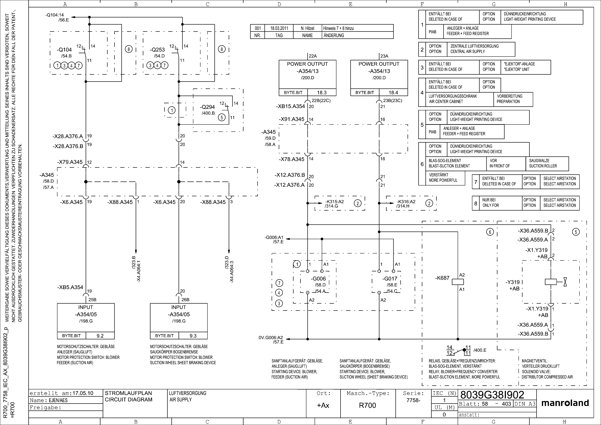

# +Ax — Sheet 58 of 403 — LUFTVERSORGUNG

**AIR SUPPLY**

> Part of the manroland **R700** printing press IEC/UL circuit diagrams.
> Drawing class: **Stromlaufplan / Circuit diagram** (DIN A3).
> Document `+Ax` covers the **Central control console** machine section.

## At a glance

| Field | Value |
|---|---|
| Document | `+Ax`  (8039G38I902) |
| Sheet | **58** of 403 |
| Section (DE) | LUFTVERSORGUNG |
| Section (EN) | AIR SUPPLY |
| Section type | CIRCUIT — Circuit diagram |
| Machine type | `R700` |
| Series | `7758` |
| Created | 17.05.10 |
| Replaces | — |
| Columns used | A, B, C, D, E, F, G, H |
| Path numbers | — |
| Labels on sheet | 248 |
| Cross-refs out | 22 |
| Cross-refs in | 51 |

**Previous:** [+Ax sheet 57](SHEET_0057.md) · **Next:** [+Ax sheet 59](SHEET_0059.md) · **Document TOC:** [_TOC.md](_TOC.md)  (+Ax) · **Master TOC:** [all sheets](../_MASTER_TOC.md)

## Sheet image (300 DPI, exact vector render)



_Rendered directly from the PDF vector layer at 300 DPI (1-bit), no OCR and no resampling. Use it to confirm anything ambiguous in the text below._

## Cross-references on this sheet

Each entry is a wire leaving this sheet. The printed token is `/sheet.column`; the link resolves to that sheet inside the same document.

| Ref | Target sheet | Col | Path | Destination on target | Target section | From col |
|---|---|---|---|---|---|---|
| `/56.E` | [+Ax sheet 56](SHEET_0056.md) | E | — | Q104:14 | LUFTVERSORGUNG | A |
| `/54.B` | [+Ax sheet 54](SHEET_0054.md) | B | — | — | LUFTVERSORGUNG | A |
| `/54.D` | [+Ax sheet 54](SHEET_0054.md) | D | — | — | LUFTVERSORGUNG | B |
| `/200.D` | [+Ax sheet 200](SHEET_0200.md) | D | — | — | REFERENZMODUL | D |
| `/200.D` | [+Ax sheet 200](SHEET_0200.md) | D | — | — | REFERENZMODUL | E |
| `/400.B` | [+Ax sheet 400](SHEET_0400.md) | B | — | — | OPTION: DÜNNDRUCKEINRICHTUNG | C |
| `/59.D` | [+Ax sheet 59](SHEET_0059.md) | D | — | — | DRUCKLUFTANLAGE | D |
| `/58.A` | [+Ax sheet 58](SHEET_0058.md) | A | — | — | LUFTVERSORGUNG | D |
| `/58.D` | [+Ax sheet 58](SHEET_0058.md) | D | — | — | LUFTVERSORGUNG | A |
| `/57.A` | [+Ax sheet 57](SHEET_0057.md) | A | — | — | LUFTVERSORGUNG | A |
| `/314.G` | [+Ax sheet 314](SHEET_0314.md) | G | — | — | OPTION: ZENTRALE LUFTVERSORGUNG | E |
| `/314.H` | [+Ax sheet 314](SHEET_0314.md) | H | — | — | OPTION: ZENTRALE LUFTVERSORGUNG | F |
| `/57.E` | [+Ax sheet 57](SHEET_0057.md) | E | — | G006:A1 | LUFTVERSORGUNG | D |
| `/323.B` | [+Ax sheet 323](SHEET_0323.md) | B | — | — | OPTION: "EJEKTOR" ANLAGE / SELECT AIRSTATION / | B |
| `/323.D` | [+Ax sheet 323](SHEET_0323.md) | D | — | — | OPTION: "EJEKTOR" ANLAGE / SELECT AIRSTATION / | C |
| `/58.E` | [+Ax sheet 58](SHEET_0058.md) | E | — | — | LUFTVERSORGUNG | F |
| `/54.C` | [+Ax sheet 54](SHEET_0054.md) | C | — | — | LUFTVERSORGUNG | F |
| `/58.D` | [+Ax sheet 58](SHEET_0058.md) | D | — | — | LUFTVERSORGUNG | E |
| `/54.A` | [+Ax sheet 54](SHEET_0054.md) | A | — | — | LUFTVERSORGUNG | E |
| `/198.G` | [+Ax sheet 198](SHEET_0198.md) | G | — | — | REFERENZMODUL | A |
| `/198.G` | [+Ax sheet 198](SHEET_0198.md) | G | — | — | REFERENZMODUL | C |
| `/57.E` | [+Ax sheet 57](SHEET_0057.md) | E | — | 0V.G006:A2 | LUFTVERSORGUNG | D |

### Incoming references (sheets that point here)

Every other sheet that sends a wire to this one. `Back-ref` is the token printed on *that* sheet; `Path` is its line number.

| From sheet | Cols | Back-ref | Path | Refs | What continues there |
|---|---|---|---|---|---|
| [+Ax#54](SHEET_0054.md) | A, B, C, D | `/54.A`, `/54.B`, `/54.C`, `/54.D` | — | 4 | — |
| [+Ax#56](SHEET_0056.md) | E | `/56.E` | — | 1 | — |
| [+Ax#57](SHEET_0057.md) | A, E | `/57.A`, `/57.E` | — | 3 | — |
| [+Ax#58](SHEET_0058.md) | A, D, E, F | `/58.A`, `/58.D`, `/58.E`, `/58.F` | — | 4 | — |
| [+Ax#59](SHEET_0059.md) | D | `/59.D` | — | 1 | — |
| [+Ax#198](SHEET_0198.md) | G | `/198.G` | — | 2 | — |
| [+Ax#200](SHEET_0200.md) | D | `/200.D` | — | 2 | — |
| [+Ax#216](SHEET_0216.md) | H | `/216.H` | — | 2 | — |
| [+Ax#231](SHEET_0231.md) | E | `/231.E` | — | 2 | — |
| [+Ax#233](SHEET_0233.md) | G | `/233.G` | — | 2 | — |
| [+Ax#248](SHEET_0248.md) | G, H | `/248.G`, `/248.H` | — | 4 | — |
| [+Ax#253](SHEET_0253.md) | B | `/253.B` | — | 2 | — |
| [+Ax#271](SHEET_0271.md) | D, E | `/271.D`, `/271.E` | — | 4 | — |
| [+Ax#279](SHEET_0279.md) | E | `/279.E` | — | 4 | — |
| [+Ax#286](SHEET_0286.md) | A, B | `/286.A`, `/286.B` | — | 4 | — |
| [+Ax#289](SHEET_0289.md) | A, E | `/289.A`, `/289.E` | — | 4 | — |
| [+Ax#314](SHEET_0314.md) | G, H | `/314.G`, `/314.H` | — | 2 | K315:A2; K316:A2 |
| [+Ax#323](SHEET_0323.md) | A, D | `/323.A`, `/323.D` | — | 2 | — |
| [+Ax#400](SHEET_0400.md) | B, D | `/400.B`, `/400.D` | — | 2 | — |


## Devices on this sheet

| Tag | Class | Class meaning (IEC) | Col | Sub | Terminal | Sign |
|---|---|---|---|---|---|---|
| `A345` | A | Baugruppe / assembly, module, PC board | A | — | — | — |
| `Q104` | Q | Leistungsschalter / power switching device | A | — | — | — |
| `Q253` | Q | Leistungsschalter / power switching device | B | — | — | — |
| `Q294` | Q | Leistungsschalter / power switching device | C | — | — | — |
| `A354/05` | A | Baugruppe / assembly, module, PC board | A | 05 | — | — |
| `A354/05` | A | Baugruppe / assembly, module, PC board | C | 05 | — | — |
| `G006` | G | Stromversorgung / power supply | E | — | — | — |
| `A1` | A | Baugruppe / assembly, module, PC board | E | — | — | — |
| `A2` | A | Baugruppe / assembly, module, PC board | D | — | — | — |
| `G017` | G | Stromversorgung / power supply | F | — | — | — |
| `A1` | A | Baugruppe / assembly, module, PC board | F | — | — | — |
| `A2` | A | Baugruppe / assembly, module, PC board | E | — | — | — |
| `Y319` | Y | Magnetventil / solenoid valve, actuator | G | — | — | — |
| `A2` | A | Baugruppe / assembly, module, PC board | G | — | — | — |
| `A1` | A | Baugruppe / assembly, module, PC board | G | — | — | — |
| `K687` | K | Relais / relay, contactor | F | — | — | — |
| `A345` | A | Baugruppe / assembly, module, PC board | D | — | — | — |
| `A354/13` | A | Baugruppe / assembly, module, PC board | D | 13 | — | — |
| `A354/13` | A | Baugruppe / assembly, module, PC board | E | 13 | — | — |
| `Q104:14` | Q | Leistungsschalter / power switching device | A | — | 14 | — |
| `G006:A1` | G | Stromversorgung / power supply | D | — | A1 | — |
| `K315:A2` | K | Relais / relay, contactor | E | — | A2 | — |
| `K316:A2` | K | Relais / relay, contactor | F | — | A2 | — |
| `X6.A345` | — | cross-device reference | A | — | — | — |
| `X88.A345` | — | cross-device reference | B | — | — | — |
| `X79.A345` | — | cross-device reference | A | — | — | — |
| `X6.A345` | — | cross-device reference | B | — | — | — |
| `X88.A345` | — | cross-device reference | C | — | — | — |
| `X28.A376.A` | — | cross-device reference | A | — | — | — |
| `X28.A376.B` | — | cross-device reference | A | — | — | — |
| `9.2` | — | cross-device reference | A | — | — | — |
| `XB5.A354` | — | cross-device reference | A | — | — | — |
| `9.3` | — | cross-device reference | C | — | — | — |
| `X1.Y319` | — | cross-device reference | H | — | — | — |
| `X1.Y319` | — | cross-device reference | H | — | — | — |
| `X78.A345` | — | cross-device reference | D | — | — | — |
| `X91.A345` | — | cross-device reference | D | — | — | — |
| `X12.A376.B` | — | cross-device reference | D | — | — | — |
| `X12.A376.A` | — | cross-device reference | D | — | — | — |
| `X36.A559.A` | — | cross-device reference | H | — | — | — |
| `X36.A559.B` | — | cross-device reference | H | — | — | — |
| `X36.A559.B` | — | cross-device reference | H | — | — | — |
| `X36.A559.A` | — | cross-device reference | H | — | — | — |
| `18.3` | — | cross-device reference | E | — | — | — |
| `XB15.A354` | — | cross-device reference | D | — | — | — |
| `18.4` | — | cross-device reference | F | — | — | — |
| `X4.A064:1` | — | cross-device reference | B | — | 1 | — |
| `X4.A064:3` | — | cross-device reference | C | — | 3 | — |
| `NR.` | — | cross-device reference | D | — | — | — |
| `18.03.2011` | — | cross-device reference | D | — | — | — |

## Potentials / nets

| Potential | Count | Columns | Attached devices | Terminals |
|---|---|---|---|---|
| `0V` | 1 | D | `G006` | `A2` |


A potential such as `L24+/4` or `M24+` is a named supply/return rail; every place it appears on this sheet is electrically common.

## Wire-end annotations (grouped as printed)

A wire that continues elsewhere is annotated with a small cluster: the destination description, the path/line number `#NN`, and the `/sheet.column` cross reference. Each row below is one such cluster exactly as it is grouped on the drawing.

| Col | Y | Path | Cross-ref | Text on the wire |
|---|---|---|---|---|
| F | 24.7 | — | — | `ENTFÄLLT BEI DELETED IN CASE OF` |
| G | 24.7 | — | — | `OPTION OPTION` |
| H | 24.8 | — | — | `DÜNNDRUCKEINRICHTUNG LIGHT WEIGHT PRINTING DEVICE` |
| A | 25.8 | — | `/56.E` | `Q104:14` |
| F | 44.2 | — | — | `1` |
| D | 52.7 | — | — | `001 18.03.2011 N. Hitzel Hinweis 7 + 8 hinzu` |
| G | 53.1 | — | — | `FEEDER + FEED REGISTER ANLEGER + ANLAGE` |
| F | 60.0 | — | — | `PIAB` |
| D | 66.8 | — | — | `NR. TAG NAME ÄNDERUNG` |
| A | 87.5 | — | — | `Q104 14` |
| A | 87.5 | — | — | `12` |
| B | 87.5 | — | — | `Q253 14` |
| B | 87.5 | — | — | `12` |
| F | 88.5 | — | — | `2 OPTION OPTION` |
| G | 88.5 | — | — | `CENTRAL AIR SUPPLY ZENTRALE LUFTVERSORGUNG` |
| C | 94.5 | — | — | `8 8` |
| A | 106.9 | — | `/54.B` | — |
| B | 106.9 | — | `/54.D` | — |
| D | 107.3 | — | — | `22A` |
| E | 107.3 | — | — | `23A` |
| A | 115.8 | — | — | `11` |
| C | 115.8 | — | — | `11` |
| D | 122.5 | — | — | `POWER OUTPUT` |
| E | 122.5 | — | — | `POWER OUTPUT` |
| F | 123.9 | — | — | `3 ENTFÄLLT BEI DELETED IN CASE OF OPTION OPTION` |
| G | 123.9 | — | — | `"EJEKTOR" ANLAGE "EJEKTOR" UNIT` |
| B | 126.2 | — | — | `1 3 4` |
| B | 126.7 | — | — | `3 4 7 7` |
| D | 136.4 | — | — | `A354/13` |
| E | 136.4 | — | — | `A354/13` |
| D | 150.2 | — | `/200.D` | — |
| E | 150.2 | — | `/200.D` | — |
| F | 159.3 | — | — | `4 ENTFÄLLT BEI DELETED IN CASE OF` |
| G | 159.3 | — | — | `OPTION OPTION` |
| D | 179.2 | — | — | `BYTE.BIT 18.3` |
| E | 179.2 | — | — | `BYTE.BIT 18.4` |
| F | 187.7 | — | — | `LUFTVERSORGUNGSSCHRANK` |
| G | 187.7 | — | — | `PREPARATION VORBEREITUNG` |
| E | 195.2 | — | — | `22B(22C)` |
| F | 195.2 | — | — | `23B(23C)` |
| F | 198.3 | — | — | `AIR CENTER CABINET` |
| C | 200.9 | — | — | `Q294 14` |
| C | 200.9 | — | — | `12` |
| D | 205.8 | — | — | `XB15.A354 20` |
| E | 207.2 | — | — | `21` |
| C | 215.2 | — | — | `1` |
| C | 220.3 | — | `/400.B` | — |
| F | 223.1 | — | — | `OPTION OPTION` |
| G | 223.2 | — | — | `DÜNNDRUCKEINRICHTUNG LIGHT WEIGHT PRINTING DEVICE` |
| C | 229.2 | — | — | `11` |
| C | 229.9 | — | — | `5` |
| E | 231.3 | — | — | `X91.A345 14 16` |
| F | 242.6 | — | — | `5` |
| G | 251.5 | — | — | `FEEDER + FEED REGISTER ANLEGER + ANLAGE` |
| D | 256.8 | — | — | `A345` |
| F | 258.5 | — | — | `PIAB` |
| A | 265.4 | — | — | `X28.A376.A 19` |
| C | 265.4 | — | — | `20` |
| D | 269.9 | — | `/59.D`, `/58.A` | — |
| A | 282.4 | — | — | `X28.A376.B 19` |
| C | 282.4 | — | — | `20` |
| F | 286.9 | — | — | `OPTION OPTION` |
| G | 286.9 | — | — | `DÜNNDRUCKEINRICHTUNG LIGHT WEIGHT PRINTING DEVICE` |
| E | 310.7 | — | — | `X78.A345 14 16` |
| H | 315.2 | — | — | `SAUGWALZE SUCTION ROLLER` |
| F | 315.3 | — | — | `BLAS SOG ELEMENT BLAST SUCTION ELEMENT` |
| G | 315.3 | — | — | `IN FRONT OF VOR` |
| A | 316.4 | — | — | `X79.A345 12` |
| C | 317.8 | — | — | `14` |
| F | 320.6 | — | — | `6` |
| A | 341.9 | — | — | `A345` |
| D | 341.9 | — | — | `X12.A376.B 20` |
| F | 343.6 | — | — | `MORE POWERFUL VERSTÄRKT` |
| E | 346.1 | — | — | `21` |
| G | 350.7 | — | — | `7 ENTFÄLLT BEI DELETED IN CASE OF OPTION OPTION SELECT AIRSTATION SELECT AIRSTATION` |
| A | 355.0 | — | `/58.D`, `/57.A` | — |
| D | 361.7 | — | — | `X12.A376.A 20` |
| E | 363.2 | — | — | `21` |
| G | 393.2 | — | — | `8 ONLY FOR OPTION OPTION SELECT AIRSTATION SELECT AIRSTATION` |
| G | 393.2 | — | — | `NUR BEI` |
| A | 395.7 | — | — | `X6.A345 19 X88.A345 1` |
| C | 395.7 | — | — | `X6.A345 20 X88.A345 3` |
| E | 395.7 | — | — | `K315:A2` |
| F | 395.7 | — | — | `K316:A2` |
| F | 400.0 | — | — | `2 2` |
| E | 404.2 | — | `/314.G` | — |
| F | 404.2 | — | `/314.H` | — |
| H | 452.4 | — | — | `X36.A559.B 2` |
| G | 456.7 | — | — | `6` |
| H | 456.7 | — | — | `5` |
| D | 466.6 | — | `/57.E` | `G006:A1` |
| H | 469.5 | — | — | `X36.A559.A 2` |
| H | 490.8 | — | — | `X1.Y319 2` |
| H | 503.4 | — | — | `+AB` |
| B | 507.1 | — | `/323.B` | — |
| C | 507.1 | — | `/323.D` | — |
| B | 515.6 | — | — | `X4.A064:1` |
| C | 517.0 | — | — | `X4.A064:3` |
| E | 519.7 | — | — | `1 A1` |
| F | 519.7 | — | — | `1 A1` |
| D | 519.9 | — | — | `1` |
| G | 541.0 | — | — | `A2` |
| F | 546.0 | — | — | `K687` |
| E | 547.4 | — | — | `G006` |
| F | 547.4 | — | — | `G017` |
| G | 554.6 | — | — | `Y319` |
| D | 558.0 | — | — | `7` |
| E | 560.5 | — | `/58.D`, `/54.A` | — |
| F | 560.5 | — | `/58.E`, `/54.C` | — |
| A | 564.4 | — | — | `XB5.A354 19` |
| G | 567.2 | — | — | `+AB` |
| G | 569.3 | — | — | `A1` |
| C | 572.9 | — | — | `20` |
| D | 577.1 | — | — | `4` |
| A | 589.9 | — | — | `25B` |
| C | 589.9 | — | — | `26B` |
| D | 590.6 | — | — | `A2` |
| E | 590.6 | — | — | `A2` |
| D | 598.4 | — | — | `3` |
| A | 604.4 | — | — | `INPUT` |
| C | 604.4 | — | — | `INPUT` |
| H | 607.0 | — | — | `X1.Y319 1` |
| A | 618.3 | — | — | `A354/05` |
| C | 618.3 | — | — | `A354/05` |
| H | 619.6 | — | — | `+AB` |
| A | 632.0 | — | `/198.G` | — |
| C | 632.0 | — | `/198.G` | — |
| H | 638.8 | — | — | `X36.A559.A 1` |
| H | 656.5 | — | — | `X36.A559.B 1` |
| A | 661.1 | — | — | `BYTE.BIT 9.2` |
| C | 661.1 | — | — | `BYTE.BIT 9.3` |
| D | 665.0 | — | `/57.E` | `0V.G006:A2` |
| G | 683.4 | — | — | `14 12 11 11 /400.E` |
| A | 683.8 | — | — | `MOTORSCHUTZSCHALTER: GEBLÄSE` |
| C | 683.8 | — | — | `MOTORSCHUTZSCHALTER: GEBLÄSE MOTOR PROTECTION SWITCH: BLOWER SAUGKÖRPER BOGENBREMSE SUCTION WHEEL SHEET BRAKING DEVICE` |
| A | 694.4 | — | — | `FEEDER (SUCTION AIR) MOTOR PROTECTION SWITCH: BLOWER ANLEGER (SAUGLUFT)` |
| D | 712.1 | — | — | `FEEDER (SUCTION AIR) SANFTANLAUFGERÄT: GEBLÄSE, STARTING DEVICE: BLOWER, ANLEGER (SAUGLUFT)` |
| E | 712.1 | — | — | `SANFTANLAUFGERÄT: GEBLÄSE, SAUGKÖRPER (BOGENBREMSE) STARTING DEVICE: BLOWER, SUCTION WHEEL (SHEET BRAKING DEVICE)` |
| G | 712.1 | — | — | `RELAIS, GEBLÄSE+FREQUENZUMRICHTER: BLAS SOG ELEMENT, VERSTÄRKT RELAY, BLOWER+FREQUENCY CONVERTER: BLAST SUCTION ELEMENT, MORE POWERFUL` |
| H | 712.1 | — | — | `MAGNETVENTIL:` |
| H | 722.8 | — | — | `DISTRIBUTOR COMPRESSED AIR SOLENOID VALVE: VERTEILER DRUCKLUFT` |


## Reconstructed tables

This sheet carries tabular content (pin map / terminal assignment / index). The grid below was rebuilt from the drawing's own rule lines, so each row is exactly one physical row of the table.

### Table 1 — 12 data rows × 23 columns (at x=113.4, y=34.0) — **/56.E DELETED IN CASE OPTION OF LIGHT WEIGHT PRINTING DEVICE**

| 12 Q104 /54.B |  | 14 |  | 8 |  | 12 Q253 /54.D |  | 14 |  | 8 | 001 NR. | 18.03.2011 N. NAME TAG | Hitzel 22A | Hinweis ÄNDERUNG | 7 + 8 hinzu |  | 23A |  | 1 ANLEGER PIAB FEEDER OPTION 2 OPTION | + ANLAGE + FEED REGISTER ZENTRALE LUFTVERSORGUNG CENTRAL AIR SUPPLY |  |  |
|---|---|---|---|---|---|---|---|---|---|---|---|---|---|---|---|---|---|---|---|---|---|---|
| `1 3 4 7` | `11` |  |  |  |  | `3 4 7` | `11` |  |  |  |  | `POWER` | `OUTPUT A354/13 /200.D` |  |  | `POWER` | `OUTPUT A354/13 /200.D` |  | `ENTFÄLLT BEI 3 DELETED IN CASE` | `OPTION OPTION OF` | `"EJEKTOR"` | `"EJEKTOR" ANLAGE UNIT` |
|  |  |  |  |  |  |  |  |  |  |  |  |  |  |  |  |  |  |  | `ENTFÄLLT BEI DELETED IN CASE` | `OPTION OPTION OF` |  |  |
|  |  |  |  |  |  |  |  |  |  |  |  | `BYTE.BIT` | `18.3` |  |  | `BYTE.BIT` | `18.4` |  | `4` |  |  |  |
|  |  |  |  |  |  | `1` |  |  | `Q294 /400.B` | `12 5` | `14 11` | `XB15.A354 X91.A345` | `22B(22C) 20 14` |  |  |  | `23B(23C) 21 16` |  | `LUFTVERSORGUNGSSCHRANK AIR CENTER CABINET OPTION OPTION` | `DÜNNDRUCKEINRICHTUNG LIGHT WEIGHT PRINTING DEVICE` | `VORBEREITUNG PREPARATION` |  |
| `X28.A376.A X28.A376.B X79.A345` | `19 19 12` |  |  |  |  |  | `14` | `20 20` |  |  | `A345 /59.D /58.A` | `X78.A345 X12.A376.B` | `14 20` |  |  |  | `16 21` |  | `5 ANLEGER PIAB FEEDER + OPTION OPTION BLAS SOG ELEMENT 6 BLAST SUCTION VERSTÄRKT MORE POWERFUL` | `+ ANLAGE FEED REGISTER DÜNNDRUCKEINRICHTUNG LIGHT WEIGHT PRINTING DEVICE VOR IN ELEMENT ENTFÄLLT` | `FRONT OF BEI` | `SAUGWALZE SUCTION ROLLER OPTION SELECT` |
| `X6.A345` | `19` |  | `X88.A345` |  | `1` | `X6.A345` |  | `20` | `X88.A345` |  | `3` | `X12.A376.A` | `20` | `K315:A2 /314.G` |  | `2` | `21` | `K316:A2 /314.H` | `2` | `7 DELETED NUR BEI 8 ONLY FOR` | `IN CASE OF` | `OPTION SELECT OPTION SELECT OPTION SELECT` |
|  |  |  |  |  |  |  |  |  |  |  |  |  |  |  |  |  |  |  |  |  |  | `X36.A559.B` |
|  |  |  |  |  |  |  |  |  |  |  | `G006:A1` |  |  |  |  |  |  |  |  | `6` |  |  |
| `XB5.A354` | `19` | `25B` |  | `/323.B` | `X4.A064:1` |  |  | `20 26B` |  | `/323.D` | `/57.E X4.A064:3 4` | `1 7` | `1 G006 /58.D /54.A A2` | `A1` |  |  | `1 G017 /58.E /54.C A2` | `A1` | `K687` | `A2 A1` | `Y319 +AB` | `X36.A559.A X1.Y319 +AB` |
| `INPUT` | `A354/05 /198.G` |  |  |  |  | `INPUT` | `A354/05 /198.G` |  |  |  | `3` |  |  |  |  |  |  |  |  |  |  | `X1.Y319 +AB X36.A559.A` |
| `BYTE.BIT` |  | `9.2` |  |  |  | `BYTE.BIT` |  | `9.3` |  |  | `0V.G006:A2` |  |  |  |  |  |  |  |  |  |  | `X36.A559.B` |
| `MOTORSCHUTZSCHALTER:` |  | `GEBLÄSE` |  |  |  | `MOTORSCHUTZSCHALTER:` |  | `GEBLÄSE` |  |  | `/57.E` |  |  |  |  |  |  |  | `14` | `11` |  |  |


## Notes and free text on this sheet

| Text | Col | Y (pt) |
|---|---|---|
| `25B` | A | 589.89 |
| `INPUT` | A | 604.42 |
| `BYTE.BIT` | A | 661.67 |
| `MOTORSCHUTZSCHALTER: GEBLÄSE` | A | 683.78 |
| `ANLEGER (SAUGLUFT)` | A | 694.42 |
| `MOTOR PROTECTION SWITCH: BLOWER` | A | 705.03 |
| `FEEDER (SUCTION AIR)` | A | 715.67 |
| `26B` | C | 589.89 |
| `INPUT` | C | 604.42 |
| `BYTE.BIT` | B | 661.67 |
| `MOTORSCHUTZSCHALTER: GEBLÄSE` | C | 683.78 |
| `SAUGKÖRPER BOGENBREMSE` | C | 694.41 |
| `MOTOR PROTECTION SWITCH: BLOWER` | C | 705.03 |
| `SUCTION WHEEL SHEET BRAKING DEVICE` | C | 715.66 |
| `SANFTANLAUFGERÄT: GEBLÄSE,` | D | 712.11 |
| `ANLEGER (SAUGLUFT)` | D | 722.77 |
| `STARTING DEVICE: BLOWER,` | D | 733.36 |
| `FEEDER (SUCTION AIR)` | D | 744.02 |
| `SANFTANLAUFGERÄT: GEBLÄSE,` | E | 712.11 |
| `SAUGKÖRPER (BOGENBREMSE)` | E | 722.76 |
| `STARTING DEVICE: BLOWER,` | E | 733.36 |
| `SUCTION WHEEL (SHEET BRAKING DEVICE)` | E | 744.01 |
| `+AB` | H | 503.38 |
| `+AB` | G | 567.16 |
| `MAGNETVENTIL:` | H | 712.11 |
| `VERTEILER DRUCKLUFT` | H | 722.77 |
| `SOLENOID VALVE:` | H | 733.37 |
| `DISTRIBUTOR COMPRESSED AIR` | H | 744.02 |
| `11 /400.E` | G | 689.79 |
| `RELAIS, GEBLÄSE+FREQUENZUMRICHTER:` | G | 712.12 |
| `BLAS SOG ELEMENT, VERSTÄRKT` | F | 722.75 |
| `RELAY, BLOWER+FREQUENCY CONVERTER:` | G | 733.38 |
| `BLAST SUCTION ELEMENT, MORE POWERFUL` | G | 744.02 |
| `22A` | D | 107.29 |
| `22B(22C)` | E | 195.2 |
| `POWER OUTPUT` | D | 122.45 |
| `BYTE.BIT` | D | 179.78 |
| `23A` | E | 107.29 |
| `23B(23C)` | F | 195.2 |
| `POWER OUTPUT` | E | 122.45 |
| `BYTE.BIT` | E | 179.78 |
| `TAG` | D | 66.95 |
| `NAME` | D | 66.94 |
| `ÄNDERUNG` | E | 67 |
| `N. Hitzel` | D | 52.82 |
| `Hinweis 7 + 8 hinzu` | E | 52.84 |
| `ENTFÄLLT BEI` | F | 24.68 |
| `DELETED IN CASE OF` | F | 35.34 |
| `OPTION` | G | 24.69 |
| `DÜNNDRUCKEINRICHTUNG` | G | 24.75 |
| `LIGHT WEIGHT PRINTING DEVICE` | H | 35.34 |
| `PIAB` | F | 60.05 |
| `ANLEGER + ANLAGE` | G | 53.07 |
| `FEEDER + FEED REGISTER` | G | 63.69 |
| `OPTION` | F | 88.47 |
| `ZENTRALE LUFTVERSORGUNG` | G | 88.52 |
| `CENTRAL AIR SUPPLY` | G | 99.13 |
| `"EJEKTOR" ANLAGE` | G | 123.93 |
| `"EJEKTOR" UNIT` | G | 134.56 |
| `LUFTVERSORGUNGSSCHRANK` | F | 187.73 |
| `AIR CENTER CABINET` | F | 198.35 |
| `VORBEREITUNG` | G | 187.72 |
| `PREPARATION` | G | 198.32 |
| `LIGHT WEIGHT PRINTING DEVICE` | G | 233.76 |
| `BLAS SOG ELEMENT` | F | 315.27 |
| `BLAST SUCTION ELEMENT` | F | 325.91 |
| `VOR` | G | 315.28 |
| `IN FRONT OF` | G | 325.9 |
| `SAUGWALZE` | H | 315.22 |
| `SUCTION ROLLER` | H | 325.92 |
| `VERSTÄRKT` | F | 343.61 |
| `MORE POWERFUL` | F | 354.24 |
| `ENTFÄLLT BEI` | G | 350.67 |
| `DELETED IN CASE OF` | G | 361.32 |
| `SELECT AIRSTATION` | H | 350.69 |
| `OPTION` | H | 350.68 |
| `NUR BEI` | G | 393.18 |
| `ONLY FOR` | G | 403.87 |

## Complete label inventory (exact text from the drawing)

Every text object inside the drawing area of this sheet, in DIN reading order (column A→H, then top→bottom). This is the authoritative list: if a string is not here it is not printed on this sheet.

| Col | Y | X | Dir | Type | Text |
|---|---|---|---|---|---|
| A | 25.8 | 90.1 | → | device tag | `Q104:14` |
| A | 35.7 | 115.9 | → | cross-reference | `/56.E` |
| A | 87.5 | 151.1 | → | number | `12` |
| A | 87.5 | 179.1 | → | number | `14` |
| A | 93.9 | 112.8 | → | device tag | `Q104` |
| A | 106.9 | 121.3 | → | cross-reference | `/54.B` |
| A | 115.8 | 172.1 | → | number | `11` |
| A | 126.2 | 111.6 | → | number | `1` |
| A | 127.1 | 125.6 | → | number | `3` |
| A | 127.1 | 139.7 | → | number | `4` |
| A | 127.1 | 153.9 | → | number | `7` |
| A | 265.4 | 104.0 | → | device ref | `X28.A376.A` |
| A | 265.4 | 172.1 | → | number | `19` |
| A | 282.4 | 172.1 | → | number | `19` |
| A | 285.2 | 104.9 | → | device ref | `X28.A376.B` |
| A | 316.4 | 113.4 | → | device ref | `X79.A345` |
| A | 317.8 | 172.1 | → | number | `12` |
| A | 341.9 | 78.5 | → | device tag | `A345` |
| A | 355.0 | 85.6 | → | cross-reference | `/58.D` |
| A | 367.3 | 85.6 | → | cross-reference | `/57.A` |
| A | 395.7 | 119.3 | → | device ref | `X6.A345` |
| A | 395.8 | 172.1 | → | number | `19` |
| A | 564.4 | 113.7 | → | device ref | `XB5.A354` |
| A | 572.9 | 172.1 | → | number | `19` |
| A | 589.9 | 175.5 | → | text | `25B` |
| A | 604.4 | 155.2 | → | text | `INPUT` |
| A | 618.3 | 148.7 | → | device tag | `A354/05` |
| A | 632.1 | 157.2 | → | cross-reference | `/198.G` |
| A | 661.1 | 191.6 | → | device ref | `9.2` |
| A | 661.7 | 123.3 | → | text | `BYTE.BIT` |
| A | 683.8 | 112.8 | → | text | `MOTORSCHUTZSCHALTER: GEBLÄSE` |
| A | 694.4 | 113.4 | → | text | `ANLEGER (SAUGLUFT)` |
| A | 705.0 | 112.8 | → | text | `MOTOR PROTECTION SWITCH: BLOWER` |
| A | 715.7 | 112.5 | → | text | `FEEDER (SUCTION AIR)` |
| B | 87.5 | 335.3 | → | number | `12` |
| B | 93.9 | 297.1 | → | device tag | `Q253` |
| B | 94.5 | 253.1 | → | number | `8` |
| B | 106.9 | 305.3 | → | cross-reference | `/54.D` |
| B | 126.7 | 295.6 | → | number | `3` |
| B | 126.7 | 309.8 | → | number | `4` |
| B | 126.7 | 324.0 | → | number | `7` |
| B | 395.7 | 212.6 | → | device ref | `X88.A345` |
| B | 395.7 | 303.6 | → | device ref | `X6.A345` |
| B | 395.8 | 271.3 | → | number | `1` |
| B | 507.1 | 261.1 | ↕ | cross-reference | `/323.B` |
| B | 515.6 | 271.0 | ↕ | device ref | `X4.A064:1` |
| B | 661.7 | 307.6 | → | text | `BYTE.BIT` |
| C | 87.5 | 363.4 | → | number | `14` |
| C | 94.5 | 437.4 | → | number | `8` |
| C | 115.8 | 356.3 | → | number | `11` |
| C | 200.9 | 434.6 | → | number | `12` |
| C | 200.9 | 462.6 | → | number | `14` |
| C | 207.2 | 396.3 | → | device tag | `Q294` |
| C | 215.2 | 338.4 | → | number | `1` |
| C | 220.3 | 400.0 | → | cross-reference | `/400.B` |
| C | 229.2 | 455.5 | → | number | `11` |
| C | 229.9 | 437.4 | → | number | `5` |
| C | 265.4 | 356.9 | → | number | `20` |
| C | 282.4 | 356.9 | → | number | `20` |
| C | 317.8 | 356.3 | → | number | `14` |
| C | 395.7 | 396.9 | → | device ref | `X88.A345` |
| C | 395.8 | 356.9 | → | number | `20` |
| C | 395.8 | 456.1 | → | number | `3` |
| C | 507.1 | 445.3 | ↕ | cross-reference | `/323.D` |
| C | 517.0 | 455.2 | ↕ | device ref | `X4.A064:3` |
| C | 572.9 | 356.9 | → | number | `20` |
| C | 589.9 | 359.7 | → | text | `26B` |
| C | 604.4 | 339.4 | → | text | `INPUT` |
| C | 618.3 | 332.9 | → | device tag | `A354/05` |
| C | 632.1 | 341.4 | → | cross-reference | `/198.G` |
| C | 661.1 | 375.9 | → | device ref | `9.3` |
| C | 683.8 | 297.1 | → | text | `MOTORSCHUTZSCHALTER: GEBLÄSE` |
| C | 694.4 | 297.4 | → | text | `SAUGKÖRPER BOGENBREMSE` |
| C | 705.0 | 297.1 | → | text | `MOTOR PROTECTION SWITCH: BLOWER` |
| C | 715.7 | 297.4 | → | text | `SUCTION WHEEL SHEET BRAKING DEVICE` |
| D | 52.7 | 505.0 | → | number | `001` |
| D | 52.8 | 535.6 | → | device ref | `18.03.2011` |
| D | 52.8 | 596.1 | → | text | `N. Hitzel` |
| D | 66.8 | 504.1 | → | device ref | `NR.` |
| D | 66.9 | 599.0 | → | text | `NAME` |
| D | 67.0 | 545.6 | → | text | `TAG` |
| D | 107.3 | 612.0 | → | text | `22A` |
| D | 122.5 | 568.6 | → | text | `POWER OUTPUT` |
| D | 136.4 | 588.0 | → | device tag | `A354/13` |
| D | 150.2 | 596.7 | → | cross-reference | `/200.D` |
| D | 179.8 | 562.7 | → | text | `BYTE.BIT` |
| D | 205.8 | 547.1 | → | device ref | `XB15.A354` |
| D | 207.3 | 612.0 | → | number | `20` |
| D | 231.3 | 552.8 | → | device ref | `X91.A345` |
| D | 232.8 | 611.4 | → | number | `14` |
| D | 256.8 | 517.9 | → | device tag | `A345` |
| D | 269.9 | 525.0 | → | cross-reference | `/59.D` |
| D | 282.3 | 525.0 | → | cross-reference | `/58.A` |
| D | 310.7 | 552.8 | → | device ref | `X78.A345` |
| D | 310.7 | 611.4 | → | number | `14` |
| D | 341.9 | 544.3 | → | device ref | `X12.A376.B` |
| D | 346.2 | 612.0 | → | number | `20` |
| D | 361.7 | 543.4 | → | device ref | `X12.A376.A` |
| D | 363.2 | 612.0 | → | number | `20` |
| D | 466.6 | 524.1 | → | device tag | `G006:A1` |
| D | 475.1 | 541.1 | → | cross-reference | `/57.E` |
| D | 519.8 | 611.4 | → | number | `1` |
| D | 519.9 | 586.4 | → | number | `1` |
| D | 558.0 | 551.5 | → | number | `7` |
| D | 577.1 | 550.8 | → | number | `4` |
| D | 590.6 | 612.3 | → | device tag | `A2` |
| D | 598.4 | 550.8 | → | number | `3` |
| D | 665.0 | 512.5 | → | potential | `0V.G006:A2` |
| D | 673.5 | 541.1 | → | cross-reference | `/57.E` |
| D | 712.1 | 538.3 | → | text | `SANFTANLAUFGERÄT: GEBLÄSE,` |
| D | 722.8 | 538.6 | → | text | `ANLEGER (SAUGLUFT)` |
| D | 733.4 | 538.3 | → | text | `STARTING DEVICE: BLOWER,` |
| D | 744.0 | 537.7 | → | text | `FEEDER (SUCTION AIR)` |
| E | 52.8 | 640.5 | → | text | `Hinweis 7 + 8 hinzu` |
| E | 67.0 | 641.6 | → | text | `ÄNDERUNG` |
| E | 107.3 | 753.7 | → | text | `23A` |
| E | 122.5 | 710.4 | → | text | `POWER OUTPUT` |
| E | 136.4 | 729.8 | → | device tag | `A354/13` |
| E | 150.2 | 738.4 | → | cross-reference | `/200.D` |
| E | 179.2 | 628.0 | → | device ref | `18.3` |
| E | 179.8 | 704.4 | → | text | `BYTE.BIT` |
| E | 195.2 | 617.7 | → | text | `22B(22C)` |
| E | 207.3 | 753.7 | → | number | `21` |
| E | 232.8 | 753.2 | → | number | `16` |
| E | 310.7 | 753.2 | → | number | `16` |
| E | 346.2 | 753.7 | → | number | `21` |
| E | 363.2 | 753.7 | → | number | `21` |
| E | 395.7 | 644.6 | → | device tag | `K315:A2` |
| E | 400.0 | 706.7 | → | number | `2` |
| E | 404.2 | 643.5 | → | cross-reference | `/314.G` |
| E | 519.7 | 640.6 | → | device tag | `A1` |
| E | 519.8 | 753.2 | → | number | `1` |
| E | 547.4 | 616.0 | → | device tag | `G006` |
| E | 560.5 | 624.2 | → | cross-reference | `/58.D` |
| E | 572.8 | 624.2 | → | cross-reference | `/54.A` |
| E | 590.6 | 754.0 | → | device tag | `A2` |
| E | 712.1 | 672.9 | → | text | `SANFTANLAUFGERÄT: GEBLÄSE,` |
| E | 722.8 | 672.9 | → | text | `SAUGKÖRPER (BOGENBREMSE)` |
| E | 733.4 | 672.9 | → | text | `STARTING DEVICE: BLOWER,` |
| E | 744.0 | 672.9 | → | text | `SUCTION WHEEL (SHEET BRAKING DEVICE)` |
| F | 24.7 | 849.5 | → | text | `ENTFÄLLT BEI` |
| F | 35.3 | 849.5 | → | text | `DELETED IN CASE OF` |
| F | 44.2 | 833.7 | → | number | `1` |
| F | 60.0 | 849.5 | → | text | `PIAB` |
| F | 88.5 | 850.1 | → | text | `OPTION` |
| F | 93.8 | 833.4 | → | number | `2` |
| F | 99.1 | 850.1 | → | text | `OPTION` |
| F | 123.9 | 849.5 | → | text | `ENTFÄLLT BEI` |
| F | 129.2 | 833.2 | → | number | `3` |
| F | 134.6 | 849.5 | → | text | `DELETED IN CASE OF` |
| F | 159.3 | 849.5 | → | text | `ENTFÄLLT BEI` |
| F | 170.0 | 849.5 | → | text | `DELETED IN CASE OF` |
| F | 178.9 | 833.4 | → | number | `4` |
| F | 179.2 | 769.7 | → | device ref | `18.4` |
| F | 187.7 | 849.5 | → | text | `LUFTVERSORGUNGSSCHRANK` |
| F | 195.2 | 759.4 | → | text | `23B(23C)` |
| F | 198.3 | 850.4 | → | text | `AIR CENTER CABINET` |
| F | 223.1 | 850.1 | → | text | `OPTION` |
| F | 233.8 | 850.1 | → | text | `OPTION` |
| F | 242.6 | 833.2 | → | number | `5` |
| F | 258.5 | 849.5 | → | text | `PIAB` |
| F | 286.9 | 850.1 | → | text | `OPTION` |
| F | 297.5 | 850.1 | → | text | `OPTION` |
| F | 315.3 | 849.5 | → | text | `BLAS SOG ELEMENT` |
| F | 320.6 | 833.4 | → | number | `6` |
| F | 325.9 | 849.5 | → | text | `BLAST SUCTION ELEMENT` |
| F | 343.6 | 850.4 | → | text | `VERSTÄRKT` |
| F | 354.2 | 849.8 | → | text | `MORE POWERFUL` |
| F | 395.7 | 786.3 | → | device tag | `K316:A2` |
| F | 400.0 | 848.4 | → | number | `2` |
| F | 404.2 | 785.2 | → | cross-reference | `/314.H` |
| F | 519.7 | 782.4 | → | device tag | `A1` |
| F | 546.0 | 862.3 | → | device tag | `K687` |
| F | 547.4 | 757.7 | → | device tag | `G017` |
| F | 560.4 | 766.5 | → | cross-reference | `/58.E` |
| F | 572.9 | 765.9 | → | cross-reference | `/54.C` |
| F | 683.4 | 884.4 | → | number | `14` |
| F | 694.8 | 884.4 | → | number | `12` |
| F | 722.8 | 849.5 | → | text | `BLAS SOG ELEMENT, VERSTÄRKT` |
| G | 24.7 | 956.4 | → | text | `OPTION` |
| G | 24.7 | 998.4 | → | text | `DÜNNDRUCKEINRICHTUNG` |
| G | 35.3 | 956.4 | → | text | `OPTION` |
| G | 53.1 | 885.8 | → | text | `ANLEGER + ANLAGE` |
| G | 63.7 | 885.0 | → | text | `FEEDER + FEED REGISTER` |
| G | 88.5 | 892.9 | → | text | `ZENTRALE LUFTVERSORGUNG` |
| G | 99.1 | 892.6 | → | text | `CENTRAL AIR SUPPLY` |
| G | 123.9 | 956.4 | → | text | `OPTION` |
| G | 123.9 | 998.9 | → | text | `"EJEKTOR" ANLAGE` |
| G | 134.5 | 956.4 | → | text | `OPTION` |
| G | 134.6 | 998.9 | → | text | `"EJEKTOR" UNIT` |
| G | 159.3 | 956.4 | → | text | `OPTION` |
| G | 170.0 | 956.4 | → | text | `OPTION` |
| G | 187.7 | 985.0 | → | text | `VORBEREITUNG` |
| G | 198.3 | 984.2 | → | text | `PREPARATION` |
| G | 223.2 | 892.1 | → | text | `DÜNNDRUCKEINRICHTUNG` |
| G | 233.8 | 892.1 | → | text | `LIGHT WEIGHT PRINTING DEVICE` |
| G | 251.5 | 878.7 | → | text | `ANLEGER + ANLAGE` |
| G | 262.1 | 877.9 | → | text | `FEEDER + FEED REGISTER` |
| G | 287.0 | 892.1 | → | text | `DÜNNDRUCKEINRICHTUNG` |
| G | 297.5 | 892.1 | → | text | `LIGHT WEIGHT PRINTING DEVICE` |
| G | 315.3 | 970.9 | → | text | `VOR` |
| G | 325.9 | 970.0 | → | text | `IN FRONT OF` |
| G | 350.7 | 955.8 | → | text | `ENTFÄLLT BEI` |
| G | 356.0 | 939.7 | → | number | `7` |
| G | 361.3 | 955.8 | → | text | `DELETED IN CASE OF` |
| G | 393.2 | 955.8 | → | text | `NUR BEI` |
| G | 398.5 | 939.5 | → | number | `8` |
| G | 403.9 | 956.4 | → | text | `ONLY FOR` |
| G | 456.7 | 968.9 | → | number | `6` |
| G | 541.0 | 909.9 | → | device tag | `A2` |
| G | 554.6 | 1001.8 | → | device tag | `Y319` |
| G | 567.2 | 1009.1 | → | text | `+AB` |
| G | 569.3 | 909.9 | → | device tag | `A1` |
| G | 683.4 | 921.5 | → | number | `11` |
| G | 689.8 | 921.5 | → | text | `11 /400.E` |
| G | 712.1 | 849.5 | → | text | `RELAIS, GEBLÄSE+FREQUENZUMRICHTER:` |
| G | 733.4 | 849.5 | → | text | `RELAY, BLOWER+FREQUENCY CONVERTER:` |
| G | 744.0 | 849.5 | → | text | `BLAST SUCTION ELEMENT, MORE POWERFUL` |
| H | 35.3 | 998.4 | → | text | `LIGHT WEIGHT PRINTING DEVICE` |
| H | 315.2 | 1048.5 | → | text | `SAUGWALZE` |
| H | 325.9 | 1048.5 | → | text | `SUCTION ROLLER` |
| H | 350.7 | 1037.2 | → | text | `OPTION` |
| H | 350.7 | 1076.9 | → | text | `SELECT AIRSTATION` |
| H | 361.3 | 1037.2 | → | text | `OPTION` |
| H | 361.3 | 1076.9 | → | text | `SELECT AIRSTATION` |
| H | 393.2 | 1037.2 | → | text | `OPTION` |
| H | 393.2 | 1076.9 | → | text | `SELECT AIRSTATION` |
| H | 403.8 | 1037.2 | → | text | `OPTION` |
| H | 403.8 | 1076.9 | → | text | `SELECT AIRSTATION` |
| H | 452.4 | 1026.1 | → | device ref | `X36.A559.B` |
| H | 452.5 | 1093.9 | → | number | `2` |
| H | 456.7 | 1139.0 | → | number | `5` |
| H | 469.5 | 1093.9 | → | number | `2` |
| H | 470.2 | 1025.3 | → | device ref | `X36.A559.A` |
| H | 490.8 | 1041.2 | → | device ref | `X1.Y319` |
| H | 502.1 | 1093.9 | → | number | `2` |
| H | 503.4 | 1064.4 | → | text | `+AB` |
| H | 607.0 | 1042.6 | → | device ref | `X1.Y319` |
| H | 608.4 | 1093.3 | → | number | `1` |
| H | 619.6 | 1065.8 | → | text | `+AB` |
| H | 638.8 | 1025.3 | → | device ref | `X36.A559.A` |
| H | 641.0 | 1093.3 | → | number | `1` |
| H | 656.5 | 1026.1 | → | device ref | `X36.A559.B` |
| H | 658.0 | 1093.3 | → | number | `1` |
| H | 712.1 | 1034.1 | → | text | `MAGNETVENTIL:` |
| H | 722.8 | 1034.6 | → | text | `VERTEILER DRUCKLUFT` |
| H | 733.4 | 1034.4 | → | text | `SOLENOID VALVE:` |
| H | 744.0 | 1033.8 | → | text | `DISTRIBUTOR COMPRESSED AIR` |

## Reading-order text block

The same content as a plain block, grouped by DIN column — convenient to paste or to match against a visual description.

```text
=== Column A ===
  25.8   90.1  devtag       Q104:14
  35.7  115.9  xref         /56.E
  87.5  151.1  numeric      12
  87.5  179.1  numeric      14
  93.9  112.8  devtag       Q104
 106.9  121.3  xref         /54.B
 115.8  172.1  numeric      11
 126.2  111.6  numeric      1
 127.1  125.6  numeric      3
 127.1  139.7  numeric      4
 127.1  153.9  numeric      7
 265.4  104.0  devref       X28.A376.A
 265.4  172.1  numeric      19
 282.4  172.1  numeric      19
 285.2  104.9  devref       X28.A376.B
 316.4  113.4  devref       X79.A345
 317.8  172.1  numeric      12
 341.9   78.5  devtag       A345
 355.0   85.6  xref         /58.D
 367.3   85.6  xref         /57.A
 395.7  119.3  devref       X6.A345
 395.8  172.1  numeric      19
 564.4  113.7  devref       XB5.A354
 572.9  172.1  numeric      19
 589.9  175.5  text         25B
 604.4  155.2  text         INPUT
 618.3  148.7  devtag       A354/05
 632.1  157.2  xref         /198.G
 661.1  191.6  devref       9.2
 661.7  123.3  text         BYTE.BIT
 683.8  112.8  text         MOTORSCHUTZSCHALTER: GEBLÄSE
 694.4  113.4  text         ANLEGER (SAUGLUFT)
 705.0  112.8  text         MOTOR PROTECTION SWITCH: BLOWER
 715.7  112.5  text         FEEDER (SUCTION AIR)
=== Column B ===
  87.5  335.3  numeric      12
  93.9  297.1  devtag       Q253
  94.5  253.1  numeric      8
 106.9  305.3  xref         /54.D
 126.7  295.6  numeric      3
 126.7  309.8  numeric      4
 126.7  324.0  numeric      7
 395.7  212.6  devref       X88.A345
 395.7  303.6  devref       X6.A345
 395.8  271.3  numeric      1
 507.1  261.1  xref         /323.B
 515.6  271.0  devref       X4.A064:1
 661.7  307.6  text         BYTE.BIT
=== Column C ===
  87.5  363.4  numeric      14
  94.5  437.4  numeric      8
 115.8  356.3  numeric      11
 200.9  434.6  numeric      12
 200.9  462.6  numeric      14
 207.2  396.3  devtag       Q294
 215.2  338.4  numeric      1
 220.3  400.0  xref         /400.B
 229.2  455.5  numeric      11
 229.9  437.4  numeric      5
 265.4  356.9  numeric      20
 282.4  356.9  numeric      20
 317.8  356.3  numeric      14
 395.7  396.9  devref       X88.A345
 395.8  356.9  numeric      20
 395.8  456.1  numeric      3
 507.1  445.3  xref         /323.D
 517.0  455.2  devref       X4.A064:3
 572.9  356.9  numeric      20
 589.9  359.7  text         26B
 604.4  339.4  text         INPUT
 618.3  332.9  devtag       A354/05
 632.1  341.4  xref         /198.G
 661.1  375.9  devref       9.3
 683.8  297.1  text         MOTORSCHUTZSCHALTER: GEBLÄSE
 694.4  297.4  text         SAUGKÖRPER BOGENBREMSE
 705.0  297.1  text         MOTOR PROTECTION SWITCH: BLOWER
 715.7  297.4  text         SUCTION WHEEL SHEET BRAKING DEVICE
=== Column D ===
  52.7  505.0  numeric      001
  52.8  535.6  devref       18.03.2011
  52.8  596.1  text         N. Hitzel
  66.8  504.1  devref       NR.
  66.9  599.0  text         NAME
  67.0  545.6  text         TAG
 107.3  612.0  text         22A
 122.5  568.6  text         POWER OUTPUT
 136.4  588.0  devtag       A354/13
 150.2  596.7  xref         /200.D
 179.8  562.7  text         BYTE.BIT
 205.8  547.1  devref       XB15.A354
 207.3  612.0  numeric      20
 231.3  552.8  devref       X91.A345
 232.8  611.4  numeric      14
 256.8  517.9  devtag       A345
 269.9  525.0  xref         /59.D
 282.3  525.0  xref         /58.A
 310.7  552.8  devref       X78.A345
 310.7  611.4  numeric      14
 341.9  544.3  devref       X12.A376.B
 346.2  612.0  numeric      20
 361.7  543.4  devref       X12.A376.A
 363.2  612.0  numeric      20
 466.6  524.1  devtag       G006:A1
 475.1  541.1  xref         /57.E
 519.8  611.4  numeric      1
 519.9  586.4  numeric      1
 558.0  551.5  numeric      7
 577.1  550.8  numeric      4
 590.6  612.3  devtag       A2
 598.4  550.8  numeric      3
 665.0  512.5  net          0V.G006:A2
 673.5  541.1  xref         /57.E
 712.1  538.3  text         SANFTANLAUFGERÄT: GEBLÄSE,
 722.8  538.6  text         ANLEGER (SAUGLUFT)
 733.4  538.3  text         STARTING DEVICE: BLOWER,
 744.0  537.7  text         FEEDER (SUCTION AIR)
=== Column E ===
  52.8  640.5  text         Hinweis 7 + 8 hinzu
  67.0  641.6  text         ÄNDERUNG
 107.3  753.7  text         23A
 122.5  710.4  text         POWER OUTPUT
 136.4  729.8  devtag       A354/13
 150.2  738.4  xref         /200.D
 179.2  628.0  devref       18.3
 179.8  704.4  text         BYTE.BIT
 195.2  617.7  text         22B(22C)
 207.3  753.7  numeric      21
 232.8  753.2  numeric      16
 310.7  753.2  numeric      16
 346.2  753.7  numeric      21
 363.2  753.7  numeric      21
 395.7  644.6  devtag       K315:A2
 400.0  706.7  numeric      2
 404.2  643.5  xref         /314.G
 519.7  640.6  devtag       A1
 519.8  753.2  numeric      1
 547.4  616.0  devtag       G006
 560.5  624.2  xref         /58.D
 572.8  624.2  xref         /54.A
 590.6  754.0  devtag       A2
 712.1  672.9  text         SANFTANLAUFGERÄT: GEBLÄSE,
 722.8  672.9  text         SAUGKÖRPER (BOGENBREMSE)
 733.4  672.9  text         STARTING DEVICE: BLOWER,
 744.0  672.9  text         SUCTION WHEEL (SHEET BRAKING DEVICE)
=== Column F ===
  24.7  849.5  text         ENTFÄLLT BEI
  35.3  849.5  text         DELETED IN CASE OF
  44.2  833.7  numeric      1
  60.0  849.5  text         PIAB
  88.5  850.1  text         OPTION
  93.8  833.4  numeric      2
  99.1  850.1  text         OPTION
 123.9  849.5  text         ENTFÄLLT BEI
 129.2  833.2  numeric      3
 134.6  849.5  text         DELETED IN CASE OF
 159.3  849.5  text         ENTFÄLLT BEI
 170.0  849.5  text         DELETED IN CASE OF
 178.9  833.4  numeric      4
 179.2  769.7  devref       18.4
 187.7  849.5  text         LUFTVERSORGUNGSSCHRANK
 195.2  759.4  text         23B(23C)
 198.3  850.4  text         AIR CENTER CABINET
 223.1  850.1  text         OPTION
 233.8  850.1  text         OPTION
 242.6  833.2  numeric      5
 258.5  849.5  text         PIAB
 286.9  850.1  text         OPTION
 297.5  850.1  text         OPTION
 315.3  849.5  text         BLAS SOG ELEMENT
 320.6  833.4  numeric      6
 325.9  849.5  text         BLAST SUCTION ELEMENT
 343.6  850.4  text         VERSTÄRKT
 354.2  849.8  text         MORE POWERFUL
 395.7  786.3  devtag       K316:A2
 400.0  848.4  numeric      2
 404.2  785.2  xref         /314.H
 519.7  782.4  devtag       A1
 546.0  862.3  devtag       K687
 547.4  757.7  devtag       G017
 560.4  766.5  xref         /58.E
 572.9  765.9  xref         /54.C
 683.4  884.4  numeric      14
 694.8  884.4  numeric      12
 722.8  849.5  text         BLAS SOG ELEMENT, VERSTÄRKT
=== Column G ===
  24.7  956.4  text         OPTION
  24.7  998.4  text         DÜNNDRUCKEINRICHTUNG
  35.3  956.4  text         OPTION
  53.1  885.8  text         ANLEGER + ANLAGE
  63.7  885.0  text         FEEDER + FEED REGISTER
  88.5  892.9  text         ZENTRALE LUFTVERSORGUNG
  99.1  892.6  text         CENTRAL AIR SUPPLY
 123.9  956.4  text         OPTION
 123.9  998.9  text         "EJEKTOR" ANLAGE
 134.5  956.4  text         OPTION
 134.6  998.9  text         "EJEKTOR" UNIT
 159.3  956.4  text         OPTION
 170.0  956.4  text         OPTION
 187.7  985.0  text         VORBEREITUNG
 198.3  984.2  text         PREPARATION
 223.2  892.1  text         DÜNNDRUCKEINRICHTUNG
 233.8  892.1  text         LIGHT WEIGHT PRINTING DEVICE
 251.5  878.7  text         ANLEGER + ANLAGE
 262.1  877.9  text         FEEDER + FEED REGISTER
 287.0  892.1  text         DÜNNDRUCKEINRICHTUNG
 297.5  892.1  text         LIGHT WEIGHT PRINTING DEVICE
 315.3  970.9  text         VOR
 325.9  970.0  text         IN FRONT OF
 350.7  955.8  text         ENTFÄLLT BEI
 356.0  939.7  numeric      7
 361.3  955.8  text         DELETED IN CASE OF
 393.2  955.8  text         NUR BEI
 398.5  939.5  numeric      8
 403.9  956.4  text         ONLY FOR
 456.7  968.9  numeric      6
 541.0  909.9  devtag       A2
 554.6 1001.8  devtag       Y319
 567.2 1009.1  text         +AB
 569.3  909.9  devtag       A1
 683.4  921.5  numeric      11
 689.8  921.5  text         11 /400.E
 712.1  849.5  text         RELAIS, GEBLÄSE+FREQUENZUMRICHTER:
 733.4  849.5  text         RELAY, BLOWER+FREQUENCY CONVERTER:
 744.0  849.5  text         BLAST SUCTION ELEMENT, MORE POWERFUL
=== Column H ===
  35.3  998.4  text         LIGHT WEIGHT PRINTING DEVICE
 315.2 1048.5  text         SAUGWALZE
 325.9 1048.5  text         SUCTION ROLLER
 350.7 1037.2  text         OPTION
 350.7 1076.9  text         SELECT AIRSTATION
 361.3 1037.2  text         OPTION
 361.3 1076.9  text         SELECT AIRSTATION
 393.2 1037.2  text         OPTION
 393.2 1076.9  text         SELECT AIRSTATION
 403.8 1037.2  text         OPTION
 403.8 1076.9  text         SELECT AIRSTATION
 452.4 1026.1  devref       X36.A559.B
 452.5 1093.9  numeric      2
 456.7 1139.0  numeric      5
 469.5 1093.9  numeric      2
 470.2 1025.3  devref       X36.A559.A
 490.8 1041.2  devref       X1.Y319
 502.1 1093.9  numeric      2
 503.4 1064.4  text         +AB
 607.0 1042.6  devref       X1.Y319
 608.4 1093.3  numeric      1
 619.6 1065.8  text         +AB
 638.8 1025.3  devref       X36.A559.A
 641.0 1093.3  numeric      1
 656.5 1026.1  devref       X36.A559.B
 658.0 1093.3  numeric      1
 712.1 1034.1  text         MAGNETVENTIL:
 722.8 1034.6  text         VERTEILER DRUCKLUFT
 733.4 1034.4  text         SOLENOID VALVE:
 744.0 1033.8  text         DISTRIBUTOR COMPRESSED AIR
```

---
_Generated from the PDF vector text layer; no OCR. Source: `R700_7758_IEC_AX_8039G38I902_p`, sheet 58._
