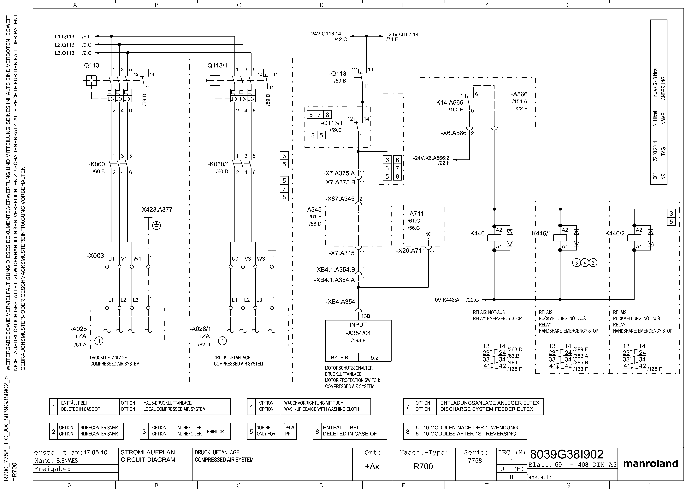

# +Ax — Sheet 59 of 403 — DRUCKLUFTANLAGE

**COMPRESSED AIR SYSTEM**

> Part of the manroland **R700** printing press IEC/UL circuit diagrams.
> Drawing class: **Stromlaufplan / Circuit diagram** (DIN A3).
> Document `+Ax` covers the **Central control console** machine section.

## At a glance

| Field | Value |
|---|---|
| Document | `+Ax`  (8039G38I902) |
| Sheet | **59** of 403 |
| Section (DE) | DRUCKLUFTANLAGE |
| Section (EN) | COMPRESSED AIR SYSTEM |
| Section type | CIRCUIT — Circuit diagram |
| Machine type | `R700` |
| Series | `7758` |
| Created | 17.05.10 |
| Replaces | — |
| Columns used | A, B, C, D, E, F, G, H |
| Path numbers | — |
| Labels on sheet | 253 |
| Cross-refs out | 31 |
| Cross-refs in | 42 |

**Previous:** [+Ax sheet 58](SHEET_0058.md) · **Next:** [+Ax sheet 60](SHEET_0060.md) · **Document TOC:** [_TOC.md](_TOC.md)  (+Ax) · **Master TOC:** [all sheets](../_MASTER_TOC.md)

## Sheet image (300 DPI, exact vector render)



_Rendered directly from the PDF vector layer at 300 DPI (1-bit), no OCR and no resampling. Use it to confirm anything ambiguous in the text below._

## Cross-references on this sheet

Each entry is a wire leaving this sheet. The printed token is `/sheet.column`; the link resolves to that sheet inside the same document.

| Ref | Target sheet | Col | Path | Destination on target | Target section | From col |
|---|---|---|---|---|---|---|
| `/42.C` | [+Ax sheet 42](SHEET_0042.md) | C | — | 24V.Q113:14 | HAUPTANTRIEB | D |
| `/9.C` | [+Ax sheet 9](SHEET_0009.md) | C | — | L1.Q113 | SPANNUNGSVERSORGUNG, SCHALTSCHRANKBELÜFTUNG | A |
| `/74.E` | [+Ax sheet 74](SHEET_0074.md) | E | — | — | FEUCHTMITTELKÜHLGERÄT | E |
| `/9.C` | [+Ax sheet 9](SHEET_0009.md) | C | — | L2.Q113 | SPANNUNGSVERSORGUNG, SCHALTSCHRANKBELÜFTUNG | A |
| `/9.C` | [+Ax sheet 9](SHEET_0009.md) | C | — | L3.Q113 | SPANNUNGSVERSORGUNG, SCHALTSCHRANKBELÜFTUNG | A |
| `/59.B` | [+Ax sheet 59](SHEET_0059.md) | B | — | — | DRUCKLUFTANLAGE | D |
| `/59.D` | [+Ax sheet 59](SHEET_0059.md) | D | — | — | DRUCKLUFTANLAGE | B |
| `/59.D` | [+Ax sheet 59](SHEET_0059.md) | D | — | — | DRUCKLUFTANLAGE | C |
| `/154.A` | [+Ax sheet 154](SHEET_0154.md) | A | — | — | ÜBERWACHUNGSRECHNER/ANSTEUERUNG NOT AUS | F |
| `/22.F` | [+Ax sheet 22](SHEET_0022.md) | F | — | — | SPANNUNGSVERSORGUNG, SCHALTSCHRANKBELÜFTUNG | F |
| `/160.F` | [+Ax sheet 160](SHEET_0160.md) | F | — | — | ÜBERWACHUNGSRECHNER/ANSTEUERUNG NOT AUS | F |
| `/59.C` | [+Ax sheet 59](SHEET_0059.md) | C | — | — | DRUCKLUFTANLAGE | D |
| `/22.F` | [+Ax sheet 22](SHEET_0022.md) | F | — | 24V.X6.A566:2 | SPANNUNGSVERSORGUNG, SCHALTSCHRANKBELÜFTUNG | E |
| `/60.B` | [+Ax sheet 60](SHEET_0060.md) | B | — | — | DRUCKLUFTANLAGE | A |
| `/60.D` | [+Ax sheet 60](SHEET_0060.md) | D | — | — | DRUCKLUFTANLAGE | C |
| `/61.G` | [+Ax sheet 61](SHEET_0061.md) | G | — | A711 | DRUCKLUFTANLAGE | E |
| `/56.C` | [+Ax sheet 56](SHEET_0056.md) | C | — | A711 | LUFTVERSORGUNG | E |
| `/61.E` | [+Ax sheet 61](SHEET_0061.md) | E | — | — | DRUCKLUFTANLAGE | D |
| `/58.D` | [+Ax sheet 58](SHEET_0058.md) | D | — | — | LUFTVERSORGUNG | D |
| `/22.G` | [+Ax sheet 22](SHEET_0022.md) | G | — | 0V.K446:A1 | SPANNUNGSVERSORGUNG, SCHALTSCHRANKBELÜFTUNG | F |
| `/198.F` | [+Ax sheet 198](SHEET_0198.md) | F | — | — | REFERENZMODUL | D |
| `/61.A` | [+Ax sheet 61](SHEET_0061.md) | A | — | — | DRUCKLUFTANLAGE | A |
| `/62.D` | [+Ax sheet 62](SHEET_0062.md) | D | — | — | DRUCKLUFTANLAGE | C |
| `/389.F` | [+Ax sheet 389](SHEET_0389.md) | F | — | — | OPTION: WASCHVORRICHTUNG MIT TUCH | G |
| `/383.A` | [+Ax sheet 383](SHEET_0383.md) | A | — | — | OPTION: INLINEFOILER PRINDOR | G |
| `/386.B` | [+Ax sheet 386](SHEET_0386.md) | B | — | — | OPTION: INLINECOATER SMART | G |
| `/168.F` | [+Ax sheet 168](SHEET_0168.md) | F | — | — | ÜBERWACHUNGSRECHNER/RÜCKMELDUNG NOT AUS | G |
| `/363.D` | [+Ax sheet 363](SHEET_0363.md) | D | — | — | OPTION: LOGISTIK AUSLEGER | F |
| `/63.B` | [+Ax sheet 63](SHEET_0063.md) | B | — | — | DRUCKLUFTANLAGE | F |
| `/48.C` | [+Ax sheet 48](SHEET_0048.md) | C | — | — | NOT AUS | F |
| `/168.F` | [+Ax sheet 168](SHEET_0168.md) | F | — | — | ÜBERWACHUNGSRECHNER/RÜCKMELDUNG NOT AUS | F |

### Incoming references (sheets that point here)

Every other sheet that sends a wire to this one. `Back-ref` is the token printed on *that* sheet; `Path` is its line number.

| From sheet | Cols | Back-ref | Path | Refs | What continues there |
|---|---|---|---|---|---|
| [+Ax#9](SHEET_0009.md) | C | `/9.C` | — | 3 | L1.Q113; L2.Q113; L3.Q113 |
| [+Ax#22](SHEET_0022.md) | F, G | `/22.F`, `/22.G` | — | 3 | 0V.K446:A1; 24V.X6.A566:2 |
| [+Ax#42](SHEET_0042.md) | C | `/42.C` | — | 1 | — |
| [+Ax#48](SHEET_0048.md) | C | `/48.C` | — | 1 | — |
| [+Ax#56](SHEET_0056.md) | C | `/56.C` | — | 1 | A711 |
| [+Ax#58](SHEET_0058.md) | D | `/58.D` | — | 1 | — |
| [+Ax#59](SHEET_0059.md) | B, C, D | `/59.B`, `/59.C`, `/59.D` | — | 4 | — |
| [+Ax#60](SHEET_0060.md) | B, D | `/60.B`, `/60.D` | — | 2 | — |
| [+Ax#61](SHEET_0061.md) | A, E, G | `/61.A`, `/61.E`, `/61.G` | — | 3 | A711 |
| [+Ax#62](SHEET_0062.md) | E | `/62.E` | — | 1 | 17 16 16 9 8 7 6 21 20 12 13 |
| [+Ax#63](SHEET_0063.md) | B | `/63.B` | — | 1 | — |
| [+Ax#74](SHEET_0074.md) | D | `/74.D` | — | 1 | 24V.Q157:14 |
| [+Ax#154](SHEET_0154.md) | A | `/154.A` | — | 1 | — |
| [+Ax#160](SHEET_0160.md) | F | `/160.F` | — | 1 | — |
| [+Ax#168](SHEET_0168.md) | F | `/168.F` | — | 3 | — |
| [+Ax#198](SHEET_0198.md) | F | `/198.F` | — | 1 | — |
| [+Ax#228](SHEET_0228.md) | A, B, C | `/228.A`, `/228.B`, `/228.C` | — | 3 | — |
| [+Ax#234](SHEET_0234.md) | E | `/234.E` | — | 2 | — |
| [+Ax#235](SHEET_0235.md) | H | `/235.H` | — | 1 | — |
| [+Ax#236](SHEET_0236.md) | E, F | `/236.E`, `/236.F` | — | 2 | — |
| [+Ax#269](SHEET_0269.md) | H | `/269.H` | — | 1 | — |
| [+Ax#289](SHEET_0289.md) | A | `/289.A` | — | 1 | — |
| [+Ax#363](SHEET_0363.md) | D | `/363.D` | — | 1 | — |
| [+Ax#383](SHEET_0383.md) | A | `/383.A` | — | 1 | — |
| [+Ax#386](SHEET_0386.md) | B | `/386.B` | — | 1 | — |
| [+Ax#389](SHEET_0389.md) | F | `/389.F` | — | 1 | — |


## Devices on this sheet

| Tag | Class | Class meaning (IEC) | Col | Sub | Terminal | Sign |
|---|---|---|---|---|---|---|
| `V1` | V | Diode / semiconductor valve | B | — | — | — |
| `W1` | W | Kabel / cable, line, bus | B | — | — | — |
| `U1` | U | Umrichter / frequency converter | A | — | — | — |
| `X003` | X | Klemme / terminal, plug connector | A | — | — | — |
| `A028` | A | Baugruppe / assembly, module, PC board | A | — | — | — |
| `V3` | V | Diode / semiconductor valve | C | — | — | — |
| `W3` | W | Kabel / cable, line, bus | C | — | — | — |
| `U3` | U | Umrichter / frequency converter | C | — | — | — |
| `A028/1` | A | Baugruppe / assembly, module, PC board | C | 1 | — | — |
| `K060/1` | K | Relais / relay, contactor | C | 1 | — | — |
| `Q113` | Q | Leistungsschalter / power switching device | A | — | — | — |
| `Q113/1` | Q | Leistungsschalter / power switching device | C | 1 | — | — |
| `K060` | K | Relais / relay, contactor | A | — | — | — |
| `Q113/1` | Q | Leistungsschalter / power switching device | D | 1 | — | — |
| `Q113` | Q | Leistungsschalter / power switching device | D | — | — | — |
| `A2` | A | Baugruppe / assembly, module, PC board | F | — | — | — |
| `A1` | A | Baugruppe / assembly, module, PC board | F | — | — | — |
| `K446` | K | Relais / relay, contactor | F | — | — | — |
| `A2` | A | Baugruppe / assembly, module, PC board | G | — | — | — |
| `A1` | A | Baugruppe / assembly, module, PC board | G | — | — | — |
| `K446/1` | K | Relais / relay, contactor | G | 1 | — | — |
| `A2` | A | Baugruppe / assembly, module, PC board | H | — | — | — |
| `A1` | A | Baugruppe / assembly, module, PC board | H | — | — | — |
| `K446/2` | K | Relais / relay, contactor | H | 2 | — | — |
| `A566` | A | Baugruppe / assembly, module, PC board | F | — | — | — |
| `A354/04` | A | Baugruppe / assembly, module, PC board | D | 04 | — | — |
| `A345` | A | Baugruppe / assembly, module, PC board | D | — | — | — |
| `A711` | A | Baugruppe / assembly, module, PC board | E | — | — | — |
| `X6.A566` | — | cross-device reference | F | — | — | — |
| `K14.A566` | — | cross-device reference | F | — | — | — |
| `X7.A345` | — | cross-device reference | D | — | — | — |
| `XB4.1.A354.B` | — | cross-device reference | D | — | — | — |
| `XB4.1.A354.A` | — | cross-device reference | D | — | — | — |
| `5.2` | — | cross-device reference | E | — | — | — |
| `XB4.A354` | — | cross-device reference | D | — | — | — |
| `X7.A375.B` | — | cross-device reference | D | — | — | — |
| `X7.A375.A` | — | cross-device reference | D | — | — | — |
| `X87.A345` | — | cross-device reference | D | — | — | — |
| `X26.A711` | — | cross-device reference | E | — | — | — |
| `NR.` | — | cross-device reference | H | — | — | — |
| `22.03.2011` | — | cross-device reference | H | — | — | — |
| `X423.A377` | — | cross-device reference | B | — | — | — |

## Potentials / nets

| Potential | Count | Columns | Attached devices | Terminals |
|---|---|---|---|---|
| `0V` | 1 | F | `K446` | `A1` |
| `24V` | 3 | D, E | `A566`, `Q113`, `Q157`, `X6` | `14`, `2` |
| `L1` | 3 | A, C | `Q113` | — |
| `L2` | 3 | A, B, C | `Q113` | — |
| `L3` | 3 | A, B, C | `Q113` | — |


A potential such as `L24+/4` or `M24+` is a named supply/return rail; every place it appears on this sheet is electrically common.

## Wire-end annotations (grouped as printed)

A wire that continues elsewhere is annotated with a small cluster: the destination description, the path/line number `#NN`, and the `/sheet.column` cross reference. Each row below is one such cluster exactly as it is grouped on the drawing.

| Col | Y | Path | Cross-ref | Text on the wire |
|---|---|---|---|---|
| D | 54.1 | — | `/42.C` | `24V.Q113:14` |
| E | 55.6 | — | — | `24V.Q157:14` |
| A | 59.1 | — | `/9.C` | `L1.Q113` |
| E | 64.0 | — | `/74.E` | — |
| A | 73.3 | — | `/9.C` | `L2.Q113` |
| A | 87.4 | — | `/9.C` | `L3.Q113` |
| A | 108.0 | — | — | `Q113` |
| C | 108.0 | — | — | `Q113/1` |
| H | 114.3 | — | — | `001 22.03.2011 N. Hitzel Hinweis 6 8 hinzu` |
| A | 115.8 | — | — | `1` |
| B | 115.8 | — | — | `3` |
| B | 115.8 | — | — | `5` |
| C | 115.8 | — | — | `1` |
| C | 115.8 | — | — | `3` |
| C | 115.8 | — | — | `5` |
| D | 115.8 | — | — | `Q113 14` |
| D | 115.8 | — | — | `12` |
| B | 124.9 | — | — | `12 14` |
| C | 124.9 | — | — | `12 14` |
| H | 132.0 | — | — | `NR. NAME TAG ÄNDERUNG` |
| D | 135.2 | — | `/59.B` | — |
| E | 144.2 | — | — | `11` |
| B | 147.6 | — | — | `11` |
| C | 147.6 | — | — | `11` |
| F | 157.6 | — | — | `A566` |
| F | 158.4 | — | — | `K14.A566 6` |
| F | 158.4 | — | — | `4` |
| B | 161.3 | — | `/59.D` | — |
| C | 161.3 | — | `/59.D` | — |
| F | 170.7 | — | `/154.A` | — |
| F | 183.1 | — | `/22.F` | — |
| F | 184.9 | — | `/160.F` | — |
| A | 186.7 | — | — | `2` |
| B | 186.7 | — | — | `4` |
| B | 186.7 | — | — | `6` |
| C | 186.7 | — | — | `2` |
| C | 186.7 | — | — | `4` |
| C | 186.7 | — | — | `6` |
| F | 186.7 | — | — | `5` |
| D | 193.0 | — | — | `5 7 8` |
| D | 200.9 | — | — | `Q113/1 14` |
| D | 200.9 | — | — | `12` |
| D | 220.3 | — | `/59.C` | — |
| F | 224.2 | — | — | `X6.A566 2` |
| F | 225.7 | — | — | `1` |
| D | 228.5 | — | — | `3 5` |
| D | 229.2 | — | — | `11` |
| D | 263.9 | — | — | `3 5` |
| A | 264.6 | — | — | `1` |
| B | 264.6 | — | — | `3` |
| B | 264.6 | — | — | `5` |
| C | 264.6 | — | — | `1` |
| C | 264.6 | — | — | `3` |
| C | 264.6 | — | — | `5` |
| E | 268.1 | — | `/22.F` | `24V.X6.A566:2` |
| E | 271.0 | — | — | `3 6` |
| E | 271.0 | — | — | `8 6 7` |
| A | 278.1 | — | — | `K060 6` |
| C | 278.1 | — | — | `K060/1 6` |
| A | 291.1 | — | `/60.B` | — |
| C | 291.2 | — | `/60.D` | — |
| A | 293.0 | — | — | `2` |
| B | 293.0 | — | — | `4` |
| C | 293.0 | — | — | `2` |
| C | 293.0 | — | — | `4` |
| D | 293.7 | — | — | `X7.A375.A 11` |
| E | 299.3 | — | — | `5` |
| D | 306.4 | — | — | `5 8 7` |
| D | 309.3 | — | — | `X7.A375.B 11` |
| D | 337.6 | — | — | `X87.A345 6` |
| B | 356.1 | — | — | `X423.A377` |
| D | 356.1 | — | — | `A345` |
| E | 363.1 | — | `/61.G`, `/56.C` | `A711` |
| H | 363.1 | — | — | `3 5` |
| D | 369.1 | — | `/61.E`, `/58.D` | — |
| F | 392.2 | — | — | `A2` |
| G | 392.2 | — | — | `A2` |
| H | 392.2 | — | — | `A2` |
| F | 397.1 | — | — | `K446` |
| G | 397.2 | — | — | `K446/1` |
| H | 397.2 | — | — | `K446/2` |
| E | 400.3 | — | — | `NC` |
| F | 420.5 | — | — | `A1` |
| G | 420.5 | — | — | `A1` |
| H | 420.5 | — | — | `A1` |
| E | 426.9 | — | — | `X26.A711 11` |
| D | 431.2 | — | — | `X7.A345 11` |
| A | 435.2 | — | — | `X003 U1` |
| B | 440.6 | — | — | `'` |
| C | 440.6 | — | — | `'` |
| B | 441.6 | — | — | `V1 W1` |
| C | 441.6 | — | — | `V3 W3` |
| C | 441.8 | — | — | `U3` |
| G | 449.6 | — | — | `3 4 2` |
| D | 459.5 | — | — | `XB4.1.A354.B 11` |
| D | 476.5 | — | — | `XB4.1.A354.A 11` |
| B | 511.5 | — | — | `'` |
| C | 511.5 | — | — | `'` |
| F | 512.6 | — | `/22.G` | `0V.K446:A1` |
| A | 512.7 | — | — | `L1` |
| B | 512.7 | — | — | `L2 L3` |
| C | 512.7 | — | — | `L1` |
| C | 512.7 | — | — | `L2 L3` |
| D | 514.8 | — | — | `XB4.A354 11` |
| F | 534.9 | — | — | `RELAIS: NOT AUS RELAY: EMERGENCY STOP` |
| G | 534.9 | — | — | `RELAIS: RÜCKMELDUNG: NOT AUS RELAY: HANDSHAKE: EMERGENCY STOP` |
| H | 534.9 | — | — | `RELAIS: RÜCKMELDUNG: NOT AUS RELAY: HANDSHAKE: EMERGENCY STOP` |
| E | 540.3 | — | — | `13B` |
| D | 554.8 | — | — | `INPUT` |
| A | 561.6 | — | — | `A028` |
| C | 561.6 | — | — | `A028/1` |
| D | 568.6 | — | — | `A354/04` |
| A | 574.2 | — | — | `+ZA` |
| C | 574.2 | — | — | `+ZA` |
| D | 582.4 | — | `/198.F` | — |
| B | 583.7 | — | — | `1 1` |
| A | 589.5 | — | `/61.A` | — |
| C | 589.5 | — | `/62.D` | — |
| F | 591.3 | — | — | `13 14` |
| G | 591.3 | — | — | `13 14` |
| H | 591.3 | — | — | `13 14` |
| F | 597.7 | — | `/363.D`, `/63.B`, `/48.C`, `/168.F` | — |
| G | 597.7 | — | `/389.F`, `/383.A`, `/386.B`, `/168.F` | — |
| F | 602.6 | — | — | `23 33 34 24` |
| G | 602.6 | — | — | `23 33 34 24` |
| H | 602.6 | — | — | `23 33 34 24` |
| D | 611.5 | — | — | `BYTE.BIT 5.2` |
| A | 612.9 | — | — | `DRUCKLUFTANLAGE` |
| C | 612.9 | — | — | `DRUCKLUFTANLAGE` |
| A | 623.5 | — | — | `COMPRESSED AIR SYSTEM` |
| C | 623.5 | — | — | `COMPRESSED AIR SYSTEM` |
| F | 625.3 | — | — | `41 42` |
| G | 625.3 | — | — | `41 42` |
| H | 625.3 | — | — | `41 42 /168.F` |
| D | 630.6 | — | — | `DRUCKLUFTANLAGE MOTORSCHUTZSCHALTER: MOTOR PROTECTION SWITCH: COMPRESSED AIR SYSTEM` |
| F | 689.8 | — | — | `ENTLADUNGSANLAGE ANLEGER ELTEX DISCHARGE SYSTEM FEEDER ELTEX` |
| B | 690.8 | — | — | `1 HAUS DRUCKLUFTANLAGE LOCAL COMPRESSED AIR SYSTEM 4 OPTION OPTION` |
| A | 690.8 | — | — | `ENTFÄLLT BEI DELETED IN CASE OF` |
| B | 690.8 | — | — | `OPTION OPTION` |
| D | 690.8 | — | — | `WASCHVORRICHTUNG MIT TUCH WASH UP DEVICE WITH WASHING CLOTH 7 OPTION OPTION` |
| D | 732.3 | — | — | `3 OPTION OPTION INLINEFOILER INLINEFOILER PRINDOR 5 10 MODULEN NACH DER 1. WENDUNG 5 10 MODULES AFTER 1ST REVERSING` |
| D | 732.3 | — | — | `6 ENTFÄLLT BEI DELETED IN CASE OF 8` |
| D | 733.2 | — | — | `PP S+W` |
| B | 733.3 | — | — | `INLINECOATER SMART INLINECOATER SMART 5 NUR BEI` |
| A | 733.4 | — | — | `2 OPTION OPTION` |
| C | 744.0 | — | — | `ONLY FOR` |


## Reconstructed tables

This sheet carries tabular content (pin map / terminal assignment / index). The grid below was rebuilt from the drawing's own rule lines, so each row is exactly one physical row of the table.

### Table 1 — 7 data rows × 5 columns (at x=148.8, y=62.4) — **/9.C**

| Q113 |  |  |  | 1 |
|---|---|---|---|---|
|  |  |  |  | `2` |
|  |  | `K060 /60.B` |  | `1 2` |
|  | `X003` |  |  | `U1` |
|  |  |  | `L1` |  |
|  |  | `1` |  |  |
|  |  |  | `DRUCKLUFTANLAGE` |  |
|  |  | `COMPRESSED` |  |  |


### Table 2 — 8 data rows × 6 columns (at x=205.5, y=62.4)

| 3 |  | 5 | 12 | 14 |  |
|---|---|---|---|---|---|
|  |  |  | `11` |  |  |
|  |  |  | `/59.D` |  |  |
| `4` |  | `6` |  |  |  |
| `3 4` |  | `5 6` |  |  |  |
|  | `V1` |  | `W1` | `X423.A377 '` |  |
| `L2` |  |  | `L3` | `'` |  |
|  |  |  |  |  | `A028/1 +ZA /62.D` |
| `AIR` |  |  | `SYSTEM` |  |  |


### Table 3 — 7 data rows × 4 columns (at x=369.9, y=62.4)

| Q113/1 |  |  | 1 |
|---|---|---|---|
|  |  |  | `2` |
| `K060/1` | `/60.D` |  | `1 2` |
|  |  |  | `U3` |
|  |  | `L1` |  |
|  | `1` |  |  |
|  |  | `DRUCKLUFTANLAGE` |  |
|  | `COMPRESSED` |  |  |


### Table 4 — 7 data rows × 22 columns (at x=418.1, y=62.4) — **/42.C /74.E 3 5 12 14 12 Q113 hinzu 8 11 /59.B ÄNDERUNG 6 4 6 A566 Hinweis /59.D /154.A**

| 4 |  | 6 |  |  | 5 7 3 5 | 8 12 Q113/1 /59.C | 11 | 14 |  |  |  | K14.A566 /160.F X6.A566 | 5 2 | 1 | /22.F |  |  |  |  |  | Hitzel NAME N. 22.03.2011 TAG |
|---|---|---|---|---|---|---|---|---|---|---|---|---|---|---|---|---|---|---|---|---|---|
| `3 4` |  | `5 6` |  | `3 5 5 7 8` |  | `X7.A375.A X7.A375.B X87.A345` | `11 11 6` |  |  | `6 3 5` | `6 7 8` | `24V.X6.A566:2 /22.F` |  |  |  |  |  |  |  |  | `001 NR.` |
|  | `V3` |  | `W3` | `'` | `A345 /61.E /58.D` | `X7.A345 XB4.1.A354.B XB4.1.A354.A` | `11 11 11` |  |  |  | `A711 /61.G /56.C NC X26.A711` | `11` | `K446` | `A2 A1` |  | `K446/1` | `A2 A1` | `3 4 2` | `K446/2` | `A2 A1` | `3 5` |
| `L2` |  |  | `L3` | `'` |  | `XB4.A354` | `11` | `13B` |  |  |  | `0V.K446:A1` | `/22.G RELAIS: RELAY:` | `NOT AUS EMERGENCY` | `STOP` | `RELAIS: RÜCKMELDUNG:` |  | `NOT AUS` | `RELAIS: RÜCKMELDUNG:` |  | `NOT AUS` |
|  |  |  |  |  |  | `INPUT` | `A354/04 /198.F` |  |  |  |  |  | `13 23` | `14 24` | `/363.D` | `RELAY: HANDSHAKE: 13 23` | `EMERGENCY 14 24` | `STOP /389.F` | `RELAY: HANDSHAKE: 13 23` | `EMERGENCY 14 24` | `STOP` |
|  |  |  |  |  |  | `BYTE.BIT` |  |  | `5.2` |  |  |  | `33` | `34` | `/63.B` | `33` | `34` | `/383.A` | `33` | `34` |  |
| `AIR` |  |  | `SYSTEM` |  |  | `MOTORSCHUTZSCHALTER:` |  |  |  |  |  |  | `41` | `42` | `/48.C /168.F` | `41` | `42` | `/386.B /168.F` | `41` | `42` | `/168.F` |
|  |  |  |  |  |  | `DRUCKLUFTANLAGE MOTOR PROTECTION` |  |  | `SWITCH:` |  |  |  |  |  |  |  |  |  |  |  |  |


## Notes and free text on this sheet

| Text | Col | Y (pt) |
|---|---|---|
| `+ZA` | A | 574.24 |
| `DRUCKLUFTANLAGE` | A | 612.92 |
| `COMPRESSED AIR SYSTEM` | A | 623.54 |
| `+ZA` | C | 574.24 |
| `DRUCKLUFTANLAGE` | C | 612.92 |
| `COMPRESSED AIR SYSTEM` | C | 623.54 |
| `RELAIS: NOT AUS` | F | 534.94 |
| `RELAY: EMERGENCY STOP` | F | 545.58 |
| `RELAIS:` | G | 534.89 |
| `RÜCKMELDUNG: NOT AUS` | G | 545.61 |
| `RELAY:` | G | 556.15 |
| `HANDSHAKE: EMERGENCY STOP` | G | 566.85 |
| `42 /168.F` | H | 625.31 |
| `RELAIS:` | H | 534.89 |
| `RÜCKMELDUNG: NOT AUS` | H | 545.61 |
| `RELAY:` | H | 556.15 |
| `HANDSHAKE: EMERGENCY STOP` | H | 566.85 |
| `13B` | E | 540.29 |
| `INPUT` | D | 554.81 |
| `BYTE.BIT` | D | 612.06 |
| `MOTORSCHUTZSCHALTER:` | D | 630.64 |
| `DRUCKLUFTANLAGE` | D | 641.27 |
| `MOTOR PROTECTION SWITCH:` | D | 651.88 |
| `COMPRESSED AIR SYSTEM` | D | 662.52 |
| `TAG` | H | 253.38 |
| `NAME` | H | 193.97 |
| `ÄNDERUNG` | H | 131.99 |
| `N. Hitzel` | H | 191.05 |
| `Hinweis 6 8 hinzu` | H | 114.28 |
| `OPTION` | A | 733.35 |
| `INLINECOATER SMART` | A | 733.38 |
| `NUR BEI` | C | 733.33 |
| `ONLY FOR` | C | 744.02 |
| `S+W` | D | 733.24 |
| `PP` | D | 743.87 |
| `NC` | E | 400.27 |
| `ENTLADUNGSANLAGE ANLEGER ELTEX` | F | 689.8 |
| `DISCHARGE SYSTEM FEEDER ELTEX` | F | 700.42 |
| `5 10 MODULEN NACH DER 1. WENDUNG` | F | 732.33 |
| `5 10 MODULES AFTER 1ST REVERSING` | F | 742.95 |
| `PRINDOR` | C | 740.47 |
| `INLINEFOILER` | B | 733.37 |
| `OPTION` | B | 733.35 |
| `ENTFÄLLT BEI` | A | 690.83 |
| `DELETED IN CASE OF` | A | 701.48 |
| `HAUS DRUCKLUFTANLAGE` | B | 690.88 |
| `LOCAL COMPRESSED AIR SYSTEM` | B | 701.49 |
| `OPTION` | C | 690.83 |
| `WASCHVORRICHTUNG MIT TUCH` | D | 690.87 |
| `WASH UP DEVICE WITH WASHING CLOTH` | D | 701.46 |
| `OPTION` | E | 690.83 |
| `ENTFÄLLT BEI` | D | 732.3 |
| `DELETED IN CASE OF` | D | 742.94 |

## Complete label inventory (exact text from the drawing)

Every text object inside the drawing area of this sheet, in DIN reading order (column A→H, then top→bottom). This is the authoritative list: if a string is not here it is not printed on this sheet.

| Col | Y | X | Dir | Type | Text |
|---|---|---|---|---|---|
| A | 59.1 | 94.4 | → | potential | `L1.Q113` |
| A | 59.1 | 141.4 | → | cross-reference | `/9.C` |
| A | 73.3 | 94.4 | → | potential | `L2.Q113` |
| A | 73.3 | 141.4 | → | cross-reference | `/9.C` |
| A | 87.4 | 141.4 | → | cross-reference | `/9.C` |
| A | 87.5 | 94.4 | → | potential | `L3.Q113` |
| A | 108.0 | 141.2 | → | device tag | `Q113` |
| A | 115.8 | 193.3 | → | number | `1` |
| A | 186.7 | 193.9 | → | number | `2` |
| A | 264.7 | 193.3 | → | number | `1` |
| A | 278.1 | 152.2 | → | device tag | `K060` |
| A | 291.2 | 159.6 | → | cross-reference | `/60.B` |
| A | 293.0 | 193.9 | → | number | `2` |
| A | 435.2 | 149.1 | → | device tag | `X003` |
| A | 441.8 | 186.2 | → | device tag | `U1` |
| A | 512.7 | 186.2 | → | potential | `L1` |
| A | 561.6 | 121.0 | → | device tag | `A028` |
| A | 574.2 | 128.7 | → | text | `+ZA` |
| A | 583.7 | 168.3 | → | number | `1` |
| A | 589.5 | 128.1 | → | cross-reference | `/61.A` |
| A | 612.9 | 155.1 | → | text | `DRUCKLUFTANLAGE` |
| A | 623.5 | 155.6 | → | text | `COMPRESSED AIR SYSTEM` |
| A | 690.8 | 105.4 | → | text | `ENTFÄLLT BEI` |
| A | 696.2 | 89.6 | → | number | `1` |
| A | 701.5 | 105.4 | → | text | `DELETED IN CASE OF` |
| A | 733.4 | 101.8 | → | text | `OPTION` |
| A | 733.4 | 136.6 | → | text | `INLINECOATER SMART` |
| A | 738.7 | 89.3 | → | number | `2` |
| A | 744.0 | 101.8 | → | text | `OPTION` |
| A | 744.0 | 136.6 | → | text | `INLINECOATER SMART` |
| B | 115.8 | 208.1 | → | number | `3` |
| B | 115.8 | 222.2 | → | number | `5` |
| B | 124.9 | 230.5 | → | number | `12` |
| B | 124.9 | 257.4 | → | number | `14` |
| B | 147.6 | 250.3 | → | number | `11` |
| B | 161.3 | 244.8 | ↕ | cross-reference | `/59.D` |
| B | 186.7 | 208.1 | → | number | `4` |
| B | 186.7 | 222.2 | → | number | `6` |
| B | 264.7 | 208.1 | → | number | `3` |
| B | 264.7 | 222.2 | → | number | `5` |
| B | 293.0 | 208.1 | → | number | `4` |
| B | 293.0 | 222.2 | → | number | `6` |
| B | 356.0 | 240.7 | → | device ref | `X423.A377` |
| B | 440.6 | 257.4 | → | other | `'` |
| B | 441.6 | 229.6 | → | device tag | `W1` |
| B | 441.8 | 208.3 | → | device tag | `V1` |
| B | 511.5 | 257.4 | → | other | `'` |
| B | 512.7 | 207.5 | → | potential | `L2` |
| B | 512.7 | 228.8 | → | potential | `L3` |
| B | 690.8 | 208.1 | → | text | `OPTION` |
| B | 690.9 | 247.2 | → | text | `HAUS DRUCKLUFTANLAGE` |
| B | 701.5 | 208.1 | → | text | `OPTION` |
| B | 701.5 | 247.2 | → | text | `LOCAL COMPRESSED AIR SYSTEM` |
| B | 733.4 | 261.9 | → | text | `OPTION` |
| B | 733.4 | 303.9 | → | text | `INLINEFOILER` |
| B | 738.7 | 245.1 | → | number | `3` |
| B | 744.0 | 261.9 | → | text | `OPTION` |
| B | 744.0 | 303.9 | → | text | `INLINEFOILER` |
| C | 108.0 | 353.5 | → | device tag | `Q113/1` |
| C | 115.8 | 405.9 | → | number | `1` |
| C | 115.8 | 420.7 | → | number | `3` |
| C | 115.8 | 434.8 | → | number | `5` |
| C | 124.9 | 443.1 | → | number | `12` |
| C | 124.9 | 470.0 | → | number | `14` |
| C | 147.6 | 462.9 | → | number | `11` |
| C | 161.3 | 457.4 | ↕ | cross-reference | `/59.D` |
| C | 186.7 | 406.5 | → | number | `2` |
| C | 186.7 | 420.7 | → | number | `4` |
| C | 186.7 | 434.8 | → | number | `6` |
| C | 264.7 | 405.9 | → | number | `1` |
| C | 264.7 | 420.7 | → | number | `3` |
| C | 264.7 | 434.8 | → | number | `5` |
| C | 278.1 | 357.4 | → | device tag | `K060/1` |
| C | 291.2 | 371.9 | → | cross-reference | `/60.D` |
| C | 293.0 | 406.5 | → | number | `2` |
| C | 293.0 | 420.7 | → | number | `4` |
| C | 293.0 | 434.8 | → | number | `6` |
| C | 440.6 | 470.0 | → | other | `'` |
| C | 441.6 | 442.2 | → | device tag | `W3` |
| C | 441.8 | 398.8 | → | device tag | `U3` |
| C | 441.8 | 420.9 | → | device tag | `V3` |
| C | 511.5 | 470.0 | → | other | `'` |
| C | 512.7 | 398.8 | → | potential | `L1` |
| C | 512.7 | 420.1 | → | potential | `L2` |
| C | 512.7 | 441.4 | → | potential | `L3` |
| C | 561.6 | 326.3 | → | device tag | `A028/1` |
| C | 574.2 | 341.3 | → | text | `+ZA` |
| C | 583.7 | 380.9 | → | number | `1` |
| C | 589.5 | 340.7 | → | cross-reference | `/62.D` |
| C | 612.9 | 367.7 | → | text | `DRUCKLUFTANLAGE` |
| C | 623.5 | 368.2 | → | text | `COMPRESSED AIR SYSTEM` |
| C | 690.8 | 446.2 | → | text | `OPTION` |
| C | 696.2 | 429.4 | → | number | `4` |
| C | 701.5 | 446.2 | → | text | `OPTION` |
| C | 733.3 | 441.4 | → | text | `NUR BEI` |
| C | 738.7 | 429.3 | → | number | `5` |
| C | 740.5 | 356.3 | → | text | `PRINDOR` |
| C | 744.0 | 441.9 | → | text | `ONLY FOR` |
| D | 54.2 | 532.6 | → | potential | `24V.Q113:14` |
| D | 64.1 | 576.0 | → | cross-reference | `/42.C` |
| D | 115.8 | 604.6 | → | number | `12` |
| D | 122.2 | 566.4 | → | device tag | `Q113` |
| D | 135.2 | 574.9 | → | cross-reference | `/59.B` |
| D | 193.0 | 532.1 | → | number | `5 7 8` |
| D | 200.9 | 597.5 | → | number | `12` |
| D | 207.2 | 551.9 | → | device tag | `Q113/1` |
| D | 220.3 | 567.5 | → | cross-reference | `/59.C` |
| D | 228.5 | 535.6 | → | number | `3` |
| D | 228.5 | 549.8 | → | number | `5` |
| D | 229.2 | 618.5 | → | number | `11` |
| D | 263.9 | 486.0 | → | number | `3` |
| D | 278.1 | 486.0 | → | number | `5` |
| D | 293.7 | 556.4 | → | device ref | `X7.A375.A` |
| D | 293.7 | 618.5 | → | number | `11` |
| D | 306.4 | 486.0 | → | number | `5` |
| D | 309.3 | 557.3 | → | device ref | `X7.A375.B` |
| D | 310.7 | 618.5 | → | number | `11` |
| D | 320.6 | 486.1 | → | number | `7` |
| D | 334.8 | 486.0 | → | number | `8` |
| D | 337.6 | 559.8 | → | device ref | `X87.A345` |
| D | 339.1 | 619.1 | → | number | `6` |
| D | 356.1 | 525.0 | → | device tag | `A345` |
| D | 369.1 | 532.6 | → | cross-reference | `/61.E` |
| D | 381.5 | 532.1 | → | cross-reference | `/58.D` |
| D | 431.2 | 565.8 | → | device ref | `X7.A345` |
| D | 431.2 | 618.5 | → | number | `11` |
| D | 459.5 | 541.4 | → | device ref | `XB4.1.A354.B` |
| D | 459.5 | 618.5 | → | number | `11` |
| D | 476.5 | 618.5 | → | number | `11` |
| D | 477.2 | 540.6 | → | device ref | `XB4.1.A354.A` |
| D | 514.8 | 560.1 | → | device ref | `XB4.A354` |
| D | 523.3 | 618.5 | → | number | `11` |
| D | 554.8 | 601.7 | → | text | `INPUT` |
| D | 568.7 | 595.1 | → | device tag | `A354/04` |
| D | 582.4 | 604.2 | → | cross-reference | `/198.F` |
| D | 612.1 | 569.8 | → | text | `BYTE.BIT` |
| D | 630.6 | 559.3 | → | text | `MOTORSCHUTZSCHALTER:` |
| D | 641.3 | 559.0 | → | text | `DRUCKLUFTANLAGE` |
| D | 651.9 | 559.3 | → | text | `MOTOR PROTECTION SWITCH:` |
| D | 662.5 | 559.6 | → | text | `COMPRESSED AIR SYSTEM` |
| D | 690.9 | 489.0 | → | text | `WASCHVORRICHTUNG MIT TUCH` |
| D | 701.5 | 489.0 | → | text | `WASH UP DEVICE WITH WASHING CLOTH` |
| D | 732.3 | 555.4 | → | text | `ENTFÄLLT BEI` |
| D | 733.2 | 491.5 | → | text | `S+W` |
| D | 738.7 | 542.8 | → | number | `6` |
| D | 742.9 | 555.4 | → | text | `DELETED IN CASE OF` |
| D | 743.9 | 491.0 | → | text | `PP` |
| E | 55.6 | 665.9 | → | potential | `24V.Q157:14` |
| E | 64.0 | 664.7 | → | cross-reference | `/74.E` |
| E | 115.8 | 632.7 | → | number | `14` |
| E | 144.2 | 625.6 | → | number | `11` |
| E | 200.9 | 625.6 | → | number | `14` |
| E | 268.1 | 710.9 | → | potential | `24V.X6.A566:2` |
| E | 271.0 | 663.3 | → | number | `6` |
| E | 271.0 | 681.0 | → | number | `6` |
| E | 276.6 | 754.0 | → | cross-reference | `/22.F` |
| E | 285.2 | 663.2 | → | number | `3` |
| E | 285.2 | 681.0 | → | number | `7` |
| E | 299.3 | 663.2 | → | number | `5` |
| E | 299.3 | 680.9 | → | number | `8` |
| E | 363.1 | 701.3 | → | device tag | `A711` |
| E | 376.2 | 701.6 | → | cross-reference | `/61.G` |
| E | 388.6 | 701.6 | → | cross-reference | `/56.C` |
| E | 400.3 | 732.1 | → | text | `NC` |
| E | 426.9 | 681.7 | → | device ref | `X26.A711` |
| E | 431.2 | 739.0 | → | number | `11` |
| E | 540.3 | 621.4 | → | text | `13B` |
| E | 611.5 | 638.1 | → | device ref | `5.2` |
| E | 690.8 | 715.5 | → | text | `OPTION` |
| E | 696.2 | 698.7 | → | number | `7` |
| E | 701.5 | 715.5 | → | text | `OPTION` |
| E | 738.7 | 698.6 | → | number | `8` |
| F | 157.6 | 879.3 | → | device tag | `A566` |
| F | 158.4 | 793.4 | → | number | `4` |
| F | 158.4 | 817.5 | → | number | `6` |
| F | 170.7 | 881.6 | → | cross-reference | `/154.A` |
| F | 171.8 | 746.9 | → | device ref | `K14.A566` |
| F | 183.1 | 887.2 | → | cross-reference | `/22.F` |
| F | 184.9 | 771.9 | → | cross-reference | `/160.F` |
| F | 186.7 | 810.4 | → | number | `5` |
| F | 224.2 | 758.6 | → | device ref | `X6.A566` |
| F | 225.7 | 810.4 | → | number | `2` |
| F | 225.7 | 852.4 | → | number | `1` |
| F | 392.2 | 853.2 | → | device tag | `A2` |
| F | 397.2 | 805.6 | → | device tag | `K446` |
| F | 420.5 | 853.2 | → | device tag | `A1` |
| F | 512.6 | 748.3 | → | potential | `0V.K446:A1` |
| F | 512.6 | 802.5 | → | cross-reference | `/22.G` |
| F | 534.9 | 814.1 | → | text | `RELAIS: NOT AUS` |
| F | 545.6 | 814.1 | → | text | `RELAY: EMERGENCY STOP` |
| F | 591.3 | 830.6 | → | number | `13` |
| F | 591.3 | 857.8 | → | number | `14` |
| F | 597.7 | 873.1 | → | cross-reference | `/363.D` |
| F | 602.6 | 830.6 | → | number | `23` |
| F | 602.6 | 858.6 | → | number | `24` |
| F | 609.0 | 873.1 | → | cross-reference | `/63.B` |
| F | 614.0 | 830.6 | → | number | `33` |
| F | 614.0 | 858.3 | → | number | `34` |
| F | 620.4 | 873.1 | → | cross-reference | `/48.C` |
| F | 625.3 | 832.0 | → | number | `41` |
| F | 625.3 | 858.6 | → | number | `42` |
| F | 631.7 | 873.1 | → | cross-reference | `/168.F` |
| F | 689.8 | 757.4 | → | text | `ENTLADUNGSANLAGE ANLEGER ELTEX` |
| F | 700.4 | 757.4 | → | text | `DISCHARGE SYSTEM FEEDER ELTEX` |
| F | 732.3 | 715.5 | → | text | `5 10 MODULEN NACH DER 1. WENDUNG` |
| F | 743.0 | 715.5 | → | text | `5 10 MODULES AFTER 1ST REVERSING` |
| G | 392.2 | 966.6 | → | device tag | `A2` |
| G | 397.2 | 911.6 | → | device tag | `K446/1` |
| G | 420.5 | 966.6 | → | device tag | `A1` |
| G | 449.6 | 990.1 | → | number | `3` |
| G | 449.6 | 1004.3 | → | number | `4` |
| G | 449.6 | 1018.5 | → | number | `2` |
| G | 534.9 | 927.5 | → | text | `RELAIS:` |
| G | 545.6 | 927.5 | → | text | `RÜCKMELDUNG: NOT AUS` |
| G | 556.2 | 927.5 | → | text | `RELAY:` |
| G | 566.9 | 927.5 | → | text | `HANDSHAKE: EMERGENCY STOP` |
| G | 591.3 | 943.9 | → | number | `13` |
| G | 591.3 | 971.1 | → | number | `14` |
| G | 597.7 | 986.5 | → | cross-reference | `/389.F` |
| G | 602.6 | 943.9 | → | number | `23` |
| G | 602.6 | 972.0 | → | number | `24` |
| G | 609.0 | 986.5 | → | cross-reference | `/383.A` |
| G | 614.0 | 943.9 | → | number | `33` |
| G | 614.0 | 971.7 | → | number | `34` |
| G | 620.3 | 986.5 | → | cross-reference | `/386.B` |
| G | 625.3 | 945.4 | → | number | `41` |
| G | 625.3 | 972.0 | → | number | `42` |
| G | 631.7 | 986.5 | → | cross-reference | `/168.F` |
| H | 114.3 | 1124.3 | ↕ | text | `Hinweis 6 8 hinzu` |
| H | 132.0 | 1138.5 | ↕ | text | `ÄNDERUNG` |
| H | 191.1 | 1124.3 | ↕ | text | `N. Hitzel` |
| H | 194.0 | 1138.4 | ↕ | text | `NAME` |
| H | 242.3 | 1124.3 | ↕ | device ref | `22.03.2011` |
| H | 253.4 | 1138.4 | ↕ | text | `TAG` |
| H | 296.4 | 1124.2 | ↕ | number | `001` |
| H | 296.8 | 1138.3 | ↕ | device ref | `NR.` |
| H | 363.1 | 1152.1 | → | number | `3` |
| H | 377.3 | 1152.1 | → | number | `5` |
| H | 392.2 | 1094.2 | → | device tag | `A2` |
| H | 397.2 | 1037.8 | → | device tag | `K446/2` |
| H | 420.5 | 1094.2 | → | device tag | `A1` |
| H | 534.9 | 1055.1 | → | text | `RELAIS:` |
| H | 545.6 | 1055.1 | → | text | `RÜCKMELDUNG: NOT AUS` |
| H | 556.2 | 1055.1 | → | text | `RELAY:` |
| H | 566.9 | 1055.1 | → | text | `HANDSHAKE: EMERGENCY STOP` |
| H | 591.3 | 1071.5 | → | number | `13` |
| H | 591.3 | 1098.7 | → | number | `14` |
| H | 602.6 | 1071.5 | → | number | `23` |
| H | 602.6 | 1099.6 | → | number | `24` |
| H | 614.0 | 1071.5 | → | number | `33` |
| H | 614.0 | 1099.3 | → | number | `34` |
| H | 625.3 | 1072.9 | → | number | `41` |
| H | 625.3 | 1099.6 | → | text | `42 /168.F` |

## Reading-order text block

The same content as a plain block, grouped by DIN column — convenient to paste or to match against a visual description.

```text
=== Column A ===
  59.1   94.4  net          L1.Q113
  59.1  141.4  xref         /9.C
  73.3   94.4  net          L2.Q113
  73.3  141.4  xref         /9.C
  87.4  141.4  xref         /9.C
  87.5   94.4  net          L3.Q113
 108.0  141.2  devtag       Q113
 115.8  193.3  numeric      1
 186.7  193.9  numeric      2
 264.7  193.3  numeric      1
 278.1  152.2  devtag       K060
 291.2  159.6  xref         /60.B
 293.0  193.9  numeric      2
 435.2  149.1  devtag       X003
 441.8  186.2  devtag       U1
 512.7  186.2  net          L1
 561.6  121.0  devtag       A028
 574.2  128.7  text         +ZA
 583.7  168.3  numeric      1
 589.5  128.1  xref         /61.A
 612.9  155.1  text         DRUCKLUFTANLAGE
 623.5  155.6  text         COMPRESSED AIR SYSTEM
 690.8  105.4  text         ENTFÄLLT BEI
 696.2   89.6  numeric      1
 701.5  105.4  text         DELETED IN CASE OF
 733.4  101.8  text         OPTION
 733.4  136.6  text         INLINECOATER SMART
 738.7   89.3  numeric      2
 744.0  101.8  text         OPTION
 744.0  136.6  text         INLINECOATER SMART
=== Column B ===
 115.8  208.1  numeric      3
 115.8  222.2  numeric      5
 124.9  230.5  numeric      12
 124.9  257.4  numeric      14
 147.6  250.3  numeric      11
 161.3  244.8  xref         /59.D
 186.7  208.1  numeric      4
 186.7  222.2  numeric      6
 264.7  208.1  numeric      3
 264.7  222.2  numeric      5
 293.0  208.1  numeric      4
 293.0  222.2  numeric      6
 356.0  240.7  devref       X423.A377
 440.6  257.4  other        `
 441.6  229.6  devtag       W1
 441.8  208.3  devtag       V1
 511.5  257.4  other        `
 512.7  207.5  net          L2
 512.7  228.8  net          L3
 690.8  208.1  text         OPTION
 690.9  247.2  text         HAUS DRUCKLUFTANLAGE
 701.5  208.1  text         OPTION
 701.5  247.2  text         LOCAL COMPRESSED AIR SYSTEM
 733.4  261.9  text         OPTION
 733.4  303.9  text         INLINEFOILER
 738.7  245.1  numeric      3
 744.0  261.9  text         OPTION
 744.0  303.9  text         INLINEFOILER
=== Column C ===
 108.0  353.5  devtag       Q113/1
 115.8  405.9  numeric      1
 115.8  420.7  numeric      3
 115.8  434.8  numeric      5
 124.9  443.1  numeric      12
 124.9  470.0  numeric      14
 147.6  462.9  numeric      11
 161.3  457.4  xref         /59.D
 186.7  406.5  numeric      2
 186.7  420.7  numeric      4
 186.7  434.8  numeric      6
 264.7  405.9  numeric      1
 264.7  420.7  numeric      3
 264.7  434.8  numeric      5
 278.1  357.4  devtag       K060/1
 291.2  371.9  xref         /60.D
 293.0  406.5  numeric      2
 293.0  420.7  numeric      4
 293.0  434.8  numeric      6
 440.6  470.0  other        `
 441.6  442.2  devtag       W3
 441.8  398.8  devtag       U3
 441.8  420.9  devtag       V3
 511.5  470.0  other        `
 512.7  398.8  net          L1
 512.7  420.1  net          L2
 512.7  441.4  net          L3
 561.6  326.3  devtag       A028/1
 574.2  341.3  text         +ZA
 583.7  380.9  numeric      1
 589.5  340.7  xref         /62.D
 612.9  367.7  text         DRUCKLUFTANLAGE
 623.5  368.2  text         COMPRESSED AIR SYSTEM
 690.8  446.2  text         OPTION
 696.2  429.4  numeric      4
 701.5  446.2  text         OPTION
 733.3  441.4  text         NUR BEI
 738.7  429.3  numeric      5
 740.5  356.3  text         PRINDOR
 744.0  441.9  text         ONLY FOR
=== Column D ===
  54.2  532.6  net          24V.Q113:14
  64.1  576.0  xref         /42.C
 115.8  604.6  numeric      12
 122.2  566.4  devtag       Q113
 135.2  574.9  xref         /59.B
 193.0  532.1  numeric      5 7 8
 200.9  597.5  numeric      12
 207.2  551.9  devtag       Q113/1
 220.3  567.5  xref         /59.C
 228.5  535.6  numeric      3
 228.5  549.8  numeric      5
 229.2  618.5  numeric      11
 263.9  486.0  numeric      3
 278.1  486.0  numeric      5
 293.7  556.4  devref       X7.A375.A
 293.7  618.5  numeric      11
 306.4  486.0  numeric      5
 309.3  557.3  devref       X7.A375.B
 310.7  618.5  numeric      11
 320.6  486.1  numeric      7
 334.8  486.0  numeric      8
 337.6  559.8  devref       X87.A345
 339.1  619.1  numeric      6
 356.1  525.0  devtag       A345
 369.1  532.6  xref         /61.E
 381.5  532.1  xref         /58.D
 431.2  565.8  devref       X7.A345
 431.2  618.5  numeric      11
 459.5  541.4  devref       XB4.1.A354.B
 459.5  618.5  numeric      11
 476.5  618.5  numeric      11
 477.2  540.6  devref       XB4.1.A354.A
 514.8  560.1  devref       XB4.A354
 523.3  618.5  numeric      11
 554.8  601.7  text         INPUT
 568.7  595.1  devtag       A354/04
 582.4  604.2  xref         /198.F
 612.1  569.8  text         BYTE.BIT
 630.6  559.3  text         MOTORSCHUTZSCHALTER:
 641.3  559.0  text         DRUCKLUFTANLAGE
 651.9  559.3  text         MOTOR PROTECTION SWITCH:
 662.5  559.6  text         COMPRESSED AIR SYSTEM
 690.9  489.0  text         WASCHVORRICHTUNG MIT TUCH
 701.5  489.0  text         WASH UP DEVICE WITH WASHING CLOTH
 732.3  555.4  text         ENTFÄLLT BEI
 733.2  491.5  text         S+W
 738.7  542.8  numeric      6
 742.9  555.4  text         DELETED IN CASE OF
 743.9  491.0  text         PP
=== Column E ===
  55.6  665.9  net          24V.Q157:14
  64.0  664.7  xref         /74.E
 115.8  632.7  numeric      14
 144.2  625.6  numeric      11
 200.9  625.6  numeric      14
 268.1  710.9  net          24V.X6.A566:2
 271.0  663.3  numeric      6
 271.0  681.0  numeric      6
 276.6  754.0  xref         /22.F
 285.2  663.2  numeric      3
 285.2  681.0  numeric      7
 299.3  663.2  numeric      5
 299.3  680.9  numeric      8
 363.1  701.3  devtag       A711
 376.2  701.6  xref         /61.G
 388.6  701.6  xref         /56.C
 400.3  732.1  text         NC
 426.9  681.7  devref       X26.A711
 431.2  739.0  numeric      11
 540.3  621.4  text         13B
 611.5  638.1  devref       5.2
 690.8  715.5  text         OPTION
 696.2  698.7  numeric      7
 701.5  715.5  text         OPTION
 738.7  698.6  numeric      8
=== Column F ===
 157.6  879.3  devtag       A566
 158.4  793.4  numeric      4
 158.4  817.5  numeric      6
 170.7  881.6  xref         /154.A
 171.8  746.9  devref       K14.A566
 183.1  887.2  xref         /22.F
 184.9  771.9  xref         /160.F
 186.7  810.4  numeric      5
 224.2  758.6  devref       X6.A566
 225.7  810.4  numeric      2
 225.7  852.4  numeric      1
 392.2  853.2  devtag       A2
 397.2  805.6  devtag       K446
 420.5  853.2  devtag       A1
 512.6  748.3  net          0V.K446:A1
 512.6  802.5  xref         /22.G
 534.9  814.1  text         RELAIS: NOT AUS
 545.6  814.1  text         RELAY: EMERGENCY STOP
 591.3  830.6  numeric      13
 591.3  857.8  numeric      14
 597.7  873.1  xref         /363.D
 602.6  830.6  numeric      23
 602.6  858.6  numeric      24
 609.0  873.1  xref         /63.B
 614.0  830.6  numeric      33
 614.0  858.3  numeric      34
 620.4  873.1  xref         /48.C
 625.3  832.0  numeric      41
 625.3  858.6  numeric      42
 631.7  873.1  xref         /168.F
 689.8  757.4  text         ENTLADUNGSANLAGE ANLEGER ELTEX
 700.4  757.4  text         DISCHARGE SYSTEM FEEDER ELTEX
 732.3  715.5  text         5 10 MODULEN NACH DER 1. WENDUNG
 743.0  715.5  text         5 10 MODULES AFTER 1ST REVERSING
=== Column G ===
 392.2  966.6  devtag       A2
 397.2  911.6  devtag       K446/1
 420.5  966.6  devtag       A1
 449.6  990.1  numeric      3
 449.6 1004.3  numeric      4
 449.6 1018.5  numeric      2
 534.9  927.5  text         RELAIS:
 545.6  927.5  text         RÜCKMELDUNG: NOT AUS
 556.2  927.5  text         RELAY:
 566.9  927.5  text         HANDSHAKE: EMERGENCY STOP
 591.3  943.9  numeric      13
 591.3  971.1  numeric      14
 597.7  986.5  xref         /389.F
 602.6  943.9  numeric      23
 602.6  972.0  numeric      24
 609.0  986.5  xref         /383.A
 614.0  943.9  numeric      33
 614.0  971.7  numeric      34
 620.3  986.5  xref         /386.B
 625.3  945.4  numeric      41
 625.3  972.0  numeric      42
 631.7  986.5  xref         /168.F
=== Column H ===
 114.3 1124.3  text         Hinweis 6 8 hinzu
 132.0 1138.5  text         ÄNDERUNG
 191.1 1124.3  text         N. Hitzel
 194.0 1138.4  text         NAME
 242.3 1124.3  devref       22.03.2011
 253.4 1138.4  text         TAG
 296.4 1124.2  numeric      001
 296.8 1138.3  devref       NR.
 363.1 1152.1  numeric      3
 377.3 1152.1  numeric      5
 392.2 1094.2  devtag       A2
 397.2 1037.8  devtag       K446/2
 420.5 1094.2  devtag       A1
 534.9 1055.1  text         RELAIS:
 545.6 1055.1  text         RÜCKMELDUNG: NOT AUS
 556.2 1055.1  text         RELAY:
 566.9 1055.1  text         HANDSHAKE: EMERGENCY STOP
 591.3 1071.5  numeric      13
 591.3 1098.7  numeric      14
 602.6 1071.5  numeric      23
 602.6 1099.6  numeric      24
 614.0 1071.5  numeric      33
 614.0 1099.3  numeric      34
 625.3 1072.9  numeric      41
 625.3 1099.6  text         42 /168.F
```

---
_Generated from the PDF vector text layer; no OCR. Source: `R700_7758_IEC_AX_8039G38I902_p`, sheet 59._
