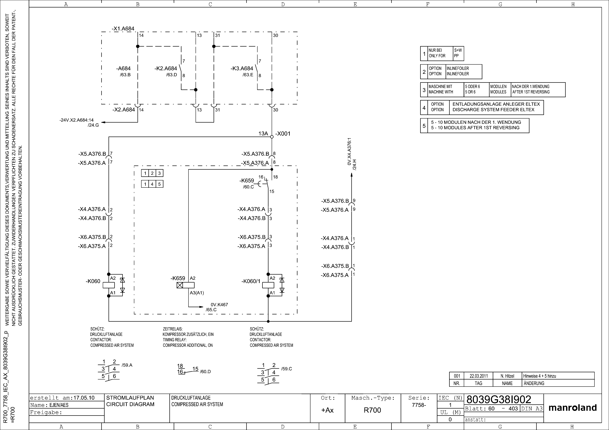

# +Ax — Sheet 60 of 403 — DRUCKLUFTANLAGE

**COMPRESSED AIR SYSTEM**

> Part of the manroland **R700** printing press IEC/UL circuit diagrams.
> Drawing class: **Stromlaufplan / Circuit diagram** (DIN A3).
> Document `+Ax` covers the **Central control console** machine section.

## At a glance

| Field | Value |
|---|---|
| Document | `+Ax`  (8039G38I902) |
| Sheet | **60** of 403 |
| Section (DE) | DRUCKLUFTANLAGE |
| Section (EN) | COMPRESSED AIR SYSTEM |
| Section type | CIRCUIT — Circuit diagram |
| Machine type | `R700` |
| Series | `7758` |
| Created | 17.05.10 |
| Replaces | — |
| Columns used | A, B, C, D, E, F, G, H |
| Path numbers | — |
| Labels on sheet | 148 |
| Cross-refs out | 9 |
| Cross-refs in | 35 |

**Previous:** [+Ax sheet 59](SHEET_0059.md) · **Next:** [+Ax sheet 61](SHEET_0061.md) · **Document TOC:** [_TOC.md](_TOC.md)  (+Ax) · **Master TOC:** [all sheets](../_MASTER_TOC.md)

## Sheet image (300 DPI, exact vector render)



_Rendered directly from the PDF vector layer at 300 DPI (1-bit), no OCR and no resampling. Use it to confirm anything ambiguous in the text below._

## Cross-references on this sheet

Each entry is a wire leaving this sheet. The printed token is `/sheet.column`; the link resolves to that sheet inside the same document.

| Ref | Target sheet | Col | Path | Destination on target | Target section | From col |
|---|---|---|---|---|---|---|
| `/63.B` | [+Ax sheet 63](SHEET_0063.md) | B | — | — | DRUCKLUFTANLAGE | B |
| `/63.E` | [+Ax sheet 63](SHEET_0063.md) | E | — | — | DRUCKLUFTANLAGE | D |
| `/63.D` | [+Ax sheet 63](SHEET_0063.md) | D | — | — | DRUCKLUFTANLAGE | B |
| `/24.G` | [+Ax sheet 24](SHEET_0024.md) | G | — | 24V.X2.A684:14 | SPANNUNGSVERSORGUNG, SCHALTSCHRANKBELÜFTUNG | A |
| `/24.H` | [+Ax sheet 24](SHEET_0024.md) | H | — | 0V.X4.A376:1 | SPANNUNGSVERSORGUNG, SCHALTSCHRANKBELÜFTUNG | E |
| `/60.C` | [+Ax sheet 60](SHEET_0060.md) | C | — | — | DRUCKLUFTANLAGE | D |
| `/65.C` | [+Ax sheet 65](SHEET_0065.md) | C | — | — | DRUCKLUFTANLAGE | C |
| `/59.A` | [+Ax sheet 59](SHEET_0059.md) | A | — | — | DRUCKLUFTANLAGE | B |
| `/59.C` | [+Ax sheet 59](SHEET_0059.md) | C | — | — | DRUCKLUFTANLAGE | D |

### Incoming references (sheets that point here)

Every other sheet that sends a wire to this one. `Back-ref` is the token printed on *that* sheet; `Path` is its line number.

| From sheet | Cols | Back-ref | Path | Refs | What continues there |
|---|---|---|---|---|---|
| [+Ax#24](SHEET_0024.md) | G, H | `/24.G`, `/24.H` | — | 2 | — |
| [+Ax#59](SHEET_0059.md) | A, C | `/59.A`, `/59.C` | — | 2 | — |
| [+Ax#60](SHEET_0060.md) | D | `/60.D` | — | 1 | — |
| [+Ax#63](SHEET_0063.md) | B, D, E | `/63.B`, `/63.D`, `/63.E` | — | 3 | — |
| [+Ax#65](SHEET_0065.md) | B | `/65.B` | — | 1 | 0V.K467 |
| [+Ax#211](SHEET_0211.md) | C, D | `/211.C`, `/211.D` | — | 4 | — |
| [+Ax#221](SHEET_0221.md) | F, G | `/221.F`, `/221.G` | — | 4 | — |
| [+Ax#228](SHEET_0228.md) | F, G | `/228.F`, `/228.G` | — | 6 | — |
| [+Ax#232](SHEET_0232.md) | A, B | `/232.A`, `/232.B` | — | 6 | — |
| [+Ax#234](SHEET_0234.md) | A, B | `/234.A`, `/234.B` | — | 6 | — |


## Devices on this sheet

| Tag | Class | Class meaning (IEC) | Col | Sub | Terminal | Sign |
|---|---|---|---|---|---|---|
| `A2` | A | Baugruppe / assembly, module, PC board | C | — | — | — |
| `K659` | K | Relais / relay, contactor | C | — | — | — |
| `A2` | A | Baugruppe / assembly, module, PC board | D | — | — | — |
| `A1` | A | Baugruppe / assembly, module, PC board | D | — | — | — |
| `K060/1` | K | Relais / relay, contactor | D | 1 | — | — |
| `K659` | K | Relais / relay, contactor | D | — | — | — |
| `X001` | X | Klemme / terminal, plug connector | D | — | — | — |
| `A684` | A | Baugruppe / assembly, module, PC board | B | — | — | — |
| `A2` | A | Baugruppe / assembly, module, PC board | B | — | — | — |
| `A1` | A | Baugruppe / assembly, module, PC board | B | — | — | — |
| `K060` | K | Relais / relay, contactor | A | — | — | — |
| `X6.A375.B` | — | cross-device reference | A | — | — | — |
| `X6.A375.A` | — | cross-device reference | A | — | — | — |
| `X6.A375.B` | — | cross-device reference | D | — | — | — |
| `X6.A375.A` | — | cross-device reference | D | — | — | — |
| `X4.A376.B` | — | cross-device reference | D | — | — | — |
| `X4.A376.A` | — | cross-device reference | D | — | — | — |
| `X5.A376.B` | — | cross-device reference | A | — | — | — |
| `X5.A376.A` | — | cross-device reference | A | — | — | — |
| `X5.A376.B` | — | cross-device reference | D | — | — | — |
| `X5.A376.A` | — | cross-device reference | D | — | — | — |
| `X2.A684` | — | cross-device reference | B | — | — | — |
| `K2.A684` | — | cross-device reference | B | — | — | — |
| `K3.A684` | — | cross-device reference | C | — | — | — |
| `X6.A375.B` | — | cross-device reference | E | — | — | — |
| `X6.A375.A` | — | cross-device reference | E | — | — | — |
| `X5.A376.B` | — | cross-device reference | E | — | — | — |
| `X5.A376.A` | — | cross-device reference | E | — | — | — |
| `X4.A376.A` | — | cross-device reference | A | — | — | — |
| `X4.A376.B` | — | cross-device reference | A | — | — | — |
| `X4.A376.A` | — | cross-device reference | E | — | — | — |
| `X4.A376.B` | — | cross-device reference | E | — | — | — |
| `NR.` | — | cross-device reference | F | — | — | — |
| `22.03.2011` | — | cross-device reference | G | — | — | — |
| `X1.A684` | — | cross-device reference | B | — | — | — |

## Potentials / nets

| Potential | Count | Columns | Attached devices | Terminals |
|---|---|---|---|---|
| `0V` | 2 | C, E | `A376`, `K467`, `X4` | `1` |
| `24V` | 1 | A | `A684`, `X2` | `14` |


A potential such as `L24+/4` or `M24+` is a named supply/return rail; every place it appears on this sheet is electrically common.

## Wire-end annotations (grouped as printed)

A wire that continues elsewhere is annotated with a small cluster: the destination description, the path/line number `#NN`, and the `/sheet.column` cross reference. Each row below is one such cluster exactly as it is grouped on the drawing.

| Col | Y | Path | Cross-ref | Text on the wire |
|---|---|---|---|---|
| B | 51.3 | — | — | `X1.A684` |
| B | 65.5 | — | — | `14` |
| C | 65.5 | — | — | `13` |
| D | 65.5 | — | — | `31 30` |
| F | 95.4 | — | — | `PP S+W` |
| F | 95.5 | — | — | `1 NUR BEI` |
| F | 106.2 | — | — | `ONLY FOR` |
| C | 115.8 | — | — | `7` |
| D | 115.8 | — | — | `7` |
| B | 129.3 | — | — | `A684` |
| B | 129.3 | — | — | `K2.A684 8` |
| C | 129.3 | — | — | `K3.A684 8` |
| F | 131.0 | — | — | `2 OPTION OPTION` |
| F | 131.0 | — | — | `INLINEFOILER INLINEFOILER` |
| B | 142.3 | — | `/63.B` | — |
| D | 142.3 | — | `/63.E` | — |
| B | 142.4 | — | `/63.D` | — |
| G | 166.4 | — | — | `NACH DER 1.WENDUNG` |
| F | 166.5 | — | — | `3 MASCHINE MIT MACHINE WITH` |
| G | 166.5 | — | — | `5 ODER 6 5 OR 6 MODULEN MODULES` |
| G | 177.1 | — | — | `AFTER 1ST REVERSING` |
| G | 200.1 | — | — | `ENTLADUNGSANLAGE ANLEGER ELTEX DISCHARGE SYSTEM FEEDER ELTEX` |
| F | 201.2 | — | — | `4 OPTION OPTION` |
| B | 210.1 | — | — | `X2.A684 14` |
| C | 211.5 | — | — | `13 31` |
| D | 211.5 | — | — | `30` |
| A | 231.3 | — | `/24.G` | `24V.X2.A684:14` |
| G | 235.6 | — | — | `5 10 MODULEN NACH DER 1. WENDUNG 5 10 MODULES AFTER 1ST REVERSING` |
| F | 241.9 | — | — | `5` |
| D | 256.6 | — | — | `13A X001` |
| E | 269.0 | — | `/24.H` | `0V.X4.A376:1` |
| A | 296.5 | — | — | `X5.A376.B 7` |
| D | 296.5 | — | — | `X5.A376.B 8` |
| A | 313.6 | — | — | `X5.A376.A 7` |
| D | 313.6 | — | — | `X5.A376.A 8` |
| B | 335.5 | — | — | `1 2 3` |
| D | 342.6 | — | — | `K659 18` |
| D | 342.6 | — | — | `16` |
| B | 356.8 | — | — | `1 4 5` |
| D | 362.1 | — | `/60.C` | — |
| D | 370.9 | — | — | `15` |
| E | 388.7 | — | — | `X5.A376.B 9` |
| C | 405.0 | — | — | `X4.A376.A 2 X5.A376.A 9` |
| D | 405.0 | — | — | `X4.A376.A 3` |
| A | 422.7 | — | — | `X4.A376.B 2` |
| D | 422.7 | — | — | `X4.A376.B 3` |
| A | 459.5 | — | — | `X6.A375.B 2` |
| D | 459.5 | — | — | `X6.A375.B 3` |
| E | 461.7 | — | — | `X4.A376.A 1` |
| A | 476.5 | — | — | `X6.A375.A 2` |
| D | 476.5 | — | — | `X6.A375.A 3` |
| E | 479.4 | — | — | `X4.A376.B 1` |
| E | 516.2 | — | — | `X6.A375.B 1` |
| E | 533.2 | — | — | `X6.A375.A 1` |
| C | 540.3 | — | — | `K659` |
| B | 541.0 | — | — | `A2` |
| C | 541.0 | — | — | `A2` |
| D | 541.0 | — | — | `A2` |
| A | 546.0 | — | — | `K060` |
| D | 546.0 | — | — | `K060/1` |
| B | 569.3 | — | — | `A1` |
| D | 569.3 | — | — | `A1` |
| C | 569.4 | — | — | `A3(A1)` |
| C | 592.7 | — | — | `0V.K467` |
| C | 602.6 | — | `/65.C` | — |
| B | 641.2 | — | — | `DRUCKLUFTANLAGE SCHÜTZ:` |
| C | 641.2 | — | — | `KOMPRESSOR ZUSÄTZLICH, EIN ZEITRELAIS:` |
| D | 641.2 | — | — | `DRUCKLUFTANLAGE SCHÜTZ:` |
| B | 662.5 | — | — | `CONTACTOR: COMPRESSED AIR SYSTEM` |
| C | 662.5 | — | — | `TIMING RELAY: COMPRESSOR ADDITIONAL, ON` |
| D | 662.5 | — | — | `CONTACTOR: COMPRESSED AIR SYSTEM` |
| B | 703.3 | — | — | `3 5 1` |
| B | 703.3 | — | — | `2 4 6` |
| D | 710.4 | — | — | `3 5 1` |
| D | 710.4 | — | — | `2 4 6` |
| B | 711.0 | — | `/59.A` | — |
| C | 711.8 | — | — | `18 16 15 /60.D` |
| D | 718.2 | — | `/59.C` | — |
| G | 733.0 | — | — | `001 22.03.2011 N. Hitzel Hinweise 4 + 5 hinzu` |
| G | 747.1 | — | — | `NR. TAG NAME ÄNDERUNG` |


## Reconstructed tables

This sheet carries tabular content (pin map / terminal assignment / index). The grid below was rebuilt from the drawing's own rule lines, so each row is exactly one physical row of the table.

### Table 1 — 3 data rows × 10 columns (at x=212.6, y=90.7)

|  | A684 /63.B X2.A684 | K2.A684 /63.D 14 | 7 8 |  | 13 | K3.A684 /63.E 31 | 7 8 |  | 30 |
|---|---|---|---|---|---|---|---|---|---|
|  |  |  |  |  |  |  | `13A` |  |  |
| `7 7` |  |  |  |  |  | `X5.A376.B X5.A376.A` |  |  | `8 8` |
| `2 2 2 2 A2 A1` |  | `1 2 3 1 4 5 K659` |  | `A2` | `A3(A1) /65.C` | `K659 /60.C X4.A376.A X4.A376.B X6.A375.B X6.A375.A K060/1 0V.K467` | `16` | `15 3 3 3 3` | `18 A2 A1` |


## Notes and free text on this sheet

| Text | Col | Y (pt) |
|---|---|---|
| `15 /60.D` | C | 717.44 |
| `A3(A1)` | C | 569.35 |
| `ZEITRELAIS:` | B | 641.22 |
| `KOMPRESSOR ZUSÄTZLICH, EIN` | C | 651.88 |
| `TIMING RELAY:` | C | 662.51 |
| `COMPRESSOR ADDITIONAL, ON` | C | 673.16 |
| `SCHÜTZ:` | D | 641.24 |
| `DRUCKLUFTANLAGE` | D | 651.9 |
| `CONTACTOR:` | D | 662.53 |
| `COMPRESSED AIR SYSTEM` | D | 673.15 |
| `13A` | D | 256.82 |
| `SCHÜTZ:` | A | 641.24 |
| `DRUCKLUFTANLAGE` | B | 651.9 |
| `CONTACTOR:` | A | 662.53 |
| `COMPRESSED AIR SYSTEM` | B | 673.15 |
| `TAG` | G | 747.27 |
| `NAME` | G | 747.25 |
| `ÄNDERUNG` | G | 747.31 |
| `N. Hitzel` | G | 733.14 |
| `Hinweise 4 + 5 hinzu` | H | 733.17 |
| `NUR BEI` | F | 95.54 |
| `ONLY FOR` | F | 106.23 |
| `OPTION` | F | 130.99 |
| `MASCHINE MIT` | F | 166.46 |
| `MACHINE WITH` | F | 177.05 |
| `S+W` | F | 95.44 |
| `PP` | F | 106.08 |
| `INLINEFOILER` | F | 131.01 |
| `5 ODER 6` | G | 166.46 |
| `5 OR 6` | G | 177.08 |
| `MODULEN` | G | 166.47 |
| `MODULES` | G | 177.09 |
| `NACH DER 1.WENDUNG` | G | 166.44 |
| `AFTER 1ST REVERSING` | G | 177.08 |
| `ENTLADUNGSANLAGE ANLEGER ELTEX` | G | 200.12 |
| `DISCHARGE SYSTEM FEEDER ELTEX` | G | 210.74 |
| `5 10 MODULEN NACH DER 1. WENDUNG` | G | 235.55 |
| `5 10 MODULES AFTER 1ST REVERSING` | G | 246.18 |

## Complete label inventory (exact text from the drawing)

Every text object inside the drawing area of this sheet, in DIN reading order (column A→H, then top→bottom). This is the authoritative list: if a string is not here it is not printed on this sheet.

| Col | Y | X | Dir | Type | Text |
|---|---|---|---|---|---|
| A | 231.3 | 116.2 | → | potential | `24V.X2.A684:14` |
| A | 241.2 | 171.8 | → | cross-reference | `/24.G` |
| A | 296.5 | 153.4 | → | device ref | `X5.A376.B` |
| A | 314.3 | 152.5 | → | device ref | `X5.A376.A` |
| A | 405.0 | 152.5 | → | device ref | `X4.A376.A` |
| A | 422.7 | 153.4 | → | device ref | `X4.A376.B` |
| A | 459.5 | 153.4 | → | device ref | `X6.A375.B` |
| A | 477.2 | 152.5 | → | device ref | `X6.A375.A` |
| A | 546.0 | 167.8 | → | device tag | `K060` |
| A | 641.2 | 176.9 | → | text | `SCHÜTZ:` |
| A | 662.5 | 176.9 | → | text | `CONTACTOR:` |
| B | 51.3 | 218.6 | → | device ref | `X1.A684` |
| B | 65.5 | 271.3 | → | number | `14` |
| B | 129.3 | 227.3 | → | device tag | `A684` |
| B | 129.3 | 302.2 | → | device ref | `K2.A684` |
| B | 142.3 | 234.7 | → | cross-reference | `/63.B` |
| B | 142.4 | 325.1 | → | cross-reference | `/63.D` |
| B | 210.1 | 220.0 | → | device ref | `X2.A684` |
| B | 211.5 | 271.3 | → | number | `14` |
| B | 296.5 | 215.1 | → | number | `7` |
| B | 313.6 | 215.1 | → | number | `7` |
| B | 335.5 | 281.5 | → | number | `1` |
| B | 335.5 | 295.4 | → | number | `2` |
| B | 335.5 | 309.4 | → | number | `3` |
| B | 356.8 | 281.5 | → | number | `1` |
| B | 356.8 | 295.2 | → | number | `4` |
| B | 356.8 | 309.4 | → | number | `5` |
| B | 407.1 | 215.1 | → | number | `2` |
| B | 424.1 | 215.1 | → | number | `2` |
| B | 459.5 | 215.1 | → | number | `2` |
| B | 476.5 | 215.1 | → | number | `2` |
| B | 541.0 | 215.4 | → | device tag | `A2` |
| B | 569.3 | 215.4 | → | device tag | `A1` |
| B | 641.2 | 318.9 | → | text | `ZEITRELAIS:` |
| B | 651.9 | 176.3 | → | text | `DRUCKLUFTANLAGE` |
| B | 673.2 | 176.9 | → | text | `COMPRESSED AIR SYSTEM` |
| B | 703.3 | 200.1 | → | number | `1` |
| B | 703.3 | 220.8 | → | number | `2` |
| B | 711.0 | 238.1 | → | cross-reference | `/59.A` |
| B | 717.4 | 198.7 | → | number | `3` |
| B | 717.4 | 220.8 | → | number | `4` |
| B | 731.6 | 198.7 | → | number | `5` |
| B | 731.6 | 220.8 | → | number | `6` |
| C | 65.5 | 384.7 | → | number | `13` |
| C | 65.5 | 420.7 | → | number | `31` |
| C | 115.8 | 356.9 | → | number | `7` |
| C | 129.3 | 451.0 | → | device ref | `K3.A684` |
| C | 144.2 | 356.9 | → | number | `8` |
| C | 211.5 | 384.7 | → | number | `13` |
| C | 211.5 | 420.7 | → | number | `31` |
| C | 540.3 | 333.6 | → | device tag | `K659` |
| C | 541.0 | 371.3 | → | device tag | `A2` |
| C | 569.3 | 371.3 | → | text | `A3(A1)` |
| C | 592.7 | 412.2 | → | potential | `0V.K467` |
| C | 602.6 | 402.5 | → | cross-reference | `/65.C` |
| C | 651.9 | 318.0 | → | text | `KOMPRESSOR ZUSÄTZLICH, EIN` |
| C | 662.5 | 318.6 | → | text | `TIMING RELAY:` |
| C | 673.2 | 318.6 | → | text | `COMPRESSOR ADDITIONAL, ON` |
| C | 711.8 | 345.8 | → | number | `18` |
| C | 717.4 | 375.9 | → | text | `15 /60.D` |
| C | 723.1 | 345.8 | → | number | `16` |
| D | 65.5 | 534.0 | → | number | `30` |
| D | 115.8 | 505.7 | → | number | `7` |
| D | 142.3 | 474.5 | → | cross-reference | `/63.E` |
| D | 144.2 | 505.7 | → | number | `8` |
| D | 211.5 | 534.0 | → | number | `30` |
| D | 256.6 | 538.3 | → | device tag | `X001` |
| D | 256.8 | 505.1 | → | text | `13A` |
| D | 296.5 | 472.3 | → | device ref | `X5.A376.B` |
| D | 296.5 | 534.0 | → | number | `8` |
| D | 313.6 | 534.0 | → | number | `8` |
| D | 314.3 | 471.4 | → | device ref | `X5.A376.A` |
| D | 342.6 | 505.1 | → | number | `16` |
| D | 342.6 | 533.5 | → | number | `18` |
| D | 349.0 | 468.3 | → | device tag | `K659` |
| D | 362.1 | 475.4 | → | cross-reference | `/60.C` |
| D | 371.0 | 526.4 | → | number | `15` |
| D | 405.0 | 464.3 | → | device ref | `X4.A376.A` |
| D | 407.1 | 527.0 | → | number | `3` |
| D | 422.7 | 465.2 | → | device ref | `X4.A376.B` |
| D | 424.1 | 527.0 | → | number | `3` |
| D | 459.5 | 465.2 | → | device ref | `X6.A375.B` |
| D | 459.5 | 527.0 | → | number | `3` |
| D | 476.5 | 527.0 | → | number | `3` |
| D | 477.2 | 464.3 | → | device ref | `X6.A375.A` |
| D | 541.0 | 527.2 | → | device tag | `A2` |
| D | 546.0 | 472.3 | → | device tag | `K060/1` |
| D | 569.3 | 527.2 | → | device tag | `A1` |
| D | 641.2 | 488.7 | → | text | `SCHÜTZ:` |
| D | 651.9 | 488.1 | → | text | `DRUCKLUFTANLAGE` |
| D | 662.5 | 488.7 | → | text | `CONTACTOR:` |
| D | 673.2 | 488.7 | → | text | `COMPRESSED AIR SYSTEM` |
| D | 710.3 | 511.9 | → | number | `1` |
| D | 710.3 | 532.6 | → | number | `2` |
| D | 718.2 | 549.9 | → | cross-reference | `/59.C` |
| D | 724.5 | 510.5 | → | number | `3` |
| D | 724.5 | 532.6 | → | number | `4` |
| D | 738.7 | 510.5 | → | number | `5` |
| D | 738.7 | 532.6 | → | number | `6` |
| E | 269.0 | 679.2 | ↕ | potential | `0V.X4.A376:1` |
| E | 312.1 | 689.1 | ↕ | cross-reference | `/24.H` |
| E | 388.7 | 628.2 | → | device ref | `X5.A376.B` |
| E | 388.7 | 690.0 | → | number | `9` |
| E | 405.7 | 690.0 | → | number | `9` |
| E | 406.4 | 627.3 | → | device ref | `X5.A376.A` |
| E | 461.7 | 627.3 | → | device ref | `X4.A376.A` |
| E | 463.8 | 689.4 | → | number | `1` |
| E | 479.4 | 628.2 | → | device ref | `X4.A376.B` |
| E | 480.8 | 689.4 | → | number | `1` |
| E | 516.2 | 628.2 | → | device ref | `X6.A375.B` |
| E | 516.2 | 689.4 | → | number | `1` |
| E | 533.2 | 689.4 | → | number | `1` |
| E | 533.9 | 627.3 | → | device ref | `X6.A375.A` |
| F | 95.4 | 888.4 | → | text | `S+W` |
| F | 95.5 | 838.2 | → | text | `NUR BEI` |
| F | 100.9 | 826.6 | → | number | `1` |
| F | 106.1 | 887.8 | → | text | `PP` |
| F | 106.2 | 838.8 | → | text | `ONLY FOR` |
| F | 131.0 | 838.8 | → | text | `OPTION` |
| F | 131.0 | 873.6 | → | text | `INLINEFOILER` |
| F | 136.3 | 826.3 | → | number | `2` |
| F | 141.6 | 838.8 | → | text | `OPTION` |
| F | 141.6 | 873.6 | → | text | `INLINEFOILER` |
| F | 166.5 | 838.5 | → | text | `MASCHINE MIT` |
| F | 171.8 | 826.2 | → | number | `3` |
| F | 177.0 | 838.5 | → | text | `MACHINE WITH` |
| F | 201.1 | 843.0 | → | text | `OPTION` |
| F | 206.5 | 826.3 | → | number | `4` |
| F | 211.8 | 843.0 | → | text | `OPTION` |
| F | 241.9 | 826.2 | → | number | `5` |
| F | 733.0 | 887.7 | → | number | `001` |
| F | 747.1 | 886.7 | → | device ref | `NR.` |
| G | 166.4 | 1001.2 | → | text | `NACH DER 1.WENDUNG` |
| G | 166.5 | 909.6 | → | text | `5 ODER 6` |
| G | 166.5 | 959.0 | → | text | `MODULEN` |
| G | 177.1 | 909.6 | → | text | `5 OR 6` |
| G | 177.1 | 959.0 | → | text | `MODULES` |
| G | 177.1 | 1002.0 | → | text | `AFTER 1ST REVERSING` |
| G | 200.1 | 885.0 | → | text | `ENTLADUNGSANLAGE ANLEGER ELTEX` |
| G | 210.7 | 885.0 | → | text | `DISCHARGE SYSTEM FEEDER ELTEX` |
| G | 235.6 | 843.0 | → | text | `5 10 MODULEN NACH DER 1. WENDUNG` |
| G | 246.2 | 843.0 | → | text | `5 10 MODULES AFTER 1ST REVERSING` |
| G | 733.1 | 918.6 | → | device ref | `22.03.2011` |
| G | 733.1 | 978.8 | → | text | `N. Hitzel` |
| G | 747.3 | 928.3 | → | text | `TAG` |
| G | 747.3 | 981.7 | → | text | `NAME` |
| G | 747.3 | 1024.3 | → | text | `ÄNDERUNG` |
| H | 733.2 | 1023.2 | → | text | `Hinweise 4 + 5 hinzu` |

## Reading-order text block

The same content as a plain block, grouped by DIN column — convenient to paste or to match against a visual description.

```text
=== Column A ===
 231.3  116.2  net          24V.X2.A684:14
 241.2  171.8  xref         /24.G
 296.5  153.4  devref       X5.A376.B
 314.3  152.5  devref       X5.A376.A
 405.0  152.5  devref       X4.A376.A
 422.7  153.4  devref       X4.A376.B
 459.5  153.4  devref       X6.A375.B
 477.2  152.5  devref       X6.A375.A
 546.0  167.8  devtag       K060
 641.2  176.9  text         SCHÜTZ:
 662.5  176.9  text         CONTACTOR:
=== Column B ===
  51.3  218.6  devref       X1.A684
  65.5  271.3  numeric      14
 129.3  227.3  devtag       A684
 129.3  302.2  devref       K2.A684
 142.3  234.7  xref         /63.B
 142.4  325.1  xref         /63.D
 210.1  220.0  devref       X2.A684
 211.5  271.3  numeric      14
 296.5  215.1  numeric      7
 313.6  215.1  numeric      7
 335.5  281.5  numeric      1
 335.5  295.4  numeric      2
 335.5  309.4  numeric      3
 356.8  281.5  numeric      1
 356.8  295.2  numeric      4
 356.8  309.4  numeric      5
 407.1  215.1  numeric      2
 424.1  215.1  numeric      2
 459.5  215.1  numeric      2
 476.5  215.1  numeric      2
 541.0  215.4  devtag       A2
 569.3  215.4  devtag       A1
 641.2  318.9  text         ZEITRELAIS:
 651.9  176.3  text         DRUCKLUFTANLAGE
 673.2  176.9  text         COMPRESSED AIR SYSTEM
 703.3  200.1  numeric      1
 703.3  220.8  numeric      2
 711.0  238.1  xref         /59.A
 717.4  198.7  numeric      3
 717.4  220.8  numeric      4
 731.6  198.7  numeric      5
 731.6  220.8  numeric      6
=== Column C ===
  65.5  384.7  numeric      13
  65.5  420.7  numeric      31
 115.8  356.9  numeric      7
 129.3  451.0  devref       K3.A684
 144.2  356.9  numeric      8
 211.5  384.7  numeric      13
 211.5  420.7  numeric      31
 540.3  333.6  devtag       K659
 541.0  371.3  devtag       A2
 569.3  371.3  text         A3(A1)
 592.7  412.2  net          0V.K467
 602.6  402.5  xref         /65.C
 651.9  318.0  text         KOMPRESSOR ZUSÄTZLICH, EIN
 662.5  318.6  text         TIMING RELAY:
 673.2  318.6  text         COMPRESSOR ADDITIONAL, ON
 711.8  345.8  numeric      18
 717.4  375.9  text         15 /60.D
 723.1  345.8  numeric      16
=== Column D ===
  65.5  534.0  numeric      30
 115.8  505.7  numeric      7
 142.3  474.5  xref         /63.E
 144.2  505.7  numeric      8
 211.5  534.0  numeric      30
 256.6  538.3  devtag       X001
 256.8  505.1  text         13A
 296.5  472.3  devref       X5.A376.B
 296.5  534.0  numeric      8
 313.6  534.0  numeric      8
 314.3  471.4  devref       X5.A376.A
 342.6  505.1  numeric      16
 342.6  533.5  numeric      18
 349.0  468.3  devtag       K659
 362.1  475.4  xref         /60.C
 371.0  526.4  numeric      15
 405.0  464.3  devref       X4.A376.A
 407.1  527.0  numeric      3
 422.7  465.2  devref       X4.A376.B
 424.1  527.0  numeric      3
 459.5  465.2  devref       X6.A375.B
 459.5  527.0  numeric      3
 476.5  527.0  numeric      3
 477.2  464.3  devref       X6.A375.A
 541.0  527.2  devtag       A2
 546.0  472.3  devtag       K060/1
 569.3  527.2  devtag       A1
 641.2  488.7  text         SCHÜTZ:
 651.9  488.1  text         DRUCKLUFTANLAGE
 662.5  488.7  text         CONTACTOR:
 673.2  488.7  text         COMPRESSED AIR SYSTEM
 710.3  511.9  numeric      1
 710.3  532.6  numeric      2
 718.2  549.9  xref         /59.C
 724.5  510.5  numeric      3
 724.5  532.6  numeric      4
 738.7  510.5  numeric      5
 738.7  532.6  numeric      6
=== Column E ===
 269.0  679.2  net          0V.X4.A376:1
 312.1  689.1  xref         /24.H
 388.7  628.2  devref       X5.A376.B
 388.7  690.0  numeric      9
 405.7  690.0  numeric      9
 406.4  627.3  devref       X5.A376.A
 461.7  627.3  devref       X4.A376.A
 463.8  689.4  numeric      1
 479.4  628.2  devref       X4.A376.B
 480.8  689.4  numeric      1
 516.2  628.2  devref       X6.A375.B
 516.2  689.4  numeric      1
 533.2  689.4  numeric      1
 533.9  627.3  devref       X6.A375.A
=== Column F ===
  95.4  888.4  text         S+W
  95.5  838.2  text         NUR BEI
 100.9  826.6  numeric      1
 106.1  887.8  text         PP
 106.2  838.8  text         ONLY FOR
 131.0  838.8  text         OPTION
 131.0  873.6  text         INLINEFOILER
 136.3  826.3  numeric      2
 141.6  838.8  text         OPTION
 141.6  873.6  text         INLINEFOILER
 166.5  838.5  text         MASCHINE MIT
 171.8  826.2  numeric      3
 177.0  838.5  text         MACHINE WITH
 201.1  843.0  text         OPTION
 206.5  826.3  numeric      4
 211.8  843.0  text         OPTION
 241.9  826.2  numeric      5
 733.0  887.7  numeric      001
 747.1  886.7  devref       NR.
=== Column G ===
 166.4 1001.2  text         NACH DER 1.WENDUNG
 166.5  909.6  text         5 ODER 6
 166.5  959.0  text         MODULEN
 177.1  909.6  text         5 OR 6
 177.1  959.0  text         MODULES
 177.1 1002.0  text         AFTER 1ST REVERSING
 200.1  885.0  text         ENTLADUNGSANLAGE ANLEGER ELTEX
 210.7  885.0  text         DISCHARGE SYSTEM FEEDER ELTEX
 235.6  843.0  text         5 10 MODULEN NACH DER 1. WENDUNG
 246.2  843.0  text         5 10 MODULES AFTER 1ST REVERSING
 733.1  918.6  devref       22.03.2011
 733.1  978.8  text         N. Hitzel
 747.3  928.3  text         TAG
 747.3  981.7  text         NAME
 747.3 1024.3  text         ÄNDERUNG
=== Column H ===
 733.2 1023.2  text         Hinweise 4 + 5 hinzu
```

---
_Generated from the PDF vector text layer; no OCR. Source: `R700_7758_IEC_AX_8039G38I902_p`, sheet 60._
