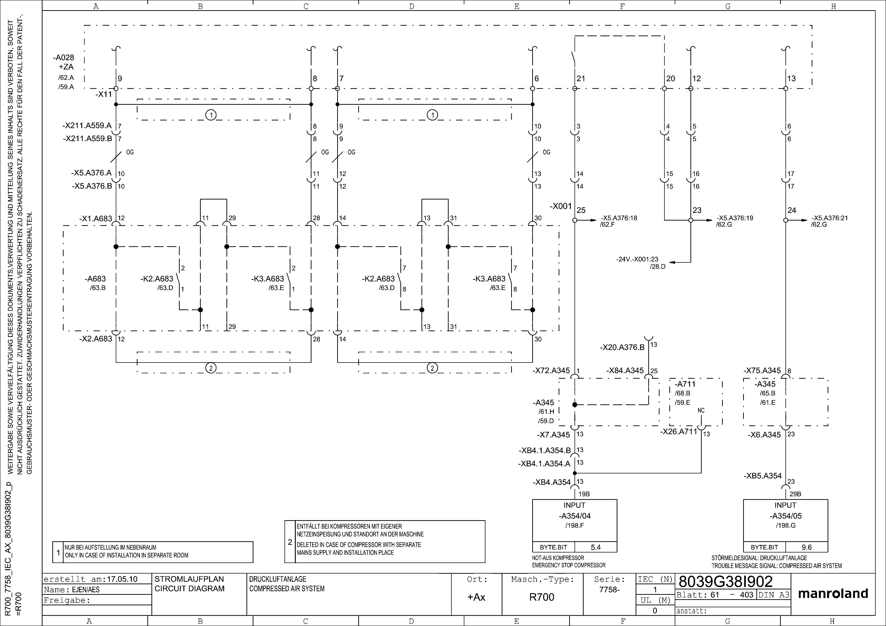

# +Ax — Sheet 61 of 403 — DRUCKLUFTANLAGE

**COMPRESSED AIR SYSTEM**

> Part of the manroland **R700** printing press IEC/UL circuit diagrams.
> Drawing class: **Stromlaufplan / Circuit diagram** (DIN A3).
> Document `+Ax` covers the **Central control console** machine section.

## At a glance

| Field | Value |
|---|---|
| Document | `+Ax`  (8039G38I902) |
| Sheet | **61** of 403 |
| Section (DE) | DRUCKLUFTANLAGE |
| Section (EN) | COMPRESSED AIR SYSTEM |
| Section type | CIRCUIT — Circuit diagram |
| Machine type | `R700` |
| Series | `7758` |
| Created | 17.05.10 |
| Replaces | — |
| Columns used | A, B, C, D, E, F, G, H |
| Path numbers | — |
| Labels on sheet | 161 |
| Cross-refs out | 19 |
| Cross-refs in | 78 |

**Previous:** [+Ax sheet 60](SHEET_0060.md) · **Next:** [+Ax sheet 62](SHEET_0062.md) · **Document TOC:** [_TOC.md](_TOC.md)  (+Ax) · **Master TOC:** [all sheets](../_MASTER_TOC.md)

## Sheet image (300 DPI, exact vector render)



_Rendered directly from the PDF vector layer at 300 DPI (1-bit), no OCR and no resampling. Use it to confirm anything ambiguous in the text below._

## Cross-references on this sheet

Each entry is a wire leaving this sheet. The printed token is `/sheet.column`; the link resolves to that sheet inside the same document.

| Ref | Target sheet | Col | Path | Destination on target | Target section | From col |
|---|---|---|---|---|---|---|
| `/62.A` | [+Ax sheet 62](SHEET_0062.md) | A | — | — | DRUCKLUFTANLAGE | A |
| `/59.A` | [+Ax sheet 59](SHEET_0059.md) | A | — | — | DRUCKLUFTANLAGE | A |
| `/62.G` | [+Ax sheet 62](SHEET_0062.md) | G | — | X5.A376:21 | DRUCKLUFTANLAGE | H |
| `/62.F` | [+Ax sheet 62](SHEET_0062.md) | F | — | — | DRUCKLUFTANLAGE | F |
| `/62.G` | [+Ax sheet 62](SHEET_0062.md) | G | — | — | DRUCKLUFTANLAGE | H |
| `/28.D` | [+Ax sheet 28](SHEET_0028.md) | D | — | 24V. X001:23 | SPANNUNGSVERSORGUNG, SCHALTSCHRANKBELÜFTUNG | F |
| `/63.B` | [+Ax sheet 63](SHEET_0063.md) | B | — | — | DRUCKLUFTANLAGE | A |
| `/63.E` | [+Ax sheet 63](SHEET_0063.md) | E | — | — | DRUCKLUFTANLAGE | C |
| `/63.E` | [+Ax sheet 63](SHEET_0063.md) | E | — | — | DRUCKLUFTANLAGE | E |
| `/63.D` | [+Ax sheet 63](SHEET_0063.md) | D | — | — | DRUCKLUFTANLAGE | B |
| `/63.D` | [+Ax sheet 63](SHEET_0063.md) | D | — | — | DRUCKLUFTANLAGE | D |
| `/68.B` | [+Ax sheet 68](SHEET_0068.md) | B | — | A711 | SAUGBÄNDERTISCH | G |
| `/59.E` | [+Ax sheet 59](SHEET_0059.md) | E | — | A711 | DRUCKLUFTANLAGE | G |
| `/65.B` | [+Ax sheet 65](SHEET_0065.md) | B | — | — | DRUCKLUFTANLAGE | G |
| `/61.E` | [+Ax sheet 61](SHEET_0061.md) | E | — | — | DRUCKLUFTANLAGE | G |
| `/61.H` | [+Ax sheet 61](SHEET_0061.md) | H | — | — | DRUCKLUFTANLAGE | E |
| `/59.D` | [+Ax sheet 59](SHEET_0059.md) | D | — | — | DRUCKLUFTANLAGE | E |
| `/198.F` | [+Ax sheet 198](SHEET_0198.md) | F | — | — | REFERENZMODUL | F |
| `/198.G` | [+Ax sheet 198](SHEET_0198.md) | G | — | — | REFERENZMODUL | H |

### Incoming references (sheets that point here)

Every other sheet that sends a wire to this one. `Back-ref` is the token printed on *that* sheet; `Path` is its line number.

| From sheet | Cols | Back-ref | Path | Refs | What continues there |
|---|---|---|---|---|---|
| [+Ax#28](SHEET_0028.md) | D | `/28.D` | — | 1 | 24V. X001:23 |
| [+Ax#59](SHEET_0059.md) | A, D, E | `/59.A`, `/59.D`, `/59.E` | — | 3 | A711 |
| [+Ax#61](SHEET_0061.md) | E, G | `/61.E`, `/61.G` | — | 2 | — |
| [+Ax#62](SHEET_0062.md) | D, F, G | `/62.D`, `/62.F`, `/62.G` | — | 4 | 18 19 18 19; X5.A376:18; X5.A376:19; X5.A376:21 |
| [+Ax#63](SHEET_0063.md) | B, D, E | `/63.B`, `/63.D`, `/63.E` | — | 5 | — |
| [+Ax#65](SHEET_0065.md) | B | `/65.B` | — | 1 | — |
| [+Ax#68](SHEET_0068.md) | B | `/68.B` | — | 1 | A711 |
| [+Ax#198](SHEET_0198.md) | F, G | `/198.F`, `/198.G` | — | 2 | — |
| [+Ax#211](SHEET_0211.md) | A, B | `/211.A`, `/211.B` | — | 8 | — |
| [+Ax#221](SHEET_0221.md) | C, D | `/221.C`, `/221.D` | — | 8 | — |
| [+Ax#228](SHEET_0228.md) | A, B, C | `/228.A`, `/228.B`, `/228.C` | — | 3 | — |
| [+Ax#231](SHEET_0231.md) | E | `/231.E` | — | 1 | — |
| [+Ax#232](SHEET_0232.md) | A, B | `/232.A`, `/232.B` | — | 16 | — |
| [+Ax#233](SHEET_0233.md) | G | `/233.G` | — | 1 | — |
| [+Ax#235](SHEET_0235.md) | H | `/235.H` | — | 1 | — |
| [+Ax#260](SHEET_0260.md) | F | `/260.F` | — | 1 | — |
| [+Ax#269](SHEET_0269.md) | H | `/269.H` | — | 1 | — |
| [+Ax#285](SHEET_0285.md) | B, E | `/285.B`, `/285.E` | — | 2 | — |
| [+Ax#287](SHEET_0287.md) | B | `/287.B` | — | 1 | — |
| [+Ax#293](SHEET_0293.md) | F | `/293.F` | — | 16 | — |


## Devices on this sheet

| Tag | Class | Class meaning (IEC) | Col | Sub | Terminal | Sign |
|---|---|---|---|---|---|---|
| `A354/05` | A | Baugruppe / assembly, module, PC board | H | 05 | — | — |
| `A354/04` | A | Baugruppe / assembly, module, PC board | F | 04 | — | — |
| `A028` | A | Baugruppe / assembly, module, PC board | A | — | — | — |
| `X001` | X | Klemme / terminal, plug connector | E | — | — | — |
| `A683` | A | Baugruppe / assembly, module, PC board | A | — | — | — |
| `A345` | A | Baugruppe / assembly, module, PC board | E | — | — | — |
| `A345` | A | Baugruppe / assembly, module, PC board | G | — | — | — |
| `A711` | A | Baugruppe / assembly, module, PC board | G | — | — | — |
| `X11` | X | Klemme / terminal, plug connector | A | — | — | — |
| `9.6` | — | cross-device reference | H | — | — | — |
| `XB5.A354` | — | cross-device reference | G | — | — | — |
| `XB4.A354` | — | cross-device reference | E | — | — | — |
| `5.4` | — | cross-device reference | F | — | — | — |
| `X211.A559.B` | — | cross-device reference | A | — | — | — |
| `X211.A559.A` | — | cross-device reference | A | — | — | — |
| `X5.A376.B` | — | cross-device reference | A | — | — | — |
| `X5.A376.A` | — | cross-device reference | A | — | — | — |
| `X1.A683` | — | cross-device reference | A | — | — | — |
| `X2.A683` | — | cross-device reference | A | — | — | — |
| `K2.A683` | — | cross-device reference | B | — | — | — |
| `K3.A683` | — | cross-device reference | C | — | — | — |
| `K2.A683` | — | cross-device reference | D | — | — | — |
| `K3.A683` | — | cross-device reference | E | — | — | — |
| `X6.A345` | — | cross-device reference | G | — | — | — |
| `X7.A345` | — | cross-device reference | E | — | — | — |
| `X20.A376.B` | — | cross-device reference | F | — | — | — |
| `XB4.1.A354.B` | — | cross-device reference | E | — | — | — |
| `XB4.1.A354.A` | — | cross-device reference | E | — | — | — |
| `X26.A711` | — | cross-device reference | G | — | — | — |
| `X75.A345` | — | cross-device reference | G | — | — | — |
| `X72.A345` | — | cross-device reference | E | — | — | — |
| `X84.A345` | — | cross-device reference | F | — | — | — |
| `X5.A376:18` | — | cross-device reference | F | — | 18 | — |
| `X5.A376:21` | — | cross-device reference | H | — | 21 | — |
| `X5.A376:19` | — | cross-device reference | G | — | 19 | — |

## Potentials / nets

| Potential | Count | Columns | Attached devices | Terminals |
|---|---|---|---|---|
| `24V` | 1 | F | `X001` | `23` |


A potential such as `L24+/4` or `M24+` is a named supply/return rail; every place it appears on this sheet is electrically common.

## Wire-end annotations (grouped as printed)

A wire that continues elsewhere is annotated with a small cluster: the destination description, the path/line number `#NN`, and the `/sheet.column` cross reference. Each row below is one such cluster exactly as it is grouped on the drawing.

| Col | Y | Path | Cross-ref | Text on the wire |
|---|---|---|---|---|
| A | 72.6 | — | — | `A028` |
| A | 85.3 | — | — | `+ZA` |
| A | 100.5 | — | `/62.A`, `/59.A` | — |
| D | 100.9 | — | — | `9 8 7 6 21 20 12 13` |
| A | 122.2 | — | — | `X11` |
| C | 151.4 | — | — | `1 1` |
| A | 164.0 | — | — | `X211.A559.A 7` |
| C | 166.2 | — | — | `8` |
| C | 166.2 | — | — | `9` |
| E | 166.2 | — | — | `10` |
| F | 166.2 | — | — | `3` |
| F | 166.2 | — | — | `4` |
| G | 166.2 | — | — | `5` |
| H | 166.2 | — | — | `6` |
| A | 181.7 | — | — | `X211.A559.B 7` |
| C | 183.2 | — | — | `8` |
| C | 183.2 | — | — | `9` |
| E | 183.2 | — | — | `10` |
| F | 183.2 | — | — | `3` |
| F | 183.2 | — | — | `4` |
| G | 183.2 | — | — | `5` |
| H | 183.2 | — | — | `6` |
| C | 201.8 | — | — | `OG OG OG OG` |
| A | 227.8 | — | — | `X5.A376.A 10` |
| C | 229.9 | — | — | `11` |
| C | 229.9 | — | — | `12` |
| E | 229.9 | — | — | `13` |
| F | 229.9 | — | — | `14` |
| F | 229.9 | — | — | `15` |
| G | 229.9 | — | — | `16` |
| H | 229.9 | — | — | `17` |
| A | 245.5 | — | — | `X5.A376.B 10` |
| C | 246.9 | — | — | `11` |
| C | 246.9 | — | — | `12` |
| E | 246.9 | — | — | `13` |
| F | 246.9 | — | — | `14` |
| F | 246.9 | — | — | `15` |
| G | 246.9 | — | — | `16` |
| H | 246.9 | — | — | `17` |
| E | 272.2 | — | — | `X001 25` |
| G | 278.1 | — | — | `23` |
| H | 278.1 | — | — | `24` |
| A | 289.4 | — | — | `X1.A683 12` |
| F | 289.4 | — | — | `X5.A376:18` |
| H | 289.4 | — | `/62.G` | `X5.A376:21` |
| G | 289.4 | — | — | `X5.A376:19` |
| B | 289.5 | — | — | `11` |
| C | 289.5 | — | — | `29 28` |
| C | 289.5 | — | — | `14` |
| D | 289.5 | — | — | `13` |
| E | 289.5 | — | — | `31 30` |
| F | 297.9 | — | `/62.F` | — |
| H | 297.9 | — | `/62.G` | — |
| F | 344.7 | — | `/28.D` | `24V. X001:23` |
| B | 356.8 | — | — | `2` |
| C | 356.8 | — | — | `2` |
| D | 356.8 | — | — | `7` |
| E | 356.8 | — | — | `7` |
| A | 370.2 | — | — | `A683` |
| B | 370.2 | — | — | `K2.A683 1` |
| C | 370.2 | — | — | `K3.A683 1` |
| D | 370.2 | — | — | `K2.A683 8` |
| E | 370.2 | — | — | `K3.A683 8` |
| A | 383.3 | — | `/63.B` | — |
| B | 383.3 | — | `/63.D` | — |
| C | 383.3 | — | `/63.E` | — |
| D | 383.3 | — | `/63.D` | — |
| E | 383.3 | — | `/63.E` | — |
| B | 435.4 | — | — | `11 29` |
| D | 435.4 | — | — | `13 31` |
| A | 451.0 | — | — | `X2.A683 12` |
| C | 452.4 | — | — | `28` |
| C | 452.4 | — | — | `14` |
| E | 452.4 | — | — | `30` |
| F | 459.5 | — | — | `X20.A376.B 13` |
| C | 492.1 | — | — | `2 2` |
| F | 493.5 | — | — | `X72.A345 1 X75.A345 8` |
| F | 493.5 | — | — | `X84.A345 25` |
| G | 512.0 | — | `/68.B`, `/59.E` | `A711` |
| G | 512.0 | — | — | `A345` |
| G | 525.0 | — | `/65.B`, `/61.E` | — |
| E | 536.8 | — | — | `A345` |
| G | 549.1 | — | — | `NC` |
| E | 549.9 | — | `/61.H`, `/59.D` | — |
| G | 575.7 | — | — | `X26.A711 13` |
| F | 580.0 | — | — | `X7.A345 13 X6.A345 23` |
| E | 601.3 | — | — | `XB4.1.A354.B 13` |
| E | 618.3 | — | — | `XB4.1.A354.A 13` |
| F | 635.3 | — | — | `XB4.A354 13 XB5.A354 23` |
| F | 660.8 | — | — | `19B` |
| H | 660.8 | — | — | `29B` |
| F | 675.3 | — | — | `INPUT` |
| H | 675.3 | — | — | `INPUT` |
| F | 689.1 | — | — | `A354/04` |
| H | 689.1 | — | — | `A354/05` |
| F | 702.9 | — | `/198.F` | — |
| H | 702.9 | — | `/198.G` | — |
| D | 705.0 | — | — | `ENTFÄLLT BEI KOMPRESSOREN MIT EIGENER NETZEINSPEISUNG UND STANDORT AN DER MASCHINE` |
| C | 724.5 | — | — | `2 DELETED IN CASE OF COMPRESSOR WITH SEPARATE MAINS SUPPLY AND INSTALLATION PLACE` |
| F | 732.0 | — | — | `BYTE.BIT 5.4` |
| H | 732.0 | — | — | `BYTE.BIT 9.6` |
| A | 733.4 | — | — | `1 NUR BEI AUFSTELLUNG IM NEBENRAUM` |
| A | 744.0 | — | — | `ONLY IN CASE OF INSTALLATION IN SEPARATE ROOM` |
| G | 747.6 | — | — | `STÖRMELDESIGNAL: DRUCKLUFTANLAGE TROUBLE MESSAGE SIGNAL: COMPRESSED AIR SYSTEM` |
| E | 747.7 | — | — | `NOT AUS KOMPRESSOR EMERGENCY STOP COMPRESSOR` |


## Reconstructed tables

This sheet carries tabular content (pin map / terminal assignment / index). The grid below was rebuilt from the drawing's own rule lines, so each row is exactly one physical row of the table.

### Table 1 — 0 data rows × 20 columns (at x=155.9, y=48.2) — **9 8 7 6 21 20 12 13 7 7 OG 10 10 12 1 11 29 8 8 OG 11 11 28 9 9 OG 12 12 14 1 13 31 10 10 OG 13 13 X001 30 3 3 14 14 25 /62.F X5.A376:18 4 4 15 15 5 5 16 16 23 X5.A376:19 /62.G 6 6 17 17 24 /62.G K2.A683 /63.D 12 2 1 11 K3.A683 /63.E 29 28 K2.A683 /63.D 14 7 8 K3.A683 /63.E 31 30 24V. X001:23 X20.A376.B /28.D 13 2 X72.A345 A345 1 X84.A345 25 A711 /68.B /59.E X75.A345 A345 /65.B /61.E /61.H /59.D X7.A345 XB4.1.A354.B XB4.1.A354.A 13 13 13 X26.A711 NC X6.A345 23 XB4.A354 13 19B XB5.A354 23 29B ENTFÄLLT BEI NETZEINSPEISUNG KOMPRESSOREN MIT EIGENER UND STANDORT AN DER MASCHINE INPUT A354/04 /198.F A354/05 /198.G**

_none_


## Notes and free text on this sheet

| Text | Col | Y (pt) |
|---|---|---|
| `29B` | H | 660.76 |
| `INPUT` | H | 675.28 |
| `BYTE.BIT` | G | 732.53 |
| `STÖRMELDESIGNAL: DRUCKLUFTANLAGE` | G | 747.57 |
| `TROUBLE MESSAGE SIGNAL: COMPRESSED AIR SYSTEM` | G | 758.19 |
| `19B` | F | 660.76 |
| `INPUT` | F | 675.28 |
| `BYTE.BIT` | E | 732.53 |
| `NOT AUS KOMPRESSOR` | E | 747.71 |
| `EMERGENCY STOP COMPRESSOR` | E | 757.67 |
| `+ZA` | A | 85.26 |
| `NUR BEI AUFSTELLUNG IM NEBENRAUM` | A | 733.39 |
| `ONLY IN CASE OF INSTALLATION IN SEPARATE ROOM` | A | 744.01 |
| `ENTFÄLLT BEI KOMPRESSOREN MIT EIGENER` | C | 705.03 |
| `NETZEINSPEISUNG UND STANDORT AN DER MASCHINE` | D | 715.67 |
| `DELETED IN CASE OF COMPRESSOR WITH SEPARATE` | D | 729.82 |
| `MAINS SUPPLY AND INSTALLATION PLACE` | C | 740.47 |
| `OG` | A | 201.84 |
| `OG` | E | 201.84 |
| `OG` | C | 201.84 |
| `NC` | G | 549.09 |

## Complete label inventory (exact text from the drawing)

Every text object inside the drawing area of this sheet, in DIN reading order (column A→H, then top→bottom). This is the authoritative list: if a string is not here it is not printed on this sheet.

| Col | Y | X | Dir | Type | Text |
|---|---|---|---|---|---|
| A | 72.6 | 71.4 | → | device tag | `A028` |
| A | 85.3 | 79.1 | → | text | `+ZA` |
| A | 100.5 | 78.5 | → | cross-reference | `/62.A` |
| A | 100.9 | 158.2 | → | number | `9` |
| A | 112.9 | 78.5 | → | cross-reference | `/59.A` |
| A | 122.2 | 128.4 | → | device tag | `X11` |
| A | 164.0 | 83.9 | → | device ref | `X211.A559.A` |
| A | 166.2 | 158.5 | → | number | `7` |
| A | 181.7 | 84.8 | → | device ref | `X211.A559.B` |
| A | 183.2 | 158.5 | → | number | `7` |
| A | 201.8 | 169.8 | → | text | `OG` |
| A | 227.8 | 95.8 | → | device ref | `X5.A376.A` |
| A | 229.9 | 157.9 | → | number | `10` |
| A | 245.5 | 96.7 | → | device ref | `X5.A376.B` |
| A | 246.9 | 157.9 | → | number | `10` |
| A | 289.4 | 106.6 | → | device ref | `X1.A683` |
| A | 289.5 | 157.9 | → | number | `12` |
| A | 370.2 | 114.0 | → | device tag | `A683` |
| A | 383.3 | 121.3 | → | cross-reference | `/63.B` |
| A | 451.0 | 106.6 | → | device ref | `X2.A683` |
| A | 452.5 | 157.9 | → | number | `12` |
| A | 733.4 | 87.0 | → | text | `NUR BEI AUFSTELLUNG IM NEBENRAUM` |
| A | 738.7 | 75.4 | → | number | `1` |
| A | 744.0 | 87.6 | → | text | `ONLY IN CASE OF INSTALLATION IN SEPARATE ROOM` |
| B | 151.4 | 281.7 | → | number | `1` |
| B | 289.5 | 271.3 | → | number | `11` |
| B | 289.5 | 307.3 | → | number | `29` |
| B | 356.8 | 243.5 | → | number | `2` |
| B | 370.2 | 188.8 | → | device ref | `K2.A683` |
| B | 383.3 | 211.7 | → | cross-reference | `/63.D` |
| B | 385.1 | 242.9 | → | number | `1` |
| B | 435.4 | 271.3 | → | number | `11` |
| B | 435.4 | 307.3 | → | number | `29` |
| B | 492.1 | 281.5 | → | number | `2` |
| C | 100.9 | 420.4 | → | number | `8` |
| C | 100.9 | 456.1 | → | number | `7` |
| C | 166.2 | 420.7 | → | number | `8` |
| C | 166.2 | 456.1 | → | number | `9` |
| C | 183.2 | 420.7 | → | number | `8` |
| C | 183.2 | 456.1 | → | number | `9` |
| C | 201.8 | 432.0 | → | text | `OG` |
| C | 201.8 | 467.4 | → | text | `OG` |
| C | 229.9 | 420.1 | → | number | `11` |
| C | 229.9 | 455.5 | → | number | `12` |
| C | 246.9 | 420.1 | → | number | `11` |
| C | 246.9 | 455.5 | → | number | `12` |
| C | 289.5 | 420.7 | → | number | `28` |
| C | 289.5 | 455.5 | → | number | `14` |
| C | 356.8 | 392.3 | → | number | `2` |
| C | 370.2 | 337.6 | → | device ref | `K3.A683` |
| C | 383.3 | 361.1 | → | cross-reference | `/63.E` |
| C | 385.1 | 391.7 | → | number | `1` |
| C | 452.5 | 420.7 | → | number | `28` |
| C | 452.5 | 455.5 | → | number | `14` |
| C | 705.0 | 398.8 | → | text | `ENTFÄLLT BEI KOMPRESSOREN MIT EIGENER` |
| C | 724.5 | 386.9 | → | number | `2` |
| C | 740.5 | 399.1 | → | text | `MAINS SUPPLY AND INSTALLATION PLACE` |
| D | 151.4 | 579.3 | → | number | `1` |
| D | 289.5 | 568.9 | → | number | `13` |
| D | 289.5 | 604.9 | → | number | `31` |
| D | 356.8 | 541.1 | → | number | `7` |
| D | 370.2 | 486.4 | → | device ref | `K2.A683` |
| D | 383.3 | 509.4 | → | cross-reference | `/63.D` |
| D | 385.1 | 541.1 | → | number | `8` |
| D | 435.4 | 568.9 | → | number | `13` |
| D | 435.4 | 604.9 | → | number | `31` |
| D | 492.1 | 579.1 | → | number | `2` |
| D | 715.7 | 398.8 | → | text | `NETZEINSPEISUNG UND STANDORT AN DER MASCHINE` |
| D | 729.8 | 398.8 | → | text | `DELETED IN CASE OF COMPRESSOR WITH SEPARATE` |
| E | 100.9 | 718.3 | → | number | `6` |
| E | 166.2 | 717.7 | → | number | `10` |
| E | 183.2 | 717.7 | → | number | `10` |
| E | 201.8 | 729.6 | → | text | `OG` |
| E | 229.9 | 717.7 | → | number | `13` |
| E | 246.9 | 717.7 | → | number | `13` |
| E | 272.2 | 739.0 | → | device tag | `X001` |
| E | 289.5 | 718.3 | → | number | `30` |
| E | 356.8 | 690.0 | → | number | `7` |
| E | 370.2 | 635.2 | → | device ref | `K3.A683` |
| E | 383.3 | 658.8 | → | cross-reference | `/63.E` |
| E | 385.1 | 690.0 | → | number | `8` |
| E | 452.5 | 718.3 | → | number | `30` |
| E | 493.5 | 715.7 | → | device ref | `X72.A345` |
| E | 536.8 | 716.3 | → | device tag | `A345` |
| E | 549.8 | 724.0 | → | cross-reference | `/61.H` |
| E | 562.3 | 723.4 | → | cross-reference | `/59.D` |
| E | 580.0 | 721.7 | → | device ref | `X7.A345` |
| E | 601.3 | 697.3 | → | device ref | `XB4.1.A354.B` |
| E | 619.0 | 696.5 | → | device ref | `XB4.1.A354.A` |
| E | 643.8 | 716.0 | → | device ref | `XB4.A354` |
| E | 732.5 | 725.7 | → | text | `BYTE.BIT` |
| E | 747.7 | 715.2 | → | text | `NOT AUS KOMPRESSOR` |
| E | 757.7 | 715.2 | → | text | `EMERGENCY STOP COMPRESSOR` |
| F | 100.9 | 775.0 | → | number | `21` |
| F | 100.9 | 895.5 | → | number | `20` |
| F | 166.2 | 775.0 | → | number | `3` |
| F | 166.2 | 895.5 | → | number | `4` |
| F | 183.2 | 775.0 | → | number | `3` |
| F | 183.2 | 895.5 | → | number | `4` |
| F | 229.9 | 774.4 | → | number | `14` |
| F | 229.9 | 894.9 | → | number | `15` |
| F | 246.9 | 774.4 | → | number | `14` |
| F | 246.9 | 894.9 | → | number | `15` |
| F | 278.1 | 775.0 | → | number | `25` |
| F | 289.4 | 807.6 | → | device ref | `X5.A376:18` |
| F | 297.9 | 806.5 | → | cross-reference | `/62.F` |
| F | 344.7 | 828.3 | → | potential | `24V. X001:23` |
| F | 354.6 | 873.6 | → | cross-reference | `/28.D` |
| F | 459.5 | 873.6 | → | number | `13` |
| F | 462.4 | 806.5 | → | device ref | `X20.A376.B` |
| F | 493.5 | 815.0 | → | device ref | `X84.A345` |
| F | 495.0 | 774.4 | → | number | `1` |
| F | 495.0 | 874.2 | → | number | `25` |
| F | 580.0 | 774.4 | → | number | `13` |
| F | 601.3 | 774.4 | → | number | `13` |
| F | 618.3 | 774.4 | → | number | `13` |
| F | 643.8 | 774.4 | → | number | `13` |
| F | 660.8 | 777.3 | → | text | `19B` |
| F | 675.3 | 757.6 | → | text | `INPUT` |
| F | 689.1 | 751.0 | → | device tag | `A354/04` |
| F | 702.9 | 760.1 | → | cross-reference | `/198.F` |
| F | 732.0 | 794.0 | → | device ref | `5.4` |
| G | 100.9 | 930.0 | → | number | `12` |
| G | 166.2 | 930.9 | → | number | `5` |
| G | 183.2 | 930.9 | → | number | `5` |
| G | 229.9 | 930.3 | → | number | `16` |
| G | 246.9 | 930.3 | → | number | `16` |
| G | 278.1 | 930.9 | → | number | `23` |
| G | 289.4 | 963.5 | → | device ref | `X5.A376:19` |
| G | 297.9 | 962.4 | → | cross-reference | `/62.G` |
| G | 493.5 | 999.2 | → | device ref | `X75.A345` |
| G | 512.0 | 906.8 | → | device tag | `A711` |
| G | 512.0 | 1014.0 | → | device tag | `A345` |
| G | 525.0 | 907.1 | → | cross-reference | `/68.B` |
| G | 525.0 | 1021.3 | → | cross-reference | `/65.B` |
| G | 537.4 | 907.1 | → | cross-reference | `/59.E` |
| G | 537.4 | 1021.6 | → | cross-reference | `/61.E` |
| G | 549.1 | 937.6 | → | text | `NC` |
| G | 575.7 | 887.2 | → | device ref | `X26.A711` |
| G | 580.0 | 944.5 | → | number | `13` |
| G | 580.0 | 1005.2 | → | device ref | `X6.A345` |
| G | 635.3 | 999.5 | → | device ref | `XB5.A354` |
| G | 732.5 | 1009.1 | → | text | `BYTE.BIT` |
| G | 747.6 | 956.4 | → | text | `STÖRMELDESIGNAL: DRUCKLUFTANLAGE` |
| G | 758.2 | 956.4 | → | text | `TROUBLE MESSAGE SIGNAL: COMPRESSED AIR SYSTEM` |
| H | 100.9 | 1057.6 | → | number | `13` |
| H | 166.2 | 1058.5 | → | number | `6` |
| H | 183.2 | 1058.5 | → | number | `6` |
| H | 229.9 | 1057.9 | → | number | `17` |
| H | 246.9 | 1057.9 | → | number | `17` |
| H | 278.1 | 1058.5 | → | number | `24` |
| H | 289.4 | 1091.1 | → | device ref | `X5.A376:21` |
| H | 297.9 | 1089.9 | → | cross-reference | `/62.G` |
| H | 495.0 | 1058.5 | → | number | `8` |
| H | 580.0 | 1058.5 | → | number | `23` |
| H | 643.8 | 1058.5 | → | number | `23` |
| H | 660.8 | 1061.3 | → | text | `29B` |
| H | 675.3 | 1041.0 | → | text | `INPUT` |
| H | 689.1 | 1034.5 | → | device tag | `A354/05` |
| H | 702.9 | 1043.0 | → | cross-reference | `/198.G` |
| H | 732.0 | 1077.4 | → | device ref | `9.6` |

## Reading-order text block

The same content as a plain block, grouped by DIN column — convenient to paste or to match against a visual description.

```text
=== Column A ===
  72.6   71.4  devtag       A028
  85.3   79.1  text         +ZA
 100.5   78.5  xref         /62.A
 100.9  158.2  numeric      9
 112.9   78.5  xref         /59.A
 122.2  128.4  devtag       X11
 164.0   83.9  devref       X211.A559.A
 166.2  158.5  numeric      7
 181.7   84.8  devref       X211.A559.B
 183.2  158.5  numeric      7
 201.8  169.8  text         OG
 227.8   95.8  devref       X5.A376.A
 229.9  157.9  numeric      10
 245.5   96.7  devref       X5.A376.B
 246.9  157.9  numeric      10
 289.4  106.6  devref       X1.A683
 289.5  157.9  numeric      12
 370.2  114.0  devtag       A683
 383.3  121.3  xref         /63.B
 451.0  106.6  devref       X2.A683
 452.5  157.9  numeric      12
 733.4   87.0  text         NUR BEI AUFSTELLUNG IM NEBENRAUM
 738.7   75.4  numeric      1
 744.0   87.6  text         ONLY IN CASE OF INSTALLATION IN SEPARATE ROOM
=== Column B ===
 151.4  281.7  numeric      1
 289.5  271.3  numeric      11
 289.5  307.3  numeric      29
 356.8  243.5  numeric      2
 370.2  188.8  devref       K2.A683
 383.3  211.7  xref         /63.D
 385.1  242.9  numeric      1
 435.4  271.3  numeric      11
 435.4  307.3  numeric      29
 492.1  281.5  numeric      2
=== Column C ===
 100.9  420.4  numeric      8
 100.9  456.1  numeric      7
 166.2  420.7  numeric      8
 166.2  456.1  numeric      9
 183.2  420.7  numeric      8
 183.2  456.1  numeric      9
 201.8  432.0  text         OG
 201.8  467.4  text         OG
 229.9  420.1  numeric      11
 229.9  455.5  numeric      12
 246.9  420.1  numeric      11
 246.9  455.5  numeric      12
 289.5  420.7  numeric      28
 289.5  455.5  numeric      14
 356.8  392.3  numeric      2
 370.2  337.6  devref       K3.A683
 383.3  361.1  xref         /63.E
 385.1  391.7  numeric      1
 452.5  420.7  numeric      28
 452.5  455.5  numeric      14
 705.0  398.8  text         ENTFÄLLT BEI KOMPRESSOREN MIT EIGENER
 724.5  386.9  numeric      2
 740.5  399.1  text         MAINS SUPPLY AND INSTALLATION PLACE
=== Column D ===
 151.4  579.3  numeric      1
 289.5  568.9  numeric      13
 289.5  604.9  numeric      31
 356.8  541.1  numeric      7
 370.2  486.4  devref       K2.A683
 383.3  509.4  xref         /63.D
 385.1  541.1  numeric      8
 435.4  568.9  numeric      13
 435.4  604.9  numeric      31
 492.1  579.1  numeric      2
 715.7  398.8  text         NETZEINSPEISUNG UND STANDORT AN DER MASCHINE
 729.8  398.8  text         DELETED IN CASE OF COMPRESSOR WITH SEPARATE
=== Column E ===
 100.9  718.3  numeric      6
 166.2  717.7  numeric      10
 183.2  717.7  numeric      10
 201.8  729.6  text         OG
 229.9  717.7  numeric      13
 246.9  717.7  numeric      13
 272.2  739.0  devtag       X001
 289.5  718.3  numeric      30
 356.8  690.0  numeric      7
 370.2  635.2  devref       K3.A683
 383.3  658.8  xref         /63.E
 385.1  690.0  numeric      8
 452.5  718.3  numeric      30
 493.5  715.7  devref       X72.A345
 536.8  716.3  devtag       A345
 549.8  724.0  xref         /61.H
 562.3  723.4  xref         /59.D
 580.0  721.7  devref       X7.A345
 601.3  697.3  devref       XB4.1.A354.B
 619.0  696.5  devref       XB4.1.A354.A
 643.8  716.0  devref       XB4.A354
 732.5  725.7  text         BYTE.BIT
 747.7  715.2  text         NOT AUS KOMPRESSOR
 757.7  715.2  text         EMERGENCY STOP COMPRESSOR
=== Column F ===
 100.9  775.0  numeric      21
 100.9  895.5  numeric      20
 166.2  775.0  numeric      3
 166.2  895.5  numeric      4
 183.2  775.0  numeric      3
 183.2  895.5  numeric      4
 229.9  774.4  numeric      14
 229.9  894.9  numeric      15
 246.9  774.4  numeric      14
 246.9  894.9  numeric      15
 278.1  775.0  numeric      25
 289.4  807.6  devref       X5.A376:18
 297.9  806.5  xref         /62.F
 344.7  828.3  net          24V. X001:23
 354.6  873.6  xref         /28.D
 459.5  873.6  numeric      13
 462.4  806.5  devref       X20.A376.B
 493.5  815.0  devref       X84.A345
 495.0  774.4  numeric      1
 495.0  874.2  numeric      25
 580.0  774.4  numeric      13
 601.3  774.4  numeric      13
 618.3  774.4  numeric      13
 643.8  774.4  numeric      13
 660.8  777.3  text         19B
 675.3  757.6  text         INPUT
 689.1  751.0  devtag       A354/04
 702.9  760.1  xref         /198.F
 732.0  794.0  devref       5.4
=== Column G ===
 100.9  930.0  numeric      12
 166.2  930.9  numeric      5
 183.2  930.9  numeric      5
 229.9  930.3  numeric      16
 246.9  930.3  numeric      16
 278.1  930.9  numeric      23
 289.4  963.5  devref       X5.A376:19
 297.9  962.4  xref         /62.G
 493.5  999.2  devref       X75.A345
 512.0  906.8  devtag       A711
 512.0 1014.0  devtag       A345
 525.0  907.1  xref         /68.B
 525.0 1021.3  xref         /65.B
 537.4  907.1  xref         /59.E
 537.4 1021.6  xref         /61.E
 549.1  937.6  text         NC
 575.7  887.2  devref       X26.A711
 580.0  944.5  numeric      13
 580.0 1005.2  devref       X6.A345
 635.3  999.5  devref       XB5.A354
 732.5 1009.1  text         BYTE.BIT
 747.6  956.4  text         STÖRMELDESIGNAL: DRUCKLUFTANLAGE
 758.2  956.4  text         TROUBLE MESSAGE SIGNAL: COMPRESSED AIR SYSTEM
=== Column H ===
 100.9 1057.6  numeric      13
 166.2 1058.5  numeric      6
 183.2 1058.5  numeric      6
 229.9 1057.9  numeric      17
 246.9 1057.9  numeric      17
 278.1 1058.5  numeric      24
 289.4 1091.1  devref       X5.A376:21
 297.9 1089.9  xref         /62.G
 495.0 1058.5  numeric      8
 580.0 1058.5  numeric      23
 643.8 1058.5  numeric      23
 660.8 1061.3  text         29B
 675.3 1041.0  text         INPUT
 689.1 1034.5  devtag       A354/05
 702.9 1043.0  xref         /198.G
 732.0 1077.4  devref       9.6
```

---
_Generated from the PDF vector text layer; no OCR. Source: `R700_7758_IEC_AX_8039G38I902_p`, sheet 61._
