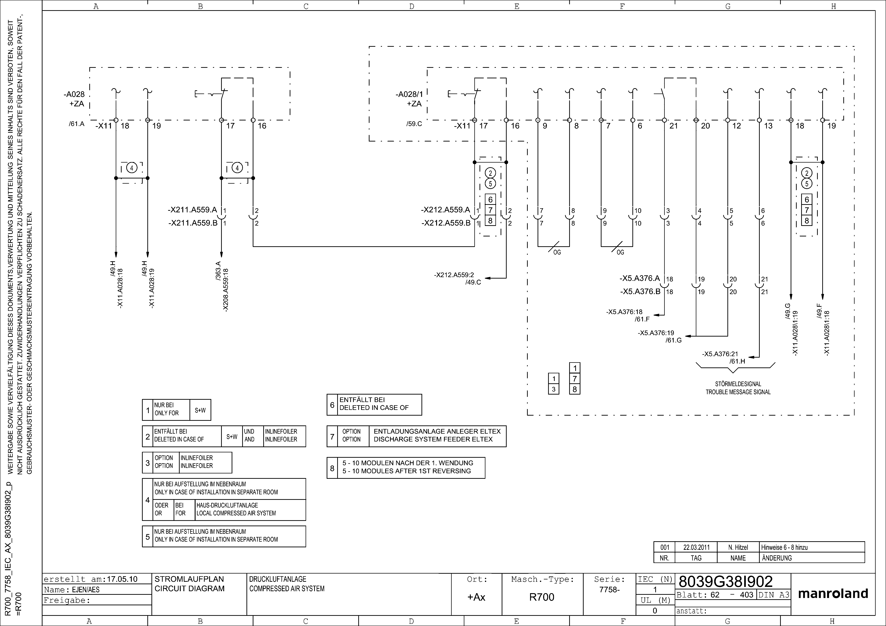

# +Ax — Sheet 62 of 403 — DRUCKLUFTANLAGE

**COMPRESSED AIR SYSTEM**

> Part of the manroland **R700** printing press IEC/UL circuit diagrams.
> Drawing class: **Stromlaufplan / Circuit diagram** (DIN A3).
> Document `+Ax` covers the **Central control console** machine section.

## At a glance

| Field | Value |
|---|---|
| Document | `+Ax`  (8039G38I902) |
| Sheet | **62** of 403 |
| Section (DE) | DRUCKLUFTANLAGE |
| Section (EN) | COMPRESSED AIR SYSTEM |
| Section type | CIRCUIT — Circuit diagram |
| Machine type | `R700` |
| Series | `7758` |
| Created | 17.05.10 |
| Replaces | — |
| Columns used | A, B, C, D, E, F, G, H |
| Path numbers | — |
| Labels on sheet | 149 |
| Cross-refs out | 11 |
| Cross-refs in | 43 |

**Previous:** [+Ax sheet 61](SHEET_0061.md) · **Next:** [+Ax sheet 63](SHEET_0063.md) · **Document TOC:** [_TOC.md](_TOC.md)  (+Ax) · **Master TOC:** [all sheets](../_MASTER_TOC.md)

## Sheet image (300 DPI, exact vector render)



_Rendered directly from the PDF vector layer at 300 DPI (1-bit), no OCR and no resampling. Use it to confirm anything ambiguous in the text below._

## Cross-references on this sheet

Each entry is a wire leaving this sheet. The printed token is `/sheet.column`; the link resolves to that sheet inside the same document.

| Ref | Target sheet | Col | Path | Destination on target | Target section | From col |
|---|---|---|---|---|---|---|
| `/61.A` | [+Ax sheet 61](SHEET_0061.md) | A | — | 18 19 18 19 | DRUCKLUFTANLAGE | D |
| `/59.C` | [+Ax sheet 59](SHEET_0059.md) | C | — | 17 16 16 9 8 7 6 21 20 12 13 | DRUCKLUFTANLAGE | E |
| `/49.H` | [+Ax sheet 49](SHEET_0049.md) | H | — | — | NOT AUS | A |
| `/49.H` | [+Ax sheet 49](SHEET_0049.md) | H | — | — | NOT AUS | A |
| `/363.A` | [+Ax sheet 363](SHEET_0363.md) | A | — | — | OPTION: LOGISTIK AUSLEGER | B |
| `/49.C` | [+Ax sheet 49](SHEET_0049.md) | C | — | X212.A559:2 | NOT AUS | D |
| `/49.G` | [+Ax sheet 49](SHEET_0049.md) | G | — | — | NOT AUS | H |
| `/49.F` | [+Ax sheet 49](SHEET_0049.md) | F | — | — | NOT AUS | H |
| `/61.F` | [+Ax sheet 61](SHEET_0061.md) | F | — | X5.A376:18 | DRUCKLUFTANLAGE | F |
| `/61.G` | [+Ax sheet 61](SHEET_0061.md) | G | — | X5.A376:19 | DRUCKLUFTANLAGE | F |
| `/61.H` | [+Ax sheet 61](SHEET_0061.md) | H | — | X5.A376:21 | DRUCKLUFTANLAGE | G |

### Incoming references (sheets that point here)

Every other sheet that sends a wire to this one. `Back-ref` is the token printed on *that* sheet; `Path` is its line number.

| From sheet | Cols | Back-ref | Path | Refs | What continues there |
|---|---|---|---|---|---|
| [+Ax#49](SHEET_0049.md) | C, F, H | `/49.C`, `/49.F`, `/49.H` | — | 5 | X11.A028:18; X11.A028:19; X11.A028\1:18; X11.A028\1:19 |
| [+Ax#59](SHEET_0059.md) | C | `/59.C` | — | 1 | — |
| [+Ax#61](SHEET_0061.md) | A, F, H | `/61.A`, `/61.F`, `/61.H` | — | 4 | X5.A376:21 |
| [+Ax#232](SHEET_0232.md) | A, B | `/232.A`, `/232.B` | — | 8 | — |
| [+Ax#293](SHEET_0293.md) | F, G | `/293.F`, `/293.G` | — | 24 | — |
| [+Ax#363](SHEET_0363.md) | A | `/363.A` | — | 1 | X208.A559:18 |


## Devices on this sheet

| Tag | Class | Class meaning (IEC) | Col | Sub | Terminal | Sign |
|---|---|---|---|---|---|---|
| `A028/1` | A | Baugruppe / assembly, module, PC board | D | 1 | — | — |
| `A028` | A | Baugruppe / assembly, module, PC board | A | — | — | — |
| `X11` | X | Klemme / terminal, plug connector | D | — | — | — |
| `X11` | X | Klemme / terminal, plug connector | A | — | — | — |
| `X212.A559.B` | — | cross-device reference | D | — | — | — |
| `X212.A559.A` | — | cross-device reference | D | — | — | — |
| `X211.A559.B` | — | cross-device reference | B | — | — | — |
| `X211.A559.A` | — | cross-device reference | B | — | — | — |
| `X5.A376.B` | — | cross-device reference | F | — | — | — |
| `X5.A376.A` | — | cross-device reference | F | — | — | — |
| `X212.A559:2` | — | cross-device reference | D | — | 2 | — |
| `X208.A559:18` | — | cross-device reference | B | — | 18 | — |
| `X11.A028\1:19` | — | cross-device reference | H | — | 19 | — |
| `X11.A028:18` | — | cross-device reference | A | — | 18 | — |
| `X11.A028:19` | — | cross-device reference | B | — | 19 | — |
| `X11.A028\1:18` | — | cross-device reference | H | — | 18 | — |
| `X5.A376:18` | — | cross-device reference | F | — | 18 | — |
| `X5.A376:19` | — | cross-device reference | F | — | 19 | — |
| `X5.A376:21` | — | cross-device reference | G | — | 21 | — |
| `NR.` | — | cross-device reference | F | — | — | — |
| `22.03.2011` | — | cross-device reference | G | — | — | — |

## Potentials / nets

_No named potentials on this sheet._

## Wire-end annotations (grouped as printed)

A wire that continues elsewhere is annotated with a small cluster: the destination description, the path/line number `#NN`, and the `/sheet.column` cross reference. Each row below is one such cluster exactly as it is grouped on the drawing.

| Col | Y | Path | Cross-ref | Text on the wire |
|---|---|---|---|---|
| A | 122.2 | — | — | `A028` |
| D | 122.2 | — | — | `A028/1` |
| A | 134.9 | — | — | `+ZA` |
| D | 134.9 | — | — | `+ZA` |
| D | 162.5 | — | `/61.A` | `18 19 18 19` |
| E | 162.6 | — | `/59.C` | `17 16 16 9 8 7 6 21 20 12 13` |
| C | 164.7 | — | — | `X11 X11` |
| E | 164.7 | — | — | `17` |
| E | 222.8 | — | — | `4 4 2` |
| E | 229.9 | — | — | `2` |
| E | 244.1 | — | — | `5` |
| H | 244.1 | — | — | `5` |
| E | 263.9 | — | — | `8 6 7` |
| H | 263.9 | — | — | `8 6 7` |
| B | 277.4 | — | — | `X211.A559.A 1` |
| D | 277.4 | — | — | `X212.A559.A 1` |
| C | 279.5 | — | — | `2` |
| E | 279.5 | — | — | `2` |
| E | 279.5 | — | — | `7` |
| F | 279.5 | — | — | `8` |
| F | 279.5 | — | — | `9` |
| F | 279.5 | — | — | `10` |
| F | 279.5 | — | — | `3` |
| G | 279.5 | — | — | `4` |
| G | 279.5 | — | — | `5` |
| G | 279.5 | — | — | `6` |
| B | 295.1 | — | — | `X211.A559.B 1` |
| D | 295.1 | — | — | `X212.A559.B 1` |
| C | 296.5 | — | — | `2` |
| E | 296.5 | — | — | `2` |
| E | 296.5 | — | — | `7` |
| F | 296.5 | — | — | `8` |
| F | 296.5 | — | — | `9` |
| F | 296.5 | — | — | `10` |
| F | 296.5 | — | — | `3` |
| G | 296.5 | — | — | `4` |
| G | 296.5 | — | — | `5` |
| G | 296.5 | — | — | `6` |
| F | 336.5 | — | — | `OG OG` |
| A | 350.6 | — | `/49.H` | — |
| A | 350.6 | — | `/49.H` | — |
| B | 351.5 | — | `/363.A` | — |
| A | 361.1 | — | — | `X11.A028:18` |
| B | 361.1 | — | — | `X11.A028:19` |
| B | 361.1 | — | — | `X208.A559:18` |
| D | 366.0 | — | `/49.C` | `X212.A559:2` |
| F | 369.5 | — | — | `X5.A376.A 18` |
| G | 371.7 | — | — | `19` |
| G | 371.7 | — | — | `20` |
| G | 371.7 | — | — | `21` |
| F | 387.2 | — | — | `X5.A376.B 18` |
| G | 388.7 | — | — | `19` |
| G | 388.7 | — | — | `20` |
| G | 388.7 | — | — | `21` |
| H | 407.6 | — | `/49.G` | — |
| H | 407.9 | — | `/49.F` | — |
| F | 415.6 | — | `/61.F` | `X5.A376:18` |
| H | 417.8 | — | — | `X11.A028\1:19` |
| H | 417.8 | — | — | `X11.A028\1:18` |
| F | 443.9 | — | `/61.G` | `X5.A376:19` |
| G | 472.2 | — | `/61.H` | `X5.A376:21` |
| F | 490.7 | — | — | `8 7 1` |
| E | 505.6 | — | — | `1` |
| G | 513.7 | — | — | `TROUBLE MESSAGE SIGNAL STÖRMELDESIGNAL` |
| E | 519.8 | — | — | `3` |
| D | 533.9 | — | — | `6 ENTFÄLLT BEI DELETED IN CASE OF` |
| B | 542.0 | — | — | `1 NUR BEI` |
| B | 549.0 | — | — | `ONLY FOR S+W` |
| D | 576.4 | — | — | `ENTLADUNGSANLAGE ANLEGER ELTEX DISCHARGE SYSTEM FEEDER ELTEX` |
| B | 577.4 | — | — | `2 ENTFÄLLT BEI DELETED IN CASE OF S+W` |
| B | 577.5 | — | — | `UND` |
| C | 577.5 | — | — | `INLINEFOILER INLINEFOILER` |
| C | 577.5 | — | — | `7 OPTION OPTION` |
| B | 588.1 | — | — | `AND` |
| B | 612.9 | — | — | `3 OPTION OPTION` |
| B | 612.9 | — | — | `INLINEFOILER INLINEFOILER` |
| D | 618.9 | — | — | `5 10 MODULEN NACH DER 1. WENDUNG 5 10 MODULES AFTER 1ST REVERSING` |
| C | 625.3 | — | — | `8` |
| B | 648.4 | — | — | `NUR BEI AUFSTELLUNG IM NEBENRAUM` |
| B | 659.0 | — | — | `ONLY IN CASE OF INSTALLATION IN SEPARATE ROOM` |
| A | 667.8 | — | — | `4` |
| B | 676.5 | — | — | `BEI FOR` |
| B | 676.7 | — | — | `ODER OR` |
| B | 676.7 | — | — | `HAUS DRUCKLUFTANLAGE LOCAL COMPRESSED AIR SYSTEM` |
| B | 712.1 | — | — | `5 NUR BEI AUFSTELLUNG IM NEBENRAUM` |
| B | 722.8 | — | — | `ONLY IN CASE OF INSTALLATION IN SEPARATE ROOM` |
| G | 733.0 | — | — | `001 22.03.2011 N. Hitzel Hinweise 6 8 hinzu` |
| G | 747.1 | — | — | `NR. TAG NAME ÄNDERUNG` |


## Reconstructed tables

This sheet carries tabular content (pin map / terminal assignment / index). The grid below was rebuilt from the drawing's own rule lines, so each row is exactly one physical row of the table.

### Table 1 — 1 data rows × 3 columns (at x=155.9, y=104.9)

| 18 4 | 19 | 17 4 |
|---|---|---|
|  | `X211.A559.A X211.A559.B` | `1 1` |


### Table 2 — 1 data rows × 2 columns (at x=637.8, y=62.4)

| 17 | 16 |
|---|---|
| `2 5 6 7 1 8 1` | `2 2` |


### Table 3 — 4 data rows × 10 columns (at x=722.8, y=62.4)

| 9 | 8 | 7 | 6 | 21 | 20 | 12 | 13 | 18 | 19 |
|---|---|---|---|---|---|---|---|---|---|
| `7 7` | `8 8` | `9 9` | `10 10` | `3 3` | `4 4` | `5 5` | `6 6` | `2 5 6 7 8` |  |
| `OG` |  | `OG X5.A376:18` | `X5.A376.A X5.A376.B /61.F X5.A376:19` | `18 18` | `19 19` | `20 20` | `21 21 /49.G` | `/49.F X11.A028\1:19` | `X11.A028\1:18` |
|  |  |  |  | `/61.G` | `X5.A376:21` | `/61.H` |  |  |  |
| `1 3` | `1 7 8` |  |  |  | `TROUBLE` | `STÖRMELDESIGNAL MESSAGE` | `SIGNAL` |  |  |


## Notes and free text on this sheet

| Text | Col | Y (pt) |
|---|---|---|
| `+ZA` | D | 134.87 |
| `+ZA` | A | 134.87 |
| `TAG` | G | 747.27 |
| `NAME` | G | 747.25 |
| `ÄNDERUNG` | G | 747.31 |
| `N. Hitzel` | G | 733.14 |
| `Hinweise 6 8 hinzu` | H | 733.16 |
| `OG` | E | 336.49 |
| `OG` | F | 336.49 |
| `NUR BEI` | B | 542 |
| `ONLY FOR` | B | 552.68 |
| `S+W` | B | 548.99 |
| `ENTFÄLLT BEI` | B | 577.44 |
| `DELETED IN CASE OF` | B | 588.09 |
| `UND` | B | 577.47 |
| `AND` | B | 588.12 |
| `INLINEFOILER` | C | 577.47 |
| `OPTION` | B | 612.88 |
| `INLINEFOILER` | B | 612.9 |
| `STÖRMELDESIGNAL` | G | 513.71 |
| `TROUBLE MESSAGE SIGNAL` | G | 524.33 |
| `NUR BEI AUFSTELLUNG IM NEBENRAUM` | B | 648.35 |
| `ONLY IN CASE OF INSTALLATION IN SEPARATE ROOM` | B | 658.97 |
| `ODER` | B | 676.7 |
| `OR` | B | 687.32 |
| `BEI` | B | 676.51 |
| `FOR` | B | 687.28 |
| `HAUS DRUCKLUFTANLAGE` | B | 676.7 |
| `LOCAL COMPRESSED AIR SYSTEM` | B | 687.32 |
| `ENTLADUNGSANLAGE ANLEGER ELTEX` | D | 576.41 |
| `DISCHARGE SYSTEM FEEDER ELTEX` | D | 587.04 |
| `5 10 MODULEN NACH DER 1. WENDUNG` | D | 618.94 |
| `5 10 MODULES AFTER 1ST REVERSING` | D | 629.57 |
| `OPTION` | C | 577.45 |
| `ENTFÄLLT BEI` | D | 533.88 |
| `DELETED IN CASE OF` | D | 544.51 |

## Complete label inventory (exact text from the drawing)

Every text object inside the drawing area of this sheet, in DIN reading order (column A→H, then top→bottom). This is the authoritative list: if a string is not here it is not printed on this sheet.

| Col | Y | X | Dir | Type | Text |
|---|---|---|---|---|---|
| A | 122.2 | 85.6 | → | device tag | `A028` |
| A | 134.9 | 93.3 | → | text | `+ZA` |
| A | 162.5 | 92.7 | → | cross-reference | `/61.A` |
| A | 164.7 | 128.4 | → | device tag | `X11` |
| A | 164.7 | 161.9 | → | number | `18` |
| A | 222.8 | 175.2 | → | number | `4` |
| A | 350.6 | 147.7 | ↕ | cross-reference | `/49.H` |
| A | 350.6 | 190.2 | ↕ | cross-reference | `/49.H` |
| A | 361.1 | 157.6 | ↕ | device ref | `X11.A028:18` |
| A | 547.4 | 195.9 | → | number | `1` |
| A | 582.8 | 195.6 | → | number | `2` |
| A | 618.2 | 195.4 | → | number | `3` |
| A | 667.8 | 195.6 | → | number | `4` |
| A | 717.4 | 195.4 | → | number | `5` |
| B | 164.7 | 204.4 | → | number | `19` |
| B | 164.7 | 303.6 | → | number | `17` |
| B | 222.8 | 316.9 | → | number | `4` |
| B | 277.4 | 225.6 | → | device ref | `X211.A559.A` |
| B | 279.5 | 299.6 | → | number | `1` |
| B | 295.1 | 226.5 | → | device ref | `X211.A559.B` |
| B | 296.5 | 299.6 | → | number | `1` |
| B | 351.5 | 289.4 | ↕ | cross-reference | `/363.A` |
| B | 361.1 | 200.1 | ↕ | device ref | `X11.A028:19` |
| B | 361.1 | 299.3 | ↕ | device ref | `X208.A559:18` |
| B | 542.0 | 207.5 | → | text | `NUR BEI` |
| B | 549.0 | 261.9 | → | text | `S+W` |
| B | 552.7 | 208.1 | → | text | `ONLY FOR` |
| B | 577.4 | 207.5 | → | text | `ENTFÄLLT BEI` |
| B | 577.5 | 328.0 | → | text | `UND` |
| B | 584.4 | 304.4 | → | text | `S+W` |
| B | 588.1 | 207.5 | → | text | `DELETED IN CASE OF` |
| B | 588.1 | 328.8 | → | text | `AND` |
| B | 612.9 | 208.1 | → | text | `OPTION` |
| B | 612.9 | 242.9 | → | text | `INLINEFOILER` |
| B | 623.5 | 208.1 | → | text | `OPTION` |
| B | 623.5 | 242.9 | → | text | `INLINEFOILER` |
| B | 648.4 | 207.5 | → | text | `NUR BEI AUFSTELLUNG IM NEBENRAUM` |
| B | 659.0 | 208.1 | → | text | `ONLY IN CASE OF INSTALLATION IN SEPARATE ROOM` |
| B | 676.5 | 235.8 | → | text | `BEI` |
| B | 676.7 | 208.1 | → | text | `ODER` |
| B | 676.7 | 264.2 | → | text | `HAUS DRUCKLUFTANLAGE` |
| B | 687.3 | 208.1 | → | text | `OR` |
| B | 687.3 | 235.8 | → | text | `FOR` |
| B | 687.3 | 264.2 | → | text | `LOCAL COMPRESSED AIR SYSTEM` |
| B | 712.1 | 207.5 | → | text | `NUR BEI AUFSTELLUNG IM NEBENRAUM` |
| B | 722.8 | 208.1 | → | text | `ONLY IN CASE OF INSTALLATION IN SEPARATE ROOM` |
| C | 164.7 | 346.1 | → | number | `16` |
| C | 279.5 | 342.7 | → | number | `2` |
| C | 296.5 | 342.7 | → | number | `2` |
| C | 540.3 | 443.6 | → | number | `6` |
| C | 577.4 | 460.3 | → | text | `OPTION` |
| C | 577.5 | 356.3 | → | text | `INLINEFOILER` |
| C | 582.8 | 443.6 | → | number | `7` |
| C | 588.1 | 356.3 | → | text | `INLINEFOILER` |
| C | 588.1 | 460.3 | → | text | `OPTION` |
| C | 625.3 | 443.5 | → | number | `8` |
| D | 122.2 | 531.8 | → | device tag | `A028/1` |
| D | 134.9 | 546.8 | → | text | `+ZA` |
| D | 162.6 | 546.2 | → | cross-reference | `/59.C` |
| D | 164.7 | 610.3 | → | device tag | `X11` |
| D | 277.4 | 565.8 | → | device ref | `X212.A559.A` |
| D | 295.1 | 566.6 | → | device ref | `X212.A559.B` |
| D | 366.0 | 583.4 | → | device ref | `X212.A559:2` |
| D | 533.9 | 456.2 | → | text | `ENTFÄLLT BEI` |
| D | 544.5 | 456.2 | → | text | `DELETED IN CASE OF` |
| D | 576.4 | 502.3 | → | text | `ENTLADUNGSANLAGE ANLEGER ELTEX` |
| D | 587.0 | 502.3 | → | text | `DISCHARGE SYSTEM FEEDER ELTEX` |
| D | 618.9 | 460.3 | → | text | `5 10 MODULEN NACH DER 1. WENDUNG` |
| D | 629.6 | 460.3 | → | text | `5 10 MODULES AFTER 1ST REVERSING` |
| E | 164.7 | 643.7 | → | number | `17` |
| E | 164.7 | 686.3 | → | number | `16` |
| E | 164.7 | 729.4 | → | number | `9` |
| E | 229.9 | 657.1 | → | number | `2` |
| E | 244.1 | 657.1 | → | number | `5` |
| E | 263.9 | 656.2 | → | number | `6` |
| E | 278.1 | 656.2 | → | number | `7` |
| E | 279.5 | 639.8 | → | number | `1` |
| E | 279.5 | 682.9 | → | number | `2` |
| E | 279.5 | 725.4 | → | number | `7` |
| E | 292.2 | 656.1 | → | number | `8` |
| E | 296.5 | 639.8 | → | number | `1` |
| E | 296.5 | 682.9 | → | number | `2` |
| E | 296.5 | 725.4 | → | number | `7` |
| E | 336.5 | 743.8 | → | text | `OG` |
| E | 375.9 | 625.6 | → | cross-reference | `/49.C` |
| E | 505.6 | 742.1 | → | number | `1` |
| E | 519.8 | 741.7 | → | number | `3` |
| F | 164.7 | 771.9 | → | number | `8` |
| F | 164.7 | 814.7 | → | number | `7` |
| F | 164.7 | 857.2 | → | number | `6` |
| F | 164.7 | 899.7 | → | number | `21` |
| F | 279.5 | 767.9 | → | number | `8` |
| F | 279.5 | 810.4 | → | number | `9` |
| F | 279.5 | 852.4 | → | number | `10` |
| F | 279.5 | 895.5 | → | number | `3` |
| F | 296.5 | 767.9 | → | number | `8` |
| F | 296.5 | 810.4 | → | number | `9` |
| F | 296.5 | 852.4 | → | number | `10` |
| F | 296.5 | 895.5 | → | number | `3` |
| F | 336.5 | 828.9 | → | text | `OG` |
| F | 369.5 | 832.8 | → | device ref | `X5.A376.A` |
| F | 371.7 | 894.9 | → | number | `18` |
| F | 387.2 | 833.7 | → | device ref | `X5.A376.B` |
| F | 388.7 | 894.9 | → | number | `18` |
| F | 415.6 | 814.7 | → | device ref | `X5.A376:18` |
| F | 425.5 | 853.2 | → | cross-reference | `/61.F` |
| F | 443.9 | 857.2 | → | device ref | `X5.A376:19` |
| F | 453.8 | 894.6 | → | cross-reference | `/61.G` |
| F | 490.7 | 769.9 | → | number | `1` |
| F | 504.8 | 769.6 | → | number | `7` |
| F | 519.0 | 769.5 | → | number | `8` |
| F | 733.0 | 887.7 | → | number | `001` |
| F | 747.1 | 886.7 | → | device ref | `NR.` |
| G | 164.7 | 942.2 | → | number | `20` |
| G | 164.7 | 983.9 | → | number | `12` |
| G | 164.7 | 1026.4 | → | number | `13` |
| G | 279.5 | 938.0 | → | number | `4` |
| G | 279.5 | 980.5 | → | number | `5` |
| G | 279.5 | 1023.0 | → | number | `6` |
| G | 296.5 | 938.0 | → | number | `4` |
| G | 296.5 | 980.5 | → | number | `5` |
| G | 296.5 | 1023.0 | → | number | `6` |
| G | 371.7 | 937.4 | → | number | `19` |
| G | 371.7 | 980.5 | → | number | `20` |
| G | 371.7 | 1023.0 | → | number | `21` |
| G | 388.7 | 937.4 | → | number | `19` |
| G | 388.7 | 980.5 | → | number | `20` |
| G | 388.7 | 1023.0 | → | number | `21` |
| G | 472.3 | 943.7 | → | device ref | `X5.A376:21` |
| G | 482.2 | 980.5 | → | cross-reference | `/61.H` |
| G | 513.7 | 961.3 | → | text | `STÖRMELDESIGNAL` |
| G | 524.3 | 948.6 | → | text | `TROUBLE MESSAGE SIGNAL` |
| G | 733.1 | 918.6 | → | device ref | `22.03.2011` |
| G | 733.1 | 978.8 | → | text | `N. Hitzel` |
| G | 747.3 | 928.3 | → | text | `TAG` |
| G | 747.3 | 981.7 | → | text | `NAME` |
| G | 747.3 | 1024.3 | → | text | `ÄNDERUNG` |
| H | 164.7 | 1068.9 | → | number | `18` |
| H | 164.7 | 1111.5 | → | number | `19` |
| H | 229.9 | 1082.3 | → | number | `2` |
| H | 244.1 | 1082.3 | → | number | `5` |
| H | 263.9 | 1081.4 | → | number | `6` |
| H | 278.1 | 1081.4 | → | number | `7` |
| H | 292.2 | 1081.3 | → | number | `8` |
| H | 407.6 | 1054.8 | ↕ | cross-reference | `/49.G` |
| H | 407.9 | 1097.3 | ↕ | cross-reference | `/49.F` |
| H | 417.8 | 1064.7 | ↕ | device ref | `X11.A028\1:19` |
| H | 417.8 | 1107.2 | ↕ | device ref | `X11.A028\1:18` |
| H | 733.2 | 1023.2 | → | text | `Hinweise 6 8 hinzu` |

## Reading-order text block

The same content as a plain block, grouped by DIN column — convenient to paste or to match against a visual description.

```text
=== Column A ===
 122.2   85.6  devtag       A028
 134.9   93.3  text         +ZA
 162.5   92.7  xref         /61.A
 164.7  128.4  devtag       X11
 164.7  161.9  numeric      18
 222.8  175.2  numeric      4
 350.6  147.7  xref         /49.H
 350.6  190.2  xref         /49.H
 361.1  157.6  devref       X11.A028:18
 547.4  195.9  numeric      1
 582.8  195.6  numeric      2
 618.2  195.4  numeric      3
 667.8  195.6  numeric      4
 717.4  195.4  numeric      5
=== Column B ===
 164.7  204.4  numeric      19
 164.7  303.6  numeric      17
 222.8  316.9  numeric      4
 277.4  225.6  devref       X211.A559.A
 279.5  299.6  numeric      1
 295.1  226.5  devref       X211.A559.B
 296.5  299.6  numeric      1
 351.5  289.4  xref         /363.A
 361.1  200.1  devref       X11.A028:19
 361.1  299.3  devref       X208.A559:18
 542.0  207.5  text         NUR BEI
 549.0  261.9  text         S+W
 552.7  208.1  text         ONLY FOR
 577.4  207.5  text         ENTFÄLLT BEI
 577.5  328.0  text         UND
 584.4  304.4  text         S+W
 588.1  207.5  text         DELETED IN CASE OF
 588.1  328.8  text         AND
 612.9  208.1  text         OPTION
 612.9  242.9  text         INLINEFOILER
 623.5  208.1  text         OPTION
 623.5  242.9  text         INLINEFOILER
 648.4  207.5  text         NUR BEI AUFSTELLUNG IM NEBENRAUM
 659.0  208.1  text         ONLY IN CASE OF INSTALLATION IN SEPARATE ROOM
 676.5  235.8  text         BEI
 676.7  208.1  text         ODER
 676.7  264.2  text         HAUS DRUCKLUFTANLAGE
 687.3  208.1  text         OR
 687.3  235.8  text         FOR
 687.3  264.2  text         LOCAL COMPRESSED AIR SYSTEM
 712.1  207.5  text         NUR BEI AUFSTELLUNG IM NEBENRAUM
 722.8  208.1  text         ONLY IN CASE OF INSTALLATION IN SEPARATE ROOM
=== Column C ===
 164.7  346.1  numeric      16
 279.5  342.7  numeric      2
 296.5  342.7  numeric      2
 540.3  443.6  numeric      6
 577.4  460.3  text         OPTION
 577.5  356.3  text         INLINEFOILER
 582.8  443.6  numeric      7
 588.1  356.3  text         INLINEFOILER
 588.1  460.3  text         OPTION
 625.3  443.5  numeric      8
=== Column D ===
 122.2  531.8  devtag       A028/1
 134.9  546.8  text         +ZA
 162.6  546.2  xref         /59.C
 164.7  610.3  devtag       X11
 277.4  565.8  devref       X212.A559.A
 295.1  566.6  devref       X212.A559.B
 366.0  583.4  devref       X212.A559:2
 533.9  456.2  text         ENTFÄLLT BEI
 544.5  456.2  text         DELETED IN CASE OF
 576.4  502.3  text         ENTLADUNGSANLAGE ANLEGER ELTEX
 587.0  502.3  text         DISCHARGE SYSTEM FEEDER ELTEX
 618.9  460.3  text         5 10 MODULEN NACH DER 1. WENDUNG
 629.6  460.3  text         5 10 MODULES AFTER 1ST REVERSING
=== Column E ===
 164.7  643.7  numeric      17
 164.7  686.3  numeric      16
 164.7  729.4  numeric      9
 229.9  657.1  numeric      2
 244.1  657.1  numeric      5
 263.9  656.2  numeric      6
 278.1  656.2  numeric      7
 279.5  639.8  numeric      1
 279.5  682.9  numeric      2
 279.5  725.4  numeric      7
 292.2  656.1  numeric      8
 296.5  639.8  numeric      1
 296.5  682.9  numeric      2
 296.5  725.4  numeric      7
 336.5  743.8  text         OG
 375.9  625.6  xref         /49.C
 505.6  742.1  numeric      1
 519.8  741.7  numeric      3
=== Column F ===
 164.7  771.9  numeric      8
 164.7  814.7  numeric      7
 164.7  857.2  numeric      6
 164.7  899.7  numeric      21
 279.5  767.9  numeric      8
 279.5  810.4  numeric      9
 279.5  852.4  numeric      10
 279.5  895.5  numeric      3
 296.5  767.9  numeric      8
 296.5  810.4  numeric      9
 296.5  852.4  numeric      10
 296.5  895.5  numeric      3
 336.5  828.9  text         OG
 369.5  832.8  devref       X5.A376.A
 371.7  894.9  numeric      18
 387.2  833.7  devref       X5.A376.B
 388.7  894.9  numeric      18
 415.6  814.7  devref       X5.A376:18
 425.5  853.2  xref         /61.F
 443.9  857.2  devref       X5.A376:19
 453.8  894.6  xref         /61.G
 490.7  769.9  numeric      1
 504.8  769.6  numeric      7
 519.0  769.5  numeric      8
 733.0  887.7  numeric      001
 747.1  886.7  devref       NR.
=== Column G ===
 164.7  942.2  numeric      20
 164.7  983.9  numeric      12
 164.7 1026.4  numeric      13
 279.5  938.0  numeric      4
 279.5  980.5  numeric      5
 279.5 1023.0  numeric      6
 296.5  938.0  numeric      4
 296.5  980.5  numeric      5
 296.5 1023.0  numeric      6
 371.7  937.4  numeric      19
 371.7  980.5  numeric      20
 371.7 1023.0  numeric      21
 388.7  937.4  numeric      19
 388.7  980.5  numeric      20
 388.7 1023.0  numeric      21
 472.3  943.7  devref       X5.A376:21
 482.2  980.5  xref         /61.H
 513.7  961.3  text         STÖRMELDESIGNAL
 524.3  948.6  text         TROUBLE MESSAGE SIGNAL
 733.1  918.6  devref       22.03.2011
 733.1  978.8  text         N. Hitzel
 747.3  928.3  text         TAG
 747.3  981.7  text         NAME
 747.3 1024.3  text         ÄNDERUNG
=== Column H ===
 164.7 1068.9  numeric      18
 164.7 1111.5  numeric      19
 229.9 1082.3  numeric      2
 244.1 1082.3  numeric      5
 263.9 1081.4  numeric      6
 278.1 1081.4  numeric      7
 292.2 1081.3  numeric      8
 407.6 1054.8  xref         /49.G
 407.9 1097.3  xref         /49.F
 417.8 1064.7  devref       X11.A028\1:19
 417.8 1107.2  devref       X11.A028\1:18
 733.2 1023.2  text         Hinweise 6 8 hinzu
```

---
_Generated from the PDF vector text layer; no OCR. Source: `R700_7758_IEC_AX_8039G38I902_p`, sheet 62._
