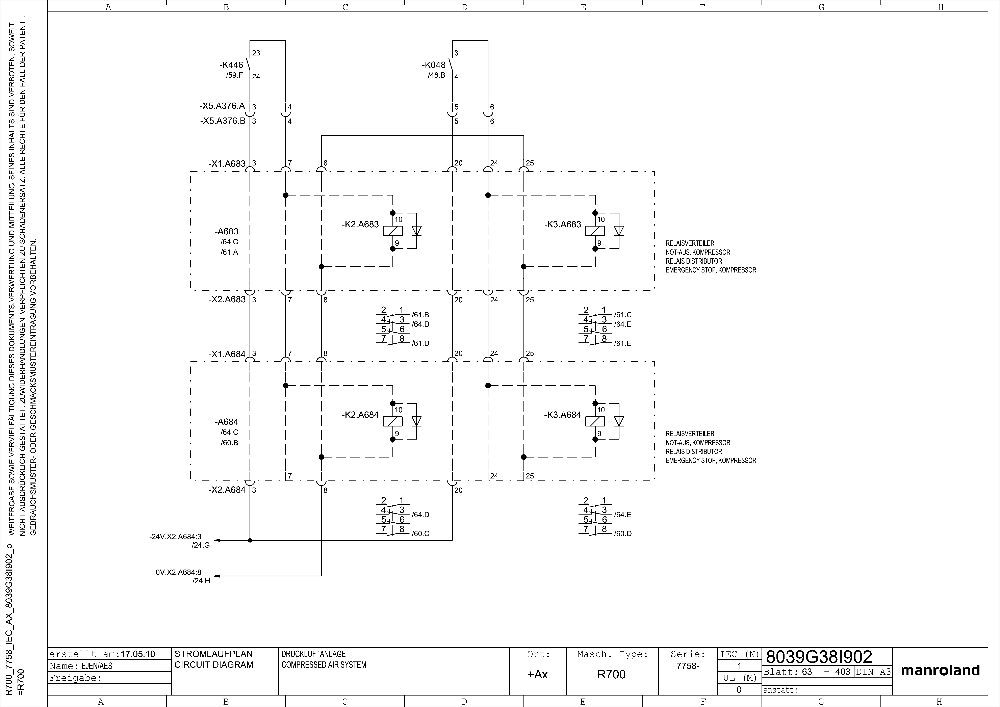

# +Ax — Sheet 63 of 403 — DRUCKLUFTANLAGE

**COMPRESSED AIR SYSTEM**

> Part of the manroland **R700** printing press IEC/UL circuit diagrams.
> Drawing class: **Stromlaufplan / Circuit diagram** (DIN A3).
> Document `+Ax` covers the **Central control console** machine section.

## At a glance

| Field | Value |
|---|---|
| Document | `+Ax`  (8039G38I902) |
| Sheet | **63** of 403 |
| Section (DE) | DRUCKLUFTANLAGE |
| Section (EN) | COMPRESSED AIR SYSTEM |
| Section type | CIRCUIT — Circuit diagram |
| Machine type | `R700` |
| Series | `7758` |
| Created | 17.05.10 |
| Replaces | — |
| Columns used | B, C, D, E, F |
| Path numbers | — |
| Labels on sheet | 118 |
| Cross-refs out | 18 |
| Cross-refs in | 50 |

**Previous:** [+Ax sheet 62](SHEET_0062.md) · **Next:** [+Ax sheet 64](SHEET_0064.md) · **Document TOC:** [_TOC.md](_TOC.md)  (+Ax) · **Master TOC:** [all sheets](../_MASTER_TOC.md)

## Sheet image (300 DPI, exact vector render)



_Rendered directly from the PDF vector layer at 300 DPI (1-bit), no OCR and no resampling. Use it to confirm anything ambiguous in the text below._

## Cross-references on this sheet

Each entry is a wire leaving this sheet. The printed token is `/sheet.column`; the link resolves to that sheet inside the same document.

| Ref | Target sheet | Col | Path | Destination on target | Target section | From col |
|---|---|---|---|---|---|---|
| `/48.B` | [+Ax sheet 48](SHEET_0048.md) | B | — | — | NOT AUS | D |
| `/59.F` | [+Ax sheet 59](SHEET_0059.md) | F | — | — | DRUCKLUFTANLAGE | B |
| `/64.C` | [+Ax sheet 64](SHEET_0064.md) | C | — | — | DRUCKLUFTANLAGE | B |
| `/61.A` | [+Ax sheet 61](SHEET_0061.md) | A | — | — | DRUCKLUFTANLAGE | B |
| `/61.B` | [+Ax sheet 61](SHEET_0061.md) | B | — | — | DRUCKLUFTANLAGE | D |
| `/64.D` | [+Ax sheet 64](SHEET_0064.md) | D | — | — | DRUCKLUFTANLAGE | D |
| `/61.C` | [+Ax sheet 61](SHEET_0061.md) | C | — | — | DRUCKLUFTANLAGE | E |
| `/64.E` | [+Ax sheet 64](SHEET_0064.md) | E | — | — | DRUCKLUFTANLAGE | E |
| `/61.E` | [+Ax sheet 61](SHEET_0061.md) | E | — | — | DRUCKLUFTANLAGE | E |
| `/61.D` | [+Ax sheet 61](SHEET_0061.md) | D | — | — | DRUCKLUFTANLAGE | D |
| `/64.C` | [+Ax sheet 64](SHEET_0064.md) | C | — | — | DRUCKLUFTANLAGE | B |
| `/60.B` | [+Ax sheet 60](SHEET_0060.md) | B | — | — | DRUCKLUFTANLAGE | B |
| `/64.E` | [+Ax sheet 64](SHEET_0064.md) | E | — | — | DRUCKLUFTANLAGE | E |
| `/64.D` | [+Ax sheet 64](SHEET_0064.md) | D | — | — | DRUCKLUFTANLAGE | D |
| `/60.C` | [+Ax sheet 60](SHEET_0060.md) | C | — | — | DRUCKLUFTANLAGE | D |
| `/60.D` | [+Ax sheet 60](SHEET_0060.md) | D | — | — | DRUCKLUFTANLAGE | E |
| `/24.G` | [+Ax sheet 24](SHEET_0024.md) | G | — | 24V.X2.A684:3 | SPANNUNGSVERSORGUNG, SCHALTSCHRANKBELÜFTUNG | B |
| `/24.H` | [+Ax sheet 24](SHEET_0024.md) | H | — | 0V.X2.A684:8 | SPANNUNGSVERSORGUNG, SCHALTSCHRANKBELÜFTUNG | B |

### Incoming references (sheets that point here)

Every other sheet that sends a wire to this one. `Back-ref` is the token printed on *that* sheet; `Path` is its line number.

| From sheet | Cols | Back-ref | Path | Refs | What continues there |
|---|---|---|---|---|---|
| [+Ax#24](SHEET_0024.md) | G, H | `/24.G`, `/24.H` | — | 2 | — |
| [+Ax#48](SHEET_0048.md) | B | `/48.B` | — | 1 | — |
| [+Ax#59](SHEET_0059.md) | F | `/59.F` | — | 1 | — |
| [+Ax#60](SHEET_0060.md) | B, D | `/60.B`, `/60.D` | — | 3 | — |
| [+Ax#61](SHEET_0061.md) | A, B, C, D, E | `/61.A`, `/61.B`, `/61.C`, `/61.D`, `/61.E` | — | 5 | — |
| [+Ax#64](SHEET_0064.md) | C, D, E | `/64.C`, `/64.D`, `/64.E` | — | 6 | — |
| [+Ax#211](SHEET_0211.md) | A, B, C, D | `/211.A`, `/211.B`, `/211.C`, `/211.D` | — | 12 | — |
| [+Ax#221](SHEET_0221.md) | C, D, F, G | `/221.C`, `/221.D`, `/221.F`, `/221.G` | — | 12 | — |
| [+Ax#232](SHEET_0232.md) | A, B | `/232.A`, `/232.B` | — | 8 | — |


## Devices on this sheet

| Tag | Class | Class meaning (IEC) | Col | Sub | Terminal | Sign |
|---|---|---|---|---|---|---|
| `A683` | A | Baugruppe / assembly, module, PC board | B | — | — | — |
| `A684` | A | Baugruppe / assembly, module, PC board | B | — | — | — |
| `K446` | K | Relais / relay, contactor | B | — | — | — |
| `K048` | K | Relais / relay, contactor | D | — | — | — |
| `X1.A683` | — | cross-device reference | B | — | — | — |
| `K2.A683` | — | cross-device reference | C | — | — | — |
| `X2.A683` | — | cross-device reference | B | — | — | — |
| `X1.A684` | — | cross-device reference | B | — | — | — |
| `X2.A684` | — | cross-device reference | B | — | — | — |
| `K2.A684` | — | cross-device reference | C | — | — | — |
| `X5.A376.B` | — | cross-device reference | B | — | — | — |
| `X5.A376.A` | — | cross-device reference | B | — | — | — |
| `K3.A683` | — | cross-device reference | E | — | — | — |
| `K3.A684` | — | cross-device reference | E | — | — | — |

## Potentials / nets

| Potential | Count | Columns | Attached devices | Terminals |
|---|---|---|---|---|
| `0V` | 1 | B | `A684`, `X2` | `8` |
| `24V` | 1 | B | `A684`, `X2` | `3` |


A potential such as `L24+/4` or `M24+` is a named supply/return rail; every place it appears on this sheet is electrically common.

## Wire-end annotations (grouped as printed)

A wire that continues elsewhere is annotated with a small cluster: the destination description, the path/line number `#NN`, and the `/sheet.column` cross reference. Each row below is one such cluster exactly as it is grouped on the drawing.

| Col | Y | Path | Cross-ref | Text on the wire |
|---|---|---|---|---|
| B | 59.1 | — | — | `23` |
| D | 59.1 | — | — | `3` |
| B | 72.6 | — | — | `K446 24` |
| D | 72.6 | — | — | `K048 4` |
| D | 85.6 | — | `/48.B` | — |
| B | 85.7 | — | `/59.F` | — |
| B | 121.5 | — | — | `X5.A376.A 3 4` |
| D | 123.6 | — | — | `5 6` |
| B | 139.2 | — | — | `X5.A376.B 3 4` |
| D | 140.6 | — | — | `5 6` |
| B | 190.2 | — | — | `X1.A683 3 7 8` |
| D | 190.2 | — | — | `20 24 25` |
| C | 257.6 | — | — | `10` |
| E | 257.6 | — | — | `10` |
| C | 262.5 | — | — | `K2.A683` |
| E | 262.5 | — | — | `K3.A683` |
| B | 271.0 | — | — | `A683` |
| B | 284.1 | — | `/64.C`, `/61.A` | — |
| C | 285.9 | — | — | `9` |
| E | 285.9 | — | — | `9` |
| F | 286.9 | — | — | `RELAISVERTEILER: NOT AUS, KOMPRESSOR RELAIS DISTRIBUTOR: EMERGENCY STOP, KOMPRESSOR` |
| B | 351.8 | — | — | `X2.A683 3 7 8` |
| D | 353.2 | — | — | `20 24 25` |
| C | 364.5 | — | — | `2 4 5 7 1 3 8 6` |
| E | 364.5 | — | — | `2 4 5 7 1 3 8 6` |
| D | 370.9 | — | `/61.B`, `/64.D` | — |
| E | 370.9 | — | `/61.C`, `/64.E` | — |
| D | 404.9 | — | `/61.D` | — |
| E | 404.9 | — | `/61.E` | — |
| B | 417.0 | — | — | `X1.A684 3 7 8` |
| D | 417.0 | — | — | `20 24 25` |
| C | 484.3 | — | — | `10` |
| E | 484.3 | — | — | `10` |
| C | 489.3 | — | — | `K2.A684` |
| E | 489.3 | — | — | `K3.A684` |
| B | 497.8 | — | — | `A684` |
| B | 510.9 | — | `/64.C`, `/60.B` | — |
| C | 512.7 | — | — | `9` |
| E | 512.7 | — | — | `9` |
| F | 513.7 | — | — | `RELAISVERTEILER: NOT AUS, KOMPRESSOR RELAIS DISTRIBUTOR: EMERGENCY STOP, KOMPRESSOR` |
| C | 563.0 | — | — | `7` |
| D | 563.0 | — | — | `24 25` |
| B | 578.6 | — | — | `X2.A684 3` |
| C | 580.0 | — | — | `8` |
| D | 580.0 | — | — | `20` |
| C | 591.3 | — | — | `2 4 5 7 1 3 8 6` |
| E | 591.3 | — | — | `2 4 5 7 1 3 8 6` |
| D | 609.0 | — | `/64.D` | — |
| E | 609.0 | — | `/64.E` | — |
| D | 631.7 | — | `/60.C` | — |
| E | 631.7 | — | `/60.D` | — |
| B | 635.2 | — | `/24.G` | `24V.X2.A684:3` |
| B | 677.8 | — | `/24.H` | `0V.X2.A684:8` |


## Reconstructed tables

This sheet carries tabular content (pin map / terminal assignment / index). The grid below was rebuilt from the drawing's own rule lines, so each row is exactly one physical row of the table.

### Table 1 — 5 data rows × 9 columns (at x=297.6, y=48.2)

| 23 24 3 3 | 4 4 |  |  | K048 /48.B | 3 4 5 5 | 6 6 |  |  |
|---|---|---|---|---|---|---|---|---|
| `3` | `7` | `8` |  |  | `20` | `24` | `25` |  |
|  |  | `K2.A683` | `10 9` |  |  |  | `K3.A683` | `10 9` |
| `3 3` | `7 7` | `8 2 4 5 7 8` | `1 3 6 8` | `/61.B /64.D /61.D` | `20 20` | `24 24` | `25 2 4 5 7 25` | `1 3 6 8` |
|  |  | `K2.A684` | `10 9` |  |  |  | `K3.A684` | `10 9` |
| `3` | `7` | `8 2 4 5 7` | `1 3 6 8` | `/64.D /60.C` | `20` | `24` | `25 2 4 5 7` | `1 3 6 8` |


## Notes and free text on this sheet

| Text | Col | Y (pt) |
|---|---|---|
| `RELAISVERTEILER:` | F | 286.9 |
| `NOT AUS, KOMPRESSOR` | F | 297.56 |
| `RELAIS DISTRIBUTOR:` | F | 308.17 |
| `EMERGENCY STOP, KOMPRESSOR` | F | 318.83 |

## Complete label inventory (exact text from the drawing)

Every text object inside the drawing area of this sheet, in DIN reading order (column A→H, then top→bottom). This is the authoritative list: if a string is not here it is not printed on this sheet.

| Col | Y | X | Dir | Type | Text |
|---|---|---|---|---|---|
| B | 59.1 | 300.2 | → | number | `23` |
| B | 72.6 | 261.4 | → | device tag | `K446` |
| B | 85.7 | 269.3 | → | cross-reference | `/59.F` |
| B | 87.5 | 300.2 | → | number | `24` |
| B | 121.5 | 237.5 | → | device ref | `X5.A376.A` |
| B | 123.6 | 300.2 | → | number | `3` |
| B | 139.2 | 238.4 | → | device ref | `X5.A376.B` |
| B | 140.6 | 300.2 | → | number | `3` |
| B | 190.2 | 248.3 | → | device ref | `X1.A683` |
| B | 190.2 | 300.2 | → | number | `3` |
| B | 271.0 | 255.7 | → | device tag | `A683` |
| B | 284.1 | 262.8 | → | cross-reference | `/64.C` |
| B | 296.5 | 262.8 | → | cross-reference | `/61.A` |
| B | 351.8 | 248.3 | → | device ref | `X2.A683` |
| B | 353.2 | 300.2 | → | number | `3` |
| B | 417.0 | 248.3 | → | device ref | `X1.A684` |
| B | 417.0 | 300.2 | → | number | `3` |
| B | 497.8 | 255.7 | → | device tag | `A684` |
| B | 510.9 | 262.8 | → | cross-reference | `/64.C` |
| B | 523.2 | 263.1 | → | cross-reference | `/60.B` |
| B | 578.6 | 248.3 | → | device ref | `X2.A684` |
| B | 580.0 | 300.2 | → | number | `3` |
| B | 635.2 | 177.7 | → | potential | `24V.X2.A684:3` |
| B | 645.2 | 228.5 | → | cross-reference | `/24.G` |
| B | 677.7 | 185.4 | → | potential | `0V.X2.A684:8` |
| B | 687.7 | 229.3 | → | cross-reference | `/24.H` |
| C | 123.6 | 342.7 | → | number | `4` |
| C | 140.6 | 342.7 | → | number | `4` |
| C | 190.2 | 342.7 | → | number | `7` |
| C | 190.2 | 385.2 | → | number | `8` |
| C | 257.6 | 469.7 | → | number | `10` |
| C | 262.5 | 407.1 | → | device ref | `K2.A683` |
| C | 285.9 | 470.3 | → | number | `9` |
| C | 353.2 | 342.7 | → | number | `7` |
| C | 353.2 | 385.2 | → | number | `8` |
| C | 364.5 | 453.8 | → | number | `2` |
| C | 364.5 | 475.1 | → | number | `1` |
| C | 375.9 | 453.8 | → | number | `4` |
| C | 375.9 | 475.7 | → | number | `3` |
| C | 387.2 | 453.8 | → | number | `5` |
| C | 387.2 | 475.9 | → | number | `6` |
| C | 398.5 | 453.8 | → | number | `7` |
| C | 398.5 | 475.7 | → | number | `8` |
| C | 417.0 | 342.7 | → | number | `7` |
| C | 417.0 | 385.2 | → | number | `8` |
| C | 484.3 | 469.7 | → | number | `10` |
| C | 489.3 | 407.1 | → | device ref | `K2.A684` |
| C | 512.7 | 470.3 | → | number | `9` |
| C | 563.0 | 342.7 | → | number | `7` |
| C | 580.0 | 385.2 | → | number | `8` |
| C | 591.3 | 453.8 | → | number | `2` |
| C | 591.3 | 475.1 | → | number | `1` |
| C | 602.6 | 453.8 | → | number | `4` |
| C | 602.6 | 475.7 | → | number | `3` |
| C | 614.0 | 453.8 | → | number | `5` |
| C | 614.0 | 475.9 | → | number | `6` |
| C | 625.3 | 453.8 | → | number | `7` |
| C | 625.3 | 475.7 | → | number | `8` |
| D | 59.1 | 541.1 | → | number | `3` |
| D | 72.6 | 502.3 | → | device tag | `K048` |
| D | 85.6 | 509.7 | → | cross-reference | `/48.B` |
| D | 87.5 | 541.1 | → | number | `4` |
| D | 123.6 | 541.1 | → | number | `5` |
| D | 123.6 | 583.7 | → | number | `6` |
| D | 140.6 | 541.1 | → | number | `5` |
| D | 140.6 | 583.7 | → | number | `6` |
| D | 190.2 | 541.1 | → | number | `20` |
| D | 190.2 | 583.7 | → | number | `24` |
| D | 353.2 | 541.1 | → | number | `20` |
| D | 353.2 | 583.7 | → | number | `24` |
| D | 370.9 | 490.4 | → | cross-reference | `/61.B` |
| D | 382.3 | 490.4 | → | cross-reference | `/64.D` |
| D | 404.9 | 490.4 | → | cross-reference | `/61.D` |
| D | 417.0 | 541.1 | → | number | `20` |
| D | 417.0 | 583.7 | → | number | `24` |
| D | 563.0 | 583.7 | → | number | `24` |
| D | 580.0 | 541.1 | → | number | `20` |
| D | 609.0 | 490.4 | → | cross-reference | `/64.D` |
| D | 631.7 | 490.4 | → | cross-reference | `/60.C` |
| E | 190.2 | 626.2 | → | number | `25` |
| E | 257.6 | 710.6 | → | number | `10` |
| E | 262.5 | 648.0 | → | device ref | `K3.A683` |
| E | 285.9 | 711.2 | → | number | `9` |
| E | 353.2 | 626.2 | → | number | `25` |
| E | 364.5 | 694.8 | → | number | `2` |
| E | 364.5 | 716.0 | → | number | `1` |
| E | 370.9 | 731.3 | → | cross-reference | `/61.C` |
| E | 375.9 | 694.8 | → | number | `4` |
| E | 375.9 | 716.6 | → | number | `3` |
| E | 382.2 | 731.3 | → | cross-reference | `/64.E` |
| E | 387.2 | 694.8 | → | number | `5` |
| E | 387.2 | 716.9 | → | number | `6` |
| E | 398.5 | 694.8 | → | number | `7` |
| E | 398.5 | 716.6 | → | number | `8` |
| E | 404.9 | 731.3 | → | cross-reference | `/61.E` |
| E | 417.0 | 626.2 | → | number | `25` |
| E | 484.3 | 710.6 | → | number | `10` |
| E | 489.3 | 648.0 | → | device ref | `K3.A684` |
| E | 512.7 | 711.2 | → | number | `9` |
| E | 563.0 | 626.2 | → | number | `25` |
| E | 591.3 | 694.8 | → | number | `2` |
| E | 591.3 | 716.0 | → | number | `1` |
| E | 602.6 | 694.8 | → | number | `4` |
| E | 602.6 | 716.6 | → | number | `3` |
| E | 609.0 | 731.3 | → | cross-reference | `/64.E` |
| E | 614.0 | 694.8 | → | number | `5` |
| E | 614.0 | 716.9 | → | number | `6` |
| E | 625.3 | 694.8 | → | number | `7` |
| E | 625.3 | 716.6 | → | number | `8` |
| E | 631.7 | 731.3 | → | cross-reference | `/60.D` |
| F | 286.9 | 792.9 | → | text | `RELAISVERTEILER:` |
| F | 297.6 | 792.9 | → | text | `NOT AUS, KOMPRESSOR` |
| F | 308.2 | 792.9 | → | text | `RELAIS DISTRIBUTOR:` |
| F | 318.8 | 792.9 | → | text | `EMERGENCY STOP, KOMPRESSOR` |
| F | 513.7 | 792.9 | → | text | `RELAISVERTEILER:` |
| F | 524.3 | 792.9 | → | text | `NOT AUS, KOMPRESSOR` |
| F | 534.9 | 792.9 | → | text | `RELAIS DISTRIBUTOR:` |
| F | 545.6 | 792.9 | → | text | `EMERGENCY STOP, KOMPRESSOR` |

## Reading-order text block

The same content as a plain block, grouped by DIN column — convenient to paste or to match against a visual description.

```text
=== Column B ===
  59.1  300.2  numeric      23
  72.6  261.4  devtag       K446
  85.7  269.3  xref         /59.F
  87.5  300.2  numeric      24
 121.5  237.5  devref       X5.A376.A
 123.6  300.2  numeric      3
 139.2  238.4  devref       X5.A376.B
 140.6  300.2  numeric      3
 190.2  248.3  devref       X1.A683
 190.2  300.2  numeric      3
 271.0  255.7  devtag       A683
 284.1  262.8  xref         /64.C
 296.5  262.8  xref         /61.A
 351.8  248.3  devref       X2.A683
 353.2  300.2  numeric      3
 417.0  248.3  devref       X1.A684
 417.0  300.2  numeric      3
 497.8  255.7  devtag       A684
 510.9  262.8  xref         /64.C
 523.2  263.1  xref         /60.B
 578.6  248.3  devref       X2.A684
 580.0  300.2  numeric      3
 635.2  177.7  net          24V.X2.A684:3
 645.2  228.5  xref         /24.G
 677.7  185.4  net          0V.X2.A684:8
 687.7  229.3  xref         /24.H
=== Column C ===
 123.6  342.7  numeric      4
 140.6  342.7  numeric      4
 190.2  342.7  numeric      7
 190.2  385.2  numeric      8
 257.6  469.7  numeric      10
 262.5  407.1  devref       K2.A683
 285.9  470.3  numeric      9
 353.2  342.7  numeric      7
 353.2  385.2  numeric      8
 364.5  453.8  numeric      2
 364.5  475.1  numeric      1
 375.9  453.8  numeric      4
 375.9  475.7  numeric      3
 387.2  453.8  numeric      5
 387.2  475.9  numeric      6
 398.5  453.8  numeric      7
 398.5  475.7  numeric      8
 417.0  342.7  numeric      7
 417.0  385.2  numeric      8
 484.3  469.7  numeric      10
 489.3  407.1  devref       K2.A684
 512.7  470.3  numeric      9
 563.0  342.7  numeric      7
 580.0  385.2  numeric      8
 591.3  453.8  numeric      2
 591.3  475.1  numeric      1
 602.6  453.8  numeric      4
 602.6  475.7  numeric      3
 614.0  453.8  numeric      5
 614.0  475.9  numeric      6
 625.3  453.8  numeric      7
 625.3  475.7  numeric      8
=== Column D ===
  59.1  541.1  numeric      3
  72.6  502.3  devtag       K048
  85.6  509.7  xref         /48.B
  87.5  541.1  numeric      4
 123.6  541.1  numeric      5
 123.6  583.7  numeric      6
 140.6  541.1  numeric      5
 140.6  583.7  numeric      6
 190.2  541.1  numeric      20
 190.2  583.7  numeric      24
 353.2  541.1  numeric      20
 353.2  583.7  numeric      24
 370.9  490.4  xref         /61.B
 382.3  490.4  xref         /64.D
 404.9  490.4  xref         /61.D
 417.0  541.1  numeric      20
 417.0  583.7  numeric      24
 563.0  583.7  numeric      24
 580.0  541.1  numeric      20
 609.0  490.4  xref         /64.D
 631.7  490.4  xref         /60.C
=== Column E ===
 190.2  626.2  numeric      25
 257.6  710.6  numeric      10
 262.5  648.0  devref       K3.A683
 285.9  711.2  numeric      9
 353.2  626.2  numeric      25
 364.5  694.8  numeric      2
 364.5  716.0  numeric      1
 370.9  731.3  xref         /61.C
 375.9  694.8  numeric      4
 375.9  716.6  numeric      3
 382.2  731.3  xref         /64.E
 387.2  694.8  numeric      5
 387.2  716.9  numeric      6
 398.5  694.8  numeric      7
 398.5  716.6  numeric      8
 404.9  731.3  xref         /61.E
 417.0  626.2  numeric      25
 484.3  710.6  numeric      10
 489.3  648.0  devref       K3.A684
 512.7  711.2  numeric      9
 563.0  626.2  numeric      25
 591.3  694.8  numeric      2
 591.3  716.0  numeric      1
 602.6  694.8  numeric      4
 602.6  716.6  numeric      3
 609.0  731.3  xref         /64.E
 614.0  694.8  numeric      5
 614.0  716.9  numeric      6
 625.3  694.8  numeric      7
 625.3  716.6  numeric      8
 631.7  731.3  xref         /60.D
=== Column F ===
 286.9  792.9  text         RELAISVERTEILER:
 297.6  792.9  text         NOT AUS, KOMPRESSOR
 308.2  792.9  text         RELAIS DISTRIBUTOR:
 318.8  792.9  text         EMERGENCY STOP, KOMPRESSOR
 513.7  792.9  text         RELAISVERTEILER:
 524.3  792.9  text         NOT AUS, KOMPRESSOR
 534.9  792.9  text         RELAIS DISTRIBUTOR:
 545.6  792.9  text         EMERGENCY STOP, KOMPRESSOR
```

---
_Generated from the PDF vector text layer; no OCR. Source: `R700_7758_IEC_AX_8039G38I902_p`, sheet 63._
