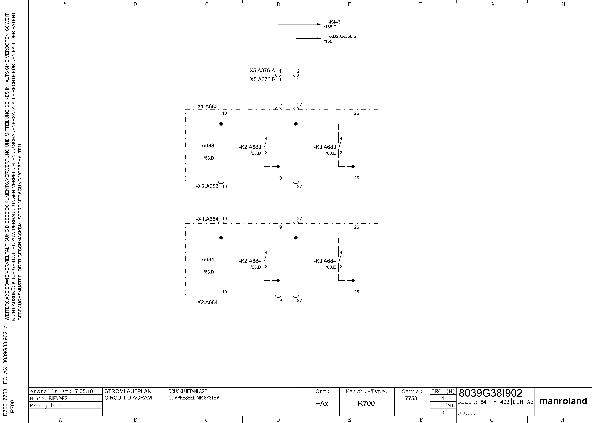

# +Ax — Sheet 64 of 403 — DRUCKLUFTANLAGE

**COMPRESSED AIR SYSTEM**

> Part of the manroland **R700** printing press IEC/UL circuit diagrams.
> Drawing class: **Stromlaufplan / Circuit diagram** (DIN A3).
> Document `+Ax` covers the **Central control console** machine section.

## At a glance

| Field | Value |
|---|---|
| Document | `+Ax`  (8039G38I902) |
| Sheet | **64** of 403 |
| Section (DE) | DRUCKLUFTANLAGE |
| Section (EN) | COMPRESSED AIR SYSTEM |
| Section type | CIRCUIT — Circuit diagram |
| Machine type | `R700` |
| Series | `7758` |
| Created | 17.05.10 |
| Replaces | — |
| Columns used | C, D, E |
| Path numbers | — |
| Labels on sheet | 50 |
| Cross-refs out | 8 |
| Cross-refs in | 28 |

**Previous:** [+Ax sheet 63](SHEET_0063.md) · **Next:** [+Ax sheet 65](SHEET_0065.md) · **Document TOC:** [_TOC.md](_TOC.md)  (+Ax) · **Master TOC:** [all sheets](../_MASTER_TOC.md)

## Sheet image (300 DPI, exact vector render)



_Rendered directly from the PDF vector layer at 300 DPI (1-bit), no OCR and no resampling. Use it to confirm anything ambiguous in the text below._

## Cross-references on this sheet

Each entry is a wire leaving this sheet. The printed token is `/sheet.column`; the link resolves to that sheet inside the same document.

| Ref | Target sheet | Col | Path | Destination on target | Target section | From col |
|---|---|---|---|---|---|---|
| `/168.F` | [+Ax sheet 168](SHEET_0168.md) | F | — | — | ÜBERWACHUNGSRECHNER/RÜCKMELDUNG NOT AUS | E |
| `/168.F` | [+Ax sheet 168](SHEET_0168.md) | F | — | — | ÜBERWACHUNGSRECHNER/RÜCKMELDUNG NOT AUS | E |
| `/63.E` | [+Ax sheet 63](SHEET_0063.md) | E | — | — | DRUCKLUFTANLAGE | E |
| `/63.D` | [+Ax sheet 63](SHEET_0063.md) | D | — | — | DRUCKLUFTANLAGE | D |
| `/63.B` | [+Ax sheet 63](SHEET_0063.md) | B | — | — | DRUCKLUFTANLAGE | C |
| `/63.E` | [+Ax sheet 63](SHEET_0063.md) | E | — | — | DRUCKLUFTANLAGE | E |
| `/63.D` | [+Ax sheet 63](SHEET_0063.md) | D | — | — | DRUCKLUFTANLAGE | D |
| `/63.B` | [+Ax sheet 63](SHEET_0063.md) | B | — | — | DRUCKLUFTANLAGE | C |

### Incoming references (sheets that point here)

Every other sheet that sends a wire to this one. `Back-ref` is the token printed on *that* sheet; `Path` is its line number.

| From sheet | Cols | Back-ref | Path | Refs | What continues there |
|---|---|---|---|---|---|
| [+Ax#63](SHEET_0063.md) | B, D, E | `/63.B`, `/63.D`, `/63.E` | — | 6 | — |
| [+Ax#168](SHEET_0168.md) | E | `/168.E` | — | 2 | K446; XB20.A358:6 |
| [+Ax#211](SHEET_0211.md) | A, B, C, D | `/211.A`, `/211.B`, `/211.C`, `/211.D` | — | 8 | — |
| [+Ax#221](SHEET_0221.md) | C, D, F, G | `/221.C`, `/221.D`, `/221.F`, `/221.G` | — | 8 | — |
| [+Ax#232](SHEET_0232.md) | A, B | `/232.A`, `/232.B` | — | 4 | — |


## Devices on this sheet

| Tag | Class | Class meaning (IEC) | Col | Sub | Terminal | Sign |
|---|---|---|---|---|---|---|
| `A683` | A | Baugruppe / assembly, module, PC board | C | — | — | — |
| `A684` | A | Baugruppe / assembly, module, PC board | C | — | — | — |
| `K446` | K | Relais / relay, contactor | E | — | — | — |
| `X2.A683` | — | cross-device reference | C | — | — | — |
| `X1.A684` | — | cross-device reference | C | — | — | — |
| `X5.A376.B` | — | cross-device reference | D | — | — | — |
| `X5.A376.A` | — | cross-device reference | D | — | — | — |
| `K2.A683` | — | cross-device reference | D | — | — | — |
| `K3.A683` | — | cross-device reference | E | — | — | — |
| `K3.A684` | — | cross-device reference | E | — | — | — |
| `K2.A684` | — | cross-device reference | D | — | — | — |
| `XB20.A358:6` | — | cross-device reference | E | — | 6 | — |
| `X1.A683` | — | cross-device reference | C | — | — | — |
| `X2.A684` | — | cross-device reference | C | — | — | — |

## Potentials / nets

_No named potentials on this sheet._

## Wire-end annotations (grouped as printed)

A wire that continues elsewhere is annotated with a small cluster: the destination description, the path/line number `#NN`, and the `/sheet.column` cross reference. Each row below is one such cluster exactly as it is grouped on the drawing.

| Col | Y | Path | Cross-ref | Text on the wire |
|---|---|---|---|---|
| E | 40.0 | — | — | `K446` |
| E | 49.9 | — | `/168.F` | — |
| E | 68.3 | — | — | `XB20.A358:6` |
| E | 78.2 | — | `/168.F` | — |
| D | 135.7 | — | — | `X5.A376.A 1` |
| D | 137.8 | — | — | `2` |
| D | 153.4 | — | — | `X5.A376.B 1` |
| D | 154.8 | — | — | `2` |
| D | 204.4 | — | — | `9` |
| D | 204.4 | — | — | `27` |
| C | 207.2 | — | — | `X1.A683` |
| C | 221.4 | — | — | `10` |
| E | 221.4 | — | — | `26` |
| D | 271.7 | — | — | `4` |
| E | 271.7 | — | — | `4` |
| C | 285.2 | — | — | `A683` |
| D | 288.0 | — | — | `K2.A683 3` |
| E | 288.0 | — | — | `K3.A683 3` |
| D | 301.1 | — | `/63.D` | — |
| E | 301.1 | — | `/63.E` | — |
| C | 310.6 | — | `/63.B` | — |
| D | 350.4 | — | — | `9` |
| E | 350.4 | — | — | `26` |
| C | 366.0 | — | — | `X2.A683 10` |
| D | 367.4 | — | — | `27` |
| C | 431.2 | — | — | `X1.A684 10` |
| D | 431.2 | — | — | `27` |
| D | 448.2 | — | — | `9` |
| E | 448.2 | — | — | `26` |
| D | 498.5 | — | — | `4` |
| E | 498.5 | — | — | `4` |
| C | 512.0 | — | — | `A684` |
| D | 514.8 | — | — | `K2.A684 3` |
| E | 514.8 | — | — | `K3.A684 3` |
| D | 527.9 | — | `/63.D` | — |
| E | 527.9 | — | `/63.E` | — |
| C | 537.4 | — | `/63.B` | — |
| C | 577.2 | — | — | `10` |
| E | 577.2 | — | — | `26` |
| D | 594.2 | — | — | `9 27` |
| C | 597.0 | — | — | `X2.A684` |


## Reconstructed tables

This sheet carries tabular content (pin map / terminal assignment / index). The grid below was rebuilt from the drawing's own rule lines, so each row is exactly one physical row of the table.

### Table 1 — 1 data rows × 5 columns (at x=439.4, y=48.2)

| X5.A376.A X5.A376.B 10 |  | 1 1 9 | /168.F /168.F 2 2 27 | XB20.A358:6 |
|---|---|---|---|---|
| `K2.A683 /63.D 10 10` | `4 3` | `9 9` | `K3.A683 /63.E 27 27` | `4 3` |


## Complete label inventory (exact text from the drawing)

Every text object inside the drawing area of this sheet, in DIN reading order (column A→H, then top→bottom). This is the authoritative list: if a string is not here it is not printed on this sheet.

| Col | Y | X | Dir | Type | Text |
|---|---|---|---|---|---|
| C | 207.2 | 388.6 | → | device ref | `X1.A683` |
| C | 221.4 | 441.4 | → | number | `10` |
| C | 285.2 | 397.4 | → | device tag | `A683` |
| C | 310.6 | 404.8 | → | cross-reference | `/63.B` |
| C | 366.0 | 390.0 | → | device ref | `X2.A683` |
| C | 367.4 | 441.4 | → | number | `10` |
| C | 431.2 | 390.0 | → | device ref | `X1.A684` |
| C | 431.2 | 441.4 | → | number | `10` |
| C | 512.0 | 397.4 | → | device tag | `A684` |
| C | 537.4 | 404.8 | → | cross-reference | `/63.B` |
| C | 577.2 | 441.4 | → | number | `10` |
| C | 597.0 | 388.6 | → | device ref | `X2.A684` |
| D | 135.7 | 492.7 | → | device ref | `X5.A376.A` |
| D | 137.8 | 554.7 | → | number | `1` |
| D | 137.8 | 590.7 | → | number | `2` |
| D | 153.4 | 493.5 | → | device ref | `X5.A376.B` |
| D | 154.8 | 554.7 | → | number | `1` |
| D | 154.8 | 590.7 | → | number | `2` |
| D | 204.4 | 555.3 | → | number | `9` |
| D | 204.4 | 590.7 | → | number | `27` |
| D | 271.7 | 527.0 | → | number | `4` |
| D | 288.0 | 475.1 | → | device ref | `K2.A683` |
| D | 300.1 | 527.0 | → | number | `3` |
| D | 301.1 | 498.0 | → | cross-reference | `/63.D` |
| D | 350.4 | 555.3 | → | number | `9` |
| D | 367.4 | 590.7 | → | number | `27` |
| D | 431.2 | 590.7 | → | number | `27` |
| D | 448.2 | 555.3 | → | number | `9` |
| D | 498.5 | 527.0 | → | number | `4` |
| D | 514.8 | 475.1 | → | device ref | `K2.A684` |
| D | 526.9 | 527.0 | → | number | `3` |
| D | 527.9 | 498.0 | → | cross-reference | `/63.D` |
| D | 594.2 | 555.3 | → | number | `9` |
| D | 594.2 | 590.7 | → | number | `27` |
| E | 40.0 | 653.1 | → | device tag | `K446` |
| E | 49.9 | 643.5 | → | cross-reference | `/168.F` |
| E | 68.3 | 653.1 | → | device ref | `XB20.A358:6` |
| E | 78.2 | 643.5 | → | cross-reference | `/168.F` |
| E | 221.4 | 704.1 | → | number | `26` |
| E | 271.7 | 675.8 | → | number | `4` |
| E | 288.0 | 623.9 | → | device ref | `K3.A683` |
| E | 300.1 | 675.8 | → | number | `3` |
| E | 301.1 | 647.4 | → | cross-reference | `/63.E` |
| E | 350.4 | 704.1 | → | number | `26` |
| E | 448.2 | 704.1 | → | number | `26` |
| E | 498.5 | 675.8 | → | number | `4` |
| E | 514.8 | 623.9 | → | device ref | `K3.A684` |
| E | 526.9 | 675.8 | → | number | `3` |
| E | 527.8 | 647.4 | → | cross-reference | `/63.E` |
| E | 577.2 | 704.1 | → | number | `26` |

## Reading-order text block

The same content as a plain block, grouped by DIN column — convenient to paste or to match against a visual description.

```text
=== Column C ===
 207.2  388.6  devref       X1.A683
 221.4  441.4  numeric      10
 285.2  397.4  devtag       A683
 310.6  404.8  xref         /63.B
 366.0  390.0  devref       X2.A683
 367.4  441.4  numeric      10
 431.2  390.0  devref       X1.A684
 431.2  441.4  numeric      10
 512.0  397.4  devtag       A684
 537.4  404.8  xref         /63.B
 577.2  441.4  numeric      10
 597.0  388.6  devref       X2.A684
=== Column D ===
 135.7  492.7  devref       X5.A376.A
 137.8  554.7  numeric      1
 137.8  590.7  numeric      2
 153.4  493.5  devref       X5.A376.B
 154.8  554.7  numeric      1
 154.8  590.7  numeric      2
 204.4  555.3  numeric      9
 204.4  590.7  numeric      27
 271.7  527.0  numeric      4
 288.0  475.1  devref       K2.A683
 300.1  527.0  numeric      3
 301.1  498.0  xref         /63.D
 350.4  555.3  numeric      9
 367.4  590.7  numeric      27
 431.2  590.7  numeric      27
 448.2  555.3  numeric      9
 498.5  527.0  numeric      4
 514.8  475.1  devref       K2.A684
 526.9  527.0  numeric      3
 527.9  498.0  xref         /63.D
 594.2  555.3  numeric      9
 594.2  590.7  numeric      27
=== Column E ===
  40.0  653.1  devtag       K446
  49.9  643.5  xref         /168.F
  68.3  653.1  devref       XB20.A358:6
  78.2  643.5  xref         /168.F
 221.4  704.1  numeric      26
 271.7  675.8  numeric      4
 288.0  623.9  devref       K3.A683
 300.1  675.8  numeric      3
 301.1  647.4  xref         /63.E
 350.4  704.1  numeric      26
 448.2  704.1  numeric      26
 498.5  675.8  numeric      4
 514.8  623.9  devref       K3.A684
 526.9  675.8  numeric      3
 527.8  647.4  xref         /63.E
 577.2  704.1  numeric      26
```

---
_Generated from the PDF vector text layer; no OCR. Source: `R700_7758_IEC_AX_8039G38I902_p`, sheet 64._
