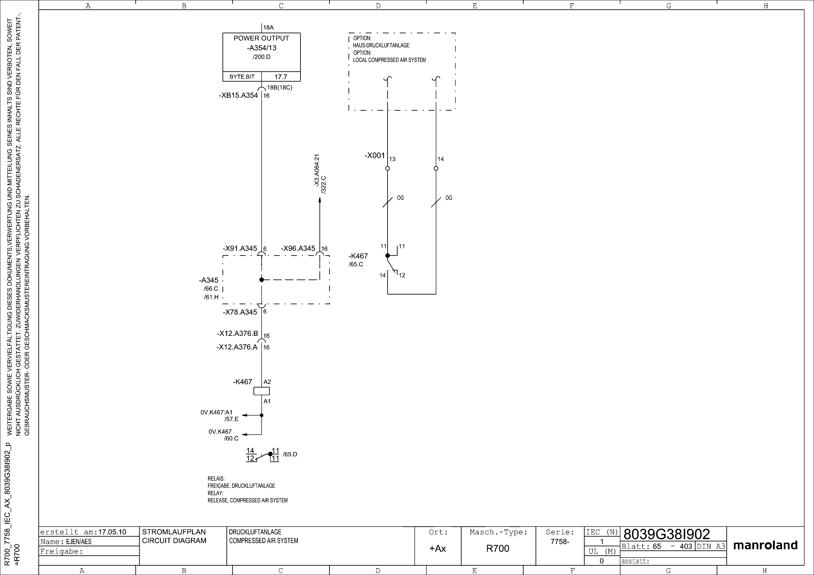

# +Ax — Sheet 65 of 403 — DRUCKLUFTANLAGE

**COMPRESSED AIR SYSTEM**

> Part of the manroland **R700** printing press IEC/UL circuit diagrams.
> Drawing class: **Stromlaufplan / Circuit diagram** (DIN A3).
> Document `+Ax` covers the **Central control console** machine section.

## At a glance

| Field | Value |
|---|---|
| Document | `+Ax`  (8039G38I902) |
| Sheet | **65** of 403 |
| Section (DE) | DRUCKLUFTANLAGE |
| Section (EN) | COMPRESSED AIR SYSTEM |
| Section type | CIRCUIT — Circuit diagram |
| Machine type | `R700` |
| Series | `7758` |
| Created | 17.05.10 |
| Replaces | — |
| Columns used | B, C, D, E |
| Path numbers | — |
| Labels on sheet | 54 |
| Cross-refs out | 7 |
| Cross-refs in | 13 |

**Previous:** [+Ax sheet 64](SHEET_0064.md) · **Next:** [+Ax sheet 66](SHEET_0066.md) · **Document TOC:** [_TOC.md](_TOC.md)  (+Ax) · **Master TOC:** [all sheets](../_MASTER_TOC.md)

## Sheet image (300 DPI, exact vector render)



_Rendered directly from the PDF vector layer at 300 DPI (1-bit), no OCR and no resampling. Use it to confirm anything ambiguous in the text below._

## Cross-references on this sheet

Each entry is a wire leaving this sheet. The printed token is `/sheet.column`; the link resolves to that sheet inside the same document.

| Ref | Target sheet | Col | Path | Destination on target | Target section | From col |
|---|---|---|---|---|---|---|
| `/200.D` | [+Ax sheet 200](SHEET_0200.md) | D | — | — | REFERENZMODUL | C |
| `/322.C` | [+Ax sheet 322](SHEET_0322.md) | C | — | X3.A064:21 | OPTION: "EJEKTOR" ANLAGE / SELECT AIRSTATION / | C |
| `/65.C` | [+Ax sheet 65](SHEET_0065.md) | C | — | K467 | DRUCKLUFTANLAGE | D |
| `/66.C` | [+Ax sheet 66](SHEET_0066.md) | C | — | — | DRUCKLUFTANLAGE | B |
| `/61.H` | [+Ax sheet 61](SHEET_0061.md) | H | — | — | DRUCKLUFTANLAGE | B |
| `/57.E` | [+Ax sheet 57](SHEET_0057.md) | E | — | 0V.K467:A1 | LUFTVERSORGUNG | B |
| `/60.C` | [+Ax sheet 60](SHEET_0060.md) | C | — | 0V.K467 | DRUCKLUFTANLAGE | B |

### Incoming references (sheets that point here)

Every other sheet that sends a wire to this one. `Back-ref` is the token printed on *that* sheet; `Path` is its line number.

| From sheet | Cols | Back-ref | Path | Refs | What continues there |
|---|---|---|---|---|---|
| [+Ax#57](SHEET_0057.md) | E | `/57.E` | — | 1 | — |
| [+Ax#60](SHEET_0060.md) | C | `/60.C` | — | 1 | — |
| [+Ax#61](SHEET_0061.md) | G | `/61.G` | — | 1 | — |
| [+Ax#65](SHEET_0065.md) | D | `/65.D` | — | 1 | K467 |
| [+Ax#66](SHEET_0066.md) | C | `/66.C` | — | 1 | — |
| [+Ax#200](SHEET_0200.md) | D | `/200.D` | — | 1 | — |
| [+Ax#248](SHEET_0248.md) | G, H | `/248.G`, `/248.H` | — | 2 | — |
| [+Ax#253](SHEET_0253.md) | B | `/253.B` | — | 1 | — |
| [+Ax#286](SHEET_0286.md) | A | `/286.A` | — | 1 | — |
| [+Ax#289](SHEET_0289.md) | E | `/289.E` | — | 1 | — |
| [+Ax#290](SHEET_0290.md) | B | `/290.B` | — | 1 | — |
| [+Ax#322](SHEET_0322.md) | C | `/322.C` | — | 1 | X3.A064:21 |


## Devices on this sheet

| Tag | Class | Class meaning (IEC) | Col | Sub | Terminal | Sign |
|---|---|---|---|---|---|---|
| `A345` | A | Baugruppe / assembly, module, PC board | B | — | — | — |
| `A354/13` | A | Baugruppe / assembly, module, PC board | C | 13 | — | — |
| `X001` | X | Klemme / terminal, plug connector | D | — | — | — |
| `K467` | K | Relais / relay, contactor | D | — | — | — |
| `A2` | A | Baugruppe / assembly, module, PC board | C | — | — | — |
| `A1` | A | Baugruppe / assembly, module, PC board | C | — | — | — |
| `K467` | K | Relais / relay, contactor | C | — | — | — |
| `X78.A345` | — | cross-device reference | C | — | — | — |
| `X91.A345` | — | cross-device reference | C | — | — | — |
| `X12.A376.B` | — | cross-device reference | C | — | — | — |
| `X12.A376.A` | — | cross-device reference | C | — | — | — |
| `17.7` | — | cross-device reference | C | — | — | — |
| `XB15.A354` | — | cross-device reference | C | — | — | — |
| `X96.A345` | — | cross-device reference | C | — | — | — |
| `X3.A064:21` | — | cross-device reference | C | — | 21 | — |

## Potentials / nets

| Potential | Count | Columns | Attached devices | Terminals |
|---|---|---|---|---|
| `0V` | 2 | B | `K467` | `A1` |


A potential such as `L24+/4` or `M24+` is a named supply/return rail; every place it appears on this sheet is electrically common.

## Wire-end annotations (grouped as printed)

A wire that continues elsewhere is annotated with a small cluster: the destination description, the path/line number `#NN`, and the `/sheet.column` cross reference. Each row below is one such cluster exactly as it is grouped on the drawing.

| Col | Y | Path | Cross-ref | Text on the wire |
|---|---|---|---|---|
| C | 36.4 | — | — | `18A` |
| C | 51.6 | — | — | `POWER OUTPUT` |
| D | 53.0 | — | — | `HAUS DRUCKLUFTANLAGE OPTION:` |
| C | 65.5 | — | — | `A354/13` |
| D | 74.3 | — | — | `LOCAL COMPRESSED AIR SYSTEM OPTION:` |
| C | 79.3 | — | `/200.D` | — |
| C | 108.3 | — | — | `BYTE.BIT 17.7` |
| C | 124.3 | — | — | `18B(18C)` |
| C | 134.9 | — | — | `XB15.A354 16` |
| D | 222.6 | — | — | `X001 13 14` |
| C | 225.1 | — | `/322.C` | `X3.A064:21` |
| D | 286.9 | — | — | `OG OG` |
| D | 356.8 | — | — | `11 11` |
| C | 358.9 | — | — | `X91.A345 6` |
| C | 358.9 | — | — | `X96.A345 16` |
| D | 370.2 | — | `/65.C` | `K467` |
| D | 399.3 | — | — | `14` |
| D | 399.3 | — | — | `12` |
| B | 405.7 | — | — | `A345` |
| B | 418.8 | — | `/66.C` | — |
| B | 431.1 | — | `/61.H` | — |
| C | 452.4 | — | — | `X78.A345 6` |
| C | 483.6 | — | — | `X12.A376.B 16` |
| C | 503.5 | — | — | `X12.A376.A 16` |
| C | 554.5 | — | — | `K467` |
| C | 555.1 | — | — | `A2` |
| C | 583.5 | — | — | `A1` |
| B | 599.8 | — | `/57.E` | `0V.K467:A1` |
| B | 628.1 | — | `/60.C` | `0V.K467` |
| C | 655.1 | — | — | `14 12 11 11 /65.D` |
| C | 697.9 | — | — | `RELAIS: FREIGABE, DRUCKLUFTANLAGE RELAY: RELEASE, COMPRESSED AIR SYSTEM` |


## Reconstructed tables

This sheet carries tabular content (pin map / terminal assignment / index). The grid below was rebuilt from the drawing's own rule lines, so each row is exactly one physical row of the table.

### Table 1 — 2 data rows × 5 columns (at x=326.0, y=48.2)

| POWER | OUTPUT A354/13 /200.D |  | OPTION: HAUS DRUCKLUFTANLAGE OPTION: LOCAL COMPRESSED | AIR SYSTEM |
|---|---|---|---|---|
| `BYTE.BIT` | `17.7` |  |  |  |
| `XB15.A354 X91.A345` | `18B(18C) 16 X96.A345 6` | `X3.A064:21` | `X001 /322.C 11 16 K467 /65.C 14` | `13 OG 11 12` |


## Notes and free text on this sheet

| Text | Col | Y (pt) |
|---|---|---|
| `18A` | C | 36.43 |
| `18B(18C)` | C | 124.34 |
| `POWER OUTPUT` | C | 51.59 |
| `BYTE.BIT` | C | 108.91 |
| `11 /65.D` | C | 661.46 |
| `RELAIS:` | B | 697.88 |
| `FREIGABE, DRUCKLUFTANLAGE` | C | 708.58 |
| `RELAY:` | B | 719.15 |
| `RELEASE, COMPRESSED AIR SYSTEM` | C | 729.84 |
| `OPTION:` | D | 53.03 |
| `HAUS DRUCKLUFTANLAGE` | D | 63.71 |
| `LOCAL COMPRESSED AIR SYSTEM` | D | 84.96 |
| `OG` | D | 286.88 |
| `OG` | E | 286.88 |

## Complete label inventory (exact text from the drawing)

Every text object inside the drawing area of this sheet, in DIN reading order (column A→H, then top→bottom). This is the authoritative list: if a string is not here it is not printed on this sheet.

| Col | Y | X | Dir | Type | Text |
|---|---|---|---|---|---|
| B | 405.7 | 291.1 | → | device tag | `A345` |
| B | 418.7 | 298.2 | → | cross-reference | `/66.C` |
| B | 431.1 | 298.8 | → | cross-reference | `/61.H` |
| B | 599.8 | 293.4 | → | potential | `0V.K467:A1` |
| B | 609.7 | 328.5 | → | cross-reference | `/57.E` |
| B | 628.1 | 305.3 | → | potential | `0V.K467` |
| B | 638.1 | 328.0 | → | cross-reference | `/60.C` |
| B | 697.9 | 303.9 | → | text | `RELAIS:` |
| B | 719.1 | 303.9 | → | text | `RELAY:` |
| C | 36.4 | 384.7 | → | text | `18A` |
| C | 51.6 | 341.9 | → | text | `POWER OUTPUT` |
| C | 65.5 | 361.3 | → | device tag | `A354/13` |
| C | 79.3 | 369.9 | → | cross-reference | `/200.D` |
| C | 108.3 | 401.2 | → | device ref | `17.7` |
| C | 108.9 | 335.9 | → | text | `BYTE.BIT` |
| C | 124.3 | 390.3 | → | text | `18B(18C)` |
| C | 134.9 | 320.3 | → | device ref | `XB15.A354` |
| C | 136.4 | 384.7 | → | number | `16` |
| C | 225.1 | 459.5 | ↕ | device ref | `X3.A064:21` |
| C | 257.7 | 469.4 | ↕ | cross-reference | `/322.C` |
| C | 358.9 | 326.0 | → | device ref | `X91.A345` |
| C | 358.9 | 411.0 | → | device ref | `X96.A345` |
| C | 360.3 | 385.2 | → | number | `6` |
| C | 360.3 | 469.7 | → | number | `16` |
| C | 452.4 | 326.0 | → | device ref | `X78.A345` |
| C | 452.5 | 385.2 | → | number | `6` |
| C | 483.6 | 317.5 | → | device ref | `X12.A376.B` |
| C | 487.9 | 384.7 | → | number | `16` |
| C | 503.5 | 316.6 | → | device ref | `X12.A376.A` |
| C | 504.9 | 384.7 | → | number | `16` |
| C | 554.5 | 340.7 | → | device tag | `K467` |
| C | 555.2 | 385.5 | → | device tag | `A2` |
| C | 583.5 | 385.5 | → | device tag | `A1` |
| C | 655.1 | 360.0 | → | number | `14` |
| C | 655.1 | 397.1 | → | number | `11` |
| C | 661.5 | 397.1 | → | text | `11 /65.D` |
| C | 666.4 | 360.0 | → | number | `12` |
| C | 708.6 | 303.9 | → | text | `FREIGABE, DRUCKLUFTANLAGE` |
| C | 729.8 | 303.9 | → | text | `RELEASE, COMPRESSED AIR SYSTEM` |
| D | 53.0 | 517.0 | → | text | `OPTION:` |
| D | 63.7 | 516.5 | → | text | `HAUS DRUCKLUFTANLAGE` |
| D | 74.3 | 517.0 | → | text | `OPTION:` |
| D | 85.0 | 516.5 | → | text | `LOCAL COMPRESSED AIR SYSTEM` |
| D | 222.6 | 533.5 | → | device tag | `X001` |
| D | 229.2 | 568.9 | → | number | `13` |
| D | 286.9 | 580.8 | → | text | `OG` |
| D | 356.8 | 556.2 | → | number | `11` |
| D | 356.8 | 583.1 | → | number | `11` |
| D | 370.2 | 510.0 | → | device tag | `K467` |
| D | 383.3 | 510.2 | → | cross-reference | `/65.C` |
| D | 399.3 | 554.7 | → | number | `14` |
| D | 399.3 | 583.1 | → | number | `12` |
| E | 229.2 | 639.8 | → | number | `14` |
| E | 286.9 | 651.7 | → | text | `OG` |

## Reading-order text block

The same content as a plain block, grouped by DIN column — convenient to paste or to match against a visual description.

```text
=== Column B ===
 405.7  291.1  devtag       A345
 418.7  298.2  xref         /66.C
 431.1  298.8  xref         /61.H
 599.8  293.4  net          0V.K467:A1
 609.7  328.5  xref         /57.E
 628.1  305.3  net          0V.K467
 638.1  328.0  xref         /60.C
 697.9  303.9  text         RELAIS:
 719.1  303.9  text         RELAY:
=== Column C ===
  36.4  384.7  text         18A
  51.6  341.9  text         POWER OUTPUT
  65.5  361.3  devtag       A354/13
  79.3  369.9  xref         /200.D
 108.3  401.2  devref       17.7
 108.9  335.9  text         BYTE.BIT
 124.3  390.3  text         18B(18C)
 134.9  320.3  devref       XB15.A354
 136.4  384.7  numeric      16
 225.1  459.5  devref       X3.A064:21
 257.7  469.4  xref         /322.C
 358.9  326.0  devref       X91.A345
 358.9  411.0  devref       X96.A345
 360.3  385.2  numeric      6
 360.3  469.7  numeric      16
 452.4  326.0  devref       X78.A345
 452.5  385.2  numeric      6
 483.6  317.5  devref       X12.A376.B
 487.9  384.7  numeric      16
 503.5  316.6  devref       X12.A376.A
 504.9  384.7  numeric      16
 554.5  340.7  devtag       K467
 555.2  385.5  devtag       A2
 583.5  385.5  devtag       A1
 655.1  360.0  numeric      14
 655.1  397.1  numeric      11
 661.5  397.1  text         11 /65.D
 666.4  360.0  numeric      12
 708.6  303.9  text         FREIGABE, DRUCKLUFTANLAGE
 729.8  303.9  text         RELEASE, COMPRESSED AIR SYSTEM
=== Column D ===
  53.0  517.0  text         OPTION:
  63.7  516.5  text         HAUS DRUCKLUFTANLAGE
  74.3  517.0  text         OPTION:
  85.0  516.5  text         LOCAL COMPRESSED AIR SYSTEM
 222.6  533.5  devtag       X001
 229.2  568.9  numeric      13
 286.9  580.8  text         OG
 356.8  556.2  numeric      11
 356.8  583.1  numeric      11
 370.2  510.0  devtag       K467
 383.3  510.2  xref         /65.C
 399.3  554.7  numeric      14
 399.3  583.1  numeric      12
=== Column E ===
 229.2  639.8  numeric      14
 286.9  651.7  text         OG
```

---
_Generated from the PDF vector text layer; no OCR. Source: `R700_7758_IEC_AX_8039G38I902_p`, sheet 65._
