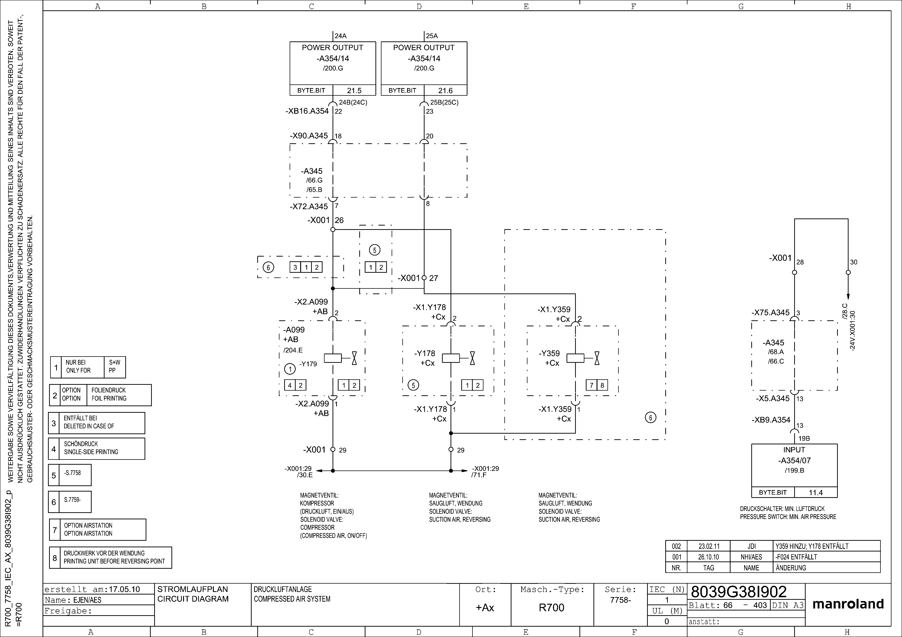

# +Ax — Sheet 66 of 403 — DRUCKLUFTANLAGE

**COMPRESSED AIR SYSTEM**

> Part of the manroland **R700** printing press IEC/UL circuit diagrams.
> Drawing class: **Stromlaufplan / Circuit diagram** (DIN A3).
> Document `+Ax` covers the **Central control console** machine section.

## At a glance

| Field | Value |
|---|---|
| Document | `+Ax`  (8039G38I902) |
| Sheet | **66** of 403 |
| Section (DE) | DRUCKLUFTANLAGE |
| Section (EN) | COMPRESSED AIR SYSTEM |
| Section type | CIRCUIT — Circuit diagram |
| Machine type | `R700` |
| Series | `7758` |
| Created | 17.05.10 |
| Replaces | — |
| Columns used | A, C, D, E, F, G, H |
| Path numbers | — |
| Labels on sheet | 155 |
| Cross-refs out | 11 |
| Cross-refs in | 26 |

**Previous:** [+Ax sheet 65](SHEET_0065.md) · **Next:** [+Ax sheet 67](SHEET_0067.md) · **Document TOC:** [_TOC.md](_TOC.md)  (+Ax) · **Master TOC:** [all sheets](../_MASTER_TOC.md)

## Sheet image (300 DPI, exact vector render)



_Rendered directly from the PDF vector layer at 300 DPI (1-bit), no OCR and no resampling. Use it to confirm anything ambiguous in the text below._

## Cross-references on this sheet

Each entry is a wire leaving this sheet. The printed token is `/sheet.column`; the link resolves to that sheet inside the same document.

| Ref | Target sheet | Col | Path | Destination on target | Target section | From col |
|---|---|---|---|---|---|---|
| `/200.G` | [+Ax sheet 200](SHEET_0200.md) | G | — | — | REFERENZMODUL | C |
| `/200.G` | [+Ax sheet 200](SHEET_0200.md) | G | — | — | REFERENZMODUL | D |
| `/66.G` | [+Ax sheet 66](SHEET_0066.md) | G | — | — | DRUCKLUFTANLAGE | C |
| `/65.B` | [+Ax sheet 65](SHEET_0065.md) | B | — | — | DRUCKLUFTANLAGE | C |
| `/28.C` | [+Ax sheet 28](SHEET_0028.md) | C | — | — | SPANNUNGSVERSORGUNG, SCHALTSCHRANKBELÜFTUNG | H |
| `/204.E` | [+Ax sheet 204](SHEET_0204.md) | E | — | — | REFERENZMODUL | C |
| `/68.A` | [+Ax sheet 68](SHEET_0068.md) | A | — | — | SAUGBÄNDERTISCH | G |
| `/66.C` | [+Ax sheet 66](SHEET_0066.md) | C | — | — | DRUCKLUFTANLAGE | G |
| `/30.E` | [+Ax sheet 30](SHEET_0030.md) | E | — | X001:29 X001:29 | SPANNUNGSVERSORGUNG, SCHALTSCHRANKBELÜFTUNG | D |
| `/199.B` | [+Ax sheet 199](SHEET_0199.md) | B | — | — | REFERENZMODUL | G |
| `/71.F` | [+Ax sheet 71](SHEET_0071.md) | F | — | — | WASCHVORRICHTUNGEN DRUCKWERKE | E |

### Incoming references (sheets that point here)

Every other sheet that sends a wire to this one. `Back-ref` is the token printed on *that* sheet; `Path` is its line number.

| From sheet | Cols | Back-ref | Path | Refs | What continues there |
|---|---|---|---|---|---|
| [+Ax#28](SHEET_0028.md) | C | `/28.C` | — | 1 | 24V.X001:30 |
| [+Ax#30](SHEET_0030.md) | E | `/30.E` | — | 1 | — |
| [+Ax#65](SHEET_0065.md) | B | `/65.B` | — | 1 | — |
| [+Ax#66](SHEET_0066.md) | C, G | `/66.C`, `/66.G` | — | 2 | — |
| [+Ax#68](SHEET_0068.md) | A | `/68.A` | — | 1 | — |
| [+Ax#71](SHEET_0071.md) | F | `/71.F` | — | 1 | X001:29 |
| [+Ax#199](SHEET_0199.md) | B | `/199.B` | — | 1 | — |
| [+Ax#200](SHEET_0200.md) | F | `/200.F` | — | 2 | — |
| [+Ax#204](SHEET_0204.md) | E | `/204.E` | — | 1 | — |
| [+Ax#216](SHEET_0216.md) | F, H | `/216.F`, `/216.H` | — | 4 | — |
| [+Ax#217](SHEET_0217.md) | B | `/217.B` | — | 2 | — |
| [+Ax#231](SHEET_0231.md) | A | `/231.A` | — | 1 | — |
| [+Ax#242](SHEET_0242.md) | A | `/242.A` | — | 1 | — |
| [+Ax#254](SHEET_0254.md) | F | `/254.F` | — | 2 | — |
| [+Ax#285](SHEET_0285.md) | B, E | `/285.B`, `/285.E` | — | 3 | — |
| [+Ax#289](SHEET_0289.md) | C | `/289.C` | — | 2 | — |


## Devices on this sheet

| Tag | Class | Class meaning (IEC) | Col | Sub | Terminal | Sign |
|---|---|---|---|---|---|---|
| `X001` | X | Klemme / terminal, plug connector | C | — | — | — |
| `A354/14` | A | Baugruppe / assembly, module, PC board | C | 14 | — | — |
| `Y179` | Y | Magnetventil / solenoid valve, actuator | C | — | — | — |
| `A099` | A | Baugruppe / assembly, module, PC board | C | — | — | — |
| `A345` | A | Baugruppe / assembly, module, PC board | C | — | — | — |
| `A354/14` | A | Baugruppe / assembly, module, PC board | D | 14 | — | — |
| `X001` | X | Klemme / terminal, plug connector | C | — | — | — |
| `X001` | X | Klemme / terminal, plug connector | D | — | — | — |
| `X001` | X | Klemme / terminal, plug connector | G | — | — | — |
| `A345` | A | Baugruppe / assembly, module, PC board | G | — | — | — |
| `A354/07` | A | Baugruppe / assembly, module, PC board | G | 07 | — | — |
| `Y178` | Y | Magnetventil / solenoid valve, actuator | D | — | — | — |
| `X001:29` | X | Klemme / terminal, plug connector | E | — | 29 | — |
| `X001:29` | X | Klemme / terminal, plug connector | C | — | 29 | — |
| `Y359` | Y | Magnetventil / solenoid valve, actuator | E | — | — | — |
| `XB16.A354` | — | cross-device reference | C | — | — | — |
| `21.5` | — | cross-device reference | C | — | — | — |
| `X2.A099` | — | cross-device reference | C | — | — | — |
| `X2.A099` | — | cross-device reference | C | — | — | — |
| `X90.A345` | — | cross-device reference | C | — | — | — |
| `X72.A345` | — | cross-device reference | C | — | — | — |
| `21.6` | — | cross-device reference | D | — | — | — |
| `X75.A345` | — | cross-device reference | G | — | — | — |
| `X5.A345` | — | cross-device reference | G | — | — | — |
| `XB9.A354` | — | cross-device reference | G | — | — | — |
| `11.4` | — | cross-device reference | H | — | — | — |
| `X1.Y178` | — | cross-device reference | D | — | — | — |
| `X1.Y178` | — | cross-device reference | D | — | — | — |
| `NR.` | — | cross-device reference | F | — | — | — |
| `26.10.10` | — | cross-device reference | G | — | — | — |
| `X1.Y359` | — | cross-device reference | E | — | — | — |
| `X1.Y359` | — | cross-device reference | E | — | — | — |
| `23.02.11` | — | cross-device reference | G | — | — | — |
| `S.7758` | — | cross-device reference | A | — | — | — |
| `S.7759` | — | cross-device reference | A | — | — | — |

## Potentials / nets

| Potential | Count | Columns | Attached devices | Terminals |
|---|---|---|---|---|
| `24V` | 1 | H | `X001` | `30` |


A potential such as `L24+/4` or `M24+` is a named supply/return rail; every place it appears on this sheet is electrically common.

## Wire-end annotations (grouped as printed)

A wire that continues elsewhere is annotated with a small cluster: the destination description, the path/line number `#NN`, and the `/sheet.column` cross reference. Each row below is one such cluster exactly as it is grouped on the drawing.

| Col | Y | Path | Cross-ref | Text on the wire |
|---|---|---|---|---|
| C | 43.5 | — | — | `24A` |
| D | 43.5 | — | — | `25A` |
| C | 58.7 | — | — | `POWER OUTPUT` |
| D | 58.7 | — | — | `POWER OUTPUT` |
| C | 72.6 | — | — | `A354/14` |
| D | 72.6 | — | — | `A354/14` |
| C | 86.4 | — | `/200.G` | — |
| D | 86.4 | — | `/200.G` | — |
| C | 115.4 | — | — | `BYTE.BIT 21.5` |
| D | 115.4 | — | — | `BYTE.BIT 21.6` |
| C | 131.4 | — | — | `24B(24C)` |
| D | 131.4 | — | — | `25B(25C)` |
| C | 142.0 | — | — | `XB16.A354 22` |
| D | 143.5 | — | — | `23` |
| C | 174.6 | — | — | `X90.A345 18` |
| D | 176.1 | — | — | `20` |
| C | 221.4 | — | — | `A345` |
| C | 234.5 | — | `/66.G` | — |
| C | 246.9 | — | `/65.B` | — |
| D | 265.4 | — | — | `8` |
| C | 268.2 | — | — | `X72.A345 7` |
| C | 286.1 | — | — | `X001 26` |
| D | 327.7 | — | — | `5` |
| H | 336.0 | — | — | `X001 28 30` |
| C | 349.7 | — | — | `3 1 2 1 2` |
| C | 350.7 | — | — | `6` |
| D | 362.6 | — | — | `X001 27` |
| C | 394.3 | — | — | `X2.A099 2` |
| H | 400.8 | — | `/28.C` | — |
| D | 401.5 | — | — | `X1.Y178 2` |
| E | 404.4 | — | — | `X1.Y359 2` |
| C | 407.0 | — | — | `+AB` |
| G | 408.5 | — | — | `X75.A345 3` |
| H | 410.7 | — | — | `24V.X001:30` |
| D | 414.2 | — | — | `+Cx` |
| E | 417.1 | — | — | `+Cx` |
| C | 431.2 | — | — | `+AB A099` |
| G | 448.2 | — | — | `A345` |
| C | 459.1 | — | `/204.E` | — |
| G | 461.2 | — | `/68.A`, `/66.C` | — |
| D | 462.4 | — | — | `Y178` |
| E | 462.4 | — | — | `Y359` |
| D | 475.1 | — | — | `+Cx` |
| E | 475.1 | — | — | `+Cx` |
| A | 476.0 | — | — | `1 ONLY FOR PP S+W` |
| A | 476.1 | — | — | `NUR BEI` |
| C | 477.2 | — | — | `Y179` |
| C | 484.5 | — | — | `1` |
| D | 505.6 | — | — | `4 2 1 2 1 2` |
| F | 505.6 | — | — | `7 8` |
| D | 506.3 | — | — | `5` |
| A | 513.0 | — | — | `2 OPTION OPTION` |
| A | 513.0 | — | — | `FOLIENDRUCK FOIL PRINTING` |
| G | 521.9 | — | — | `X5.A345 13` |
| C | 529.0 | — | — | `X2.A099 1` |
| D | 536.1 | — | — | `X1.Y178 1` |
| E | 536.1 | — | — | `X1.Y359 1` |
| C | 541.6 | — | — | `+AB` |
| D | 548.8 | — | — | `+Cx` |
| E | 548.8 | — | — | `+Cx` |
| F | 549.1 | — | — | `6` |
| A | 549.8 | — | — | `3 ENTFÄLLT BEI DELETED IN CASE OF` |
| G | 550.2 | — | — | `XB9.A354 13` |
| H | 575.7 | — | — | `19B` |
| A | 583.9 | — | — | `4 SCHÖNDRUCK SINGLE SIDE PRINTING` |
| C | 589.4 | — | — | `X001 29` |
| G | 590.2 | — | — | `INPUT` |
| D | 591.4 | — | — | `29` |
| G | 604.1 | — | — | `A354/07` |
| D | 615.4 | — | `/30.E` | `X001:29 X001:29` |
| G | 617.9 | — | `/199.B` | — |
| A | 622.1 | — | — | `5 S.7758` |
| E | 623.9 | — | `/71.F` | — |
| G | 646.9 | — | — | `BYTE.BIT 11.4` |
| C | 651.9 | — | — | `6 7 S.7759 OPTION AIRSTATION OPTION AIRSTATION MAGNETVENTIL: SAUGLUFT, WENDUNG SOLENOID VALVE: SUCTION AIR, REVERSING` |
| C | 651.9 | — | — | `KOMPRESSOR MAGNETVENTIL: (DRUCKLUFT, EIN/AUS) (COMPRESSED AIR, ON/OFF) SOLENOID VALVE: COMPRESSOR` |
| D | 651.9 | — | — | `MAGNETVENTIL: SAUGLUFT, WENDUNG SOLENOID VALVE: SUCTION AIR, REVERSING` |
| G | 669.6 | — | — | `DRUCKSCHALTER: MIN. LUFTDRUCK PRESSURE SWITCH: MIN. AIR PRESSURE` |
| G | 718.9 | — | — | `002 23.02.11 JDI Y359 HINZU; Y178 ENTFÄLLT` |
| A | 728.4 | — | — | `8 DRUCKWERK VOR DER WENDUNG PRINTING UNIT BEFORE REVERSING POINT` |
| G | 733.0 | — | — | `001 26.10.10 NHI/AES F024 ENTFÄLLT` |
| G | 747.1 | — | — | `NR. TAG NAME ÄNDERUNG` |


## Reconstructed tables

This sheet carries tabular content (pin map / terminal assignment / index). The grid below was rebuilt from the drawing's own rule lines, so each row is exactly one physical row of the table.

### Table 1 — 5 data rows × 2 columns (at x=382.7, y=55.3)

| POWER | OUTPUT A354/14 /200.G |
|---|---|
| `BYTE.BIT` | `21.5` |
| `XB16.A354 X90.A345 A345 /66.G /65.B X72.A345 X001` | `24B(24C) 22 18 7 26` |
| `3 1 2` | `5 1` |
| `X2.A099 +AB A099 +AB /204.E Y179 1 2 X2.A099 +AB` | `2 1 2 1` |
| `X001 X001:29` | `29` |


### Table 2 — 5 data rows × 3 columns (at x=503.1, y=55.3)

| POWER | OUTPUT A354/14 /200.G |  |
|---|---|---|
| `BYTE.BIT` | `21.6` |  |
|  | `25B(25C) 23 20 8` |  |
| `2 X001` | `27` |  |
| `5` | `X1.Y178 +Cx Y178 +Cx X1.Y178 +Cx` | `2 1` |
|  |  | `29` |


### Table 3 — 2 data rows × 3 columns (at x=992.1, y=289.1)

| X001 X75.A345 A345 /68.A /66.C X5.A345 XB9.A354 | 28 3 13 13 19B | /28.C |
|---|---|---|
| `INPUT` | `A354/07 /199.B` |  |
| `BYTE.BIT` | `11.4` |  |


## Notes and free text on this sheet

| Text | Col | Y (pt) |
|---|---|---|
| `24A` | C | 43.52 |
| `24B(24C)` | C | 131.42 |
| `POWER OUTPUT` | C | 58.67 |
| `BYTE.BIT` | C | 116 |
| `MAGNETVENTIL:` | C | 651.87 |
| `KOMPRESSOR` | C | 662.51 |
| `(DRUCKLUFT, EIN/AUS)` | C | 673.16 |
| `SOLENOID VALVE:` | C | 683.77 |
| `COMPRESSOR` | C | 694.43 |
| `(COMPRESSED AIR, ON/OFF)` | C | 705.05 |
| `+AB` | C | 541.65 |
| `25A` | D | 43.52 |
| `25B(25C)` | D | 131.42 |
| `POWER OUTPUT` | D | 58.67 |
| `BYTE.BIT` | D | 116 |
| `MAGNETVENTIL:` | D | 651.87 |
| `SAUGLUFT, WENDUNG` | D | 662.51 |
| `SOLENOID VALVE:` | D | 673.13 |
| `SUCTION AIR, REVERSING` | D | 683.78 |
| `19B` | H | 575.72 |
| `INPUT` | G | 590.24 |
| `BYTE.BIT` | G | 647.49 |
| `DRUCKSCHALTER: MIN. LUFTDRUCK` | G | 669.62 |
| `PRESSURE SWITCH: MIN. AIR PRESSURE` | G | 680.22 |
| `+Cx` | D | 548.84 |
| `TAG` | G | 747.27 |
| `NAME` | G | 747.25 |
| `ÄNDERUNG` | G | 747.31 |
| `NHI/AES` | G | 733.11 |
| `F024 ENTFÄLLT` | H | 733.15 |
| `+Cx` | E | 475.14 |
| `JDI` | G | 718.87 |
| `Y359 HINZU; Y178 ENTFÄLLT` | H | 718.98 |
| `OPTION` | A | 512.96 |
| `FOLIENDRUCK` | A | 513 |
| `FOIL PRINTING` | A | 523.61 |
| `ENTFÄLLT BEI` | A | 549.8 |
| `DELETED IN CASE OF` | A | 560.46 |
| `NUR BEI` | A | 476.09 |
| `ONLY FOR` | A | 486.78 |
| `S+W` | A | 476 |
| `PP` | A | 486.63 |
| `SCHÖNDRUCK` | A | 583.89 |
| `SINGLE SIDE PRINTING` | A | 594.48 |
| `MAGNETVENTIL:` | E | 651.87 |
| `SAUGLUFT, WENDUNG` | E | 662.51 |
| `SOLENOID VALVE:` | E | 673.13 |
| `SUCTION AIR, REVERSING` | E | 683.78 |
| `OPTION AIRSTATION` | A | 691.56 |
| `DRUCKWERK VOR DER WENDUNG` | A | 728.4 |
| `PRINTING UNIT BEFORE REVERSING POINT` | A | 739.05 |

## Complete label inventory (exact text from the drawing)

Every text object inside the drawing area of this sheet, in DIN reading order (column A→H, then top→bottom). This is the authoritative list: if a string is not here it is not printed on this sheet.

| Col | Y | X | Dir | Type | Text |
|---|---|---|---|---|---|
| A | 476.0 | 144.3 | → | text | `S+W` |
| A | 476.1 | 87.0 | → | text | `NUR BEI` |
| A | 481.5 | 71.1 | → | number | `1` |
| A | 486.6 | 143.7 | → | text | `PP` |
| A | 486.8 | 87.6 | → | text | `ONLY FOR` |
| A | 513.0 | 81.9 | → | text | `OPTION` |
| A | 513.0 | 121.0 | → | text | `FOLIENDRUCK` |
| A | 518.3 | 69.4 | → | number | `2` |
| A | 523.6 | 81.9 | → | text | `OPTION` |
| A | 523.6 | 121.0 | → | text | `FOIL PRINTING` |
| A | 549.8 | 84.2 | → | text | `ENTFÄLLT BEI` |
| A | 555.2 | 67.9 | → | number | `3` |
| A | 560.5 | 84.2 | → | text | `DELETED IN CASE OF` |
| A | 583.9 | 84.8 | → | text | `SCHÖNDRUCK` |
| A | 589.2 | 68.0 | → | number | `4` |
| A | 594.5 | 84.8 | → | text | `SINGLE SIDE PRINTING` |
| A | 622.1 | 84.8 | → | device ref | `S.7758` |
| A | 623.9 | 67.9 | → | number | `5` |
| A | 657.6 | 84.8 | → | device ref | `S.7759` |
| A | 659.3 | 68.0 | → | number | `6` |
| A | 691.6 | 84.8 | → | text | `OPTION AIRSTATION` |
| A | 696.2 | 69.4 | → | number | `7` |
| A | 702.2 | 84.8 | → | text | `OPTION AIRSTATION` |
| A | 728.4 | 84.2 | → | text | `DRUCKWERK VOR DER WENDUNG` |
| A | 733.0 | 69.3 | → | number | `8` |
| A | 739.1 | 84.2 | → | text | `PRINTING UNIT BEFORE REVERSING POINT` |
| C | 43.5 | 441.9 | → | text | `24A` |
| C | 58.7 | 398.6 | → | text | `POWER OUTPUT` |
| C | 72.6 | 418.0 | → | device tag | `A354/14` |
| C | 86.4 | 426.5 | → | cross-reference | `/200.G` |
| C | 115.4 | 458.2 | → | device ref | `21.5` |
| C | 116.0 | 392.6 | → | text | `BYTE.BIT` |
| C | 131.4 | 447.6 | → | text | `24B(24C)` |
| C | 142.0 | 377.0 | → | device ref | `XB16.A354` |
| C | 143.5 | 441.9 | → | number | `22` |
| C | 174.6 | 382.7 | → | device ref | `X90.A345` |
| C | 176.1 | 441.4 | → | number | `18` |
| C | 221.4 | 397.4 | → | device tag | `A345` |
| C | 234.5 | 404.2 | → | cross-reference | `/66.G` |
| C | 246.9 | 404.8 | → | cross-reference | `/65.B` |
| C | 268.2 | 382.7 | → | device ref | `X72.A345` |
| C | 268.2 | 441.9 | → | number | `7` |
| C | 286.1 | 405.9 | → | device tag | `X001` |
| C | 286.6 | 441.9 | → | number | `26` |
| C | 349.7 | 387.4 | → | number | `3` |
| C | 349.7 | 402.0 | → | number | `1` |
| C | 349.7 | 415.8 | → | number | `2` |
| C | 350.7 | 352.3 | → | number | `6` |
| C | 394.3 | 388.6 | → | device ref | `X2.A099` |
| C | 407.0 | 412.4 | → | text | `+AB` |
| C | 409.9 | 441.9 | → | number | `2` |
| C | 431.2 | 373.9 | → | device tag | `A099` |
| C | 443.9 | 373.6 | → | text | `+AB` |
| C | 459.1 | 374.2 | → | cross-reference | `/204.E` |
| C | 477.2 | 395.1 | → | device tag | `Y179` |
| C | 484.5 | 380.9 | → | number | `1` |
| C | 505.6 | 380.3 | → | number | `4` |
| C | 505.6 | 394.6 | → | number | `2` |
| C | 505.6 | 451.6 | → | number | `1` |
| C | 505.6 | 465.4 | → | number | `2` |
| C | 529.0 | 390.0 | → | device ref | `X2.A099` |
| C | 530.4 | 441.4 | → | number | `1` |
| C | 541.6 | 413.9 | → | text | `+AB` |
| C | 589.4 | 400.3 | → | device tag | `X001` |
| C | 591.3 | 447.6 | → | number | `29` |
| C | 615.4 | 375.9 | → | device tag | `X001:29` |
| C | 623.9 | 392.3 | → | cross-reference | `/30.E` |
| C | 651.9 | 396.3 | → | text | `MAGNETVENTIL:` |
| C | 662.5 | 396.0 | → | text | `KOMPRESSOR` |
| C | 673.2 | 396.3 | → | text | `(DRUCKLUFT, EIN/AUS)` |
| C | 683.8 | 396.6 | → | text | `SOLENOID VALVE:` |
| C | 694.4 | 396.6 | → | text | `COMPRESSOR` |
| C | 705.1 | 396.3 | → | text | `(COMPRESSED AIR, ON/OFF)` |
| D | 43.5 | 562.4 | → | text | `25A` |
| D | 58.7 | 519.0 | → | text | `POWER OUTPUT` |
| D | 72.6 | 538.4 | → | device tag | `A354/14` |
| D | 86.4 | 546.9 | → | cross-reference | `/200.G` |
| D | 115.4 | 578.7 | → | device ref | `21.6` |
| D | 116.0 | 513.1 | → | text | `BYTE.BIT` |
| D | 131.4 | 568.1 | → | text | `25B(25C)` |
| D | 143.5 | 562.4 | → | number | `23` |
| D | 176.1 | 562.4 | → | number | `20` |
| D | 265.4 | 562.4 | → | number | `8` |
| D | 327.7 | 492.7 | → | number | `5` |
| D | 349.7 | 487.0 | → | number | `1` |
| D | 349.7 | 500.9 | → | number | `2` |
| D | 362.6 | 525.0 | → | device tag | `X001` |
| D | 363.1 | 566.6 | → | number | `27` |
| D | 401.5 | 545.1 | → | device ref | `X1.Y178` |
| D | 414.2 | 569.2 | → | text | `+Cx` |
| D | 417.0 | 597.8 | → | number | `2` |
| D | 462.4 | 546.8 | → | device tag | `Y178` |
| D | 475.1 | 555.0 | → | text | `+Cx` |
| D | 505.6 | 614.6 | → | number | `1` |
| D | 506.3 | 543.7 | → | number | `5` |
| D | 536.1 | 546.5 | → | device ref | `X1.Y178` |
| D | 537.5 | 597.3 | → | number | `1` |
| D | 548.8 | 570.6 | → | text | `+Cx` |
| D | 591.3 | 603.5 | → | number | `29` |
| D | 651.9 | 566.4 | → | text | `MAGNETVENTIL:` |
| D | 662.5 | 566.6 | → | text | `SAUGLUFT, WENDUNG` |
| D | 673.1 | 566.6 | → | text | `SOLENOID VALVE:` |
| D | 683.8 | 566.6 | → | text | `SUCTION AIR, REVERSING` |
| E | 404.4 | 709.5 | → | device ref | `X1.Y359` |
| E | 417.0 | 762.2 | → | number | `2` |
| E | 417.1 | 733.6 | → | text | `+Cx` |
| E | 462.4 | 711.2 | → | device tag | `Y359` |
| E | 475.1 | 719.4 | → | text | `+Cx` |
| E | 505.6 | 628.4 | → | number | `2` |
| E | 536.1 | 710.9 | → | device ref | `X1.Y359` |
| E | 537.5 | 761.7 | → | number | `1` |
| E | 548.8 | 735.0 | → | text | `+Cx` |
| E | 615.4 | 623.3 | → | device tag | `X001:29` |
| E | 623.9 | 622.2 | → | cross-reference | `/71.F` |
| E | 651.9 | 710.9 | → | text | `MAGNETVENTIL:` |
| E | 662.5 | 711.2 | → | text | `SAUGLUFT, WENDUNG` |
| E | 673.1 | 711.2 | → | text | `SOLENOID VALVE:` |
| E | 683.8 | 711.2 | → | text | `SUCTION AIR, REVERSING` |
| F | 505.6 | 778.5 | → | number | `7` |
| F | 505.6 | 792.7 | → | number | `8` |
| F | 549.1 | 856.9 | → | number | `6` |
| F | 719.0 | 887.1 | → | number | `002` |
| F | 733.0 | 887.7 | → | number | `001` |
| F | 747.1 | 886.7 | → | device ref | `NR.` |
| G | 336.0 | 1015.4 | → | device tag | `X001` |
| G | 408.5 | 992.1 | → | device ref | `X75.A345` |
| G | 448.2 | 1006.9 | → | device tag | `A345` |
| G | 461.2 | 1014.0 | → | cross-reference | `/68.A` |
| G | 473.7 | 1014.0 | → | cross-reference | `/66.C` |
| G | 521.9 | 998.1 | → | device ref | `X5.A345` |
| G | 550.2 | 992.4 | → | device ref | `XB9.A354` |
| G | 590.2 | 1033.9 | → | text | `INPUT` |
| G | 604.1 | 1027.4 | → | device tag | `A354/07` |
| G | 617.9 | 1036.2 | → | cross-reference | `/199.B` |
| G | 647.5 | 1002.0 | → | text | `BYTE.BIT` |
| G | 669.6 | 977.1 | → | text | `DRUCKSCHALTER: MIN. LUFTDRUCK` |
| G | 680.2 | 977.1 | → | text | `PRESSURE SWITCH: MIN. AIR PRESSURE` |
| G | 718.9 | 922.5 | → | device ref | `23.02.11` |
| G | 718.9 | 987.0 | → | text | `JDI` |
| G | 733.1 | 921.9 | → | device ref | `26.10.10` |
| G | 733.1 | 977.9 | → | text | `NHI/AES` |
| G | 747.3 | 928.3 | → | text | `TAG` |
| G | 747.3 | 981.7 | → | text | `NAME` |
| G | 747.3 | 1024.3 | → | text | `ÄNDERUNG` |
| H | 342.6 | 1051.4 | → | number | `28` |
| H | 342.6 | 1122.2 | → | number | `30` |
| H | 400.8 | 1111.5 | ↕ | cross-reference | `/28.C` |
| H | 409.9 | 1051.4 | → | number | `3` |
| H | 410.7 | 1121.4 | ↕ | potential | `24V.X001:30` |
| H | 523.3 | 1050.8 | → | number | `13` |
| H | 558.7 | 1050.8 | → | number | `13` |
| H | 575.7 | 1053.6 | → | text | `19B` |
| H | 646.9 | 1067.4 | → | device ref | `11.4` |
| H | 719.0 | 1024.0 | → | text | `Y359 HINZU; Y178 ENTFÄLLT` |
| H | 733.1 | 1023.7 | → | text | `F024 ENTFÄLLT` |

## Reading-order text block

The same content as a plain block, grouped by DIN column — convenient to paste or to match against a visual description.

```text
=== Column A ===
 476.0  144.3  text         S+W
 476.1   87.0  text         NUR BEI
 481.5   71.1  numeric      1
 486.6  143.7  text         PP
 486.8   87.6  text         ONLY FOR
 513.0   81.9  text         OPTION
 513.0  121.0  text         FOLIENDRUCK
 518.3   69.4  numeric      2
 523.6   81.9  text         OPTION
 523.6  121.0  text         FOIL PRINTING
 549.8   84.2  text         ENTFÄLLT BEI
 555.2   67.9  numeric      3
 560.5   84.2  text         DELETED IN CASE OF
 583.9   84.8  text         SCHÖNDRUCK
 589.2   68.0  numeric      4
 594.5   84.8  text         SINGLE SIDE PRINTING
 622.1   84.8  devref       S.7758
 623.9   67.9  numeric      5
 657.6   84.8  devref       S.7759
 659.3   68.0  numeric      6
 691.6   84.8  text         OPTION AIRSTATION
 696.2   69.4  numeric      7
 702.2   84.8  text         OPTION AIRSTATION
 728.4   84.2  text         DRUCKWERK VOR DER WENDUNG
 733.0   69.3  numeric      8
 739.1   84.2  text         PRINTING UNIT BEFORE REVERSING POINT
=== Column C ===
  43.5  441.9  text         24A
  58.7  398.6  text         POWER OUTPUT
  72.6  418.0  devtag       A354/14
  86.4  426.5  xref         /200.G
 115.4  458.2  devref       21.5
 116.0  392.6  text         BYTE.BIT
 131.4  447.6  text         24B(24C)
 142.0  377.0  devref       XB16.A354
 143.5  441.9  numeric      22
 174.6  382.7  devref       X90.A345
 176.1  441.4  numeric      18
 221.4  397.4  devtag       A345
 234.5  404.2  xref         /66.G
 246.9  404.8  xref         /65.B
 268.2  382.7  devref       X72.A345
 268.2  441.9  numeric      7
 286.1  405.9  devtag       X001
 286.6  441.9  numeric      26
 349.7  387.4  numeric      3
 349.7  402.0  numeric      1
 349.7  415.8  numeric      2
 350.7  352.3  numeric      6
 394.3  388.6  devref       X2.A099
 407.0  412.4  text         +AB
 409.9  441.9  numeric      2
 431.2  373.9  devtag       A099
 443.9  373.6  text         +AB
 459.1  374.2  xref         /204.E
 477.2  395.1  devtag       Y179
 484.5  380.9  numeric      1
 505.6  380.3  numeric      4
 505.6  394.6  numeric      2
 505.6  451.6  numeric      1
 505.6  465.4  numeric      2
 529.0  390.0  devref       X2.A099
 530.4  441.4  numeric      1
 541.6  413.9  text         +AB
 589.4  400.3  devtag       X001
 591.3  447.6  numeric      29
 615.4  375.9  devtag       X001:29
 623.9  392.3  xref         /30.E
 651.9  396.3  text         MAGNETVENTIL:
 662.5  396.0  text         KOMPRESSOR
 673.2  396.3  text         (DRUCKLUFT, EIN/AUS)
 683.8  396.6  text         SOLENOID VALVE:
 694.4  396.6  text         COMPRESSOR
 705.1  396.3  text         (COMPRESSED AIR, ON/OFF)
=== Column D ===
  43.5  562.4  text         25A
  58.7  519.0  text         POWER OUTPUT
  72.6  538.4  devtag       A354/14
  86.4  546.9  xref         /200.G
 115.4  578.7  devref       21.6
 116.0  513.1  text         BYTE.BIT
 131.4  568.1  text         25B(25C)
 143.5  562.4  numeric      23
 176.1  562.4  numeric      20
 265.4  562.4  numeric      8
 327.7  492.7  numeric      5
 349.7  487.0  numeric      1
 349.7  500.9  numeric      2
 362.6  525.0  devtag       X001
 363.1  566.6  numeric      27
 401.5  545.1  devref       X1.Y178
 414.2  569.2  text         +Cx
 417.0  597.8  numeric      2
 462.4  546.8  devtag       Y178
 475.1  555.0  text         +Cx
 505.6  614.6  numeric      1
 506.3  543.7  numeric      5
 536.1  546.5  devref       X1.Y178
 537.5  597.3  numeric      1
 548.8  570.6  text         +Cx
 591.3  603.5  numeric      29
 651.9  566.4  text         MAGNETVENTIL:
 662.5  566.6  text         SAUGLUFT, WENDUNG
 673.1  566.6  text         SOLENOID VALVE:
 683.8  566.6  text         SUCTION AIR, REVERSING
=== Column E ===
 404.4  709.5  devref       X1.Y359
 417.0  762.2  numeric      2
 417.1  733.6  text         +Cx
 462.4  711.2  devtag       Y359
 475.1  719.4  text         +Cx
 505.6  628.4  numeric      2
 536.1  710.9  devref       X1.Y359
 537.5  761.7  numeric      1
 548.8  735.0  text         +Cx
 615.4  623.3  devtag       X001:29
 623.9  622.2  xref         /71.F
 651.9  710.9  text         MAGNETVENTIL:
 662.5  711.2  text         SAUGLUFT, WENDUNG
 673.1  711.2  text         SOLENOID VALVE:
 683.8  711.2  text         SUCTION AIR, REVERSING
=== Column F ===
 505.6  778.5  numeric      7
 505.6  792.7  numeric      8
 549.1  856.9  numeric      6
 719.0  887.1  numeric      002
 733.0  887.7  numeric      001
 747.1  886.7  devref       NR.
=== Column G ===
 336.0 1015.4  devtag       X001
 408.5  992.1  devref       X75.A345
 448.2 1006.9  devtag       A345
 461.2 1014.0  xref         /68.A
 473.7 1014.0  xref         /66.C
 521.9  998.1  devref       X5.A345
 550.2  992.4  devref       XB9.A354
 590.2 1033.9  text         INPUT
 604.1 1027.4  devtag       A354/07
 617.9 1036.2  xref         /199.B
 647.5 1002.0  text         BYTE.BIT
 669.6  977.1  text         DRUCKSCHALTER: MIN. LUFTDRUCK
 680.2  977.1  text         PRESSURE SWITCH: MIN. AIR PRESSURE
 718.9  922.5  devref       23.02.11
 718.9  987.0  text         JDI
 733.1  921.9  devref       26.10.10
 733.1  977.9  text         NHI/AES
 747.3  928.3  text         TAG
 747.3  981.7  text         NAME
 747.3 1024.3  text         ÄNDERUNG
=== Column H ===
 342.6 1051.4  numeric      28
 342.6 1122.2  numeric      30
 400.8 1111.5  xref         /28.C
 409.9 1051.4  numeric      3
 410.7 1121.4  net          24V.X001:30
 523.3 1050.8  numeric      13
 558.7 1050.8  numeric      13
 575.7 1053.6  text         19B
 646.9 1067.4  devref       11.4
 719.0 1024.0  text         Y359 HINZU; Y178 ENTFÄLLT
 733.1 1023.7  text         F024 ENTFÄLLT
```

---
_Generated from the PDF vector text layer; no OCR. Source: `R700_7758_IEC_AX_8039G38I902_p`, sheet 66._
