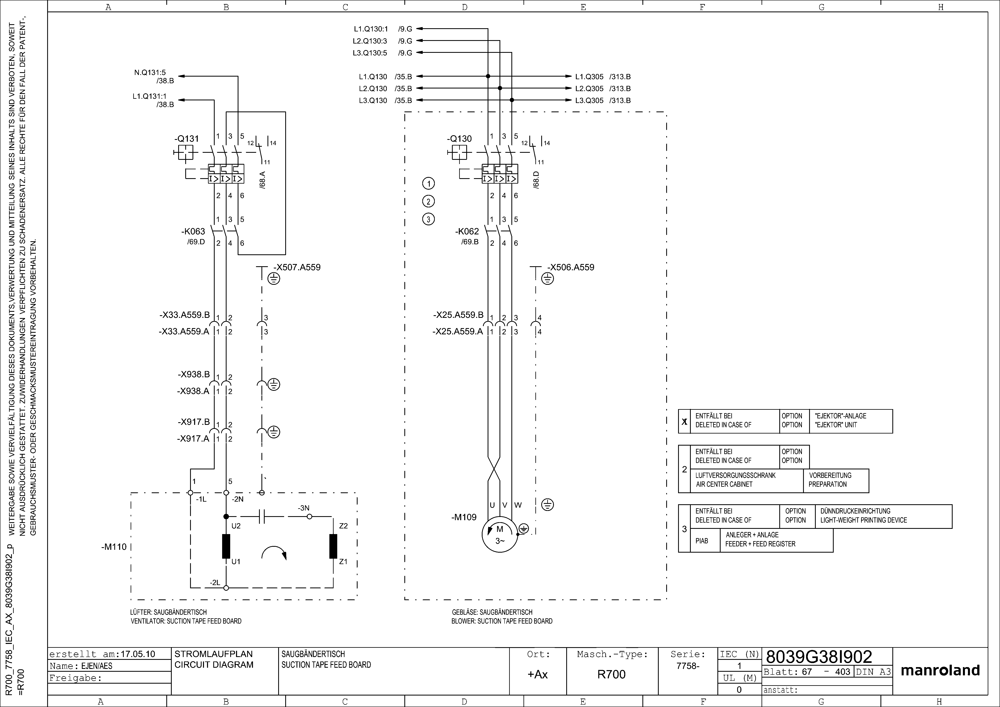

# +Ax — Sheet 67 of 403 — SAUGBÄNDERTISCH

**SUCTION TAPE FEED BOARD**

> Part of the manroland **R700** printing press IEC/UL circuit diagrams.
> Drawing class: **Stromlaufplan / Circuit diagram** (DIN A3).
> Document `+Ax` covers the **Central control console** machine section.

## At a glance

| Field | Value |
|---|---|
| Document | `+Ax`  (8039G38I902) |
| Sheet | **67** of 403 |
| Section (DE) | SAUGBÄNDERTISCH |
| Section (EN) | SUCTION TAPE FEED BOARD |
| Section type | CIRCUIT — Circuit diagram |
| Machine type | `R700` |
| Series | `7758` |
| Created | 17.05.10 |
| Replaces | — |
| Columns used | A, B, C, D, E, F, G |
| Path numbers | — |
| Labels on sheet | 144 |
| Cross-refs out | 15 |
| Cross-refs in | 41 |

**Previous:** [+Ax sheet 66](SHEET_0066.md) · **Next:** [+Ax sheet 68](SHEET_0068.md) · **Document TOC:** [_TOC.md](_TOC.md)  (+Ax) · **Master TOC:** [all sheets](../_MASTER_TOC.md)

## Sheet image (300 DPI, exact vector render)



_Rendered directly from the PDF vector layer at 300 DPI (1-bit), no OCR and no resampling. Use it to confirm anything ambiguous in the text below._

## Cross-references on this sheet

Each entry is a wire leaving this sheet. The printed token is `/sheet.column`; the link resolves to that sheet inside the same document.

| Ref | Target sheet | Col | Path | Destination on target | Target section | From col |
|---|---|---|---|---|---|---|
| `/9.G` | [+Ax sheet 9](SHEET_0009.md) | G | — | L1.Q130:1 | SPANNUNGSVERSORGUNG, SCHALTSCHRANKBELÜFTUNG | C |
| `/9.G` | [+Ax sheet 9](SHEET_0009.md) | G | — | L2.Q130:3 | SPANNUNGSVERSORGUNG, SCHALTSCHRANKBELÜFTUNG | C |
| `/9.G` | [+Ax sheet 9](SHEET_0009.md) | G | — | L3.Q130:5 | SPANNUNGSVERSORGUNG, SCHALTSCHRANKBELÜFTUNG | C |
| `/38.B` | [+Ax sheet 38](SHEET_0038.md) | B | — | N.Q131:5 | HAUPTANTRIEB | A |
| `/35.B` | [+Ax sheet 35](SHEET_0035.md) | B | — | L1.Q130 | SCHMIERUNG | C |
| `/313.B` | [+Ax sheet 313](SHEET_0313.md) | B | — | L1.Q305 | OPTION: STAUBSAUGER MIT BÜRSTE | E |
| `/35.B` | [+Ax sheet 35](SHEET_0035.md) | B | — | L2.Q130 | SCHMIERUNG | C |
| `/313.B` | [+Ax sheet 313](SHEET_0313.md) | B | — | L2.Q305 | OPTION: STAUBSAUGER MIT BÜRSTE | E |
| `/38.B` | [+Ax sheet 38](SHEET_0038.md) | B | — | L1.Q131:1 | HAUPTANTRIEB | A |
| `/35.B` | [+Ax sheet 35](SHEET_0035.md) | B | — | L3.Q130 | SCHMIERUNG | C |
| `/313.B` | [+Ax sheet 313](SHEET_0313.md) | B | — | L3.Q305 | OPTION: STAUBSAUGER MIT BÜRSTE | E |
| `/68.D` | [+Ax sheet 68](SHEET_0068.md) | D | — | — | SAUGBÄNDERTISCH | E |
| `/68.A` | [+Ax sheet 68](SHEET_0068.md) | A | — | — | SAUGBÄNDERTISCH | B |
| `/69.B` | [+Ax sheet 69](SHEET_0069.md) | B | — | — | SAUGBÄNDERTISCH | D |
| `/69.D` | [+Ax sheet 69](SHEET_0069.md) | D | — | — | SAUGBÄNDERTISCH | B |

### Incoming references (sheets that point here)

Every other sheet that sends a wire to this one. `Back-ref` is the token printed on *that* sheet; `Path` is its line number.

| From sheet | Cols | Back-ref | Path | Refs | What continues there |
|---|---|---|---|---|---|
| [+Ax#9](SHEET_0009.md) | G | `/9.G` | — | 3 | L1.Q130:1; L2.Q130:3; L3.Q130:5 |
| [+Ax#35](SHEET_0035.md) | C | `/35.C` | — | 3 | L1.Q130; L2.Q130; L3.Q130 |
| [+Ax#38](SHEET_0038.md) | B, D | `/38.B`, `/38.D` | — | 2 | L1.Q149:1 L1.Q131:1 L1.Q115:1; N.Q149:5 N.Q131:5 |
| [+Ax#68](SHEET_0068.md) | A, D | `/68.A`, `/68.D` | — | 2 | — |
| [+Ax#69](SHEET_0069.md) | B, D | `/69.B`, `/69.D` | — | 2 | — |
| [+Ax#268](SHEET_0268.md) | A | `/268.A` | — | 8 | — |
| [+Ax#276](SHEET_0276.md) | H | `/276.H` | — | 6 | — |
| [+Ax#296](SHEET_0296.md) | D, E | `/296.D`, `/296.E` | — | 12 | — |
| [+Ax#313](SHEET_0313.md) | A | `/313.A` | — | 3 | L1.Q305; L2.Q305; L3.Q305 |


## Devices on this sheet

| Tag | Class | Class meaning (IEC) | Col | Sub | Terminal | Sign |
|---|---|---|---|---|---|---|
| `K062` | K | Relais / relay, contactor | D | — | — | — |
| `Q131` | Q | Leistungsschalter / power switching device | B | — | — | — |
| `Q130` | Q | Leistungsschalter / power switching device | D | — | — | — |
| `K063` | K | Relais / relay, contactor | B | — | — | — |
| `U2` | U | Umrichter / frequency converter | B | — | — | — |
| `U1` | U | Umrichter / frequency converter | B | — | — | — |
| `Z2` | Z |  | C | — | — | — |
| `Z1` | Z |  | C | — | — | — |
| `X917.A` | — | cross-device reference | B | — | — | — |
| `X917.B` | — | cross-device reference | B | — | — | — |
| `X938.A` | — | cross-device reference | B | — | — | — |
| `X938.B` | — | cross-device reference | B | — | — | — |
| `X33.A559.B` | — | cross-device reference | B | — | — | — |
| `X33.A559.A` | — | cross-device reference | B | — | — | — |
| `X25.A559.B` | — | cross-device reference | D | — | — | — |
| `X25.A559.A` | — | cross-device reference | D | — | — | — |
| `X507.A559` | — | cross-device reference | C | — | — | — |
| `X506.A559` | — | cross-device reference | E | — | — | — |

## Potentials / nets

| Potential | Count | Columns | Attached devices | Terminals |
|---|---|---|---|---|
| `L1` | 4 | A, C, E | `Q130`, `Q131`, `Q305` | `1` |
| `L2` | 3 | C, E | `Q130`, `Q305` | `3` |
| `L3` | 3 | C, E | `Q130`, `Q305` | `5` |
| `M109` | 1 | D | — | — |
| `M110` | 1 | A | — | — |
| `N` | 1 | A | `Q131` | `5` |


A potential such as `L24+/4` or `M24+` is a named supply/return rail; every place it appears on this sheet is electrically common.

## Wire-end annotations (grouped as printed)

A wire that continues elsewhere is annotated with a small cluster: the destination description, the path/line number `#NN`, and the `/sheet.column` cross reference. Each row below is one such cluster exactly as it is grouped on the drawing.

| Col | Y | Path | Cross-ref | Text on the wire |
|---|---|---|---|---|
| C | 30.7 | — | `/9.G` | `L1.Q130:1` |
| C | 44.9 | — | `/9.G` | `L2.Q130:3` |
| C | 59.1 | — | `/9.G` | `L3.Q130:5` |
| A | 82.5 | — | `/38.B` | `N.Q131:5` |
| C | 87.4 | — | `/35.B` | `L1.Q130` |
| E | 87.4 | — | `/313.B` | `L1.Q305` |
| C | 101.6 | — | `/35.B` | `L2.Q130` |
| E | 101.6 | — | `/313.B` | `L2.Q305` |
| A | 110.8 | — | `/38.B` | `L1.Q131:1` |
| C | 115.8 | — | `/35.B` | `L3.Q130` |
| E | 115.8 | — | `/313.B` | `L3.Q305` |
| B | 158.4 | — | — | `1` |
| B | 158.4 | — | — | `3` |
| B | 158.4 | — | — | `5` |
| D | 158.4 | — | — | `1` |
| D | 158.4 | — | — | `3` |
| D | 158.4 | — | — | `5` |
| B | 160.5 | — | — | `Q131` |
| D | 160.5 | — | — | `Q130` |
| B | 167.4 | — | — | `12 14` |
| E | 167.4 | — | — | `12 14` |
| B | 190.1 | — | — | `11` |
| E | 190.1 | — | — | `11` |
| E | 203.8 | — | `/68.D` | — |
| B | 204.1 | — | `/68.A` | — |
| D | 215.2 | — | — | `1` |
| B | 229.2 | — | — | `2` |
| B | 229.2 | — | — | `4` |
| B | 229.2 | — | — | `6` |
| D | 229.2 | — | — | `2` |
| D | 229.2 | — | — | `4` |
| D | 229.2 | — | — | `6` |
| D | 237.0 | — | — | `2` |
| B | 257.6 | — | — | `1` |
| B | 257.6 | — | — | `3` |
| B | 257.6 | — | — | `5` |
| D | 257.6 | — | — | `1` |
| D | 257.6 | — | — | `3` |
| D | 257.6 | — | — | `5` |
| D | 258.2 | — | — | `3` |
| B | 271.0 | — | — | `K063 6` |
| D | 271.0 | — | — | `K062 6` |
| B | 284.1 | — | `/69.D` | — |
| D | 284.1 | — | `/69.B` | — |
| B | 285.9 | — | — | `2` |
| B | 285.9 | — | — | `4` |
| D | 285.9 | — | — | `2` |
| D | 285.9 | — | — | `4` |
| D | 313.5 | — | — | `X507.A559 X506.A559` |
| B | 370.2 | — | — | `X33.A559.B 1 2 3` |
| D | 370.2 | — | — | `X25.A559.B 1` |
| D | 374.5 | — | — | `2 3 4` |
| B | 390.1 | — | — | `X33.A559.A 1 2 3` |
| D | 390.1 | — | — | `X25.A559.A 1` |
| D | 391.5 | — | — | `2 3 4` |
| B | 441.1 | — | — | `X938.B 1` |
| B | 445.4 | — | — | `2` |
| B | 460.9 | — | — | `X938.A 1` |
| B | 462.4 | — | — | `2` |
| F | 492.4 | — | — | `X ENTFÄLLT BEI DELETED IN CASE OF` |
| G | 492.4 | — | — | `OPTION OPTION` |
| G | 492.4 | — | — | `"EJEKTOR" ANLAGE "EJEKTOR" UNIT` |
| B | 497.8 | — | — | `X917.B 1` |
| F | 497.8 | — | — | `1` |
| B | 502.1 | — | — | `2` |
| B | 517.6 | — | — | `X917.A 1` |
| B | 519.1 | — | — | `2` |
| F | 534.9 | — | — | `ENTFÄLLT BEI DELETED IN CASE OF` |
| G | 534.9 | — | — | `OPTION OPTION` |
| F | 554.4 | — | — | `2` |
| F | 563.3 | — | — | `LUFTVERSORGUNGSSCHRANK` |
| G | 563.3 | — | — | `PREPARATION VORBEREITUNG` |
| B | 568.2 | — | — | `'` |
| B | 569.4 | — | — | `1 5` |
| F | 573.9 | — | — | `AIR CENTER CABINET` |
| B | 590.6 | — | — | `1L 2N` |
| D | 597.4 | — | — | `U V W` |
| C | 601.3 | — | — | `3N` |
| F | 605.8 | — | — | `ENTFÄLLT BEI DELETED IN CASE OF` |
| G | 605.8 | — | — | `OPTION OPTION` |
| G | 605.9 | — | — | `DÜNNDRUCKEINRICHTUNG LIGHT WEIGHT PRINTING DEVICE` |
| D | 611.2 | — | — | `M109` |
| B | 622.5 | — | — | `U2` |
| C | 622.5 | — | — | `Z2` |
| F | 625.3 | — | — | `3` |
| D | 625.6 | — | — | `3~ M` |
| F | 634.2 | — | — | `FEEDER + FEED REGISTER ANLEGER + ANLAGE` |
| F | 641.1 | — | — | `PIAB` |
| A | 646.6 | — | — | `M110` |
| C | 665.0 | — | — | `Z1` |
| B | 665.1 | — | — | `U1` |
| B | 689.9 | — | — | `2L` |
| B | 726.3 | — | — | `LÜFTER: SAUGBÄNDERTISCH` |
| D | 726.3 | — | — | `BLOWER: SUCTION TAPE FEED BOARD GEBLÄSE: SAUGBÄNDERTISCH` |
| B | 736.9 | — | — | `VENTILATOR: SUCTION TAPE FEED BOARD` |


## Reconstructed tables

This sheet carries tabular content (pin map / terminal assignment / index). The grid below was rebuilt from the drawing's own rule lines, so each row is exactly one physical row of the table.

### Table 1 — 0 data rows × 3 columns (at x=212.6, y=90.7) — **Q131 K063 /69.D**

_none_


### Table 2 — 3 data rows × 1 columns (at x=255.1, y=90.7)

| C1 |
|---|
| `1` |
| `2 1 2` |
| `1 1 1 1 1 1 2L` |


### Table 3 — 3 data rows × 5 columns (at x=276.4, y=90.7)

|  | 5 | 12 | 14 |  |
|---|---|---|---|---|
|  |  |  | `11` |  |
|  | `6 5 6` |  |  |  |
| `2N U2 U1` |  |  | `3 3 '` | `X507.A559 3N` |


## Notes and free text on this sheet

| Text | Col | Y (pt) |
|---|---|---|
| `U` | D | 597.74 |
| `V` | D | 597.63 |
| `W` | D | 597.37 |
| `M` | D | 625.62 |
| `GEBLÄSE: SAUGBÄNDERTISCH` | D | 726.29 |
| `BLOWER: SUCTION TAPE FEED BOARD` | D | 736.91 |
| `LÜFTER: SAUGBÄNDERTISCH` | B | 726.28 |
| `VENTILATOR: SUCTION TAPE FEED BOARD` | B | 736.93 |
| `2N` | B | 590.66 |
| `1L` | B | 590.65 |
| `3N` | C | 601.29 |
| `2L` | B | 689.87 |
| `ENTFÄLLT BEI` | F | 534.92 |
| `DELETED IN CASE OF` | F | 545.57 |
| `OPTION` | G | 492.41 |
| `"EJEKTOR" ANLAGE` | G | 492.43 |
| `"EJEKTOR" UNIT` | G | 503.06 |
| `DÜNNDRUCKEINRICHTUNG` | G | 605.85 |
| `LIGHT WEIGHT PRINTING DEVICE` | G | 616.44 |
| `LUFTVERSORGUNGSSCHRANK` | F | 563.32 |
| `AIR CENTER CABINET` | F | 573.94 |
| `VORBEREITUNG` | G | 563.31 |
| `PREPARATION` | G | 573.91 |
| `PIAB` | F | 641.15 |
| `ANLEGER + ANLAGE` | F | 634.17 |
| `FEEDER + FEED REGISTER` | F | 644.79 |

## Complete label inventory (exact text from the drawing)

Every text object inside the drawing area of this sheet, in DIN reading order (column A→H, then top→bottom). This is the authoritative list: if a string is not here it is not printed on this sheet.

| Col | Y | X | Dir | Type | Text |
|---|---|---|---|---|---|
| A | 82.5 | 159.9 | → | potential | `N.Q131:5` |
| A | 92.4 | 186.5 | → | cross-reference | `/38.B` |
| A | 110.8 | 157.9 | → | potential | `L1.Q131:1` |
| A | 120.7 | 186.5 | → | cross-reference | `/38.B` |
| A | 646.6 | 120.8 | → | potential | `M110` |
| B | 158.4 | 257.1 | → | number | `1` |
| B | 158.4 | 271.8 | → | number | `3` |
| B | 158.4 | 286.0 | → | number | `5` |
| B | 160.5 | 207.8 | → | device tag | `Q131` |
| B | 167.4 | 294.2 | → | number | `12` |
| B | 167.4 | 321.2 | → | number | `14` |
| B | 190.1 | 314.1 | → | number | `11` |
| B | 204.1 | 308.5 | ↕ | cross-reference | `/68.A` |
| B | 229.2 | 257.7 | → | number | `2` |
| B | 229.2 | 271.8 | → | number | `4` |
| B | 229.2 | 286.0 | → | number | `6` |
| B | 257.6 | 257.1 | → | number | `1` |
| B | 257.6 | 271.8 | → | number | `3` |
| B | 257.6 | 286.0 | → | number | `5` |
| B | 271.0 | 216.0 | → | device tag | `K063` |
| B | 284.1 | 223.1 | → | cross-reference | `/69.D` |
| B | 285.9 | 257.7 | → | number | `2` |
| B | 285.9 | 271.8 | → | number | `4` |
| B | 285.9 | 286.0 | → | number | `6` |
| B | 370.2 | 189.9 | → | device ref | `X33.A559.B` |
| B | 374.5 | 257.1 | → | number | `1` |
| B | 374.5 | 271.8 | → | number | `2` |
| B | 374.5 | 314.4 | → | number | `3` |
| B | 390.1 | 189.1 | → | device ref | `X33.A559.A` |
| B | 391.5 | 257.1 | → | number | `1` |
| B | 391.5 | 271.8 | → | number | `2` |
| B | 391.5 | 314.4 | → | number | `3` |
| B | 441.1 | 211.7 | → | device ref | `X938.B` |
| B | 445.4 | 257.1 | → | number | `1` |
| B | 445.4 | 271.8 | → | number | `2` |
| B | 460.9 | 210.9 | → | device ref | `X938.A` |
| B | 462.4 | 257.1 | → | number | `1` |
| B | 462.4 | 271.8 | → | number | `2` |
| B | 497.8 | 211.7 | → | device ref | `X917.B` |
| B | 502.1 | 257.1 | → | number | `1` |
| B | 502.1 | 271.8 | → | number | `2` |
| B | 517.6 | 210.9 | → | device ref | `X917.A` |
| B | 519.1 | 257.1 | → | number | `1` |
| B | 519.1 | 271.8 | → | number | `2` |
| B | 568.2 | 314.1 | → | other | `'` |
| B | 569.4 | 228.8 | → | number | `1` |
| B | 569.4 | 271.8 | → | number | `5` |
| B | 590.7 | 233.6 | → | text | `1L` |
| B | 590.7 | 276.1 | → | text | `2N` |
| B | 622.5 | 275.5 | → | device tag | `U2` |
| B | 665.1 | 275.5 | → | device tag | `U1` |
| B | 689.9 | 250.0 | → | text | `2L` |
| B | 726.3 | 155.1 | → | text | `LÜFTER: SAUGBÄNDERTISCH` |
| B | 736.9 | 155.9 | → | text | `VENTILATOR: SUCTION TAPE FEED BOARD` |
| C | 30.8 | 421.5 | → | potential | `L1.Q130:1` |
| C | 44.9 | 420.1 | → | potential | `L2.Q130:3` |
| C | 59.1 | 420.1 | → | potential | `L3.Q130:5` |
| C | 87.4 | 470.0 | → | cross-reference | `/35.B` |
| C | 87.5 | 427.5 | → | potential | `L1.Q130` |
| C | 101.6 | 427.5 | → | potential | `L2.Q130` |
| C | 101.6 | 470.0 | → | cross-reference | `/35.B` |
| C | 115.8 | 427.5 | → | potential | `L3.Q130` |
| C | 115.8 | 470.0 | → | cross-reference | `/35.B` |
| C | 313.5 | 325.7 | → | device ref | `X507.A559` |
| C | 601.3 | 354.8 | → | text | `3N` |
| C | 622.5 | 403.9 | → | device tag | `Z2` |
| C | 665.0 | 403.9 | → | device tag | `Z1` |
| D | 30.7 | 474.2 | → | cross-reference | `/9.G` |
| D | 44.9 | 474.2 | → | cross-reference | `/9.G` |
| D | 59.1 | 474.2 | → | cross-reference | `/9.G` |
| D | 158.4 | 583.1 | → | number | `1` |
| D | 158.4 | 597.8 | → | number | `3` |
| D | 158.4 | 612.0 | → | number | `5` |
| D | 160.5 | 532.3 | → | device tag | `Q130` |
| D | 215.2 | 508.5 | → | number | `1` |
| D | 229.2 | 583.7 | → | number | `2` |
| D | 229.2 | 597.8 | → | number | `4` |
| D | 229.2 | 612.0 | → | number | `6` |
| D | 237.0 | 508.2 | → | number | `2` |
| D | 257.6 | 583.1 | → | number | `1` |
| D | 257.6 | 597.8 | → | number | `3` |
| D | 257.6 | 612.0 | → | number | `5` |
| D | 258.2 | 508.2 | → | number | `3` |
| D | 271.0 | 542.0 | → | device tag | `K062` |
| D | 284.1 | 549.4 | → | cross-reference | `/69.B` |
| D | 285.9 | 583.7 | → | number | `2` |
| D | 285.9 | 597.8 | → | number | `4` |
| D | 285.9 | 612.0 | → | number | `6` |
| D | 370.2 | 515.9 | → | device ref | `X25.A559.B` |
| D | 374.5 | 583.1 | → | number | `1` |
| D | 374.5 | 597.8 | → | number | `2` |
| D | 374.5 | 612.0 | → | number | `3` |
| D | 390.1 | 515.1 | → | device ref | `X25.A559.A` |
| D | 391.5 | 583.1 | → | number | `1` |
| D | 391.5 | 597.8 | → | number | `2` |
| D | 391.5 | 612.0 | → | number | `3` |
| D | 597.4 | 612.3 | → | text | `W` |
| D | 597.6 | 598.1 | → | text | `V` |
| D | 597.7 | 583.1 | → | text | `U` |
| D | 611.2 | 537.4 | → | potential | `M109` |
| D | 625.6 | 591.2 | → | text | `M` |
| D | 639.9 | 589.9 | → | other | `3~` |
| D | 726.3 | 538.3 | → | text | `GEBLÄSE: SAUGBÄNDERTISCH` |
| D | 736.9 | 537.7 | → | text | `BLOWER: SUCTION TAPE FEED BOARD` |
| E | 87.4 | 725.7 | → | cross-reference | `/313.B` |
| E | 87.5 | 685.1 | → | potential | `L1.Q305` |
| E | 101.6 | 685.1 | → | potential | `L2.Q305` |
| E | 101.6 | 725.7 | → | cross-reference | `/313.B` |
| E | 115.8 | 685.1 | → | potential | `L3.Q305` |
| E | 115.8 | 725.7 | → | cross-reference | `/313.B` |
| E | 167.4 | 620.2 | → | number | `12` |
| E | 167.4 | 647.1 | → | number | `14` |
| E | 190.1 | 640.1 | → | number | `11` |
| E | 203.8 | 634.5 | ↕ | cross-reference | `/68.D` |
| E | 313.5 | 651.7 | → | device ref | `X506.A559` |
| E | 374.5 | 640.3 | → | number | `4` |
| E | 391.5 | 640.3 | → | number | `4` |
| F | 492.4 | 828.3 | → | text | `ENTFÄLLT BEI` |
| F | 497.8 | 811.4 | → | not fitted | `X` |
| F | 497.8 | 812.4 | → | number | `1` |
| F | 503.1 | 828.3 | → | text | `DELETED IN CASE OF` |
| F | 534.9 | 828.3 | → | text | `ENTFÄLLT BEI` |
| F | 545.6 | 828.3 | → | text | `DELETED IN CASE OF` |
| F | 554.4 | 812.1 | → | number | `2` |
| F | 563.3 | 828.3 | → | text | `LUFTVERSORGUNGSSCHRANK` |
| F | 573.9 | 829.1 | → | text | `AIR CENTER CABINET` |
| F | 605.8 | 828.3 | → | text | `ENTFÄLLT BEI` |
| F | 616.4 | 828.3 | → | text | `DELETED IN CASE OF` |
| F | 625.3 | 812.0 | → | number | `3` |
| F | 634.2 | 864.6 | → | text | `ANLEGER + ANLAGE` |
| F | 641.2 | 828.3 | → | text | `PIAB` |
| F | 644.8 | 863.7 | → | text | `FEEDER + FEED REGISTER` |
| G | 492.4 | 930.9 | → | text | `OPTION` |
| G | 492.4 | 970.6 | → | text | `"EJEKTOR" ANLAGE` |
| G | 503.0 | 930.9 | → | text | `OPTION` |
| G | 503.1 | 970.6 | → | text | `"EJEKTOR" UNIT` |
| G | 534.9 | 930.9 | → | text | `OPTION` |
| G | 545.6 | 930.9 | → | text | `OPTION` |
| G | 563.3 | 963.8 | → | text | `VORBEREITUNG` |
| G | 573.9 | 962.9 | → | text | `PREPARATION` |
| G | 605.8 | 935.1 | → | text | `OPTION` |
| G | 605.9 | 977.1 | → | text | `DÜNNDRUCKEINRICHTUNG` |
| G | 616.4 | 935.1 | → | text | `OPTION` |
| G | 616.4 | 977.1 | → | text | `LIGHT WEIGHT PRINTING DEVICE` |

## Reading-order text block

The same content as a plain block, grouped by DIN column — convenient to paste or to match against a visual description.

```text
=== Column A ===
  82.5  159.9  net          N.Q131:5
  92.4  186.5  xref         /38.B
 110.8  157.9  net          L1.Q131:1
 120.7  186.5  xref         /38.B
 646.6  120.8  net          M110
=== Column B ===
 158.4  257.1  numeric      1
 158.4  271.8  numeric      3
 158.4  286.0  numeric      5
 160.5  207.8  devtag       Q131
 167.4  294.2  numeric      12
 167.4  321.2  numeric      14
 190.1  314.1  numeric      11
 204.1  308.5  xref         /68.A
 229.2  257.7  numeric      2
 229.2  271.8  numeric      4
 229.2  286.0  numeric      6
 257.6  257.1  numeric      1
 257.6  271.8  numeric      3
 257.6  286.0  numeric      5
 271.0  216.0  devtag       K063
 284.1  223.1  xref         /69.D
 285.9  257.7  numeric      2
 285.9  271.8  numeric      4
 285.9  286.0  numeric      6
 370.2  189.9  devref       X33.A559.B
 374.5  257.1  numeric      1
 374.5  271.8  numeric      2
 374.5  314.4  numeric      3
 390.1  189.1  devref       X33.A559.A
 391.5  257.1  numeric      1
 391.5  271.8  numeric      2
 391.5  314.4  numeric      3
 441.1  211.7  devref       X938.B
 445.4  257.1  numeric      1
 445.4  271.8  numeric      2
 460.9  210.9  devref       X938.A
 462.4  257.1  numeric      1
 462.4  271.8  numeric      2
 497.8  211.7  devref       X917.B
 502.1  257.1  numeric      1
 502.1  271.8  numeric      2
 517.6  210.9  devref       X917.A
 519.1  257.1  numeric      1
 519.1  271.8  numeric      2
 568.2  314.1  other        `
 569.4  228.8  numeric      1
 569.4  271.8  numeric      5
 590.7  233.6  text         1L
 590.7  276.1  text         2N
 622.5  275.5  devtag       U2
 665.1  275.5  devtag       U1
 689.9  250.0  text         2L
 726.3  155.1  text         LÜFTER: SAUGBÄNDERTISCH
 736.9  155.9  text         VENTILATOR: SUCTION TAPE FEED BOARD
=== Column C ===
  30.8  421.5  net          L1.Q130:1
  44.9  420.1  net          L2.Q130:3
  59.1  420.1  net          L3.Q130:5
  87.4  470.0  xref         /35.B
  87.5  427.5  net          L1.Q130
 101.6  427.5  net          L2.Q130
 101.6  470.0  xref         /35.B
 115.8  427.5  net          L3.Q130
 115.8  470.0  xref         /35.B
 313.5  325.7  devref       X507.A559
 601.3  354.8  text         3N
 622.5  403.9  devtag       Z2
 665.0  403.9  devtag       Z1
=== Column D ===
  30.7  474.2  xref         /9.G
  44.9  474.2  xref         /9.G
  59.1  474.2  xref         /9.G
 158.4  583.1  numeric      1
 158.4  597.8  numeric      3
 158.4  612.0  numeric      5
 160.5  532.3  devtag       Q130
 215.2  508.5  numeric      1
 229.2  583.7  numeric      2
 229.2  597.8  numeric      4
 229.2  612.0  numeric      6
 237.0  508.2  numeric      2
 257.6  583.1  numeric      1
 257.6  597.8  numeric      3
 257.6  612.0  numeric      5
 258.2  508.2  numeric      3
 271.0  542.0  devtag       K062
 284.1  549.4  xref         /69.B
 285.9  583.7  numeric      2
 285.9  597.8  numeric      4
 285.9  612.0  numeric      6
 370.2  515.9  devref       X25.A559.B
 374.5  583.1  numeric      1
 374.5  597.8  numeric      2
 374.5  612.0  numeric      3
 390.1  515.1  devref       X25.A559.A
 391.5  583.1  numeric      1
 391.5  597.8  numeric      2
 391.5  612.0  numeric      3
 597.4  612.3  text         W
 597.6  598.1  text         V
 597.7  583.1  text         U
 611.2  537.4  net          M109
 625.6  591.2  text         M
 639.9  589.9  other        3~
 726.3  538.3  text         GEBLÄSE: SAUGBÄNDERTISCH
 736.9  537.7  text         BLOWER: SUCTION TAPE FEED BOARD
=== Column E ===
  87.4  725.7  xref         /313.B
  87.5  685.1  net          L1.Q305
 101.6  685.1  net          L2.Q305
 101.6  725.7  xref         /313.B
 115.8  685.1  net          L3.Q305
 115.8  725.7  xref         /313.B
 167.4  620.2  numeric      12
 167.4  647.1  numeric      14
 190.1  640.1  numeric      11
 203.8  634.5  xref         /68.D
 313.5  651.7  devref       X506.A559
 374.5  640.3  numeric      4
 391.5  640.3  numeric      4
=== Column F ===
 492.4  828.3  text         ENTFÄLLT BEI
 497.8  811.4  placeholder  X
 497.8  812.4  numeric      1
 503.1  828.3  text         DELETED IN CASE OF
 534.9  828.3  text         ENTFÄLLT BEI
 545.6  828.3  text         DELETED IN CASE OF
 554.4  812.1  numeric      2
 563.3  828.3  text         LUFTVERSORGUNGSSCHRANK
 573.9  829.1  text         AIR CENTER CABINET
 605.8  828.3  text         ENTFÄLLT BEI
 616.4  828.3  text         DELETED IN CASE OF
 625.3  812.0  numeric      3
 634.2  864.6  text         ANLEGER + ANLAGE
 641.2  828.3  text         PIAB
 644.8  863.7  text         FEEDER + FEED REGISTER
=== Column G ===
 492.4  930.9  text         OPTION
 492.4  970.6  text         "EJEKTOR" ANLAGE
 503.0  930.9  text         OPTION
 503.1  970.6  text         "EJEKTOR" UNIT
 534.9  930.9  text         OPTION
 545.6  930.9  text         OPTION
 563.3  963.8  text         VORBEREITUNG
 573.9  962.9  text         PREPARATION
 605.8  935.1  text         OPTION
 605.9  977.1  text         DÜNNDRUCKEINRICHTUNG
 616.4  935.1  text         OPTION
 616.4  977.1  text         LIGHT WEIGHT PRINTING DEVICE
```

---
_Generated from the PDF vector text layer; no OCR. Source: `R700_7758_IEC_AX_8039G38I902_p`, sheet 67._
