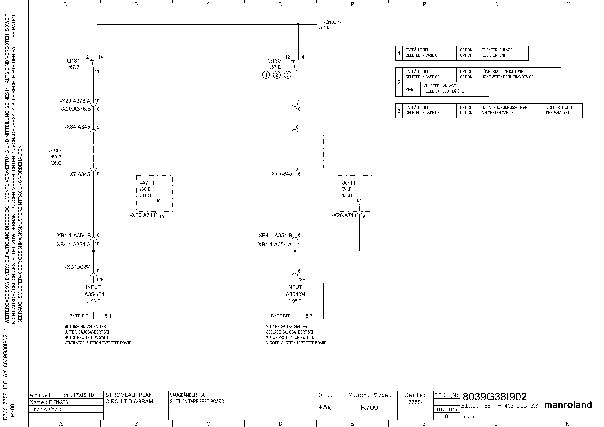

# +Ax — Sheet 68 of 403 — SAUGBÄNDERTISCH

**SUCTION TAPE FEED BOARD**

> Part of the manroland **R700** printing press IEC/UL circuit diagrams.
> Drawing class: **Stromlaufplan / Circuit diagram** (DIN A3).
> Document `+Ax` covers the **Central control console** machine section.

## At a glance

| Field | Value |
|---|---|
| Document | `+Ax`  (8039G38I902) |
| Sheet | **68** of 403 |
| Section (DE) | SAUGBÄNDERTISCH |
| Section (EN) | SUCTION TAPE FEED BOARD |
| Section type | CIRCUIT — Circuit diagram |
| Machine type | `R700` |
| Series | `7758` |
| Created | 17.05.10 |
| Replaces | — |
| Columns used | A, B, D, E, F, G, H |
| Path numbers | — |
| Labels on sheet | 100 |
| Cross-refs out | 11 |
| Cross-refs in | 27 |

**Previous:** [+Ax sheet 67](SHEET_0067.md) · **Next:** [+Ax sheet 69](SHEET_0069.md) · **Document TOC:** [_TOC.md](_TOC.md)  (+Ax) · **Master TOC:** [all sheets](../_MASTER_TOC.md)

## Sheet image (300 DPI, exact vector render)



_Rendered directly from the PDF vector layer at 300 DPI (1-bit), no OCR and no resampling. Use it to confirm anything ambiguous in the text below._

## Cross-references on this sheet

Each entry is a wire leaving this sheet. The printed token is `/sheet.column`; the link resolves to that sheet inside the same document.

| Ref | Target sheet | Col | Path | Destination on target | Target section | From col |
|---|---|---|---|---|---|---|
| `/77.B` | [+Ax sheet 77](SHEET_0077.md) | B | — | — | ANLEGER | E |
| `/67.B` | [+Ax sheet 67](SHEET_0067.md) | B | — | — | SAUGBÄNDERTISCH | A |
| `/67.E` | [+Ax sheet 67](SHEET_0067.md) | E | — | — | SAUGBÄNDERTISCH | D |
| `/69.B` | [+Ax sheet 69](SHEET_0069.md) | B | — | — | SAUGBÄNDERTISCH | A |
| `/66.G` | [+Ax sheet 66](SHEET_0066.md) | G | — | — | DRUCKLUFTANLAGE | A |
| `/68.E` | [+Ax sheet 68](SHEET_0068.md) | E | — | A711 | SAUGBÄNDERTISCH | B |
| `/61.G` | [+Ax sheet 61](SHEET_0061.md) | G | — | A711 | DRUCKLUFTANLAGE | B |
| `/74.F` | [+Ax sheet 74](SHEET_0074.md) | F | — | A711 | FEUCHTMITTELKÜHLGERÄT | E |
| `/68.B` | [+Ax sheet 68](SHEET_0068.md) | B | — | A711 | SAUGBÄNDERTISCH | E |
| `/198.F` | [+Ax sheet 198](SHEET_0198.md) | F | — | — | REFERENZMODUL | A |
| `/198.F` | [+Ax sheet 198](SHEET_0198.md) | F | — | — | REFERENZMODUL | D |

### Incoming references (sheets that point here)

Every other sheet that sends a wire to this one. `Back-ref` is the token printed on *that* sheet; `Path` is its line number.

| From sheet | Cols | Back-ref | Path | Refs | What continues there |
|---|---|---|---|---|---|
| [+Ax#61](SHEET_0061.md) | G | `/61.G` | — | 1 | A711 |
| [+Ax#66](SHEET_0066.md) | G | `/66.G` | — | 1 | — |
| [+Ax#67](SHEET_0067.md) | B, E | `/67.B`, `/67.E` | — | 2 | — |
| [+Ax#68](SHEET_0068.md) | B, E | `/68.B`, `/68.E` | — | 2 | A711 |
| [+Ax#69](SHEET_0069.md) | B | `/69.B` | — | 1 | — |
| [+Ax#74](SHEET_0074.md) | F | `/74.F` | — | 1 | A711 |
| [+Ax#77](SHEET_0077.md) | A | `/77.A` | — | 1 | Q103:14 |
| [+Ax#198](SHEET_0198.md) | F | `/198.F` | — | 2 | — |
| [+Ax#228](SHEET_0228.md) | A, B, C | `/228.A`, `/228.B`, `/228.C` | — | 6 | — |
| [+Ax#235](SHEET_0235.md) | H | `/235.H` | — | 2 | — |
| [+Ax#260](SHEET_0260.md) | E, F | `/260.E`, `/260.F` | — | 4 | — |
| [+Ax#269](SHEET_0269.md) | H | `/269.H` | — | 2 | — |
| [+Ax#287](SHEET_0287.md) | B | `/287.B` | — | 2 | — |


## Devices on this sheet

| Tag | Class | Class meaning (IEC) | Col | Sub | Terminal | Sign |
|---|---|---|---|---|---|---|
| `A345` | A | Baugruppe / assembly, module, PC board | A | — | — | — |
| `Q131` | Q | Leistungsschalter / power switching device | A | — | — | — |
| `Q130` | Q | Leistungsschalter / power switching device | D | — | — | — |
| `A354/04` | A | Baugruppe / assembly, module, PC board | A | 04 | — | — |
| `A354/04` | A | Baugruppe / assembly, module, PC board | D | 04 | — | — |
| `A711` | A | Baugruppe / assembly, module, PC board | E | — | — | — |
| `A711` | A | Baugruppe / assembly, module, PC board | B | — | — | — |
| `Q103:14` | Q | Leistungsschalter / power switching device | E | — | 14 | — |
| `X20.A376.A` | — | cross-device reference | A | — | — | — |
| `X20.A376.B` | — | cross-device reference | A | — | — | — |
| `X84.A345` | — | cross-device reference | A | — | — | — |
| `X7.A345` | — | cross-device reference | A | — | — | — |
| `X7.A345` | — | cross-device reference | D | — | — | — |
| `5.1` | — | cross-device reference | B | — | — | — |
| `XB4.A354` | — | cross-device reference | A | — | — | — |
| `5.7` | — | cross-device reference | D | — | — | — |
| `XB4.1.A354.B` | — | cross-device reference | A | — | — | — |
| `XB4.1.A354.A` | — | cross-device reference | A | — | — | — |
| `XB4.1.A354.B` | — | cross-device reference | D | — | — | — |
| `XB4.1.A354.A` | — | cross-device reference | D | — | — | — |
| `X26.A711` | — | cross-device reference | E | — | — | — |
| `X26.A711` | — | cross-device reference | B | — | — | — |

## Potentials / nets

_No named potentials on this sheet._

## Wire-end annotations (grouped as printed)

A wire that continues elsewhere is annotated with a small cluster: the destination description, the path/line number `#NN`, and the `/sheet.column` cross reference. Each row below is one such cluster exactly as it is grouped on the drawing.

| Col | Y | Path | Cross-ref | Text on the wire |
|---|---|---|---|---|
| E | 40.0 | — | — | `Q103:14` |
| E | 49.9 | — | `/77.B` | — |
| F | 95.5 | — | — | `ENTFÄLLT BEI DELETED IN CASE OF` |
| F | 95.6 | — | — | `1 OPTION OPTION "EJEKTOR" ANLAGE "EJEKTOR" UNIT` |
| A | 108.8 | — | — | `Q131 14` |
| A | 108.8 | — | — | `12` |
| D | 108.8 | — | — | `Q130 14` |
| D | 108.8 | — | — | `12` |
| A | 128.2 | — | `/67.B` | — |
| D | 128.2 | — | `/67.E` | — |
| A | 137.1 | — | — | `11` |
| D | 137.1 | — | — | `11` |
| F | 138.1 | — | — | `ENTFÄLLT BEI DELETED IN CASE OF` |
| G | 138.1 | — | — | `OPTION OPTION` |
| G | 138.1 | — | — | `DÜNNDRUCKEINRICHTUNG LIGHT WEIGHT PRINTING DEVICE` |
| D | 144.3 | — | — | `1 2 3` |
| F | 157.6 | — | — | `2` |
| F | 166.4 | — | — | `FEEDER + FEED REGISTER ANLEGER + ANLAGE` |
| F | 173.4 | — | — | `PIAB` |
| A | 194.5 | — | — | `X20.A376.A 10` |
| D | 194.5 | — | — | `16` |
| F | 208.9 | — | — | `ENTFÄLLT BEI DELETED IN CASE OF` |
| G | 208.9 | — | — | `OPTION OPTION` |
| G | 209.0 | — | — | `LUFTVERSORGUNGSSCHRANK PREPARATION VORBEREITUNG` |
| A | 210.1 | — | — | `X20.A376.B 10` |
| D | 211.5 | — | — | `16` |
| F | 214.3 | — | — | `3 AIR CENTER CABINET` |
| A | 245.5 | — | — | `X84.A345 19` |
| D | 246.9 | — | — | `6` |
| A | 292.3 | — | — | `A345` |
| A | 305.3 | — | `/69.B`, `/66.G` | — |
| D | 337.6 | — | — | `X7.A345 16` |
| A | 339.1 | — | — | `X7.A345 10` |
| B | 356.1 | — | `/68.E`, `/61.G` | `A711` |
| E | 356.1 | — | `/74.F`, `/68.B` | `A711` |
| D | 393.2 | — | — | `NC NC` |
| B | 419.8 | — | — | `X26.A711 10` |
| E | 419.8 | — | — | `X26.A711 16` |
| A | 459.5 | — | — | `XB4.1.A354.B 10` |
| D | 459.5 | — | — | `XB4.1.A354.B 16` |
| A | 476.5 | — | — | `XB4.1.A354.A 10` |
| D | 476.5 | — | — | `XB4.1.A354.A 16` |
| A | 521.9 | — | — | `XB4.A354 10` |
| D | 530.4 | — | — | `16` |
| A | 547.4 | — | — | `12B` |
| D | 547.4 | — | — | `22B` |
| A | 561.9 | — | — | `INPUT` |
| D | 561.9 | — | — | `INPUT` |
| A | 575.7 | — | — | `A354/04` |
| D | 575.7 | — | — | `A354/04` |
| A | 589.5 | — | `/198.F` | — |
| D | 589.5 | — | `/198.F` | — |
| A | 618.6 | — | — | `BYTE.BIT 5.1` |
| D | 618.6 | — | — | `BYTE.BIT 5.7` |
| A | 641.3 | — | — | `LÜFTER: SAUGBÄNDERTISCH MOTORSCHUTZSCHALTER: MOTOR PROTECTION SWITCH:` |
| D | 641.3 | — | — | `BLOWER, SUCTION TAPE FEED BOARD MOTORSCHUTZSCHALTER: MOTOR PROTECTION SWITCH: GEBLÄSE, SAUGBÄNDERTISCH` |
| A | 673.1 | — | — | `VENTILATOR: SUCTION TAPE FEED BOARD` |


## Reconstructed tables

This sheet carries tabular content (pin map / terminal assignment / index). The grid below was rebuilt from the drawing's own rule lines, so each row is exactly one physical row of the table.

### Table 1 — 3 data rows × 4 columns (at x=127.6, y=48.2)

| 12 Q131 /67.B X20.A376.A X20.A376.B X84.A345 X7.A345 XB4.1.A354.B XB4.1.A354.A | 11 10 10 19 10 10 10 | 14 | A711 /68.E /61.G NC X26.A711 |
|---|---|---|---|
| `XB4.A354` | `10` | `12B` |  |
| `INPUT` | `A354/04 /198.F` |  |  |
| `BYTE.BIT` |  | `5.1` |  |


### Table 2 — 3 data rows × 4 columns (at x=524.4, y=48.2)

| 12 Q130 /67.E 1 2 3 X7.A345 XB4.1.A354.B XB4.1.A354.A | 11 16 16 6 16 16 16 | 14 | /77.B A711 /74.F /68.B NC X26.A711 |
|---|---|---|---|
|  | `16` | `22B` |  |
| `INPUT` | `A354/04 /198.F` |  |  |
| `BYTE.BIT` |  | `5.7` |  |


## Notes and free text on this sheet

| Text | Col | Y (pt) |
|---|---|---|
| `12B` | A | 547.37 |
| `INPUT` | A | 561.9 |
| `BYTE.BIT` | A | 619.15 |
| `MOTORSCHUTZSCHALTER:` | A | 641.27 |
| `LÜFTER: SAUGBÄNDERTISCH` | A | 651.87 |
| `MOTOR PROTECTION SWITCH:` | A | 662.51 |
| `VENTILATOR: SUCTION TAPE FEED BOARD` | A | 673.15 |
| `22B` | D | 547.37 |
| `INPUT` | D | 561.9 |
| `BYTE.BIT` | D | 619.15 |
| `MOTORSCHUTZSCHALTER:` | D | 641.27 |
| `GEBLÄSE, SAUGBÄNDERTISCH` | D | 651.88 |
| `MOTOR PROTECTION SWITCH:` | D | 662.51 |
| `BLOWER, SUCTION TAPE FEED BOARD` | D | 673.14 |
| `ENTFÄLLT BEI` | F | 95.55 |
| `DELETED IN CASE OF` | F | 106.2 |
| `"EJEKTOR" ANLAGE` | G | 95.58 |
| `"EJEKTOR" UNIT` | G | 106.21 |
| `OPTION` | G | 95.56 |
| `DÜNNDRUCKEINRICHTUNG` | G | 138.13 |
| `LIGHT WEIGHT PRINTING DEVICE` | G | 148.72 |
| `PIAB` | F | 173.43 |
| `ANLEGER + ANLAGE` | F | 166.45 |
| `FEEDER + FEED REGISTER` | F | 177.07 |
| `VORBEREITUNG` | H | 208.98 |
| `PREPARATION` | H | 219.58 |
| `LUFTVERSORGUNGSSCHRANK` | G | 208.99 |
| `AIR CENTER CABINET` | G | 219.61 |
| `NC` | E | 393.18 |
| `NC` | B | 393.18 |

## Complete label inventory (exact text from the drawing)

Every text object inside the drawing area of this sheet, in DIN reading order (column A→H, then top→bottom). This is the authoritative list: if a string is not here it is not printed on this sheet.

| Col | Y | X | Dir | Type | Text |
|---|---|---|---|---|---|
| A | 108.7 | 165.3 | → | number | `12` |
| A | 108.7 | 193.3 | → | number | `14` |
| A | 115.1 | 128.4 | → | device tag | `Q131` |
| A | 128.2 | 135.5 | → | cross-reference | `/67.B` |
| A | 137.1 | 186.2 | → | number | `11` |
| A | 194.5 | 118.2 | → | device ref | `X20.A376.A` |
| A | 194.5 | 186.2 | → | number | `10` |
| A | 210.1 | 119.1 | → | device ref | `X20.A376.B` |
| A | 211.5 | 186.2 | → | number | `10` |
| A | 245.5 | 127.6 | → | device ref | `X84.A345` |
| A | 246.9 | 186.2 | → | number | `19` |
| A | 292.3 | 92.7 | → | device tag | `A345` |
| A | 305.3 | 100.1 | → | cross-reference | `/69.B` |
| A | 317.8 | 99.5 | → | cross-reference | `/66.G` |
| A | 339.0 | 133.5 | → | device ref | `X7.A345` |
| A | 339.1 | 186.2 | → | number | `10` |
| A | 459.5 | 109.1 | → | device ref | `XB4.1.A354.B` |
| A | 459.5 | 186.2 | → | number | `10` |
| A | 476.5 | 186.2 | → | number | `10` |
| A | 477.2 | 108.3 | → | device ref | `XB4.1.A354.A` |
| A | 521.9 | 127.8 | → | device ref | `XB4.A354` |
| A | 530.4 | 186.2 | → | number | `10` |
| A | 547.4 | 189.1 | → | text | `12B` |
| A | 561.9 | 169.4 | → | text | `INPUT` |
| A | 575.7 | 162.9 | → | device tag | `A354/04` |
| A | 589.5 | 171.9 | → | cross-reference | `/198.F` |
| A | 619.1 | 137.5 | → | text | `BYTE.BIT` |
| A | 641.3 | 127.0 | → | text | `MOTORSCHUTZSCHALTER:` |
| A | 651.9 | 126.7 | → | text | `LÜFTER: SAUGBÄNDERTISCH` |
| A | 662.5 | 127.0 | → | text | `MOTOR PROTECTION SWITCH:` |
| A | 673.2 | 127.6 | → | text | `VENTILATOR: SUCTION TAPE FEED BOARD` |
| B | 356.1 | 276.1 | → | device tag | `A711` |
| B | 369.1 | 276.4 | → | cross-reference | `/68.E` |
| B | 381.5 | 276.4 | → | cross-reference | `/61.G` |
| B | 393.2 | 306.9 | → | text | `NC` |
| B | 419.8 | 256.5 | → | device ref | `X26.A711` |
| B | 424.1 | 313.8 | → | number | `10` |
| B | 618.6 | 206.6 | → | device ref | `5.1` |
| D | 108.7 | 562.1 | → | number | `12` |
| D | 108.7 | 590.2 | → | number | `14` |
| D | 115.1 | 523.8 | → | device tag | `Q130` |
| D | 128.2 | 532.6 | → | cross-reference | `/67.E` |
| D | 137.1 | 583.1 | → | number | `11` |
| D | 144.3 | 522.7 | → | number | `1` |
| D | 144.9 | 543.7 | → | number | `2` |
| D | 144.9 | 564.9 | → | number | `3` |
| D | 194.5 | 583.1 | → | number | `16` |
| D | 211.5 | 583.1 | → | number | `16` |
| D | 246.9 | 583.7 | → | number | `6` |
| D | 337.6 | 531.8 | → | device ref | `X7.A345` |
| D | 339.1 | 583.1 | → | number | `16` |
| D | 459.5 | 506.0 | → | device ref | `XB4.1.A354.B` |
| D | 459.5 | 583.1 | → | number | `16` |
| D | 476.5 | 583.1 | → | number | `16` |
| D | 477.2 | 505.1 | → | device ref | `XB4.1.A354.A` |
| D | 530.4 | 583.1 | → | number | `16` |
| D | 547.4 | 586.5 | → | text | `22B` |
| D | 561.9 | 566.2 | → | text | `INPUT` |
| D | 575.7 | 559.7 | → | device tag | `A354/04` |
| D | 589.5 | 568.8 | → | cross-reference | `/198.F` |
| D | 618.6 | 602.6 | → | device ref | `5.7` |
| D | 619.1 | 534.3 | → | text | `BYTE.BIT` |
| D | 641.3 | 523.8 | → | text | `MOTORSCHUTZSCHALTER:` |
| D | 651.9 | 524.1 | → | text | `GEBLÄSE, SAUGBÄNDERTISCH` |
| D | 662.5 | 523.8 | → | text | `MOTOR PROTECTION SWITCH:` |
| D | 673.1 | 523.6 | → | text | `BLOWER, SUCTION TAPE FEED BOARD` |
| E | 40.0 | 638.9 | → | device tag | `Q103:14` |
| E | 49.9 | 629.3 | → | cross-reference | `/77.B` |
| E | 356.1 | 672.9 | → | device tag | `A711` |
| E | 369.1 | 673.2 | → | cross-reference | `/74.F` |
| E | 381.5 | 673.2 | → | cross-reference | `/68.B` |
| E | 393.2 | 703.8 | → | text | `NC` |
| E | 419.8 | 653.4 | → | device ref | `X26.A711` |
| E | 424.1 | 710.6 | → | number | `16` |
| F | 95.5 | 799.9 | → | text | `ENTFÄLLT BEI` |
| F | 100.9 | 784.1 | → | number | `1` |
| F | 106.2 | 799.9 | → | text | `DELETED IN CASE OF` |
| F | 138.1 | 799.9 | → | text | `ENTFÄLLT BEI` |
| F | 148.7 | 799.9 | → | text | `DELETED IN CASE OF` |
| F | 157.6 | 783.8 | → | number | `2` |
| F | 166.5 | 836.2 | → | text | `ANLEGER + ANLAGE` |
| F | 173.4 | 799.9 | → | text | `PIAB` |
| F | 177.1 | 835.4 | → | text | `FEEDER + FEED REGISTER` |
| F | 208.9 | 799.9 | → | text | `ENTFÄLLT BEI` |
| F | 214.3 | 783.6 | → | number | `3` |
| F | 219.6 | 799.9 | → | text | `DELETED IN CASE OF` |
| G | 95.6 | 906.8 | → | text | `OPTION` |
| G | 95.6 | 949.3 | → | text | `"EJEKTOR" ANLAGE` |
| G | 106.2 | 906.8 | → | text | `OPTION` |
| G | 106.2 | 949.3 | → | text | `"EJEKTOR" UNIT` |
| G | 138.1 | 906.8 | → | text | `OPTION` |
| G | 138.1 | 948.8 | → | text | `DÜNNDRUCKEINRICHTUNG` |
| G | 148.7 | 906.8 | → | text | `OPTION` |
| G | 148.7 | 948.8 | → | text | `LIGHT WEIGHT PRINTING DEVICE` |
| G | 208.9 | 906.8 | → | text | `OPTION` |
| G | 209.0 | 948.8 | → | text | `LUFTVERSORGUNGSSCHRANK` |
| G | 219.6 | 906.8 | → | text | `OPTION` |
| G | 219.6 | 949.6 | → | text | `AIR CENTER CABINET` |
| H | 209.0 | 1077.2 | → | text | `VORBEREITUNG` |
| H | 219.6 | 1076.3 | → | text | `PREPARATION` |

## Reading-order text block

The same content as a plain block, grouped by DIN column — convenient to paste or to match against a visual description.

```text
=== Column A ===
 108.7  165.3  numeric      12
 108.7  193.3  numeric      14
 115.1  128.4  devtag       Q131
 128.2  135.5  xref         /67.B
 137.1  186.2  numeric      11
 194.5  118.2  devref       X20.A376.A
 194.5  186.2  numeric      10
 210.1  119.1  devref       X20.A376.B
 211.5  186.2  numeric      10
 245.5  127.6  devref       X84.A345
 246.9  186.2  numeric      19
 292.3   92.7  devtag       A345
 305.3  100.1  xref         /69.B
 317.8   99.5  xref         /66.G
 339.0  133.5  devref       X7.A345
 339.1  186.2  numeric      10
 459.5  109.1  devref       XB4.1.A354.B
 459.5  186.2  numeric      10
 476.5  186.2  numeric      10
 477.2  108.3  devref       XB4.1.A354.A
 521.9  127.8  devref       XB4.A354
 530.4  186.2  numeric      10
 547.4  189.1  text         12B
 561.9  169.4  text         INPUT
 575.7  162.9  devtag       A354/04
 589.5  171.9  xref         /198.F
 619.1  137.5  text         BYTE.BIT
 641.3  127.0  text         MOTORSCHUTZSCHALTER:
 651.9  126.7  text         LÜFTER: SAUGBÄNDERTISCH
 662.5  127.0  text         MOTOR PROTECTION SWITCH:
 673.2  127.6  text         VENTILATOR: SUCTION TAPE FEED BOARD
=== Column B ===
 356.1  276.1  devtag       A711
 369.1  276.4  xref         /68.E
 381.5  276.4  xref         /61.G
 393.2  306.9  text         NC
 419.8  256.5  devref       X26.A711
 424.1  313.8  numeric      10
 618.6  206.6  devref       5.1
=== Column D ===
 108.7  562.1  numeric      12
 108.7  590.2  numeric      14
 115.1  523.8  devtag       Q130
 128.2  532.6  xref         /67.E
 137.1  583.1  numeric      11
 144.3  522.7  numeric      1
 144.9  543.7  numeric      2
 144.9  564.9  numeric      3
 194.5  583.1  numeric      16
 211.5  583.1  numeric      16
 246.9  583.7  numeric      6
 337.6  531.8  devref       X7.A345
 339.1  583.1  numeric      16
 459.5  506.0  devref       XB4.1.A354.B
 459.5  583.1  numeric      16
 476.5  583.1  numeric      16
 477.2  505.1  devref       XB4.1.A354.A
 530.4  583.1  numeric      16
 547.4  586.5  text         22B
 561.9  566.2  text         INPUT
 575.7  559.7  devtag       A354/04
 589.5  568.8  xref         /198.F
 618.6  602.6  devref       5.7
 619.1  534.3  text         BYTE.BIT
 641.3  523.8  text         MOTORSCHUTZSCHALTER:
 651.9  524.1  text         GEBLÄSE, SAUGBÄNDERTISCH
 662.5  523.8  text         MOTOR PROTECTION SWITCH:
 673.1  523.6  text         BLOWER, SUCTION TAPE FEED BOARD
=== Column E ===
  40.0  638.9  devtag       Q103:14
  49.9  629.3  xref         /77.B
 356.1  672.9  devtag       A711
 369.1  673.2  xref         /74.F
 381.5  673.2  xref         /68.B
 393.2  703.8  text         NC
 419.8  653.4  devref       X26.A711
 424.1  710.6  numeric      16
=== Column F ===
  95.5  799.9  text         ENTFÄLLT BEI
 100.9  784.1  numeric      1
 106.2  799.9  text         DELETED IN CASE OF
 138.1  799.9  text         ENTFÄLLT BEI
 148.7  799.9  text         DELETED IN CASE OF
 157.6  783.8  numeric      2
 166.5  836.2  text         ANLEGER + ANLAGE
 173.4  799.9  text         PIAB
 177.1  835.4  text         FEEDER + FEED REGISTER
 208.9  799.9  text         ENTFÄLLT BEI
 214.3  783.6  numeric      3
 219.6  799.9  text         DELETED IN CASE OF
=== Column G ===
  95.6  906.8  text         OPTION
  95.6  949.3  text         "EJEKTOR" ANLAGE
 106.2  906.8  text         OPTION
 106.2  949.3  text         "EJEKTOR" UNIT
 138.1  906.8  text         OPTION
 138.1  948.8  text         DÜNNDRUCKEINRICHTUNG
 148.7  906.8  text         OPTION
 148.7  948.8  text         LIGHT WEIGHT PRINTING DEVICE
 208.9  906.8  text         OPTION
 209.0  948.8  text         LUFTVERSORGUNGSSCHRANK
 219.6  906.8  text         OPTION
 219.6  949.6  text         AIR CENTER CABINET
=== Column H ===
 209.0 1077.2  text         VORBEREITUNG
 219.6 1076.3  text         PREPARATION
```

---
_Generated from the PDF vector text layer; no OCR. Source: `R700_7758_IEC_AX_8039G38I902_p`, sheet 68._
