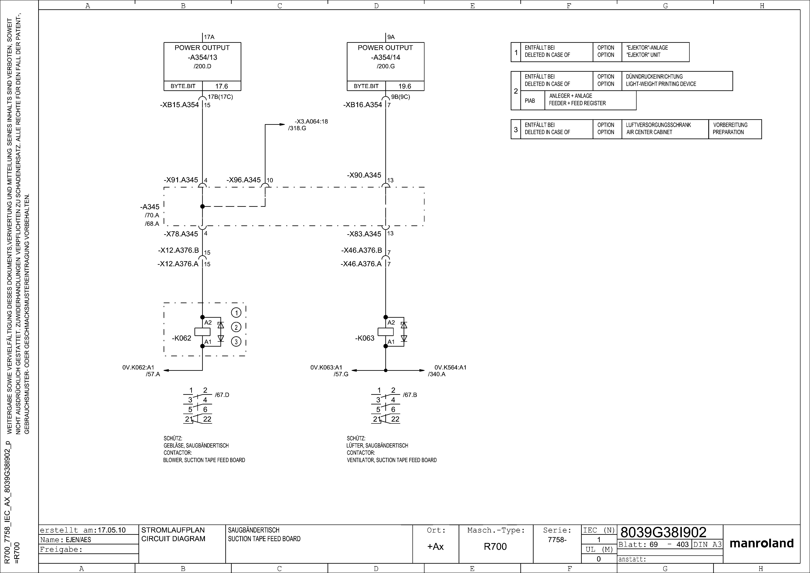

# +Ax — Sheet 69 of 403 — SAUGBÄNDERTISCH

**SUCTION TAPE FEED BOARD**

> Part of the manroland **R700** printing press IEC/UL circuit diagrams.
> Drawing class: **Stromlaufplan / Circuit diagram** (DIN A3).
> Document `+Ax` covers the **Central control console** machine section.

## At a glance

| Field | Value |
|---|---|
| Document | `+Ax`  (8039G38I902) |
| Sheet | **69** of 403 |
| Section (DE) | SAUGBÄNDERTISCH |
| Section (EN) | SUCTION TAPE FEED BOARD |
| Section type | CIRCUIT — Circuit diagram |
| Machine type | `R700` |
| Series | `7758` |
| Created | 17.05.10 |
| Replaces | — |
| Columns used | B, C, D, E, F, G, H |
| Path numbers | — |
| Labels on sheet | 108 |
| Cross-refs out | 10 |
| Cross-refs in | 21 |

**Previous:** [+Ax sheet 68](SHEET_0068.md) · **Next:** [+Ax sheet 70](SHEET_0070.md) · **Document TOC:** [_TOC.md](_TOC.md)  (+Ax) · **Master TOC:** [all sheets](../_MASTER_TOC.md)

## Sheet image (300 DPI, exact vector render)



_Rendered directly from the PDF vector layer at 300 DPI (1-bit), no OCR and no resampling. Use it to confirm anything ambiguous in the text below._

## Cross-references on this sheet

Each entry is a wire leaving this sheet. The printed token is `/sheet.column`; the link resolves to that sheet inside the same document.

| Ref | Target sheet | Col | Path | Destination on target | Target section | From col |
|---|---|---|---|---|---|---|
| `/200.G` | [+Ax sheet 200](SHEET_0200.md) | G | — | — | REFERENZMODUL | D |
| `/200.D` | [+Ax sheet 200](SHEET_0200.md) | D | — | — | REFERENZMODUL | B |
| `/318.G` | [+Ax sheet 318](SHEET_0318.md) | G | — | — | OPTION: "EJEKTOR" ANLAGE / SELECT AIRSTATION / | C |
| `/70.A` | [+Ax sheet 70](SHEET_0070.md) | A | — | — | WASCHVORRICHTUNGEN DRUCKWERKE | B |
| `/68.A` | [+Ax sheet 68](SHEET_0068.md) | A | — | — | SAUGBÄNDERTISCH | B |
| `/57.A` | [+Ax sheet 57](SHEET_0057.md) | A | — | 0V.K062:A1 0V.K063:A1 0V.K564:A1 | LUFTVERSORGUNG | C |
| `/57.G` | [+Ax sheet 57](SHEET_0057.md) | G | — | 0V.K062:A1 0V.K063:A1 0V.K564:A1 | LUFTVERSORGUNG | C |
| `/340.A` | [+Ax sheet 340](SHEET_0340.md) | A | — | — | OPTION: INLINESHEETER RS104 S | E |
| `/67.B` | [+Ax sheet 67](SHEET_0067.md) | B | — | — | SAUGBÄNDERTISCH | D |
| `/67.D` | [+Ax sheet 67](SHEET_0067.md) | D | — | — | SAUGBÄNDERTISCH | B |

### Incoming references (sheets that point here)

Every other sheet that sends a wire to this one. `Back-ref` is the token printed on *that* sheet; `Path` is its line number.

| From sheet | Cols | Back-ref | Path | Refs | What continues there |
|---|---|---|---|---|---|
| [+Ax#57](SHEET_0057.md) | A, G | `/57.A`, `/57.G` | — | 2 | 0V.K062:A1 |
| [+Ax#67](SHEET_0067.md) | B, D | `/67.B`, `/67.D` | — | 2 | — |
| [+Ax#68](SHEET_0068.md) | A | `/68.A` | — | 1 | — |
| [+Ax#70](SHEET_0070.md) | A | `/70.A` | — | 1 | — |
| [+Ax#200](SHEET_0200.md) | D, F | `/200.D`, `/200.F` | — | 2 | — |
| [+Ax#248](SHEET_0248.md) | G, H | `/248.G`, `/248.H` | — | 2 | — |
| [+Ax#253](SHEET_0253.md) | B | `/253.B` | — | 1 | — |
| [+Ax#254](SHEET_0254.md) | F | `/254.F` | — | 1 | — |
| [+Ax#283](SHEET_0283.md) | A, B | `/283.A`, `/283.B` | — | 2 | — |
| [+Ax#286](SHEET_0286.md) | A | `/286.A` | — | 1 | — |
| [+Ax#287](SHEET_0287.md) | A | `/287.A` | — | 1 | — |
| [+Ax#289](SHEET_0289.md) | C, E | `/289.C`, `/289.E` | — | 2 | — |
| [+Ax#290](SHEET_0290.md) | B | `/290.B` | — | 1 | — |
| [+Ax#318](SHEET_0318.md) | G | `/318.G` | — | 1 | X3.A064:18 |
| [+Ax#340](SHEET_0340.md) | A | `/340.A` | — | 1 | 0V.K564:A1 |


## Devices on this sheet

| Tag | Class | Class meaning (IEC) | Col | Sub | Terminal | Sign |
|---|---|---|---|---|---|---|
| `A354/14` | A | Baugruppe / assembly, module, PC board | D | 14 | — | — |
| `A354/13` | A | Baugruppe / assembly, module, PC board | B | 13 | — | — |
| `A1` | A | Baugruppe / assembly, module, PC board | D | — | — | — |
| `A2` | A | Baugruppe / assembly, module, PC board | D | — | — | — |
| `K063` | K | Relais / relay, contactor | D | — | — | — |
| `A1` | A | Baugruppe / assembly, module, PC board | B | — | — | — |
| `A2` | A | Baugruppe / assembly, module, PC board | B | — | — | — |
| `K062` | K | Relais / relay, contactor | B | — | — | — |
| `A345` | A | Baugruppe / assembly, module, PC board | B | — | — | — |
| `19.6` | — | cross-device reference | D | — | — | — |
| `XB16.A354` | — | cross-device reference | D | — | — | — |
| `17.6` | — | cross-device reference | B | — | — | — |
| `XB15.A354` | — | cross-device reference | B | — | — | — |
| `X46.A376.B` | — | cross-device reference | D | — | — | — |
| `X46.A376.A` | — | cross-device reference | D | — | — | — |
| `X12.A376.B` | — | cross-device reference | B | — | — | — |
| `X12.A376.A` | — | cross-device reference | B | — | — | — |
| `X78.A345` | — | cross-device reference | B | — | — | — |
| `X83.A345` | — | cross-device reference | D | — | — | — |
| `X91.A345` | — | cross-device reference | B | — | — | — |
| `X90.A345` | — | cross-device reference | D | — | — | — |
| `X96.A345` | — | cross-device reference | C | — | — | — |
| `X3.A064:18` | — | cross-device reference | C | — | 18 | — |

## Potentials / nets

| Potential | Count | Columns | Attached devices | Terminals |
|---|---|---|---|---|
| `0V` | 3 | B, C, E | `K062`, `K063`, `K564` | `A1` |


A potential such as `L24+/4` or `M24+` is a named supply/return rail; every place it appears on this sheet is electrically common.

## Wire-end annotations (grouped as printed)

A wire that continues elsewhere is annotated with a small cluster: the destination description, the path/line number `#NN`, and the `/sheet.column` cross reference. Each row below is one such cluster exactly as it is grouped on the drawing.

| Col | Y | Path | Cross-ref | Text on the wire |
|---|---|---|---|---|
| B | 50.6 | — | — | `17A` |
| D | 50.6 | — | — | `9A` |
| B | 65.8 | — | — | `POWER OUTPUT` |
| D | 65.8 | — | — | `POWER OUTPUT` |
| F | 67.2 | — | — | `1 OPTION OPTION "EJEKTOR" ANLAGE "EJEKTOR" UNIT` |
| F | 67.2 | — | — | `ENTFÄLLT BEI DELETED IN CASE OF` |
| B | 79.7 | — | — | `A354/13` |
| D | 79.7 | — | — | `A354/14` |
| B | 93.5 | — | `/200.D` | — |
| D | 93.5 | — | `/200.G` | — |
| F | 109.7 | — | — | `ENTFÄLLT BEI DELETED IN CASE OF` |
| F | 109.7 | — | — | `OPTION OPTION` |
| G | 109.8 | — | — | `DÜNNDRUCKEINRICHTUNG LIGHT WEIGHT PRINTING DEVICE` |
| B | 122.5 | — | — | `BYTE.BIT 17.6` |
| D | 122.5 | — | — | `BYTE.BIT 19.6` |
| E | 129.2 | — | — | `2` |
| F | 138.1 | — | — | `FEEDER + FEED REGISTER ANLEGER + ANLAGE` |
| B | 138.5 | — | — | `17B(17C)` |
| D | 138.5 | — | — | `9B(9C)` |
| F | 145.1 | — | — | `PIAB` |
| B | 149.1 | — | — | `XB15.A354 15` |
| D | 149.1 | — | — | `XB16.A354 7` |
| C | 174.6 | — | — | `X3.A064:18` |
| F | 180.6 | — | — | `ENTFÄLLT BEI DELETED IN CASE OF` |
| F | 180.6 | — | — | `OPTION OPTION` |
| G | 180.6 | — | — | `LUFTVERSORGUNGSSCHRANK PREPARATION VORBEREITUNG` |
| C | 184.5 | — | `/318.G` | — |
| F | 185.9 | — | — | `3 AIR CENTER CABINET` |
| C | 252.6 | — | — | `X91.A345 4 X96.A345 10 X90.A345 13` |
| B | 299.4 | — | — | `A345` |
| B | 312.4 | — | `/70.A`, `/68.A` | — |
| C | 339.0 | — | — | `X78.A345 4 X83.A345 13` |
| B | 363.1 | — | — | `X12.A376.B 15` |
| D | 363.1 | — | — | `X46.A376.B 7` |
| B | 383.0 | — | — | `X12.A376.A 15` |
| D | 383.0 | — | — | `X46.A376.A 7` |
| C | 456.1 | — | — | `1` |
| B | 470.1 | — | — | `A2` |
| D | 470.1 | — | — | `A2` |
| C | 477.9 | — | — | `2` |
| B | 492.1 | — | — | `K062` |
| D | 492.1 | — | — | `K063` |
| B | 498.5 | — | — | `A1` |
| D | 498.5 | — | — | `A1` |
| C | 499.2 | — | — | `3` |
| C | 536.0 | — | `/57.A`, `/57.G` | `0V.K062:A1 0V.K063:A1 0V.K564:A1` |
| E | 545.9 | — | `/340.A` | — |
| B | 568.6 | — | — | `21 3 5 1` |
| B | 568.6 | — | — | `2 4 6 22` |
| D | 568.6 | — | — | `21 3 5 1` |
| D | 568.6 | — | — | `2 4 6 22` |
| B | 576.4 | — | `/67.D` | — |
| D | 576.4 | — | `/67.B` | — |
| B | 641.2 | — | — | `BLOWER, SUCTION TAPE FEED BOARD SCHÜTZ: GEBLÄSE, SAUGBÄNDERTISCH CONTACTOR:` |
| D | 641.2 | — | — | `LÜFTER, SAUGBÄNDERTISCH SCHÜTZ:` |
| D | 662.5 | — | — | `CONTACTOR: VENTILATOR, SUCTION TAPE FEED BOARD` |


## Reconstructed tables

This sheet carries tabular content (pin map / terminal assignment / index). The grid below was rebuilt from the drawing's own rule lines, so each row is exactly one physical row of the table.

### Table 1 — 4 data rows × 1 columns (at x=240.9, y=62.4)

| C1 |
|---|
| `POWER` |
| `BYTE.BIT` |
| `XB15.A354 X91.A345` |
| `X78.A345 X12.A376.B X12.A376.A K062` |


### Table 2 — 1 data rows × 3 columns (at x=297.6, y=62.4) — **OUTPUT A354/13 /200.D 17.6**

| 17B(17C) 15 4 |  | X96.A345 |
|---|---|---|
| `4 15 15 A2 A1` | `1 2 3` |  |


### Table 3 — 2 data rows × 3 columns (at x=510.2, y=62.4)

| POWER | OUTPUT A354/14 /200.G |  |
|---|---|---|
| `BYTE.BIT` |  | `19.6` |
| `XB16.A354 X90.A345 X83.A345 X46.A376.B X46.A376.A K063` | `9B(9C) 7 13 13 7 7 A2 A1` |  |


## Notes and free text on this sheet

| Text | Col | Y (pt) |
|---|---|---|
| `9A` | D | 50.58 |
| `9B(9C)` | D | 138.51 |
| `POWER OUTPUT` | D | 65.76 |
| `BYTE.BIT` | D | 123.08 |
| `17A` | B | 50.6 |
| `17B(17C)` | B | 138.51 |
| `POWER OUTPUT` | B | 65.76 |
| `BYTE.BIT` | B | 123.08 |
| `SCHÜTZ:` | D | 641.24 |
| `LÜFTER, SAUGBÄNDERTISCH` | D | 651.89 |
| `CONTACTOR:` | D | 662.53 |
| `VENTILATOR, SUCTION TAPE FEED BOARD` | D | 673.15 |
| `SCHÜTZ:` | B | 641.24 |
| `GEBLÄSE, SAUGBÄNDERTISCH` | B | 651.88 |
| `CONTACTOR:` | B | 662.53 |
| `BLOWER, SUCTION TAPE FEED BOARD` | B | 673.14 |
| `ENTFÄLLT BEI` | F | 67.2 |
| `DELETED IN CASE OF` | F | 77.86 |
| `"EJEKTOR" ANLAGE` | G | 67.23 |
| `"EJEKTOR" UNIT` | G | 77.87 |
| `OPTION` | F | 67.21 |
| `DÜNNDRUCKEINRICHTUNG` | G | 109.79 |
| `LIGHT WEIGHT PRINTING DEVICE` | G | 120.38 |
| `PIAB` | F | 145.09 |
| `ANLEGER + ANLAGE` | F | 138.11 |
| `FEEDER + FEED REGISTER` | F | 148.73 |
| `VORBEREITUNG` | H | 180.63 |
| `PREPARATION` | H | 191.23 |
| `LUFTVERSORGUNGSSCHRANK` | G | 180.64 |
| `AIR CENTER CABINET` | G | 191.26 |

## Complete label inventory (exact text from the drawing)

Every text object inside the drawing area of this sheet, in DIN reading order (column A→H, then top→bottom). This is the authoritative list: if a string is not here it is not printed on this sheet.

| Col | Y | X | Dir | Type | Text |
|---|---|---|---|---|---|
| B | 50.6 | 299.6 | → | text | `17A` |
| B | 65.8 | 256.8 | → | text | `POWER OUTPUT` |
| B | 79.7 | 276.2 | → | device tag | `A354/13` |
| B | 93.5 | 284.9 | → | cross-reference | `/200.D` |
| B | 122.5 | 316.2 | → | device ref | `17.6` |
| B | 123.1 | 250.9 | → | text | `BYTE.BIT` |
| B | 138.5 | 305.3 | → | text | `17B(17C)` |
| B | 149.1 | 235.3 | → | device ref | `XB15.A354` |
| B | 150.6 | 299.6 | → | number | `15` |
| B | 259.7 | 240.9 | → | device ref | `X91.A345` |
| B | 261.1 | 300.2 | → | number | `4` |
| B | 299.4 | 206.1 | → | device tag | `A345` |
| B | 312.4 | 213.2 | → | cross-reference | `/70.A` |
| B | 324.8 | 213.2 | → | cross-reference | `/68.A` |
| B | 339.0 | 240.9 | → | device ref | `X78.A345` |
| B | 339.1 | 300.2 | → | number | `4` |
| B | 363.1 | 232.4 | → | device ref | `X12.A376.B` |
| B | 367.4 | 299.6 | → | number | `15` |
| B | 383.0 | 231.6 | → | device ref | `X12.A376.A` |
| B | 384.4 | 299.6 | → | number | `15` |
| B | 470.1 | 300.5 | → | device tag | `A2` |
| B | 492.1 | 252.9 | → | device tag | `K062` |
| B | 498.5 | 300.5 | → | device tag | `A1` |
| B | 536.0 | 180.0 | → | potential | `0V.K062:A1` |
| B | 545.9 | 214.6 | → | cross-reference | `/57.A` |
| B | 568.6 | 278.1 | → | number | `1` |
| B | 568.6 | 298.8 | → | number | `2` |
| B | 576.4 | 316.1 | → | cross-reference | `/67.D` |
| B | 582.8 | 276.7 | → | number | `3` |
| B | 582.8 | 298.8 | → | number | `4` |
| B | 597.0 | 276.7 | → | number | `5` |
| B | 597.0 | 298.8 | → | number | `6` |
| B | 611.1 | 272.1 | → | number | `21` |
| B | 611.1 | 298.8 | → | number | `22` |
| B | 641.2 | 240.7 | → | text | `SCHÜTZ:` |
| B | 651.9 | 240.7 | → | text | `GEBLÄSE, SAUGBÄNDERTISCH` |
| B | 662.5 | 240.7 | → | text | `CONTACTOR:` |
| B | 673.1 | 240.1 | → | text | `BLOWER, SUCTION TAPE FEED BOARD` |
| C | 174.6 | 433.4 | → | device ref | `X3.A064:18` |
| C | 184.5 | 423.8 | → | cross-reference | `/318.G` |
| C | 259.7 | 333.1 | → | device ref | `X96.A345` |
| C | 261.1 | 391.7 | → | number | `10` |
| C | 456.2 | 345.5 | → | number | `1` |
| C | 477.9 | 345.2 | → | number | `2` |
| C | 499.2 | 345.2 | → | number | `3` |
| C | 536.0 | 456.4 | → | potential | `0V.K063:A1` |
| D | 50.6 | 569.5 | → | text | `9A` |
| D | 65.8 | 526.1 | → | text | `POWER OUTPUT` |
| D | 79.7 | 545.5 | → | device tag | `A354/14` |
| D | 93.5 | 554.0 | → | cross-reference | `/200.G` |
| D | 122.5 | 585.5 | → | device ref | `19.6` |
| D | 123.1 | 520.2 | → | text | `BYTE.BIT` |
| D | 138.5 | 575.1 | → | text | `9B(9C)` |
| D | 149.1 | 504.6 | → | device ref | `XB16.A354` |
| D | 150.6 | 569.5 | → | number | `7` |
| D | 252.6 | 510.2 | → | device ref | `X90.A345` |
| D | 261.1 | 568.9 | → | number | `13` |
| D | 339.0 | 510.2 | → | device ref | `X83.A345` |
| D | 339.1 | 568.9 | → | number | `13` |
| D | 363.1 | 501.7 | → | device ref | `X46.A376.B` |
| D | 367.4 | 569.5 | → | number | `7` |
| D | 383.0 | 500.9 | → | device ref | `X46.A376.A` |
| D | 384.4 | 569.5 | → | number | `7` |
| D | 470.1 | 569.8 | → | device tag | `A2` |
| D | 492.1 | 522.1 | → | device tag | `K063` |
| D | 498.5 | 569.8 | → | device tag | `A1` |
| D | 545.9 | 490.7 | → | cross-reference | `/57.G` |
| D | 568.6 | 554.5 | → | number | `1` |
| D | 568.6 | 575.1 | → | number | `2` |
| D | 576.4 | 592.4 | → | cross-reference | `/67.B` |
| D | 582.8 | 553.0 | → | number | `3` |
| D | 582.8 | 575.1 | → | number | `4` |
| D | 597.0 | 553.0 | → | number | `5` |
| D | 597.0 | 575.1 | → | number | `6` |
| D | 611.1 | 548.5 | → | number | `21` |
| D | 611.1 | 575.1 | → | number | `22` |
| D | 641.2 | 510.0 | → | text | `SCHÜTZ:` |
| D | 651.9 | 509.4 | → | text | `LÜFTER, SAUGBÄNDERTISCH` |
| D | 662.5 | 510.0 | → | text | `CONTACTOR:` |
| D | 673.2 | 510.2 | → | text | `VENTILATOR, SUCTION TAPE FEED BOARD` |
| E | 72.6 | 755.7 | → | number | `1` |
| E | 129.2 | 755.4 | → | number | `2` |
| E | 185.9 | 755.3 | → | number | `3` |
| E | 536.0 | 638.9 | → | potential | `0V.K564:A1` |
| E | 545.9 | 629.3 | → | cross-reference | `/340.A` |
| F | 67.2 | 771.6 | → | text | `ENTFÄLLT BEI` |
| F | 67.2 | 878.5 | → | text | `OPTION` |
| F | 77.8 | 878.5 | → | text | `OPTION` |
| F | 77.9 | 771.6 | → | text | `DELETED IN CASE OF` |
| F | 109.7 | 771.6 | → | text | `ENTFÄLLT BEI` |
| F | 109.7 | 878.5 | → | text | `OPTION` |
| F | 120.4 | 771.6 | → | text | `DELETED IN CASE OF` |
| F | 120.4 | 878.5 | → | text | `OPTION` |
| F | 138.1 | 807.9 | → | text | `ANLEGER + ANLAGE` |
| F | 145.1 | 771.6 | → | text | `PIAB` |
| F | 148.7 | 807.0 | → | text | `FEEDER + FEED REGISTER` |
| F | 180.6 | 771.6 | → | text | `ENTFÄLLT BEI` |
| F | 180.6 | 878.5 | → | text | `OPTION` |
| F | 191.2 | 771.6 | → | text | `DELETED IN CASE OF` |
| F | 191.2 | 878.5 | → | text | `OPTION` |
| G | 67.2 | 921.0 | → | text | `"EJEKTOR" ANLAGE` |
| G | 77.9 | 921.0 | → | text | `"EJEKTOR" UNIT` |
| G | 109.8 | 920.4 | → | text | `DÜNNDRUCKEINRICHTUNG` |
| G | 120.4 | 920.4 | → | text | `LIGHT WEIGHT PRINTING DEVICE` |
| G | 180.6 | 920.4 | → | text | `LUFTVERSORGUNGSSCHRANK` |
| G | 191.3 | 921.3 | → | text | `AIR CENTER CABINET` |
| H | 180.6 | 1048.8 | → | text | `VORBEREITUNG` |
| H | 191.2 | 1048.0 | → | text | `PREPARATION` |

## Reading-order text block

The same content as a plain block, grouped by DIN column — convenient to paste or to match against a visual description.

```text
=== Column B ===
  50.6  299.6  text         17A
  65.8  256.8  text         POWER OUTPUT
  79.7  276.2  devtag       A354/13
  93.5  284.9  xref         /200.D
 122.5  316.2  devref       17.6
 123.1  250.9  text         BYTE.BIT
 138.5  305.3  text         17B(17C)
 149.1  235.3  devref       XB15.A354
 150.6  299.6  numeric      15
 259.7  240.9  devref       X91.A345
 261.1  300.2  numeric      4
 299.4  206.1  devtag       A345
 312.4  213.2  xref         /70.A
 324.8  213.2  xref         /68.A
 339.0  240.9  devref       X78.A345
 339.1  300.2  numeric      4
 363.1  232.4  devref       X12.A376.B
 367.4  299.6  numeric      15
 383.0  231.6  devref       X12.A376.A
 384.4  299.6  numeric      15
 470.1  300.5  devtag       A2
 492.1  252.9  devtag       K062
 498.5  300.5  devtag       A1
 536.0  180.0  net          0V.K062:A1
 545.9  214.6  xref         /57.A
 568.6  278.1  numeric      1
 568.6  298.8  numeric      2
 576.4  316.1  xref         /67.D
 582.8  276.7  numeric      3
 582.8  298.8  numeric      4
 597.0  276.7  numeric      5
 597.0  298.8  numeric      6
 611.1  272.1  numeric      21
 611.1  298.8  numeric      22
 641.2  240.7  text         SCHÜTZ:
 651.9  240.7  text         GEBLÄSE, SAUGBÄNDERTISCH
 662.5  240.7  text         CONTACTOR:
 673.1  240.1  text         BLOWER, SUCTION TAPE FEED BOARD
=== Column C ===
 174.6  433.4  devref       X3.A064:18
 184.5  423.8  xref         /318.G
 259.7  333.1  devref       X96.A345
 261.1  391.7  numeric      10
 456.2  345.5  numeric      1
 477.9  345.2  numeric      2
 499.2  345.2  numeric      3
 536.0  456.4  net          0V.K063:A1
=== Column D ===
  50.6  569.5  text         9A
  65.8  526.1  text         POWER OUTPUT
  79.7  545.5  devtag       A354/14
  93.5  554.0  xref         /200.G
 122.5  585.5  devref       19.6
 123.1  520.2  text         BYTE.BIT
 138.5  575.1  text         9B(9C)
 149.1  504.6  devref       XB16.A354
 150.6  569.5  numeric      7
 252.6  510.2  devref       X90.A345
 261.1  568.9  numeric      13
 339.0  510.2  devref       X83.A345
 339.1  568.9  numeric      13
 363.1  501.7  devref       X46.A376.B
 367.4  569.5  numeric      7
 383.0  500.9  devref       X46.A376.A
 384.4  569.5  numeric      7
 470.1  569.8  devtag       A2
 492.1  522.1  devtag       K063
 498.5  569.8  devtag       A1
 545.9  490.7  xref         /57.G
 568.6  554.5  numeric      1
 568.6  575.1  numeric      2
 576.4  592.4  xref         /67.B
 582.8  553.0  numeric      3
 582.8  575.1  numeric      4
 597.0  553.0  numeric      5
 597.0  575.1  numeric      6
 611.1  548.5  numeric      21
 611.1  575.1  numeric      22
 641.2  510.0  text         SCHÜTZ:
 651.9  509.4  text         LÜFTER, SAUGBÄNDERTISCH
 662.5  510.0  text         CONTACTOR:
 673.2  510.2  text         VENTILATOR, SUCTION TAPE FEED BOARD
=== Column E ===
  72.6  755.7  numeric      1
 129.2  755.4  numeric      2
 185.9  755.3  numeric      3
 536.0  638.9  net          0V.K564:A1
 545.9  629.3  xref         /340.A
=== Column F ===
  67.2  771.6  text         ENTFÄLLT BEI
  67.2  878.5  text         OPTION
  77.8  878.5  text         OPTION
  77.9  771.6  text         DELETED IN CASE OF
 109.7  771.6  text         ENTFÄLLT BEI
 109.7  878.5  text         OPTION
 120.4  771.6  text         DELETED IN CASE OF
 120.4  878.5  text         OPTION
 138.1  807.9  text         ANLEGER + ANLAGE
 145.1  771.6  text         PIAB
 148.7  807.0  text         FEEDER + FEED REGISTER
 180.6  771.6  text         ENTFÄLLT BEI
 180.6  878.5  text         OPTION
 191.2  771.6  text         DELETED IN CASE OF
 191.2  878.5  text         OPTION
=== Column G ===
  67.2  921.0  text         "EJEKTOR" ANLAGE
  77.9  921.0  text         "EJEKTOR" UNIT
 109.8  920.4  text         DÜNNDRUCKEINRICHTUNG
 120.4  920.4  text         LIGHT WEIGHT PRINTING DEVICE
 180.6  920.4  text         LUFTVERSORGUNGSSCHRANK
 191.3  921.3  text         AIR CENTER CABINET
=== Column H ===
 180.6 1048.8  text         VORBEREITUNG
 191.2 1048.0  text         PREPARATION
```

---
_Generated from the PDF vector text layer; no OCR. Source: `R700_7758_IEC_AX_8039G38I902_p`, sheet 69._
