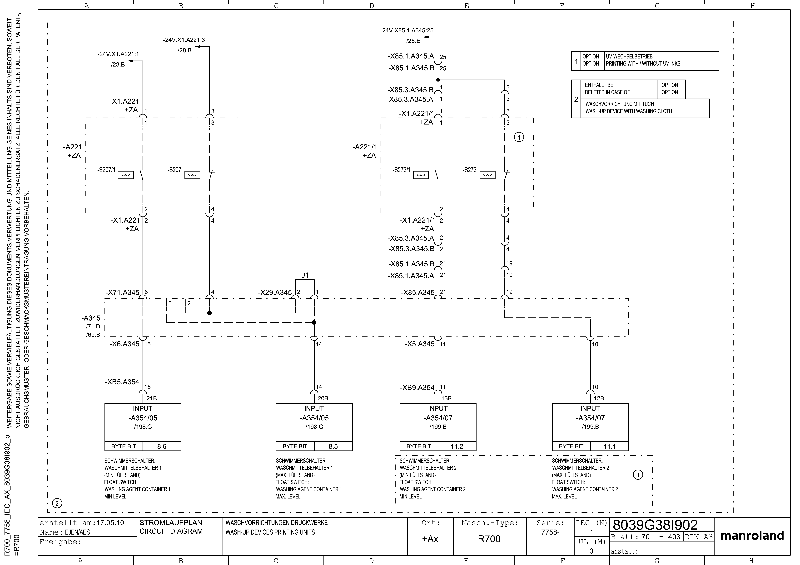

# +Ax — Sheet 70 of 403 — WASCHVORRICHTUNGEN DRUCKWERKE

**WASH UP DEVICES PRINTING UNITS**

> Part of the manroland **R700** printing press IEC/UL circuit diagrams.
> Drawing class: **Stromlaufplan / Circuit diagram** (DIN A3).
> Document `+Ax` covers the **Central control console** machine section.

## At a glance

| Field | Value |
|---|---|
| Document | `+Ax`  (8039G38I902) |
| Sheet | **70** of 403 |
| Section (DE) | WASCHVORRICHTUNGEN DRUCKWERKE |
| Section (EN) | WASH UP DEVICES PRINTING UNITS |
| Section type | CIRCUIT — Circuit diagram |
| Machine type | `R700` |
| Series | `7758` |
| Created | 17.05.10 |
| Replaces | — |
| Columns used | A, B, C, D, E, F, G |
| Path numbers | — |
| Labels on sheet | 150 |
| Cross-refs out | 9 |
| Cross-refs in | 47 |

**Previous:** [+Ax sheet 69](SHEET_0069.md) · **Next:** [+Ax sheet 71](SHEET_0071.md) · **Document TOC:** [_TOC.md](_TOC.md)  (+Ax) · **Master TOC:** [all sheets](../_MASTER_TOC.md)

## Sheet image (300 DPI, exact vector render)



_Rendered directly from the PDF vector layer at 300 DPI (1-bit), no OCR and no resampling. Use it to confirm anything ambiguous in the text below._

## Cross-references on this sheet

Each entry is a wire leaving this sheet. The printed token is `/sheet.column`; the link resolves to that sheet inside the same document.

| Ref | Target sheet | Col | Path | Destination on target | Target section | From col |
|---|---|---|---|---|---|---|
| `/28.E` | [+Ax sheet 28](SHEET_0028.md) | E | — | — | SPANNUNGSVERSORGUNG, SCHALTSCHRANKBELÜFTUNG | D |
| `/28.B` | [+Ax sheet 28](SHEET_0028.md) | B | — | — | SPANNUNGSVERSORGUNG, SCHALTSCHRANKBELÜFTUNG | B |
| `/28.B` | [+Ax sheet 28](SHEET_0028.md) | B | — | — | SPANNUNGSVERSORGUNG, SCHALTSCHRANKBELÜFTUNG | A |
| `/71.D` | [+Ax sheet 71](SHEET_0071.md) | D | — | — | WASCHVORRICHTUNGEN DRUCKWERKE | A |
| `/69.B` | [+Ax sheet 69](SHEET_0069.md) | B | — | — | SAUGBÄNDERTISCH | A |
| `/199.B` | [+Ax sheet 199](SHEET_0199.md) | B | — | — | REFERENZMODUL | E |
| `/199.B` | [+Ax sheet 199](SHEET_0199.md) | B | — | — | REFERENZMODUL | F |
| `/198.G` | [+Ax sheet 198](SHEET_0198.md) | G | — | — | REFERENZMODUL | B |
| `/198.G` | [+Ax sheet 198](SHEET_0198.md) | G | — | — | REFERENZMODUL | C |

### Incoming references (sheets that point here)

Every other sheet that sends a wire to this one. `Back-ref` is the token printed on *that* sheet; `Path` is its line number.

| From sheet | Cols | Back-ref | Path | Refs | What continues there |
|---|---|---|---|---|---|
| [+Ax#28](SHEET_0028.md) | B, E | `/28.B`, `/28.E` | — | 3 | 24V.X1.A221:1; 24V.X1.A221:3 |
| [+Ax#69](SHEET_0069.md) | B | `/69.B` | — | 1 | — |
| [+Ax#71](SHEET_0071.md) | D | `/71.D` | — | 1 | — |
| [+Ax#198](SHEET_0198.md) | G | `/198.G` | — | 2 | — |
| [+Ax#199](SHEET_0199.md) | B | `/199.B` | — | 2 | — |
| [+Ax#206](SHEET_0206.md) | F | `/206.F` | — | 8 | — |
| [+Ax#231](SHEET_0231.md) | A, E | `/231.A`, `/231.E` | — | 4 | — |
| [+Ax#233](SHEET_0233.md) | G | `/233.G` | — | 2 | — |
| [+Ax#242](SHEET_0242.md) | A | `/242.A` | — | 2 | — |
| [+Ax#273](SHEET_0273.md) | F | `/273.F` | — | 2 | — |
| [+Ax#285](SHEET_0285.md) | B | `/285.B` | — | 4 | — |
| [+Ax#287](SHEET_0287.md) | C, E, F, G | `/287.C`, `/287.E`, `/287.F`, `/287.G` | — | 16 | — |


## Devices on this sheet

| Tag | Class | Class meaning (IEC) | Col | Sub | Terminal | Sign |
|---|---|---|---|---|---|---|
| `S207/1` | S | Schalter / switch | A | 1 | — | — |
| `S207` | S | Schalter / switch | B | — | — | — |
| `A221` | A | Baugruppe / assembly, module, PC board | A | — | — | — |
| `A354/05` | A | Baugruppe / assembly, module, PC board | B | 05 | — | — |
| `A354/07` | A | Baugruppe / assembly, module, PC board | F | 07 | — | — |
| `S273/1` | S | Schalter / switch | D | 1 | — | — |
| `S273` | S | Schalter / switch | E | — | — | — |
| `A221/1` | A | Baugruppe / assembly, module, PC board | D | 1 | — | — |
| `A354/07` | A | Baugruppe / assembly, module, PC board | E | 07 | — | — |
| `A354/05` | A | Baugruppe / assembly, module, PC board | C | 05 | — | — |
| `A345` | A | Baugruppe / assembly, module, PC board | A | — | — | — |
| `J1` | J |  | C | — | — | — |
| `X1.A221` | — | cross-device reference | A | — | — | — |
| `X1.A221` | — | cross-device reference | A | — | — | — |
| `X71.A345` | — | cross-device reference | A | — | — | — |
| `X6.A345` | — | cross-device reference | A | — | — | — |
| `8.6` | — | cross-device reference | B | — | — | — |
| `XB5.A354` | — | cross-device reference | A | — | — | — |
| `11.1` | — | cross-device reference | G | — | — | — |
| `X85.3.A345.B` | — | cross-device reference | D | — | — | — |
| `X85.3.A345.A` | — | cross-device reference | D | — | — | — |
| `X85.3.A345.A` | — | cross-device reference | D | — | — | — |
| `X85.3.A345.B` | — | cross-device reference | D | — | — | — |
| `X85.1.A345.A` | — | cross-device reference | D | — | — | — |
| `X85.1.A345.B` | — | cross-device reference | D | — | — | — |
| `X85.1.A345.B` | — | cross-device reference | D | — | — | — |
| `X85.1.A345.A` | — | cross-device reference | D | — | — | — |
| `X5.A345` | — | cross-device reference | E | — | — | — |
| `X85.A345` | — | cross-device reference | D | — | — | — |
| `11.2` | — | cross-device reference | E | — | — | — |
| `XB9.A354` | — | cross-device reference | D | — | — | — |
| `8.5` | — | cross-device reference | D | — | — | — |
| `X29.A345` | — | cross-device reference | C | — | — | — |

## Potentials / nets

| Potential | Count | Columns | Attached devices | Terminals |
|---|---|---|---|---|
| `24V` | 3 | A, B, D | `1`, `A221`, `A345`, `X1`, `X85` | `1`, `25`, `3` |


A potential such as `L24+/4` or `M24+` is a named supply/return rail; every place it appears on this sheet is electrically common.

## Wire-end annotations (grouped as printed)

A wire that continues elsewhere is annotated with a small cluster: the destination description, the path/line number `#NN`, and the `/sheet.column` cross reference. Each row below is one such cluster exactly as it is grouped on the drawing.

| Col | Y | Path | Cross-ref | Text on the wire |
|---|---|---|---|---|
| D | 41.4 | — | — | `24V.X85.1.A345:25` |
| B | 55.5 | — | — | `24V.X1.A221:3` |
| D | 56.9 | — | `/28.E` | — |
| B | 71.1 | — | `/28.B` | — |
| A | 76.8 | — | — | `24V.X1.A221:1` |
| D | 79.0 | — | — | `X85.1.A345.A 25` |
| G | 81.4 | — | — | `1 OPTION OPTION UV WECHSELBETRIEB PRINTING WITH / WITHOUT UV INKS` |
| A | 92.4 | — | `/28.B` | — |
| D | 96.7 | — | — | `X85.1.A345.B 25` |
| F | 123.9 | — | — | `ENTFÄLLT BEI DELETED IN CASE OF` |
| G | 123.9 | — | — | `OPTION OPTION` |
| D | 126.5 | — | — | `X85.3.A345.B 1` |
| E | 126.5 | — | — | `3` |
| F | 143.4 | — | — | `2` |
| D | 143.5 | — | — | `X85.3.A345.A 1` |
| E | 143.5 | — | — | `3` |
| A | 146.3 | — | — | `X1.A221 1` |
| G | 152.3 | — | — | `WASCHVORRICHTUNG MIT TUCH WASH UP DEVICE WITH WASHING CLOTH` |
| A | 159.0 | — | — | `+ZA` |
| B | 161.9 | — | — | `3` |
| E | 161.9 | — | — | `X1.A221/1 1 3` |
| E | 177.4 | — | — | `+ZA` |
| B | 178.9 | — | — | `1` |
| B | 178.9 | — | — | `3` |
| E | 178.9 | — | — | `1` |
| E | 178.9 | — | — | `3` |
| F | 201.0 | — | — | `1` |
| A | 214.3 | — | — | `A221` |
| D | 214.3 | — | — | `A221/1` |
| A | 227.0 | — | — | `+ZA` |
| D | 227.0 | — | — | `+ZA` |
| B | 249.6 | — | — | `S207/1 S207` |
| E | 249.6 | — | — | `S273/1 S273` |
| B | 307.9 | — | — | `2` |
| B | 307.9 | — | — | `4` |
| E | 307.9 | — | — | `2` |
| E | 307.9 | — | — | `4` |
| A | 323.5 | — | — | `X1.A221 2` |
| E | 323.5 | — | — | `X1.A221/1 2` |
| B | 324.9 | — | — | `4` |
| E | 324.9 | — | — | `4` |
| A | 336.1 | — | — | `+ZA` |
| E | 336.1 | — | — | `+ZA` |
| D | 350.4 | — | — | `X85.3.A345.A 2` |
| E | 350.4 | — | — | `4` |
| D | 366.0 | — | — | `X85.3.A345.B 2` |
| E | 367.4 | — | — | `4` |
| D | 388.7 | — | — | `X85.1.A345.B 21` |
| E | 388.7 | — | — | `19` |
| C | 405.6 | — | — | `J1` |
| D | 405.7 | — | — | `X85.1.A345.A 21` |
| E | 405.7 | — | — | `19` |
| A | 431.2 | — | — | `X71.A345 6` |
| B | 431.2 | — | — | `4` |
| C | 431.2 | — | — | `X29.A345 2 1` |
| E | 431.2 | — | — | `X85.A345 21 19` |
| B | 448.2 | — | — | `5 2` |
| A | 469.4 | — | — | `A345` |
| A | 482.5 | — | `/71.D`, `/69.B` | — |
| A | 507.7 | — | — | `X6.A345 15` |
| E | 507.7 | — | — | `X5.A345 11` |
| C | 509.1 | — | — | `14` |
| F | 509.1 | — | — | `10` |
| A | 564.4 | — | — | `XB5.A354 15` |
| C | 572.9 | — | — | `14` |
| E | 572.9 | — | — | `XB9.A354 11` |
| F | 572.9 | — | — | `10` |
| B | 589.9 | — | — | `21B` |
| C | 589.9 | — | — | `20B` |
| E | 589.9 | — | — | `13B` |
| F | 589.9 | — | — | `12B` |
| B | 604.4 | — | — | `INPUT` |
| C | 604.4 | — | — | `INPUT` |
| E | 604.4 | — | — | `INPUT` |
| F | 604.4 | — | — | `INPUT` |
| B | 618.3 | — | — | `A354/05` |
| C | 618.3 | — | — | `A354/05` |
| E | 618.3 | — | — | `A354/07` |
| F | 618.3 | — | — | `A354/07` |
| B | 632.0 | — | `/198.G` | — |
| C | 632.0 | — | `/198.G` | — |
| E | 632.0 | — | `/199.B` | — |
| F | 632.0 | — | `/199.B` | — |
| B | 661.1 | — | — | `BYTE.BIT 8.6` |
| C | 661.1 | — | — | `BYTE.BIT 8.5` |
| E | 661.1 | — | — | `BYTE.BIT 11.2` |
| F | 661.1 | — | — | `BYTE.BIT 11.1` |
| A | 683.8 | — | — | `FLOAT SWITCH: (MIN FÜLLSTAND) SCHWIMMERSCHALTER: WASCHMITTELBEHÄLTER 1` |
| C | 683.8 | — | — | `FLOAT SWITCH: (MAX. FÜLLSTAND) SCHWIMMERSCHALTER: WASCHMITTELBEHÄLTER 1` |
| E | 683.8 | — | — | `FLOAT SWITCH: (MIN FÜLLSTAND) SCHWIMMERSCHALTER: WASCHMITTELBEHÄLTER 2` |
| F | 683.8 | — | — | `FLOAT SWITCH: (MAX. FÜLLSTAND) SCHWIMMERSCHALTER: WASCHMITTELBEHÄLTER 2` |
| G | 704.2 | — | — | `1` |
| B | 726.3 | — | — | `MIN LEVEL WASHING AGENT CONTAINER 1` |
| C | 726.3 | — | — | `MAX. LEVEL WASHING AGENT CONTAINER 1` |
| E | 726.3 | — | — | `MIN LEVEL WASHING AGENT CONTAINER 2` |
| F | 726.3 | — | — | `MAX. LEVEL WASHING AGENT CONTAINER 2` |
| A | 747.2 | — | — | `2` |


## Reconstructed tables

This sheet carries tabular content (pin map / terminal assignment / index). The grid below was rebuilt from the drawing's own rule lines, so each row is exactly one physical row of the table.

### Table 1 — 6 data rows × 10 columns (at x=127.6, y=119.1)

|  | X1.A221 +ZA | 1 |  |  | 3 |  |  |  |  |
|---|---|---|---|---|---|---|---|---|---|
|  | `S207/1` | `1 2` | `S207` |  | `3 4` |  |  |  | `A221/1 +ZA` |
|  | `X1.A221 +ZA X71.A345` | `2 6` | `5` | `2` | `4 4` | `X29.A345` | `J1 2` | `1` |  |
| `A345` |  |  |  |  |  |  |  |  |  |
| `/71.D /69.B` | `X6.A345 XB5.A354` | `15 15 21B` |  |  |  |  |  | `14 14 20B` |  |
|  | `INPUT` | `A354/05 /198.G` |  |  |  |  | `INPUT` | `A354/05 /198.G` |  |
|  | `BYTE.BIT` | `8.6` |  |  |  |  | `BYTE.BIT` | `8.5` |  |


### Table 2 — 5 data rows × 2 columns (at x=595.3, y=119.1)

| X85.3.A345.B X85.3.A345.A X1.A221/1 | 1 1 1 |
|---|---|
| `+ZA S273/1` | `1 S273 2` |
| `X1.A221/1 +ZA X85.3.A345.A X85.3.A345.B X85.1.A345.B X85.1.A345.A X85.A345` | `2 2 2 21 21 21` |
| `X5.A345 XB9.A354` | `11 11 13B` |
| `INPUT` | `A354/07 /199.B` |
| `BYTE.BIT` | `11.2` |


### Table 3 — 3 data rows × 1 columns (at x=751.2, y=119.1)

| C1 |
|---|
| `3 3 3` |
| `3 1 4` |
| `4 4 4 19 19 19` |


### Table 4 — 3 data rows × 2 columns (at x=822.0, y=119.1)

| 2 | ENTFÄLLT BEI DELETED IN CASE OF WASCHVORRICHTUNG WASH UP DEVICE |
|---|---|
|  | `10 10 12B` |
| `INPUT` | `A354/07 /199.B` |
| `BYTE.BIT` | `11.1` |


## Notes and free text on this sheet

| Text | Col | Y (pt) |
|---|---|---|
| `+ZA` | A | 158.96 |
| `21B` | B | 589.89 |
| `INPUT` | B | 604.42 |
| `BYTE.BIT` | A | 661.67 |
| `SCHWIMMERSCHALTER:` | A | 683.77 |
| `WASCHMITTELBEHÄLTER 1` | A | 694.39 |
| `(MIN FÜLLSTAND)` | A | 705.06 |
| `FLOAT SWITCH:` | A | 715.62 |
| `WASHING AGENT CONTAINER 1` | B | 726.29 |
| `MIN LEVEL` | A | 736.93 |
| `12B` | F | 589.89 |
| `INPUT` | F | 604.42 |
| `BYTE.BIT` | F | 661.67 |
| `SCHWIMMERSCHALTER:` | F | 683.77 |
| `WASCHMITTELBEHÄLTER 2` | F | 694.4 |
| `(MAX. FÜLLSTAND)` | F | 705.05 |
| `FLOAT SWITCH:` | F | 715.62 |
| `WASHING AGENT CONTAINER 2` | F | 726.3 |
| `MAX. LEVEL` | F | 736.92 |
| `+ZA` | D | 227 |
| `X1.A221/1` | D | 164.72 |
| `+ZA` | E | 177.39 |
| `13B` | E | 589.89 |
| `INPUT` | E | 604.42 |
| `BYTE.BIT` | D | 661.67 |
| `SCHWIMMERSCHALTER:` | E | 683.77 |
| `WASCHMITTELBEHÄLTER 2` | E | 694.4 |
| `(MIN FÜLLSTAND)` | D | 705.06 |
| `FLOAT SWITCH:` | D | 715.62 |
| `WASHING AGENT CONTAINER 2` | E | 726.3 |
| `MIN LEVEL` | D | 736.93 |
| `20B` | C | 589.89 |
| `INPUT` | C | 604.42 |
| `BYTE.BIT` | C | 661.67 |
| `SCHWIMMERSCHALTER:` | C | 683.77 |
| `WASCHMITTELBEHÄLTER 1` | C | 694.39 |
| `(MAX. FÜLLSTAND)` | C | 705.05 |
| `FLOAT SWITCH:` | C | 715.62 |
| `WASHING AGENT CONTAINER 1` | C | 726.29 |
| `MAX. LEVEL` | C | 736.92 |
| `ENTFÄLLT BEI` | F | 123.9 |
| `DELETED IN CASE OF` | F | 134.55 |
| `OPTION` | G | 123.9 |
| `OPTION` | F | 81.38 |
| `UV WECHSELBETRIEB` | G | 81.38 |
| `PRINTING WITH / WITHOUT UV INKS` | G | 92.01 |
| `WASCHVORRICHTUNG MIT TUCH` | G | 152.29 |
| `WASH UP DEVICE WITH WASHING CLOTH` | G | 162.88 |

## Complete label inventory (exact text from the drawing)

Every text object inside the drawing area of this sheet, in DIN reading order (column A→H, then top→bottom). This is the authoritative list: if a string is not here it is not printed on this sheet.

| Col | Y | X | Dir | Type | Text |
|---|---|---|---|---|---|
| A | 76.8 | 145.1 | → | potential | `24V.X1.A221:1` |
| A | 92.4 | 165.3 | → | cross-reference | `/28.B` |
| A | 146.3 | 163.3 | → | device ref | `X1.A221` |
| A | 159.0 | 185.4 | → | text | `+ZA` |
| A | 214.3 | 94.1 | → | device tag | `A221` |
| A | 227.0 | 100.3 | → | text | `+ZA` |
| A | 249.5 | 145.0 | → | device tag | `S207/1` |
| A | 323.5 | 164.7 | → | device ref | `X1.A221` |
| A | 336.1 | 186.8 | → | text | `+ZA` |
| A | 431.2 | 157.3 | → | device ref | `X71.A345` |
| A | 469.4 | 121.0 | → | device tag | `A345` |
| A | 482.5 | 128.1 | → | cross-reference | `/71.D` |
| A | 494.9 | 128.4 | → | cross-reference | `/69.B` |
| A | 507.7 | 163.3 | → | device ref | `X6.A345` |
| A | 564.4 | 156.2 | → | device ref | `XB5.A354` |
| A | 661.7 | 165.8 | → | text | `BYTE.BIT` |
| A | 683.8 | 155.6 | → | text | `SCHWIMMERSCHALTER:` |
| A | 694.4 | 155.9 | → | text | `WASCHMITTELBEHÄLTER 1` |
| A | 705.1 | 155.3 | → | text | `(MIN FÜLLSTAND)` |
| A | 715.6 | 155.1 | → | text | `FLOAT SWITCH:` |
| A | 736.9 | 155.3 | → | text | `MIN LEVEL` |
| A | 747.2 | 83.0 | → | number | `2` |
| B | 55.6 | 242.9 | → | potential | `24V.X1.A221:3` |
| B | 71.1 | 264.5 | → | cross-reference | `/28.B` |
| B | 161.9 | 214.6 | → | number | `1` |
| B | 161.9 | 314.4 | → | number | `3` |
| B | 178.9 | 214.6 | → | number | `1` |
| B | 178.9 | 314.4 | → | number | `3` |
| B | 249.6 | 249.5 | → | device tag | `S207` |
| B | 307.9 | 215.1 | → | number | `2` |
| B | 307.9 | 314.4 | → | number | `4` |
| B | 324.9 | 215.1 | → | number | `2` |
| B | 324.9 | 314.4 | → | number | `4` |
| B | 431.2 | 215.1 | → | number | `6` |
| B | 431.2 | 314.4 | → | number | `4` |
| B | 448.2 | 250.6 | → | number | `5` |
| B | 448.2 | 278.9 | → | number | `2` |
| B | 509.1 | 214.6 | → | number | `15` |
| B | 572.9 | 214.6 | → | number | `15` |
| B | 589.9 | 218.0 | → | text | `21B` |
| B | 604.4 | 197.7 | → | text | `INPUT` |
| B | 618.3 | 191.2 | → | device tag | `A354/05` |
| B | 632.1 | 199.7 | → | cross-reference | `/198.G` |
| B | 661.1 | 234.1 | → | device ref | `8.6` |
| B | 726.3 | 155.9 | → | text | `WASHING AGENT CONTAINER 1` |
| C | 405.6 | 448.7 | → | device tag | `J1` |
| C | 431.2 | 384.1 | → | device ref | `X29.A345` |
| C | 431.2 | 441.9 | → | number | `2` |
| C | 431.2 | 469.7 | → | number | `1` |
| C | 509.1 | 469.7 | → | number | `14` |
| C | 572.9 | 469.7 | → | number | `14` |
| C | 589.9 | 473.1 | → | text | `20B` |
| C | 604.4 | 452.8 | → | text | `INPUT` |
| C | 618.3 | 446.3 | → | device tag | `A354/05` |
| C | 632.1 | 454.8 | → | cross-reference | `/198.G` |
| C | 661.7 | 420.9 | → | text | `BYTE.BIT` |
| C | 683.8 | 410.7 | → | text | `SCHWIMMERSCHALTER:` |
| C | 694.4 | 411.0 | → | text | `WASCHMITTELBEHÄLTER 1` |
| C | 705.0 | 410.5 | → | text | `(MAX. FÜLLSTAND)` |
| C | 715.6 | 410.2 | → | text | `FLOAT SWITCH:` |
| C | 726.3 | 411.0 | → | text | `WASHING AGENT CONTAINER 1` |
| C | 736.9 | 410.5 | → | text | `MAX. LEVEL` |
| D | 41.4 | 566.1 | → | potential | `24V.X85.1.A345:25` |
| D | 56.9 | 604.9 | → | cross-reference | `/28.E` |
| D | 79.0 | 577.1 | → | device ref | `X85.1.A345.A` |
| D | 96.7 | 578.0 | → | device ref | `X85.1.A345.B` |
| D | 129.3 | 576.6 | → | device ref | `X85.3.A345.B` |
| D | 143.5 | 575.7 | → | device ref | `X85.3.A345.A` |
| D | 164.7 | 593.9 | → | text | `X1.A221/1` |
| D | 214.3 | 524.7 | → | device tag | `A221/1` |
| D | 227.0 | 539.7 | → | text | `+ZA` |
| D | 249.5 | 584.4 | → | device tag | `S273/1` |
| D | 323.5 | 595.3 | → | text | `X1.A221/1` |
| D | 350.4 | 577.1 | → | device ref | `X85.3.A345.A` |
| D | 366.0 | 578.0 | → | device ref | `X85.3.A345.B` |
| D | 388.7 | 578.0 | → | device ref | `X85.1.A345.B` |
| D | 406.4 | 577.1 | → | device ref | `X85.1.A345.A` |
| D | 431.2 | 596.7 | → | device ref | `X85.A345` |
| D | 572.9 | 595.6 | → | device ref | `XB9.A354` |
| D | 661.1 | 489.3 | → | device ref | `8.5` |
| D | 661.7 | 605.2 | → | text | `BYTE.BIT` |
| D | 705.1 | 594.7 | → | text | `(MIN FÜLLSTAND)` |
| D | 715.6 | 594.4 | → | text | `FLOAT SWITCH:` |
| D | 736.9 | 594.7 | → | text | `MIN LEVEL` |
| E | 81.1 | 654.5 | → | number | `25` |
| E | 98.1 | 654.5 | → | number | `25` |
| E | 126.5 | 654.0 | → | number | `1` |
| E | 126.5 | 753.7 | → | number | `3` |
| E | 143.5 | 654.0 | → | number | `1` |
| E | 143.5 | 753.7 | → | number | `3` |
| E | 161.9 | 654.0 | → | number | `1` |
| E | 161.9 | 753.7 | → | number | `3` |
| E | 177.4 | 624.8 | → | text | `+ZA` |
| E | 178.9 | 654.0 | → | number | `1` |
| E | 178.9 | 753.7 | → | number | `3` |
| E | 249.6 | 688.9 | → | device tag | `S273` |
| E | 307.9 | 654.5 | → | number | `2` |
| E | 307.9 | 753.7 | → | number | `4` |
| E | 324.9 | 654.5 | → | number | `2` |
| E | 324.9 | 753.7 | → | number | `4` |
| E | 336.1 | 626.2 | → | text | `+ZA` |
| E | 350.4 | 654.5 | → | number | `2` |
| E | 350.4 | 753.7 | → | number | `4` |
| E | 367.4 | 654.5 | → | number | `2` |
| E | 367.4 | 753.7 | → | number | `4` |
| E | 388.7 | 654.5 | → | number | `21` |
| E | 388.7 | 753.2 | → | number | `19` |
| E | 405.7 | 654.5 | → | number | `21` |
| E | 405.7 | 753.2 | → | number | `19` |
| E | 431.2 | 654.5 | → | number | `21` |
| E | 431.2 | 753.2 | → | number | `19` |
| E | 507.7 | 602.6 | → | device ref | `X5.A345` |
| E | 509.1 | 654.0 | → | number | `11` |
| E | 572.9 | 654.0 | → | number | `11` |
| E | 589.9 | 656.8 | → | text | `13B` |
| E | 604.4 | 637.1 | → | text | `INPUT` |
| E | 618.3 | 630.6 | → | device tag | `A354/07` |
| E | 632.0 | 639.4 | → | cross-reference | `/199.B` |
| E | 661.1 | 670.5 | → | device ref | `11.2` |
| E | 683.8 | 595.0 | → | text | `SCHWIMMERSCHALTER:` |
| E | 694.4 | 595.3 | → | text | `WASCHMITTELBEHÄLTER 2` |
| E | 726.3 | 595.3 | → | text | `WASHING AGENT CONTAINER 2` |
| F | 81.4 | 867.1 | → | text | `OPTION` |
| F | 86.7 | 854.9 | → | number | `1` |
| F | 92.0 | 867.1 | → | text | `OPTION` |
| F | 123.9 | 870.8 | → | text | `ENTFÄLLT BEI` |
| F | 134.6 | 870.8 | → | text | `DELETED IN CASE OF` |
| F | 143.4 | 854.6 | → | number | `2` |
| F | 201.0 | 770.7 | → | number | `1` |
| F | 509.1 | 880.7 | → | number | `10` |
| F | 572.9 | 880.7 | → | number | `10` |
| F | 589.9 | 883.6 | → | text | `12B` |
| F | 604.4 | 863.9 | → | text | `INPUT` |
| F | 618.3 | 857.3 | → | device tag | `A354/07` |
| F | 632.0 | 866.1 | → | cross-reference | `/199.B` |
| F | 661.7 | 832.0 | → | text | `BYTE.BIT` |
| F | 683.8 | 821.8 | → | text | `SCHWIMMERSCHALTER:` |
| F | 694.4 | 822.0 | → | text | `WASCHMITTELBEHÄLTER 2` |
| F | 705.0 | 821.5 | → | text | `(MAX. FÜLLSTAND)` |
| F | 715.6 | 821.2 | → | text | `FLOAT SWITCH:` |
| F | 726.3 | 822.0 | → | text | `WASHING AGENT CONTAINER 2` |
| F | 736.9 | 821.5 | → | text | `MAX. LEVEL` |
| G | 81.4 | 902.0 | → | text | `UV WECHSELBETRIEB` |
| G | 92.0 | 902.0 | → | text | `PRINTING WITH / WITHOUT UV INKS` |
| G | 123.9 | 984.8 | → | text | `OPTION` |
| G | 134.5 | 984.8 | → | text | `OPTION` |
| G | 152.3 | 871.7 | → | text | `WASCHVORRICHTUNG MIT TUCH` |
| G | 162.9 | 871.7 | → | text | `WASH UP DEVICE WITH WASHING CLOTH` |
| G | 661.1 | 898.2 | → | device ref | `11.1` |
| G | 704.2 | 947.9 | → | number | `1` |

## Reading-order text block

The same content as a plain block, grouped by DIN column — convenient to paste or to match against a visual description.

```text
=== Column A ===
  76.8  145.1  net          24V.X1.A221:1
  92.4  165.3  xref         /28.B
 146.3  163.3  devref       X1.A221
 159.0  185.4  text         +ZA
 214.3   94.1  devtag       A221
 227.0  100.3  text         +ZA
 249.5  145.0  devtag       S207/1
 323.5  164.7  devref       X1.A221
 336.1  186.8  text         +ZA
 431.2  157.3  devref       X71.A345
 469.4  121.0  devtag       A345
 482.5  128.1  xref         /71.D
 494.9  128.4  xref         /69.B
 507.7  163.3  devref       X6.A345
 564.4  156.2  devref       XB5.A354
 661.7  165.8  text         BYTE.BIT
 683.8  155.6  text         SCHWIMMERSCHALTER:
 694.4  155.9  text         WASCHMITTELBEHÄLTER 1
 705.1  155.3  text         (MIN FÜLLSTAND)
 715.6  155.1  text         FLOAT SWITCH:
 736.9  155.3  text         MIN LEVEL
 747.2   83.0  numeric      2
=== Column B ===
  55.6  242.9  net          24V.X1.A221:3
  71.1  264.5  xref         /28.B
 161.9  214.6  numeric      1
 161.9  314.4  numeric      3
 178.9  214.6  numeric      1
 178.9  314.4  numeric      3
 249.6  249.5  devtag       S207
 307.9  215.1  numeric      2
 307.9  314.4  numeric      4
 324.9  215.1  numeric      2
 324.9  314.4  numeric      4
 431.2  215.1  numeric      6
 431.2  314.4  numeric      4
 448.2  250.6  numeric      5
 448.2  278.9  numeric      2
 509.1  214.6  numeric      15
 572.9  214.6  numeric      15
 589.9  218.0  text         21B
 604.4  197.7  text         INPUT
 618.3  191.2  devtag       A354/05
 632.1  199.7  xref         /198.G
 661.1  234.1  devref       8.6
 726.3  155.9  text         WASHING AGENT CONTAINER 1
=== Column C ===
 405.6  448.7  devtag       J1
 431.2  384.1  devref       X29.A345
 431.2  441.9  numeric      2
 431.2  469.7  numeric      1
 509.1  469.7  numeric      14
 572.9  469.7  numeric      14
 589.9  473.1  text         20B
 604.4  452.8  text         INPUT
 618.3  446.3  devtag       A354/05
 632.1  454.8  xref         /198.G
 661.7  420.9  text         BYTE.BIT
 683.8  410.7  text         SCHWIMMERSCHALTER:
 694.4  411.0  text         WASCHMITTELBEHÄLTER 1
 705.0  410.5  text         (MAX. FÜLLSTAND)
 715.6  410.2  text         FLOAT SWITCH:
 726.3  411.0  text         WASHING AGENT CONTAINER 1
 736.9  410.5  text         MAX. LEVEL
=== Column D ===
  41.4  566.1  net          24V.X85.1.A345:25
  56.9  604.9  xref         /28.E
  79.0  577.1  devref       X85.1.A345.A
  96.7  578.0  devref       X85.1.A345.B
 129.3  576.6  devref       X85.3.A345.B
 143.5  575.7  devref       X85.3.A345.A
 164.7  593.9  text         X1.A221/1
 214.3  524.7  devtag       A221/1
 227.0  539.7  text         +ZA
 249.5  584.4  devtag       S273/1
 323.5  595.3  text         X1.A221/1
 350.4  577.1  devref       X85.3.A345.A
 366.0  578.0  devref       X85.3.A345.B
 388.7  578.0  devref       X85.1.A345.B
 406.4  577.1  devref       X85.1.A345.A
 431.2  596.7  devref       X85.A345
 572.9  595.6  devref       XB9.A354
 661.1  489.3  devref       8.5
 661.7  605.2  text         BYTE.BIT
 705.1  594.7  text         (MIN FÜLLSTAND)
 715.6  594.4  text         FLOAT SWITCH:
 736.9  594.7  text         MIN LEVEL
=== Column E ===
  81.1  654.5  numeric      25
  98.1  654.5  numeric      25
 126.5  654.0  numeric      1
 126.5  753.7  numeric      3
 143.5  654.0  numeric      1
 143.5  753.7  numeric      3
 161.9  654.0  numeric      1
 161.9  753.7  numeric      3
 177.4  624.8  text         +ZA
 178.9  654.0  numeric      1
 178.9  753.7  numeric      3
 249.6  688.9  devtag       S273
 307.9  654.5  numeric      2
 307.9  753.7  numeric      4
 324.9  654.5  numeric      2
 324.9  753.7  numeric      4
 336.1  626.2  text         +ZA
 350.4  654.5  numeric      2
 350.4  753.7  numeric      4
 367.4  654.5  numeric      2
 367.4  753.7  numeric      4
 388.7  654.5  numeric      21
 388.7  753.2  numeric      19
 405.7  654.5  numeric      21
 405.7  753.2  numeric      19
 431.2  654.5  numeric      21
 431.2  753.2  numeric      19
 507.7  602.6  devref       X5.A345
 509.1  654.0  numeric      11
 572.9  654.0  numeric      11
 589.9  656.8  text         13B
 604.4  637.1  text         INPUT
 618.3  630.6  devtag       A354/07
 632.0  639.4  xref         /199.B
 661.1  670.5  devref       11.2
 683.8  595.0  text         SCHWIMMERSCHALTER:
 694.4  595.3  text         WASCHMITTELBEHÄLTER 2
 726.3  595.3  text         WASHING AGENT CONTAINER 2
=== Column F ===
  81.4  867.1  text         OPTION
  86.7  854.9  numeric      1
  92.0  867.1  text         OPTION
 123.9  870.8  text         ENTFÄLLT BEI
 134.6  870.8  text         DELETED IN CASE OF
 143.4  854.6  numeric      2
 201.0  770.7  numeric      1
 509.1  880.7  numeric      10
 572.9  880.7  numeric      10
 589.9  883.6  text         12B
 604.4  863.9  text         INPUT
 618.3  857.3  devtag       A354/07
 632.0  866.1  xref         /199.B
 661.7  832.0  text         BYTE.BIT
 683.8  821.8  text         SCHWIMMERSCHALTER:
 694.4  822.0  text         WASCHMITTELBEHÄLTER 2
 705.0  821.5  text         (MAX. FÜLLSTAND)
 715.6  821.2  text         FLOAT SWITCH:
 726.3  822.0  text         WASHING AGENT CONTAINER 2
 736.9  821.5  text         MAX. LEVEL
=== Column G ===
  81.4  902.0  text         UV WECHSELBETRIEB
  92.0  902.0  text         PRINTING WITH / WITHOUT UV INKS
 123.9  984.8  text         OPTION
 134.5  984.8  text         OPTION
 152.3  871.7  text         WASCHVORRICHTUNG MIT TUCH
 162.9  871.7  text         WASH UP DEVICE WITH WASHING CLOTH
 661.1  898.2  devref       11.1
 704.2  947.9  numeric      1
```

---
_Generated from the PDF vector text layer; no OCR. Source: `R700_7758_IEC_AX_8039G38I902_p`, sheet 70._
