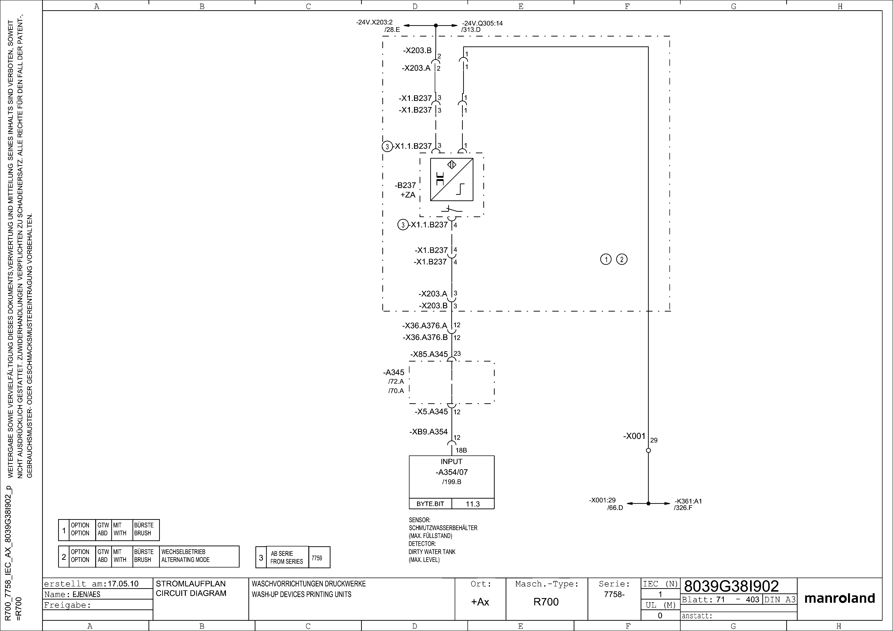

# +Ax — Sheet 71 of 403 — WASCHVORRICHTUNGEN DRUCKWERKE

**WASH UP DEVICES PRINTING UNITS**

> Part of the manroland **R700** printing press IEC/UL circuit diagrams.
> Drawing class: **Stromlaufplan / Circuit diagram** (DIN A3).
> Document `+Ax` covers the **Central control console** machine section.

## At a glance

| Field | Value |
|---|---|
| Document | `+Ax`  (8039G38I902) |
| Sheet | **71** of 403 |
| Section (DE) | WASCHVORRICHTUNGEN DRUCKWERKE |
| Section (EN) | WASH UP DEVICES PRINTING UNITS |
| Section type | CIRCUIT — Circuit diagram |
| Machine type | `R700` |
| Series | `7758` |
| Created | 17.05.10 |
| Replaces | — |
| Columns used | A, B, C, D, E, F, G |
| Path numbers | — |
| Labels on sheet | 90 |
| Cross-refs out | 7 |
| Cross-refs in | 17 |

**Previous:** [+Ax sheet 70](SHEET_0070.md) · **Next:** [+Ax sheet 72](SHEET_0072.md) · **Document TOC:** [_TOC.md](_TOC.md)  (+Ax) · **Master TOC:** [all sheets](../_MASTER_TOC.md)

## Sheet image (300 DPI, exact vector render)



_Rendered directly from the PDF vector layer at 300 DPI (1-bit), no OCR and no resampling. Use it to confirm anything ambiguous in the text below._

## Cross-references on this sheet

Each entry is a wire leaving this sheet. The printed token is `/sheet.column`; the link resolves to that sheet inside the same document.

| Ref | Target sheet | Col | Path | Destination on target | Target section | From col |
|---|---|---|---|---|---|---|
| `/28.E` | [+Ax sheet 28](SHEET_0028.md) | E | — | 24V.X203:2 24V.Q305:14 | SPANNUNGSVERSORGUNG, SCHALTSCHRANKBELÜFTUNG | D |
| `/313.D` | [+Ax sheet 313](SHEET_0313.md) | D | — | — | OPTION: STAUBSAUGER MIT BÜRSTE | E |
| `/72.A` | [+Ax sheet 72](SHEET_0072.md) | A | — | — | WASCHVORRICHTUNGEN DRUCKWERKE | D |
| `/70.A` | [+Ax sheet 70](SHEET_0070.md) | A | — | — | WASCHVORRICHTUNGEN DRUCKWERKE | D |
| `/199.B` | [+Ax sheet 199](SHEET_0199.md) | B | — | — | REFERENZMODUL | D |
| `/66.D` | [+Ax sheet 66](SHEET_0066.md) | D | — | X001:29 | DRUCKLUFTANLAGE | F |
| `/326.F` | [+Ax sheet 326](SHEET_0326.md) | F | — | — | OPTION: AUTOMATISCHE FARBZUFÜHRUNG | G |

### Incoming references (sheets that point here)

Every other sheet that sends a wire to this one. `Back-ref` is the token printed on *that* sheet; `Path` is its line number.

| From sheet | Cols | Back-ref | Path | Refs | What continues there |
|---|---|---|---|---|---|
| [+Ax#28](SHEET_0028.md) | D | `/28.D` | — | 1 | — |
| [+Ax#66](SHEET_0066.md) | E | `/66.E` | — | 1 | — |
| [+Ax#70](SHEET_0070.md) | A | `/70.A` | — | 1 | — |
| [+Ax#72](SHEET_0072.md) | A | `/72.A` | — | 1 | — |
| [+Ax#199](SHEET_0199.md) | B | `/199.B` | — | 1 | — |
| [+Ax#213](SHEET_0213.md) | A | `/213.A` | — | 2 | — |
| [+Ax#231](SHEET_0231.md) | A | `/231.A` | — | 1 | — |
| [+Ax#242](SHEET_0242.md) | A | `/242.A` | — | 1 | — |
| [+Ax#279](SHEET_0279.md) | A, B | `/279.A`, `/279.B` | — | 2 | — |
| [+Ax#287](SHEET_0287.md) | C | `/287.C` | — | 1 | — |
| [+Ax#291](SHEET_0291.md) | B | `/291.B` | — | 3 | STROMPFAD PIN 1 2 3 4 |
| [+Ax#313](SHEET_0313.md) | C | `/313.C` | — | 1 | 24V.Q305:14 |
| [+Ax#326](SHEET_0326.md) | F | `/326.F` | — | 1 | — |


## Devices on this sheet

| Tag | Class | Class meaning (IEC) | Col | Sub | Terminal | Sign |
|---|---|---|---|---|---|---|
| `B237` | B | Umformer / transducer, sensor | D | — | — | — |
| `A354/07` | A | Baugruppe / assembly, module, PC board | D | 07 | — | — |
| `A345` | A | Baugruppe / assembly, module, PC board | D | — | — | — |
| `X001` | X | Klemme / terminal, plug connector | F | — | — | — |
| `X001:29` | X | Klemme / terminal, plug connector | F | — | 29 | — |
| `K361:A1` | K | Relais / relay, contactor | G | — | A1 | — |
| `X1.1.B237` | — | cross-device reference | D | — | — | — |
| `X1.1.B237` | — | cross-device reference | D | — | — | — |
| `X1.B237` | — | cross-device reference | D | — | — | — |
| `X203.B` | — | cross-device reference | D | — | — | — |
| `11.3` | — | cross-device reference | E | — | — | — |
| `XB9.A354` | — | cross-device reference | D | — | — | — |
| `X85.A345` | — | cross-device reference | D | — | — | — |
| `X5.A345` | — | cross-device reference | D | — | — | — |
| `X36.A376.B` | — | cross-device reference | D | — | — | — |
| `X36.A376.A` | — | cross-device reference | D | — | — | — |
| `X1.B237` | — | cross-device reference | D | — | — | — |
| `X1.B237` | — | cross-device reference | D | — | — | — |
| `X203.A` | — | cross-device reference | D | — | — | — |
| `X1.B237` | — | cross-device reference | D | — | — | — |
| `X203.B` | — | cross-device reference | D | — | — | — |
| `X203.A` | — | cross-device reference | D | — | — | — |

## Potentials / nets

| Potential | Count | Columns | Attached devices | Terminals |
|---|---|---|---|---|
| `24V` | 2 | D, E | `Q305`, `X203` | `14`, `2` |


A potential such as `L24+/4` or `M24+` is a named supply/return rail; every place it appears on this sheet is electrically common.

## Wire-end annotations (grouped as printed)

A wire that continues elsewhere is annotated with a small cluster: the destination description, the path/line number `#NN`, and the `/sheet.column` cross reference. Each row below is one such cluster exactly as it is grouped on the drawing.

| Col | Y | Path | Cross-ref | Text on the wire |
|---|---|---|---|---|
| D | 25.8 | — | `/28.E` | `24V.X203:2 24V.Q305:14` |
| E | 35.7 | — | `/313.D` | — |
| D | 62.7 | — | — | `X203.B 2` |
| D | 68.4 | — | — | `1` |
| D | 85.4 | — | — | `1` |
| D | 86.2 | — | — | `X203.A 2` |
| D | 126.5 | — | — | `X1.B237 3 1` |
| D | 142.0 | — | — | `X1.B237 3` |
| D | 143.5 | — | — | `1` |
| D | 190.2 | — | — | `X1.1.B237 3 1` |
| D | 192.8 | — | — | `3` |
| D | 242.7 | — | — | `B237` |
| D | 255.3 | — | — | `+ZA` |
| D | 295.1 | — | — | `X1.1.B237 4` |
| D | 297.1 | — | — | `3` |
| D | 329.1 | — | — | `X1.B237 4` |
| F | 342.8 | — | — | `1 2` |
| D | 344.7 | — | — | `X1.B237 4` |
| D | 387.2 | — | — | `X203.A 3` |
| D | 403.1 | — | — | `X203.B 3` |
| D | 429.8 | — | — | `X36.A376.A 12` |
| D | 445.4 | — | — | `X36.A376.B 12` |
| D | 468.0 | — | — | `X85.A345 23` |
| D | 492.1 | — | — | `A345` |
| D | 505.2 | — | `/72.A`, `/70.A` | — |
| D | 544.6 | — | — | `X5.A345 12` |
| D | 571.5 | — | — | `XB9.A354 12` |
| F | 576.9 | — | — | `X001 29` |
| D | 597.0 | — | — | `18B` |
| D | 611.5 | — | — | `INPUT` |
| D | 625.3 | — | — | `A354/07` |
| D | 639.1 | — | `/199.B` | — |
| F | 663.6 | — | `/66.D` | `X001:29` |
| G | 665.0 | — | — | `K361:A1` |
| D | 668.2 | — | — | `BYTE.BIT 11.3` |
| G | 673.5 | — | `/326.F` | — |
| D | 690.8 | — | — | `DETECTOR: DIRTY WATER TANK (MAX. FÜLLSTAND) (MAX. LEVEL) SENSOR: SCHMUTZWASSERBEHÄLTER` |
| A | 697.8 | — | — | `GTW ABD` |
| A | 697.9 | — | — | `1 OPTION OPTION` |
| A | 697.9 | — | — | `MIT` |
| A | 697.9 | — | — | `BÜRSTE BRUSH` |
| A | 708.5 | — | — | `WITH` |
| A | 733.3 | — | — | `GTW ABD` |
| A | 733.3 | — | — | `BÜRSTE BRUSH` |
| A | 733.4 | — | — | `2 OPTION OPTION WECHSELBETRIEB ALTERNATING MODE` |
| A | 733.4 | — | — | `MIT` |
| C | 735.8 | — | — | `3 FROM SERIES AB SERIE 7759` |
| A | 743.9 | — | — | `WITH` |


## Reconstructed tables

This sheet carries tabular content (pin map / terminal assignment / index). The grid below was rebuilt from the drawing's own rule lines, so each row is exactly one physical row of the table.

### Table 1 — 5 data rows × 6 columns (at x=510.2, y=48.2)

| 3 | X203.B X203.A X1.B237 X1.B237 X1.1.B237 |  | 2 2 3 3 3 |  | 1 1 1 1 1 |
|---|---|---|---|---|---|
| `B237 +ZA` |  |  |  |  |  |
| `3` | `X1.1.B237 X1.B237` | `X1.B237 X203.A X203.B` |  | `4 4 4 3 3` |  |
| `A345 /72.A /70.A` | `X36.A376.A X36.A376.B X85.A345 XB9.A354` | `X5.A345` |  | `12 12 23 12 12 18B` |  |
|  |  |  | `INPUT` | `A354/07 /199.B` |  |
|  | `BYTE.BIT` |  |  |  | `11.3` |


## Notes and free text on this sheet

| Text | Col | Y (pt) |
|---|---|---|
| `+ZA` | D | 255.34 |
| `18B` | D | 596.98 |
| `INPUT` | D | 611.5 |
| `BYTE.BIT` | D | 668.75 |
| `SENSOR:` | D | 690.83 |
| `SCHMUTZWASSERBEHÄLTER` | D | 701.49 |
| `(MAX. FÜLLSTAND)` | D | 712.14 |
| `DETECTOR:` | D | 722.74 |
| `DIRTY WATER TANK` | D | 733.36 |
| `(MAX. LEVEL)` | D | 744.01 |
| `OPTION` | A | 697.92 |
| `GTW` | A | 697.83 |
| `ABD` | A | 708.57 |
| `MIT` | A | 697.92 |
| `WITH` | A | 708.45 |
| `BÜRSTE` | A | 697.91 |
| `BRUSH` | A | 708.54 |
| `WECHSELBETRIEB` | B | 733.35 |
| `ALTERNATING MODE` | B | 744.03 |
| `AB SERIE` | C | 735.75 |
| `FROM SERIES` | C | 746.41 |

## Complete label inventory (exact text from the drawing)

Every text object inside the drawing area of this sheet, in DIN reading order (column A→H, then top→bottom). This is the authoritative list: if a string is not here it is not printed on this sheet.

| Col | Y | X | Dir | Type | Text |
|---|---|---|---|---|---|
| A | 697.8 | 130.1 | → | text | `GTW` |
| A | 697.9 | 94.7 | → | text | `OPTION` |
| A | 697.9 | 151.1 | → | text | `MIT` |
| A | 697.9 | 179.1 | → | text | `BÜRSTE` |
| A | 703.3 | 82.5 | → | number | `1` |
| A | 708.5 | 151.7 | → | text | `WITH` |
| A | 708.5 | 179.1 | → | text | `BRUSH` |
| A | 708.6 | 94.7 | → | text | `OPTION` |
| A | 708.6 | 130.4 | → | text | `ABD` |
| A | 733.3 | 130.1 | → | text | `GTW` |
| A | 733.3 | 179.1 | → | text | `BÜRSTE` |
| A | 733.4 | 94.7 | → | text | `OPTION` |
| A | 733.4 | 151.1 | → | text | `MIT` |
| A | 738.7 | 82.2 | → | number | `2` |
| A | 743.9 | 151.7 | → | text | `WITH` |
| A | 744.0 | 94.7 | → | text | `OPTION` |
| A | 744.0 | 130.4 | → | text | `ABD` |
| A | 744.0 | 179.1 | → | text | `BRUSH` |
| B | 733.4 | 215.4 | → | text | `WECHSELBETRIEB` |
| B | 744.0 | 215.4 | → | text | `ALTERNATING MODE` |
| C | 735.7 | 361.4 | → | text | `AB SERIE` |
| C | 739.5 | 345.1 | → | number | `3` |
| C | 741.8 | 415.6 | → | number | `7759` |
| C | 746.4 | 360.6 | → | text | `FROM SERIES` |
| D | 25.8 | 474.8 | → | potential | `24V.X203:2` |
| D | 35.7 | 512.8 | → | cross-reference | `/28.E` |
| D | 62.7 | 537.4 | → | device ref | `X203.B` |
| D | 68.4 | 619.9 | → | number | `1` |
| D | 71.2 | 583.4 | → | number | `2` |
| D | 85.4 | 619.9 | → | number | `1` |
| D | 86.2 | 535.7 | → | device ref | `X203.A` |
| D | 87.6 | 582.5 | → | number | `2` |
| D | 126.5 | 531.8 | → | device ref | `X1.B237` |
| D | 126.5 | 583.7 | → | number | `3` |
| D | 126.5 | 618.5 | → | number | `1` |
| D | 142.0 | 531.8 | → | device ref | `X1.B237` |
| D | 143.5 | 583.7 | → | number | `3` |
| D | 143.5 | 618.5 | → | number | `1` |
| D | 190.2 | 523.0 | → | device ref | `X1.1.B237` |
| D | 190.2 | 583.7 | → | number | `3` |
| D | 190.2 | 618.5 | → | number | `1` |
| D | 192.8 | 514.5 | → | number | `3` |
| D | 242.7 | 526.4 | → | device tag | `B237` |
| D | 255.3 | 534.0 | → | text | `+ZA` |
| D | 295.1 | 544.3 | → | device ref | `X1.1.B237` |
| D | 296.5 | 604.9 | → | number | `4` |
| D | 297.1 | 535.5 | → | number | `3` |
| D | 329.1 | 553.0 | → | device ref | `X1.B237` |
| D | 329.1 | 604.9 | → | number | `4` |
| D | 344.7 | 551.6 | → | device ref | `X1.B237` |
| D | 346.2 | 604.9 | → | number | `4` |
| D | 387.2 | 558.1 | → | device ref | `X203.A` |
| D | 387.3 | 604.9 | → | number | `3` |
| D | 403.1 | 558.7 | → | device ref | `X203.B` |
| D | 404.5 | 604.6 | → | number | `3` |
| D | 429.8 | 536.3 | → | device ref | `X36.A376.A` |
| D | 429.8 | 604.3 | → | number | `12` |
| D | 445.4 | 537.2 | → | device ref | `X36.A376.B` |
| D | 446.8 | 604.3 | → | number | `12` |
| D | 468.0 | 547.1 | → | device ref | `X85.A345` |
| D | 468.0 | 604.9 | → | number | `23` |
| D | 492.1 | 510.8 | → | device tag | `A345` |
| D | 505.2 | 517.9 | → | cross-reference | `/72.A` |
| D | 517.6 | 517.9 | → | cross-reference | `/70.A` |
| D | 544.6 | 553.0 | → | device ref | `X5.A345` |
| D | 546.0 | 604.3 | → | number | `12` |
| D | 571.5 | 546.0 | → | device ref | `XB9.A354` |
| D | 580.0 | 604.3 | → | number | `12` |
| D | 597.0 | 607.2 | → | text | `18B` |
| D | 611.5 | 587.5 | → | text | `INPUT` |
| D | 625.3 | 581.0 | → | device tag | `A354/07` |
| D | 639.1 | 589.7 | → | cross-reference | `/199.B` |
| D | 668.8 | 555.6 | → | text | `BYTE.BIT` |
| D | 690.8 | 545.4 | → | text | `SENSOR:` |
| D | 701.5 | 545.4 | → | text | `SCHMUTZWASSERBEHÄLTER` |
| D | 712.1 | 545.1 | → | text | `(MAX. FÜLLSTAND)` |
| D | 722.7 | 544.8 | → | text | `DETECTOR:` |
| D | 733.4 | 544.8 | → | text | `DIRTY WATER TANK` |
| D | 744.0 | 545.1 | → | text | `(MAX. LEVEL)` |
| E | 27.2 | 616.3 | → | potential | `24V.Q305:14` |
| E | 35.7 | 615.1 | → | cross-reference | `/313.D` |
| E | 668.2 | 620.9 | → | device ref | `11.3` |
| F | 342.8 | 806.1 | → | number | `1` |
| F | 343.3 | 827.1 | → | number | `2` |
| F | 576.9 | 831.1 | → | device tag | `X001` |
| F | 583.6 | 867.1 | → | number | `29` |
| F | 663.6 | 785.5 | → | device tag | `X001:29` |
| F | 673.5 | 809.9 | → | cross-reference | `/66.D` |
| G | 665.0 | 899.7 | → | device tag | `K361:A1` |
| G | 673.5 | 898.6 | → | cross-reference | `/326.F` |

## Reading-order text block

The same content as a plain block, grouped by DIN column — convenient to paste or to match against a visual description.

```text
=== Column A ===
 697.8  130.1  text         GTW
 697.9   94.7  text         OPTION
 697.9  151.1  text         MIT
 697.9  179.1  text         BÜRSTE
 703.3   82.5  numeric      1
 708.5  151.7  text         WITH
 708.5  179.1  text         BRUSH
 708.6   94.7  text         OPTION
 708.6  130.4  text         ABD
 733.3  130.1  text         GTW
 733.3  179.1  text         BÜRSTE
 733.4   94.7  text         OPTION
 733.4  151.1  text         MIT
 738.7   82.2  numeric      2
 743.9  151.7  text         WITH
 744.0   94.7  text         OPTION
 744.0  130.4  text         ABD
 744.0  179.1  text         BRUSH
=== Column B ===
 733.4  215.4  text         WECHSELBETRIEB
 744.0  215.4  text         ALTERNATING MODE
=== Column C ===
 735.7  361.4  text         AB SERIE
 739.5  345.1  numeric      3
 741.8  415.6  numeric      7759
 746.4  360.6  text         FROM SERIES
=== Column D ===
  25.8  474.8  net          24V.X203:2
  35.7  512.8  xref         /28.E
  62.7  537.4  devref       X203.B
  68.4  619.9  numeric      1
  71.2  583.4  numeric      2
  85.4  619.9  numeric      1
  86.2  535.7  devref       X203.A
  87.6  582.5  numeric      2
 126.5  531.8  devref       X1.B237
 126.5  583.7  numeric      3
 126.5  618.5  numeric      1
 142.0  531.8  devref       X1.B237
 143.5  583.7  numeric      3
 143.5  618.5  numeric      1
 190.2  523.0  devref       X1.1.B237
 190.2  583.7  numeric      3
 190.2  618.5  numeric      1
 192.8  514.5  numeric      3
 242.7  526.4  devtag       B237
 255.3  534.0  text         +ZA
 295.1  544.3  devref       X1.1.B237
 296.5  604.9  numeric      4
 297.1  535.5  numeric      3
 329.1  553.0  devref       X1.B237
 329.1  604.9  numeric      4
 344.7  551.6  devref       X1.B237
 346.2  604.9  numeric      4
 387.2  558.1  devref       X203.A
 387.3  604.9  numeric      3
 403.1  558.7  devref       X203.B
 404.5  604.6  numeric      3
 429.8  536.3  devref       X36.A376.A
 429.8  604.3  numeric      12
 445.4  537.2  devref       X36.A376.B
 446.8  604.3  numeric      12
 468.0  547.1  devref       X85.A345
 468.0  604.9  numeric      23
 492.1  510.8  devtag       A345
 505.2  517.9  xref         /72.A
 517.6  517.9  xref         /70.A
 544.6  553.0  devref       X5.A345
 546.0  604.3  numeric      12
 571.5  546.0  devref       XB9.A354
 580.0  604.3  numeric      12
 597.0  607.2  text         18B
 611.5  587.5  text         INPUT
 625.3  581.0  devtag       A354/07
 639.1  589.7  xref         /199.B
 668.8  555.6  text         BYTE.BIT
 690.8  545.4  text         SENSOR:
 701.5  545.4  text         SCHMUTZWASSERBEHÄLTER
 712.1  545.1  text         (MAX. FÜLLSTAND)
 722.7  544.8  text         DETECTOR:
 733.4  544.8  text         DIRTY WATER TANK
 744.0  545.1  text         (MAX. LEVEL)
=== Column E ===
  27.2  616.3  net          24V.Q305:14
  35.7  615.1  xref         /313.D
 668.2  620.9  devref       11.3
=== Column F ===
 342.8  806.1  numeric      1
 343.3  827.1  numeric      2
 576.9  831.1  devtag       X001
 583.6  867.1  numeric      29
 663.6  785.5  devtag       X001:29
 673.5  809.9  xref         /66.D
=== Column G ===
 665.0  899.7  devtag       K361:A1
 673.5  898.6  xref         /326.F
```

---
_Generated from the PDF vector text layer; no OCR. Source: `R700_7758_IEC_AX_8039G38I902_p`, sheet 71._
