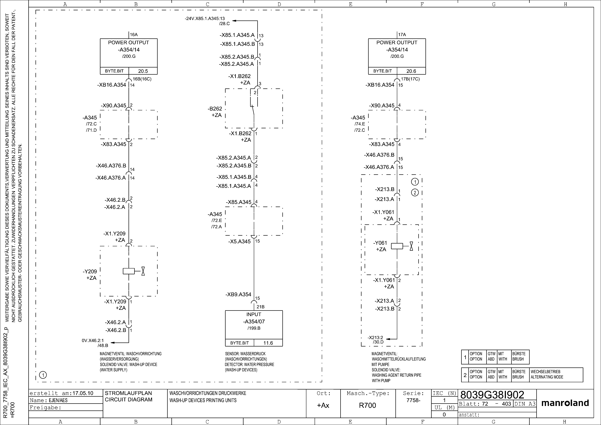

# +Ax — Sheet 72 of 403 — WASCHVORRICHTUNGEN DRUCKWERKE

**WASH UP DEVICES PRINTING UNITS**

> Part of the manroland **R700** printing press IEC/UL circuit diagrams.
> Drawing class: **Stromlaufplan / Circuit diagram** (DIN A3).
> Document `+Ax` covers the **Central control console** machine section.

## At a glance

| Field | Value |
|---|---|
| Document | `+Ax`  (8039G38I902) |
| Sheet | **72** of 403 |
| Section (DE) | WASCHVORRICHTUNGEN DRUCKWERKE |
| Section (EN) | WASH UP DEVICES PRINTING UNITS |
| Section type | CIRCUIT — Circuit diagram |
| Machine type | `R700` |
| Series | `7758` |
| Created | 17.05.10 |
| Replaces | — |
| Columns used | A, B, C, D, E, F, G, H |
| Path numbers | — |
| Labels on sheet | 155 |
| Cross-refs out | 12 |
| Cross-refs in | 47 |

**Previous:** [+Ax sheet 71](SHEET_0071.md) · **Next:** [+Ax sheet 73](SHEET_0073.md) · **Document TOC:** [_TOC.md](_TOC.md)  (+Ax) · **Master TOC:** [all sheets](../_MASTER_TOC.md)

## Sheet image (300 DPI, exact vector render)



_Rendered directly from the PDF vector layer at 300 DPI (1-bit), no OCR and no resampling. Use it to confirm anything ambiguous in the text below._

## Cross-references on this sheet

Each entry is a wire leaving this sheet. The printed token is `/sheet.column`; the link resolves to that sheet inside the same document.

| Ref | Target sheet | Col | Path | Destination on target | Target section | From col |
|---|---|---|---|---|---|---|
| `/28.C` | [+Ax sheet 28](SHEET_0028.md) | C | — | 24V.X85.1.A345:13 | SPANNUNGSVERSORGUNG, SCHALTSCHRANKBELÜFTUNG | C |
| `/200.G` | [+Ax sheet 200](SHEET_0200.md) | G | — | — | REFERENZMODUL | B |
| `/200.G` | [+Ax sheet 200](SHEET_0200.md) | G | — | — | REFERENZMODUL | F |
| `/74.E` | [+Ax sheet 74](SHEET_0074.md) | E | — | — | FEUCHTMITTELKÜHLGERÄT | E |
| `/72.C` | [+Ax sheet 72](SHEET_0072.md) | C | — | — | WASCHVORRICHTUNGEN DRUCKWERKE | E |
| `/72.C` | [+Ax sheet 72](SHEET_0072.md) | C | — | — | WASCHVORRICHTUNGEN DRUCKWERKE | A |
| `/71.D` | [+Ax sheet 71](SHEET_0071.md) | D | — | — | WASCHVORRICHTUNGEN DRUCKWERKE | A |
| `/72.E` | [+Ax sheet 72](SHEET_0072.md) | E | — | — | WASCHVORRICHTUNGEN DRUCKWERKE | C |
| `/72.A` | [+Ax sheet 72](SHEET_0072.md) | A | — | — | WASCHVORRICHTUNGEN DRUCKWERKE | C |
| `/199.B` | [+Ax sheet 199](SHEET_0199.md) | B | — | — | REFERENZMODUL | D |
| `/30.D` | [+Ax sheet 30](SHEET_0030.md) | D | — | X213:2 | SPANNUNGSVERSORGUNG, SCHALTSCHRANKBELÜFTUNG | E |
| `/48.B` | [+Ax sheet 48](SHEET_0048.md) | B | — | 0V.X46.2:1 | NOT AUS | A |

### Incoming references (sheets that point here)

Every other sheet that sends a wire to this one. `Back-ref` is the token printed on *that* sheet; `Path` is its line number.

| From sheet | Cols | Back-ref | Path | Refs | What continues there |
|---|---|---|---|---|---|
| [+Ax#28](SHEET_0028.md) | C | `/28.C` | — | 1 | — |
| [+Ax#30](SHEET_0030.md) | D | `/30.D` | — | 1 | — |
| [+Ax#48](SHEET_0048.md) | B | `/48.B` | — | 1 | — |
| [+Ax#71](SHEET_0071.md) | D | `/71.D` | — | 1 | — |
| [+Ax#72](SHEET_0072.md) | A, C, E | `/72.A`, `/72.C`, `/72.E` | — | 4 | — |
| [+Ax#74](SHEET_0074.md) | D | `/74.D` | — | 1 | — |
| [+Ax#199](SHEET_0199.md) | B | `/199.B` | — | 1 | — |
| [+Ax#200](SHEET_0200.md) | F | `/200.F` | — | 2 | — |
| [+Ax#213](SHEET_0213.md) | A | `/213.A` | — | 2 | — |
| [+Ax#216](SHEET_0216.md) | E, F | `/216.E`, `/216.F` | — | 4 | — |
| [+Ax#231](SHEET_0231.md) | A | `/231.A` | — | 1 | — |
| [+Ax#242](SHEET_0242.md) | A | `/242.A` | — | 1 | — |
| [+Ax#254](SHEET_0254.md) | F | `/254.F` | — | 2 | — |
| [+Ax#283](SHEET_0283.md) | A, B, C | `/283.A`, `/283.B`, `/283.C` | — | 8 | — |
| [+Ax#287](SHEET_0287.md) | A, C, E, F, G | `/287.A`, `/287.C`, `/287.E`, `/287.F`, `/287.G` | — | 11 | — |
| [+Ax#289](SHEET_0289.md) | C | `/289.C` | — | 2 | — |
| [+Ax#294](SHEET_0294.md) | A | `/294.A` | — | 4 | — |


## Devices on this sheet

| Tag | Class | Class meaning (IEC) | Col | Sub | Terminal | Sign |
|---|---|---|---|---|---|---|
| `Y209` | Y | Magnetventil / solenoid valve, actuator | A | — | — | — |
| `A354/14` | A | Baugruppe / assembly, module, PC board | B | 14 | — | — |
| `A354/14` | A | Baugruppe / assembly, module, PC board | F | 14 | — | — |
| `Y061` | Y | Magnetventil / solenoid valve, actuator | E | — | — | — |
| `A345` | A | Baugruppe / assembly, module, PC board | E | — | — | — |
| `A345` | A | Baugruppe / assembly, module, PC board | A | — | — | — |
| `A354/07` | A | Baugruppe / assembly, module, PC board | D | 07 | — | — |
| `A345` | A | Baugruppe / assembly, module, PC board | C | — | — | — |
| `B262` | B | Umformer / transducer, sensor | C | — | — | — |
| `X213:2` | X | Klemme / terminal, plug connector | E | — | 2 | — |
| `X1.Y209` | — | cross-device reference | B | — | — | — |
| `X1.Y209` | — | cross-device reference | B | — | — | — |
| `X46.2.A` | — | cross-device reference | B | — | — | — |
| `X46.2.B` | — | cross-device reference | B | — | — | — |
| `XB16.A354` | — | cross-device reference | B | — | — | — |
| `20.5` | — | cross-device reference | B | — | — | — |
| `X46.2.B` | — | cross-device reference | B | — | — | — |
| `X46.2.A` | — | cross-device reference | B | — | — | — |
| `XB16.A354` | — | cross-device reference | E | — | — | — |
| `20.6` | — | cross-device reference | F | — | — | — |
| `X1.Y061` | — | cross-device reference | E | — | — | — |
| `X1.Y061` | — | cross-device reference | E | — | — | — |
| `X213.B` | — | cross-device reference | E | — | — | — |
| `X213.A` | — | cross-device reference | E | — | — | — |
| `X213.B` | — | cross-device reference | E | — | — | — |
| `X213.A` | — | cross-device reference | E | — | — | — |
| `X46.A376.A` | — | cross-device reference | E | — | — | — |
| `X46.A376.B` | — | cross-device reference | E | — | — | — |
| `X83.A345` | — | cross-device reference | E | — | — | — |
| `X90.A345` | — | cross-device reference | E | — | — | — |
| `X83.A345` | — | cross-device reference | B | — | — | — |
| `X90.A345` | — | cross-device reference | B | — | — | — |
| `XB9.A354` | — | cross-device reference | C | — | — | — |
| `11.6` | — | cross-device reference | D | — | — | — |
| `X85.2.A345.B` | — | cross-device reference | C | — | — | — |
| `X85.2.A345.A` | — | cross-device reference | C | — | — | — |
| `X85.1.A345.B` | — | cross-device reference | C | — | — | — |
| `X85.1.A345.A` | — | cross-device reference | C | — | — | — |
| `X5.A345` | — | cross-device reference | C | — | — | — |
| `X85.A345` | — | cross-device reference | C | — | — | — |
| `X1.B262` | — | cross-device reference | C | — | — | — |
| `X1.B262` | — | cross-device reference | C | — | — | — |
| `X85.2.A345.A` | — | cross-device reference | C | — | — | — |
| `X85.2.A345.B` | — | cross-device reference | C | — | — | — |
| `X85.1.A345.B` | — | cross-device reference | C | — | — | — |
| `X85.1.A345.A` | — | cross-device reference | C | — | — | — |
| `X46.A376.A` | — | cross-device reference | B | — | — | — |
| `X46.A376.B` | — | cross-device reference | B | — | — | — |

## Potentials / nets

| Potential | Count | Columns | Attached devices | Terminals |
|---|---|---|---|---|
| `0V` | 1 | A | `2`, `X46` | `1` |
| `24V` | 1 | C | `1`, `A345`, `X85` | `13` |


A potential such as `L24+/4` or `M24+` is a named supply/return rail; every place it appears on this sheet is electrically common.

## Wire-end annotations (grouped as printed)

A wire that continues elsewhere is annotated with a small cluster: the destination description, the path/line number `#NN`, and the `/sheet.column` cross reference. Each row below is one such cluster exactly as it is grouped on the drawing.

| Col | Y | Path | Cross-ref | Text on the wire |
|---|---|---|---|---|
| C | 32.9 | — | `/28.C` | `24V.X85.1.A345:13` |
| B | 64.8 | — | — | `16A` |
| C | 64.8 | — | — | `X85.1.A345.A 13` |
| F | 64.8 | — | — | `17A` |
| B | 79.9 | — | — | `POWER OUTPUT` |
| F | 79.9 | — | — | `POWER OUTPUT` |
| C | 82.5 | — | — | `X85.1.A345.B 13` |
| B | 93.8 | — | — | `A354/14` |
| F | 93.8 | — | — | `A354/14` |
| C | 105.2 | — | — | `X85.2.A345.B 1` |
| B | 107.6 | — | `/200.G` | — |
| F | 107.6 | — | `/200.G` | — |
| C | 122.2 | — | — | `X85.2.A345.A 1` |
| B | 136.7 | — | — | `BYTE.BIT 20.5` |
| F | 136.7 | — | — | `BYTE.BIT 20.6` |
| D | 146.3 | — | — | `X1.B262 3` |
| B | 152.7 | — | — | `16B(16C)` |
| F | 152.7 | — | — | `17B(17C)` |
| D | 159.0 | — | — | `+ZA` |
| B | 163.3 | — | — | `XB16.A354 14` |
| E | 163.3 | — | — | `XB16.A354 15` |
| D | 179.6 | — | — | `2` |
| B | 204.4 | — | — | `X90.A345 2` |
| E | 204.4 | — | — | `X90.A345 4` |
| C | 210.8 | — | — | `B262` |
| C | 223.4 | — | — | `+ZA` |
| A | 228.5 | — | — | `A345` |
| E | 228.5 | — | — | `A345` |
| A | 241.6 | — | `/72.C`, `/71.D` | — |
| E | 241.6 | — | `/74.E`, `/72.C` | — |
| C | 259.7 | — | — | `X1.B262 1` |
| D | 272.4 | — | — | `+ZA` |
| B | 280.9 | — | — | `X83.A345 2` |
| E | 280.9 | — | — | `X83.A345 4` |
| E | 302.2 | — | — | `X46.A376.B 15` |
| C | 307.9 | — | — | `X85.2.A345.A 2` |
| B | 323.5 | — | — | `X46.A376.B 14` |
| C | 323.5 | — | — | `X85.2.A345.B 2` |
| E | 326.3 | — | — | `X46.A376.A 15` |
| C | 346.1 | — | — | `X85.1.A345.B 4` |
| B | 347.6 | — | — | `X46.A376.A 14` |
| F | 356.9 | — | — | `1` |
| C | 363.2 | — | — | `X85.1.A345.A 4` |
| F | 370.2 | — | — | `X213.B 1` |
| F | 378.7 | — | — | `2` |
| B | 388.7 | — | — | `X46.2.B 2` |
| F | 390.1 | — | — | `X213.A 1` |
| C | 395.7 | — | — | `X85.A345 4` |
| B | 405.7 | — | — | `X46.2.A 2` |
| F | 415.6 | — | — | `X1.Y061 1` |
| C | 419.8 | — | — | `A345` |
| F | 428.3 | — | — | `+ZA` |
| C | 432.9 | — | `/72.E`, `/72.A` | — |
| B | 458.2 | — | — | `X1.Y209 2` |
| B | 470.8 | — | — | `+ZA` |
| D | 473.7 | — | — | `X5.A345 15` |
| E | 476.6 | — | — | `Y061` |
| E | 489.2 | — | — | `+ZA` |
| A | 533.3 | — | — | `Y209` |
| A | 545.9 | — | — | `+ZA` |
| F | 550.3 | — | — | `X1.Y061 2` |
| F | 562.9 | — | — | `+ZA` |
| C | 578.6 | — | — | `XB9.A354 15` |
| F | 591.3 | — | — | `X213.A 2` |
| B | 592.8 | — | — | `X1.Y209 1` |
| D | 604.1 | — | — | `21B` |
| B | 605.4 | — | — | `+ZA` |
| F | 606.9 | — | — | `X213.B 2` |
| D | 618.6 | — | — | `INPUT` |
| D | 632.4 | — | — | `A354/07` |
| B | 633.9 | — | — | `X46.2.A 1` |
| D | 646.2 | — | `/199.B` | — |
| B | 649.5 | — | — | `X46.2.B 1` |
| E | 665.0 | — | `/30.D` | `X213:2` |
| A | 670.7 | — | `/48.B` | `0V.X46.2:1` |
| D | 675.3 | — | — | `BYTE.BIT 11.6` |
| G | 697.8 | — | — | `GTW ABD` |
| D | 697.9 | — | — | `DETECTOR: WATER PRESSURE (WASCHVORRICHTUNGEN) (WASH UP DEVICES) SENSOR: WASSERDRUCK` |
| E | 697.9 | — | — | `MAGNETVENTIL:` |
| G | 697.9 | — | — | `1 OPTION OPTION` |
| G | 697.9 | — | — | `MIT` |
| G | 697.9 | — | — | `BÜRSTE BRUSH` |
| B | 698.0 | — | — | `MAGNETVENTIL: WASCHVORRICHTUNG (WASSERVERSORGUNG) (WATER SUPPLY) SOLENOID VALVE: WASH UP DEVICE` |
| G | 708.5 | — | — | `WITH` |
| F | 708.6 | — | — | `MIT PUMPE SOLENOID VALVE: WASCHMITTELRÜCKLAUFLEITUNG WASHING AGENT RETURN PIPE WITH PUMP` |
| G | 733.3 | — | — | `GTW ABD` |
| G | 733.3 | — | — | `BÜRSTE BRUSH` |
| G | 733.4 | — | — | `2 OPTION OPTION WECHSELBETRIEB ALTERNATING MODE` |
| G | 733.4 | — | — | `MIT` |
| A | 739.6 | — | — | `1` |
| G | 743.9 | — | — | `WITH` |


## Reconstructed tables

This sheet carries tabular content (pin map / terminal assignment / index). The grid below was rebuilt from the drawing's own rule lines, so each row is exactly one physical row of the table.

### Table 1 — 1 data rows × 2 columns (at x=198.4, y=76.5)

| POWER | OUTPUT A354/14 /200.G |
|---|---|
| `BYTE.BIT` | `20.5` |


### Table 2 — 1 data rows × 3 columns (at x=446.5, y=615.1)

| INPUT | A354/07 /199.B |  |
|---|---|---|
| `BYTE.BIT` |  | `11.6` |


### Table 3 — 3 data rows × 2 columns (at x=729.9, y=76.5)

| POWER | OUTPUT A354/14 /200.G |
|---|---|
| `BYTE.BIT` | `20.6` |
| `XB16.A354 X90.A345 X83.A345 X46.A376.B X46.A376.A` | `17B(17C) 15 4 4 15 15` |
| `X213.B X213.A X1.Y061 +ZA Y061 +ZA X1.Y061 +ZA X213.A X213.B X213:2 /30.D` | `1 1 2 1 1 2 2 2` |


## Notes and free text on this sheet

| Text | Col | Y (pt) |
|---|---|---|
| `+ZA` | B | 470.78 |
| `+ZA` | A | 545.89 |
| `MAGNETVENTIL: WASCHVORRICHTUNG` | B | 697.95 |
| `(WASSERVERSORGUNG)` | B | 708.57 |
| `SOLENOID VALVE: WASH UP DEVICE` | B | 719.19 |
| `(WATER SUPPLY)` | B | 729.81 |
| `16A` | B | 64.77 |
| `16B(16C)` | B | 152.68 |
| `POWER OUTPUT` | B | 79.93 |
| `BYTE.BIT` | B | 137.26 |
| `17A` | F | 64.77 |
| `17B(17C)` | F | 152.68 |
| `POWER OUTPUT` | F | 79.93 |
| `BYTE.BIT` | E | 137.26 |
| `+ZA` | F | 562.9 |
| `+ZA` | E | 489.2 |
| `MAGNETVENTIL:` | E | 697.94 |
| `WASCHMITTELRÜCKLAUFLEITUNG` | F | 708.59 |
| `MIT PUMPE` | E | 719.21 |
| `SOLENOID VALVE:` | E | 729.83 |
| `WASHING AGENT RETURN PIPE` | F | 740.46 |
| `WITH PUMP` | E | 751.08 |
| `21B` | D | 604.07 |
| `INPUT` | D | 618.59 |
| `BYTE.BIT` | C | 675.84 |
| `SENSOR: WASSERDRUCK` | D | 697.94 |
| `(WASCHVORRICHTUNGEN)` | D | 708.58 |
| `DETECTOR: WATER PRESSURE` | D | 719.19 |
| `(WASH UP DEVICES)` | C | 729.82 |
| `+ZA` | D | 272.35 |
| `+ZA` | C | 223.45 |
| `OPTION` | G | 697.92 |
| `GTW` | G | 697.83 |
| `ABD` | G | 708.57 |
| `MIT` | G | 697.92 |
| `WITH` | G | 708.45 |
| `BÜRSTE` | G | 697.91 |
| `BRUSH` | G | 708.54 |
| `WECHSELBETRIEB` | H | 733.35 |
| `ALTERNATING MODE` | H | 744.03 |

## Complete label inventory (exact text from the drawing)

Every text object inside the drawing area of this sheet, in DIN reading order (column A→H, then top→bottom). This is the authoritative list: if a string is not here it is not printed on this sheet.

| Col | Y | X | Dir | Type | Text |
|---|---|---|---|---|---|
| A | 228.5 | 163.6 | → | device tag | `A345` |
| A | 241.6 | 170.6 | → | cross-reference | `/72.C` |
| A | 254.0 | 170.6 | → | cross-reference | `/71.D` |
| A | 533.3 | 164.1 | → | device tag | `Y209` |
| A | 545.9 | 171.2 | → | text | `+ZA` |
| A | 670.7 | 162.1 | → | potential | `0V.X46.2:1` |
| A | 739.6 | 83.3 | → | number | `1` |
| B | 64.8 | 257.1 | → | text | `16A` |
| B | 79.9 | 214.3 | → | text | `POWER OUTPUT` |
| B | 93.8 | 233.7 | → | device tag | `A354/14` |
| B | 107.6 | 242.2 | → | cross-reference | `/200.G` |
| B | 136.7 | 274.0 | → | device ref | `20.5` |
| B | 137.3 | 208.3 | → | text | `BYTE.BIT` |
| B | 152.7 | 262.8 | → | text | `16B(16C)` |
| B | 163.3 | 192.8 | → | device ref | `XB16.A354` |
| B | 164.7 | 257.1 | → | number | `14` |
| B | 204.4 | 199.8 | → | device ref | `X90.A345` |
| B | 204.4 | 257.7 | → | number | `2` |
| B | 280.9 | 199.8 | → | device ref | `X83.A345` |
| B | 282.4 | 257.7 | → | number | `2` |
| B | 323.5 | 189.9 | → | device ref | `X46.A376.B` |
| B | 332.0 | 257.1 | → | number | `14` |
| B | 347.6 | 189.1 | → | device ref | `X46.A376.A` |
| B | 349.0 | 257.1 | → | number | `14` |
| B | 388.7 | 257.7 | → | number | `2` |
| B | 391.5 | 207.5 | → | device ref | `X46.2.B` |
| B | 405.7 | 206.6 | → | device ref | `X46.2.A` |
| B | 405.7 | 257.7 | → | number | `2` |
| B | 458.2 | 204.9 | → | device ref | `X1.Y209` |
| B | 470.8 | 227.9 | → | text | `+ZA` |
| B | 473.7 | 257.7 | → | number | `2` |
| B | 592.8 | 206.4 | → | device ref | `X1.Y209` |
| B | 594.2 | 257.1 | → | number | `1` |
| B | 605.4 | 229.3 | → | text | `+ZA` |
| B | 633.9 | 208.1 | → | device ref | `X46.2.A` |
| B | 633.9 | 257.1 | → | number | `1` |
| B | 649.5 | 208.9 | → | device ref | `X46.2.B` |
| B | 650.9 | 257.1 | → | number | `1` |
| B | 680.6 | 193.6 | → | cross-reference | `/48.B` |
| B | 697.9 | 197.9 | → | text | `MAGNETVENTIL: WASCHVORRICHTUNG` |
| B | 708.6 | 197.9 | → | text | `(WASSERVERSORGUNG)` |
| B | 719.2 | 198.1 | → | text | `SOLENOID VALVE: WASH UP DEVICE` |
| B | 729.8 | 197.9 | → | text | `(WATER SUPPLY)` |
| C | 32.9 | 366.2 | → | potential | `24V.X85.1.A345:13` |
| C | 42.8 | 434.3 | → | cross-reference | `/28.C` |
| C | 64.8 | 435.4 | → | device ref | `X85.1.A345.A` |
| C | 82.5 | 436.3 | → | device ref | `X85.1.A345.B` |
| C | 108.0 | 434.8 | → | device ref | `X85.2.A345.B` |
| C | 122.2 | 434.0 | → | device ref | `X85.2.A345.A` |
| C | 146.3 | 452.4 | → | device ref | `X1.B262` |
| C | 210.8 | 411.6 | → | device tag | `B262` |
| C | 223.5 | 419.2 | → | text | `+ZA` |
| C | 259.7 | 453.8 | → | device ref | `X1.B262` |
| C | 307.9 | 428.3 | → | device ref | `X85.2.A345.A` |
| C | 323.5 | 429.2 | → | device ref | `X85.2.A345.B` |
| C | 346.1 | 429.2 | → | device ref | `X85.1.A345.B` |
| C | 363.9 | 428.3 | → | device ref | `X85.1.A345.A` |
| C | 395.7 | 447.9 | → | device ref | `X85.A345` |
| C | 419.8 | 411.6 | → | device tag | `A345` |
| C | 432.9 | 419.2 | → | cross-reference | `/72.E` |
| C | 445.3 | 418.7 | → | cross-reference | `/72.A` |
| C | 473.7 | 452.4 | → | device ref | `X5.A345` |
| C | 578.6 | 446.7 | → | device ref | `XB9.A354` |
| C | 675.8 | 456.4 | → | text | `BYTE.BIT` |
| C | 729.8 | 445.9 | → | text | `(WASH UP DEVICES)` |
| D | 66.9 | 512.2 | → | number | `13` |
| D | 83.9 | 512.2 | → | number | `13` |
| D | 105.2 | 512.2 | → | number | `1` |
| D | 122.2 | 512.2 | → | number | `1` |
| D | 159.0 | 475.9 | → | text | `+ZA` |
| D | 161.9 | 512.8 | → | number | `3` |
| D | 179.6 | 502.9 | → | number | `2` |
| D | 261.1 | 505.1 | → | number | `1` |
| D | 272.4 | 477.4 | → | text | `+ZA` |
| D | 307.9 | 505.7 | → | number | `2` |
| D | 324.9 | 505.7 | → | number | `2` |
| D | 346.2 | 505.7 | → | number | `4` |
| D | 363.2 | 505.7 | → | number | `4` |
| D | 395.8 | 505.7 | → | number | `4` |
| D | 473.7 | 505.1 | → | number | `15` |
| D | 587.1 | 505.1 | → | number | `15` |
| D | 604.1 | 508.5 | → | text | `21B` |
| D | 618.6 | 488.3 | → | text | `INPUT` |
| D | 632.4 | 481.7 | → | device tag | `A354/07` |
| D | 646.2 | 490.5 | → | cross-reference | `/199.B` |
| D | 675.3 | 521.7 | → | device ref | `11.6` |
| D | 697.9 | 446.2 | → | text | `SENSOR: WASSERDRUCK` |
| D | 708.6 | 445.9 | → | text | `(WASCHVORRICHTUNGEN)` |
| D | 719.2 | 445.6 | → | text | `DETECTOR: WATER PRESSURE` |
| E | 137.3 | 739.8 | → | text | `BYTE.BIT` |
| E | 163.3 | 724.3 | → | device ref | `XB16.A354` |
| E | 204.4 | 731.3 | → | device ref | `X90.A345` |
| E | 228.5 | 695.1 | → | device tag | `A345` |
| E | 241.5 | 702.7 | → | cross-reference | `/74.E` |
| E | 254.0 | 702.1 | → | cross-reference | `/72.C` |
| E | 280.9 | 731.3 | → | device ref | `X83.A345` |
| E | 302.2 | 721.4 | → | device ref | `X46.A376.B` |
| E | 326.3 | 720.6 | → | device ref | `X46.A376.A` |
| E | 370.2 | 743.2 | → | device ref | `X213.B` |
| E | 390.1 | 742.4 | → | device ref | `X213.A` |
| E | 415.6 | 737.9 | → | device ref | `X1.Y061` |
| E | 476.6 | 739.6 | → | device tag | `Y061` |
| E | 489.2 | 745.2 | → | text | `+ZA` |
| E | 550.3 | 739.3 | → | device ref | `X1.Y061` |
| E | 591.3 | 742.4 | → | device ref | `X213.A` |
| E | 606.9 | 743.2 | → | device ref | `X213.B` |
| E | 665.0 | 728.2 | → | device tag | `X213:2` |
| E | 673.5 | 739.0 | → | cross-reference | `/30.D` |
| E | 697.9 | 736.4 | → | text | `MAGNETVENTIL:` |
| E | 719.2 | 736.4 | → | text | `MIT PUMPE` |
| E | 729.8 | 736.7 | → | text | `SOLENOID VALVE:` |
| E | 751.1 | 737.0 | → | text | `WITH PUMP` |
| F | 64.8 | 788.6 | → | text | `17A` |
| F | 79.9 | 745.8 | → | text | `POWER OUTPUT` |
| F | 93.8 | 765.2 | → | device tag | `A354/14` |
| F | 107.6 | 773.7 | → | cross-reference | `/200.G` |
| F | 136.7 | 805.5 | → | device ref | `20.6` |
| F | 152.7 | 794.3 | → | text | `17B(17C)` |
| F | 164.7 | 788.6 | → | number | `15` |
| F | 204.4 | 789.2 | → | number | `4` |
| F | 282.4 | 789.2 | → | number | `4` |
| F | 310.7 | 788.6 | → | number | `15` |
| F | 327.7 | 788.6 | → | number | `15` |
| F | 356.9 | 820.3 | → | number | `1` |
| F | 374.5 | 788.6 | → | number | `1` |
| F | 378.7 | 820.1 | → | number | `2` |
| F | 391.5 | 788.6 | → | number | `1` |
| F | 428.3 | 759.4 | → | text | `+ZA` |
| F | 431.2 | 788.6 | → | number | `1` |
| F | 551.7 | 789.2 | → | number | `2` |
| F | 562.9 | 760.8 | → | text | `+ZA` |
| F | 591.3 | 789.2 | → | number | `2` |
| F | 608.4 | 789.2 | → | number | `2` |
| F | 708.6 | 737.0 | → | text | `WASCHMITTELRÜCKLAUFLEITUNG` |
| F | 740.5 | 737.0 | → | text | `WASHING AGENT RETURN PIPE` |
| G | 697.8 | 966.3 | → | text | `GTW` |
| G | 697.9 | 930.9 | → | text | `OPTION` |
| G | 697.9 | 987.3 | → | text | `MIT` |
| G | 697.9 | 1015.4 | → | text | `BÜRSTE` |
| G | 703.3 | 918.7 | → | number | `1` |
| G | 708.5 | 987.9 | → | text | `WITH` |
| G | 708.5 | 1015.4 | → | text | `BRUSH` |
| G | 708.6 | 930.9 | → | text | `OPTION` |
| G | 708.6 | 966.6 | → | text | `ABD` |
| G | 733.3 | 966.3 | → | text | `GTW` |
| G | 733.3 | 1015.4 | → | text | `BÜRSTE` |
| G | 733.4 | 930.9 | → | text | `OPTION` |
| G | 733.4 | 987.3 | → | text | `MIT` |
| G | 738.7 | 918.4 | → | number | `2` |
| G | 743.9 | 987.9 | → | text | `WITH` |
| G | 744.0 | 930.9 | → | text | `OPTION` |
| G | 744.0 | 966.6 | → | text | `ABD` |
| G | 744.0 | 1015.4 | → | text | `BRUSH` |
| H | 733.4 | 1051.7 | → | text | `WECHSELBETRIEB` |
| H | 744.0 | 1051.7 | → | text | `ALTERNATING MODE` |

## Reading-order text block

The same content as a plain block, grouped by DIN column — convenient to paste or to match against a visual description.

```text
=== Column A ===
 228.5  163.6  devtag       A345
 241.6  170.6  xref         /72.C
 254.0  170.6  xref         /71.D
 533.3  164.1  devtag       Y209
 545.9  171.2  text         +ZA
 670.7  162.1  net          0V.X46.2:1
 739.6   83.3  numeric      1
=== Column B ===
  64.8  257.1  text         16A
  79.9  214.3  text         POWER OUTPUT
  93.8  233.7  devtag       A354/14
 107.6  242.2  xref         /200.G
 136.7  274.0  devref       20.5
 137.3  208.3  text         BYTE.BIT
 152.7  262.8  text         16B(16C)
 163.3  192.8  devref       XB16.A354
 164.7  257.1  numeric      14
 204.4  199.8  devref       X90.A345
 204.4  257.7  numeric      2
 280.9  199.8  devref       X83.A345
 282.4  257.7  numeric      2
 323.5  189.9  devref       X46.A376.B
 332.0  257.1  numeric      14
 347.6  189.1  devref       X46.A376.A
 349.0  257.1  numeric      14
 388.7  257.7  numeric      2
 391.5  207.5  devref       X46.2.B
 405.7  206.6  devref       X46.2.A
 405.7  257.7  numeric      2
 458.2  204.9  devref       X1.Y209
 470.8  227.9  text         +ZA
 473.7  257.7  numeric      2
 592.8  206.4  devref       X1.Y209
 594.2  257.1  numeric      1
 605.4  229.3  text         +ZA
 633.9  208.1  devref       X46.2.A
 633.9  257.1  numeric      1
 649.5  208.9  devref       X46.2.B
 650.9  257.1  numeric      1
 680.6  193.6  xref         /48.B
 697.9  197.9  text         MAGNETVENTIL: WASCHVORRICHTUNG
 708.6  197.9  text         (WASSERVERSORGUNG)
 719.2  198.1  text         SOLENOID VALVE: WASH UP DEVICE
 729.8  197.9  text         (WATER SUPPLY)
=== Column C ===
  32.9  366.2  net          24V.X85.1.A345:13
  42.8  434.3  xref         /28.C
  64.8  435.4  devref       X85.1.A345.A
  82.5  436.3  devref       X85.1.A345.B
 108.0  434.8  devref       X85.2.A345.B
 122.2  434.0  devref       X85.2.A345.A
 146.3  452.4  devref       X1.B262
 210.8  411.6  devtag       B262
 223.5  419.2  text         +ZA
 259.7  453.8  devref       X1.B262
 307.9  428.3  devref       X85.2.A345.A
 323.5  429.2  devref       X85.2.A345.B
 346.1  429.2  devref       X85.1.A345.B
 363.9  428.3  devref       X85.1.A345.A
 395.7  447.9  devref       X85.A345
 419.8  411.6  devtag       A345
 432.9  419.2  xref         /72.E
 445.3  418.7  xref         /72.A
 473.7  452.4  devref       X5.A345
 578.6  446.7  devref       XB9.A354
 675.8  456.4  text         BYTE.BIT
 729.8  445.9  text         (WASH UP DEVICES)
=== Column D ===
  66.9  512.2  numeric      13
  83.9  512.2  numeric      13
 105.2  512.2  numeric      1
 122.2  512.2  numeric      1
 159.0  475.9  text         +ZA
 161.9  512.8  numeric      3
 179.6  502.9  numeric      2
 261.1  505.1  numeric      1
 272.4  477.4  text         +ZA
 307.9  505.7  numeric      2
 324.9  505.7  numeric      2
 346.2  505.7  numeric      4
 363.2  505.7  numeric      4
 395.8  505.7  numeric      4
 473.7  505.1  numeric      15
 587.1  505.1  numeric      15
 604.1  508.5  text         21B
 618.6  488.3  text         INPUT
 632.4  481.7  devtag       A354/07
 646.2  490.5  xref         /199.B
 675.3  521.7  devref       11.6
 697.9  446.2  text         SENSOR: WASSERDRUCK
 708.6  445.9  text         (WASCHVORRICHTUNGEN)
 719.2  445.6  text         DETECTOR: WATER PRESSURE
=== Column E ===
 137.3  739.8  text         BYTE.BIT
 163.3  724.3  devref       XB16.A354
 204.4  731.3  devref       X90.A345
 228.5  695.1  devtag       A345
 241.5  702.7  xref         /74.E
 254.0  702.1  xref         /72.C
 280.9  731.3  devref       X83.A345
 302.2  721.4  devref       X46.A376.B
 326.3  720.6  devref       X46.A376.A
 370.2  743.2  devref       X213.B
 390.1  742.4  devref       X213.A
 415.6  737.9  devref       X1.Y061
 476.6  739.6  devtag       Y061
 489.2  745.2  text         +ZA
 550.3  739.3  devref       X1.Y061
 591.3  742.4  devref       X213.A
 606.9  743.2  devref       X213.B
 665.0  728.2  devtag       X213:2
 673.5  739.0  xref         /30.D
 697.9  736.4  text         MAGNETVENTIL:
 719.2  736.4  text         MIT PUMPE
 729.8  736.7  text         SOLENOID VALVE:
 751.1  737.0  text         WITH PUMP
=== Column F ===
  64.8  788.6  text         17A
  79.9  745.8  text         POWER OUTPUT
  93.8  765.2  devtag       A354/14
 107.6  773.7  xref         /200.G
 136.7  805.5  devref       20.6
 152.7  794.3  text         17B(17C)
 164.7  788.6  numeric      15
 204.4  789.2  numeric      4
 282.4  789.2  numeric      4
 310.7  788.6  numeric      15
 327.7  788.6  numeric      15
 356.9  820.3  numeric      1
 374.5  788.6  numeric      1
 378.7  820.1  numeric      2
 391.5  788.6  numeric      1
 428.3  759.4  text         +ZA
 431.2  788.6  numeric      1
 551.7  789.2  numeric      2
 562.9  760.8  text         +ZA
 591.3  789.2  numeric      2
 608.4  789.2  numeric      2
 708.6  737.0  text         WASCHMITTELRÜCKLAUFLEITUNG
 740.5  737.0  text         WASHING AGENT RETURN PIPE
=== Column G ===
 697.8  966.3  text         GTW
 697.9  930.9  text         OPTION
 697.9  987.3  text         MIT
 697.9 1015.4  text         BÜRSTE
 703.3  918.7  numeric      1
 708.5  987.9  text         WITH
 708.5 1015.4  text         BRUSH
 708.6  930.9  text         OPTION
 708.6  966.6  text         ABD
 733.3  966.3  text         GTW
 733.3 1015.4  text         BÜRSTE
 733.4  930.9  text         OPTION
 733.4  987.3  text         MIT
 738.7  918.4  numeric      2
 743.9  987.9  text         WITH
 744.0  930.9  text         OPTION
 744.0  966.6  text         ABD
 744.0 1015.4  text         BRUSH
=== Column H ===
 733.4 1051.7  text         WECHSELBETRIEB
 744.0 1051.7  text         ALTERNATING MODE
```

---
_Generated from the PDF vector text layer; no OCR. Source: `R700_7758_IEC_AX_8039G38I902_p`, sheet 72._
