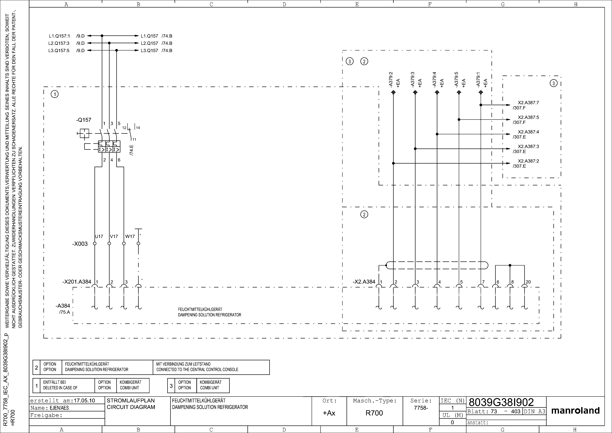

# +Ax — Sheet 73 of 403 — FEUCHTMITTELKÜHLGERÄT

**DAMPENING SOLUTION REFRIGERATOR**

> Part of the manroland **R700** printing press IEC/UL circuit diagrams.
> Drawing class: **Stromlaufplan / Circuit diagram** (DIN A3).
> Document `+Ax` covers the **Central control console** machine section.

## At a glance

| Field | Value |
|---|---|
| Document | `+Ax`  (8039G38I902) |
| Sheet | **73** of 403 |
| Section (DE) | FEUCHTMITTELKÜHLGERÄT |
| Section (EN) | DAMPENING SOLUTION REFRIGERATOR |
| Section type | CIRCUIT — Circuit diagram |
| Machine type | `R700` |
| Series | `7758` |
| Created | 17.05.10 |
| Replaces | — |
| Columns used | A, B, C, E, F, G, H |
| Path numbers | — |
| Labels on sheet | 91 |
| Cross-refs out | 13 |
| Cross-refs in | 26 |

**Previous:** [+Ax sheet 72](SHEET_0072.md) · **Next:** [+Ax sheet 74](SHEET_0074.md) · **Document TOC:** [_TOC.md](_TOC.md)  (+Ax) · **Master TOC:** [all sheets](../_MASTER_TOC.md)

## Sheet image (300 DPI, exact vector render)



_Rendered directly from the PDF vector layer at 300 DPI (1-bit), no OCR and no resampling. Use it to confirm anything ambiguous in the text below._

## Cross-references on this sheet

Each entry is a wire leaving this sheet. The printed token is `/sheet.column`; the link resolves to that sheet inside the same document.

| Ref | Target sheet | Col | Path | Destination on target | Target section | From col |
|---|---|---|---|---|---|---|
| `/74.B` | [+Ax sheet 74](SHEET_0074.md) | B | — | L1.Q157:1 L1.Q157 | FEUCHTMITTELKÜHLGERÄT | B |
| `/9.D` | [+Ax sheet 9](SHEET_0009.md) | D | — | L1.Q157:1 L1.Q157 | SPANNUNGSVERSORGUNG, SCHALTSCHRANKBELÜFTUNG | B |
| `/74.B` | [+Ax sheet 74](SHEET_0074.md) | B | — | L2.Q157:3 L2.Q157 | FEUCHTMITTELKÜHLGERÄT | B |
| `/9.D` | [+Ax sheet 9](SHEET_0009.md) | D | — | L2.Q157:3 L2.Q157 | SPANNUNGSVERSORGUNG, SCHALTSCHRANKBELÜFTUNG | B |
| `/74.B` | [+Ax sheet 74](SHEET_0074.md) | B | — | L3.Q157:5 L3.Q157 | FEUCHTMITTELKÜHLGERÄT | B |
| `/9.D` | [+Ax sheet 9](SHEET_0009.md) | D | — | L3.Q157:5 L3.Q157 | SPANNUNGSVERSORGUNG, SCHALTSCHRANKBELÜFTUNG | B |
| `/307.F` | [+Ax sheet 307](SHEET_0307.md) | F | — | — | OPTION: KOMBIGERÄT | G |
| `/307.F` | [+Ax sheet 307](SHEET_0307.md) | F | — | — | OPTION: KOMBIGERÄT | G |
| `/307.E` | [+Ax sheet 307](SHEET_0307.md) | E | — | — | OPTION: KOMBIGERÄT | G |
| `/74.E` | [+Ax sheet 74](SHEET_0074.md) | E | — | — | FEUCHTMITTELKÜHLGERÄT | B |
| `/307.E` | [+Ax sheet 307](SHEET_0307.md) | E | — | — | OPTION: KOMBIGERÄT | G |
| `/307.E` | [+Ax sheet 307](SHEET_0307.md) | E | — | — | OPTION: KOMBIGERÄT | G |
| `/75.A` | [+Ax sheet 75](SHEET_0075.md) | A | — | FEUCHTMITTELKÜHLGERÄT DAMPENING SOLUTION REFRIGERATOR | FEUCHTMITTELKÜHLGERÄT | B |

### Incoming references (sheets that point here)

Every other sheet that sends a wire to this one. `Back-ref` is the token printed on *that* sheet; `Path` is its line number.

| From sheet | Cols | Back-ref | Path | Refs | What continues there |
|---|---|---|---|---|---|
| [+Ax#9](SHEET_0009.md) | D | `/9.D` | — | 3 | L1.Q157:1; L2.Q157:3; L3.Q157:5 |
| [+Ax#74](SHEET_0074.md) | A, B, E | `/74.A`, `/74.B`, `/74.E` | — | 4 | L1.Q157 1; L2.Q157; L3.Q157 |
| [+Ax#75](SHEET_0075.md) | A | `/75.A` | — | 1 | — |
| [+Ax#220](SHEET_0220.md) | C | `/220.C` | — | 9 | — |
| [+Ax#290](SHEET_0290.md) | F | `/290.F` | — | 4 | — |
| [+Ax#307](SHEET_0307.md) | E, F | `/307.E`, `/307.F` | — | 5 | X2.A387:2; X2.A387:3; X2.A387:4; X2.A387:5; X2.A387:7 |


## Devices on this sheet

| Tag | Class | Class meaning (IEC) | Col | Sub | Terminal | Sign |
|---|---|---|---|---|---|---|
| `A379:2` | A | Baugruppe / assembly, module, PC board | E | — | 2 | — |
| `A379:3` | A | Baugruppe / assembly, module, PC board | F | — | 3 | — |
| `A379:4` | A | Baugruppe / assembly, module, PC board | F | — | 4 | — |
| `A379:5` | A | Baugruppe / assembly, module, PC board | F | — | 5 | — |
| `A379:1` | A | Baugruppe / assembly, module, PC board | G | — | 1 | — |
| `U17` | U | Umrichter / frequency converter | A | — | — | — |
| `X003` | X | Klemme / terminal, plug connector | A | — | — | — |
| `V17` | V | Diode / semiconductor valve | B | — | — | — |
| `W17` | W | Kabel / cable, line, bus | B | — | — | — |
| `A384` | A | Baugruppe / assembly, module, PC board | A | — | — | — |
| `Q157` | Q | Leistungsschalter / power switching device | A | — | — | — |
| `X201.A384` | — | cross-device reference | A | — | — | — |
| `X2.A384` | — | cross-device reference | E | — | — | — |
| `X2.A387:5` | — | cross-device reference | G | — | 5 | — |
| `X2.A387:4` | — | cross-device reference | G | — | 4 | — |
| `X2.A387:7` | — | cross-device reference | G | — | 7 | — |
| `X2.A387:3` | — | cross-device reference | G | — | 3 | — |
| `X2.A387:2` | — | cross-device reference | G | — | 2 | — |

## Potentials / nets

| Potential | Count | Columns | Attached devices | Terminals |
|---|---|---|---|---|
| `L1` | 2 | A, B | `Q157` | `1` |
| `L2` | 2 | A, B | `Q157` | `3` |
| `L3` | 2 | A, B | `Q157` | `5` |


A potential such as `L24+/4` or `M24+` is a named supply/return rail; every place it appears on this sheet is electrically common.

## Wire-end annotations (grouped as printed)

A wire that continues elsewhere is annotated with a small cluster: the destination description, the path/line number `#NN`, and the `/sheet.column` cross reference. Each row below is one such cluster exactly as it is grouped on the drawing.

| Col | Y | Path | Cross-ref | Text on the wire |
|---|---|---|---|---|
| B | 66.2 | — | `/74.B`, `/9.D` | `L1.Q157:1 L1.Q157` |
| B | 80.3 | — | `/74.B`, `/9.D` | `L2.Q157:3 L2.Q157` |
| B | 94.5 | — | `/74.B`, `/9.D` | `L3.Q157:5 L3.Q157` |
| E | 116.5 | — | — | `3 2` |
| E | 139.8 | — | — | `A379:2` |
| F | 139.8 | — | — | `A379:3` |
| F | 139.8 | — | — | `A379:4` |
| F | 139.8 | — | — | `A379:5` |
| G | 139.8 | — | — | `A379:1` |
| F | 153.4 | — | — | `+EA` |
| F | 153.4 | — | — | `+EA` |
| F | 153.4 | — | — | `+EA` |
| F | 153.4 | — | — | `+EA` |
| G | 153.4 | — | — | `+EA` |
| H | 159.0 | — | — | `3` |
| A | 179.8 | — | — | `1` |
| G | 195.9 | — | — | `X2.A387:7` |
| G | 205.8 | — | `/307.F` | — |
| G | 224.2 | — | — | `X2.A387:5` |
| A | 228.5 | — | — | `Q157` |
| G | 234.1 | — | `/307.F` | — |
| B | 236.3 | — | — | `1` |
| B | 236.3 | — | — | `3` |
| B | 236.3 | — | — | `5` |
| B | 245.4 | — | — | `12 14` |
| G | 252.6 | — | — | `X2.A387:4` |
| G | 262.5 | — | `/307.E` | — |
| B | 268.1 | — | — | `11` |
| G | 280.9 | — | — | `X2.A387:3` |
| B | 281.5 | — | `/74.E` | — |
| G | 290.8 | — | `/307.E` | — |
| B | 307.2 | — | — | `2` |
| B | 307.2 | — | — | `4` |
| B | 307.2 | — | — | `6` |
| G | 309.2 | — | — | `X2.A387:2` |
| G | 319.2 | — | `/307.E` | — |
| E | 414.1 | — | — | `2` |
| B | 454.8 | — | — | `'` |
| B | 455.8 | — | — | `V17 W17` |
| A | 456.0 | — | — | `X003 U17` |
| B | 542.0 | — | — | `'` |
| A | 543.1 | — | — | `X201.A384 1 2 3` |
| F | 543.1 | — | — | `X2.A384 1 2 3 4 5 7 6 8 20` |
| A | 589.9 | — | — | `A384` |
| B | 598.8 | — | `/75.A` | `FEUCHTMITTELKÜHLGERÄT DAMPENING SOLUTION REFRIGERATOR` |
| B | 705.0 | — | — | `2 MIT VERBINDUNG ZUM LEITSTAND CONNECTED TO THE CENTRAL CONTROL CONSOLE` |
| A | 705.0 | — | — | `OPTION OPTION` |
| A | 705.0 | — | — | `FEUCHTMITTELKÜHLGERÄT DAMPENING SOLUTION REFRIGERATOR` |
| A | 740.4 | — | — | `1 ENTFÄLLT BEI DELETED IN CASE OF OPTION OPTION` |
| C | 740.4 | — | — | `3 OPTION OPTION KOMBIGERÄT` |
| B | 740.5 | — | — | `KOMBIGERÄT` |
| B | 751.1 | — | — | `COMBI UNIT` |
| C | 751.1 | — | — | `COMBI UNIT` |


## Reconstructed tables

This sheet carries tabular content (pin map / terminal assignment / index). The grid below was rebuilt from the drawing's own rule lines, so each row is exactly one physical row of the table.

### Table 1 — 3 data rows × 2 columns (at x=85.0, y=69.4)

| L1.Q157:1 | /9.D |
|---|---|
| `L2.Q157:3` | `/9.D` |
| `L3.Q157:5` | `/9.D` |
| `1` | `Q157` |


### Table 2 — 3 data rows × 1 columns (at x=240.9, y=69.4)

| C1 |
|---|
| `12 14` |
| `11` |
| `/74.E` |


### Table 3 — 2 data rows × 7 columns (at x=666.1, y=97.8)

| 3 2 | A379:2 | A379:3 +EA | A379:4 +EA | A379:5 +EA | A379:1 +EA | +EA |
|---|---|---|---|---|---|---|
| `2` |  |  |  |  |  |  |
| `X2.A384` | `1` | `2` | `3` | `4` | `5` | `7` |


### Table 4 — 5 data rows × 3 columns (at x=963.8, y=97.8) — **3 X2.A387:7**

|  | /307.F | X2.A387:5 |
|---|---|---|
|  | `/307.F` | `X2.A387:4` |
|  | `/307.E` | `X2.A387:3` |
|  | `/307.E` | `X2.A387:2` |
|  | `/307.E` |  |
| `6` | `8` | `20` |


## Notes and free text on this sheet

| Text | Col | Y (pt) |
|---|---|---|
| `+EA` | F | 153.36 |
| `+EA` | G | 153.36 |
| `FEUCHTMITTELKÜHLGERÄT` | C | 598.75 |
| `DAMPENING SOLUTION REFRIGERATOR` | C | 609.38 |
| `ENTFÄLLT BEI` | A | 740.43 |
| `DELETED IN CASE OF` | A | 751.09 |
| `OPTION` | B | 740.44 |
| `KOMBIGERÄT` | B | 740.46 |
| `COMBI UNIT` | B | 751.11 |
| `OPTION` | A | 705.01 |
| `FEUCHTMITTELKÜHLGERÄT` | A | 705.05 |
| `DAMPENING SOLUTION REFRIGERATOR` | A | 715.68 |
| `MIT VERBINDUNG ZUM LEITSTAND` | C | 705.05 |
| `CONNECTED TO THE CENTRAL CONTROL CONSOLE` | C | 715.69 |
| `OPTION` | C | 740.44 |
| `KOMBIGERÄT` | C | 740.46 |
| `COMBI UNIT` | C | 751.11 |

## Complete label inventory (exact text from the drawing)

Every text object inside the drawing area of this sheet, in DIN reading order (column A→H, then top→bottom). This is the authoritative list: if a string is not here it is not printed on this sheet.

| Col | Y | X | Dir | Type | Text |
|---|---|---|---|---|---|
| A | 66.2 | 95.5 | → | potential | `L1.Q157:1` |
| A | 66.2 | 148.5 | → | cross-reference | `/9.D` |
| A | 80.3 | 148.5 | → | cross-reference | `/9.D` |
| A | 80.4 | 94.1 | → | potential | `L2.Q157:3` |
| A | 94.5 | 94.1 | → | potential | `L3.Q157:5` |
| A | 94.5 | 148.5 | → | cross-reference | `/9.D` |
| A | 179.8 | 104.5 | → | number | `1` |
| A | 228.5 | 148.3 | → | device tag | `Q157` |
| A | 456.0 | 184.8 | → | device tag | `U17` |
| A | 469.2 | 140.6 | → | device tag | `X003` |
| A | 543.1 | 121.6 | → | device ref | `X201.A384` |
| A | 544.6 | 186.2 | → | number | `1` |
| A | 589.9 | 108.3 | → | device tag | `A384` |
| A | 603.0 | 115.4 | → | cross-reference | `/75.A` |
| A | 705.0 | 84.8 | → | text | `OPTION` |
| A | 705.0 | 126.7 | → | text | `FEUCHTMITTELKÜHLGERÄT` |
| A | 710.3 | 68.0 | → | number | `2` |
| A | 715.6 | 84.8 | → | text | `OPTION` |
| A | 715.7 | 126.7 | → | text | `DAMPENING SOLUTION REFRIGERATOR` |
| A | 740.4 | 84.2 | → | text | `ENTFÄLLT BEI` |
| A | 745.8 | 68.3 | → | number | `1` |
| A | 751.1 | 84.2 | → | text | `DELETED IN CASE OF` |
| B | 66.2 | 274.1 | → | potential | `L1.Q157` |
| B | 66.2 | 314.6 | → | cross-reference | `/74.B` |
| B | 80.3 | 314.6 | → | cross-reference | `/74.B` |
| B | 80.4 | 274.1 | → | potential | `L2.Q157` |
| B | 94.5 | 314.6 | → | cross-reference | `/74.B` |
| B | 94.6 | 274.1 | → | potential | `L3.Q157` |
| B | 236.3 | 200.4 | → | number | `1` |
| B | 236.3 | 215.1 | → | number | `3` |
| B | 236.3 | 229.3 | → | number | `5` |
| B | 245.4 | 237.5 | → | number | `12` |
| B | 245.4 | 264.5 | → | number | `14` |
| B | 268.1 | 257.4 | → | number | `11` |
| B | 281.5 | 251.8 | ↕ | cross-reference | `/74.E` |
| B | 307.2 | 201.0 | → | number | `2` |
| B | 307.2 | 215.1 | → | number | `4` |
| B | 307.2 | 229.3 | → | number | `6` |
| B | 454.8 | 271.6 | → | other | `'` |
| B | 455.8 | 243.8 | → | device tag | `W17` |
| B | 456.0 | 214.0 | → | device tag | `V17` |
| B | 542.0 | 274.7 | → | other | `'` |
| B | 544.6 | 215.1 | → | number | `2` |
| B | 544.6 | 243.5 | → | number | `3` |
| B | 740.4 | 191.1 | → | text | `OPTION` |
| B | 740.5 | 233.0 | → | text | `KOMBIGERÄT` |
| B | 745.8 | 330.1 | → | number | `3` |
| B | 751.1 | 191.1 | → | text | `OPTION` |
| B | 751.1 | 233.6 | → | text | `COMBI UNIT` |
| C | 598.7 | 346.4 | → | text | `FEUCHTMITTELKÜHLGERÄT` |
| C | 609.4 | 346.4 | → | text | `DAMPENING SOLUTION REFRIGERATOR` |
| C | 705.0 | 304.2 | → | text | `MIT VERBINDUNG ZUM LEITSTAND` |
| C | 715.7 | 304.4 | → | text | `CONNECTED TO THE CENTRAL CONTROL CONSOLE` |
| C | 740.4 | 347.0 | → | text | `OPTION` |
| C | 740.5 | 388.9 | → | text | `KOMBIGERÄT` |
| C | 751.1 | 347.0 | → | text | `OPTION` |
| C | 751.1 | 389.5 | → | text | `COMBI UNIT` |
| E | 116.5 | 678.3 | → | number | `3` |
| E | 116.5 | 706.7 | → | number | `2` |
| E | 139.8 | 756.4 | ↕ | device tag | `A379:2` |
| E | 414.2 | 706.7 | → | number | `2` |
| E | 543.1 | 686.3 | → | device ref | `X2.A384` |
| E | 544.6 | 739.0 | → | number | `1` |
| F | 139.8 | 799.0 | ↕ | device tag | `A379:3` |
| F | 139.8 | 841.5 | ↕ | device tag | `A379:4` |
| F | 139.8 | 884.0 | ↕ | device tag | `A379:5` |
| F | 153.4 | 770.6 | ↕ | text | `+EA` |
| F | 153.4 | 813.1 | ↕ | text | `+EA` |
| F | 153.4 | 855.6 | ↕ | text | `+EA` |
| F | 153.4 | 898.1 | ↕ | text | `+EA` |
| F | 544.6 | 767.9 | → | number | `2` |
| F | 544.6 | 810.4 | → | number | `3` |
| F | 544.6 | 852.9 | → | number | `4` |
| F | 544.6 | 895.5 | → | number | `5` |
| G | 139.8 | 926.5 | ↕ | device tag | `A379:1` |
| G | 153.4 | 940.6 | ↕ | text | `+EA` |
| G | 195.9 | 1007.7 | → | device ref | `X2.A387:7` |
| G | 205.8 | 997.8 | → | cross-reference | `/307.F` |
| G | 224.2 | 1007.7 | → | device ref | `X2.A387:5` |
| G | 234.1 | 997.8 | → | cross-reference | `/307.F` |
| G | 252.6 | 1007.7 | → | device ref | `X2.A387:4` |
| G | 262.5 | 997.8 | → | cross-reference | `/307.E` |
| G | 280.9 | 1007.7 | → | device ref | `X2.A387:3` |
| G | 290.8 | 997.8 | → | cross-reference | `/307.E` |
| G | 309.2 | 1007.7 | → | device ref | `X2.A387:2` |
| G | 319.2 | 997.8 | → | cross-reference | `/307.E` |
| G | 544.6 | 938.0 | → | number | `7` |
| G | 544.6 | 966.3 | → | number | `6` |
| G | 544.6 | 994.7 | → | number | `8` |
| G | 544.6 | 1023.0 | → | number | `20` |
| H | 159.0 | 1075.2 | → | number | `3` |

## Reading-order text block

The same content as a plain block, grouped by DIN column — convenient to paste or to match against a visual description.

```text
=== Column A ===
  66.2   95.5  net          L1.Q157:1
  66.2  148.5  xref         /9.D
  80.3  148.5  xref         /9.D
  80.4   94.1  net          L2.Q157:3
  94.5   94.1  net          L3.Q157:5
  94.5  148.5  xref         /9.D
 179.8  104.5  numeric      1
 228.5  148.3  devtag       Q157
 456.0  184.8  devtag       U17
 469.2  140.6  devtag       X003
 543.1  121.6  devref       X201.A384
 544.6  186.2  numeric      1
 589.9  108.3  devtag       A384
 603.0  115.4  xref         /75.A
 705.0   84.8  text         OPTION
 705.0  126.7  text         FEUCHTMITTELKÜHLGERÄT
 710.3   68.0  numeric      2
 715.6   84.8  text         OPTION
 715.7  126.7  text         DAMPENING SOLUTION REFRIGERATOR
 740.4   84.2  text         ENTFÄLLT BEI
 745.8   68.3  numeric      1
 751.1   84.2  text         DELETED IN CASE OF
=== Column B ===
  66.2  274.1  net          L1.Q157
  66.2  314.6  xref         /74.B
  80.3  314.6  xref         /74.B
  80.4  274.1  net          L2.Q157
  94.5  314.6  xref         /74.B
  94.6  274.1  net          L3.Q157
 236.3  200.4  numeric      1
 236.3  215.1  numeric      3
 236.3  229.3  numeric      5
 245.4  237.5  numeric      12
 245.4  264.5  numeric      14
 268.1  257.4  numeric      11
 281.5  251.8  xref         /74.E
 307.2  201.0  numeric      2
 307.2  215.1  numeric      4
 307.2  229.3  numeric      6
 454.8  271.6  other        `
 455.8  243.8  devtag       W17
 456.0  214.0  devtag       V17
 542.0  274.7  other        `
 544.6  215.1  numeric      2
 544.6  243.5  numeric      3
 740.4  191.1  text         OPTION
 740.5  233.0  text         KOMBIGERÄT
 745.8  330.1  numeric      3
 751.1  191.1  text         OPTION
 751.1  233.6  text         COMBI UNIT
=== Column C ===
 598.7  346.4  text         FEUCHTMITTELKÜHLGERÄT
 609.4  346.4  text         DAMPENING SOLUTION REFRIGERATOR
 705.0  304.2  text         MIT VERBINDUNG ZUM LEITSTAND
 715.7  304.4  text         CONNECTED TO THE CENTRAL CONTROL CONSOLE
 740.4  347.0  text         OPTION
 740.5  388.9  text         KOMBIGERÄT
 751.1  347.0  text         OPTION
 751.1  389.5  text         COMBI UNIT
=== Column E ===
 116.5  678.3  numeric      3
 116.5  706.7  numeric      2
 139.8  756.4  devtag       A379:2
 414.2  706.7  numeric      2
 543.1  686.3  devref       X2.A384
 544.6  739.0  numeric      1
=== Column F ===
 139.8  799.0  devtag       A379:3
 139.8  841.5  devtag       A379:4
 139.8  884.0  devtag       A379:5
 153.4  770.6  text         +EA
 153.4  813.1  text         +EA
 153.4  855.6  text         +EA
 153.4  898.1  text         +EA
 544.6  767.9  numeric      2
 544.6  810.4  numeric      3
 544.6  852.9  numeric      4
 544.6  895.5  numeric      5
=== Column G ===
 139.8  926.5  devtag       A379:1
 153.4  940.6  text         +EA
 195.9 1007.7  devref       X2.A387:7
 205.8  997.8  xref         /307.F
 224.2 1007.7  devref       X2.A387:5
 234.1  997.8  xref         /307.F
 252.6 1007.7  devref       X2.A387:4
 262.5  997.8  xref         /307.E
 280.9 1007.7  devref       X2.A387:3
 290.8  997.8  xref         /307.E
 309.2 1007.7  devref       X2.A387:2
 319.2  997.8  xref         /307.E
 544.6  938.0  numeric      7
 544.6  966.3  numeric      6
 544.6  994.7  numeric      8
 544.6 1023.0  numeric      20
=== Column H ===
 159.0 1075.2  numeric      3
```

---
_Generated from the PDF vector text layer; no OCR. Source: `R700_7758_IEC_AX_8039G38I902_p`, sheet 73._
