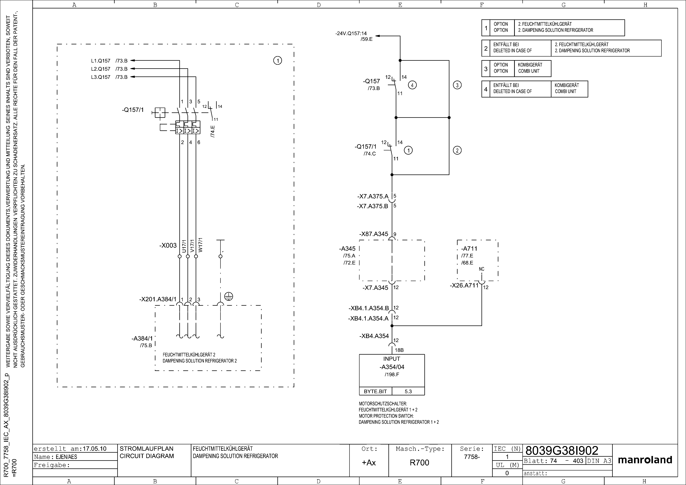

# +Ax — Sheet 74 of 403 — FEUCHTMITTELKÜHLGERÄT

**DAMPENING SOLUTION REFRIGERATOR**

> Part of the manroland **R700** printing press IEC/UL circuit diagrams.
> Drawing class: **Stromlaufplan / Circuit diagram** (DIN A3).
> Document `+Ax` covers the **Central control console** machine section.

## At a glance

| Field | Value |
|---|---|
| Document | `+Ax`  (8039G38I902) |
| Sheet | **74** of 403 |
| Section (DE) | FEUCHTMITTELKÜHLGERÄT |
| Section (EN) | DAMPENING SOLUTION REFRIGERATOR |
| Section type | CIRCUIT — Circuit diagram |
| Machine type | `R700` |
| Series | `7758` |
| Created | 17.05.10 |
| Replaces | — |
| Columns used | A, B, C, D, E, F, G |
| Path numbers | — |
| Labels on sheet | 100 |
| Cross-refs out | 13 |
| Cross-refs in | 25 |

**Previous:** [+Ax sheet 73](SHEET_0073.md) · **Next:** [+Ax sheet 75](SHEET_0075.md) · **Document TOC:** [_TOC.md](_TOC.md)  (+Ax) · **Master TOC:** [all sheets](../_MASTER_TOC.md)

## Sheet image (300 DPI, exact vector render)



_Rendered directly from the PDF vector layer at 300 DPI (1-bit), no OCR and no resampling. Use it to confirm anything ambiguous in the text below._

## Cross-references on this sheet

Each entry is a wire leaving this sheet. The printed token is `/sheet.column`; the link resolves to that sheet inside the same document.

| Ref | Target sheet | Col | Path | Destination on target | Target section | From col |
|---|---|---|---|---|---|---|
| `/59.E` | [+Ax sheet 59](SHEET_0059.md) | E | — | 24V.Q157:14 | DRUCKLUFTANLAGE | D |
| `/73.B` | [+Ax sheet 73](SHEET_0073.md) | B | — | L1.Q157 1 | FEUCHTMITTELKÜHLGERÄT | B |
| `/73.B` | [+Ax sheet 73](SHEET_0073.md) | B | — | L2.Q157 | FEUCHTMITTELKÜHLGERÄT | A |
| `/73.B` | [+Ax sheet 73](SHEET_0073.md) | B | — | L3.Q157 | FEUCHTMITTELKÜHLGERÄT | A |
| `/73.B` | [+Ax sheet 73](SHEET_0073.md) | B | — | — | FEUCHTMITTELKÜHLGERÄT | E |
| `/74.E` | [+Ax sheet 74](SHEET_0074.md) | E | — | — | FEUCHTMITTELKÜHLGERÄT | C |
| `/74.C` | [+Ax sheet 74](SHEET_0074.md) | C | — | — | FEUCHTMITTELKÜHLGERÄT | E |
| `/77.E` | [+Ax sheet 77](SHEET_0077.md) | E | — | A711 | ANLEGER | F |
| `/68.E` | [+Ax sheet 68](SHEET_0068.md) | E | — | A711 | SAUGBÄNDERTISCH | F |
| `/75.A` | [+Ax sheet 75](SHEET_0075.md) | A | — | — | FEUCHTMITTELKÜHLGERÄT | D |
| `/72.E` | [+Ax sheet 72](SHEET_0072.md) | E | — | — | WASCHVORRICHTUNGEN DRUCKWERKE | D |
| `/75.B` | [+Ax sheet 75](SHEET_0075.md) | B | — | — | FEUCHTMITTELKÜHLGERÄT | B |
| `/198.F` | [+Ax sheet 198](SHEET_0198.md) | F | — | — | REFERENZMODUL | E |

### Incoming references (sheets that point here)

Every other sheet that sends a wire to this one. `Back-ref` is the token printed on *that* sheet; `Path` is its line number.

| From sheet | Cols | Back-ref | Path | Refs | What continues there |
|---|---|---|---|---|---|
| [+Ax#59](SHEET_0059.md) | E | `/59.E` | — | 1 | — |
| [+Ax#68](SHEET_0068.md) | E | `/68.E` | — | 1 | A711 |
| [+Ax#72](SHEET_0072.md) | E | `/72.E` | — | 1 | — |
| [+Ax#73](SHEET_0073.md) | B | `/73.B` | — | 4 | L1.Q157:1 L1.Q157; L2.Q157:3 L2.Q157; L3.Q157:5 L3.Q157 |
| [+Ax#74](SHEET_0074.md) | C, E | `/74.C`, `/74.E` | — | 2 | — |
| [+Ax#75](SHEET_0075.md) | A, B | `/75.A`, `/75.B` | — | 2 | — |
| [+Ax#77](SHEET_0077.md) | D | `/77.D` | — | 1 | — |
| [+Ax#198](SHEET_0198.md) | F | `/198.F` | — | 1 | — |
| [+Ax#228](SHEET_0228.md) | A, B, C | `/228.A`, `/228.B`, `/228.C` | — | 3 | — |
| [+Ax#235](SHEET_0235.md) | H | `/235.H` | — | 1 | — |
| [+Ax#236](SHEET_0236.md) | E, F | `/236.E`, `/236.F` | — | 2 | — |
| [+Ax#269](SHEET_0269.md) | H | `/269.H` | — | 1 | — |
| [+Ax#289](SHEET_0289.md) | A | `/289.A` | — | 1 | — |
| [+Ax#290](SHEET_0290.md) | G | `/290.G` | — | 4 | — |


## Devices on this sheet

| Tag | Class | Class meaning (IEC) | Col | Sub | Terminal | Sign |
|---|---|---|---|---|---|---|
| `A384/1` | A | Baugruppe / assembly, module, PC board | B | 1 | — | — |
| `U17/1` | U | Umrichter / frequency converter | B | 1 | — | — |
| `X003` | X | Klemme / terminal, plug connector | B | — | — | — |
| `V17/1` | V | Diode / semiconductor valve | B | 1 | — | — |
| `W17/1` | W | Kabel / cable, line, bus | C | 1 | — | — |
| `Q157/1` | Q | Leistungsschalter / power switching device | B | 1 | — | — |
| `Q157` | Q | Leistungsschalter / power switching device | E | — | — | — |
| `A354/04` | A | Baugruppe / assembly, module, PC board | E | 04 | — | — |
| `Q157/1` | Q | Leistungsschalter / power switching device | E | 1 | — | — |
| `A345` | A | Baugruppe / assembly, module, PC board | D | — | — | — |
| `A711` | A | Baugruppe / assembly, module, PC board | F | — | — | — |
| `5.3` | — | cross-device reference | E | — | — | — |
| `XB4.A354` | — | cross-device reference | E | — | — | — |
| `X7.A375.B` | — | cross-device reference | E | — | — | — |
| `X7.A375.A` | — | cross-device reference | E | — | — | — |
| `X7.A345` | — | cross-device reference | E | — | — | — |
| `X87.A345` | — | cross-device reference | E | — | — | — |
| `XB4.1.A354.B` | — | cross-device reference | E | — | — | — |
| `XB4.1.A354.A` | — | cross-device reference | E | — | — | — |
| `X26.A711` | — | cross-device reference | F | — | — | — |

## Potentials / nets

| Potential | Count | Columns | Attached devices | Terminals |
|---|---|---|---|---|
| `24V` | 1 | D | `Q157` | `14` |
| `L1` | 1 | A | `Q157` | — |
| `L2` | 1 | A | `Q157` | — |
| `L3` | 1 | A | `Q157` | — |


A potential such as `L24+/4` or `M24+` is a named supply/return rail; every place it appears on this sheet is electrically common.

## Wire-end annotations (grouped as printed)

A wire that continues elsewhere is annotated with a small cluster: the destination description, the path/line number `#NN`, and the `/sheet.column` cross reference. Each row below is one such cluster exactly as it is grouped on the drawing.

| Col | Y | Path | Cross-ref | Text on the wire |
|---|---|---|---|---|
| F | 38.9 | — | — | `OPTION OPTION` |
| G | 38.9 | — | — | `2. FEUCHTMITTELKÜHLGERÄT 2. DAMPENING SOLUTION REFRIGERATOR` |
| F | 44.2 | — | — | `1` |
| D | 54.1 | — | `/59.E` | `24V.Q157:14` |
| G | 74.3 | — | — | `ENTFÄLLT BEI DELETED IN CASE OF 2. FEUCHTMITTELKÜHLGERÄT 2. DAMPENING SOLUTION REFRIGERATOR` |
| F | 79.6 | — | — | `2` |
| B | 101.6 | — | `/73.B` | `L1.Q157 1` |
| F | 109.7 | — | — | `3 OPTION OPTION` |
| G | 109.8 | — | — | `KOMBIGERÄT` |
| A | 115.8 | — | `/73.B` | `L2.Q157` |
| G | 120.4 | — | — | `COMBI UNIT` |
| A | 129.9 | — | `/73.B` | `L3.Q157` |
| E | 130.0 | — | — | `Q157 14` |
| E | 130.0 | — | — | `12` |
| E | 144.9 | — | — | `4` |
| F | 144.9 | — | — | `3` |
| F | 145.2 | — | — | `ENTFÄLLT BEI DELETED IN CASE OF` |
| G | 145.2 | — | — | `KOMBIGERÄT` |
| E | 149.4 | — | `/73.B` | — |
| F | 150.5 | — | — | `4` |
| G | 155.8 | — | — | `COMBI UNIT` |
| E | 158.4 | — | — | `11` |
| B | 172.5 | — | — | `1` |
| B | 172.5 | — | — | `3` |
| C | 172.5 | — | — | `5` |
| C | 181.6 | — | — | `12 14` |
| B | 186.0 | — | — | `Q157/1 11` |
| C | 217.7 | — | `/74.E` | — |
| B | 243.4 | — | — | `2` |
| B | 243.4 | — | — | `4` |
| C | 243.4 | — | — | `6` |
| E | 243.4 | — | — | `Q157/1 14` |
| E | 243.4 | — | — | `12` |
| E | 257.7 | — | — | `1` |
| F | 258.2 | — | — | `2` |
| E | 262.8 | — | `/74.C` | — |
| E | 271.7 | — | — | `11` |
| E | 336.2 | — | — | `X7.A375.A 5` |
| E | 353.2 | — | — | `X7.A375.B 5` |
| E | 401.4 | — | — | `X87.A345 9` |
| C | 411.9 | — | — | `W17/1` |
| B | 415.0 | — | — | `V17/1` |
| B | 415.6 | — | — | `U17/1` |
| B | 421.0 | — | — | `X003` |
| D | 426.9 | — | — | `A345` |
| F | 426.9 | — | `/77.E`, `/68.E` | `A711` |
| C | 434.6 | — | — | `'` |
| D | 440.0 | — | `/75.A` | — |
| D | 452.4 | — | `/72.E` | — |
| F | 464.1 | — | — | `NC` |
| F | 490.7 | — | — | `X26.A711 12` |
| E | 494.9 | — | — | `X7.A345 12` |
| B | 514.8 | — | — | `X201.A384/1 1 2 3` |
| E | 530.4 | — | — | `XB4.1.A354.B 12` |
| E | 547.4 | — | — | `XB4.1.A354.A 12` |
| E | 578.6 | — | — | `XB4.A354 12` |
| B | 582.8 | — | — | `A384/1` |
| B | 595.9 | — | `/75.B` | — |
| E | 604.1 | — | — | `18B` |
| C | 612.9 | — | — | `FEUCHTMITTELKÜHLGERÄT 2 DAMPENING SOLUTION REFRIGERATOR 2` |
| E | 618.6 | — | — | `INPUT` |
| E | 632.4 | — | — | `A354/04` |
| E | 646.2 | — | `/198.F` | — |
| E | 675.6 | — | — | `BYTE.BIT 5.3` |
| E | 698.0 | — | — | `FEUCHTMITTELKÜHLGERÄT 1 + 2 DAMPENING SOLUTION REFRIGERATOR 1 + 2 MOTORSCHUTZSCHALTER: MOTOR PROTECTION SWITCH:` |


## Reconstructed tables

This sheet carries tabular content (pin map / terminal assignment / index). The grid below was rebuilt from the drawing's own rule lines, so each row is exactly one physical row of the table.

### Table 1 — 2 data rows × 2 columns (at x=340.2, y=104.9)

| 5 | 12 14 |
|---|---|
|  | `11` |
|  | `/74.E` |


### Table 2 — 5 data rows × 4 columns (at x=623.6, y=104.9)

| 12 Q157 /73.B |  | 11 | 14 4 |
|---|---|---|---|
| `12 Q157/1 /74.C` | `11` | `14` | `1` |
| `X7.A375.A X7.A375.B X87.A345 X7.A345 XB4.1.A354.B XB4.1.A354.A` | `5 5 9 12 12 12` |  |  |
| `XB4.A354` | `12` | `18B` |  |
| `INPUT` | `A354/04 /198.F` |  |  |
| `BYTE.BIT` |  |  | `5.3` |


### Table 3 — 3 data rows × 1 columns (at x=779.5, y=104.9)

| C1 |
|---|
| `3` |
| `2` |
| `A711 /77.E /68.E NC X26.A711` |


## Notes and free text on this sheet

| Text | Col | Y (pt) |
|---|---|---|
| `FEUCHTMITTELKÜHLGERÄT 2` | B | 612.92 |
| `DAMPENING SOLUTION REFRIGERATOR 2` | C | 623.55 |
| `X201.A384/1` | B | 514.79 |
| `18B` | E | 604.07 |
| `INPUT` | E | 618.59 |
| `BYTE.BIT` | E | 675.58 |
| `MOTORSCHUTZSCHALTER:` | E | 697.96 |
| `FEUCHTMITTELKÜHLGERÄT 1 + 2` | E | 708.59 |
| `MOTOR PROTECTION SWITCH:` | E | 719.2 |
| `DAMPENING SOLUTION REFRIGERATOR 1 + 2` | E | 729.85 |
| `OPTION` | F | 38.87 |
| `ENTFÄLLT BEI` | F | 145.16 |
| `DELETED IN CASE OF` | F | 155.81 |
| `2. FEUCHTMITTELKÜHLGERÄT` | G | 38.91 |
| `2. DAMPENING SOLUTION REFRIGERATOR` | G | 49.54 |
| `KOMBIGERÄT` | G | 145.18 |
| `COMBI UNIT` | G | 155.84 |
| `NC` | F | 464.05 |

## Complete label inventory (exact text from the drawing)

Every text object inside the drawing area of this sheet, in DIN reading order (column A→H, then top→bottom). This is the authoritative list: if a string is not here it is not printed on this sheet.

| Col | Y | X | Dir | Type | Text |
|---|---|---|---|---|---|
| A | 101.6 | 158.2 | → | potential | `L1.Q157` |
| A | 115.8 | 158.2 | → | potential | `L2.Q157` |
| A | 130.0 | 158.2 | → | potential | `L3.Q157` |
| B | 101.6 | 200.7 | → | cross-reference | `/73.B` |
| B | 115.8 | 200.7 | → | cross-reference | `/73.B` |
| B | 129.9 | 200.7 | → | cross-reference | `/73.B` |
| B | 172.5 | 313.8 | → | number | `1` |
| B | 172.5 | 328.5 | → | number | `3` |
| B | 186.0 | 211.7 | → | device tag | `Q157/1` |
| B | 243.4 | 314.4 | → | number | `2` |
| B | 243.4 | 328.5 | → | number | `4` |
| B | 415.0 | 329.8 | ↕ | device tag | `V17/1` |
| B | 415.6 | 315.7 | ↕ | device tag | `U17/1` |
| B | 421.0 | 276.7 | → | device tag | `X003` |
| B | 514.8 | 241.8 | → | text | `X201.A384/1` |
| B | 516.2 | 313.8 | → | number | `1` |
| B | 516.2 | 328.5 | → | number | `2` |
| B | 582.8 | 228.5 | → | device tag | `A384/1` |
| B | 595.9 | 243.2 | → | cross-reference | `/75.B` |
| B | 612.9 | 282.6 | → | text | `FEUCHTMITTELKÜHLGERÄT 2` |
| C | 172.5 | 342.7 | → | number | `5` |
| C | 181.6 | 350.9 | → | number | `12` |
| C | 181.6 | 377.9 | → | number | `14` |
| C | 204.3 | 370.8 | → | number | `11` |
| C | 217.7 | 365.2 | ↕ | cross-reference | `/74.E` |
| C | 243.4 | 342.7 | → | number | `6` |
| C | 411.9 | 343.9 | ↕ | device tag | `W17/1` |
| C | 434.6 | 385.3 | ↕ | other | `'` |
| C | 516.2 | 342.7 | → | number | `3` |
| C | 623.6 | 282.6 | → | text | `DAMPENING SOLUTION REFRIGERATOR 2` |
| D | 54.2 | 582.2 | → | potential | `24V.Q157:14` |
| D | 101.8 | 480.1 | → | number | `1` |
| D | 426.9 | 588.8 | → | device tag | `A345` |
| D | 440.0 | 595.8 | → | cross-reference | `/75.A` |
| D | 452.4 | 596.4 | → | cross-reference | `/72.E` |
| E | 64.0 | 626.2 | → | cross-reference | `/59.E` |
| E | 130.0 | 668.4 | → | number | `12` |
| E | 130.0 | 696.5 | → | number | `14` |
| E | 136.4 | 630.1 | → | device tag | `Q157` |
| E | 144.9 | 713.8 | → | number | `4` |
| E | 149.4 | 638.6 | → | cross-reference | `/73.B` |
| E | 158.4 | 689.4 | → | number | `11` |
| E | 243.4 | 661.3 | → | number | `12` |
| E | 243.4 | 689.4 | → | number | `14` |
| E | 249.8 | 615.7 | → | device tag | `Q157/1` |
| E | 257.7 | 706.9 | → | number | `1` |
| E | 262.8 | 631.3 | → | cross-reference | `/74.C` |
| E | 271.7 | 682.3 | → | number | `11` |
| E | 336.2 | 620.2 | → | device ref | `X7.A375.A` |
| E | 336.2 | 682.9 | → | number | `5` |
| E | 353.2 | 619.7 | → | device ref | `X7.A375.B` |
| E | 353.2 | 682.9 | → | number | `5` |
| E | 401.4 | 623.6 | → | device ref | `X87.A345` |
| E | 402.8 | 682.9 | → | number | `9` |
| E | 495.0 | 629.6 | → | device ref | `X7.A345` |
| E | 495.0 | 682.3 | → | number | `12` |
| E | 530.4 | 605.2 | → | device ref | `XB4.1.A354.B` |
| E | 530.4 | 682.3 | → | number | `12` |
| E | 547.4 | 682.3 | → | number | `12` |
| E | 548.1 | 604.3 | → | device ref | `XB4.1.A354.A` |
| E | 578.6 | 623.9 | → | device ref | `XB4.A354` |
| E | 587.1 | 682.3 | → | number | `12` |
| E | 604.1 | 685.1 | → | text | `18B` |
| E | 618.6 | 665.4 | → | text | `INPUT` |
| E | 632.4 | 658.9 | → | device tag | `A354/04` |
| E | 646.2 | 668.0 | → | cross-reference | `/198.F` |
| E | 675.6 | 631.8 | → | text | `BYTE.BIT` |
| E | 675.6 | 702.6 | → | device ref | `5.3` |
| E | 698.0 | 623.1 | → | text | `MOTORSCHUTZSCHALTER:` |
| E | 708.6 | 622.8 | → | text | `FEUCHTMITTELKÜHLGERÄT 1 + 2` |
| E | 719.2 | 623.1 | → | text | `MOTOR PROTECTION SWITCH:` |
| E | 729.9 | 622.8 | → | text | `DAMPENING SOLUTION REFRIGERATOR 1 + 2` |
| F | 38.9 | 857.2 | → | text | `OPTION` |
| F | 44.2 | 840.8 | → | number | `1` |
| F | 49.5 | 857.2 | → | text | `OPTION` |
| F | 74.3 | 856.6 | → | text | `ENTFÄLLT BEI` |
| F | 79.6 | 840.5 | → | number | `2` |
| F | 84.9 | 856.6 | → | text | `DELETED IN CASE OF` |
| F | 109.7 | 857.2 | → | text | `OPTION` |
| F | 115.1 | 840.3 | → | number | `3` |
| F | 120.4 | 857.2 | → | text | `OPTION` |
| F | 144.9 | 791.7 | → | number | `3` |
| F | 145.2 | 856.6 | → | text | `ENTFÄLLT BEI` |
| F | 150.5 | 840.5 | → | number | `4` |
| F | 155.8 | 856.6 | → | text | `DELETED IN CASE OF` |
| F | 258.2 | 791.7 | → | number | `2` |
| F | 426.9 | 800.5 | → | device tag | `A711` |
| F | 440.0 | 800.8 | → | cross-reference | `/77.E` |
| F | 452.4 | 800.8 | → | cross-reference | `/68.E` |
| F | 464.0 | 831.3 | → | text | `NC` |
| F | 490.7 | 780.9 | → | device ref | `X26.A711` |
| F | 495.0 | 838.2 | → | number | `12` |
| G | 38.9 | 899.7 | → | text | `2. FEUCHTMITTELKÜHLGERÄT` |
| G | 49.5 | 899.7 | → | text | `2. DAMPENING SOLUTION REFRIGERATOR` |
| G | 74.3 | 963.5 | → | text | `2. FEUCHTMITTELKÜHLGERÄT` |
| G | 85.0 | 963.5 | → | text | `2. DAMPENING SOLUTION REFRIGERATOR` |
| G | 109.7 | 899.1 | → | text | `KOMBIGERÄT` |
| G | 120.4 | 899.7 | → | text | `COMBI UNIT` |
| G | 145.2 | 962.9 | → | text | `KOMBIGERÄT` |
| G | 155.8 | 963.5 | → | text | `COMBI UNIT` |

## Reading-order text block

The same content as a plain block, grouped by DIN column — convenient to paste or to match against a visual description.

```text
=== Column A ===
 101.6  158.2  net          L1.Q157
 115.8  158.2  net          L2.Q157
 130.0  158.2  net          L3.Q157
=== Column B ===
 101.6  200.7  xref         /73.B
 115.8  200.7  xref         /73.B
 129.9  200.7  xref         /73.B
 172.5  313.8  numeric      1
 172.5  328.5  numeric      3
 186.0  211.7  devtag       Q157/1
 243.4  314.4  numeric      2
 243.4  328.5  numeric      4
 415.0  329.8  devtag       V17/1
 415.6  315.7  devtag       U17/1
 421.0  276.7  devtag       X003
 514.8  241.8  text         X201.A384/1
 516.2  313.8  numeric      1
 516.2  328.5  numeric      2
 582.8  228.5  devtag       A384/1
 595.9  243.2  xref         /75.B
 612.9  282.6  text         FEUCHTMITTELKÜHLGERÄT 2
=== Column C ===
 172.5  342.7  numeric      5
 181.6  350.9  numeric      12
 181.6  377.9  numeric      14
 204.3  370.8  numeric      11
 217.7  365.2  xref         /74.E
 243.4  342.7  numeric      6
 411.9  343.9  devtag       W17/1
 434.6  385.3  other        `
 516.2  342.7  numeric      3
 623.6  282.6  text         DAMPENING SOLUTION REFRIGERATOR 2
=== Column D ===
  54.2  582.2  net          24V.Q157:14
 101.8  480.1  numeric      1
 426.9  588.8  devtag       A345
 440.0  595.8  xref         /75.A
 452.4  596.4  xref         /72.E
=== Column E ===
  64.0  626.2  xref         /59.E
 130.0  668.4  numeric      12
 130.0  696.5  numeric      14
 136.4  630.1  devtag       Q157
 144.9  713.8  numeric      4
 149.4  638.6  xref         /73.B
 158.4  689.4  numeric      11
 243.4  661.3  numeric      12
 243.4  689.4  numeric      14
 249.8  615.7  devtag       Q157/1
 257.7  706.9  numeric      1
 262.8  631.3  xref         /74.C
 271.7  682.3  numeric      11
 336.2  620.2  devref       X7.A375.A
 336.2  682.9  numeric      5
 353.2  619.7  devref       X7.A375.B
 353.2  682.9  numeric      5
 401.4  623.6  devref       X87.A345
 402.8  682.9  numeric      9
 495.0  629.6  devref       X7.A345
 495.0  682.3  numeric      12
 530.4  605.2  devref       XB4.1.A354.B
 530.4  682.3  numeric      12
 547.4  682.3  numeric      12
 548.1  604.3  devref       XB4.1.A354.A
 578.6  623.9  devref       XB4.A354
 587.1  682.3  numeric      12
 604.1  685.1  text         18B
 618.6  665.4  text         INPUT
 632.4  658.9  devtag       A354/04
 646.2  668.0  xref         /198.F
 675.6  631.8  text         BYTE.BIT
 675.6  702.6  devref       5.3
 698.0  623.1  text         MOTORSCHUTZSCHALTER:
 708.6  622.8  text         FEUCHTMITTELKÜHLGERÄT 1 + 2
 719.2  623.1  text         MOTOR PROTECTION SWITCH:
 729.9  622.8  text         DAMPENING SOLUTION REFRIGERATOR 1 + 2
=== Column F ===
  38.9  857.2  text         OPTION
  44.2  840.8  numeric      1
  49.5  857.2  text         OPTION
  74.3  856.6  text         ENTFÄLLT BEI
  79.6  840.5  numeric      2
  84.9  856.6  text         DELETED IN CASE OF
 109.7  857.2  text         OPTION
 115.1  840.3  numeric      3
 120.4  857.2  text         OPTION
 144.9  791.7  numeric      3
 145.2  856.6  text         ENTFÄLLT BEI
 150.5  840.5  numeric      4
 155.8  856.6  text         DELETED IN CASE OF
 258.2  791.7  numeric      2
 426.9  800.5  devtag       A711
 440.0  800.8  xref         /77.E
 452.4  800.8  xref         /68.E
 464.0  831.3  text         NC
 490.7  780.9  devref       X26.A711
 495.0  838.2  numeric      12
=== Column G ===
  38.9  899.7  text         2. FEUCHTMITTELKÜHLGERÄT
  49.5  899.7  text         2. DAMPENING SOLUTION REFRIGERATOR
  74.3  963.5  text         2. FEUCHTMITTELKÜHLGERÄT
  85.0  963.5  text         2. DAMPENING SOLUTION REFRIGERATOR
 109.7  899.1  text         KOMBIGERÄT
 120.4  899.7  text         COMBI UNIT
 145.2  962.9  text         KOMBIGERÄT
 155.8  963.5  text         COMBI UNIT
```

---
_Generated from the PDF vector text layer; no OCR. Source: `R700_7758_IEC_AX_8039G38I902_p`, sheet 74._
