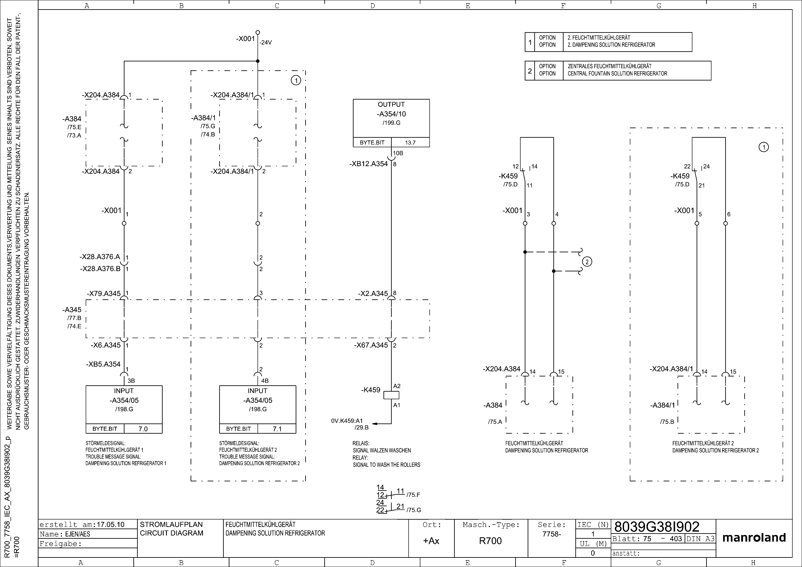

# +Ax — Sheet 75 of 403 — FEUCHTMITTELKÜHLGERÄT

**DAMPENING SOLUTION REFRIGERATOR**

> Part of the manroland **R700** printing press IEC/UL circuit diagrams.
> Drawing class: **Stromlaufplan / Circuit diagram** (DIN A3).
> Document `+Ax` covers the **Central control console** machine section.

## At a glance

| Field | Value |
|---|---|
| Document | `+Ax`  (8039G38I902) |
| Sheet | **75** of 403 |
| Section (DE) | FEUCHTMITTELKÜHLGERÄT |
| Section (EN) | DAMPENING SOLUTION REFRIGERATOR |
| Section type | CIRCUIT — Circuit diagram |
| Machine type | `R700` |
| Series | `7758` |
| Created | 17.05.10 |
| Replaces | — |
| Columns used | A, B, C, D, E, F, G, H |
| Path numbers | — |
| Labels on sheet | 128 |
| Cross-refs out | 15 |
| Cross-refs in | 36 |

**Previous:** [+Ax sheet 74](SHEET_0074.md) · **Next:** [+Ax sheet 76](SHEET_0076.md) · **Document TOC:** [_TOC.md](_TOC.md)  (+Ax) · **Master TOC:** [all sheets](../_MASTER_TOC.md)

## Sheet image (300 DPI, exact vector render)



_Rendered directly from the PDF vector layer at 300 DPI (1-bit), no OCR and no resampling. Use it to confirm anything ambiguous in the text below._

## Cross-references on this sheet

Each entry is a wire leaving this sheet. The printed token is `/sheet.column`; the link resolves to that sheet inside the same document.

| Ref | Target sheet | Col | Path | Destination on target | Target section | From col |
|---|---|---|---|---|---|---|
| `/199.G` | [+Ax sheet 199](SHEET_0199.md) | G | — | — | REFERENZMODUL | D |
| `/75.G` | [+Ax sheet 75](SHEET_0075.md) | G | — | — | FEUCHTMITTELKÜHLGERÄT | B |
| `/75.E` | [+Ax sheet 75](SHEET_0075.md) | E | — | — | FEUCHTMITTELKÜHLGERÄT | A |
| `/73.A` | [+Ax sheet 73](SHEET_0073.md) | A | — | — | FEUCHTMITTELKÜHLGERÄT | A |
| `/74.B` | [+Ax sheet 74](SHEET_0074.md) | B | — | — | FEUCHTMITTELKÜHLGERÄT | B |
| `/75.D` | [+Ax sheet 75](SHEET_0075.md) | D | — | — | FEUCHTMITTELKÜHLGERÄT | E |
| `/75.D` | [+Ax sheet 75](SHEET_0075.md) | D | — | — | FEUCHTMITTELKÜHLGERÄT | G |
| `/77.B` | [+Ax sheet 77](SHEET_0077.md) | B | — | — | ANLEGER | A |
| `/74.E` | [+Ax sheet 74](SHEET_0074.md) | E | — | — | FEUCHTMITTELKÜHLGERÄT | A |
| `/198.G` | [+Ax sheet 198](SHEET_0198.md) | G | — | — | REFERENZMODUL | A |
| `/198.G` | [+Ax sheet 198](SHEET_0198.md) | G | — | — | REFERENZMODUL | C |
| `/29.B` | [+Ax sheet 29](SHEET_0029.md) | B | — | 0V.K459:A1 | SPANNUNGSVERSORGUNG, SCHALTSCHRANKBELÜFTUNG | D |
| `/75.A` | [+Ax sheet 75](SHEET_0075.md) | A | — | — | FEUCHTMITTELKÜHLGERÄT | E |
| `/75.B` | [+Ax sheet 75](SHEET_0075.md) | B | — | — | FEUCHTMITTELKÜHLGERÄT | G |
| `/75.G` | [+Ax sheet 75](SHEET_0075.md) | G | — | — | FEUCHTMITTELKÜHLGERÄT | D |

### Incoming references (sheets that point here)

Every other sheet that sends a wire to this one. `Back-ref` is the token printed on *that* sheet; `Path` is its line number.

| From sheet | Cols | Back-ref | Path | Refs | What continues there |
|---|---|---|---|---|---|
| [+Ax#29](SHEET_0029.md) | A | `/29.A` | — | 1 | — |
| [+Ax#73](SHEET_0073.md) | B | `/73.B` | — | 1 | FEUCHTMITTELKÜHLGERÄT DAMPENING SOLUTION REFRIGERATOR |
| [+Ax#74](SHEET_0074.md) | B, D | `/74.B`, `/74.D` | — | 2 | — |
| [+Ax#75](SHEET_0075.md) | A, B, D, E, G | `/75.A`, `/75.B`, `/75.D`, `/75.E`, `/75.G` | — | 7 | — |
| [+Ax#77](SHEET_0077.md) | A | `/77.A` | — | 1 | — |
| [+Ax#198](SHEET_0198.md) | G | `/198.G` | — | 2 | — |
| [+Ax#199](SHEET_0199.md) | G | `/199.G` | — | 1 | — |
| [+Ax#217](SHEET_0217.md) | H | `/217.H` | — | 1 | — |
| [+Ax#231](SHEET_0231.md) | E | `/231.E` | — | 2 | — |
| [+Ax#233](SHEET_0233.md) | G | `/233.G` | — | 2 | — |
| [+Ax#248](SHEET_0248.md) | F | `/248.F` | — | 1 | — |
| [+Ax#271](SHEET_0271.md) | D, E | `/271.D`, `/271.E` | — | 4 | — |
| [+Ax#284](SHEET_0284.md) | H | `/284.H` | — | 1 | — |
| [+Ax#286](SHEET_0286.md) | B | `/286.B` | — | 2 | — |
| [+Ax#291](SHEET_0291.md) | B, C | `/291.B`, `/291.C` | — | 8 | — |


## Devices on this sheet

| Tag | Class | Class meaning (IEC) | Col | Sub | Terminal | Sign |
|---|---|---|---|---|---|---|
| `A2` | A | Baugruppe / assembly, module, PC board | D | — | — | — |
| `A1` | A | Baugruppe / assembly, module, PC board | D | — | — | — |
| `K459` | K | Relais / relay, contactor | D | — | — | — |
| `A354/05` | A | Baugruppe / assembly, module, PC board | A | 05 | — | — |
| `A354/05` | A | Baugruppe / assembly, module, PC board | C | 05 | — | — |
| `X001` | X | Klemme / terminal, plug connector | A | — | — | — |
| `A345` | A | Baugruppe / assembly, module, PC board | A | — | — | — |
| `A384` | A | Baugruppe / assembly, module, PC board | A | — | — | — |
| `A384/1` | A | Baugruppe / assembly, module, PC board | B | 1 | — | — |
| `A354/10` | A | Baugruppe / assembly, module, PC board | D | 10 | — | — |
| `K459` | K | Relais / relay, contactor | G | — | — | — |
| `A384/1` | A | Baugruppe / assembly, module, PC board | G | 1 | — | — |
| `X001` | X | Klemme / terminal, plug connector | G | — | — | — |
| `K459` | K | Relais / relay, contactor | E | — | — | — |
| `A384` | A | Baugruppe / assembly, module, PC board | E | — | — | — |
| `X001` | X | Klemme / terminal, plug connector | E | — | — | — |
| `X001` | X | Klemme / terminal, plug connector | C | — | — | — |
| `7.0` | — | cross-device reference | B | — | — | — |
| `XB5.A354` | — | cross-device reference | A | — | — | — |
| `7.1` | — | cross-device reference | C | — | — | — |
| `X28.A376.A` | — | cross-device reference | A | — | — | — |
| `X28.A376.B` | — | cross-device reference | A | — | — | — |
| `X79.A345` | — | cross-device reference | A | — | — | — |
| `X6.A345` | — | cross-device reference | A | — | — | — |
| `X2.A345` | — | cross-device reference | D | — | — | — |
| `X67.A345` | — | cross-device reference | D | — | — | — |
| `13.7` | — | cross-device reference | D | — | — | — |
| `XB12.A354` | — | cross-device reference | D | — | — | — |
| `X204.A384` | — | cross-device reference | A | — | — | — |
| `X204.A384` | — | cross-device reference | A | — | — | — |
| `X204.A384` | — | cross-device reference | E | — | — | — |

## Potentials / nets

| Potential | Count | Columns | Attached devices | Terminals |
|---|---|---|---|---|
| `0V` | 1 | D | `K459` | `A1` |
| `24V` | 1 | C | — | — |


A potential such as `L24+/4` or `M24+` is a named supply/return rail; every place it appears on this sheet is electrically common.

## Wire-end annotations (grouped as printed)

A wire that continues elsewhere is annotated with a small cluster: the destination description, the path/line number `#NN`, and the `/sheet.column` cross reference. Each row below is one such cluster exactly as it is grouped on the drawing.

| Col | Y | Path | Cross-ref | Text on the wire |
|---|---|---|---|---|
| C | 52.7 | — | — | `X001 24V` |
| F | 53.0 | — | — | `OPTION OPTION` |
| F | 53.1 | — | — | `1 2. FEUCHTMITTELKÜHLGERÄT 2. DAMPENING SOLUTION REFRIGERATOR` |
| F | 95.6 | — | — | `2 CENTRAL FOUNTAIN SOLUTION REFRIGERATOR ZENTRALES FEUCHTMITTELKÜHLGERÄT` |
| F | 95.6 | — | — | `OPTION OPTION` |
| C | 116.0 | — | — | `1` |
| A | 136.4 | — | — | `X204.A384 1` |
| C | 136.4 | — | — | `X204.A384/1 1` |
| D | 150.8 | — | — | `OUTPUT` |
| D | 164.7 | — | — | `A354/10` |
| B | 170.4 | — | — | `A384/1` |
| A | 171.8 | — | — | `A384` |
| D | 178.5 | — | `/199.G` | — |
| B | 183.5 | — | `/75.G` | — |
| A | 184.9 | — | `/75.E`, `/73.A` | — |
| B | 195.8 | — | `/74.B` | — |
| D | 208.1 | — | — | `BYTE.BIT 13.7` |
| H | 215.2 | — | — | `1` |
| D | 223.5 | — | — | `10B` |
| F | 238.4 | — | — | `XB12.A354 8 22` |
| F | 243.4 | — | — | `K459 14` |
| F | 243.4 | — | — | `12` |
| G | 243.4 | — | — | `K459 24` |
| A | 249.8 | — | — | `X204.A384 2` |
| C | 249.8 | — | — | `X204.A384/1 2` |
| E | 269.9 | — | `/75.D` | — |
| G | 269.9 | — | `/75.D` | — |
| F | 271.7 | — | — | `11` |
| G | 271.7 | — | — | `21` |
| B | 307.6 | — | — | `X001 1 2` |
| F | 307.6 | — | — | `X001 3` |
| G | 307.6 | — | — | `X001 5 6` |
| F | 314.3 | — | — | `4` |
| B | 376.6 | — | — | `X28.A376.A 1 2` |
| F | 385.8 | — | — | `2` |
| B | 394.3 | — | — | `X28.A376.B 1 2` |
| B | 431.2 | — | — | `X79.A345 1 3` |
| D | 431.2 | — | — | `X2.A345 8` |
| A | 455.3 | — | — | `A345` |
| A | 468.3 | — | `/77.B`, `/74.E` | — |
| B | 507.7 | — | — | `X6.A345 1 2` |
| D | 507.7 | — | — | `X67.A345 2` |
| A | 536.1 | — | — | `XB5.A354 1` |
| E | 543.1 | — | — | `X204.A384 14` |
| G | 543.1 | — | — | `X204.A384/1 14 15` |
| C | 544.6 | — | — | `2` |
| F | 548.1 | — | — | `15` |
| A | 561.5 | — | — | `3B` |
| C | 561.5 | — | — | `4B` |
| D | 569.3 | — | — | `A2` |
| D | 574.3 | — | — | `K459` |
| A | 576.1 | — | — | `INPUT` |
| C | 576.1 | — | — | `INPUT` |
| A | 589.9 | — | — | `A354/05` |
| C | 589.9 | — | — | `A354/05` |
| E | 597.0 | — | — | `A384` |
| G | 597.0 | — | — | `A384/1` |
| D | 597.7 | — | — | `A1` |
| A | 603.7 | — | `/198.G` | — |
| C | 603.7 | — | `/198.G` | — |
| D | 621.0 | — | `/29.B` | `0V.K459:A1` |
| E | 622.5 | — | `/75.A` | — |
| G | 622.5 | — | `/75.B` | — |
| A | 632.7 | — | — | `BYTE.BIT 7.0` |
| C | 632.7 | — | — | `BYTE.BIT 7.1` |
| D | 655.4 | — | — | `RELAIS:` |
| F | 655.4 | — | — | `FEUCHTMITTELKÜHLGERÄT DAMPENING SOLUTION REFRIGERATOR` |
| H | 655.4 | — | — | `FEUCHTMITTELKÜHLGERÄT 2 DAMPENING SOLUTION REFRIGERATOR 2` |
| A | 655.6 | — | — | `FEUCHTMITTELKÜHLGERÄT 1 DAMPENING SOLUTION REFRIGERATOR 1 STÖRMELDESIGNAL: TROUBLE MESSAGE SIGNAL:` |
| C | 655.6 | — | — | `FEUCHTMITTELKÜHLGERÄT 2 DAMPENING SOLUTION REFRIGERATOR 2 STÖRMELDESIGNAL: TROUBLE MESSAGE SIGNAL:` |
| D | 666.0 | — | — | `RELAY: SIGNAL WALZEN WASCHEN` |
| D | 687.3 | — | — | `SIGNAL TO WASH THE ROLLERS` |
| D | 718.9 | — | — | `14 12 24 22 21` |
| D | 724.5 | — | — | `11 /75.F` |
| D | 753.6 | — | `/75.G` | — |


## Reconstructed tables

This sheet carries tabular content (pin map / terminal assignment / index). The grid below was rebuilt from the drawing's own rule lines, so each row is exactly one physical row of the table.

### Table 1 — 6 data rows × 10 columns (at x=127.6, y=90.7)

| X204.A384 | 1 |  |  | X204.A384/1 | 1 | 1 |  |  |  |
|---|---|---|---|---|---|---|---|---|---|
|  |  |  | `A384/1 /75.G /74.B` |  |  |  |  | `OUTPUT` | `A354/10 /199.G` |
|  |  |  |  |  |  |  |  | `BYTE.BIT` | `13.7` |
| `X204.A384 X001 X28.A376.A X28.A376.B X79.A345 X6.A345 XB5.A354` | `2 1 1 1 1 1 1 3B` |  |  | `X204.A384/1` | `2 2 2 2 3 2 2 4B` |  |  | `XB12.A354 X2.A345 X67.A345` | `10B 8 8 2` |
| `INPUT` | `A354/05 /198.G` |  |  | `INPUT` | `A354/05 /198.G` |  | `0V.K459:A1` | `K459` | `A2 A1` |
| `BYTE.BIT` | `7.0` |  |  | `BYTE.BIT` | `7.1` |  |  | `/29.B` |  |
| `STÖRMELDESIGNAL: FEUCHTMITTELKÜHLGERÄT TROUBLE MESSAGE DAMPENING SOLUTION` | `1 SIGNAL: REFRIGERATOR` | `1` |  | `STÖRMELDESIGNAL: FEUCHTMITTELKÜHLGERÄT TROUBLE MESSAGE DAMPENING SOLUTION` | `2 SIGNAL: REFRIGERATOR` | `2` |  | `RELAIS: SIGNAL WALZEN RELAY: SIGNAL TO WASH` | `WASCHEN THE ROLLERS` |


## Notes and free text on this sheet

| Text | Col | Y (pt) |
|---|---|---|
| `11 /75.F` | D | 724.52 |
| `RELAIS:` | D | 655.36 |
| `SIGNAL WALZEN WASCHEN` | D | 666.02 |
| `RELAY:` | D | 676.63 |
| `SIGNAL TO WASH THE ROLLERS` | D | 687.31 |
| `3B` | A | 561.53 |
| `INPUT` | A | 576.07 |
| `BYTE.BIT` | A | 633.32 |
| `STÖRMELDESIGNAL:` | A | 655.59 |
| `FEUCHTMITTELKÜHLGERÄT 1` | A | 665.5 |
| `TROUBLE MESSAGE SIGNAL:` | A | 675.49 |
| `DAMPENING SOLUTION REFRIGERATOR 1` | A | 685.42 |
| `4B` | C | 561.53 |
| `INPUT` | C | 576.07 |
| `BYTE.BIT` | C | 633.32 |
| `STÖRMELDESIGNAL:` | C | 655.59 |
| `FEUCHTMITTELKÜHLGERÄT 2` | C | 665.51 |
| `TROUBLE MESSAGE SIGNAL:` | C | 675.49 |
| `DAMPENING SOLUTION REFRIGERATOR 2` | C | 685.42 |
| `10B` | D | 223.52 |
| `OUTPUT` | D | 150.85 |
| `BYTE.BIT` | D | 208.12 |
| `FEUCHTMITTELKÜHLGERÄT 2` | G | 655.44 |
| `DAMPENING SOLUTION REFRIGERATOR 2` | H | 666.07 |
| `FEUCHTMITTELKÜHLGERÄT` | F | 655.44 |
| `DAMPENING SOLUTION REFRIGERATOR` | F | 666.07 |
| `X204.A384/1` | C | 136.37 |
| `X204.A384/1` | G | 543.14 |
| `OPTION` | F | 53.04 |
| `2. FEUCHTMITTELKÜHLGERÄT` | F | 53.08 |
| `2. DAMPENING SOLUTION REFRIGERATOR` | G | 63.71 |
| `ZENTRALES FEUCHTMITTELKÜHLGERÄT` | F | 95.6 |
| `CENTRAL FOUNTAIN SOLUTION REFRIGERATOR` | G | 106.23 |

## Complete label inventory (exact text from the drawing)

Every text object inside the drawing area of this sheet, in DIN reading order (column A→H, then top→bottom). This is the authoritative list: if a string is not here it is not printed on this sheet.

| Col | Y | X | Dir | Type | Text |
|---|---|---|---|---|---|
| A | 136.4 | 121.6 | → | device ref | `X204.A384` |
| A | 137.1 | 190.5 | → | number | `1` |
| A | 171.8 | 92.7 | → | device tag | `A384` |
| A | 184.9 | 100.3 | → | cross-reference | `/75.E` |
| A | 197.3 | 99.8 | → | cross-reference | `/73.A` |
| A | 249.7 | 121.6 | → | device ref | `X204.A384` |
| A | 250.5 | 191.1 | → | number | `2` |
| A | 307.6 | 150.8 | → | device tag | `X001` |
| A | 314.3 | 186.2 | → | number | `1` |
| A | 376.6 | 118.2 | → | device ref | `X28.A376.A` |
| A | 378.7 | 186.2 | → | number | `1` |
| A | 394.3 | 119.1 | → | device ref | `X28.A376.B` |
| A | 395.8 | 186.2 | → | number | `1` |
| A | 431.2 | 129.0 | → | device ref | `X79.A345` |
| A | 431.2 | 186.2 | → | number | `1` |
| A | 455.3 | 92.7 | → | device tag | `A345` |
| A | 468.3 | 100.1 | → | cross-reference | `/77.B` |
| A | 480.7 | 100.3 | → | cross-reference | `/74.E` |
| A | 507.7 | 134.9 | → | device ref | `X6.A345` |
| A | 509.1 | 186.2 | → | number | `1` |
| A | 536.1 | 127.8 | → | device ref | `XB5.A354` |
| A | 544.6 | 186.2 | → | number | `1` |
| A | 561.5 | 189.6 | → | text | `3B` |
| A | 576.1 | 169.4 | → | text | `INPUT` |
| A | 589.9 | 162.9 | → | device tag | `A354/05` |
| A | 603.7 | 171.4 | → | cross-reference | `/198.G` |
| A | 633.3 | 137.5 | → | text | `BYTE.BIT` |
| A | 655.6 | 127.3 | → | text | `STÖRMELDESIGNAL:` |
| A | 665.5 | 127.0 | → | text | `FEUCHTMITTELKÜHLGERÄT 1` |
| A | 675.5 | 127.3 | → | text | `TROUBLE MESSAGE SIGNAL:` |
| A | 685.4 | 127.0 | → | text | `DAMPENING SOLUTION REFRIGERATOR 1` |
| B | 170.4 | 283.7 | → | device tag | `A384/1` |
| B | 183.5 | 297.9 | → | cross-reference | `/75.G` |
| B | 195.8 | 298.5 | → | cross-reference | `/74.B` |
| B | 632.7 | 205.8 | → | device ref | `7.0` |
| C | 52.7 | 350.6 | → | device tag | `X001` |
| C | 59.1 | 385.2 | → | potential | `24V` |
| C | 116.0 | 437.6 | → | number | `1` |
| C | 136.4 | 312.7 | → | text | `X204.A384/1` |
| C | 137.1 | 388.9 | → | number | `1` |
| C | 249.8 | 312.7 | → | text | `X204.A384/1` |
| C | 250.5 | 389.5 | → | number | `2` |
| C | 314.3 | 385.2 | → | number | `2` |
| C | 378.7 | 385.2 | → | number | `2` |
| C | 395.8 | 385.2 | → | number | `2` |
| C | 431.2 | 385.2 | → | number | `3` |
| C | 509.1 | 385.2 | → | number | `2` |
| C | 544.6 | 385.2 | → | number | `2` |
| C | 561.5 | 388.1 | → | text | `4B` |
| C | 576.1 | 367.8 | → | text | `INPUT` |
| C | 589.9 | 361.3 | → | device tag | `A354/05` |
| C | 603.7 | 369.8 | → | cross-reference | `/198.G` |
| C | 632.7 | 405.1 | → | device ref | `7.1` |
| C | 633.3 | 335.9 | → | text | `BYTE.BIT` |
| C | 655.6 | 325.7 | → | text | `STÖRMELDESIGNAL:` |
| C | 665.5 | 325.4 | → | text | `FEUCHTMITTELKÜHLGERÄT 2` |
| C | 675.5 | 325.7 | → | text | `TROUBLE MESSAGE SIGNAL:` |
| C | 685.4 | 325.4 | → | text | `DAMPENING SOLUTION REFRIGERATOR 2` |
| D | 150.9 | 560.8 | → | text | `OUTPUT` |
| D | 164.7 | 559.7 | → | device tag | `A354/10` |
| D | 178.5 | 568.2 | → | cross-reference | `/199.G` |
| D | 208.1 | 534.3 | → | text | `BYTE.BIT` |
| D | 208.2 | 601.2 | → | device ref | `13.7` |
| D | 223.5 | 583.1 | → | text | `10B` |
| D | 238.4 | 518.7 | → | device ref | `XB12.A354` |
| D | 239.9 | 583.7 | → | number | `8` |
| D | 431.2 | 531.8 | → | device ref | `X2.A345` |
| D | 431.2 | 583.7 | → | number | `8` |
| D | 507.7 | 525.8 | → | device ref | `X67.A345` |
| D | 509.1 | 583.7 | → | number | `2` |
| D | 569.3 | 583.9 | → | device tag | `A2` |
| D | 574.3 | 536.3 | → | device tag | `K459` |
| D | 597.7 | 583.9 | → | device tag | `A1` |
| D | 621.1 | 491.8 | → | potential | `0V.K459:A1` |
| D | 631.0 | 526.7 | → | cross-reference | `/29.B` |
| D | 655.4 | 523.6 | → | text | `RELAIS:` |
| D | 666.0 | 524.1 | → | text | `SIGNAL WALZEN WASCHEN` |
| D | 676.6 | 523.6 | → | text | `RELAY:` |
| D | 687.3 | 524.1 | → | text | `SIGNAL TO WASH THE ROLLERS` |
| D | 718.9 | 558.4 | → | number | `14` |
| D | 724.5 | 588.5 | → | text | `11 /75.F` |
| D | 730.2 | 558.4 | → | number | `12` |
| D | 741.5 | 558.4 | → | number | `24` |
| D | 747.2 | 588.8 | → | number | `21` |
| D | 752.9 | 558.4 | → | number | `22` |
| D | 753.6 | 603.8 | → | cross-reference | `/75.G` |
| E | 256.8 | 740.4 | → | device tag | `K459` |
| E | 269.9 | 747.5 | → | cross-reference | `/75.D` |
| E | 307.6 | 746.1 | → | device tag | `X001` |
| E | 543.1 | 716.9 | → | device ref | `X204.A384` |
| E | 597.0 | 717.7 | → | device tag | `A384` |
| E | 622.5 | 724.8 | → | cross-reference | `/75.A` |
| F | 53.0 | 800.5 | → | text | `OPTION` |
| F | 53.1 | 843.0 | → | text | `2. FEUCHTMITTELKÜHLGERÄT` |
| F | 58.4 | 784.1 | → | number | `1` |
| F | 63.7 | 800.5 | → | text | `OPTION` |
| F | 95.6 | 800.5 | → | text | `OPTION` |
| F | 95.6 | 843.3 | → | text | `ZENTRALES FEUCHTMITTELKÜHLGERÄT` |
| F | 100.9 | 783.8 | → | number | `2` |
| F | 106.2 | 800.5 | → | text | `OPTION` |
| F | 243.4 | 760.5 | → | number | `12` |
| F | 243.4 | 788.6 | → | number | `14` |
| F | 271.7 | 781.5 | → | number | `11` |
| F | 314.3 | 782.1 | → | number | `3` |
| F | 314.3 | 824.6 | → | number | `4` |
| F | 385.8 | 869.7 | → | number | `2` |
| F | 548.1 | 785.8 | → | number | `14` |
| F | 548.1 | 828.3 | → | number | `15` |
| F | 655.4 | 750.3 | → | text | `FEUCHTMITTELKÜHLGERÄT` |
| F | 666.1 | 750.3 | → | text | `DAMPENING SOLUTION REFRIGERATOR` |
| G | 63.7 | 843.0 | → | text | `2. DAMPENING SOLUTION REFRIGERATOR` |
| G | 106.2 | 843.0 | → | text | `CENTRAL FOUNTAIN SOLUTION REFRIGERATOR` |
| G | 243.4 | 1015.7 | → | number | `22` |
| G | 256.8 | 995.5 | → | device tag | `K459` |
| G | 269.9 | 1002.6 | → | cross-reference | `/75.D` |
| G | 271.7 | 1037.2 | → | number | `21` |
| G | 307.6 | 1001.2 | → | device tag | `X001` |
| G | 314.3 | 1037.2 | → | number | `5` |
| G | 543.1 | 964.6 | → | text | `X204.A384/1` |
| G | 548.1 | 1040.9 | → | number | `14` |
| G | 597.0 | 965.5 | → | device tag | `A384/1` |
| G | 622.5 | 980.2 | → | cross-reference | `/75.B` |
| G | 655.4 | 998.4 | → | text | `FEUCHTMITTELKÜHLGERÄT 2` |
| H | 215.2 | 1132.1 | → | number | `1` |
| H | 243.4 | 1044.3 | → | number | `24` |
| H | 314.3 | 1079.7 | → | number | `6` |
| H | 548.1 | 1083.4 | → | number | `15` |
| H | 666.1 | 998.4 | → | text | `DAMPENING SOLUTION REFRIGERATOR 2` |

## Reading-order text block

The same content as a plain block, grouped by DIN column — convenient to paste or to match against a visual description.

```text
=== Column A ===
 136.4  121.6  devref       X204.A384
 137.1  190.5  numeric      1
 171.8   92.7  devtag       A384
 184.9  100.3  xref         /75.E
 197.3   99.8  xref         /73.A
 249.7  121.6  devref       X204.A384
 250.5  191.1  numeric      2
 307.6  150.8  devtag       X001
 314.3  186.2  numeric      1
 376.6  118.2  devref       X28.A376.A
 378.7  186.2  numeric      1
 394.3  119.1  devref       X28.A376.B
 395.8  186.2  numeric      1
 431.2  129.0  devref       X79.A345
 431.2  186.2  numeric      1
 455.3   92.7  devtag       A345
 468.3  100.1  xref         /77.B
 480.7  100.3  xref         /74.E
 507.7  134.9  devref       X6.A345
 509.1  186.2  numeric      1
 536.1  127.8  devref       XB5.A354
 544.6  186.2  numeric      1
 561.5  189.6  text         3B
 576.1  169.4  text         INPUT
 589.9  162.9  devtag       A354/05
 603.7  171.4  xref         /198.G
 633.3  137.5  text         BYTE.BIT
 655.6  127.3  text         STÖRMELDESIGNAL:
 665.5  127.0  text         FEUCHTMITTELKÜHLGERÄT 1
 675.5  127.3  text         TROUBLE MESSAGE SIGNAL:
 685.4  127.0  text         DAMPENING SOLUTION REFRIGERATOR 1
=== Column B ===
 170.4  283.7  devtag       A384/1
 183.5  297.9  xref         /75.G
 195.8  298.5  xref         /74.B
 632.7  205.8  devref       7.0
=== Column C ===
  52.7  350.6  devtag       X001
  59.1  385.2  net          24V
 116.0  437.6  numeric      1
 136.4  312.7  text         X204.A384/1
 137.1  388.9  numeric      1
 249.8  312.7  text         X204.A384/1
 250.5  389.5  numeric      2
 314.3  385.2  numeric      2
 378.7  385.2  numeric      2
 395.8  385.2  numeric      2
 431.2  385.2  numeric      3
 509.1  385.2  numeric      2
 544.6  385.2  numeric      2
 561.5  388.1  text         4B
 576.1  367.8  text         INPUT
 589.9  361.3  devtag       A354/05
 603.7  369.8  xref         /198.G
 632.7  405.1  devref       7.1
 633.3  335.9  text         BYTE.BIT
 655.6  325.7  text         STÖRMELDESIGNAL:
 665.5  325.4  text         FEUCHTMITTELKÜHLGERÄT 2
 675.5  325.7  text         TROUBLE MESSAGE SIGNAL:
 685.4  325.4  text         DAMPENING SOLUTION REFRIGERATOR 2
=== Column D ===
 150.9  560.8  text         OUTPUT
 164.7  559.7  devtag       A354/10
 178.5  568.2  xref         /199.G
 208.1  534.3  text         BYTE.BIT
 208.2  601.2  devref       13.7
 223.5  583.1  text         10B
 238.4  518.7  devref       XB12.A354
 239.9  583.7  numeric      8
 431.2  531.8  devref       X2.A345
 431.2  583.7  numeric      8
 507.7  525.8  devref       X67.A345
 509.1  583.7  numeric      2
 569.3  583.9  devtag       A2
 574.3  536.3  devtag       K459
 597.7  583.9  devtag       A1
 621.1  491.8  net          0V.K459:A1
 631.0  526.7  xref         /29.B
 655.4  523.6  text         RELAIS:
 666.0  524.1  text         SIGNAL WALZEN WASCHEN
 676.6  523.6  text         RELAY:
 687.3  524.1  text         SIGNAL TO WASH THE ROLLERS
 718.9  558.4  numeric      14
 724.5  588.5  text         11 /75.F
 730.2  558.4  numeric      12
 741.5  558.4  numeric      24
 747.2  588.8  numeric      21
 752.9  558.4  numeric      22
 753.6  603.8  xref         /75.G
=== Column E ===
 256.8  740.4  devtag       K459
 269.9  747.5  xref         /75.D
 307.6  746.1  devtag       X001
 543.1  716.9  devref       X204.A384
 597.0  717.7  devtag       A384
 622.5  724.8  xref         /75.A
=== Column F ===
  53.0  800.5  text         OPTION
  53.1  843.0  text         2. FEUCHTMITTELKÜHLGERÄT
  58.4  784.1  numeric      1
  63.7  800.5  text         OPTION
  95.6  800.5  text         OPTION
  95.6  843.3  text         ZENTRALES FEUCHTMITTELKÜHLGERÄT
 100.9  783.8  numeric      2
 106.2  800.5  text         OPTION
 243.4  760.5  numeric      12
 243.4  788.6  numeric      14
 271.7  781.5  numeric      11
 314.3  782.1  numeric      3
 314.3  824.6  numeric      4
 385.8  869.7  numeric      2
 548.1  785.8  numeric      14
 548.1  828.3  numeric      15
 655.4  750.3  text         FEUCHTMITTELKÜHLGERÄT
 666.1  750.3  text         DAMPENING SOLUTION REFRIGERATOR
=== Column G ===
  63.7  843.0  text         2. DAMPENING SOLUTION REFRIGERATOR
 106.2  843.0  text         CENTRAL FOUNTAIN SOLUTION REFRIGERATOR
 243.4 1015.7  numeric      22
 256.8  995.5  devtag       K459
 269.9 1002.6  xref         /75.D
 271.7 1037.2  numeric      21
 307.6 1001.2  devtag       X001
 314.3 1037.2  numeric      5
 543.1  964.6  text         X204.A384/1
 548.1 1040.9  numeric      14
 597.0  965.5  devtag       A384/1
 622.5  980.2  xref         /75.B
 655.4  998.4  text         FEUCHTMITTELKÜHLGERÄT 2
=== Column H ===
 215.2 1132.1  numeric      1
 243.4 1044.3  numeric      24
 314.3 1079.7  numeric      6
 548.1 1083.4  numeric      15
 666.1  998.4  text         DAMPENING SOLUTION REFRIGERATOR 2
```

---
_Generated from the PDF vector text layer; no OCR. Source: `R700_7758_IEC_AX_8039G38I902_p`, sheet 75._
