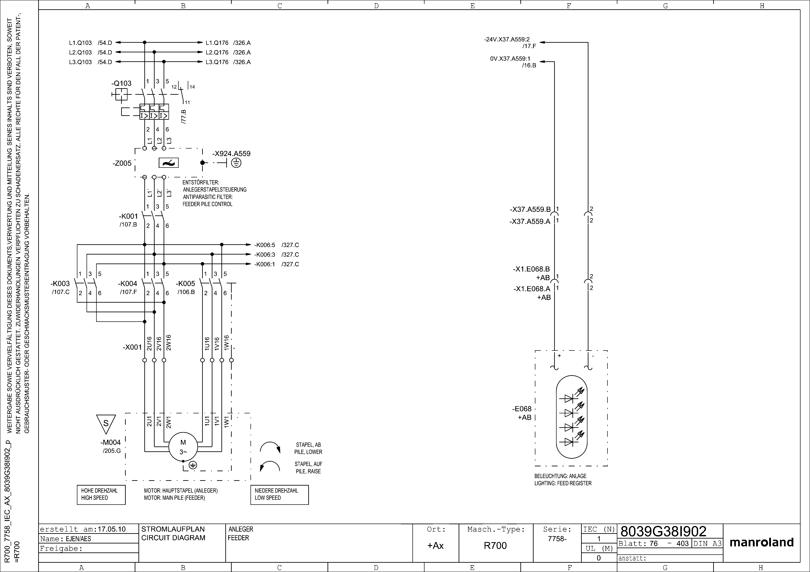

# +Ax — Sheet 76 of 403 — ANLEGER

**FEEDER**

> Part of the manroland **R700** printing press IEC/UL circuit diagrams.
> Drawing class: **Stromlaufplan / Circuit diagram** (DIN A3).
> Document `+Ax` covers the **Central control console** machine section.

## At a glance

| Field | Value |
|---|---|
| Document | `+Ax`  (8039G38I902) |
| Sheet | **76** of 403 |
| Section (DE) | ANLEGER |
| Section (EN) | FEEDER |
| Section type | CIRCUIT — Circuit diagram |
| Machine type | `R700` |
| Series | `7758` |
| Created | 17.05.10 |
| Replaces | — |
| Columns used | A, B, C, E, F |
| Path numbers | — |
| Labels on sheet | 127 |
| Cross-refs out | 17 |
| Cross-refs in | 25 |

**Previous:** [+Ax sheet 75](SHEET_0075.md) · **Next:** [+Ax sheet 77](SHEET_0077.md) · **Document TOC:** [_TOC.md](_TOC.md)  (+Ax) · **Master TOC:** [all sheets](../_MASTER_TOC.md)

## Sheet image (300 DPI, exact vector render)



_Rendered directly from the PDF vector layer at 300 DPI (1-bit), no OCR and no resampling. Use it to confirm anything ambiguous in the text below._

## Cross-references on this sheet

Each entry is a wire leaving this sheet. The printed token is `/sheet.column`; the link resolves to that sheet inside the same document.

| Ref | Target sheet | Col | Path | Destination on target | Target section | From col |
|---|---|---|---|---|---|---|
| `/17.F` | [+Ax sheet 17](SHEET_0017.md) | F | — | 24V.X37.A559:2 | SPANNUNGSVERSORGUNG, SCHALTSCHRANKBELÜFTUNG | E |
| `/326.A` | [+Ax sheet 326](SHEET_0326.md) | A | — | L1.Q176 | OPTION: AUTOMATISCHE FARBZUFÜHRUNG | B |
| `/54.D` | [+Ax sheet 54](SHEET_0054.md) | D | — | L1.Q103 | LUFTVERSORGUNG | A |
| `/326.A` | [+Ax sheet 326](SHEET_0326.md) | A | — | L2.Q176 | OPTION: AUTOMATISCHE FARBZUFÜHRUNG | B |
| `/54.D` | [+Ax sheet 54](SHEET_0054.md) | D | — | L2.Q103 | LUFTVERSORGUNG | A |
| `/16.B` | [+Ax sheet 16](SHEET_0016.md) | B | — | 0V.X37.A559:1 | SPANNUNGSVERSORGUNG, SCHALTSCHRANKBELÜFTUNG | E |
| `/326.A` | [+Ax sheet 326](SHEET_0326.md) | A | — | L3.Q176 | OPTION: AUTOMATISCHE FARBZUFÜHRUNG | B |
| `/54.D` | [+Ax sheet 54](SHEET_0054.md) | D | — | L3.Q103 | LUFTVERSORGUNG | A |
| `/77.B` | [+Ax sheet 77](SHEET_0077.md) | B | — | — | ANLEGER | B |
| `/107.B` | [+Ax sheet 107](SHEET_0107.md) | B | — | — | ANLEGER | A |
| `/327.C` | [+Ax sheet 327](SHEET_0327.md) | C | — | K006:5 | OPTION: NONSTOP EINRICHTUNG MANUELL, ANLEGER | C |
| `/327.C` | [+Ax sheet 327](SHEET_0327.md) | C | — | K006:3 | OPTION: NONSTOP EINRICHTUNG MANUELL, ANLEGER | C |
| `/327.C` | [+Ax sheet 327](SHEET_0327.md) | C | — | K006:1 | OPTION: NONSTOP EINRICHTUNG MANUELL, ANLEGER | C |
| `/106.B` | [+Ax sheet 106](SHEET_0106.md) | B | — | — | ANLEGER | B |
| `/107.F` | [+Ax sheet 107](SHEET_0107.md) | F | — | — | ANLEGER | A |
| `/107.C` | [+Ax sheet 107](SHEET_0107.md) | C | — | — | ANLEGER | A |
| `/205.G` | [+Ax sheet 205](SHEET_0205.md) | G | — | — | REFERENZMODUL | A |

### Incoming references (sheets that point here)

Every other sheet that sends a wire to this one. `Back-ref` is the token printed on *that* sheet; `Path` is its line number.

| From sheet | Cols | Back-ref | Path | Refs | What continues there |
|---|---|---|---|---|---|
| [+Ax#16](SHEET_0016.md) | B | `/16.B` | — | 1 | — |
| [+Ax#17](SHEET_0017.md) | F | `/17.F` | — | 1 | — |
| [+Ax#54](SHEET_0054.md) | C | `/54.C` | — | 3 | L1.Q104 L1.Q103 L1.Q107; L2.Q104 L2.Q103 L2.Q107; L3.Q104 L3.Q103 L3.Q107 |
| [+Ax#77](SHEET_0077.md) | B | `/77.B` | — | 1 | — |
| [+Ax#106](SHEET_0106.md) | B | `/106.B` | — | 1 | — |
| [+Ax#107](SHEET_0107.md) | B, C, F | `/107.B`, `/107.C`, `/107.F` | — | 3 | — |
| [+Ax#205](SHEET_0205.md) | G | `/205.G` | — | 1 | — |
| [+Ax#214](SHEET_0214.md) | A | `/214.A` | — | 4 | — |
| [+Ax#279](SHEET_0279.md) | G | `/279.G` | — | 4 | — |
| [+Ax#326](SHEET_0326.md) | A | `/326.A` | — | 3 | L1.Q176; L2.Q176; L3.Q176 |
| [+Ax#327](SHEET_0327.md) | B | `/327.B` | — | 3 | K006:1; K006:3; K006:5 |


## Devices on this sheet

| Tag | Class | Class meaning (IEC) | Col | Sub | Terminal | Sign |
|---|---|---|---|---|---|---|
| `Q103` | Q | Leistungsschalter / power switching device | A | — | — | — |
| `Z005` | Z |  | A | — | — | — |
| `K001` | K | Relais / relay, contactor | A | — | — | — |
| `K004` | K | Relais / relay, contactor | A | — | — | — |
| `K003` | K | Relais / relay, contactor | A | — | — | — |
| `K005` | K | Relais / relay, contactor | B | — | — | — |
| `X001` | X | Klemme / terminal, plug connector | A | — | — | — |
| `E068` | E | Sonstiges / miscellaneous, lamp | F | — | — | — |
| `K006:5` | K | Relais / relay, contactor | C | — | 5 | — |
| `K006:3` | K | Relais / relay, contactor | C | — | 3 | — |
| `K006:1` | K | Relais / relay, contactor | C | — | 1 | — |
| `X1.E068.B` | — | cross-device reference | F | — | — | — |
| `X1.E068.A` | — | cross-device reference | F | — | — | — |
| `X37.A559.B` | — | cross-device reference | F | — | — | — |
| `X37.A559.A` | — | cross-device reference | F | — | — | — |
| `X924.A559` | — | cross-device reference | B | — | — | — |

## Potentials / nets

| Potential | Count | Columns | Attached devices | Terminals |
|---|---|---|---|---|
| `0V` | 1 | E | `A559`, `X37` | `1` |
| `24V` | 1 | E | `A559`, `X37` | `2` |
| `L1` | 3 | A, B | `Q103`, `Q176` | — |
| `L2` | 3 | A, B | `Q103`, `Q176` | — |
| `L3` | 3 | A, B | `Q103`, `Q176` | — |
| `M004` | 1 | A | — | — |


A potential such as `L24+/4` or `M24+` is a named supply/return rail; every place it appears on this sheet is electrically common.

## Wire-end annotations (grouped as printed)

A wire that continues elsewhere is annotated with a small cluster: the destination description, the path/line number `#NN`, and the `/sheet.column` cross reference. Each row below is one such cluster exactly as it is grouped on the drawing.

| Col | Y | Path | Cross-ref | Text on the wire |
|---|---|---|---|---|
| E | 54.1 | — | `/17.F` | `24V.X37.A559:2` |
| A | 59.1 | — | `/54.D` | `L1.Q103` |
| B | 59.1 | — | `/326.A` | `L1.Q176` |
| A | 73.3 | — | `/54.D` | `L2.Q103` |
| B | 73.3 | — | `/326.A` | `L2.Q176` |
| E | 82.5 | — | `/16.B` | `0V.X37.A559:1` |
| B | 87.4 | — | `/326.A` | `L3.Q176` |
| A | 87.5 | — | `/54.D` | `L3.Q103` |
| B | 115.8 | — | — | `1` |
| B | 115.8 | — | — | `3` |
| B | 115.8 | — | — | `5` |
| A | 118.0 | — | — | `Q103` |
| B | 124.9 | — | — | `12 14` |
| B | 147.6 | — | — | `11` |
| B | 161.3 | — | `/77.B` | — |
| B | 186.7 | — | — | `2` |
| B | 186.7 | — | — | `4` |
| B | 186.7 | — | — | `6` |
| B | 202.4 | — | — | `L1` |
| B | 202.4 | — | — | `L2` |
| B | 202.4 | — | — | `L3` |
| B | 221.4 | — | — | `~ X924.A559` |
| A | 235.6 | — | — | `Z005` |
| B | 265.6 | — | — | `ENTSTÖRFILTER:` |
| B | 276.3 | — | — | `1 FEEDER PILE CONTROL ANLEGERSTAPELSTEUERUNG ANTIPARASITIC FILTER:` |
| B | 277.5 | — | — | `L1´` |
| B | 277.5 | — | — | `L2´` |
| B | 277.5 | — | — | `L3´` |
| B | 300.1 | — | — | `3` |
| B | 300.1 | — | — | `5` |
| F | 303.6 | — | — | `X37.A559.B 1 2` |
| B | 313.5 | — | — | `K001 6` |
| F | 320.6 | — | — | `X37.A559.A 1 2` |
| A | 326.6 | — | `/107.B` | — |
| B | 328.4 | — | — | `2` |
| B | 328.4 | — | — | `4` |
| C | 356.8 | — | `/327.C` | `K006:5` |
| C | 370.9 | — | `/327.C` | `K006:3` |
| C | 385.1 | — | `/327.C` | `K006:1` |
| F | 391.5 | — | — | `X1.E068.B 1` |
| A | 399.3 | — | — | `1` |
| A | 399.3 | — | — | `3` |
| A | 399.3 | — | — | `5` |
| B | 399.3 | — | — | `1` |
| B | 399.3 | — | — | `3` |
| B | 399.3 | — | — | `5` |
| B | 399.3 | — | — | `1` |
| B | 399.3 | — | — | `3` |
| B | 399.3 | — | — | `5` |
| F | 402.8 | — | — | `2` |
| F | 404.2 | — | — | `+AB` |
| A | 412.7 | — | — | `K003 6` |
| B | 412.7 | — | — | `K004 6` |
| B | 412.7 | — | — | `K005 6` |
| F | 419.9 | — | — | `X1.E068.A 1` |
| F | 419.9 | — | — | `2` |
| A | 425.8 | — | `/107.C` | — |
| A | 425.8 | — | `/107.F` | — |
| B | 425.8 | — | `/106.B` | — |
| A | 427.6 | — | — | `2` |
| A | 427.6 | — | — | `4` |
| B | 427.6 | — | — | `2` |
| B | 427.6 | — | — | `4` |
| B | 427.6 | — | — | `2` |
| B | 427.6 | — | — | `4` |
| F | 433.2 | — | — | `+AB` |
| B | 492.7 | — | — | `2W16` |
| B | 493.2 | — | — | `1W16` |
| B | 495.5 | — | — | `2U16` |
| B | 495.8 | — | — | `2V16` |
| B | 496.1 | — | — | `1U16` |
| B | 496.4 | — | — | `1V16` |
| A | 506.3 | — | — | `X001` |
| C | 511.5 | — | — | `'` |
| F | 519.8 | — | — | `+` |
| F | 597.0 | — | — | `E068` |
| F | 609.7 | — | — | `+AB` |
| B | 612.0 | — | — | `2U1` |
| B | 612.0 | — | — | `2V1` |
| B | 612.0 | — | — | `2W1` |
| B | 612.0 | — | — | `1U1` |
| B | 612.0 | — | — | `1V1` |
| B | 612.0 | — | — | `1W1` |
| C | 613.4 | — | — | `'` |
| A | 617.6 | — | — | `S` |
| A | 646.6 | — | — | `M004` |
| B | 646.9 | — | — | `3~ M` |
| C | 651.9 | — | — | `PILE, LOWER STAPEL, AB` |
| A | 659.7 | — | `/205.G` | — |
| C | 680.2 | — | — | `STAPEL, AUF` |
| C | 690.8 | — | — | `PILE, RAISE` |
| F | 698.0 | — | — | `BELEUCHTUNG: ANLAGE LIGHTING: FEED REGISTER` |
| B | 719.2 | — | — | `HOHE DREHZAHL HIGH SPEED NIEDERE DREHZAHL LOW SPEED` |
| B | 719.2 | — | — | `MOTOR: HAUPTSTAPEL (ANLEGER) MOTOR: MAIN PILE (FEEDER)` |


## Reconstructed tables

This sheet carries tabular content (pin map / terminal assignment / index). The grid below was rebuilt from the drawing's own rule lines, so each row is exactly one physical row of the table.

### Table 1 — 5 data rows × 6 columns (at x=113.4, y=62.4)

| L1.Q103 |  | /54.D |  |  |  |
|---|---|---|---|---|---|
| `L2.Q103` |  | `/54.D` |  |  |  |
| `L3.Q103` |  | `/54.D` | `Q103` |  |  |
|  |  |  |  | `Z005` | `K001 /107.B` |
| `1 2` | `3 4` | `5 6` |  |  | `K004 /107.F` |
|  |  | `S M004 /205.G` |  |  | `X001` |


### Table 2 — 5 data rows × 9 columns (at x=212.6, y=62.4) — **L1.Q176 L2.Q176**

| 1 |  | 3 |  | 5 | 12 14 |  | L3.Q176 |  |
|---|---|---|---|---|---|---|---|---|
|  |  |  |  |  | `11` |  |  |  |
|  |  |  |  |  | `/77.B` |  |  |  |
| `2 1 2` | `L1 L1´` | `4 3 4` | `L2 L2´` | `6 5 6` | `L3 ~ ENTSTÖRFILTER: L3´ ANTIPARASITIC FEEDER` | `PILE` | `ANLEGERSTAPELSTEUERUNG` | `FILTER: CONTROL` |
| `1 2` |  | `3 4` |  | `5 6` | `K005 /106.B` | `1 2` | `3 4` | `5 6` |
|  | `2U16 2U1` |  | `2V16 2V1` |  | `2W16 2W1 M 3~` | `1U16 1U1` | `1V16 1V1` | `1W16 1W1` |


## Notes and free text on this sheet

| Text | Col | Y (pt) |
|---|---|---|
| `L1´` | B | 277.51 |
| `L2´` | B | 277.51 |
| `L3´` | B | 277.51 |
| `ENTSTÖRFILTER:` | B | 265.65 |
| `ANLEGERSTAPELSTEUERUNG` | B | 276.31 |
| `ANTIPARASITIC FILTER:` | B | 286.91 |
| `FEEDER PILE CONTROL` | B | 297.56 |
| `2U16` | B | 495.5 |
| `2V16` | B | 495.78 |
| `2W16` | B | 492.66 |
| `1U16` | B | 496.06 |
| `1V16` | B | 496.35 |
| `1W16` | B | 493.23 |
| `MOTOR: HAUPTSTAPEL (ANLEGER)` | B | 719.21 |
| `MOTOR: MAIN PILE (FEEDER)` | B | 729.85 |
| `M` | B | 646.88 |
| `2U1` | B | 612 |
| `2V1` | B | 612 |
| `2W1` | B | 612 |
| `1U1` | B | 612 |
| `1V1` | B | 612 |
| `1W1` | B | 612 |
| `+AB` | F | 609.68 |
| `BELEUCHTUNG: ANLAGE` | F | 697.95 |
| `LIGHTING: FEED REGISTER` | F | 708.57 |
| `S` | A | 617.62 |
| `STAPEL, AB` | C | 651.85 |
| `PILE, LOWER` | C | 662.45 |
| `STAPEL, AUF` | C | 680.21 |
| `PILE, RAISE` | C | 690.81 |
| `NIEDERE DREHZAHL` | C | 719.21 |
| `LOW SPEED` | C | 729.77 |
| `HOHE DREHZAHL` | A | 719.22 |
| `HIGH SPEED` | A | 729.82 |

## Complete label inventory (exact text from the drawing)

Every text object inside the drawing area of this sheet, in DIN reading order (column A→H, then top→bottom). This is the authoritative list: if a string is not here it is not printed on this sheet.

| Col | Y | X | Dir | Type | Text |
|---|---|---|---|---|---|
| A | 59.1 | 101.5 | → | potential | `L1.Q103` |
| A | 59.1 | 143.7 | → | cross-reference | `/54.D` |
| A | 73.3 | 101.5 | → | potential | `L2.Q103` |
| A | 73.3 | 143.7 | → | cross-reference | `/54.D` |
| A | 87.4 | 143.7 | → | cross-reference | `/54.D` |
| A | 87.5 | 101.5 | → | potential | `L3.Q103` |
| A | 117.9 | 163.8 | → | device tag | `Q103` |
| A | 235.6 | 165.5 | → | device tag | `Z005` |
| A | 313.5 | 174.9 | → | device tag | `K001` |
| A | 326.6 | 176.0 | → | cross-reference | `/107.B` |
| A | 399.3 | 115.4 | → | number | `1` |
| A | 399.3 | 130.1 | → | number | `3` |
| A | 399.3 | 144.3 | → | number | `5` |
| A | 412.7 | 74.3 | → | device tag | `K003` |
| A | 412.7 | 173.5 | → | device tag | `K004` |
| A | 425.8 | 76.5 | → | cross-reference | `/107.C` |
| A | 425.8 | 176.6 | → | cross-reference | `/107.F` |
| A | 427.6 | 115.9 | → | number | `2` |
| A | 427.6 | 130.1 | → | number | `4` |
| A | 427.6 | 144.3 | → | number | `6` |
| A | 506.3 | 180.6 | → | device tag | `X001` |
| A | 617.6 | 151.8 | → | text | `S` |
| A | 646.6 | 147.7 | → | potential | `M004` |
| A | 659.7 | 151.4 | → | cross-reference | `/205.G` |
| A | 719.2 | 119.6 | → | text | `HOHE DREHZAHL` |
| A | 729.8 | 119.6 | → | text | `HIGH SPEED` |
| B | 59.1 | 302.5 | → | potential | `L1.Q176` |
| B | 73.3 | 302.5 | → | potential | `L2.Q176` |
| B | 87.5 | 302.5 | → | potential | `L3.Q176` |
| B | 115.8 | 214.6 | → | number | `1` |
| B | 115.8 | 229.3 | → | number | `3` |
| B | 115.8 | 243.5 | → | number | `5` |
| B | 124.9 | 251.7 | → | number | `12` |
| B | 124.9 | 278.6 | → | number | `14` |
| B | 147.6 | 271.6 | → | number | `11` |
| B | 161.3 | 266.0 | ↕ | cross-reference | `/77.B` |
| B | 186.7 | 215.1 | → | number | `2` |
| B | 186.7 | 229.3 | → | number | `4` |
| B | 186.7 | 243.5 | → | number | `6` |
| B | 202.4 | 216.5 | ↕ | potential | `L1` |
| B | 202.4 | 230.6 | ↕ | potential | `L2` |
| B | 202.4 | 244.8 | ↕ | potential | `L3` |
| B | 221.4 | 312.2 | → | device ref | `X924.A559` |
| B | 226.5 | 237.8 | → | other | `~` |
| B | 265.6 | 268.4 | → | text | `ENTSTÖRFILTER:` |
| B | 276.3 | 269.3 | → | text | `ANLEGERSTAPELSTEUERUNG` |
| B | 277.5 | 216.5 | ↕ | text | `L1´` |
| B | 277.5 | 230.7 | ↕ | text | `L2´` |
| B | 277.5 | 244.8 | ↕ | text | `L3´` |
| B | 286.9 | 269.3 | → | text | `ANTIPARASITIC FILTER:` |
| B | 297.6 | 268.4 | → | text | `FEEDER PILE CONTROL` |
| B | 300.1 | 214.6 | → | number | `1` |
| B | 300.1 | 229.3 | → | number | `3` |
| B | 300.1 | 243.5 | → | number | `5` |
| B | 328.4 | 215.1 | → | number | `2` |
| B | 328.4 | 229.3 | → | number | `4` |
| B | 328.4 | 243.5 | → | number | `6` |
| B | 399.3 | 214.6 | → | number | `1` |
| B | 399.3 | 229.3 | → | number | `3` |
| B | 399.3 | 243.5 | → | number | `5` |
| B | 399.3 | 299.6 | → | number | `1` |
| B | 399.3 | 314.4 | → | number | `3` |
| B | 399.3 | 328.5 | → | number | `5` |
| B | 412.7 | 258.5 | → | device tag | `K005` |
| B | 425.8 | 261.1 | → | cross-reference | `/106.B` |
| B | 427.6 | 215.1 | → | number | `2` |
| B | 427.6 | 229.3 | → | number | `4` |
| B | 427.6 | 243.5 | → | number | `6` |
| B | 427.6 | 300.2 | → | number | `2` |
| B | 427.6 | 314.4 | → | number | `4` |
| B | 427.6 | 328.5 | → | number | `6` |
| B | 492.7 | 244.0 | ↕ | text | `2W16` |
| B | 493.2 | 329.0 | ↕ | text | `1W16` |
| B | 495.5 | 215.8 | ↕ | text | `2U16` |
| B | 495.8 | 229.9 | ↕ | text | `2V16` |
| B | 496.1 | 300.8 | ↕ | text | `1U16` |
| B | 496.3 | 314.9 | ↕ | text | `1V16` |
| B | 612.0 | 215.8 | ↕ | text | `2U1` |
| B | 612.0 | 229.9 | ↕ | text | `2V1` |
| B | 612.0 | 243.9 | ↕ | text | `2W1` |
| B | 612.0 | 300.8 | ↕ | text | `1U1` |
| B | 612.0 | 314.9 | ↕ | text | `1V1` |
| B | 612.0 | 329.0 | ↕ | text | `1W1` |
| B | 646.9 | 265.2 | → | text | `M` |
| B | 661.1 | 263.9 | → | other | `3~` |
| B | 719.2 | 212.0 | → | text | `MOTOR: HAUPTSTAPEL (ANLEGER)` |
| B | 729.8 | 212.0 | → | text | `MOTOR: MAIN PILE (FEEDER)` |
| C | 59.1 | 343.0 | → | cross-reference | `/326.A` |
| C | 73.3 | 343.0 | → | cross-reference | `/326.A` |
| C | 87.4 | 343.0 | → | cross-reference | `/326.A` |
| C | 356.7 | 413.9 | → | cross-reference | `/327.C` |
| C | 356.8 | 373.9 | → | device tag | `K006:5` |
| C | 370.9 | 373.9 | → | device tag | `K006:3` |
| C | 370.9 | 413.9 | → | cross-reference | `/327.C` |
| C | 385.1 | 373.9 | → | device tag | `K006:1` |
| C | 385.1 | 413.9 | → | cross-reference | `/327.C` |
| C | 511.5 | 342.4 | → | other | `'` |
| C | 613.4 | 347.5 | → | other | `'` |
| C | 651.8 | 435.3 | → | text | `STAPEL, AB` |
| C | 662.5 | 432.8 | → | text | `PILE, LOWER` |
| C | 680.2 | 433.3 | → | text | `STAPEL, AUF` |
| C | 690.8 | 435.1 | → | text | `PILE, RAISE` |
| C | 719.2 | 374.7 | → | text | `NIEDERE DREHZAHL` |
| C | 729.8 | 374.7 | → | text | `LOW SPEED` |
| E | 54.1 | 711.8 | → | potential | `24V.X37.A559:2` |
| E | 82.5 | 720.6 | → | potential | `0V.X37.A559:1` |
| F | 64.0 | 768.2 | → | cross-reference | `/17.F` |
| F | 92.4 | 767.6 | → | cross-reference | `/16.B` |
| F | 303.6 | 749.8 | → | device ref | `X37.A559.B` |
| F | 303.6 | 816.9 | → | number | `1` |
| F | 303.6 | 867.1 | → | number | `2` |
| F | 320.6 | 816.9 | → | number | `1` |
| F | 320.6 | 867.1 | → | number | `2` |
| F | 321.3 | 748.9 | → | device ref | `X37.A559.A` |
| F | 391.5 | 754.3 | → | device ref | `X1.E068.B` |
| F | 402.8 | 816.9 | → | number | `1` |
| F | 402.8 | 867.1 | → | number | `2` |
| F | 404.2 | 788.0 | → | text | `+AB` |
| F | 419.9 | 816.9 | → | number | `1` |
| F | 419.9 | 867.1 | → | number | `2` |
| F | 420.6 | 754.9 | → | device ref | `X1.E068.A` |
| F | 433.2 | 789.4 | → | text | `+AB` |
| F | 519.7 | 819.6 | → | number | `+` |
| F | 597.0 | 753.2 | → | device tag | `E068` |
| F | 609.7 | 761.1 | → | text | `+AB` |
| F | 697.9 | 785.8 | → | text | `BELEUCHTUNG: ANLAGE` |
| F | 708.6 | 785.8 | → | text | `LIGHTING: FEED REGISTER` |

## Reading-order text block

The same content as a plain block, grouped by DIN column — convenient to paste or to match against a visual description.

```text
=== Column A ===
  59.1  101.5  net          L1.Q103
  59.1  143.7  xref         /54.D
  73.3  101.5  net          L2.Q103
  73.3  143.7  xref         /54.D
  87.4  143.7  xref         /54.D
  87.5  101.5  net          L3.Q103
 117.9  163.8  devtag       Q103
 235.6  165.5  devtag       Z005
 313.5  174.9  devtag       K001
 326.6  176.0  xref         /107.B
 399.3  115.4  numeric      1
 399.3  130.1  numeric      3
 399.3  144.3  numeric      5
 412.7   74.3  devtag       K003
 412.7  173.5  devtag       K004
 425.8   76.5  xref         /107.C
 425.8  176.6  xref         /107.F
 427.6  115.9  numeric      2
 427.6  130.1  numeric      4
 427.6  144.3  numeric      6
 506.3  180.6  devtag       X001
 617.6  151.8  text         S
 646.6  147.7  net          M004
 659.7  151.4  xref         /205.G
 719.2  119.6  text         HOHE DREHZAHL
 729.8  119.6  text         HIGH SPEED
=== Column B ===
  59.1  302.5  net          L1.Q176
  73.3  302.5  net          L2.Q176
  87.5  302.5  net          L3.Q176
 115.8  214.6  numeric      1
 115.8  229.3  numeric      3
 115.8  243.5  numeric      5
 124.9  251.7  numeric      12
 124.9  278.6  numeric      14
 147.6  271.6  numeric      11
 161.3  266.0  xref         /77.B
 186.7  215.1  numeric      2
 186.7  229.3  numeric      4
 186.7  243.5  numeric      6
 202.4  216.5  net          L1
 202.4  230.6  net          L2
 202.4  244.8  net          L3
 221.4  312.2  devref       X924.A559
 226.5  237.8  other        ~
 265.6  268.4  text         ENTSTÖRFILTER:
 276.3  269.3  text         ANLEGERSTAPELSTEUERUNG
 277.5  216.5  text         L1´
 277.5  230.7  text         L2´
 277.5  244.8  text         L3´
 286.9  269.3  text         ANTIPARASITIC FILTER:
 297.6  268.4  text         FEEDER PILE CONTROL
 300.1  214.6  numeric      1
 300.1  229.3  numeric      3
 300.1  243.5  numeric      5
 328.4  215.1  numeric      2
 328.4  229.3  numeric      4
 328.4  243.5  numeric      6
 399.3  214.6  numeric      1
 399.3  229.3  numeric      3
 399.3  243.5  numeric      5
 399.3  299.6  numeric      1
 399.3  314.4  numeric      3
 399.3  328.5  numeric      5
 412.7  258.5  devtag       K005
 425.8  261.1  xref         /106.B
 427.6  215.1  numeric      2
 427.6  229.3  numeric      4
 427.6  243.5  numeric      6
 427.6  300.2  numeric      2
 427.6  314.4  numeric      4
 427.6  328.5  numeric      6
 492.7  244.0  text         2W16
 493.2  329.0  text         1W16
 495.5  215.8  text         2U16
 495.8  229.9  text         2V16
 496.1  300.8  text         1U16
 496.3  314.9  text         1V16
 612.0  215.8  text         2U1
 612.0  229.9  text         2V1
 612.0  243.9  text         2W1
 612.0  300.8  text         1U1
 612.0  314.9  text         1V1
 612.0  329.0  text         1W1
 646.9  265.2  text         M
 661.1  263.9  other        3~
 719.2  212.0  text         MOTOR: HAUPTSTAPEL (ANLEGER)
 729.8  212.0  text         MOTOR: MAIN PILE (FEEDER)
=== Column C ===
  59.1  343.0  xref         /326.A
  73.3  343.0  xref         /326.A
  87.4  343.0  xref         /326.A
 356.7  413.9  xref         /327.C
 356.8  373.9  devtag       K006:5
 370.9  373.9  devtag       K006:3
 370.9  413.9  xref         /327.C
 385.1  373.9  devtag       K006:1
 385.1  413.9  xref         /327.C
 511.5  342.4  other        `
 613.4  347.5  other        `
 651.8  435.3  text         STAPEL, AB
 662.5  432.8  text         PILE, LOWER
 680.2  433.3  text         STAPEL, AUF
 690.8  435.1  text         PILE, RAISE
 719.2  374.7  text         NIEDERE DREHZAHL
 729.8  374.7  text         LOW SPEED
=== Column E ===
  54.1  711.8  net          24V.X37.A559:2
  82.5  720.6  net          0V.X37.A559:1
=== Column F ===
  64.0  768.2  xref         /17.F
  92.4  767.6  xref         /16.B
 303.6  749.8  devref       X37.A559.B
 303.6  816.9  numeric      1
 303.6  867.1  numeric      2
 320.6  816.9  numeric      1
 320.6  867.1  numeric      2
 321.3  748.9  devref       X37.A559.A
 391.5  754.3  devref       X1.E068.B
 402.8  816.9  numeric      1
 402.8  867.1  numeric      2
 404.2  788.0  text         +AB
 419.9  816.9  numeric      1
 419.9  867.1  numeric      2
 420.6  754.9  devref       X1.E068.A
 433.2  789.4  text         +AB
 519.7  819.6  numeric      +
 597.0  753.2  devtag       E068
 609.7  761.1  text         +AB
 697.9  785.8  text         BELEUCHTUNG: ANLAGE
 708.6  785.8  text         LIGHTING: FEED REGISTER
```

---
_Generated from the PDF vector text layer; no OCR. Source: `R700_7758_IEC_AX_8039G38I902_p`, sheet 76._
