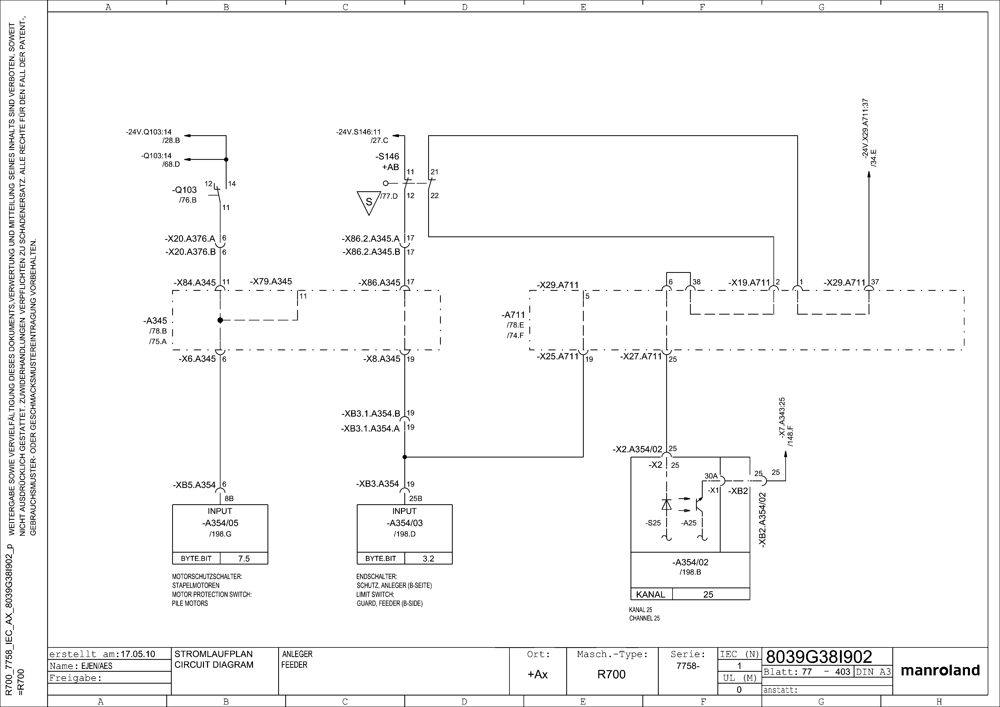

# +Ax — Sheet 77 of 403 — ANLEGER

**FEEDER**

> Part of the manroland **R700** printing press IEC/UL circuit diagrams.
> Drawing class: **Stromlaufplan / Circuit diagram** (DIN A3).
> Document `+Ax` covers the **Central control console** machine section.

## At a glance

| Field | Value |
|---|---|
| Document | `+Ax`  (8039G38I902) |
| Sheet | **77** of 403 |
| Section (DE) | ANLEGER |
| Section (EN) | FEEDER |
| Section type | CIRCUIT — Circuit diagram |
| Machine type | `R700` |
| Series | `7758` |
| Created | 17.05.10 |
| Replaces | — |
| Columns used | A, B, C, D, E, F, G |
| Path numbers | — |
| Labels on sheet | 106 |
| Cross-refs out | 14 |
| Cross-refs in | 37 |

**Previous:** [+Ax sheet 76](SHEET_0076.md) · **Next:** [+Ax sheet 78](SHEET_0078.md) · **Document TOC:** [_TOC.md](_TOC.md)  (+Ax) · **Master TOC:** [all sheets](../_MASTER_TOC.md)

## Sheet image (300 DPI, exact vector render)



_Rendered directly from the PDF vector layer at 300 DPI (1-bit), no OCR and no resampling. Use it to confirm anything ambiguous in the text below._

## Cross-references on this sheet

Each entry is a wire leaving this sheet. The printed token is `/sheet.column`; the link resolves to that sheet inside the same document.

| Ref | Target sheet | Col | Path | Destination on target | Target section | From col |
|---|---|---|---|---|---|---|
| `/34.E` | [+Ax sheet 34](SHEET_0034.md) | E | — | 24V.X29.A711:37 | SPANNUNGSVERSORGUNG, SCHALTSCHRANKBELÜFTUNG | G |
| `/27.C` | [+Ax sheet 27](SHEET_0027.md) | C | — | 24V.S146:11 | SPANNUNGSVERSORGUNG, SCHALTSCHRANKBELÜFTUNG | C |
| `/28.B` | [+Ax sheet 28](SHEET_0028.md) | B | — | 24V.Q103:14 | SPANNUNGSVERSORGUNG, SCHALTSCHRANKBELÜFTUNG | A |
| `/68.D` | [+Ax sheet 68](SHEET_0068.md) | D | — | Q103:14 | SAUGBÄNDERTISCH | A |
| `/77.D` | [+Ax sheet 77](SHEET_0077.md) | D | — | — | ANLEGER | C |
| `/76.B` | [+Ax sheet 76](SHEET_0076.md) | B | — | — | ANLEGER | B |
| `/78.E` | [+Ax sheet 78](SHEET_0078.md) | E | — | — | ANLEGER | D |
| `/74.F` | [+Ax sheet 74](SHEET_0074.md) | F | — | — | FEUCHTMITTELKÜHLGERÄT | D |
| `/78.B` | [+Ax sheet 78](SHEET_0078.md) | B | — | — | ANLEGER | A |
| `/75.A` | [+Ax sheet 75](SHEET_0075.md) | A | — | — | FEUCHTMITTELKÜHLGERÄT | A |
| `/148.F` | [+Ax sheet 148](SHEET_0148.md) | F | — | X7.A343:25 | ÜBERWACHUNGSRECHNER SICHERHEITSBUS | G |
| `/198.G` | [+Ax sheet 198](SHEET_0198.md) | G | — | — | REFERENZMODUL | B |
| `/198.D` | [+Ax sheet 198](SHEET_0198.md) | D | — | — | REFERENZMODUL | C |
| `/198.B` | [+Ax sheet 198](SHEET_0198.md) | B | — | — | REFERENZMODUL | F |

### Incoming references (sheets that point here)

Every other sheet that sends a wire to this one. `Back-ref` is the token printed on *that* sheet; `Path` is its line number.

| From sheet | Cols | Back-ref | Path | Refs | What continues there |
|---|---|---|---|---|---|
| [+Ax#27](SHEET_0027.md) | C | `/27.C` | — | 1 | 24V.S146:11 |
| [+Ax#28](SHEET_0028.md) | B | `/28.B` | — | 1 | — |
| [+Ax#34](SHEET_0034.md) | E | `/34.E` | — | 1 | — |
| [+Ax#68](SHEET_0068.md) | E | `/68.E` | — | 1 | — |
| [+Ax#74](SHEET_0074.md) | F | `/74.F` | — | 1 | A711 |
| [+Ax#75](SHEET_0075.md) | A | `/75.A` | — | 1 | — |
| [+Ax#76](SHEET_0076.md) | B | `/76.B` | — | 1 | — |
| [+Ax#77](SHEET_0077.md) | C | `/77.C` | — | 1 | — |
| [+Ax#78](SHEET_0078.md) | B, E | `/78.B`, `/78.E` | — | 2 | — |
| [+Ax#148](SHEET_0148.md) | F | `/148.F` | — | 1 | X7.A343:25 |
| [+Ax#198](SHEET_0198.md) | B, D, G | `/198.B`, `/198.D`, `/198.G` | — | 3 | — |
| [+Ax#219](SHEET_0219.md) | D, F | `/219.D`, `/219.F` | — | 2 | — |
| [+Ax#224](SHEET_0224.md) | A, B, C | `/224.A`, `/224.B`, `/224.C` | — | 3 | — |
| [+Ax#231](SHEET_0231.md) | E | `/231.E` | — | 1 | — |
| [+Ax#233](SHEET_0233.md) | G | `/233.G` | — | 1 | — |
| [+Ax#238](SHEET_0238.md) | A | `/238.A` | — | 1 | — |
| [+Ax#259](SHEET_0259.md) | F | `/259.F` | — | 2 | — |
| [+Ax#260](SHEET_0260.md) | E, F | `/260.E`, `/260.F` | — | 2 | — |
| [+Ax#268](SHEET_0268.md) | C | `/268.C` | — | 1 | — |
| [+Ax#271](SHEET_0271.md) | B | `/271.B` | — | 1 | — |
| [+Ax#274](SHEET_0274.md) | A, B | `/274.A`, `/274.B` | — | 4 | — |
| [+Ax#286](SHEET_0286.md) | B | `/286.B` | — | 1 | — |
| [+Ax#287](SHEET_0287.md) | B | `/287.B` | — | 1 | — |
| [+Ax#288](SHEET_0288.md) | A, E, F | `/288.A`, `/288.E`, `/288.F` | — | 3 | — |


## Devices on this sheet

| Tag | Class | Class meaning (IEC) | Col | Sub | Terminal | Sign |
|---|---|---|---|---|---|---|
| `S25` | S | Schalter / switch | F | — | — | — |
| `A25` | A | Baugruppe / assembly, module, PC board | F | — | — | — |
| `X1` | X | Klemme / terminal, plug connector | F | — | — | — |
| `X2` | X | Klemme / terminal, plug connector | F | — | — | — |
| `XB2` | XB |  | F | — | — | — |
| `A354/02` | A | Baugruppe / assembly, module, PC board | F | 02 | — | — |
| `A711` | A | Baugruppe / assembly, module, PC board | D | — | — | — |
| `A354/05` | A | Baugruppe / assembly, module, PC board | B | 05 | — | — |
| `Q103` | Q | Leistungsschalter / power switching device | B | — | — | — |
| `A345` | A | Baugruppe / assembly, module, PC board | A | — | — | — |
| `A354/03` | A | Baugruppe / assembly, module, PC board | C | 03 | — | — |
| `S146` | S | Schalter / switch | C | — | — | — |
| `Q103:14` | Q | Leistungsschalter / power switching device | A | — | 14 | — |
| `X27.A711` | — | cross-device reference | E | — | — | — |
| `X25.A711` | — | cross-device reference | E | — | — | — |
| `X19.A711` | — | cross-device reference | F | — | — | — |
| `7.5` | — | cross-device reference | B | — | — | — |
| `XB5.A354` | — | cross-device reference | B | — | — | — |
| `X6.A345` | — | cross-device reference | B | — | — | — |
| `X20.A376.B` | — | cross-device reference | B | — | — | — |
| `X20.A376.A` | — | cross-device reference | B | — | — | — |
| `X84.A345` | — | cross-device reference | B | — | — | — |
| `3.2` | — | cross-device reference | D | — | — | — |
| `XB3.A354` | — | cross-device reference | C | — | — | — |
| `X86.A345` | — | cross-device reference | C | — | — | — |
| `X8.A345` | — | cross-device reference | C | — | — | — |
| `X86.2.A345.B` | — | cross-device reference | C | — | — | — |
| `X86.2.A345.A` | — | cross-device reference | C | — | — | — |
| `XB3.1.A354.B` | — | cross-device reference | C | — | — | — |
| `XB3.1.A354.A` | — | cross-device reference | C | — | — | — |
| `X29.A711` | — | cross-device reference | G | — | — | — |
| `X7.A343:25` | — | cross-device reference | G | — | 25 | — |
| `X29.A711` | — | cross-device reference | E | — | — | — |
| `X79.A345` | — | cross-device reference | B | — | — | — |

## Potentials / nets

| Potential | Count | Columns | Attached devices | Terminals |
|---|---|---|---|---|
| `24V` | 3 | A, C, G | `A711`, `Q103`, `S146`, `X29` | `11`, `14`, `37` |


A potential such as `L24+/4` or `M24+` is a named supply/return rail; every place it appears on this sheet is electrically common.

## Wire-end annotations (grouped as printed)

A wire that continues elsewhere is annotated with a small cluster: the destination description, the path/line number `#NN`, and the `/sheet.column` cross reference. Each row below is one such cluster exactly as it is grouped on the drawing.

| Col | Y | Path | Cross-ref | Text on the wire |
|---|---|---|---|---|
| G | 117.1 | — | `/34.E` | `24V.X29.A711:37` |
| A | 153.4 | — | `/28.B` | `24V.Q103:14` |
| C | 153.4 | — | `/27.C` | `24V.S146:11` |
| A | 181.7 | — | `/68.D` | `Q103:14` |
| C | 181.7 | — | — | `S146` |
| D | 194.4 | — | — | `+AB 21` |
| D | 200.9 | — | — | `11` |
| B | 215.1 | — | — | `Q103 14` |
| B | 215.1 | — | — | `12` |
| D | 229.2 | — | — | `12` |
| D | 229.2 | — | — | `22` |
| C | 229.9 | — | `/77.D` | — |
| B | 234.5 | — | `/76.B` | — |
| C | 234.9 | — | — | `S` |
| B | 243.4 | — | — | `11` |
| B | 279.5 | — | — | `X20.A376.A 6` |
| C | 279.5 | — | — | `X86.2.A345.A 17` |
| B | 295.1 | — | — | `X20.A376.B 6` |
| C | 295.1 | — | — | `X86.2.A345.B 17` |
| D | 330.5 | — | — | `X79.A345 X29.A711` |
| B | 332.0 | — | — | `X84.A345 11` |
| C | 332.0 | — | — | `X86.A345 17` |
| F | 332.0 | — | — | `6` |
| F | 332.0 | — | — | `38 X19.A711 2 1` |
| G | 332.0 | — | — | `X29.A711 37` |
| C | 349.0 | — | — | `11` |
| E | 349.0 | — | — | `5` |
| D | 370.2 | — | — | `A711` |
| A | 377.3 | — | — | `A345` |
| D | 383.3 | — | `/78.E`, `/74.F` | — |
| A | 390.4 | — | `/78.B`, `/75.A` | — |
| E | 419.8 | — | — | `X25.A711 19 X27.A711 25` |
| B | 422.7 | — | — | `X6.A345 6` |
| C | 422.7 | — | — | `X8.A345 19` |
| G | 473.1 | — | `/148.F` | `X7.A343:25` |
| C | 487.9 | — | — | `XB3.1.A354.B 19` |
| C | 504.9 | — | — | `XB3.1.A354.A 19` |
| F | 530.4 | — | — | `X2.A354/02 25` |
| F | 548.8 | — | — | `X2` |
| F | 550.2 | — | — | `25 25` |
| G | 558.8 | — | — | `25` |
| F | 563.0 | — | — | `30A` |
| C | 571.5 | — | — | `XB3.A354 19` |
| B | 572.9 | — | — | `XB5.A354 6` |
| F | 580.0 | — | — | `X1` |
| F | 580.0 | — | — | `XB2` |
| G | 586.2 | — | — | `XB2.A354/02` |
| B | 589.9 | — | — | `8B` |
| D | 589.9 | — | — | `25B` |
| B | 604.4 | — | — | `INPUT` |
| C | 604.4 | — | — | `INPUT` |
| B | 618.3 | — | — | `A354/05` |
| C | 618.3 | — | — | `A354/03` |
| F | 619.0 | — | — | `S25 A25` |
| B | 632.0 | — | `/198.G` | — |
| C | 632.1 | — | `/198.D` | — |
| B | 661.1 | — | — | `BYTE.BIT 7.5` |
| C | 661.1 | — | — | `BYTE.BIT 3.2` |
| F | 665.0 | — | — | `A354/02` |
| F | 677.4 | — | `/198.B` | — |
| B | 683.8 | — | — | `PILE MOTORS MOTORSCHUTZSCHALTER: MOTOR PROTECTION SWITCH: STAPELMOTOREN` |
| C | 683.8 | — | — | `ENDSCHALTER:` |
| C | 694.4 | — | — | `LIMIT SWITCH: SCHUTZ, ANLEGER (B SEITE)` |
| F | 703.3 | — | — | `KANAL 25` |
| C | 715.7 | — | — | `GUARD, FEEDER (B SIDE)` |
| F | 723.6 | — | — | `KANAL 25 CHANNEL 25` |


## Reconstructed tables

This sheet carries tabular content (pin map / terminal assignment / index). The grid below was rebuilt from the drawing's own rule lines, so each row is exactly one physical row of the table.

### Table 1 — 5 data rows × 8 columns (at x=205.5, y=161.6)

| 12 Q103 /76.B | 11 | 14 |  |  | /27.C S146 +AB /77.D S | 11 12 | 21 22 |
|---|---|---|---|---|---|---|---|
| `X20.A376.A X20.A376.B X84.A345` | `6 6 11` |  | `X79.A345` | `11` | `X86.2.A345.A X86.2.A345.B X86.A345` | `17 17 17` |  |
| `X6.A345` | `6` |  |  |  | `X8.A345 XB3.1.A354.B XB3.1.A354.A` | `19 19 19` |  |
| `XB5.A354` | `6` | `8B` |  |  | `XB3.A354` | `19 25B` |  |
| `INPUT` | `A354/05 /198.G` |  |  |  | `INPUT` | `A354/03 /198.D` |  |
| `BYTE.BIT` |  | `7.5` |  |  | `BYTE.BIT` |  | `3.2` |


### Table 2 — 4 data rows × 9 columns (at x=694.5, y=161.6)

| 5 |  | 6 38 |  | X19.A711 |  | 2 |  | X29.A711 1 |
|---|---|---|---|---|---|---|---|---|
| `19` | `X27.A711 X2.A354/02` | `25 25` |  |  |  | `X7.A343:25` | `/148.F` |  |
|  | `X2 S25` | `25 A25` | `30A X1` | `XB2` | `25 XB2.A354/02` | `25` |  |  |
|  |  | `A354/02 /198.B` |  |  |  |  |  |  |
|  | `KANAL` |  | `25` |  |  |  |  |  |


## Notes and free text on this sheet

| Text | Col | Y (pt) |
|---|---|---|
| `KANAL 25` | E | 723.62 |
| `CHANNEL 25` | F | 733.56 |
| `30A` | F | 562.96 |
| `KANAL` | F | 703.29 |
| `X2.A354/02` | E | 530.39 |
| `XB2.A354/02` | G | 586.21 |
| `8B` | B | 589.88 |
| `INPUT` | B | 604.42 |
| `BYTE.BIT` | B | 661.67 |
| `MOTORSCHUTZSCHALTER:` | B | 683.79 |
| `STAPELMOTOREN` | B | 694.41 |
| `MOTOR PROTECTION SWITCH:` | B | 705.03 |
| `PILE MOTORS` | B | 715.66 |
| `25B` | D | 589.89 |
| `INPUT` | C | 604.42 |
| `BYTE.BIT` | C | 661.67 |
| `ENDSCHALTER:` | C | 683.77 |
| `SCHUTZ, ANLEGER (B SEITE)` | C | 694.41 |
| `LIMIT SWITCH:` | C | 704.98 |
| `GUARD, FEEDER (B SIDE)` | C | 715.68 |
| `+AB` | C | 194.4 |
| `S` | C | 234.95 |

## Complete label inventory (exact text from the drawing)

Every text object inside the drawing area of this sheet, in DIN reading order (column A→H, then top→bottom). This is the authoritative list: if a string is not here it is not printed on this sheet.

| Col | Y | X | Dir | Type | Text |
|---|---|---|---|---|---|
| A | 153.4 | 150.0 | → | potential | `24V.Q103:14` |
| A | 181.7 | 168.1 | → | device tag | `Q103:14` |
| A | 377.3 | 170.6 | → | device tag | `A345` |
| A | 390.4 | 178.0 | → | cross-reference | `/78.B` |
| A | 402.8 | 177.7 | → | cross-reference | `/75.A` |
| B | 163.2 | 193.6 | → | cross-reference | `/28.B` |
| B | 191.6 | 193.3 | → | cross-reference | `/68.D` |
| B | 215.0 | 243.2 | → | number | `12` |
| B | 215.0 | 271.3 | → | number | `14` |
| B | 221.4 | 204.9 | → | device tag | `Q103` |
| B | 234.5 | 213.4 | → | cross-reference | `/76.B` |
| B | 243.4 | 264.2 | → | number | `11` |
| B | 279.5 | 196.2 | → | device ref | `X20.A376.A` |
| B | 279.5 | 264.8 | → | number | `6` |
| B | 295.1 | 197.0 | → | device ref | `X20.A376.B` |
| B | 296.5 | 264.8 | → | number | `6` |
| B | 330.5 | 297.6 | → | device ref | `X79.A345` |
| B | 332.0 | 206.9 | → | device ref | `X84.A345` |
| B | 332.0 | 264.2 | → | number | `11` |
| B | 422.7 | 212.9 | → | device ref | `X6.A345` |
| B | 424.1 | 264.8 | → | number | `6` |
| B | 572.9 | 205.8 | → | device ref | `XB5.A354` |
| B | 572.9 | 264.8 | → | number | `6` |
| B | 589.9 | 267.6 | → | text | `8B` |
| B | 604.4 | 247.3 | → | text | `INPUT` |
| B | 618.3 | 240.8 | → | device tag | `A354/05` |
| B | 632.1 | 249.3 | → | cross-reference | `/198.G` |
| B | 661.1 | 283.7 | → | device ref | `7.5` |
| B | 661.7 | 215.4 | → | text | `BYTE.BIT` |
| B | 683.8 | 204.9 | → | text | `MOTORSCHUTZSCHALTER:` |
| B | 694.4 | 205.2 | → | text | `STAPELMOTOREN` |
| B | 705.0 | 204.9 | → | text | `MOTOR PROTECTION SWITCH:` |
| B | 715.7 | 204.7 | → | text | `PILE MOTORS` |
| C | 153.4 | 400.3 | → | potential | `24V.S146:11` |
| C | 163.3 | 441.4 | → | cross-reference | `/27.C` |
| C | 181.7 | 447.0 | → | device tag | `S146` |
| C | 194.4 | 455.0 | → | text | `+AB` |
| C | 229.9 | 452.7 | → | cross-reference | `/77.D` |
| C | 234.9 | 435.3 | → | text | `S` |
| C | 279.5 | 407.1 | → | device ref | `X86.2.A345.A` |
| C | 295.1 | 407.9 | → | device ref | `X86.2.A345.B` |
| C | 332.0 | 426.6 | → | device ref | `X86.A345` |
| C | 349.0 | 356.3 | → | number | `11` |
| C | 422.7 | 432.6 | → | device ref | `X8.A345` |
| C | 487.9 | 406.8 | → | device ref | `XB3.1.A354.B` |
| C | 505.6 | 405.9 | → | device ref | `XB3.1.A354.A` |
| C | 571.5 | 424.1 | → | device ref | `XB3.A354` |
| C | 604.4 | 467.0 | → | text | `INPUT` |
| C | 618.3 | 460.5 | → | device tag | `A354/03` |
| C | 632.1 | 469.1 | → | cross-reference | `/198.D` |
| C | 661.7 | 435.1 | → | text | `BYTE.BIT` |
| C | 683.8 | 424.3 | → | text | `ENDSCHALTER:` |
| C | 694.4 | 424.9 | → | text | `SCHUTZ, ANLEGER (B SEITE)` |
| C | 705.0 | 424.3 | → | text | `LIMIT SWITCH:` |
| C | 715.7 | 424.9 | → | text | `GUARD, FEEDER (B SIDE)` |
| D | 200.9 | 483.9 | → | number | `11` |
| D | 200.9 | 512.8 | → | number | `21` |
| D | 229.2 | 483.9 | → | number | `12` |
| D | 229.2 | 512.8 | → | number | `22` |
| D | 279.5 | 483.9 | → | number | `17` |
| D | 296.5 | 483.9 | → | number | `17` |
| D | 332.0 | 483.9 | → | number | `17` |
| D | 370.2 | 597.3 | → | device tag | `A711` |
| D | 383.3 | 603.5 | → | cross-reference | `/78.E` |
| D | 395.7 | 603.8 | → | cross-reference | `/74.F` |
| D | 424.1 | 483.9 | → | number | `19` |
| D | 487.9 | 483.9 | → | number | `19` |
| D | 504.9 | 483.9 | → | number | `19` |
| D | 572.9 | 483.9 | → | number | `19` |
| D | 589.9 | 487.3 | → | text | `25B` |
| D | 661.1 | 503.4 | → | device ref | `3.2` |
| E | 334.8 | 639.2 | → | device ref | `X29.A711` |
| E | 349.0 | 697.0 | → | number | `5` |
| E | 419.8 | 639.2 | → | device ref | `X25.A711` |
| E | 419.8 | 738.4 | → | device ref | `X27.A711` |
| E | 424.1 | 696.5 | → | number | `19` |
| E | 530.4 | 729.6 | → | text | `X2.A354/02` |
| E | 723.6 | 749.2 | → | text | `KANAL 25` |
| F | 332.0 | 796.3 | → | number | `6` |
| F | 332.0 | 824.6 | → | number | `38` |
| F | 332.0 | 867.4 | → | device ref | `X19.A711` |
| F | 424.1 | 796.3 | → | number | `25` |
| F | 530.4 | 796.3 | → | number | `25` |
| F | 548.8 | 772.2 | → | device tag | `X2` |
| F | 550.2 | 799.1 | → | number | `25` |
| F | 560.2 | 898.3 | → | number | `25` |
| F | 563.0 | 839.1 | → | text | `30A` |
| F | 580.0 | 842.7 | → | device tag | `X1` |
| F | 580.0 | 867.1 | → | device tag | `XB2` |
| F | 619.0 | 768.5 | → | device tag | `S25` |
| F | 619.0 | 811.0 | → | device tag | `A25` |
| F | 665.0 | 800.6 | → | device tag | `A354/02` |
| F | 677.4 | 809.4 | → | cross-reference | `/198.B` |
| F | 703.3 | 757.4 | → | text | `KANAL` |
| F | 703.3 | 837.5 | → | number | `25` |
| F | 733.6 | 749.5 | → | text | `CHANNEL 25` |
| G | 117.1 | 1026.4 | ↕ | potential | `24V.X29.A711:37` |
| G | 177.7 | 1036.3 | ↕ | cross-reference | `/34.E` |
| G | 332.0 | 923.8 | → | number | `2` |
| G | 332.0 | 951.6 | → | number | `1` |
| G | 332.0 | 980.8 | → | device ref | `X29.A711` |
| G | 332.0 | 1037.2 | → | number | `37` |
| G | 473.1 | 927.2 | ↕ | device ref | `X7.A343:25` |
| G | 506.6 | 937.1 | ↕ | cross-reference | `/148.F` |
| G | 558.7 | 919.0 | → | number | `25` |
| G | 586.2 | 903.1 | ↕ | text | `XB2.A354/02` |

## Reading-order text block

The same content as a plain block, grouped by DIN column — convenient to paste or to match against a visual description.

```text
=== Column A ===
 153.4  150.0  net          24V.Q103:14
 181.7  168.1  devtag       Q103:14
 377.3  170.6  devtag       A345
 390.4  178.0  xref         /78.B
 402.8  177.7  xref         /75.A
=== Column B ===
 163.2  193.6  xref         /28.B
 191.6  193.3  xref         /68.D
 215.0  243.2  numeric      12
 215.0  271.3  numeric      14
 221.4  204.9  devtag       Q103
 234.5  213.4  xref         /76.B
 243.4  264.2  numeric      11
 279.5  196.2  devref       X20.A376.A
 279.5  264.8  numeric      6
 295.1  197.0  devref       X20.A376.B
 296.5  264.8  numeric      6
 330.5  297.6  devref       X79.A345
 332.0  206.9  devref       X84.A345
 332.0  264.2  numeric      11
 422.7  212.9  devref       X6.A345
 424.1  264.8  numeric      6
 572.9  205.8  devref       XB5.A354
 572.9  264.8  numeric      6
 589.9  267.6  text         8B
 604.4  247.3  text         INPUT
 618.3  240.8  devtag       A354/05
 632.1  249.3  xref         /198.G
 661.1  283.7  devref       7.5
 661.7  215.4  text         BYTE.BIT
 683.8  204.9  text         MOTORSCHUTZSCHALTER:
 694.4  205.2  text         STAPELMOTOREN
 705.0  204.9  text         MOTOR PROTECTION SWITCH:
 715.7  204.7  text         PILE MOTORS
=== Column C ===
 153.4  400.3  net          24V.S146:11
 163.3  441.4  xref         /27.C
 181.7  447.0  devtag       S146
 194.4  455.0  text         +AB
 229.9  452.7  xref         /77.D
 234.9  435.3  text         S
 279.5  407.1  devref       X86.2.A345.A
 295.1  407.9  devref       X86.2.A345.B
 332.0  426.6  devref       X86.A345
 349.0  356.3  numeric      11
 422.7  432.6  devref       X8.A345
 487.9  406.8  devref       XB3.1.A354.B
 505.6  405.9  devref       XB3.1.A354.A
 571.5  424.1  devref       XB3.A354
 604.4  467.0  text         INPUT
 618.3  460.5  devtag       A354/03
 632.1  469.1  xref         /198.D
 661.7  435.1  text         BYTE.BIT
 683.8  424.3  text         ENDSCHALTER:
 694.4  424.9  text         SCHUTZ, ANLEGER (B SEITE)
 705.0  424.3  text         LIMIT SWITCH:
 715.7  424.9  text         GUARD, FEEDER (B SIDE)
=== Column D ===
 200.9  483.9  numeric      11
 200.9  512.8  numeric      21
 229.2  483.9  numeric      12
 229.2  512.8  numeric      22
 279.5  483.9  numeric      17
 296.5  483.9  numeric      17
 332.0  483.9  numeric      17
 370.2  597.3  devtag       A711
 383.3  603.5  xref         /78.E
 395.7  603.8  xref         /74.F
 424.1  483.9  numeric      19
 487.9  483.9  numeric      19
 504.9  483.9  numeric      19
 572.9  483.9  numeric      19
 589.9  487.3  text         25B
 661.1  503.4  devref       3.2
=== Column E ===
 334.8  639.2  devref       X29.A711
 349.0  697.0  numeric      5
 419.8  639.2  devref       X25.A711
 419.8  738.4  devref       X27.A711
 424.1  696.5  numeric      19
 530.4  729.6  text         X2.A354/02
 723.6  749.2  text         KANAL 25
=== Column F ===
 332.0  796.3  numeric      6
 332.0  824.6  numeric      38
 332.0  867.4  devref       X19.A711
 424.1  796.3  numeric      25
 530.4  796.3  numeric      25
 548.8  772.2  devtag       X2
 550.2  799.1  numeric      25
 560.2  898.3  numeric      25
 563.0  839.1  text         30A
 580.0  842.7  devtag       X1
 580.0  867.1  devtag       XB2
 619.0  768.5  devtag       S25
 619.0  811.0  devtag       A25
 665.0  800.6  devtag       A354/02
 677.4  809.4  xref         /198.B
 703.3  757.4  text         KANAL
 703.3  837.5  numeric      25
 733.6  749.5  text         CHANNEL 25
=== Column G ===
 117.1 1026.4  net          24V.X29.A711:37
 177.7 1036.3  xref         /34.E
 332.0  923.8  numeric      2
 332.0  951.6  numeric      1
 332.0  980.8  devref       X29.A711
 332.0 1037.2  numeric      37
 473.1  927.2  devref       X7.A343:25
 506.6  937.1  xref         /148.F
 558.7  919.0  numeric      25
 586.2  903.1  text         XB2.A354/02
```

---
_Generated from the PDF vector text layer; no OCR. Source: `R700_7758_IEC_AX_8039G38I902_p`, sheet 77._
