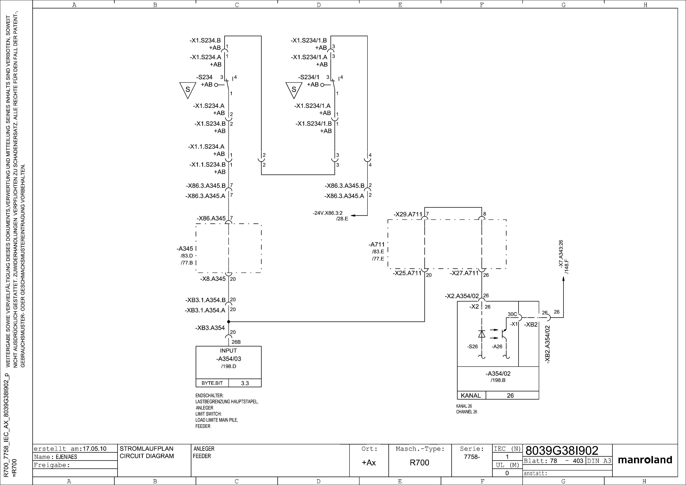

# +Ax — Sheet 78 of 403 — ANLEGER

**FEEDER**

> Part of the manroland **R700** printing press IEC/UL circuit diagrams.
> Drawing class: **Stromlaufplan / Circuit diagram** (DIN A3).
> Document `+Ax` covers the **Central control console** machine section.

## At a glance

| Field | Value |
|---|---|
| Document | `+Ax`  (8039G38I902) |
| Sheet | **78** of 403 |
| Section (DE) | ANLEGER |
| Section (EN) | FEEDER |
| Section type | CIRCUIT — Circuit diagram |
| Machine type | `R700` |
| Series | `7758` |
| Created | 17.05.10 |
| Replaces | — |
| Columns used | B, C, D, E, F, G |
| Path numbers | — |
| Labels on sheet | 113 |
| Cross-refs out | 8 |
| Cross-refs in | 39 |

**Previous:** [+Ax sheet 77](SHEET_0077.md) · **Next:** [+Ax sheet 79](SHEET_0079.md) · **Document TOC:** [_TOC.md](_TOC.md)  (+Ax) · **Master TOC:** [all sheets](../_MASTER_TOC.md)

## Sheet image (300 DPI, exact vector render)



_Rendered directly from the PDF vector layer at 300 DPI (1-bit), no OCR and no resampling. Use it to confirm anything ambiguous in the text below._

## Cross-references on this sheet

Each entry is a wire leaving this sheet. The printed token is `/sheet.column`; the link resolves to that sheet inside the same document.

| Ref | Target sheet | Col | Path | Destination on target | Target section | From col |
|---|---|---|---|---|---|---|
| `/28.E` | [+Ax sheet 28](SHEET_0028.md) | E | — | 24V.X86.3:2 | SPANNUNGSVERSORGUNG, SCHALTSCHRANKBELÜFTUNG | D |
| `/148.F` | [+Ax sheet 148](SHEET_0148.md) | F | — | X7.A343:26 | ÜBERWACHUNGSRECHNER SICHERHEITSBUS | G |
| `/83.E` | [+Ax sheet 83](SHEET_0083.md) | E | — | — | ANLEGER | E |
| `/77.E` | [+Ax sheet 77](SHEET_0077.md) | E | — | — | ANLEGER | E |
| `/83.D` | [+Ax sheet 83](SHEET_0083.md) | D | — | — | ANLEGER | B |
| `/77.B` | [+Ax sheet 77](SHEET_0077.md) | B | — | — | ANLEGER | B |
| `/198.D` | [+Ax sheet 198](SHEET_0198.md) | D | — | — | REFERENZMODUL | C |
| `/198.B` | [+Ax sheet 198](SHEET_0198.md) | B | — | — | REFERENZMODUL | F |

### Incoming references (sheets that point here)

Every other sheet that sends a wire to this one. `Back-ref` is the token printed on *that* sheet; `Path` is its line number.

| From sheet | Cols | Back-ref | Path | Refs | What continues there |
|---|---|---|---|---|---|
| [+Ax#28](SHEET_0028.md) | E | `/28.E` | — | 1 | — |
| [+Ax#77](SHEET_0077.md) | A, D | `/77.A`, `/77.D` | — | 2 | — |
| [+Ax#83](SHEET_0083.md) | C, E | `/83.C`, `/83.E` | — | 2 | — |
| [+Ax#148](SHEET_0148.md) | F | `/148.F` | — | 1 | X7.A343:26 |
| [+Ax#198](SHEET_0198.md) | B, D | `/198.B`, `/198.D` | — | 2 | — |
| [+Ax#215](SHEET_0215.md) | A, B, C | `/215.A`, `/215.B`, `/215.C` | — | 16 | — |
| [+Ax#219](SHEET_0219.md) | D, F | `/219.D`, `/219.F` | — | 2 | — |
| [+Ax#224](SHEET_0224.md) | A, B, C | `/224.A`, `/224.B`, `/224.C` | — | 3 | — |
| [+Ax#238](SHEET_0238.md) | A | `/238.A` | — | 1 | — |
| [+Ax#268](SHEET_0268.md) | C | `/268.C` | — | 1 | — |
| [+Ax#271](SHEET_0271.md) | B | `/271.B` | — | 1 | — |
| [+Ax#274](SHEET_0274.md) | A | `/274.A` | — | 2 | — |
| [+Ax#288](SHEET_0288.md) | A, G, H | `/288.A`, `/288.G`, `/288.H` | — | 5 | — |


## Devices on this sheet

| Tag | Class | Class meaning (IEC) | Col | Sub | Terminal | Sign |
|---|---|---|---|---|---|---|
| `A354/03` | A | Baugruppe / assembly, module, PC board | C | 03 | — | — |
| `A345` | A | Baugruppe / assembly, module, PC board | B | — | — | — |
| `S234` | S | Schalter / switch | C | — | — | — |
| `S234/1` | S | Schalter / switch | D | 1 | — | — |
| `S26` | S | Schalter / switch | F | — | — | — |
| `A26` | A | Baugruppe / assembly, module, PC board | F | — | — | — |
| `X1` | X | Klemme / terminal, plug connector | F | — | — | — |
| `X2` | X | Klemme / terminal, plug connector | F | — | — | — |
| `XB2` | XB |  | G | — | — | — |
| `A354/02` | A | Baugruppe / assembly, module, PC board | F | 02 | — | — |
| `A711` | A | Baugruppe / assembly, module, PC board | E | — | — | — |
| `3.3` | — | cross-device reference | C | — | — | — |
| `XB3.A354` | — | cross-device reference | C | — | — | — |
| `X8.A345` | — | cross-device reference | C | — | — | — |
| `X86.A345` | — | cross-device reference | C | — | — | — |
| `X1.S234.B` | — | cross-device reference | C | — | — | — |
| `X1.S234.A` | — | cross-device reference | C | — | — | — |
| `X1.S234.A` | — | cross-device reference | C | — | — | — |
| `X1.S234.B` | — | cross-device reference | C | — | — | — |
| `X86.3.A345.A` | — | cross-device reference | C | — | — | — |
| `X86.3.A345.B` | — | cross-device reference | C | — | — | — |
| `X1.1.S234.B` | — | cross-device reference | C | — | — | — |
| `X1.1.S234.A` | — | cross-device reference | C | — | — | — |
| `X86.3.A345.A` | — | cross-device reference | D | — | — | — |
| `X86.3.A345.B` | — | cross-device reference | D | — | — | — |
| `X27.A711` | — | cross-device reference | F | — | — | — |
| `X29.A711` | — | cross-device reference | E | — | — | — |
| `X25.A711` | — | cross-device reference | E | — | — | — |
| `XB3.1.A354.B` | — | cross-device reference | C | — | — | — |
| `XB3.1.A354.A` | — | cross-device reference | C | — | — | — |
| `X7.A343:26` | — | cross-device reference | G | — | 26 | — |

## Potentials / nets

| Potential | Count | Columns | Attached devices | Terminals |
|---|---|---|---|---|
| `24V` | 1 | D | `3`, `X86` | `2` |


A potential such as `L24+/4` or `M24+` is a named supply/return rail; every place it appears on this sheet is electrically common.

## Wire-end annotations (grouped as printed)

A wire that continues elsewhere is annotated with a small cluster: the destination description, the path/line number `#NN`, and the `/sheet.column` cross reference. Each row below is one such cluster exactly as it is grouped on the drawing.

| Col | Y | Path | Cross-ref | Text on the wire |
|---|---|---|---|---|
| C | 65.5 | — | — | `X1.S234.B 1` |
| D | 65.5 | — | — | `X1.S234/1.B 3` |
| C | 78.2 | — | — | `+AB` |
| D | 78.2 | — | — | `+AB` |
| C | 93.9 | — | — | `X1.S234.A 1` |
| D | 93.9 | — | — | `X1.S234/1.A 3` |
| C | 107.2 | — | — | `+AB` |
| D | 107.2 | — | — | `+AB` |
| C | 129.3 | — | — | `S234 4` |
| D | 129.3 | — | — | `S234/1 4` |
| C | 130.0 | — | — | `3` |
| D | 130.0 | — | — | `3` |
| C | 142.0 | — | — | `+AB` |
| D | 142.0 | — | — | `+AB` |
| C | 149.9 | — | — | `S S` |
| C | 158.4 | — | — | `1` |
| D | 158.4 | — | — | `1` |
| C | 178.9 | — | — | `X1.S234.A 2` |
| D | 178.9 | — | — | `X1.S234/1.A 1` |
| C | 191.6 | — | — | `+AB` |
| D | 191.6 | — | — | `+AB` |
| C | 210.1 | — | — | `X1.S234.B 2` |
| D | 210.1 | — | — | `X1.S234/1.B 1` |
| C | 222.8 | — | — | `+AB` |
| D | 222.8 | — | — | `+AB` |
| C | 249.8 | — | — | `X1.1.S234.A 1` |
| C | 262.4 | — | — | `+AB` |
| C | 265.4 | — | — | `2` |
| D | 265.4 | — | — | `3` |
| E | 265.4 | — | — | `4` |
| C | 280.9 | — | — | `X1.1.S234.B 1` |
| C | 282.4 | — | — | `2` |
| D | 282.4 | — | — | `3` |
| E | 282.4 | — | — | `4` |
| C | 293.6 | — | — | `+AB` |
| C | 317.8 | — | — | `X86.3.A345.B 7` |
| D | 317.8 | — | — | `X86.3.A345.B 2` |
| C | 334.8 | — | — | `X86.3.A345.A 7` |
| D | 334.8 | — | — | `X86.3.A345.A 2` |
| D | 365.9 | — | `/28.E` | `24V.X86.3:2` |
| E | 367.4 | — | — | `X29.A711 7` |
| F | 367.4 | — | — | `8` |
| C | 374.5 | — | — | `X86.A345 7` |
| G | 416.4 | — | `/148.F` | `X7.A343:26` |
| E | 419.8 | — | — | `A711` |
| B | 426.9 | — | — | `A345` |
| E | 432.9 | — | `/83.E`, `/77.E` | — |
| B | 440.0 | — | `/83.D`, `/77.B` | — |
| E | 469.4 | — | — | `X25.A711 20` |
| F | 469.4 | — | — | `X27.A711 26` |
| C | 479.4 | — | — | `X8.A345 20` |
| F | 509.1 | — | — | `X2.A354/02 26` |
| C | 516.2 | — | — | `XB3.1.A354.B 20` |
| F | 527.6 | — | — | `X2` |
| F | 529.0 | — | — | `26 26` |
| C | 533.2 | — | — | `XB3.1.A354.A 20` |
| G | 537.5 | — | — | `26` |
| F | 541.8 | — | — | `30C` |
| F | 558.7 | — | — | `X1` |
| G | 558.7 | — | — | `XB2` |
| C | 564.4 | — | — | `XB3.A354 20` |
| G | 565.0 | — | — | `XB2.A354/02` |
| C | 589.9 | — | — | `26B` |
| F | 597.7 | — | — | `S26 A26` |
| C | 604.4 | — | — | `INPUT` |
| C | 618.3 | — | — | `A354/03` |
| C | 632.1 | — | `/198.D` | — |
| F | 643.8 | — | — | `A354/02` |
| F | 656.1 | — | `/198.B` | — |
| C | 661.1 | — | — | `BYTE.BIT 3.3` |
| F | 682.0 | — | — | `KANAL 26` |
| C | 683.8 | — | — | `ENDSCHALTER: LASTBEGRENZUNG HAUPTSTAPEL,` |
| F | 702.4 | — | — | `KANAL 26 CHANNEL 26` |
| C | 705.0 | — | — | `LIMIT SWITCH: LOAD LIMITE MAIN PILE, FEEDER ANLEGER` |


## Reconstructed tables

This sheet carries tabular content (pin map / terminal assignment / index). The grid below was rebuilt from the drawing's own rule lines, so each row is exactly one physical row of the table.

### Table 1 — 4 data rows × 3 columns (at x=340.2, y=62.4)

| X1.S234.B +AB X1.S234.A +AB S234 3 +AB X1.S234.A +AB X1.S234.B +AB X1.1.S234.A +AB X1.1.S234.B +AB | 1 1 | 4 1 2 2 1 1 |
|---|---|---|
| `X86.3.A345.B X86.3.A345.A X86.A345 X8.A345 XB3.1.A354.B XB3.1.A354.A` |  | `7 7 7 20 20 20` |
| `XB3.A354` |  | `20 26B` |
|  | `INPUT` | `A354/03 /198.D` |
| `BYTE.BIT` |  | `3.3` |


### Table 2 — 6 data rows × 9 columns (at x=574.0, y=62.4)

| 3 3 | 4 1 1 1 3 3 | 4 4 |  |  |  |  |  |  |
|---|---|---|---|---|---|---|---|---|
|  | `X86.3.A345.B X86.3.A345.A` | `2 2` |  |  |  |  |  |  |
|  | `/28.E` | `X29.A711 A711 /83.E /77.E X25.A711` | `7 20` | `X27.A711 X2.A354/02` | `8 26 26` |  |  | `X7.A343:26` |
|  |  |  |  | `X2` | `26` | `30C` |  | `26 26` |
|  |  |  |  | `S26` | `A26` | `X1` | `XB2` | `XB2.A354/02` |
|  |  |  |  |  | `A354/02 /198.B` |  |  |  |
|  |  |  |  | `KANAL` |  | `26` |  |  |


## Notes and free text on this sheet

| Text | Col | Y (pt) |
|---|---|---|
| `26B` | C | 589.89 |
| `INPUT` | C | 604.42 |
| `BYTE.BIT` | C | 661.67 |
| `ENDSCHALTER:` | C | 683.77 |
| `LASTBEGRENZUNG HAUPTSTAPEL,` | C | 694.4 |
| `ANLEGER` | C | 705.05 |
| `LIMIT SWITCH:` | C | 715.61 |
| `LOAD LIMITE MAIN PILE,` | C | 726.29 |
| `FEEDER` | C | 736.91 |
| `+AB` | C | 141.96 |
| `X1.S234/1.B` | D | 210.08 |
| `+AB` | D | 222.75 |
| `X1.S234/1.A` | D | 178.9 |
| `KANAL 26` | F | 702.36 |
| `CHANNEL 26` | F | 712.3 |
| `30C` | F | 541.75 |
| `KANAL` | F | 682.03 |
| `X2.A354/02` | F | 509.13 |
| `XB2.A354/02` | G | 564.95 |
| `S` | B | 149.91 |
| `S` | D | 149.91 |

## Complete label inventory (exact text from the drawing)

Every text object inside the drawing area of this sheet, in DIN reading order (column A→H, then top→bottom). This is the authoritative list: if a string is not here it is not printed on this sheet.

| Col | Y | X | Dir | Type | Text |
|---|---|---|---|---|---|
| B | 149.9 | 321.9 | → | text | `S` |
| B | 426.9 | 306.7 | → | device tag | `A345` |
| B | 440.0 | 313.8 | → | cross-reference | `/83.D` |
| B | 452.4 | 314.1 | → | cross-reference | `/77.B` |
| C | 65.5 | 329.1 | → | device ref | `X1.S234.B` |
| C | 76.9 | 391.7 | → | number | `1` |
| C | 78.2 | 362.8 | → | text | `+AB` |
| C | 93.9 | 391.7 | → | number | `1` |
| C | 94.6 | 329.7 | → | device ref | `X1.S234.A` |
| C | 107.2 | 364.3 | → | text | `+AB` |
| C | 129.3 | 340.7 | → | device tag | `S234` |
| C | 130.0 | 382.4 | → | number | `3` |
| C | 130.0 | 406.5 | → | number | `4` |
| C | 142.0 | 348.7 | → | text | `+AB` |
| C | 158.4 | 398.8 | → | number | `1` |
| C | 178.9 | 335.3 | → | device ref | `X1.S234.A` |
| C | 191.6 | 369.9 | → | text | `+AB` |
| C | 194.5 | 399.4 | → | number | `2` |
| C | 210.1 | 337.6 | → | device ref | `X1.S234.B` |
| C | 211.5 | 399.4 | → | number | `2` |
| C | 222.8 | 371.3 | → | text | `+AB` |
| C | 249.8 | 326.6 | → | device ref | `X1.1.S234.A` |
| C | 262.4 | 369.9 | → | text | `+AB` |
| C | 265.4 | 398.8 | → | number | `1` |
| C | 265.4 | 456.1 | → | number | `2` |
| C | 280.9 | 328.8 | → | device ref | `X1.1.S234.B` |
| C | 282.4 | 398.8 | → | number | `1` |
| C | 282.4 | 456.1 | → | number | `2` |
| C | 293.6 | 371.3 | → | text | `+AB` |
| C | 317.8 | 322.9 | → | device ref | `X86.3.A345.B` |
| C | 317.8 | 399.4 | → | number | `7` |
| C | 334.8 | 399.4 | → | number | `7` |
| C | 335.5 | 322.0 | → | device ref | `X86.3.A345.A` |
| C | 374.5 | 341.6 | → | device ref | `X86.A345` |
| C | 374.5 | 399.4 | → | number | `7` |
| C | 479.4 | 347.5 | → | device ref | `X8.A345` |
| C | 480.8 | 399.4 | → | number | `20` |
| C | 516.2 | 321.7 | → | device ref | `XB3.1.A354.B` |
| C | 516.2 | 399.4 | → | number | `20` |
| C | 533.2 | 399.4 | → | number | `20` |
| C | 533.9 | 320.9 | → | device ref | `XB3.1.A354.A` |
| C | 564.4 | 339.0 | → | device ref | `XB3.A354` |
| C | 572.9 | 399.4 | → | number | `20` |
| C | 589.9 | 402.2 | → | text | `26B` |
| C | 604.4 | 382.0 | → | text | `INPUT` |
| C | 618.3 | 375.4 | → | device tag | `A354/03` |
| C | 632.1 | 384.1 | → | cross-reference | `/198.D` |
| C | 661.1 | 418.4 | → | device ref | `3.3` |
| C | 661.7 | 350.1 | → | text | `BYTE.BIT` |
| C | 683.8 | 339.3 | → | text | `ENDSCHALTER:` |
| C | 694.4 | 339.3 | → | text | `LASTBEGRENZUNG HAUPTSTAPEL,` |
| C | 705.1 | 340.2 | → | text | `ANLEGER` |
| C | 715.6 | 339.3 | → | text | `LIMIT SWITCH:` |
| C | 726.3 | 339.3 | → | text | `LOAD LIMITE MAIN PILE,` |
| C | 736.9 | 339.3 | → | text | `FEEDER` |
| D | 65.5 | 504.6 | → | text | `X1.S234/1.B` |
| D | 76.9 | 576.6 | → | number | `3` |
| D | 78.2 | 547.1 | → | text | `+AB` |
| D | 93.9 | 576.6 | → | number | `3` |
| D | 94.6 | 505.1 | → | text | `X1.S234/1.A` |
| D | 107.2 | 548.5 | → | text | `+AB` |
| D | 129.3 | 517.6 | → | device tag | `S234/1` |
| D | 130.0 | 566.6 | → | number | `3` |
| D | 130.0 | 590.7 | → | number | `4` |
| D | 142.0 | 532.9 | → | text | `+AB` |
| D | 149.9 | 506.1 | → | text | `S` |
| D | 158.4 | 583.1 | → | number | `1` |
| D | 178.9 | 510.8 | → | text | `X1.S234/1.A` |
| D | 191.6 | 554.2 | → | text | `+AB` |
| D | 194.5 | 583.1 | → | number | `1` |
| D | 210.1 | 513.1 | → | text | `X1.S234/1.B` |
| D | 211.5 | 583.1 | → | number | `1` |
| D | 222.8 | 555.6 | → | text | `+AB` |
| D | 265.4 | 583.7 | → | number | `3` |
| D | 282.4 | 583.7 | → | number | `3` |
| D | 317.8 | 563.8 | → | device ref | `X86.3.A345.B` |
| D | 335.5 | 563.0 | → | device ref | `X86.3.A345.A` |
| D | 365.9 | 543.1 | → | potential | `24V.X86.3:2` |
| D | 375.8 | 583.7 | → | cross-reference | `/28.E` |
| E | 265.4 | 640.3 | → | number | `4` |
| E | 282.4 | 640.3 | → | number | `4` |
| E | 317.8 | 640.3 | → | number | `2` |
| E | 334.8 | 640.3 | → | number | `2` |
| E | 367.4 | 683.1 | → | device ref | `X29.A711` |
| E | 367.4 | 739.6 | → | number | `7` |
| E | 419.8 | 639.8 | → | device tag | `A711` |
| E | 432.9 | 646.0 | → | cross-reference | `/83.E` |
| E | 445.3 | 646.0 | → | cross-reference | `/77.E` |
| E | 469.4 | 681.7 | → | device ref | `X25.A711` |
| E | 473.7 | 739.6 | → | number | `20` |
| F | 367.4 | 838.8 | → | number | `8` |
| F | 469.4 | 780.9 | → | device ref | `X27.A711` |
| F | 473.7 | 838.8 | → | number | `26` |
| F | 509.1 | 772.2 | → | text | `X2.A354/02` |
| F | 509.1 | 838.8 | → | number | `26` |
| F | 527.6 | 814.7 | → | device tag | `X2` |
| F | 529.0 | 841.6 | → | number | `26` |
| F | 541.7 | 881.6 | → | text | `30C` |
| F | 558.7 | 885.3 | → | device tag | `X1` |
| F | 597.7 | 811.0 | → | device tag | `S26` |
| F | 597.7 | 853.5 | → | device tag | `A26` |
| F | 643.8 | 843.2 | → | device tag | `A354/02` |
| F | 656.1 | 852.0 | → | cross-reference | `/198.B` |
| F | 682.0 | 799.9 | → | text | `KANAL` |
| F | 682.0 | 880.0 | → | number | `26` |
| F | 702.4 | 791.7 | → | text | `KANAL 26` |
| F | 712.3 | 792.0 | → | text | `CHANNEL 26` |
| G | 416.4 | 969.7 | ↕ | device ref | `X7.A343:26` |
| G | 449.9 | 979.6 | ↕ | cross-reference | `/148.F` |
| G | 537.5 | 961.5 | → | number | `26` |
| G | 538.9 | 940.8 | → | number | `26` |
| G | 558.7 | 909.6 | → | device tag | `XB2` |
| G | 564.9 | 945.7 | ↕ | text | `XB2.A354/02` |

## Reading-order text block

The same content as a plain block, grouped by DIN column — convenient to paste or to match against a visual description.

```text
=== Column B ===
 149.9  321.9  text         S
 426.9  306.7  devtag       A345
 440.0  313.8  xref         /83.D
 452.4  314.1  xref         /77.B
=== Column C ===
  65.5  329.1  devref       X1.S234.B
  76.9  391.7  numeric      1
  78.2  362.8  text         +AB
  93.9  391.7  numeric      1
  94.6  329.7  devref       X1.S234.A
 107.2  364.3  text         +AB
 129.3  340.7  devtag       S234
 130.0  382.4  numeric      3
 130.0  406.5  numeric      4
 142.0  348.7  text         +AB
 158.4  398.8  numeric      1
 178.9  335.3  devref       X1.S234.A
 191.6  369.9  text         +AB
 194.5  399.4  numeric      2
 210.1  337.6  devref       X1.S234.B
 211.5  399.4  numeric      2
 222.8  371.3  text         +AB
 249.8  326.6  devref       X1.1.S234.A
 262.4  369.9  text         +AB
 265.4  398.8  numeric      1
 265.4  456.1  numeric      2
 280.9  328.8  devref       X1.1.S234.B
 282.4  398.8  numeric      1
 282.4  456.1  numeric      2
 293.6  371.3  text         +AB
 317.8  322.9  devref       X86.3.A345.B
 317.8  399.4  numeric      7
 334.8  399.4  numeric      7
 335.5  322.0  devref       X86.3.A345.A
 374.5  341.6  devref       X86.A345
 374.5  399.4  numeric      7
 479.4  347.5  devref       X8.A345
 480.8  399.4  numeric      20
 516.2  321.7  devref       XB3.1.A354.B
 516.2  399.4  numeric      20
 533.2  399.4  numeric      20
 533.9  320.9  devref       XB3.1.A354.A
 564.4  339.0  devref       XB3.A354
 572.9  399.4  numeric      20
 589.9  402.2  text         26B
 604.4  382.0  text         INPUT
 618.3  375.4  devtag       A354/03
 632.1  384.1  xref         /198.D
 661.1  418.4  devref       3.3
 661.7  350.1  text         BYTE.BIT
 683.8  339.3  text         ENDSCHALTER:
 694.4  339.3  text         LASTBEGRENZUNG HAUPTSTAPEL,
 705.1  340.2  text         ANLEGER
 715.6  339.3  text         LIMIT SWITCH:
 726.3  339.3  text         LOAD LIMITE MAIN PILE,
 736.9  339.3  text         FEEDER
=== Column D ===
  65.5  504.6  text         X1.S234/1.B
  76.9  576.6  numeric      3
  78.2  547.1  text         +AB
  93.9  576.6  numeric      3
  94.6  505.1  text         X1.S234/1.A
 107.2  548.5  text         +AB
 129.3  517.6  devtag       S234/1
 130.0  566.6  numeric      3
 130.0  590.7  numeric      4
 142.0  532.9  text         +AB
 149.9  506.1  text         S
 158.4  583.1  numeric      1
 178.9  510.8  text         X1.S234/1.A
 191.6  554.2  text         +AB
 194.5  583.1  numeric      1
 210.1  513.1  text         X1.S234/1.B
 211.5  583.1  numeric      1
 222.8  555.6  text         +AB
 265.4  583.7  numeric      3
 282.4  583.7  numeric      3
 317.8  563.8  devref       X86.3.A345.B
 335.5  563.0  devref       X86.3.A345.A
 365.9  543.1  net          24V.X86.3:2
 375.8  583.7  xref         /28.E
=== Column E ===
 265.4  640.3  numeric      4
 282.4  640.3  numeric      4
 317.8  640.3  numeric      2
 334.8  640.3  numeric      2
 367.4  683.1  devref       X29.A711
 367.4  739.6  numeric      7
 419.8  639.8  devtag       A711
 432.9  646.0  xref         /83.E
 445.3  646.0  xref         /77.E
 469.4  681.7  devref       X25.A711
 473.7  739.6  numeric      20
=== Column F ===
 367.4  838.8  numeric      8
 469.4  780.9  devref       X27.A711
 473.7  838.8  numeric      26
 509.1  772.2  text         X2.A354/02
 509.1  838.8  numeric      26
 527.6  814.7  devtag       X2
 529.0  841.6  numeric      26
 541.7  881.6  text         30C
 558.7  885.3  devtag       X1
 597.7  811.0  devtag       S26
 597.7  853.5  devtag       A26
 643.8  843.2  devtag       A354/02
 656.1  852.0  xref         /198.B
 682.0  799.9  text         KANAL
 682.0  880.0  numeric      26
 702.4  791.7  text         KANAL 26
 712.3  792.0  text         CHANNEL 26
=== Column G ===
 416.4  969.7  devref       X7.A343:26
 449.9  979.6  xref         /148.F
 537.5  961.5  numeric      26
 538.9  940.8  numeric      26
 558.7  909.6  devtag       XB2
 564.9  945.7  text         XB2.A354/02
```

---
_Generated from the PDF vector text layer; no OCR. Source: `R700_7758_IEC_AX_8039G38I902_p`, sheet 78._
