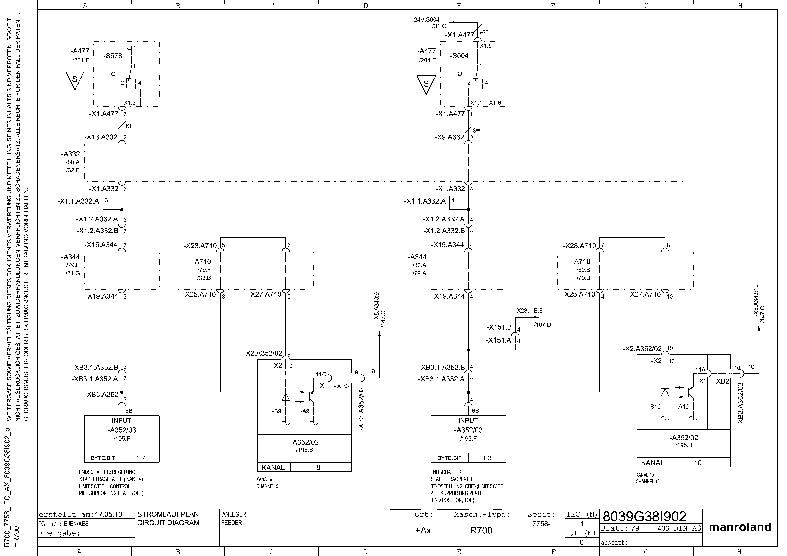

# +Ax — Sheet 79 of 403 — ANLEGER

**FEEDER**

> Part of the manroland **R700** printing press IEC/UL circuit diagrams.
> Drawing class: **Stromlaufplan / Circuit diagram** (DIN A3).
> Document `+Ax` covers the **Central control console** machine section.

## At a glance

| Field | Value |
|---|---|
| Document | `+Ax`  (8039G38I902) |
| Sheet | **79** of 403 |
| Section (DE) | ANLEGER |
| Section (EN) | FEEDER |
| Section type | CIRCUIT — Circuit diagram |
| Machine type | `R700` |
| Series | `7758` |
| Created | 17.05.10 |
| Replaces | — |
| Columns used | A, B, C, D, E, F, G, H |
| Path numbers | — |
| Labels on sheet | 164 |
| Cross-refs out | 20 |
| Cross-refs in | 55 |

**Previous:** [+Ax sheet 78](SHEET_0078.md) · **Next:** [+Ax sheet 80](SHEET_0080.md) · **Document TOC:** [_TOC.md](_TOC.md)  (+Ax) · **Master TOC:** [all sheets](../_MASTER_TOC.md)

## Sheet image (300 DPI, exact vector render)



_Rendered directly from the PDF vector layer at 300 DPI (1-bit), no OCR and no resampling. Use it to confirm anything ambiguous in the text below._

## Cross-references on this sheet

Each entry is a wire leaving this sheet. The printed token is `/sheet.column`; the link resolves to that sheet inside the same document.

| Ref | Target sheet | Col | Path | Destination on target | Target section | From col |
|---|---|---|---|---|---|---|
| `/31.C` | [+Ax sheet 31](SHEET_0031.md) | C | — | 24V.S604 | SPANNUNGSVERSORGUNG, SCHALTSCHRANKBELÜFTUNG | E |
| `/204.E` | [+Ax sheet 204](SHEET_0204.md) | E | — | — | REFERENZMODUL | A |
| `/204.E` | [+Ax sheet 204](SHEET_0204.md) | E | — | — | REFERENZMODUL | E |
| `/80.A` | [+Ax sheet 80](SHEET_0080.md) | A | — | — | ANLEGER | A |
| `/32.B` | [+Ax sheet 32](SHEET_0032.md) | B | — | — | SPANNUNGSVERSORGUNG, SCHALTSCHRANKBELÜFTUNG | A |
| `/79.E` | [+Ax sheet 79](SHEET_0079.md) | E | — | — | ANLEGER | A |
| `/51.G` | [+Ax sheet 51](SHEET_0051.md) | G | — | — | SIGNALGEBER: AKUSTISCHE WARNSIGNALE | A |
| `/80.A` | [+Ax sheet 80](SHEET_0080.md) | A | — | — | ANLEGER | E |
| `/79.A` | [+Ax sheet 79](SHEET_0079.md) | A | — | — | ANLEGER | E |
| `/80.B` | [+Ax sheet 80](SHEET_0080.md) | B | — | — | ANLEGER | F |
| `/79.B` | [+Ax sheet 79](SHEET_0079.md) | B | — | — | ANLEGER | F |
| `/79.F` | [+Ax sheet 79](SHEET_0079.md) | F | — | — | ANLEGER | B |
| `/33.B` | [+Ax sheet 33](SHEET_0033.md) | B | — | — | SPANNUNGSVERSORGUNG, SCHALTSCHRANKBELÜFTUNG | B |
| `/147.C` | [+Ax sheet 147](SHEET_0147.md) | C | — | X5.A343:10 | ÜBERWACHUNGSRECHNER SICHERHEITSBUS | H |
| `/147.C` | [+Ax sheet 147](SHEET_0147.md) | C | — | X5.A343:9 | ÜBERWACHUNGSRECHNER SICHERHEITSBUS | D |
| `/107.D` | [+Ax sheet 107](SHEET_0107.md) | D | — | — | ANLEGER | F |
| `/195.F` | [+Ax sheet 195](SHEET_0195.md) | F | — | — | REFERENZMODUL | A |
| `/195.F` | [+Ax sheet 195](SHEET_0195.md) | F | — | — | REFERENZMODUL | E |
| `/195.B` | [+Ax sheet 195](SHEET_0195.md) | B | — | — | REFERENZMODUL | G |
| `/195.B` | [+Ax sheet 195](SHEET_0195.md) | B | — | — | REFERENZMODUL | C |

### Incoming references (sheets that point here)

Every other sheet that sends a wire to this one. `Back-ref` is the token printed on *that* sheet; `Path` is its line number.

| From sheet | Cols | Back-ref | Path | Refs | What continues there |
|---|---|---|---|---|---|
| [+Ax#31](SHEET_0031.md) | C | `/31.C` | — | 1 | 24V.S604 |
| [+Ax#32](SHEET_0032.md) | B | `/32.B` | — | 1 | — |
| [+Ax#33](SHEET_0033.md) | B | `/33.B` | — | 1 | — |
| [+Ax#51](SHEET_0051.md) | G | `/51.G` | — | 1 | — |
| [+Ax#79](SHEET_0079.md) | A, B, E, F | `/79.A`, `/79.B`, `/79.E`, `/79.F` | — | 4 | — |
| [+Ax#80](SHEET_0080.md) | A, B | `/80.A`, `/80.B` | — | 3 | — |
| [+Ax#107](SHEET_0107.md) | D | `/107.D` | — | 1 | X23.1.B:9 |
| [+Ax#147](SHEET_0147.md) | C | `/147.C` | — | 2 | X5.A343:10; X5.A343:9 |
| [+Ax#195](SHEET_0195.md) | B, F | `/195.B`, `/195.F` | — | 4 | — |
| [+Ax#204](SHEET_0204.md) | E | `/204.E` | — | 2 | — |
| [+Ax#207](SHEET_0207.md) | A, B, C | `/207.A`, `/207.B`, `/207.C` | — | 8 | — |
| [+Ax#209](SHEET_0209.md) | A | `/209.A` | — | 3 | — |
| [+Ax#218](SHEET_0218.md) | G | `/218.G` | — | 2 | — |
| [+Ax#219](SHEET_0219.md) | A | `/219.A` | — | 2 | — |
| [+Ax#223](SHEET_0223.md) | E, G, H | `/223.E`, `/223.G`, `/223.H` | — | 6 | — |
| [+Ax#240](SHEET_0240.md) | E | `/240.E` | — | 1 | — |
| [+Ax#249](SHEET_0249.md) | F | `/249.F` | — | 1 | — |
| [+Ax#252](SHEET_0252.md) | D, E | `/252.D`, `/252.E` | — | 2 | — |
| [+Ax#258](SHEET_0258.md) | G | `/258.G` | — | 2 | — |
| [+Ax#268](SHEET_0268.md) | B | `/268.B` | — | 2 | — |
| [+Ax#270](SHEET_0270.md) | G | `/270.G` | — | 2 | — |
| [+Ax#272](SHEET_0272.md) | E | `/272.E` | — | 4 | — |


## Devices on this sheet

| Tag | Class | Class meaning (IEC) | Col | Sub | Terminal | Sign |
|---|---|---|---|---|---|---|
| `A344` | A | Baugruppe / assembly, module, PC board | A | — | — | — |
| `A332` | A | Baugruppe / assembly, module, PC board | A | — | — | — |
| `A344` | A | Baugruppe / assembly, module, PC board | E | — | — | — |
| `A710` | A | Baugruppe / assembly, module, PC board | B | — | — | — |
| `A710` | A | Baugruppe / assembly, module, PC board | F | — | — | — |
| `A352/03` | A | Baugruppe / assembly, module, PC board | A | 03 | — | — |
| `A352/03` | A | Baugruppe / assembly, module, PC board | E | 03 | — | — |
| `S9` | S | Schalter / switch | C | — | — | — |
| `A9` | A | Baugruppe / assembly, module, PC board | C | — | — | — |
| `X1` | X | Klemme / terminal, plug connector | D | — | — | — |
| `X2` | X | Klemme / terminal, plug connector | C | — | — | — |
| `XB2` | XB |  | D | — | — | — |
| `A352/02` | A | Baugruppe / assembly, module, PC board | C | 02 | — | — |
| `S10` | S | Schalter / switch | G | — | — | — |
| `A10` | A | Baugruppe / assembly, module, PC board | G | — | — | — |
| `X1` | X | Klemme / terminal, plug connector | H | — | — | — |
| `X2` | X | Klemme / terminal, plug connector | G | — | — | — |
| `XB2` | XB |  | H | — | — | — |
| `A352/02` | A | Baugruppe / assembly, module, PC board | G | 02 | — | — |
| `X1:5` | X | Klemme / terminal, plug connector | E | — | 5 | — |
| `X1:1` | X | Klemme / terminal, plug connector | E | — | 1 | — |
| `X1:6` | X | Klemme / terminal, plug connector | E | — | 6 | — |
| `S604` | S | Schalter / switch | E | — | — | — |
| `A477` | A | Baugruppe / assembly, module, PC board | E | — | — | — |
| `X1:3` | X | Klemme / terminal, plug connector | A | — | 3 | — |
| `S678` | S | Schalter / switch | A | — | — | — |
| `A477` | A | Baugruppe / assembly, module, PC board | A | — | — | — |
| `X1.A332` | — | cross-device reference | A | — | — | — |
| `X13.A332` | — | cross-device reference | A | — | — | — |
| `X19.A344` | — | cross-device reference | A | — | — | — |
| `X15.A344` | — | cross-device reference | A | — | — | — |
| `X1.2.A332.B` | — | cross-device reference | A | — | — | — |
| `X1.2.A332.A` | — | cross-device reference | A | — | — | — |
| `X1.1.A332.A` | — | cross-device reference | A | — | — | — |
| `X1.A332` | — | cross-device reference | E | — | — | — |
| `X9.A332` | — | cross-device reference | E | — | — | — |
| `X19.A344` | — | cross-device reference | E | — | — | — |
| `X15.A344` | — | cross-device reference | E | — | — | — |
| `X1.2.A332.B` | — | cross-device reference | E | — | — | — |
| `X1.2.A332.A` | — | cross-device reference | E | — | — | — |
| `X1.1.A332.A` | — | cross-device reference | E | — | — | — |
| `X28.A710` | — | cross-device reference | B | — | — | — |
| `X27.A710` | — | cross-device reference | C | — | — | — |
| `X25.A710` | — | cross-device reference | B | — | — | — |
| `X28.A710` | — | cross-device reference | F | — | — | — |
| `X27.A710` | — | cross-device reference | G | — | — | — |
| `X25.A710` | — | cross-device reference | F | — | — | — |
| `1.2` | — | cross-device reference | B | — | — | — |
| `XB3.A352` | — | cross-device reference | A | — | — | — |
| `1.3` | — | cross-device reference | E | — | — | — |
| `X151.B` | — | cross-device reference | E | — | — | — |
| `X151.A` | — | cross-device reference | E | — | — | — |
| `XB3.1.A352.B` | — | cross-device reference | E | — | — | — |
| `XB3.1.A352.A` | — | cross-device reference | E | — | — | — |
| `XB3.1.A352.B` | — | cross-device reference | A | — | — | — |
| `XB3.1.A352.A` | — | cross-device reference | A | — | — | — |
| `X1.A477` | — | cross-device reference | E | — | — | — |
| `X1.A477` | — | cross-device reference | E | — | — | — |
| `X1.A477` | — | cross-device reference | A | — | — | — |
| `X23.1.B:9` | — | cross-device reference | F | — | 9 | — |
| `X5.A343:10` | — | cross-device reference | H | — | 10 | — |
| `X5.A343:9` | — | cross-device reference | D | — | 9 | — |

## Potentials / nets

| Potential | Count | Columns | Attached devices | Terminals |
|---|---|---|---|---|
| `24V` | 1 | E | `S604` | — |


A potential such as `L24+/4` or `M24+` is a named supply/return rail; every place it appears on this sheet is electrically common.

## Wire-end annotations (grouped as printed)

A wire that continues elsewhere is annotated with a small cluster: the destination description, the path/line number `#NN`, and the `/sheet.column` cross reference. Each row below is one such cluster exactly as it is grouped on the drawing.

| Col | Y | Path | Cross-ref | Text on the wire |
|---|---|---|---|---|
| E | 25.8 | — | `/31.C` | `24V.S604` |
| E | 45.9 | — | — | `GE` |
| E | 48.5 | — | — | `X1.A477 5` |
| E | 65.5 | — | — | `X1:5` |
| A | 72.6 | — | — | `A477 S678` |
| E | 72.6 | — | — | `A477 S604` |
| A | 87.4 | — | `/204.E` | — |
| E | 87.4 | — | `/204.E` | — |
| B | 96.0 | — | — | `1` |
| E | 96.0 | — | — | `1` |
| A | 114.5 | — | — | `S` |
| A | 121.5 | — | — | `2 4` |
| E | 121.5 | — | — | `2 4` |
| E | 121.6 | — | — | `S` |
| A | 151.9 | — | — | `X1:3` |
| E | 151.9 | — | — | `X1:1 X1:6` |
| A | 167.6 | — | — | `X1.A477 3` |
| E | 167.6 | — | — | `X1.A477 1` |
| A | 187.6 | — | — | `RT` |
| E | 194.6 | — | — | `SW` |
| A | 203.0 | — | — | `X13.A332 2` |
| E | 203.0 | — | — | `X9.A332 2` |
| A | 228.5 | — | — | `A332` |
| A | 241.6 | — | `/80.A`, `/32.B` | — |
| A | 280.9 | — | — | `X1.A332 3` |
| E | 280.9 | — | — | `X1.A332 4` |
| A | 299.4 | — | — | `X1.1.A332.A 3` |
| E | 299.4 | — | — | `X1.1.A332.A 4` |
| A | 327.0 | — | — | `X1.2.A332.A 3` |
| E | 327.0 | — | — | `X1.2.A332.A 4` |
| A | 344.7 | — | — | `X1.2.A332.B 3` |
| E | 344.7 | — | — | `X1.2.A332.B 4` |
| A | 366.0 | — | — | `X15.A344 3` |
| E | 366.0 | — | — | `X15.A344 4` |
| C | 367.4 | — | — | `X28.A710 5 6` |
| G | 367.4 | — | — | `X28.A710 7 8` |
| A | 384.4 | — | — | `A344` |
| E | 384.4 | — | — | `A344` |
| B | 391.5 | — | — | `A710` |
| F | 391.5 | — | — | `A710` |
| A | 397.4 | — | `/79.E`, `/51.G` | — |
| E | 397.4 | — | `/80.A`, `/79.A` | — |
| F | 404.5 | — | `/80.B`, `/79.B` | — |
| B | 404.6 | — | `/79.F`, `/33.B` | — |
| H | 430.6 | — | `/147.C` | `X5.A343:10` |
| C | 441.1 | — | — | `X25.A710 3 X27.A710 9` |
| G | 441.1 | — | — | `X25.A710 4 X27.A710 10` |
| D | 442.5 | — | `/147.C` | `X5.A343:9` |
| A | 443.9 | — | — | `X19.A344 3` |
| E | 443.9 | — | — | `X19.A344 4` |
| F | 466.6 | — | — | `X23.1.B:9` |
| F | 487.9 | — | `/107.D` | — |
| E | 490.7 | — | — | `X151.B 4` |
| E | 510.6 | — | — | `X151.A 4` |
| G | 523.3 | — | — | `X2.A352/02 10` |
| C | 530.4 | — | — | `X2.A352/02 9` |
| G | 541.7 | — | — | `X2` |
| H | 543.2 | — | — | `10 10` |
| C | 548.8 | — | — | `X2` |
| D | 550.2 | — | — | `9 9` |
| A | 551.7 | — | — | `XB3.1.A352.B 3` |
| E | 551.7 | — | — | `XB3.1.A352.B 4` |
| H | 551.7 | — | — | `10` |
| H | 555.9 | — | — | `11A` |
| D | 558.8 | — | — | `9` |
| D | 563.0 | — | — | `11C` |
| A | 568.7 | — | — | `XB3.1.A352.A 3` |
| E | 568.7 | — | — | `XB3.1.A352.A 4` |
| H | 572.9 | — | — | `X1` |
| H | 572.9 | — | — | `XB2` |
| H | 579.1 | — | — | `XB2.A352/02` |
| D | 580.0 | — | — | `X1` |
| D | 580.0 | — | — | `XB2` |
| D | 586.2 | — | — | `XB2.A352/02` |
| A | 592.8 | — | — | `XB3.A352 3` |
| E | 601.3 | — | — | `4` |
| G | 611.9 | — | — | `S10 A10` |
| A | 618.2 | — | — | `5B` |
| E | 618.2 | — | — | `6B` |
| C | 619.0 | — | — | `S9 A9` |
| A | 632.8 | — | — | `INPUT` |
| E | 632.8 | — | — | `INPUT` |
| A | 646.6 | — | — | `A352/03` |
| E | 646.6 | — | — | `A352/03` |
| G | 657.9 | — | — | `A352/02` |
| A | 660.4 | — | `/195.F` | — |
| E | 660.4 | — | `/195.F` | — |
| C | 665.0 | — | — | `A352/02` |
| G | 670.3 | — | `/195.B` | — |
| C | 677.4 | — | `/195.B` | — |
| A | 689.4 | — | — | `BYTE.BIT 1.2` |
| E | 689.4 | — | — | `BYTE.BIT 1.3` |
| G | 696.2 | — | — | `KANAL 10` |
| C | 703.3 | — | — | `KANAL 9` |
| A | 712.1 | — | — | `ENDSCHALTER: REGELUNG` |
| E | 712.1 | — | — | `ENDSCHALTER:` |
| G | 716.5 | — | — | `KANAL 10 CHANNEL 10` |
| A | 722.7 | — | — | `LIMIT SWITCH: CONTROL PILE SUPPORTING PLATE (OFF) STAPELTRAGPLATTE (INAKTIV)` |
| E | 722.7 | — | — | `PILE SUPPORTING PLATE (ENDSTELLUNG, OBEN)LIMIT SWITCH: (END POSITION, TOP) STAPELTRAGPLATTE` |
| C | 723.6 | — | — | `KANAL 9 CHANNEL 9` |


## Reconstructed tables

This sheet carries tabular content (pin map / terminal assignment / index). The grid below was rebuilt from the drawing's own rule lines, so each row is exactly one physical row of the table.

### Table 1 — 7 data rows × 12 columns (at x=127.6, y=360.0)

| X15.A344 X19.A344 | 3 3 | X28.A710 A710 /79.F /33.B X25.A710 | 5 3 | X27.A710 | 6 9 |  |  | X5.A343:9 | A344 /80.A /79.A /147.C | X15.A344 X19.A344 | 4 4 X151.B X151.A |
|---|---|---|---|---|---|---|---|---|---|---|---|
|  |  |  |  | `X2.A352/02` | `9` |  |  |  |  |  |  |
| `XB3.1.A352.B XB3.1.A352.A` | `3 3` |  |  | `X2` | `9` | `11C X1` | `XB2` | `9 9` |  | `XB3.1.A352.B XB3.1.A352.A` | `4 4` |
| `XB3.A352` | `3 5B` |  |  | `S9` | `A9` |  |  | `XB2.A352/02` |  |  | `4 6B` |
| `INPUT` | `A352/03` |  |  |  |  |  |  |  |  | `INPUT` | `A352/03` |
|  | `/195.F` |  |  |  | `A352/02 /195.B` |  |  |  |  |  | `/195.F` |
| `BYTE.BIT` | `1.2` |  |  |  |  |  |  |  |  | `BYTE.BIT` | `1.3` |
|  |  |  |  | `KANAL` |  | `9` |  |  |  |  |  |


### Table 2 — 4 data rows × 6 columns (at x=907.1, y=360.0)

| 7 4 | X27.A710 X2.A352/02 | 8 10 10 |  |  | X5.A343:10 |
|---|---|---|---|---|---|
|  | `X2` | `10` | `11A X1` | `XB2` | `10 10` |
|  | `S10` | `A10` |  |  | `XB2.A352/02` |
|  |  | `A352/02 /195.B` |  |  |  |
|  | `KANAL` |  | `10` |  |  |


## Notes and free text on this sheet

| Text | Col | Y (pt) |
|---|---|---|
| `5B` | A | 618.22 |
| `INPUT` | A | 632.76 |
| `BYTE.BIT` | A | 690.01 |
| `ENDSCHALTER: REGELUNG` | A | 712.13 |
| `STAPELTRAGPLATTE (INAKTIV)` | A | 722.74 |
| `LIMIT SWITCH: CONTROL` | A | 733.35 |
| `PILE SUPPORTING PLATE (OFF)` | A | 744.01 |
| `6B` | E | 618.22 |
| `INPUT` | E | 632.76 |
| `BYTE.BIT` | E | 690.01 |
| `ENDSCHALTER:` | E | 712.11 |
| `STAPELTRAGPLATTE` | E | 722.74 |
| `(ENDSTELLUNG, OBEN)LIMIT SWITCH:` | E | 733.38 |
| `PILE SUPPORTING PLATE` | E | 744 |
| `(END POSITION, TOP)` | E | 754.64 |
| `KANAL 9` | C | 723.62 |
| `CHANNEL 9` | C | 733.56 |
| `11C` | D | 563.01 |
| `KANAL` | C | 703.29 |
| `X2.A352/02` | C | 530.39 |
| `XB2.A352/02` | D | 586.21 |
| `KANAL 10` | G | 716.53 |
| `CHANNEL 10` | G | 726.48 |
| `11A` | H | 555.88 |
| `KANAL` | G | 696.2 |
| `X2.A352/02` | G | 523.3 |
| `XB2.A352/02` | H | 579.12 |
| `S` | E | 121.56 |
| `GE` | E | 45.9 |
| `RT` | A | 187.64 |
| `SW` | E | 194.6 |
| `S` | A | 114.47 |

## Complete label inventory (exact text from the drawing)

Every text object inside the drawing area of this sheet, in DIN reading order (column A→H, then top→bottom). This is the authoritative list: if a string is not here it is not printed on this sheet.

| Col | Y | X | Dir | Type | Text |
|---|---|---|---|---|---|
| A | 72.6 | 106.9 | → | device tag | `A477` |
| A | 79.7 | 156.5 | → | device tag | `S678` |
| A | 87.4 | 109.7 | → | cross-reference | `/204.E` |
| A | 114.5 | 109.3 | → | text | `S` |
| A | 121.5 | 182.8 | → | number | `2` |
| A | 151.9 | 187.1 | → | device tag | `X1:3` |
| A | 167.6 | 134.9 | → | device ref | `X1.A477` |
| A | 169.0 | 186.8 | → | number | `3` |
| A | 187.6 | 190.5 | → | text | `RT` |
| A | 203.0 | 127.6 | → | device ref | `X13.A332` |
| A | 204.4 | 186.8 | → | number | `2` |
| A | 228.5 | 92.7 | → | device tag | `A332` |
| A | 241.5 | 99.8 | → | cross-reference | `/80.A` |
| A | 253.9 | 100.1 | → | cross-reference | `/32.B` |
| A | 280.9 | 134.9 | → | device ref | `X1.A332` |
| A | 282.4 | 186.8 | → | number | `3` |
| A | 299.4 | 158.5 | → | number | `3` |
| A | 300.1 | 87.0 | → | device ref | `X1.1.A332.A` |
| A | 327.0 | 115.4 | → | device ref | `X1.2.A332.A` |
| A | 329.1 | 186.8 | → | number | `3` |
| A | 344.7 | 116.2 | → | device ref | `X1.2.A332.B` |
| A | 346.2 | 186.8 | → | number | `3` |
| A | 366.0 | 127.6 | → | device ref | `X15.A344` |
| A | 367.4 | 186.8 | → | number | `3` |
| A | 384.4 | 92.7 | → | device tag | `A344` |
| A | 397.5 | 100.3 | → | cross-reference | `/79.E` |
| A | 409.9 | 99.5 | → | cross-reference | `/51.G` |
| A | 443.9 | 129.0 | → | device ref | `X19.A344` |
| A | 445.4 | 186.8 | → | number | `3` |
| A | 551.7 | 109.1 | → | device ref | `XB3.1.A352.B` |
| A | 551.7 | 186.8 | → | number | `3` |
| A | 568.7 | 186.8 | → | number | `3` |
| A | 569.4 | 108.3 | → | device ref | `XB3.1.A352.A` |
| A | 592.7 | 127.8 | → | device ref | `XB3.A352` |
| A | 601.3 | 186.8 | → | number | `3` |
| A | 618.2 | 189.6 | → | text | `5B` |
| A | 632.8 | 169.4 | → | text | `INPUT` |
| A | 646.6 | 162.9 | → | device tag | `A352/03` |
| A | 660.4 | 171.9 | → | cross-reference | `/195.F` |
| A | 690.0 | 137.5 | → | text | `BYTE.BIT` |
| A | 712.1 | 119.6 | → | text | `ENDSCHALTER: REGELUNG` |
| A | 722.7 | 120.2 | → | text | `STAPELTRAGPLATTE (INAKTIV)` |
| A | 733.4 | 119.6 | → | text | `LIMIT SWITCH: CONTROL` |
| A | 744.0 | 119.6 | → | text | `PILE SUPPORTING PLATE (OFF)` |
| B | 96.0 | 200.4 | → | number | `1` |
| B | 121.5 | 209.5 | → | number | `4` |
| B | 367.4 | 277.8 | → | device ref | `X28.A710` |
| B | 367.4 | 335.6 | → | number | `5` |
| B | 391.5 | 291.1 | → | device tag | `A710` |
| B | 404.6 | 299.1 | → | cross-reference | `/79.F` |
| B | 416.9 | 298.5 | → | cross-reference | `/33.B` |
| B | 441.1 | 276.4 | → | device ref | `X25.A710` |
| B | 445.4 | 335.6 | → | number | `3` |
| B | 689.4 | 205.5 | → | device ref | `1.2` |
| C | 367.4 | 434.8 | → | number | `6` |
| C | 441.1 | 375.6 | → | device ref | `X27.A710` |
| C | 445.4 | 434.8 | → | number | `9` |
| C | 530.4 | 368.2 | → | text | `X2.A352/02` |
| C | 530.4 | 434.8 | → | number | `9` |
| C | 548.8 | 410.7 | → | device tag | `X2` |
| C | 550.2 | 437.7 | → | number | `9` |
| C | 619.0 | 411.9 | → | device tag | `S9` |
| C | 619.0 | 454.4 | → | device tag | `A9` |
| C | 665.0 | 439.2 | → | device tag | `A352/02` |
| C | 677.4 | 448.0 | → | cross-reference | `/195.B` |
| C | 703.3 | 396.0 | → | text | `KANAL` |
| C | 703.3 | 478.9 | → | number | `9` |
| C | 723.6 | 387.8 | → | text | `KANAL 9` |
| C | 733.6 | 388.1 | → | text | `CHANNEL 9` |
| D | 442.5 | 565.8 | ↕ | device ref | `X5.A343:9` |
| D | 470.3 | 575.7 | ↕ | cross-reference | `/147.C` |
| D | 558.7 | 562.4 | → | number | `9` |
| D | 560.2 | 536.9 | → | number | `9` |
| D | 563.0 | 477.6 | → | text | `11C` |
| D | 580.0 | 481.3 | → | device tag | `X1` |
| D | 580.0 | 505.7 | → | device tag | `XB2` |
| D | 586.2 | 541.7 | ↕ | text | `XB2.A352/02` |
| E | 25.8 | 623.6 | → | potential | `24V.S604` |
| E | 35.7 | 654.0 | → | cross-reference | `/31.C` |
| E | 45.9 | 729.6 | → | text | `GE` |
| E | 48.5 | 673.5 | → | device ref | `X1.A477` |
| E | 48.5 | 725.4 | → | number | `5` |
| E | 65.5 | 725.7 | → | device tag | `X1:5` |
| E | 72.6 | 631.3 | → | device tag | `A477` |
| E | 79.7 | 680.9 | → | device tag | `S604` |
| E | 87.4 | 634.1 | → | cross-reference | `/204.E` |
| E | 96.0 | 724.8 | → | number | `1` |
| E | 121.5 | 707.2 | → | number | `2` |
| E | 121.5 | 733.9 | → | number | `4` |
| E | 121.6 | 640.8 | → | text | `S` |
| E | 151.9 | 711.5 | → | device tag | `X1:1` |
| E | 151.9 | 739.8 | → | device tag | `X1:6` |
| E | 167.6 | 659.3 | → | device ref | `X1.A477` |
| E | 169.0 | 710.6 | → | number | `1` |
| E | 194.6 | 715.5 | → | text | `SW` |
| E | 203.0 | 657.9 | → | device ref | `X9.A332` |
| E | 204.4 | 711.2 | → | number | `2` |
| E | 280.9 | 659.3 | → | device ref | `X1.A332` |
| E | 282.4 | 711.2 | → | number | `4` |
| E | 299.4 | 682.9 | → | number | `4` |
| E | 300.1 | 611.4 | → | device ref | `X1.1.A332.A` |
| E | 327.0 | 639.8 | → | device ref | `X1.2.A332.A` |
| E | 329.1 | 711.2 | → | number | `4` |
| E | 344.7 | 640.6 | → | device ref | `X1.2.A332.B` |
| E | 346.2 | 711.2 | → | number | `4` |
| E | 366.0 | 652.0 | → | device ref | `X15.A344` |
| E | 367.4 | 711.2 | → | number | `4` |
| E | 384.4 | 617.1 | → | device tag | `A344` |
| E | 397.5 | 624.2 | → | cross-reference | `/80.A` |
| E | 409.9 | 624.2 | → | cross-reference | `/79.A` |
| E | 443.9 | 653.4 | → | device ref | `X19.A344` |
| E | 445.4 | 711.2 | → | number | `4` |
| E | 490.7 | 736.2 | → | device ref | `X151.B` |
| E | 510.6 | 735.3 | → | device ref | `X151.A` |
| E | 551.7 | 633.5 | → | device ref | `XB3.1.A352.B` |
| E | 551.7 | 711.2 | → | number | `4` |
| E | 568.7 | 711.2 | → | number | `4` |
| E | 569.4 | 632.7 | → | device ref | `XB3.1.A352.A` |
| E | 601.3 | 711.2 | → | number | `4` |
| E | 618.2 | 714.0 | → | text | `6B` |
| E | 632.8 | 693.8 | → | text | `INPUT` |
| E | 646.6 | 687.3 | → | device tag | `A352/03` |
| E | 660.4 | 696.3 | → | cross-reference | `/195.F` |
| E | 689.4 | 729.9 | → | device ref | `1.3` |
| E | 690.0 | 661.9 | → | text | `BYTE.BIT` |
| E | 712.1 | 651.1 | → | text | `ENDSCHALTER:` |
| E | 722.7 | 651.7 | → | text | `STAPELTRAGPLATTE` |
| E | 733.4 | 651.4 | → | text | `(ENDSTELLUNG, OBEN)LIMIT SWITCH:` |
| E | 744.0 | 651.1 | → | text | `PILE SUPPORTING PLATE` |
| E | 754.6 | 651.4 | → | text | `(END POSITION, TOP)` |
| F | 367.4 | 851.8 | → | device ref | `X28.A710` |
| F | 391.5 | 865.1 | → | device tag | `A710` |
| F | 404.5 | 872.5 | → | cross-reference | `/80.B` |
| F | 416.9 | 872.5 | → | cross-reference | `/79.B` |
| F | 441.1 | 850.4 | → | device ref | `X25.A710` |
| F | 466.6 | 779.2 | → | device ref | `X23.1.B:9` |
| F | 487.8 | 807.9 | → | cross-reference | `/107.D` |
| F | 494.9 | 782.1 | → | number | `4` |
| F | 511.9 | 782.1 | → | number | `4` |
| G | 367.4 | 909.6 | → | number | `7` |
| G | 367.4 | 1008.9 | → | number | `8` |
| G | 441.1 | 949.6 | → | device ref | `X27.A710` |
| G | 445.4 | 909.6 | → | number | `4` |
| G | 445.4 | 1008.3 | → | number | `10` |
| G | 523.3 | 942.2 | → | text | `X2.A352/02` |
| G | 523.3 | 1008.3 | → | number | `10` |
| G | 541.7 | 984.8 | → | device tag | `X2` |
| G | 543.2 | 1011.1 | → | number | `10` |
| G | 611.9 | 981.1 | → | device tag | `S10` |
| G | 611.9 | 1023.6 | → | device tag | `A10` |
| G | 657.9 | 1013.2 | → | device tag | `A352/02` |
| G | 670.3 | 1022.0 | → | cross-reference | `/195.B` |
| G | 696.2 | 970.0 | → | text | `KANAL` |
| G | 716.5 | 961.8 | → | text | `KANAL 10` |
| G | 726.5 | 962.1 | → | text | `CHANNEL 10` |
| H | 430.6 | 1139.8 | ↕ | device ref | `X5.A343:10` |
| H | 463.2 | 1149.7 | ↕ | cross-reference | `/147.C` |
| H | 551.7 | 1131.6 | → | number | `10` |
| H | 553.1 | 1110.3 | → | number | `10` |
| H | 555.9 | 1051.7 | → | text | `11A` |
| H | 572.9 | 1055.3 | → | device tag | `X1` |
| H | 572.9 | 1079.7 | → | device tag | `XB2` |
| H | 579.1 | 1115.7 | ↕ | text | `XB2.A352/02` |
| H | 696.2 | 1049.7 | → | number | `10` |

## Reading-order text block

The same content as a plain block, grouped by DIN column — convenient to paste or to match against a visual description.

```text
=== Column A ===
  72.6  106.9  devtag       A477
  79.7  156.5  devtag       S678
  87.4  109.7  xref         /204.E
 114.5  109.3  text         S
 121.5  182.8  numeric      2
 151.9  187.1  devtag       X1:3
 167.6  134.9  devref       X1.A477
 169.0  186.8  numeric      3
 187.6  190.5  text         RT
 203.0  127.6  devref       X13.A332
 204.4  186.8  numeric      2
 228.5   92.7  devtag       A332
 241.5   99.8  xref         /80.A
 253.9  100.1  xref         /32.B
 280.9  134.9  devref       X1.A332
 282.4  186.8  numeric      3
 299.4  158.5  numeric      3
 300.1   87.0  devref       X1.1.A332.A
 327.0  115.4  devref       X1.2.A332.A
 329.1  186.8  numeric      3
 344.7  116.2  devref       X1.2.A332.B
 346.2  186.8  numeric      3
 366.0  127.6  devref       X15.A344
 367.4  186.8  numeric      3
 384.4   92.7  devtag       A344
 397.5  100.3  xref         /79.E
 409.9   99.5  xref         /51.G
 443.9  129.0  devref       X19.A344
 445.4  186.8  numeric      3
 551.7  109.1  devref       XB3.1.A352.B
 551.7  186.8  numeric      3
 568.7  186.8  numeric      3
 569.4  108.3  devref       XB3.1.A352.A
 592.7  127.8  devref       XB3.A352
 601.3  186.8  numeric      3
 618.2  189.6  text         5B
 632.8  169.4  text         INPUT
 646.6  162.9  devtag       A352/03
 660.4  171.9  xref         /195.F
 690.0  137.5  text         BYTE.BIT
 712.1  119.6  text         ENDSCHALTER: REGELUNG
 722.7  120.2  text         STAPELTRAGPLATTE (INAKTIV)
 733.4  119.6  text         LIMIT SWITCH: CONTROL
 744.0  119.6  text         PILE SUPPORTING PLATE (OFF)
=== Column B ===
  96.0  200.4  numeric      1
 121.5  209.5  numeric      4
 367.4  277.8  devref       X28.A710
 367.4  335.6  numeric      5
 391.5  291.1  devtag       A710
 404.6  299.1  xref         /79.F
 416.9  298.5  xref         /33.B
 441.1  276.4  devref       X25.A710
 445.4  335.6  numeric      3
 689.4  205.5  devref       1.2
=== Column C ===
 367.4  434.8  numeric      6
 441.1  375.6  devref       X27.A710
 445.4  434.8  numeric      9
 530.4  368.2  text         X2.A352/02
 530.4  434.8  numeric      9
 548.8  410.7  devtag       X2
 550.2  437.7  numeric      9
 619.0  411.9  devtag       S9
 619.0  454.4  devtag       A9
 665.0  439.2  devtag       A352/02
 677.4  448.0  xref         /195.B
 703.3  396.0  text         KANAL
 703.3  478.9  numeric      9
 723.6  387.8  text         KANAL 9
 733.6  388.1  text         CHANNEL 9
=== Column D ===
 442.5  565.8  devref       X5.A343:9
 470.3  575.7  xref         /147.C
 558.7  562.4  numeric      9
 560.2  536.9  numeric      9
 563.0  477.6  text         11C
 580.0  481.3  devtag       X1
 580.0  505.7  devtag       XB2
 586.2  541.7  text         XB2.A352/02
=== Column E ===
  25.8  623.6  net          24V.S604
  35.7  654.0  xref         /31.C
  45.9  729.6  text         GE
  48.5  673.5  devref       X1.A477
  48.5  725.4  numeric      5
  65.5  725.7  devtag       X1:5
  72.6  631.3  devtag       A477
  79.7  680.9  devtag       S604
  87.4  634.1  xref         /204.E
  96.0  724.8  numeric      1
 121.5  707.2  numeric      2
 121.5  733.9  numeric      4
 121.6  640.8  text         S
 151.9  711.5  devtag       X1:1
 151.9  739.8  devtag       X1:6
 167.6  659.3  devref       X1.A477
 169.0  710.6  numeric      1
 194.6  715.5  text         SW
 203.0  657.9  devref       X9.A332
 204.4  711.2  numeric      2
 280.9  659.3  devref       X1.A332
 282.4  711.2  numeric      4
 299.4  682.9  numeric      4
 300.1  611.4  devref       X1.1.A332.A
 327.0  639.8  devref       X1.2.A332.A
 329.1  711.2  numeric      4
 344.7  640.6  devref       X1.2.A332.B
 346.2  711.2  numeric      4
 366.0  652.0  devref       X15.A344
 367.4  711.2  numeric      4
 384.4  617.1  devtag       A344
 397.5  624.2  xref         /80.A
 409.9  624.2  xref         /79.A
 443.9  653.4  devref       X19.A344
 445.4  711.2  numeric      4
 490.7  736.2  devref       X151.B
 510.6  735.3  devref       X151.A
 551.7  633.5  devref       XB3.1.A352.B
 551.7  711.2  numeric      4
 568.7  711.2  numeric      4
 569.4  632.7  devref       XB3.1.A352.A
 601.3  711.2  numeric      4
 618.2  714.0  text         6B
 632.8  693.8  text         INPUT
 646.6  687.3  devtag       A352/03
 660.4  696.3  xref         /195.F
 689.4  729.9  devref       1.3
 690.0  661.9  text         BYTE.BIT
 712.1  651.1  text         ENDSCHALTER:
 722.7  651.7  text         STAPELTRAGPLATTE
 733.4  651.4  text         (ENDSTELLUNG, OBEN)LIMIT SWITCH:
 744.0  651.1  text         PILE SUPPORTING PLATE
 754.6  651.4  text         (END POSITION, TOP)
=== Column F ===
 367.4  851.8  devref       X28.A710
 391.5  865.1  devtag       A710
 404.5  872.5  xref         /80.B
 416.9  872.5  xref         /79.B
 441.1  850.4  devref       X25.A710
 466.6  779.2  devref       X23.1.B:9
 487.8  807.9  xref         /107.D
 494.9  782.1  numeric      4
 511.9  782.1  numeric      4
=== Column G ===
 367.4  909.6  numeric      7
 367.4 1008.9  numeric      8
 441.1  949.6  devref       X27.A710
 445.4  909.6  numeric      4
 445.4 1008.3  numeric      10
 523.3  942.2  text         X2.A352/02
 523.3 1008.3  numeric      10
 541.7  984.8  devtag       X2
 543.2 1011.1  numeric      10
 611.9  981.1  devtag       S10
 611.9 1023.6  devtag       A10
 657.9 1013.2  devtag       A352/02
 670.3 1022.0  xref         /195.B
 696.2  970.0  text         KANAL
 716.5  961.8  text         KANAL 10
 726.5  962.1  text         CHANNEL 10
=== Column H ===
 430.6 1139.8  devref       X5.A343:10
 463.2 1149.7  xref         /147.C
 551.7 1131.6  numeric      10
 553.1 1110.3  numeric      10
 555.9 1051.7  text         11A
 572.9 1055.3  devtag       X1
 572.9 1079.7  devtag       XB2
 579.1 1115.7  text         XB2.A352/02
 696.2 1049.7  numeric      10
```

---
_Generated from the PDF vector text layer; no OCR. Source: `R700_7758_IEC_AX_8039G38I902_p`, sheet 79._
