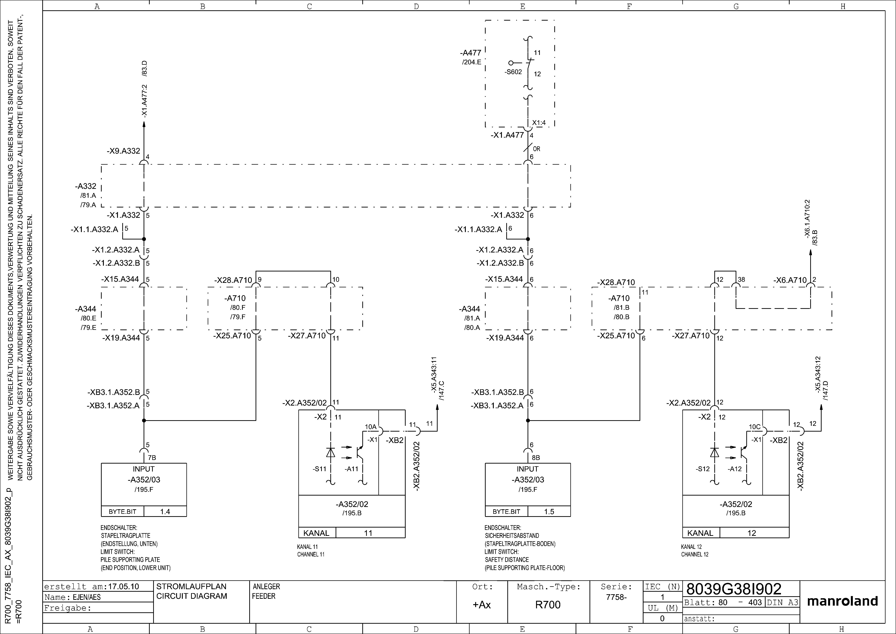

# +Ax — Sheet 80 of 403 — ANLEGER

**FEEDER**

> Part of the manroland **R700** printing press IEC/UL circuit diagrams.
> Drawing class: **Stromlaufplan / Circuit diagram** (DIN A3).
> Document `+Ax` covers the **Central control console** machine section.

## At a glance

| Field | Value |
|---|---|
| Document | `+Ax`  (8039G38I902) |
| Sheet | **80** of 403 |
| Section (DE) | ANLEGER |
| Section (EN) | FEEDER |
| Section type | CIRCUIT — Circuit diagram |
| Machine type | `R700` |
| Series | `7758` |
| Created | 17.05.10 |
| Replaces | — |
| Columns used | A, B, C, D, E, F, G, H |
| Path numbers | — |
| Labels on sheet | 146 |
| Cross-refs out | 19 |
| Cross-refs in | 54 |

**Previous:** [+Ax sheet 79](SHEET_0079.md) · **Next:** [+Ax sheet 81](SHEET_0081.md) · **Document TOC:** [_TOC.md](_TOC.md)  (+Ax) · **Master TOC:** [all sheets](../_MASTER_TOC.md)

## Sheet image (300 DPI, exact vector render)



_Rendered directly from the PDF vector layer at 300 DPI (1-bit), no OCR and no resampling. Use it to confirm anything ambiguous in the text below._

## Cross-references on this sheet

Each entry is a wire leaving this sheet. The printed token is `/sheet.column`; the link resolves to that sheet inside the same document.

| Ref | Target sheet | Col | Path | Destination on target | Target section | From col |
|---|---|---|---|---|---|---|
| `/204.E` | [+Ax sheet 204](SHEET_0204.md) | E | — | — | REFERENZMODUL | E |
| `/83.D` | [+Ax sheet 83](SHEET_0083.md) | D | — | X1.A477:2 | ANLEGER | A |
| `/81.A` | [+Ax sheet 81](SHEET_0081.md) | A | — | — | ANLEGER | A |
| `/79.A` | [+Ax sheet 79](SHEET_0079.md) | A | — | — | ANLEGER | A |
| `/83.B` | [+Ax sheet 83](SHEET_0083.md) | B | — | X6.1.A710:2 | ANLEGER | H |
| `/81.B` | [+Ax sheet 81](SHEET_0081.md) | B | — | — | ANLEGER | F |
| `/80.B` | [+Ax sheet 80](SHEET_0080.md) | B | — | — | ANLEGER | F |
| `/80.F` | [+Ax sheet 80](SHEET_0080.md) | F | — | — | ANLEGER | B |
| `/79.F` | [+Ax sheet 79](SHEET_0079.md) | F | — | — | ANLEGER | B |
| `/80.E` | [+Ax sheet 80](SHEET_0080.md) | E | — | — | ANLEGER | A |
| `/79.E` | [+Ax sheet 79](SHEET_0079.md) | E | — | — | ANLEGER | A |
| `/81.A` | [+Ax sheet 81](SHEET_0081.md) | A | — | — | ANLEGER | E |
| `/80.A` | [+Ax sheet 80](SHEET_0080.md) | A | — | — | ANLEGER | E |
| `/147.C` | [+Ax sheet 147](SHEET_0147.md) | C | — | X5.A343:11 | ÜBERWACHUNGSRECHNER SICHERHEITSBUS | D |
| `/147.D` | [+Ax sheet 147](SHEET_0147.md) | D | — | X5.A343:12 | ÜBERWACHUNGSRECHNER SICHERHEITSBUS | H |
| `/195.F` | [+Ax sheet 195](SHEET_0195.md) | F | — | — | REFERENZMODUL | A |
| `/195.F` | [+Ax sheet 195](SHEET_0195.md) | F | — | — | REFERENZMODUL | E |
| `/195.B` | [+Ax sheet 195](SHEET_0195.md) | B | — | — | REFERENZMODUL | C |
| `/195.B` | [+Ax sheet 195](SHEET_0195.md) | B | — | — | REFERENZMODUL | G |

### Incoming references (sheets that point here)

Every other sheet that sends a wire to this one. `Back-ref` is the token printed on *that* sheet; `Path` is its line number.

| From sheet | Cols | Back-ref | Path | Refs | What continues there |
|---|---|---|---|---|---|
| [+Ax#79](SHEET_0079.md) | A, E, F | `/79.A`, `/79.E`, `/79.F` | — | 3 | — |
| [+Ax#80](SHEET_0080.md) | A, B, E, F | `/80.A`, `/80.B`, `/80.E`, `/80.F` | — | 4 | — |
| [+Ax#81](SHEET_0081.md) | A, B | `/81.A`, `/81.B` | — | 3 | A710 |
| [+Ax#83](SHEET_0083.md) | A, D | `/83.A`, `/83.D` | — | 2 | X1.A477:2; X6.1.A710:2 |
| [+Ax#147](SHEET_0147.md) | C, D | `/147.C`, `/147.D` | — | 2 | X5.A343:11; X5.A343:12 |
| [+Ax#195](SHEET_0195.md) | B, F | `/195.B`, `/195.F` | — | 4 | — |
| [+Ax#204](SHEET_0204.md) | E | `/204.E` | — | 1 | — |
| [+Ax#207](SHEET_0207.md) | A, B, C | `/207.A`, `/207.B`, `/207.C` | — | 8 | — |
| [+Ax#209](SHEET_0209.md) | A | `/209.A` | — | 1 | — |
| [+Ax#218](SHEET_0218.md) | G | `/218.G` | — | 2 | — |
| [+Ax#219](SHEET_0219.md) | A | `/219.A` | — | 2 | — |
| [+Ax#223](SHEET_0223.md) | E, G, H | `/223.E`, `/223.G`, `/223.H` | — | 6 | — |
| [+Ax#234](SHEET_0234.md) | G | `/234.G` | — | 1 | — |
| [+Ax#240](SHEET_0240.md) | D, E | `/240.D`, `/240.E` | — | 2 | — |
| [+Ax#252](SHEET_0252.md) | D, E | `/252.D`, `/252.E` | — | 2 | — |
| [+Ax#258](SHEET_0258.md) | G | `/258.G` | — | 2 | — |
| [+Ax#268](SHEET_0268.md) | B | `/268.B` | — | 2 | — |
| [+Ax#270](SHEET_0270.md) | G | `/270.G` | — | 2 | — |
| [+Ax#272](SHEET_0272.md) | E, F | `/272.E`, `/272.F` | — | 5 | — |


## Devices on this sheet

| Tag | Class | Class meaning (IEC) | Col | Sub | Terminal | Sign |
|---|---|---|---|---|---|---|
| `A332` | A | Baugruppe / assembly, module, PC board | A | — | — | — |
| `A344` | A | Baugruppe / assembly, module, PC board | A | — | — | — |
| `A352/03` | A | Baugruppe / assembly, module, PC board | A | 03 | — | — |
| `A710` | A | Baugruppe / assembly, module, PC board | B | — | — | — |
| `S11` | S | Schalter / switch | C | — | — | — |
| `A11` | A | Baugruppe / assembly, module, PC board | C | — | — | — |
| `X1` | X | Klemme / terminal, plug connector | D | — | — | — |
| `X2` | X | Klemme / terminal, plug connector | C | — | — | — |
| `XB2` | XB |  | D | — | — | — |
| `A352/02` | A | Baugruppe / assembly, module, PC board | C | 02 | — | — |
| `A352/03` | A | Baugruppe / assembly, module, PC board | E | 03 | — | — |
| `A344` | A | Baugruppe / assembly, module, PC board | E | — | — | — |
| `A710` | A | Baugruppe / assembly, module, PC board | F | — | — | — |
| `S12` | S | Schalter / switch | G | — | — | — |
| `A12` | A | Baugruppe / assembly, module, PC board | G | — | — | — |
| `X1` | X | Klemme / terminal, plug connector | G | — | — | — |
| `X2` | X | Klemme / terminal, plug connector | G | — | — | — |
| `XB2` | XB |  | G | — | — | — |
| `A352/02` | A | Baugruppe / assembly, module, PC board | G | 02 | — | — |
| `X1:4` | X | Klemme / terminal, plug connector | E | — | 4 | — |
| `S602` | S | Schalter / switch | E | — | — | — |
| `A477` | A | Baugruppe / assembly, module, PC board | E | — | — | — |
| `1.4` | — | cross-device reference | B | — | — | — |
| `X1.A332` | — | cross-device reference | A | — | — | — |
| `X9.A332` | — | cross-device reference | A | — | — | — |
| `X19.A344` | — | cross-device reference | A | — | — | — |
| `X15.A344` | — | cross-device reference | A | — | — | — |
| `X1.2.A332.B` | — | cross-device reference | A | — | — | — |
| `X1.2.A332.A` | — | cross-device reference | A | — | — | — |
| `X1.1.A332.A` | — | cross-device reference | A | — | — | — |
| `X28.A710` | — | cross-device reference | B | — | — | — |
| `X27.A710` | — | cross-device reference | C | — | — | — |
| `X25.A710` | — | cross-device reference | B | — | — | — |
| `1.5` | — | cross-device reference | E | — | — | — |
| `X1.A332` | — | cross-device reference | E | — | — | — |
| `X19.A344` | — | cross-device reference | E | — | — | — |
| `X15.A344` | — | cross-device reference | E | — | — | — |
| `X1.2.A332.B` | — | cross-device reference | E | — | — | — |
| `X1.2.A332.A` | — | cross-device reference | E | — | — | — |
| `X1.1.A332.A` | — | cross-device reference | E | — | — | — |
| `X27.A710` | — | cross-device reference | G | — | — | — |
| `X25.A710` | — | cross-device reference | F | — | — | — |
| `XB3.1.A352.B` | — | cross-device reference | A | — | — | — |
| `XB3.1.A352.A` | — | cross-device reference | A | — | — | — |
| `XB3.1.A352.B` | — | cross-device reference | E | — | — | — |
| `XB3.1.A352.A` | — | cross-device reference | E | — | — | — |
| `X6.A710` | — | cross-device reference | H | — | — | — |
| `X1.A477` | — | cross-device reference | E | — | — | — |
| `X5.A343:11` | — | cross-device reference | D | — | 11 | — |
| `X5.A343:12` | — | cross-device reference | H | — | 12 | — |
| `X1.A477:2` | — | cross-device reference | A | — | 2 | — |
| `X6.1.A710:2` | — | cross-device reference | H | — | 2 | — |
| `X28.A710` | — | cross-device reference | F | — | — | — |

## Potentials / nets

_No named potentials on this sheet._

## Wire-end annotations (grouped as printed)

A wire that continues elsewhere is annotated with a small cluster: the destination description, the path/line number `#NN`, and the `/sheet.column` cross reference. Each row below is one such cluster exactly as it is grouped on the drawing.

| Col | Y | Path | Cross-ref | Text on the wire |
|---|---|---|---|---|
| E | 65.5 | — | — | `A477` |
| E | 66.2 | — | — | `11` |
| E | 78.6 | — | `/204.E` | — |
| A | 80.4 | — | `/83.D` | `X1.A477:2` |
| E | 91.7 | — | — | `S602` |
| E | 94.6 | — | — | `12` |
| E | 159.0 | — | — | `X1:4` |
| E | 174.6 | — | — | `X1.A477 4` |
| E | 194.8 | — | — | `OR` |
| A | 195.9 | — | — | `X9.A332 4` |
| E | 204.4 | — | — | `6` |
| A | 242.7 | — | — | `A332` |
| A | 255.7 | — | `/81.A`, `/79.A` | — |
| H | 265.0 | — | `/83.B` | `X6.1.A710:2` |
| A | 280.9 | — | — | `X1.A332 5` |
| E | 280.9 | — | — | `X1.A332 6` |
| A | 299.4 | — | — | `X1.1.A332.A 5` |
| E | 299.4 | — | — | `X1.1.A332.A 6` |
| A | 327.0 | — | — | `X1.2.A332.A 5` |
| E | 327.0 | — | — | `X1.2.A332.A 6` |
| A | 344.7 | — | — | `X1.2.A332.B 5` |
| E | 344.7 | — | — | `X1.2.A332.B 6` |
| A | 366.0 | — | — | `X15.A344 5` |
| E | 366.0 | — | — | `X15.A344 6` |
| C | 367.4 | — | — | `X28.A710 9 10` |
| G | 367.4 | — | — | `12 38 X6.A710 2` |
| F | 370.2 | — | — | `X28.A710` |
| F | 384.4 | — | — | `11` |
| B | 391.5 | — | — | `A710` |
| F | 391.5 | — | — | `A710` |
| F | 404.5 | — | `/81.B`, `/80.B` | — |
| B | 404.6 | — | `/80.F`, `/79.F` | — |
| A | 405.7 | — | — | `A344` |
| E | 405.7 | — | — | `A344` |
| A | 418.7 | — | `/80.E`, `/79.E` | — |
| E | 418.7 | — | `/81.A`, `/80.A` | — |
| C | 441.1 | — | — | `X25.A710 5 X27.A710 11` |
| F | 441.1 | — | — | `X25.A710 6 X27.A710 12` |
| A | 443.9 | — | — | `X19.A344 5` |
| E | 443.9 | — | — | `X19.A344 6` |
| D | 473.1 | — | `/147.C` | `X5.A343:11` |
| H | 473.1 | — | `/147.D` | `X5.A343:12` |
| A | 516.2 | — | — | `XB3.1.A352.B 5` |
| E | 516.2 | — | — | `XB3.1.A352.B 6` |
| C | 530.4 | — | — | `X2.A352/02 11` |
| G | 530.4 | — | — | `X2.A352/02 12` |
| A | 533.2 | — | — | `XB3.1.A352.A 5` |
| E | 533.2 | — | — | `XB3.1.A352.A 6` |
| C | 548.8 | — | — | `X2` |
| G | 548.8 | — | — | `X2` |
| D | 550.2 | — | — | `11 11` |
| G | 550.2 | — | — | `12 12` |
| D | 558.8 | — | — | `11` |
| H | 558.8 | — | — | `12` |
| D | 563.0 | — | — | `10A` |
| G | 563.0 | — | — | `10C` |
| D | 580.0 | — | — | `X1` |
| D | 580.0 | — | — | `XB2` |
| G | 580.0 | — | — | `X1` |
| G | 580.0 | — | — | `XB2` |
| D | 586.2 | — | — | `XB2.A352/02` |
| H | 586.2 | — | — | `XB2.A352/02` |
| A | 587.1 | — | — | `5` |
| E | 587.1 | — | — | `6` |
| B | 604.0 | — | — | `7B` |
| E | 604.0 | — | — | `8B` |
| A | 618.6 | — | — | `INPUT` |
| E | 618.6 | — | — | `INPUT` |
| C | 619.0 | — | — | `S11 A11` |
| G | 619.0 | — | — | `S12 A12` |
| A | 632.4 | — | — | `A352/03` |
| E | 632.4 | — | — | `A352/03` |
| A | 646.2 | — | `/195.F` | — |
| E | 646.2 | — | `/195.F` | — |
| C | 665.0 | — | — | `A352/02` |
| G | 665.0 | — | — | `A352/02` |
| A | 675.3 | — | — | `BYTE.BIT 1.4` |
| E | 675.3 | — | — | `BYTE.BIT 1.5` |
| C | 677.4 | — | `/195.B` | — |
| G | 677.4 | — | `/195.B` | — |
| A | 697.9 | — | — | `ENDSCHALTER:` |
| E | 697.9 | — | — | `ENDSCHALTER:` |
| C | 703.3 | — | — | `KANAL 11` |
| G | 703.3 | — | — | `KANAL 12` |
| A | 708.6 | — | — | `LIMIT SWITCH: PILE SUPPORTING PLATE (ENDSTELLUNG, UNTEN) (END POSITION, LOWER UNIT) STAPELTRAGPLATTE` |
| E | 708.6 | — | — | `LIMIT SWITCH: (STAPELTRAGPLATTE BODEN) SICHERHEITSABSTAND` |
| C | 723.6 | — | — | `KANAL 11 CHANNEL 11` |
| G | 723.6 | — | — | `KANAL 12 CHANNEL 12` |
| E | 740.5 | — | — | `(PILE SUPPORTING PLATE FLOOR) SAFETY DISTANCE` |


## Reconstructed tables

This sheet carries tabular content (pin map / terminal assignment / index). The grid below was rebuilt from the drawing's own rule lines, so each row is exactly one physical row of the table.

### Table 1 — 7 data rows × 20 columns (at x=134.6, y=360.0)

| X15.A344 | 5 | X28.A710 A710 /80.F | 9 |  | 10 |  |  |  |  | X15.A344 | 6 | X28.A710 A710 /81.B | 11 |  | 12 38 |  |  | X6.A710 | 2 |
|---|---|---|---|---|---|---|---|---|---|---|---|---|---|---|---|---|---|---|---|
| `X19.A344 XB3.1.A352.B XB3.1.A352.A` | `5 5 5` | `/79.F X25.A710` | `5` | `X27.A710 X2.A352/02` | `11 11` |  |  | `X5.A343:11` | `A344 /81.A /80.A /147.C` | `X19.A344 XB3.1.A352.B XB3.1.A352.A` | `6 6 6` | `/80.B X25.A710` | `6` | `X27.A710 X2.A352/02` | `12 12` |  |  |  | `X5.A343:12` |
|  |  |  |  | `X2` | `11` |  |  |  |  |  |  |  |  | `X2` | `12` |  |  |  |  |
|  | `5 7B` |  |  |  |  | `10A X1` | `XB2` | `11 11` |  |  | `6 8B` |  |  |  |  | `10C X1` | `XB2` | `12` | `12` |
| `INPUT` | `A352/03 /195.F` |  |  | `S11` | `A11` |  |  | `XB2.A352/02` |  | `INPUT` | `A352/03 /195.F` |  |  | `S12` | `A12` |  |  | `XB2.A352/02` |  |
|  |  |  |  |  | `A352/02` |  |  |  |  |  |  |  |  |  | `A352/02` |  |  |  |  |
| `BYTE.BIT` | `1.4` |  |  |  | `/195.B` |  |  |  |  | `BYTE.BIT` | `1.5` |  |  |  | `/195.B` |  |  |  |  |
| `ENDSCHALTER: STAPELTRAGPLATTE` |  |  |  | `KANAL` |  | `11` |  |  |  | `ENDSCHALTER: SICHERHEITSABSTAND` |  |  |  | `KANAL` |  | `12` |  |  |  |


## Notes and free text on this sheet

| Text | Col | Y (pt) |
|---|---|---|
| `7B` | B | 604.05 |
| `INPUT` | A | 618.59 |
| `BYTE.BIT` | A | 675.84 |
| `ENDSCHALTER:` | A | 697.94 |
| `STAPELTRAGPLATTE` | A | 708.57 |
| `(ENDSTELLUNG, UNTEN)` | A | 719.23 |
| `LIMIT SWITCH:` | A | 729.79 |
| `PILE SUPPORTING PLATE` | A | 740.46 |
| `(END POSITION, LOWER UNIT)` | A | 751.1 |
| `KANAL 11` | C | 723.59 |
| `CHANNEL 11` | C | 733.54 |
| `10A` | D | 562.96 |
| `KANAL` | C | 703.29 |
| `X2.A352/02` | C | 530.39 |
| `XB2.A352/02` | D | 586.21 |
| `8B` | E | 604.05 |
| `INPUT` | E | 618.59 |
| `BYTE.BIT` | E | 675.84 |
| `ENDSCHALTER:` | E | 697.94 |
| `SICHERHEITSABSTAND` | E | 708.58 |
| `(STAPELTRAGPLATTE BODEN)` | E | 719.21 |
| `LIMIT SWITCH:` | E | 729.79 |
| `SAFETY DISTANCE` | E | 740.46 |
| `(PILE SUPPORTING PLATE FLOOR)` | E | 751.11 |
| `KANAL 12` | G | 723.61 |
| `CHANNEL 12` | G | 733.56 |
| `10C` | G | 563.01 |
| `KANAL` | G | 703.29 |
| `X2.A352/02` | G | 530.39 |
| `XB2.A352/02` | H | 586.21 |
| `OR` | E | 194.79 |

## Complete label inventory (exact text from the drawing)

Every text object inside the drawing area of this sheet, in DIN reading order (column A→H, then top→bottom). This is the authoritative list: if a string is not here it is not printed on this sheet.

| Col | Y | X | Dir | Type | Text |
|---|---|---|---|---|---|
| A | 80.4 | 188.1 | ↕ | cross-reference | `/83.D` |
| A | 112.3 | 188.1 | ↕ | device ref | `X1.A477:2` |
| A | 195.9 | 142.0 | → | device ref | `X9.A332` |
| A | 204.4 | 193.9 | → | number | `4` |
| A | 242.7 | 99.8 | → | device tag | `A332` |
| A | 255.7 | 106.9 | → | cross-reference | `/81.A` |
| A | 268.1 | 106.9 | → | cross-reference | `/79.A` |
| A | 280.9 | 142.0 | → | device ref | `X1.A332` |
| A | 282.4 | 193.9 | → | number | `5` |
| A | 299.4 | 165.5 | → | number | `5` |
| A | 300.1 | 94.1 | → | device ref | `X1.1.A332.A` |
| A | 327.0 | 122.5 | → | device ref | `X1.2.A332.A` |
| A | 329.1 | 193.9 | → | number | `5` |
| A | 344.7 | 123.3 | → | device ref | `X1.2.A332.B` |
| A | 346.2 | 193.9 | → | number | `5` |
| A | 366.0 | 134.6 | → | device ref | `X15.A344` |
| A | 367.4 | 193.9 | → | number | `5` |
| A | 405.7 | 99.8 | → | device tag | `A344` |
| A | 418.7 | 107.4 | → | cross-reference | `/80.E` |
| A | 431.1 | 107.4 | → | cross-reference | `/79.E` |
| A | 443.9 | 136.1 | → | device ref | `X19.A344` |
| A | 445.4 | 193.9 | → | number | `5` |
| A | 516.2 | 116.2 | → | device ref | `XB3.1.A352.B` |
| A | 516.2 | 193.9 | → | number | `5` |
| A | 533.2 | 193.9 | → | number | `5` |
| A | 533.9 | 115.4 | → | device ref | `XB3.1.A352.A` |
| A | 587.1 | 193.9 | → | number | `5` |
| A | 618.6 | 176.5 | → | text | `INPUT` |
| A | 632.4 | 169.9 | → | device tag | `A352/03` |
| A | 646.2 | 179.0 | → | cross-reference | `/195.F` |
| A | 675.8 | 144.6 | → | text | `BYTE.BIT` |
| A | 697.9 | 133.8 | → | text | `ENDSCHALTER:` |
| A | 708.6 | 134.4 | → | text | `STAPELTRAGPLATTE` |
| A | 719.2 | 134.1 | → | text | `(ENDSTELLUNG, UNTEN)` |
| A | 729.8 | 133.8 | → | text | `LIMIT SWITCH:` |
| A | 740.5 | 133.8 | → | text | `PILE SUPPORTING PLATE` |
| A | 751.1 | 134.1 | → | text | `(END POSITION, LOWER UNIT)` |
| B | 367.4 | 284.9 | → | device ref | `X28.A710` |
| B | 391.5 | 298.2 | → | device tag | `A710` |
| B | 404.6 | 306.1 | → | cross-reference | `/80.F` |
| B | 417.0 | 306.1 | → | cross-reference | `/79.F` |
| B | 441.1 | 283.5 | → | device ref | `X25.A710` |
| B | 604.0 | 196.7 | → | text | `7B` |
| B | 675.3 | 212.6 | → | device ref | `1.4` |
| C | 367.4 | 342.7 | → | number | `9` |
| C | 367.4 | 441.4 | → | number | `10` |
| C | 441.1 | 382.7 | → | device ref | `X27.A710` |
| C | 445.4 | 342.7 | → | number | `5` |
| C | 445.4 | 441.4 | → | number | `11` |
| C | 530.4 | 375.3 | → | text | `X2.A352/02` |
| C | 530.4 | 441.4 | → | number | `11` |
| C | 548.8 | 417.8 | → | device tag | `X2` |
| C | 550.2 | 444.2 | → | number | `11` |
| C | 619.0 | 415.6 | → | device tag | `S11` |
| C | 619.0 | 458.1 | → | device tag | `A11` |
| C | 665.0 | 446.3 | → | device tag | `A352/02` |
| C | 677.4 | 455.1 | → | cross-reference | `/195.B` |
| C | 703.3 | 403.1 | → | text | `KANAL` |
| C | 723.6 | 394.9 | → | text | `KANAL 11` |
| C | 733.5 | 395.1 | → | text | `CHANNEL 11` |
| D | 473.1 | 572.9 | ↕ | device ref | `X5.A343:11` |
| D | 505.7 | 582.8 | ↕ | cross-reference | `/147.C` |
| D | 558.7 | 566.1 | → | number | `11` |
| D | 560.2 | 543.4 | → | number | `11` |
| D | 563.0 | 484.7 | → | text | `10A` |
| D | 580.0 | 488.4 | → | device tag | `X1` |
| D | 580.0 | 512.8 | → | device tag | `XB2` |
| D | 586.2 | 548.8 | ↕ | text | `XB2.A352/02` |
| D | 703.3 | 483.4 | → | number | `11` |
| E | 65.5 | 611.4 | → | device tag | `A477` |
| E | 66.2 | 709.2 | → | number | `11` |
| E | 78.6 | 614.3 | → | cross-reference | `/204.E` |
| E | 91.7 | 670.4 | → | device tag | `S602` |
| E | 94.6 | 709.2 | → | number | `12` |
| E | 159.0 | 707.2 | → | device tag | `X1:4` |
| E | 174.6 | 652.3 | → | device ref | `X1.A477` |
| E | 176.1 | 704.1 | → | number | `4` |
| E | 194.8 | 708.4 | → | text | `OR` |
| E | 204.4 | 704.1 | → | number | `6` |
| E | 280.9 | 652.3 | → | device ref | `X1.A332` |
| E | 282.4 | 704.1 | → | number | `6` |
| E | 299.4 | 675.8 | → | number | `6` |
| E | 300.1 | 604.3 | → | device ref | `X1.1.A332.A` |
| E | 327.0 | 632.7 | → | device ref | `X1.2.A332.A` |
| E | 329.1 | 704.1 | → | number | `6` |
| E | 344.7 | 633.5 | → | device ref | `X1.2.A332.B` |
| E | 346.2 | 704.1 | → | number | `6` |
| E | 366.0 | 644.9 | → | device ref | `X15.A344` |
| E | 367.4 | 704.1 | → | number | `6` |
| E | 405.7 | 610.0 | → | device tag | `A344` |
| E | 418.7 | 617.1 | → | cross-reference | `/81.A` |
| E | 431.1 | 617.1 | → | cross-reference | `/80.A` |
| E | 443.9 | 646.3 | → | device ref | `X19.A344` |
| E | 445.4 | 704.1 | → | number | `6` |
| E | 516.2 | 626.5 | → | device ref | `XB3.1.A352.B` |
| E | 516.2 | 704.1 | → | number | `6` |
| E | 533.2 | 704.1 | → | number | `6` |
| E | 533.9 | 625.6 | → | device ref | `XB3.1.A352.A` |
| E | 587.1 | 704.1 | → | number | `6` |
| E | 604.0 | 707.0 | → | text | `8B` |
| E | 618.6 | 686.7 | → | text | `INPUT` |
| E | 632.4 | 680.2 | → | device tag | `A352/03` |
| E | 646.2 | 689.2 | → | cross-reference | `/195.F` |
| E | 675.3 | 722.8 | → | device ref | `1.5` |
| E | 675.8 | 654.8 | → | text | `BYTE.BIT` |
| E | 697.9 | 644.0 | → | text | `ENDSCHALTER:` |
| E | 708.6 | 644.6 | → | text | `SICHERHEITSABSTAND` |
| E | 719.2 | 644.3 | → | text | `(STAPELTRAGPLATTE BODEN)` |
| E | 729.8 | 644.0 | → | text | `LIMIT SWITCH:` |
| E | 740.5 | 644.6 | → | text | `SAFETY DISTANCE` |
| E | 751.1 | 644.3 | → | text | `(PILE SUPPORTING PLATE FLOOR)` |
| F | 370.2 | 793.7 | → | device ref | `X28.A710` |
| F | 384.4 | 852.4 | → | number | `11` |
| F | 391.5 | 808.4 | → | device tag | `A710` |
| F | 404.5 | 815.8 | → | cross-reference | `/81.B` |
| F | 416.9 | 815.8 | → | cross-reference | `/80.B` |
| F | 441.1 | 793.7 | → | device ref | `X25.A710` |
| F | 445.4 | 852.9 | → | number | `6` |
| G | 367.4 | 951.6 | → | number | `12` |
| G | 367.4 | 980.5 | → | number | `38` |
| G | 441.1 | 892.9 | → | device ref | `X27.A710` |
| G | 445.4 | 951.6 | → | number | `12` |
| G | 530.4 | 885.5 | → | text | `X2.A352/02` |
| G | 530.4 | 951.6 | → | number | `12` |
| G | 548.8 | 928.1 | → | device tag | `X2` |
| G | 550.2 | 954.4 | → | number | `12` |
| G | 563.0 | 995.0 | → | text | `10C` |
| G | 580.0 | 998.6 | → | device tag | `X1` |
| G | 580.0 | 1023.0 | → | device tag | `XB2` |
| G | 619.0 | 924.7 | → | device tag | `S12` |
| G | 619.0 | 967.2 | → | device tag | `A12` |
| G | 665.0 | 956.6 | → | device tag | `A352/02` |
| G | 677.4 | 965.3 | → | cross-reference | `/195.B` |
| G | 703.3 | 913.3 | → | text | `KANAL` |
| G | 703.3 | 993.0 | → | number | `12` |
| G | 723.6 | 905.1 | → | text | `KANAL 12` |
| G | 733.6 | 905.4 | → | text | `CHANNEL 12` |
| H | 265.0 | 1068.9 | ↕ | device ref | `X6.1.A710:2` |
| H | 305.3 | 1078.8 | ↕ | cross-reference | `/83.B` |
| H | 367.4 | 1027.8 | → | device ref | `X6.A710` |
| H | 367.4 | 1079.7 | → | number | `2` |
| H | 473.1 | 1083.1 | ↕ | device ref | `X5.A343:12` |
| H | 505.7 | 1093.0 | ↕ | cross-reference | `/147.D` |
| H | 558.7 | 1075.2 | → | number | `12` |
| H | 560.2 | 1053.6 | → | number | `12` |
| H | 586.2 | 1059.0 | ↕ | text | `XB2.A352/02` |

## Reading-order text block

The same content as a plain block, grouped by DIN column — convenient to paste or to match against a visual description.

```text
=== Column A ===
  80.4  188.1  xref         /83.D
 112.3  188.1  devref       X1.A477:2
 195.9  142.0  devref       X9.A332
 204.4  193.9  numeric      4
 242.7   99.8  devtag       A332
 255.7  106.9  xref         /81.A
 268.1  106.9  xref         /79.A
 280.9  142.0  devref       X1.A332
 282.4  193.9  numeric      5
 299.4  165.5  numeric      5
 300.1   94.1  devref       X1.1.A332.A
 327.0  122.5  devref       X1.2.A332.A
 329.1  193.9  numeric      5
 344.7  123.3  devref       X1.2.A332.B
 346.2  193.9  numeric      5
 366.0  134.6  devref       X15.A344
 367.4  193.9  numeric      5
 405.7   99.8  devtag       A344
 418.7  107.4  xref         /80.E
 431.1  107.4  xref         /79.E
 443.9  136.1  devref       X19.A344
 445.4  193.9  numeric      5
 516.2  116.2  devref       XB3.1.A352.B
 516.2  193.9  numeric      5
 533.2  193.9  numeric      5
 533.9  115.4  devref       XB3.1.A352.A
 587.1  193.9  numeric      5
 618.6  176.5  text         INPUT
 632.4  169.9  devtag       A352/03
 646.2  179.0  xref         /195.F
 675.8  144.6  text         BYTE.BIT
 697.9  133.8  text         ENDSCHALTER:
 708.6  134.4  text         STAPELTRAGPLATTE
 719.2  134.1  text         (ENDSTELLUNG, UNTEN)
 729.8  133.8  text         LIMIT SWITCH:
 740.5  133.8  text         PILE SUPPORTING PLATE
 751.1  134.1  text         (END POSITION, LOWER UNIT)
=== Column B ===
 367.4  284.9  devref       X28.A710
 391.5  298.2  devtag       A710
 404.6  306.1  xref         /80.F
 417.0  306.1  xref         /79.F
 441.1  283.5  devref       X25.A710
 604.0  196.7  text         7B
 675.3  212.6  devref       1.4
=== Column C ===
 367.4  342.7  numeric      9
 367.4  441.4  numeric      10
 441.1  382.7  devref       X27.A710
 445.4  342.7  numeric      5
 445.4  441.4  numeric      11
 530.4  375.3  text         X2.A352/02
 530.4  441.4  numeric      11
 548.8  417.8  devtag       X2
 550.2  444.2  numeric      11
 619.0  415.6  devtag       S11
 619.0  458.1  devtag       A11
 665.0  446.3  devtag       A352/02
 677.4  455.1  xref         /195.B
 703.3  403.1  text         KANAL
 723.6  394.9  text         KANAL 11
 733.5  395.1  text         CHANNEL 11
=== Column D ===
 473.1  572.9  devref       X5.A343:11
 505.7  582.8  xref         /147.C
 558.7  566.1  numeric      11
 560.2  543.4  numeric      11
 563.0  484.7  text         10A
 580.0  488.4  devtag       X1
 580.0  512.8  devtag       XB2
 586.2  548.8  text         XB2.A352/02
 703.3  483.4  numeric      11
=== Column E ===
  65.5  611.4  devtag       A477
  66.2  709.2  numeric      11
  78.6  614.3  xref         /204.E
  91.7  670.4  devtag       S602
  94.6  709.2  numeric      12
 159.0  707.2  devtag       X1:4
 174.6  652.3  devref       X1.A477
 176.1  704.1  numeric      4
 194.8  708.4  text         OR
 204.4  704.1  numeric      6
 280.9  652.3  devref       X1.A332
 282.4  704.1  numeric      6
 299.4  675.8  numeric      6
 300.1  604.3  devref       X1.1.A332.A
 327.0  632.7  devref       X1.2.A332.A
 329.1  704.1  numeric      6
 344.7  633.5  devref       X1.2.A332.B
 346.2  704.1  numeric      6
 366.0  644.9  devref       X15.A344
 367.4  704.1  numeric      6
 405.7  610.0  devtag       A344
 418.7  617.1  xref         /81.A
 431.1  617.1  xref         /80.A
 443.9  646.3  devref       X19.A344
 445.4  704.1  numeric      6
 516.2  626.5  devref       XB3.1.A352.B
 516.2  704.1  numeric      6
 533.2  704.1  numeric      6
 533.9  625.6  devref       XB3.1.A352.A
 587.1  704.1  numeric      6
 604.0  707.0  text         8B
 618.6  686.7  text         INPUT
 632.4  680.2  devtag       A352/03
 646.2  689.2  xref         /195.F
 675.3  722.8  devref       1.5
 675.8  654.8  text         BYTE.BIT
 697.9  644.0  text         ENDSCHALTER:
 708.6  644.6  text         SICHERHEITSABSTAND
 719.2  644.3  text         (STAPELTRAGPLATTE BODEN)
 729.8  644.0  text         LIMIT SWITCH:
 740.5  644.6  text         SAFETY DISTANCE
 751.1  644.3  text         (PILE SUPPORTING PLATE FLOOR)
=== Column F ===
 370.2  793.7  devref       X28.A710
 384.4  852.4  numeric      11
 391.5  808.4  devtag       A710
 404.5  815.8  xref         /81.B
 416.9  815.8  xref         /80.B
 441.1  793.7  devref       X25.A710
 445.4  852.9  numeric      6
=== Column G ===
 367.4  951.6  numeric      12
 367.4  980.5  numeric      38
 441.1  892.9  devref       X27.A710
 445.4  951.6  numeric      12
 530.4  885.5  text         X2.A352/02
 530.4  951.6  numeric      12
 548.8  928.1  devtag       X2
 550.2  954.4  numeric      12
 563.0  995.0  text         10C
 580.0  998.6  devtag       X1
 580.0 1023.0  devtag       XB2
 619.0  924.7  devtag       S12
 619.0  967.2  devtag       A12
 665.0  956.6  devtag       A352/02
 677.4  965.3  xref         /195.B
 703.3  913.3  text         KANAL
 703.3  993.0  numeric      12
 723.6  905.1  text         KANAL 12
 733.6  905.4  text         CHANNEL 12
=== Column H ===
 265.0 1068.9  devref       X6.1.A710:2
 305.3 1078.8  xref         /83.B
 367.4 1027.8  devref       X6.A710
 367.4 1079.7  numeric      2
 473.1 1083.1  devref       X5.A343:12
 505.7 1093.0  xref         /147.D
 558.7 1075.2  numeric      12
 560.2 1053.6  numeric      12
 586.2 1059.0  text         XB2.A352/02
```

---
_Generated from the PDF vector text layer; no OCR. Source: `R700_7758_IEC_AX_8039G38I902_p`, sheet 80._
