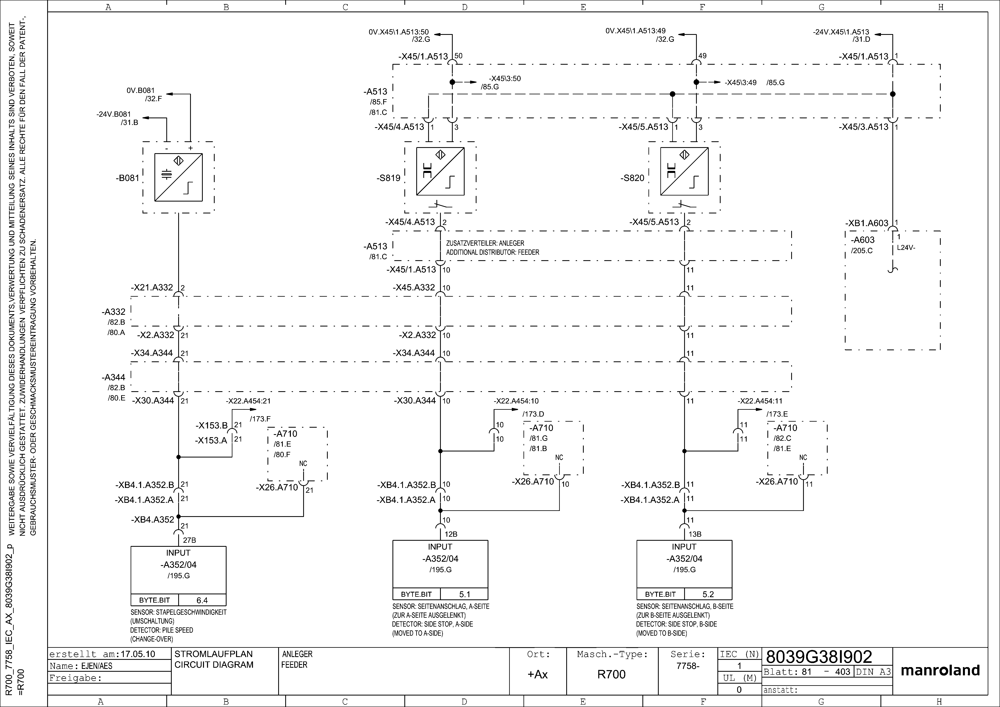

# +Ax — Sheet 81 of 403 — ANLEGER

**FEEDER**

> Part of the manroland **R700** printing press IEC/UL circuit diagrams.
> Drawing class: **Stromlaufplan / Circuit diagram** (DIN A3).
> Document `+Ax` covers the **Central control console** machine section.

## At a glance

| Field | Value |
|---|---|
| Document | `+Ax`  (8039G38I902) |
| Sheet | **81** of 403 |
| Section (DE) | ANLEGER |
| Section (EN) | FEEDER |
| Section type | CIRCUIT — Circuit diagram |
| Machine type | `R700` |
| Series | `7758` |
| Created | 17.05.10 |
| Replaces | — |
| Columns used | A, B, C, D, E, F, G, H |
| Path numbers | — |
| Labels on sheet | 155 |
| Cross-refs out | 27 |
| Cross-refs in | 70 |

**Previous:** [+Ax sheet 80](SHEET_0080.md) · **Next:** [+Ax sheet 82](SHEET_0082.md) · **Document TOC:** [_TOC.md](_TOC.md)  (+Ax) · **Master TOC:** [all sheets](../_MASTER_TOC.md)

## Sheet image (300 DPI, exact vector render)



_Rendered directly from the PDF vector layer at 300 DPI (1-bit), no OCR and no resampling. Use it to confirm anything ambiguous in the text below._

## Cross-references on this sheet

Each entry is a wire leaving this sheet. The printed token is `/sheet.column`; the link resolves to that sheet inside the same document.

| Ref | Target sheet | Col | Path | Destination on target | Target section | From col |
|---|---|---|---|---|---|---|
| `/32.G` | [+Ax sheet 32](SHEET_0032.md) | G | — | 0V.X45\1.A513:49 0V.X45\1.A513:50 | SPANNUNGSVERSORGUNG, SCHALTSCHRANKBELÜFTUNG | D |
| `/32.G` | [+Ax sheet 32](SHEET_0032.md) | G | — | 0V.X45\1.A513:49 0V.X45\1.A513:50 | SPANNUNGSVERSORGUNG, SCHALTSCHRANKBELÜFTUNG | D |
| `/31.D` | [+Ax sheet 31](SHEET_0031.md) | D | — | 24V.X45\1.A513 | SPANNUNGSVERSORGUNG, SCHALTSCHRANKBELÜFTUNG | G |
| `/85.G` | [+Ax sheet 85](SHEET_0085.md) | G | — | X45\3:50 X45\3:49 | ANLEGER | E |
| `/85.G` | [+Ax sheet 85](SHEET_0085.md) | G | — | — | ANLEGER | D |
| `/32.F` | [+Ax sheet 32](SHEET_0032.md) | F | — | 0V.B081 | SPANNUNGSVERSORGUNG, SCHALTSCHRANKBELÜFTUNG | A |
| `/85.F` | [+Ax sheet 85](SHEET_0085.md) | F | — | — | ANLEGER | C |
| `/81.C` | [+Ax sheet 81](SHEET_0081.md) | C | — | — | ANLEGER | C |
| `/31.B` | [+Ax sheet 31](SHEET_0031.md) | B | — | 24V.B081 | SPANNUNGSVERSORGUNG, SCHALTSCHRANKBELÜFTUNG | A |
| `/205.C` | [+Ax sheet 205](SHEET_0205.md) | C | — | A603 L24V | REFERENZMODUL | H |
| `/81.C` | [+Ax sheet 81](SHEET_0081.md) | C | — | — | ANLEGER | C |
| `/82.B` | [+Ax sheet 82](SHEET_0082.md) | B | — | — | ANLEGER | A |
| `/80.A` | [+Ax sheet 80](SHEET_0080.md) | A | — | — | ANLEGER | A |
| `/82.B` | [+Ax sheet 82](SHEET_0082.md) | B | — | — | ANLEGER | A |
| `/80.E` | [+Ax sheet 80](SHEET_0080.md) | E | — | — | ANLEGER | A |
| `/173.E` | [+Ax sheet 173](SHEET_0173.md) | E | — | — | RESERVE | G |
| `/173.D` | [+Ax sheet 173](SHEET_0173.md) | D | — | — | RESERVE | E |
| `/173.F` | [+Ax sheet 173](SHEET_0173.md) | F | — | — | RESERVE | B |
| `/81.G` | [+Ax sheet 81](SHEET_0081.md) | G | — | A710 | ANLEGER | E |
| `/81.B` | [+Ax sheet 81](SHEET_0081.md) | B | — | A710 | ANLEGER | E |
| `/82.C` | [+Ax sheet 82](SHEET_0082.md) | C | — | A710 | ANLEGER | G |
| `/81.E` | [+Ax sheet 81](SHEET_0081.md) | E | — | A710 | ANLEGER | G |
| `/81.E` | [+Ax sheet 81](SHEET_0081.md) | E | — | A710 | ANLEGER | B |
| `/80.F` | [+Ax sheet 80](SHEET_0080.md) | F | — | A710 | ANLEGER | B |
| `/195.G` | [+Ax sheet 195](SHEET_0195.md) | G | — | — | REFERENZMODUL | D |
| `/195.G` | [+Ax sheet 195](SHEET_0195.md) | G | — | — | REFERENZMODUL | F |
| `/195.G` | [+Ax sheet 195](SHEET_0195.md) | G | — | — | REFERENZMODUL | B |

### Incoming references (sheets that point here)

Every other sheet that sends a wire to this one. `Back-ref` is the token printed on *that* sheet; `Path` is its line number.

| From sheet | Cols | Back-ref | Path | Refs | What continues there |
|---|---|---|---|---|---|
| [+Ax#31](SHEET_0031.md) | B, D | `/31.B`, `/31.D` | — | 2 | — |
| [+Ax#32](SHEET_0032.md) | F, G | `/32.F`, `/32.G` | — | 3 | 0V.B081 |
| [+Ax#80](SHEET_0080.md) | A, E, F | `/80.A`, `/80.E`, `/80.F` | — | 3 | — |
| [+Ax#81](SHEET_0081.md) | B, C, E, G | `/81.B`, `/81.C`, `/81.E`, `/81.G` | — | 6 | A710 |
| [+Ax#82](SHEET_0082.md) | B, C | `/82.B`, `/82.C` | — | 3 | A710 |
| [+Ax#85](SHEET_0085.md) | E, F, G | `/85.E`, `/85.F`, `/85.G` | — | 3 | X45\3:49; X45\3:50 |
| [+Ax#173](SHEET_0173.md) | D, E, F | `/173.D`, `/173.E`, `/173.F` | — | 3 | X22.A454:10; X22.A454:11; X22.A454:21 |
| [+Ax#195](SHEET_0195.md) | G | `/195.G` | — | 3 | — |
| [+Ax#205](SHEET_0205.md) | C | `/205.C` | — | 1 | — |
| [+Ax#210](SHEET_0210.md) | A | `/210.A` | — | 1 | — |
| [+Ax#217](SHEET_0217.md) | F | `/217.F` | — | 3 | — |
| [+Ax#227](SHEET_0227.md) | E, F, G | `/227.E`, `/227.F`, `/227.G` | — | 9 | — |
| [+Ax#261](SHEET_0261.md) | A | `/261.A` | — | 1 | — |
| [+Ax#269](SHEET_0269.md) | G | `/269.G` | — | 3 | — |
| [+Ax#274](SHEET_0274.md) | F | `/274.F` | — | 3 | — |
| [+Ax#278](SHEET_0278.md) | A | `/278.A` | — | 3 | — |
| [+Ax#282](SHEET_0282.md) | A, C, D, E, H | `/282.A`, `/282.C`, `/282.D`, `/282.E`, `/282.H` | — | 14 | — |
| [+Ax#290](SHEET_0290.md) | C, E | `/290.C`, `/290.E` | — | 6 | — |


## Devices on this sheet

| Tag | Class | Class meaning (IEC) | Col | Sub | Terminal | Sign |
|---|---|---|---|---|---|---|
| `A332` | A | Baugruppe / assembly, module, PC board | A | — | — | — |
| `A344` | A | Baugruppe / assembly, module, PC board | A | — | — | — |
| `B081` | B | Umformer / transducer, sensor | A | — | — | — |
| `A352/04` | A | Baugruppe / assembly, module, PC board | B | 04 | — | — |
| `A710` | A | Baugruppe / assembly, module, PC board | B | — | — | — |
| `S819` | S | Schalter / switch | C | — | — | — |
| `A513` | A | Baugruppe / assembly, module, PC board | C | — | — | — |
| `A513` | A | Baugruppe / assembly, module, PC board | C | — | — | — |
| `A352/04` | A | Baugruppe / assembly, module, PC board | D | 04 | — | — |
| `A710` | A | Baugruppe / assembly, module, PC board | E | — | — | — |
| `S820` | S | Schalter / switch | E | — | — | — |
| `A352/04` | A | Baugruppe / assembly, module, PC board | F | 04 | — | — |
| `A710` | A | Baugruppe / assembly, module, PC board | G | — | — | — |
| `A603` | A | Baugruppe / assembly, module, PC board | G | — | — | — |
| `X153.B` | — | cross-device reference | B | — | — | — |
| `X153.A` | — | cross-device reference | B | — | — | — |
| `X30.A344` | — | cross-device reference | A | — | — | — |
| `X34.A344` | — | cross-device reference | A | — | — | — |
| `X2.A332` | — | cross-device reference | A | — | — | — |
| `X21.A332` | — | cross-device reference | A | — | — | — |
| `6.4` | — | cross-device reference | B | — | — | — |
| `XB4.A352` | — | cross-device reference | A | — | — | — |
| `X26.A710` | — | cross-device reference | B | — | — | — |
| `XB4.1.A352.B` | — | cross-device reference | A | — | — | — |
| `XB4.1.A352.A` | — | cross-device reference | A | — | — | — |
| `X45/1.A513` | — | cross-device reference | D | — | — | — |
| `X45/4.A513` | — | cross-device reference | C | — | — | — |
| `X45/4.A513` | — | cross-device reference | D | — | — | — |
| `X45/1.A513` | — | cross-device reference | D | — | — | — |
| `X45.A332` | — | cross-device reference | D | — | — | — |
| `X2.A332` | — | cross-device reference | D | — | — | — |
| `X34.A344` | — | cross-device reference | D | — | — | — |
| `X30.A344` | — | cross-device reference | D | — | — | — |
| `5.1` | — | cross-device reference | D | — | — | — |
| `XB4.1.A352.B` | — | cross-device reference | D | — | — | — |
| `XB4.1.A352.A` | — | cross-device reference | D | — | — | — |
| `X26.A710` | — | cross-device reference | E | — | — | — |
| `X45/5.A513` | — | cross-device reference | F | — | — | — |
| `X45/5.A513` | — | cross-device reference | F | — | — | — |
| `5.2` | — | cross-device reference | F | — | — | — |
| `XB4.1.A352.B` | — | cross-device reference | F | — | — | — |
| `XB4.1.A352.A` | — | cross-device reference | F | — | — | — |
| `X26.A710` | — | cross-device reference | G | — | — | — |
| `X45/1.A513` | — | cross-device reference | G | — | — | — |
| `X45/3.A513` | — | cross-device reference | G | — | — | — |
| `XB1.A603` | — | cross-device reference | G | — | — | — |
| `X22.A454:10` | — | cross-device reference | D | — | 10 | — |
| `X22.A454:11` | — | cross-device reference | F | — | 11 | — |
| `X22.A454:21` | — | cross-device reference | B | — | 21 | — |

## Potentials / nets

| Potential | Count | Columns | Attached devices | Terminals |
|---|---|---|---|---|
| `0V` | 3 | A, C, E | `A513`, `B081`, `X45\1` | `49`, `50` |
| `24V` | 2 | A, G | `A513`, `B081`, `X45\1` | — |
| `L24V` | 1 | H | — | — |


A potential such as `L24+/4` or `M24+` is a named supply/return rail; every place it appears on this sheet is electrically common.

## Wire-end annotations (grouped as printed)

A wire that continues elsewhere is annotated with a small cluster: the destination description, the path/line number `#NN`, and the `/sheet.column` cross reference. Each row below is one such cluster exactly as it is grouped on the drawing.

| Col | Y | Path | Cross-ref | Text on the wire |
|---|---|---|---|---|
| D | 32.9 | — | `/32.G`, `/32.G` | `0V.X45\1.A513:50 0V.X45\1.A513:49` |
| G | 34.3 | — | `/31.D` | `24V.X45\1.A513` |
| D | 62.7 | — | — | `X45/1.A513 50` |
| F | 62.7 | — | — | `49` |
| G | 62.7 | — | — | `X45/1.A513 1` |
| E | 89.6 | — | `/85.G` | `X45\3:50 X45\3:49` |
| D | 99.5 | — | `/85.G` | — |
| A | 103.7 | — | `/32.F` | `0V.B081` |
| C | 104.5 | — | — | `A513` |
| C | 117.5 | — | `/85.F`, `/81.C` | — |
| A | 132.1 | — | `/31.B` | `24V.B081` |
| D | 146.3 | — | — | `X45/4.A513 1 3` |
| F | 146.3 | — | — | `X45/5.A513 1 3` |
| G | 146.3 | — | — | `X45/3.A513 1` |
| B | 171.8 | — | — | `+` |
| A | 207.2 | — | — | `B081` |
| C | 207.2 | — | — | `S819` |
| E | 207.2 | — | — | `S820` |
| D | 259.7 | — | — | `X45/4.A513 2` |
| F | 259.7 | — | — | `X45/5.A513 2` |
| G | 261.1 | — | — | `XB1.A603 1` |
| H | 278.1 | — | — | `1` |
| H | 280.9 | — | `/205.C` | `A603 L24V` |
| D | 286.9 | — | — | `ZUSATZVERTEILER: ANLEGER ADDITIONAL DISTRIBUTOR: FEEDER` |
| C | 288.7 | — | — | `A513` |
| C | 301.8 | — | `/81.C` | — |
| D | 316.4 | — | — | `X45/1.A513 10` |
| F | 317.8 | — | — | `11` |
| A | 337.6 | — | — | `X21.A332 2` |
| D | 337.6 | — | — | `X45.A332 10` |
| F | 339.1 | — | — | `11` |
| A | 366.7 | — | — | `A332` |
| A | 379.7 | — | `/82.B`, `/80.A` | — |
| A | 394.3 | — | — | `X2.A332 21` |
| D | 394.3 | — | — | `X2.A332 10` |
| F | 395.8 | — | — | `11` |
| A | 415.6 | — | — | `X34.A344 21` |
| D | 415.6 | — | — | `X34.A344 10` |
| F | 417.0 | — | — | `11` |
| A | 444.6 | — | — | `A344` |
| A | 457.7 | — | `/82.B`, `/80.E` | — |
| A | 472.3 | — | — | `X30.A344 21` |
| D | 472.3 | — | — | `X30.A344 10` |
| B | 473.7 | — | — | `X22.A454:21` |
| D | 473.7 | — | — | `X22.A454:10` |
| F | 473.7 | — | — | `11` |
| F | 473.7 | — | — | `X22.A454:11` |
| G | 489.2 | — | `/173.E` | — |
| E | 489.3 | — | `/173.D` | — |
| B | 494.9 | — | `/173.F` | — |
| B | 502.1 | — | — | `X153.B 21` |
| D | 502.1 | — | — | `10` |
| F | 502.1 | — | — | `11` |
| E | 504.9 | — | `/81.G`, `/81.B` | `A710` |
| G | 504.9 | — | `/82.C`, `/81.E` | `A710` |
| B | 512.0 | — | `/81.E`, `/80.F` | `A710` |
| B | 519.1 | — | — | `X153.A 21` |
| D | 519.1 | — | — | `10` |
| F | 519.1 | — | — | `11` |
| F | 542.0 | — | — | `NC NC` |
| C | 549.1 | — | — | `NC` |
| E | 568.6 | — | — | `X26.A710 10` |
| G | 568.6 | — | — | `X26.A710 11` |
| A | 572.9 | — | — | `XB4.1.A352.B 21` |
| D | 572.9 | — | — | `XB4.1.A352.B 10` |
| F | 572.9 | — | — | `XB4.1.A352.B 11` |
| B | 575.7 | — | — | `X26.A710 21` |
| A | 589.9 | — | — | `XB4.1.A352.A 21` |
| D | 589.9 | — | — | `XB4.1.A352.A 10` |
| F | 589.9 | — | — | `XB4.1.A352.A 11` |
| A | 614.0 | — | — | `XB4.A352 21` |
| D | 615.4 | — | — | `10` |
| F | 615.4 | — | — | `11` |
| D | 632.4 | — | — | `12B` |
| F | 632.4 | — | — | `13B` |
| B | 639.5 | — | — | `27B` |
| D | 646.9 | — | — | `INPUT` |
| F | 646.9 | — | — | `INPUT` |
| B | 654.0 | — | — | `INPUT` |
| D | 660.8 | — | — | `A352/04` |
| F | 660.8 | — | — | `A352/04` |
| B | 667.9 | — | — | `A352/04` |
| D | 674.6 | — | `/195.G` | — |
| F | 674.6 | — | `/195.G` | — |
| B | 681.7 | — | `/195.G` | — |
| D | 703.6 | — | — | `BYTE.BIT 5.1` |
| F | 703.6 | — | — | `BYTE.BIT 5.2` |
| B | 710.7 | — | — | `BYTE.BIT 6.4` |
| D | 719.2 | — | — | `DETECTOR: SIDE STOP, A SIDE (ZUR A SEITE AUSGELENKT) (MOVED TO A SIDE) SENSOR: SEITENANSCHLAG, A SEITE` |
| F | 719.2 | — | — | `DETECTOR: SIDE STOP, B SIDE (ZUR B SEITE AUSGELENKT) (MOVED TO B SIDE) SENSOR: SEITENANSCHLAG, B SEITE` |
| B | 726.3 | — | — | `DETECTOR: PILE SPEED (UMSCHALTUNG) (CHANGE OVER) SENSOR: STAPELGESCHWINDIGKEIT` |


## Reconstructed tables

This sheet carries tabular content (pin map / terminal assignment / index). The grid below was rebuilt from the drawing's own rule lines, so each row is exactly one physical row of the table.

### Table 1 — 12 data rows × 24 columns (at x=155.9, y=112.0)

| /32.F |  |  |  |  |  |  | /85.F /81.C | X45/4.A513 | 1 |  | 3 |  |  |  | X45/5.A513 | 1 |  | 3 |  |  |  | X45/3.A513 | 1 |
|---|---|---|---|---|---|---|---|---|---|---|---|---|---|---|---|---|---|---|---|---|---|---|---|
|  |  |  |  | `+` |  |  |  |  |  |  |  |  |  |  |  |  |  |  |  |  |  |  |  |
|  |  |  |  |  |  |  | `S819` |  |  |  |  |  |  | `S820` |  |  |  |  |  |  |  |  |  |
|  |  |  |  |  |  |  |  | `X45/4.A513` |  | `2` |  |  |  |  | `X45/5.A513` |  | `2` |  |  |  |  | `XB1.A603` | `1` |
| `X21.A332` | `X2.A332` |  | `2 21` |  |  |  | `A513 /81.C` | `X45/1.A513 X45.A332` | `X2.A332` | `10 10 10` | `ADDITIONAL` | `ZUSATZVERTEILER:` | `ANLEGER DISTRIBUTOR: FEEDER` |  |  |  | `11 11 11` |  |  |  |  | `A603 /205.C` | `1 L24V` |
| `X34.A344 X30.A344` |  |  | `21 21` |  | `X153.B X153.A` | `X22.A454:21 /173.F 21 A710 21 /81.E` |  | `X34.A344 X30.A344` |  | `10 10` |  |  | `X22.A454:10 /173.D 10 A710 /81.G 10 /81.B` |  |  |  | `11 11` |  |  | `X22.A454:11 /173.E 11 A710 /82.C 11 /81.E` |  |  |  |
|  |  |  |  |  |  | `/80.F` |  |  |  |  |  |  |  |  |  |  |  |  |  |  |  |  |  |
| `XB4.1.A352.B XB4.1.A352.A` |  |  | `21 21` |  |  | `NC X26.A710` | `21` | `XB4.1.A352.B XB4.1.A352.A` |  | `10 10` |  |  | `NC X26.A710` | `10` | `XB4.1.A352.B XB4.1.A352.A` |  | `11 11` |  |  | `NC X26.A710` | `11` |  |  |
| `XB4.A352` |  |  | `21` |  |  |  |  |  |  | `10 12B` |  |  |  |  |  |  | `11 13B` |  |  |  |  |  |  |
|  |  |  | `27B` |  |  |  |  |  |  |  |  |  |  |  |  |  |  |  |  |  |  |  |  |
|  |  | `INPUT` | `A352/04 /195.G` |  |  |  |  |  | `INPUT` | `A352/04 /195.G` |  |  |  |  |  | `INPUT` | `A352/04 /195.G` |  |  |  |  |  |  |
|  |  |  |  |  |  |  |  | `BYTE.BIT` |  |  |  | `5.1` |  |  | `BYTE.BIT` |  |  |  | `5.2` |  |  |  |  |
| `BYTE.BIT` |  |  |  |  | `6.4` |  |  |  |  |  |  |  |  |  |  |  |  |  |  |  |  |  |  |


## Notes and free text on this sheet

| Text | Col | Y (pt) |
|---|---|---|
| `27B` | B | 639.5 |
| `INPUT` | B | 654.02 |
| `BYTE.BIT` | A | 711.27 |
| `SENSOR: STAPELGESCHWINDIGKEIT` | B | 726.28 |
| `(UMSCHALTUNG)` | A | 736.96 |
| `DETECTOR: PILE SPEED` | A | 747.54 |
| `(CHANGE OVER)` | A | 758.21 |
| `ZUSATZVERTEILER: ANLEGER` | D | 286.93 |
| `ADDITIONAL DISTRIBUTOR: FEEDER` | D | 297.56 |
| `12B` | D | 632.41 |
| `INPUT` | D | 646.94 |
| `BYTE.BIT` | D | 704.19 |
| `SENSOR: SEITENANSCHLAG, A SEITE` | D | 719.2 |
| `(ZUR A SEITE AUSGELENKT)` | D | 729.84 |
| `DETECTOR: SIDE STOP, A SIDE` | D | 740.46 |
| `(MOVED TO A SIDE)` | D | 751.11 |
| `13B` | F | 632.41 |
| `INPUT` | F | 646.94 |
| `BYTE.BIT` | F | 704.19 |
| `SENSOR: SEITENANSCHLAG, B SEITE` | F | 719.2 |
| `(ZUR B SEITE AUSGELENKT)` | F | 729.84 |
| `DETECTOR: SIDE STOP, B SIDE` | F | 740.46 |
| `(MOVED TO B SIDE)` | F | 751.11 |
| `X45\3:50` | D | 89.58 |
| `X45\3:49` | F | 94.54 |
| `NC` | C | 549.09 |
| `NC` | E | 542 |
| `NC` | G | 542 |

## Complete label inventory (exact text from the drawing)

Every text object inside the drawing area of this sheet, in DIN reading order (column A→H, then top→bottom). This is the authoritative list: if a string is not here it is not printed on this sheet.

| Col | Y | X | Dir | Type | Text |
|---|---|---|---|---|---|
| A | 103.7 | 150.8 | → | potential | `0V.B081` |
| A | 113.6 | 172.9 | → | cross-reference | `/32.F` |
| A | 132.1 | 114.8 | → | potential | `24V.B081` |
| A | 142.0 | 144.0 | → | cross-reference | `/31.B` |
| A | 207.2 | 138.0 | → | device tag | `B081` |
| A | 337.6 | 155.9 | → | device ref | `X21.A332` |
| A | 366.7 | 121.0 | → | device tag | `A332` |
| A | 379.7 | 128.4 | → | cross-reference | `/82.B` |
| A | 392.1 | 128.1 | → | cross-reference | `/80.A` |
| A | 394.3 | 163.3 | → | device ref | `X2.A332` |
| A | 415.6 | 155.9 | → | device ref | `X34.A344` |
| A | 444.6 | 121.0 | → | device tag | `A344` |
| A | 457.7 | 128.4 | → | cross-reference | `/82.B` |
| A | 470.1 | 128.7 | → | cross-reference | `/80.E` |
| A | 472.3 | 157.3 | → | device ref | `X30.A344` |
| A | 572.9 | 137.5 | → | device ref | `XB4.1.A352.B` |
| A | 590.6 | 136.6 | → | device ref | `XB4.1.A352.A` |
| A | 614.0 | 156.2 | → | device ref | `XB4.A352` |
| A | 711.3 | 165.8 | → | text | `BYTE.BIT` |
| A | 737.0 | 155.3 | → | text | `(UMSCHALTUNG)` |
| A | 747.5 | 155.1 | → | text | `DETECTOR: PILE SPEED` |
| A | 758.2 | 155.3 | → | text | `(CHANGE OVER)` |
| B | 171.8 | 223.8 | → | number | `+` |
| B | 339.1 | 215.1 | → | number | `2` |
| B | 395.8 | 215.1 | → | number | `21` |
| B | 417.0 | 215.1 | → | number | `21` |
| B | 473.7 | 215.1 | → | number | `21` |
| B | 473.7 | 269.0 | → | device ref | `X22.A454:21` |
| B | 494.9 | 297.6 | → | cross-reference | `/173.F` |
| B | 502.0 | 233.0 | → | device ref | `X153.B` |
| B | 502.1 | 278.9 | → | number | `21` |
| B | 512.0 | 325.7 | → | device tag | `A710` |
| B | 519.1 | 278.9 | → | number | `21` |
| B | 519.8 | 232.2 | → | device ref | `X153.A` |
| B | 525.0 | 326.0 | → | cross-reference | `/81.E` |
| B | 537.4 | 326.0 | → | cross-reference | `/80.F` |
| B | 572.9 | 215.1 | → | number | `21` |
| B | 575.7 | 304.7 | → | device ref | `X26.A710` |
| B | 589.9 | 215.1 | → | number | `21` |
| B | 622.5 | 215.1 | → | number | `21` |
| B | 639.5 | 218.0 | → | text | `27B` |
| B | 654.0 | 197.7 | → | text | `INPUT` |
| B | 667.9 | 191.2 | → | device tag | `A352/04` |
| B | 681.7 | 199.7 | → | cross-reference | `/195.G` |
| B | 710.7 | 234.1 | → | device ref | `6.4` |
| B | 726.3 | 155.6 | → | text | `SENSOR: STAPELGESCHWINDIGKEIT` |
| C | 34.3 | 439.1 | → | potential | `0V.X45\1.A513:50` |
| C | 104.5 | 432.9 | → | device tag | `A513` |
| C | 117.5 | 440.8 | → | cross-reference | `/85.F` |
| C | 130.0 | 439.9 | → | cross-reference | `/81.C` |
| C | 146.3 | 446.2 | → | device ref | `X45/4.A513` |
| C | 207.2 | 448.4 | → | device tag | `S819` |
| C | 288.7 | 432.9 | → | device tag | `A513` |
| C | 301.8 | 439.9 | → | cross-reference | `/81.C` |
| C | 549.1 | 356.5 | → | text | `NC` |
| C | 580.0 | 364.0 | → | number | `21` |
| D | 42.8 | 490.7 | → | cross-reference | `/32.G` |
| D | 62.7 | 474.5 | → | device ref | `X45/1.A513` |
| D | 62.7 | 541.1 | → | number | `50` |
| D | 89.6 | 582.2 | → | text | `X45\3:50` |
| D | 99.5 | 572.6 | → | cross-reference | `/85.G` |
| D | 147.7 | 512.2 | → | number | `1` |
| D | 147.7 | 541.1 | → | number | `3` |
| D | 259.7 | 458.9 | → | device ref | `X45/4.A513` |
| D | 261.1 | 527.0 | → | number | `2` |
| D | 286.9 | 531.5 | → | text | `ZUSATZVERTEILER: ANLEGER` |
| D | 297.6 | 531.5 | → | text | `ADDITIONAL DISTRIBUTOR: FEEDER` |
| D | 316.4 | 460.3 | → | device ref | `X45/1.A513` |
| D | 317.8 | 526.4 | → | number | `10` |
| D | 337.6 | 467.7 | → | device ref | `X45.A332` |
| D | 339.1 | 526.4 | → | number | `10` |
| D | 394.3 | 475.1 | → | device ref | `X2.A332` |
| D | 395.8 | 526.4 | → | number | `10` |
| D | 415.6 | 467.7 | → | device ref | `X34.A344` |
| D | 417.0 | 526.4 | → | number | `10` |
| D | 472.3 | 469.1 | → | device ref | `X30.A344` |
| D | 473.7 | 526.4 | → | number | `10` |
| D | 473.7 | 587.9 | → | device ref | `X22.A454:10` |
| D | 502.1 | 590.2 | → | number | `10` |
| D | 519.1 | 590.2 | → | number | `10` |
| D | 572.9 | 449.3 | → | device ref | `XB4.1.A352.B` |
| D | 572.9 | 526.4 | → | number | `10` |
| D | 589.9 | 526.4 | → | number | `10` |
| D | 590.6 | 448.4 | → | device ref | `XB4.1.A352.A` |
| D | 615.4 | 526.4 | → | number | `10` |
| D | 632.4 | 529.2 | → | text | `12B` |
| D | 646.9 | 509.5 | → | text | `INPUT` |
| D | 660.8 | 503.0 | → | device tag | `A352/04` |
| D | 674.6 | 511.5 | → | cross-reference | `/195.G` |
| D | 703.6 | 546.8 | → | device ref | `5.1` |
| D | 704.2 | 477.6 | → | text | `BYTE.BIT` |
| D | 719.2 | 467.4 | → | text | `SENSOR: SEITENANSCHLAG, A SEITE` |
| D | 729.8 | 467.1 | → | text | `(ZUR A SEITE AUSGELENKT)` |
| D | 740.5 | 466.9 | → | text | `DETECTOR: SIDE STOP, A SIDE` |
| D | 751.1 | 467.1 | → | text | `(MOVED TO A SIDE)` |
| E | 32.9 | 721.1 | → | potential | `0V.X45\1.A513:49` |
| E | 207.2 | 739.0 | → | device tag | `S820` |
| E | 489.3 | 622.2 | → | cross-reference | `/173.D` |
| E | 504.9 | 630.4 | → | device tag | `A710` |
| E | 517.9 | 630.7 | → | cross-reference | `/81.G` |
| E | 530.3 | 630.7 | → | cross-reference | `/81.B` |
| E | 542.0 | 661.3 | → | text | `NC` |
| E | 568.7 | 609.4 | → | device ref | `X26.A710` |
| E | 572.9 | 668.1 | → | number | `10` |
| F | 42.8 | 781.2 | → | cross-reference | `/32.G` |
| F | 62.7 | 831.7 | → | number | `49` |
| F | 94.5 | 862.9 | → | text | `X45\3:49` |
| F | 146.3 | 736.7 | → | device ref | `X45/5.A513` |
| F | 147.7 | 802.8 | → | number | `1` |
| F | 147.7 | 831.7 | → | number | `3` |
| F | 259.7 | 749.5 | → | device ref | `X45/5.A513` |
| F | 261.1 | 817.5 | → | number | `2` |
| F | 317.8 | 816.9 | → | number | `11` |
| F | 339.1 | 816.9 | → | number | `11` |
| F | 395.8 | 816.9 | → | number | `11` |
| F | 417.0 | 816.9 | → | number | `11` |
| F | 473.7 | 816.9 | → | number | `11` |
| F | 473.7 | 878.5 | → | device ref | `X22.A454:11` |
| F | 502.1 | 880.7 | → | number | `11` |
| F | 519.1 | 880.7 | → | number | `11` |
| F | 572.9 | 739.8 | → | device ref | `XB4.1.A352.B` |
| F | 572.9 | 816.9 | → | number | `11` |
| F | 589.9 | 816.9 | → | number | `11` |
| F | 590.6 | 739.0 | → | device ref | `XB4.1.A352.A` |
| F | 615.4 | 816.9 | → | number | `11` |
| F | 632.4 | 819.8 | → | text | `13B` |
| F | 646.9 | 800.1 | → | text | `INPUT` |
| F | 660.8 | 793.6 | → | device tag | `A352/04` |
| F | 674.6 | 802.1 | → | cross-reference | `/195.G` |
| F | 703.6 | 836.5 | → | device ref | `5.2` |
| F | 704.2 | 768.2 | → | text | `BYTE.BIT` |
| F | 719.2 | 758.0 | → | text | `SENSOR: SEITENANSCHLAG, B SEITE` |
| F | 729.8 | 757.7 | → | text | `(ZUR B SEITE AUSGELENKT)` |
| F | 740.5 | 757.4 | → | text | `DETECTOR: SIDE STOP, B SIDE` |
| F | 751.1 | 757.7 | → | text | `(MOVED TO B SIDE)` |
| G | 34.3 | 968.0 | → | potential | `24V.X45\1.A513` |
| G | 42.8 | 1015.4 | → | cross-reference | `/31.D` |
| G | 62.7 | 998.9 | → | device ref | `X45/1.A513` |
| G | 94.5 | 912.8 | → | cross-reference | `/85.G` |
| G | 146.3 | 998.9 | → | device ref | `X45/3.A513` |
| G | 261.1 | 1006.6 | → | device ref | `XB1.A603` |
| G | 280.9 | 1013.1 | → | device tag | `A603` |
| G | 294.7 | 1013.4 | → | cross-reference | `/205.C` |
| G | 489.2 | 912.8 | → | cross-reference | `/173.E` |
| G | 504.9 | 921.0 | → | device tag | `A710` |
| G | 518.0 | 921.3 | → | cross-reference | `/82.C` |
| G | 530.3 | 921.3 | → | cross-reference | `/81.E` |
| G | 542.0 | 951.8 | → | text | `NC` |
| G | 568.7 | 900.0 | → | device ref | `X26.A710` |
| G | 572.9 | 958.7 | → | number | `11` |
| H | 62.7 | 1065.0 | → | number | `1` |
| H | 147.7 | 1065.0 | → | number | `1` |
| H | 261.1 | 1065.0 | → | number | `1` |
| H | 278.1 | 1067.8 | → | number | `1` |
| H | 291.3 | 1068.1 | → | potential | `L24V` |

## Reading-order text block

The same content as a plain block, grouped by DIN column — convenient to paste or to match against a visual description.

```text
=== Column A ===
 103.7  150.8  net          0V.B081
 113.6  172.9  xref         /32.F
 132.1  114.8  net          24V.B081
 142.0  144.0  xref         /31.B
 207.2  138.0  devtag       B081
 337.6  155.9  devref       X21.A332
 366.7  121.0  devtag       A332
 379.7  128.4  xref         /82.B
 392.1  128.1  xref         /80.A
 394.3  163.3  devref       X2.A332
 415.6  155.9  devref       X34.A344
 444.6  121.0  devtag       A344
 457.7  128.4  xref         /82.B
 470.1  128.7  xref         /80.E
 472.3  157.3  devref       X30.A344
 572.9  137.5  devref       XB4.1.A352.B
 590.6  136.6  devref       XB4.1.A352.A
 614.0  156.2  devref       XB4.A352
 711.3  165.8  text         BYTE.BIT
 737.0  155.3  text         (UMSCHALTUNG)
 747.5  155.1  text         DETECTOR: PILE SPEED
 758.2  155.3  text         (CHANGE OVER)
=== Column B ===
 171.8  223.8  numeric      +
 339.1  215.1  numeric      2
 395.8  215.1  numeric      21
 417.0  215.1  numeric      21
 473.7  215.1  numeric      21
 473.7  269.0  devref       X22.A454:21
 494.9  297.6  xref         /173.F
 502.0  233.0  devref       X153.B
 502.1  278.9  numeric      21
 512.0  325.7  devtag       A710
 519.1  278.9  numeric      21
 519.8  232.2  devref       X153.A
 525.0  326.0  xref         /81.E
 537.4  326.0  xref         /80.F
 572.9  215.1  numeric      21
 575.7  304.7  devref       X26.A710
 589.9  215.1  numeric      21
 622.5  215.1  numeric      21
 639.5  218.0  text         27B
 654.0  197.7  text         INPUT
 667.9  191.2  devtag       A352/04
 681.7  199.7  xref         /195.G
 710.7  234.1  devref       6.4
 726.3  155.6  text         SENSOR: STAPELGESCHWINDIGKEIT
=== Column C ===
  34.3  439.1  net          0V.X45\1.A513:50
 104.5  432.9  devtag       A513
 117.5  440.8  xref         /85.F
 130.0  439.9  xref         /81.C
 146.3  446.2  devref       X45/4.A513
 207.2  448.4  devtag       S819
 288.7  432.9  devtag       A513
 301.8  439.9  xref         /81.C
 549.1  356.5  text         NC
 580.0  364.0  numeric      21
=== Column D ===
  42.8  490.7  xref         /32.G
  62.7  474.5  devref       X45/1.A513
  62.7  541.1  numeric      50
  89.6  582.2  text         X45\3:50
  99.5  572.6  xref         /85.G
 147.7  512.2  numeric      1
 147.7  541.1  numeric      3
 259.7  458.9  devref       X45/4.A513
 261.1  527.0  numeric      2
 286.9  531.5  text         ZUSATZVERTEILER: ANLEGER
 297.6  531.5  text         ADDITIONAL DISTRIBUTOR: FEEDER
 316.4  460.3  devref       X45/1.A513
 317.8  526.4  numeric      10
 337.6  467.7  devref       X45.A332
 339.1  526.4  numeric      10
 394.3  475.1  devref       X2.A332
 395.8  526.4  numeric      10
 415.6  467.7  devref       X34.A344
 417.0  526.4  numeric      10
 472.3  469.1  devref       X30.A344
 473.7  526.4  numeric      10
 473.7  587.9  devref       X22.A454:10
 502.1  590.2  numeric      10
 519.1  590.2  numeric      10
 572.9  449.3  devref       XB4.1.A352.B
 572.9  526.4  numeric      10
 589.9  526.4  numeric      10
 590.6  448.4  devref       XB4.1.A352.A
 615.4  526.4  numeric      10
 632.4  529.2  text         12B
 646.9  509.5  text         INPUT
 660.8  503.0  devtag       A352/04
 674.6  511.5  xref         /195.G
 703.6  546.8  devref       5.1
 704.2  477.6  text         BYTE.BIT
 719.2  467.4  text         SENSOR: SEITENANSCHLAG, A SEITE
 729.8  467.1  text         (ZUR A SEITE AUSGELENKT)
 740.5  466.9  text         DETECTOR: SIDE STOP, A SIDE
 751.1  467.1  text         (MOVED TO A SIDE)
=== Column E ===
  32.9  721.1  net          0V.X45\1.A513:49
 207.2  739.0  devtag       S820
 489.3  622.2  xref         /173.D
 504.9  630.4  devtag       A710
 517.9  630.7  xref         /81.G
 530.3  630.7  xref         /81.B
 542.0  661.3  text         NC
 568.7  609.4  devref       X26.A710
 572.9  668.1  numeric      10
=== Column F ===
  42.8  781.2  xref         /32.G
  62.7  831.7  numeric      49
  94.5  862.9  text         X45\3:49
 146.3  736.7  devref       X45/5.A513
 147.7  802.8  numeric      1
 147.7  831.7  numeric      3
 259.7  749.5  devref       X45/5.A513
 261.1  817.5  numeric      2
 317.8  816.9  numeric      11
 339.1  816.9  numeric      11
 395.8  816.9  numeric      11
 417.0  816.9  numeric      11
 473.7  816.9  numeric      11
 473.7  878.5  devref       X22.A454:11
 502.1  880.7  numeric      11
 519.1  880.7  numeric      11
 572.9  739.8  devref       XB4.1.A352.B
 572.9  816.9  numeric      11
 589.9  816.9  numeric      11
 590.6  739.0  devref       XB4.1.A352.A
 615.4  816.9  numeric      11
 632.4  819.8  text         13B
 646.9  800.1  text         INPUT
 660.8  793.6  devtag       A352/04
 674.6  802.1  xref         /195.G
 703.6  836.5  devref       5.2
 704.2  768.2  text         BYTE.BIT
 719.2  758.0  text         SENSOR: SEITENANSCHLAG, B SEITE
 729.8  757.7  text         (ZUR B SEITE AUSGELENKT)
 740.5  757.4  text         DETECTOR: SIDE STOP, B SIDE
 751.1  757.7  text         (MOVED TO B SIDE)
=== Column G ===
  34.3  968.0  net          24V.X45\1.A513
  42.8 1015.4  xref         /31.D
  62.7  998.9  devref       X45/1.A513
  94.5  912.8  xref         /85.G
 146.3  998.9  devref       X45/3.A513
 261.1 1006.6  devref       XB1.A603
 280.9 1013.1  devtag       A603
 294.7 1013.4  xref         /205.C
 489.2  912.8  xref         /173.E
 504.9  921.0  devtag       A710
 518.0  921.3  xref         /82.C
 530.3  921.3  xref         /81.E
 542.0  951.8  text         NC
 568.7  900.0  devref       X26.A710
 572.9  958.7  numeric      11
=== Column H ===
  62.7 1065.0  numeric      1
 147.7 1065.0  numeric      1
 261.1 1065.0  numeric      1
 278.1 1067.8  numeric      1
 291.3 1068.1  net          L24V
```

---
_Generated from the PDF vector text layer; no OCR. Source: `R700_7758_IEC_AX_8039G38I902_p`, sheet 81._
