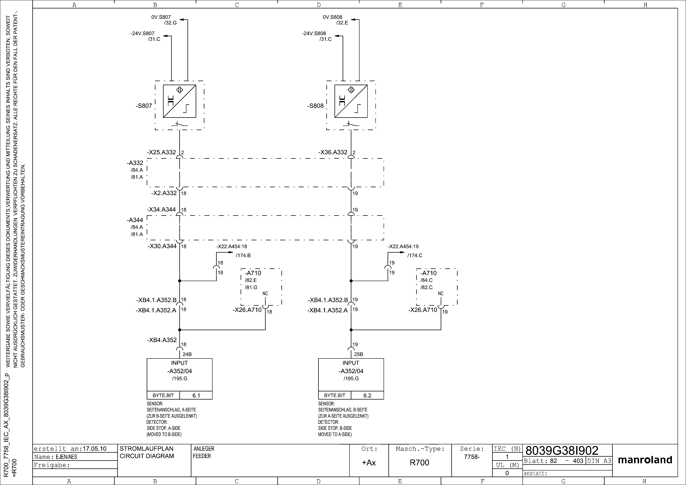

# +Ax — Sheet 82 of 403 — ANLEGER

**FEEDER**

> Part of the manroland **R700** printing press IEC/UL circuit diagrams.
> Drawing class: **Stromlaufplan / Circuit diagram** (DIN A3).
> Document `+Ax` covers the **Central control console** machine section.

## At a glance

| Field | Value |
|---|---|
| Document | `+Ax`  (8039G38I902) |
| Sheet | **82** of 403 |
| Section (DE) | ANLEGER |
| Section (EN) | FEEDER |
| Section type | CIRCUIT — Circuit diagram |
| Machine type | `R700` |
| Series | `7758` |
| Created | 17.05.10 |
| Replaces | — |
| Columns used | B, C, D, E, F |
| Path numbers | — |
| Labels on sheet | 84 |
| Cross-refs out | 16 |
| Cross-refs in | 36 |

**Previous:** [+Ax sheet 81](SHEET_0081.md) · **Next:** [+Ax sheet 83](SHEET_0083.md) · **Document TOC:** [_TOC.md](_TOC.md)  (+Ax) · **Master TOC:** [all sheets](../_MASTER_TOC.md)

## Sheet image (300 DPI, exact vector render)



_Rendered directly from the PDF vector layer at 300 DPI (1-bit), no OCR and no resampling. Use it to confirm anything ambiguous in the text below._

## Cross-references on this sheet

Each entry is a wire leaving this sheet. The printed token is `/sheet.column`; the link resolves to that sheet inside the same document.

| Ref | Target sheet | Col | Path | Destination on target | Target section | From col |
|---|---|---|---|---|---|---|
| `/32.E` | [+Ax sheet 32](SHEET_0032.md) | E | — | 0V.S807 0V.S808 | SPANNUNGSVERSORGUNG, SCHALTSCHRANKBELÜFTUNG | C |
| `/32.G` | [+Ax sheet 32](SHEET_0032.md) | G | — | 0V.S807 0V.S808 | SPANNUNGSVERSORGUNG, SCHALTSCHRANKBELÜFTUNG | C |
| `/31.C` | [+Ax sheet 31](SHEET_0031.md) | C | — | 24V.S807 | SPANNUNGSVERSORGUNG, SCHALTSCHRANKBELÜFTUNG | B |
| `/31.C` | [+Ax sheet 31](SHEET_0031.md) | C | — | 24V.S808 | SPANNUNGSVERSORGUNG, SCHALTSCHRANKBELÜFTUNG | D |
| `/84.A` | [+Ax sheet 84](SHEET_0084.md) | A | — | — | ANLEGER | B |
| `/81.A` | [+Ax sheet 81](SHEET_0081.md) | A | — | — | ANLEGER | B |
| `/84.A` | [+Ax sheet 84](SHEET_0084.md) | A | — | — | ANLEGER | B |
| `/81.A` | [+Ax sheet 81](SHEET_0081.md) | A | — | — | ANLEGER | B |
| `/174.B` | [+Ax sheet 174](SHEET_0174.md) | B | — | — | RESERVE | C |
| `/174.C` | [+Ax sheet 174](SHEET_0174.md) | C | — | — | RESERVE | E |
| `/82.E` | [+Ax sheet 82](SHEET_0082.md) | E | — | A710 | ANLEGER | C |
| `/81.G` | [+Ax sheet 81](SHEET_0081.md) | G | — | A710 | ANLEGER | C |
| `/84.C` | [+Ax sheet 84](SHEET_0084.md) | C | — | A710 | ANLEGER | E |
| `/82.C` | [+Ax sheet 82](SHEET_0082.md) | C | — | A710 | ANLEGER | E |
| `/195.G` | [+Ax sheet 195](SHEET_0195.md) | G | — | — | REFERENZMODUL | B |
| `/195.G` | [+Ax sheet 195](SHEET_0195.md) | G | — | — | REFERENZMODUL | D |

### Incoming references (sheets that point here)

Every other sheet that sends a wire to this one. `Back-ref` is the token printed on *that* sheet; `Path` is its line number.

| From sheet | Cols | Back-ref | Path | Refs | What continues there |
|---|---|---|---|---|---|
| [+Ax#31](SHEET_0031.md) | C | `/31.C` | — | 2 | — |
| [+Ax#32](SHEET_0032.md) | E, G | `/32.E`, `/32.G` | — | 2 | 0V.S807 |
| [+Ax#81](SHEET_0081.md) | A, G | `/81.A`, `/81.G` | — | 3 | A710 |
| [+Ax#82](SHEET_0082.md) | C, E | `/82.C`, `/82.E` | — | 2 | A710 |
| [+Ax#84](SHEET_0084.md) | A, B | `/84.A`, `/84.B` | — | 3 | — |
| [+Ax#174](SHEET_0174.md) | B, C | `/174.B`, `/174.C` | — | 2 | X22.A454:18 X22.A454:14; X22.A454:19 |
| [+Ax#195](SHEET_0195.md) | G | `/195.G` | — | 2 | — |
| [+Ax#217](SHEET_0217.md) | F | `/217.F` | — | 2 | — |
| [+Ax#227](SHEET_0227.md) | E, F, G | `/227.E`, `/227.F`, `/227.G` | — | 6 | — |
| [+Ax#267](SHEET_0267.md) | C | `/267.C` | — | 1 | — |
| [+Ax#269](SHEET_0269.md) | G | `/269.G` | — | 2 | — |
| [+Ax#274](SHEET_0274.md) | F | `/274.F` | — | 2 | — |
| [+Ax#278](SHEET_0278.md) | A | `/278.A` | — | 2 | — |
| [+Ax#279](SHEET_0279.md) | C | `/279.C` | — | 1 | — |
| [+Ax#290](SHEET_0290.md) | C, E | `/290.C`, `/290.E` | — | 4 | — |


## Devices on this sheet

| Tag | Class | Class meaning (IEC) | Col | Sub | Terminal | Sign |
|---|---|---|---|---|---|---|
| `A352/04` | A | Baugruppe / assembly, module, PC board | B | 04 | — | — |
| `A352/04` | A | Baugruppe / assembly, module, PC board | D | 04 | — | — |
| `S807` | S | Schalter / switch | B | — | — | — |
| `S808` | S | Schalter / switch | D | — | — | — |
| `A332` | A | Baugruppe / assembly, module, PC board | B | — | — | — |
| `A344` | A | Baugruppe / assembly, module, PC board | B | — | — | — |
| `A710` | A | Baugruppe / assembly, module, PC board | C | — | — | — |
| `A710` | A | Baugruppe / assembly, module, PC board | E | — | — | — |
| `6.1` | — | cross-device reference | C | — | — | — |
| `XB4.A352` | — | cross-device reference | B | — | — | — |
| `6.2` | — | cross-device reference | E | — | — | — |
| `X2.A332` | — | cross-device reference | B | — | — | — |
| `X25.A332` | — | cross-device reference | B | — | — | — |
| `X36.A332` | — | cross-device reference | D | — | — | — |
| `X34.A344` | — | cross-device reference | B | — | — | — |
| `X30.A344` | — | cross-device reference | B | — | — | — |
| `XB4.1.A352.B` | — | cross-device reference | B | — | — | — |
| `XB4.1.A352.A` | — | cross-device reference | B | — | — | — |
| `X26.A710` | — | cross-device reference | C | — | — | — |
| `XB4.1.A352.B` | — | cross-device reference | D | — | — | — |
| `XB4.1.A352.A` | — | cross-device reference | D | — | — | — |
| `X26.A710` | — | cross-device reference | E | — | — | — |
| `X22.A454:18` | — | cross-device reference | C | — | 18 | — |
| `X22.A454:19` | — | cross-device reference | E | — | 19 | — |

## Potentials / nets

| Potential | Count | Columns | Attached devices | Terminals |
|---|---|---|---|---|
| `0V` | 2 | B, D | `S807`, `S808` | — |
| `24V` | 2 | B, D | `S807`, `S808` | — |


A potential such as `L24+/4` or `M24+` is a named supply/return rail; every place it appears on this sheet is electrically common.

## Wire-end annotations (grouped as printed)

A wire that continues elsewhere is annotated with a small cluster: the destination description, the path/line number `#NN`, and the `/sheet.column` cross reference. Each row below is one such cluster exactly as it is grouped on the drawing.

| Col | Y | Path | Cross-ref | Text on the wire |
|---|---|---|---|---|
| C | 25.8 | — | `/32.E`, `/32.G` | `0V.S807 0V.S808` |
| B | 54.1 | — | `/31.C` | `24V.S807` |
| D | 54.1 | — | `/31.C` | `24V.S808` |
| C | 178.9 | — | — | `S807 S808` |
| B | 259.7 | — | — | `X25.A332 2` |
| D | 259.7 | — | — | `X36.A332 2` |
| B | 278.1 | — | — | `A332` |
| B | 291.1 | — | `/84.A`, `/81.A` | — |
| B | 330.6 | — | — | `X2.A332 18` |
| D | 332.0 | — | — | `19` |
| B | 358.9 | — | — | `X34.A344 18` |
| D | 360.3 | — | — | `19` |
| B | 377.3 | — | — | `A344` |
| B | 390.4 | — | `/84.A`, `/81.A` | — |
| B | 422.7 | — | — | `X30.A344 18` |
| C | 424.1 | — | — | `X22.A454:18` |
| D | 424.1 | — | — | `19` |
| E | 424.1 | — | — | `X22.A454:19` |
| C | 439.6 | — | `/174.B` | — |
| E | 439.7 | — | `/174.C` | — |
| C | 452.4 | — | — | `18` |
| E | 452.4 | — | — | `19` |
| C | 469.4 | — | `/82.E`, `/81.G` | `A710` |
| E | 469.4 | — | `/84.C`, `/82.C` | `A710` |
| C | 469.5 | — | — | `18` |
| E | 469.5 | — | — | `19` |
| D | 506.6 | — | — | `NC NC` |
| B | 516.2 | — | — | `XB4.1.A352.B 18` |
| D | 516.2 | — | — | `XB4.1.A352.B 19` |
| C | 533.2 | — | — | `XB4.1.A352.A 18 X26.A710 18` |
| E | 533.2 | — | — | `XB4.1.A352.A 19 X26.A710 19` |
| B | 585.7 | — | — | `XB4.A352 18` |
| D | 594.2 | — | — | `19` |
| B | 611.1 | — | — | `24B` |
| D | 611.1 | — | — | `25B` |
| B | 625.7 | — | — | `INPUT` |
| D | 625.7 | — | — | `INPUT` |
| B | 639.5 | — | — | `A352/04` |
| D | 639.5 | — | — | `A352/04` |
| B | 653.3 | — | `/195.G` | — |
| D | 653.3 | — | `/195.G` | — |
| B | 682.4 | — | — | `BYTE.BIT 6.1` |
| D | 682.4 | — | — | `BYTE.BIT 6.2` |
| B | 697.9 | — | — | `DETECTOR: (ZUR B SEITE AUSGELENKT) SENSOR: SEITENANSCHLAG, A SEITE` |
| D | 697.9 | — | — | `DETECTOR: (ZUR A SEITE AUSGELENKT) SENSOR: SEITENANSCHLAG, B SEITE` |
| B | 740.5 | — | — | `(MOVED TO B SIDE) SIDE STOP, A SIDE` |
| D | 740.5 | — | — | `MOVED TO A SIDE) SIDE STOP, B SIDE` |


## Reconstructed tables

This sheet carries tabular content (pin map / terminal assignment / index). The grid below was rebuilt from the drawing's own rule lines, so each row is exactly one physical row of the table.

### Table 1 — 4 data rows × 4 columns (at x=255.1, y=147.4)

| X25.A332 X34.A344 X30.A344 | X2.A332 |  | 2 18 18 18 |
|---|---|---|---|
| `XB4.1.A352.B XB4.1.A352.A` |  |  | `18 18` |
| `XB4.A352` |  |  | `18 24B` |
|  |  | `INPUT` | `A352/04 /195.G` |
| `BYTE.BIT` |  |  |  |


### Table 2 — 2 data rows × 4 columns (at x=340.2, y=147.4) — **S808**

|  | X22.A454:18 /174.B 18 A710 18 /82.E |  | X36.A332 |
|---|---|---|---|
|  | `/81.G NC X26.A710` | `18` | `XB4.1.A352.B XB4.1.A352.A` |
| `6.1` |  |  | `BYTE.BIT` |


### Table 3 — 1 data rows × 3 columns (at x=595.3, y=147.4) — **2 19 19 19 19 19 19 25B**

| INPUT | A352/04 /195.G |  |
|---|---|---|
|  |  | `6.2` |


### Table 4 — 2 data rows × 1 columns (at x=666.1, y=147.4)

| C1 |
|---|
| `X22.A454:19 /174.C 19 A710 19 /84.C` |
| `/82.C NC X26.A710` |


## Notes and free text on this sheet

| Text | Col | Y (pt) |
|---|---|---|
| `24B` | B | 611.15 |
| `INPUT` | B | 625.68 |
| `BYTE.BIT` | B | 682.93 |
| `SENSOR:` | B | 697.92 |
| `SEITENANSCHLAG, A SEITE` | B | 708.57 |
| `(ZUR B SEITE AUSGELENKT)` | B | 719.21 |
| `DETECTOR:` | B | 729.82 |
| `SIDE STOP, A SIDE` | B | 740.45 |
| `(MOVED TO B SIDE)` | B | 751.11 |
| `25B` | D | 611.15 |
| `INPUT` | D | 625.68 |
| `BYTE.BIT` | D | 682.93 |
| `SENSOR:` | D | 697.92 |
| `SEITENANSCHLAG, B SEITE` | D | 708.57 |
| `(ZUR A SEITE AUSGELENKT)` | D | 719.21 |
| `DETECTOR:` | D | 729.82 |
| `SIDE STOP, B SIDE` | D | 740.45 |
| `MOVED TO A SIDE)` | D | 751.11 |
| `NC` | C | 506.57 |
| `NC` | E | 506.57 |

## Complete label inventory (exact text from the drawing)

Every text object inside the drawing area of this sheet, in DIN reading order (column A→H, then top→bottom). This is the authoritative list: if a string is not here it is not printed on this sheet.

| Col | Y | X | Dir | Type | Text |
|---|---|---|---|---|---|
| B | 25.8 | 262.8 | → | potential | `0V.S807` |
| B | 35.7 | 285.2 | → | cross-reference | `/32.G` |
| B | 54.1 | 226.8 | → | potential | `24V.S807` |
| B | 64.1 | 257.1 | → | cross-reference | `/31.C` |
| B | 178.9 | 235.8 | → | device tag | `S807` |
| B | 259.7 | 255.1 | → | device ref | `X25.A332` |
| B | 261.1 | 314.4 | → | number | `2` |
| B | 278.1 | 220.3 | → | device tag | `A332` |
| B | 291.2 | 227.3 | → | cross-reference | `/84.A` |
| B | 303.6 | 227.3 | → | cross-reference | `/81.A` |
| B | 330.5 | 262.5 | → | device ref | `X2.A332` |
| B | 332.0 | 313.8 | → | number | `18` |
| B | 358.9 | 255.1 | → | device ref | `X34.A344` |
| B | 360.3 | 313.8 | → | number | `18` |
| B | 377.3 | 220.3 | → | device tag | `A344` |
| B | 390.4 | 227.3 | → | cross-reference | `/84.A` |
| B | 402.8 | 227.3 | → | cross-reference | `/81.A` |
| B | 422.7 | 256.5 | → | device ref | `X30.A344` |
| B | 424.1 | 313.8 | → | number | `18` |
| B | 516.2 | 236.7 | → | device ref | `XB4.1.A352.B` |
| B | 516.2 | 313.8 | → | number | `18` |
| B | 533.2 | 313.8 | → | number | `18` |
| B | 533.9 | 235.8 | → | device ref | `XB4.1.A352.A` |
| B | 585.7 | 255.4 | → | device ref | `XB4.A352` |
| B | 594.2 | 313.8 | → | number | `18` |
| B | 611.2 | 317.2 | → | text | `24B` |
| B | 625.7 | 296.9 | → | text | `INPUT` |
| B | 639.5 | 290.4 | → | device tag | `A352/04` |
| B | 653.3 | 298.9 | → | cross-reference | `/195.G` |
| B | 682.9 | 265.0 | → | text | `BYTE.BIT` |
| B | 697.9 | 254.8 | → | text | `SENSOR:` |
| B | 708.6 | 254.8 | → | text | `SEITENANSCHLAG, A SEITE` |
| B | 719.2 | 254.6 | → | text | `(ZUR B SEITE AUSGELENKT)` |
| B | 729.8 | 254.3 | → | text | `DETECTOR:` |
| B | 740.5 | 254.8 | → | text | `SIDE STOP, A SIDE` |
| B | 751.1 | 254.6 | → | text | `(MOVED TO B SIDE)` |
| C | 424.1 | 375.3 | → | device ref | `X22.A454:18` |
| C | 439.6 | 409.6 | → | cross-reference | `/174.B` |
| C | 452.5 | 377.6 | → | number | `18` |
| C | 469.4 | 424.9 | → | device tag | `A710` |
| C | 469.5 | 377.6 | → | number | `18` |
| C | 482.5 | 425.2 | → | cross-reference | `/82.E` |
| C | 494.9 | 425.2 | → | cross-reference | `/81.G` |
| C | 506.6 | 455.8 | → | text | `NC` |
| C | 533.2 | 403.9 | → | device ref | `X26.A710` |
| C | 537.5 | 462.6 | → | number | `18` |
| C | 682.3 | 334.2 | → | device ref | `6.1` |
| D | 25.8 | 560.4 | → | potential | `0V.S808` |
| D | 35.7 | 583.7 | → | cross-reference | `/32.E` |
| D | 54.1 | 524.4 | → | potential | `24V.S808` |
| D | 64.1 | 554.7 | → | cross-reference | `/31.C` |
| D | 178.9 | 533.5 | → | device tag | `S808` |
| D | 259.7 | 552.8 | → | device ref | `X36.A332` |
| D | 261.1 | 612.0 | → | number | `2` |
| D | 332.0 | 611.4 | → | number | `19` |
| D | 360.3 | 611.4 | → | number | `19` |
| D | 424.1 | 611.4 | → | number | `19` |
| D | 516.2 | 534.3 | → | device ref | `XB4.1.A352.B` |
| D | 516.2 | 611.4 | → | number | `19` |
| D | 533.2 | 611.4 | → | number | `19` |
| D | 533.9 | 533.5 | → | device ref | `XB4.1.A352.A` |
| D | 594.2 | 611.4 | → | number | `19` |
| D | 611.2 | 614.8 | → | text | `25B` |
| D | 625.7 | 594.6 | → | text | `INPUT` |
| D | 639.5 | 588.0 | → | device tag | `A352/04` |
| D | 653.3 | 596.6 | → | cross-reference | `/195.G` |
| D | 682.9 | 562.7 | → | text | `BYTE.BIT` |
| D | 697.9 | 552.5 | → | text | `SENSOR:` |
| D | 708.6 | 552.5 | → | text | `SEITENANSCHLAG, B SEITE` |
| D | 719.2 | 552.2 | → | text | `(ZUR A SEITE AUSGELENKT)` |
| D | 729.8 | 551.9 | → | text | `DETECTOR:` |
| D | 740.5 | 552.5 | → | text | `SIDE STOP, B SIDE` |
| D | 751.1 | 552.2 | → | text | `MOVED TO A SIDE)` |
| E | 424.1 | 672.9 | → | device ref | `X22.A454:19` |
| E | 439.7 | 707.2 | → | cross-reference | `/174.C` |
| E | 452.5 | 675.2 | → | number | `19` |
| E | 469.4 | 729.6 | → | device tag | `A710` |
| E | 469.5 | 675.2 | → | number | `19` |
| E | 482.5 | 729.9 | → | cross-reference | `/84.C` |
| E | 494.9 | 729.9 | → | cross-reference | `/82.C` |
| E | 506.6 | 760.5 | → | text | `NC` |
| E | 533.2 | 708.7 | → | device ref | `X26.A710` |
| E | 682.3 | 631.0 | → | device ref | `6.2` |
| F | 537.5 | 767.3 | → | number | `19` |

## Reading-order text block

The same content as a plain block, grouped by DIN column — convenient to paste or to match against a visual description.

```text
=== Column B ===
  25.8  262.8  net          0V.S807
  35.7  285.2  xref         /32.G
  54.1  226.8  net          24V.S807
  64.1  257.1  xref         /31.C
 178.9  235.8  devtag       S807
 259.7  255.1  devref       X25.A332
 261.1  314.4  numeric      2
 278.1  220.3  devtag       A332
 291.2  227.3  xref         /84.A
 303.6  227.3  xref         /81.A
 330.5  262.5  devref       X2.A332
 332.0  313.8  numeric      18
 358.9  255.1  devref       X34.A344
 360.3  313.8  numeric      18
 377.3  220.3  devtag       A344
 390.4  227.3  xref         /84.A
 402.8  227.3  xref         /81.A
 422.7  256.5  devref       X30.A344
 424.1  313.8  numeric      18
 516.2  236.7  devref       XB4.1.A352.B
 516.2  313.8  numeric      18
 533.2  313.8  numeric      18
 533.9  235.8  devref       XB4.1.A352.A
 585.7  255.4  devref       XB4.A352
 594.2  313.8  numeric      18
 611.2  317.2  text         24B
 625.7  296.9  text         INPUT
 639.5  290.4  devtag       A352/04
 653.3  298.9  xref         /195.G
 682.9  265.0  text         BYTE.BIT
 697.9  254.8  text         SENSOR:
 708.6  254.8  text         SEITENANSCHLAG, A SEITE
 719.2  254.6  text         (ZUR B SEITE AUSGELENKT)
 729.8  254.3  text         DETECTOR:
 740.5  254.8  text         SIDE STOP, A SIDE
 751.1  254.6  text         (MOVED TO B SIDE)
=== Column C ===
 424.1  375.3  devref       X22.A454:18
 439.6  409.6  xref         /174.B
 452.5  377.6  numeric      18
 469.4  424.9  devtag       A710
 469.5  377.6  numeric      18
 482.5  425.2  xref         /82.E
 494.9  425.2  xref         /81.G
 506.6  455.8  text         NC
 533.2  403.9  devref       X26.A710
 537.5  462.6  numeric      18
 682.3  334.2  devref       6.1
=== Column D ===
  25.8  560.4  net          0V.S808
  35.7  583.7  xref         /32.E
  54.1  524.4  net          24V.S808
  64.1  554.7  xref         /31.C
 178.9  533.5  devtag       S808
 259.7  552.8  devref       X36.A332
 261.1  612.0  numeric      2
 332.0  611.4  numeric      19
 360.3  611.4  numeric      19
 424.1  611.4  numeric      19
 516.2  534.3  devref       XB4.1.A352.B
 516.2  611.4  numeric      19
 533.2  611.4  numeric      19
 533.9  533.5  devref       XB4.1.A352.A
 594.2  611.4  numeric      19
 611.2  614.8  text         25B
 625.7  594.6  text         INPUT
 639.5  588.0  devtag       A352/04
 653.3  596.6  xref         /195.G
 682.9  562.7  text         BYTE.BIT
 697.9  552.5  text         SENSOR:
 708.6  552.5  text         SEITENANSCHLAG, B SEITE
 719.2  552.2  text         (ZUR A SEITE AUSGELENKT)
 729.8  551.9  text         DETECTOR:
 740.5  552.5  text         SIDE STOP, B SIDE
 751.1  552.2  text         MOVED TO A SIDE)
=== Column E ===
 424.1  672.9  devref       X22.A454:19
 439.7  707.2  xref         /174.C
 452.5  675.2  numeric      19
 469.4  729.6  devtag       A710
 469.5  675.2  numeric      19
 482.5  729.9  xref         /84.C
 494.9  729.9  xref         /82.C
 506.6  760.5  text         NC
 533.2  708.7  devref       X26.A710
 682.3  631.0  devref       6.2
=== Column F ===
 537.5  767.3  numeric      19
```

---
_Generated from the PDF vector text layer; no OCR. Source: `R700_7758_IEC_AX_8039G38I902_p`, sheet 82._
