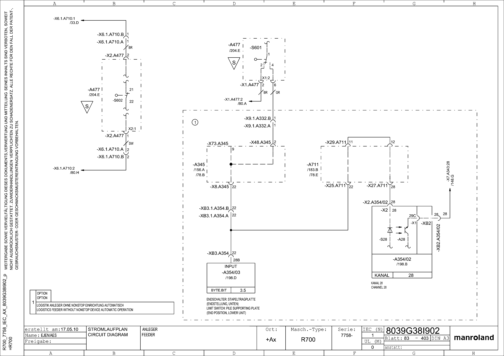

# +Ax — Sheet 83 of 403 — ANLEGER

**FEEDER**

> Part of the manroland **R700** printing press IEC/UL circuit diagrams.
> Drawing class: **Stromlaufplan / Circuit diagram** (DIN A3).
> Document `+Ax` covers the **Central control console** machine section.

## At a glance

| Field | Value |
|---|---|
| Document | `+Ax`  (8039G38I902) |
| Sheet | **83** of 403 |
| Section (DE) | ANLEGER |
| Section (EN) | FEEDER |
| Section type | CIRCUIT — Circuit diagram |
| Machine type | `R700` |
| Series | `7758` |
| Created | 17.05.10 |
| Replaces | — |
| Columns used | A, B, C, D, E, F, G, H |
| Path numbers | — |
| Labels on sheet | 105 |
| Cross-refs out | 12 |
| Cross-refs in | 34 |

**Previous:** [+Ax sheet 82](SHEET_0082.md) · **Next:** [+Ax sheet 84](SHEET_0084.md) · **Document TOC:** [_TOC.md](_TOC.md)  (+Ax) · **Master TOC:** [all sheets](../_MASTER_TOC.md)

## Sheet image (300 DPI, exact vector render)



_Rendered directly from the PDF vector layer at 300 DPI (1-bit), no OCR and no resampling. Use it to confirm anything ambiguous in the text below._

## Cross-references on this sheet

Each entry is a wire leaving this sheet. The printed token is `/sheet.column`; the link resolves to that sheet inside the same document.

| Ref | Target sheet | Col | Path | Destination on target | Target section | From col |
|---|---|---|---|---|---|---|
| `/33.D` | [+Ax sheet 33](SHEET_0033.md) | D | — | X6.1.A710:1 | SPANNUNGSVERSORGUNG, SCHALTSCHRANKBELÜFTUNG | A |
| `/204.E` | [+Ax sheet 204](SHEET_0204.md) | E | — | — | REFERENZMODUL | D |
| `/204.E` | [+Ax sheet 204](SHEET_0204.md) | E | — | — | REFERENZMODUL | B |
| `/80.A` | [+Ax sheet 80](SHEET_0080.md) | A | — | X1.A477:2 | ANLEGER | D |
| `/148.G` | [+Ax sheet 148](SHEET_0148.md) | G | — | X7.A343:28 | ÜBERWACHUNGSRECHNER SICHERHEITSBUS | H |
| `/80.H` | [+Ax sheet 80](SHEET_0080.md) | H | — | X6.1.A710:2 | ANLEGER | A |
| `/156.A` | [+Ax sheet 156](SHEET_0156.md) | A | — | — | ÜBERWACHUNGSRECHNER/ANSTEUERUNG NOT AUS | C |
| `/183.B` | [+Ax sheet 183](SHEET_0183.md) | B | — | — | RESERVE | E |
| `/78.B` | [+Ax sheet 78](SHEET_0078.md) | B | — | — | ANLEGER | C |
| `/78.E` | [+Ax sheet 78](SHEET_0078.md) | E | — | — | ANLEGER | E |
| `/198.B` | [+Ax sheet 198](SHEET_0198.md) | B | — | — | REFERENZMODUL | G |
| `/198.D` | [+Ax sheet 198](SHEET_0198.md) | D | — | — | REFERENZMODUL | D |

### Incoming references (sheets that point here)

Every other sheet that sends a wire to this one. `Back-ref` is the token printed on *that* sheet; `Path` is its line number.

| From sheet | Cols | Back-ref | Path | Refs | What continues there |
|---|---|---|---|---|---|
| [+Ax#33](SHEET_0033.md) | D | `/33.D` | — | 1 | X6.1.A710:1 |
| [+Ax#78](SHEET_0078.md) | B, E | `/78.B`, `/78.E` | — | 2 | — |
| [+Ax#80](SHEET_0080.md) | A, H | `/80.A`, `/80.H` | — | 2 | X1.A477:2; X6.1.A710:2 |
| [+Ax#148](SHEET_0148.md) | G | `/148.G` | — | 1 | X7.A343:28 |
| [+Ax#156](SHEET_0156.md) | A | `/156.A` | — | 1 | — |
| [+Ax#183](SHEET_0183.md) | B | `/183.B` | — | 1 | — |
| [+Ax#198](SHEET_0198.md) | B, D | `/198.B`, `/198.D` | — | 2 | — |
| [+Ax#204](SHEET_0204.md) | E | `/204.E` | — | 2 | — |
| [+Ax#209](SHEET_0209.md) | A | `/209.A` | — | 2 | — |
| [+Ax#219](SHEET_0219.md) | D, F | `/219.D`, `/219.F` | — | 2 | — |
| [+Ax#220](SHEET_0220.md) | F | `/220.F` | — | 2 | — |
| [+Ax#224](SHEET_0224.md) | A, B, C | `/224.A`, `/224.B`, `/224.C` | — | 3 | — |
| [+Ax#234](SHEET_0234.md) | F | `/234.F` | — | 4 | — |
| [+Ax#238](SHEET_0238.md) | A | `/238.A` | — | 1 | — |
| [+Ax#240](SHEET_0240.md) | E | `/240.E` | — | 2 | STROMPFAD PIN 1 2 |
| [+Ax#268](SHEET_0268.md) | C | `/268.C` | — | 1 | — |
| [+Ax#271](SHEET_0271.md) | B | `/271.B` | — | 1 | — |
| [+Ax#274](SHEET_0274.md) | A | `/274.A` | — | 2 | — |
| [+Ax#283](SHEET_0283.md) | E | `/283.E` | — | 1 | — |
| [+Ax#285](SHEET_0285.md) | C | `/285.C` | — | 1 | — |


## Devices on this sheet

| Tag | Class | Class meaning (IEC) | Col | Sub | Terminal | Sign |
|---|---|---|---|---|---|---|
| `X2:1` | X | Klemme / terminal, plug connector | B | — | 1 | — |
| `S602` | S | Schalter / switch | B | — | — | — |
| `A477` | A | Baugruppe / assembly, module, PC board | B | — | — | — |
| `A345` | A | Baugruppe / assembly, module, PC board | C | — | — | — |
| `X1:2` | X | Klemme / terminal, plug connector | E | — | 2 | — |
| `S601` | S | Schalter / switch | D | — | — | — |
| `A477` | A | Baugruppe / assembly, module, PC board | D | — | — | — |
| `A354/03` | A | Baugruppe / assembly, module, PC board | D | 03 | — | — |
| `S28` | S | Schalter / switch | F | — | — | — |
| `A28` | A | Baugruppe / assembly, module, PC board | G | — | — | — |
| `X1` | X | Klemme / terminal, plug connector | G | — | — | — |
| `X2` | X | Klemme / terminal, plug connector | G | — | — | — |
| `XB2` | XB |  | G | — | — | — |
| `A354/02` | A | Baugruppe / assembly, module, PC board | G | 02 | — | — |
| `A711` | A | Baugruppe / assembly, module, PC board | E | — | — | — |
| `X2.A477` | — | cross-device reference | B | — | — | — |
| `X2.A477` | — | cross-device reference | B | — | — | — |
| `X6.1.A710.B` | — | cross-device reference | B | — | — | — |
| `X6.1.A710.A` | — | cross-device reference | B | — | — | — |
| `X6.1.A710.A` | — | cross-device reference | B | — | — | — |
| `X6.1.A710.B` | — | cross-device reference | B | — | — | — |
| `X9.1.A332.B` | — | cross-device reference | D | — | — | — |
| `X9.1.A332.A` | — | cross-device reference | D | — | — | — |
| `X8.A345` | — | cross-device reference | D | — | — | — |
| `X48.A345` | — | cross-device reference | D | — | — | — |
| `3.5` | — | cross-device reference | D | — | — | — |
| `XB3.A354` | — | cross-device reference | D | — | — | — |
| `X27.A711` | — | cross-device reference | F | — | — | — |
| `X29.A711` | — | cross-device reference | F | — | — | — |
| `X25.A711` | — | cross-device reference | F | — | — | — |
| `XB3.1.A354.B` | — | cross-device reference | D | — | — | — |
| `XB3.1.A354.A` | — | cross-device reference | D | — | — | — |
| `X1.A477` | — | cross-device reference | D | — | — | — |
| `X7.A343:28` | — | cross-device reference | H | — | 28 | — |
| `X1.A477:2` | — | cross-device reference | D | — | 2 | — |
| `X6.1.A710:2` | — | cross-device reference | A | — | 2 | — |
| `X6.1.A710:1` | — | cross-device reference | A | — | 1 | — |
| `X73.A345` | — | cross-device reference | D | — | — | — |

## Potentials / nets

_No named potentials on this sheet._

## Wire-end annotations (grouped as printed)

A wire that continues elsewhere is annotated with a small cluster: the destination description, the path/line number `#NN`, and the `/sheet.column` cross reference. Each row below is one such cluster exactly as it is grouped on the drawing.

| Col | Y | Path | Cross-ref | Text on the wire |
|---|---|---|---|---|
| A | 40.0 | — | `/33.D` | `X6.1.A710:1` |
| B | 76.8 | — | — | `X6.1.A710.B 1` |
| B | 93.9 | — | — | `X6.1.A710.A 1` |
| D | 100.9 | — | — | `A477 S601` |
| B | 109.7 | — | — | `BR` |
| D | 115.8 | — | `/204.E` | — |
| E | 124.3 | — | — | `1` |
| B | 126.5 | — | — | `X2.A477 2` |
| D | 142.8 | — | — | `S` |
| E | 149.8 | — | — | `2 4` |
| E | 180.3 | — | — | `X1:2` |
| D | 195.9 | — | — | `X1.A477 2` |
| E | 197.3 | — | — | `6` |
| B | 207.2 | — | — | `A477` |
| B | 208.0 | — | — | `21` |
| E | 216.0 | — | — | `BR GR` |
| B | 220.3 | — | `/204.E` | — |
| D | 231.3 | — | `/80.A` | `X1.A477:2` |
| B | 233.5 | — | — | `S602` |
| B | 236.3 | — | — | `22` |
| B | 246.3 | — | — | `S` |
| D | 275.3 | — | — | `X9.1.A332.B 1` |
| C | 286.1 | — | — | `1` |
| D | 292.3 | — | — | `X9.1.A332.A 1` |
| B | 300.7 | — | — | `X2:1` |
| B | 316.4 | — | — | `X2.A477 1` |
| D | 332.0 | — | — | `X48.A345 2` |
| F | 332.0 | — | — | `X29.A711 11` |
| G | 332.0 | — | — | `12` |
| D | 334.8 | — | — | `X73.A345` |
| B | 336.3 | — | — | `SW` |
| B | 348.3 | — | — | `X6.1.A710.A 2` |
| D | 349.0 | — | — | `9` |
| B | 366.0 | — | — | `X6.1.A710.B 2` |
| H | 381.0 | — | `/148.G` | `X7.A343:28` |
| C | 384.4 | — | — | `A345` |
| E | 384.4 | — | — | `A711` |
| A | 394.3 | — | `/80.H` | `X6.1.A710:2` |
| C | 397.5 | — | `/156.A` | — |
| E | 397.5 | — | `/183.B` | — |
| C | 409.9 | — | `/78.B` | — |
| E | 409.9 | — | `/78.E` | — |
| F | 434.0 | — | — | `X25.A711 22` |
| F | 434.0 | — | — | `X27.A711 28` |
| D | 436.8 | — | — | `X8.A345 22` |
| F | 473.7 | — | — | `X2.A354/02 28` |
| D | 487.9 | — | — | `XB3.1.A354.B 22` |
| G | 492.1 | — | — | `X2` |
| G | 493.6 | — | — | `28 28` |
| H | 502.1 | — | — | `28` |
| D | 504.9 | — | — | `XB3.1.A354.A 22` |
| G | 506.3 | — | — | `29C` |
| G | 523.3 | — | — | `X1` |
| G | 523.3 | — | — | `XB2` |
| G | 529.5 | — | — | `XB2.A354/02` |
| G | 562.3 | — | — | `S28 A28` |
| D | 594.2 | — | — | `XB3.A354 22` |
| G | 608.3 | — | — | `A354/02` |
| D | 611.1 | — | — | `28B` |
| G | 620.7 | — | `/198.B` | — |
| D | 625.7 | — | — | `INPUT` |
| D | 639.5 | — | — | `A354/03` |
| G | 646.6 | — | — | `KANAL 28` |
| D | 653.3 | — | `/198.D` | — |
| F | 666.9 | — | — | `KANAL 28 CHANNEL 28` |
| D | 682.4 | — | — | `BYTE.BIT 3.5` |
| A | 690.8 | — | — | `OPTION OPTION` |
| D | 705.0 | — | — | `ENDSCHALTER: STAPELTRAGPLATTE LIMIT SWITCH: PILE SUPPORTING PLATE (ENDSTELLUNG, UNTEN) (END POSITION, LOWER UNIT)` |
| A | 710.4 | — | — | `1` |
| B | 719.2 | — | — | `LOGISTIK ANLEGER OHNE NONSTOP EINRICHTUNG AUTOMATISCH LOGISTICS FEEDER WITHOUT NONSTOP DEVICE AUTOMATIC OPERATION` |


## Reconstructed tables

This sheet carries tabular content (pin map / terminal assignment / index). The grid below was rebuilt from the drawing's own rule lines, so each row is exactly one physical row of the table.

### Table 1 — 3 data rows × 2 columns (at x=489.0, y=388.3)

| X8.A345 XB3.1.A354.B XB3.1.A354.A | 22 22 22 |
|---|---|
| `XB3.A354` | `22 28B` |
| `INPUT` | `A354/03 /198.D` |
| `BYTE.BIT` | `3.5` |


### Table 2 — 4 data rows × 6 columns (at x=822.0, y=324.6)

| 11 22 | X27.A711 X2.A354/02 | 12 28 28 |  |  | X7.A343:28 |
|---|---|---|---|---|---|
|  | `X2` | `28` | `29C X1` | `XB2` | `28 28` |
|  | `S28` | `A28` |  |  | `XB2.A354/02` |
|  |  | `A354/02 /198.B` |  |  |  |
|  | `KANAL` |  | `28` |  |  |


## Notes and free text on this sheet

| Text | Col | Y (pt) |
|---|---|---|
| `28B` | D | 611.15 |
| `INPUT` | D | 625.68 |
| `BYTE.BIT` | D | 682.93 |
| `ENDSCHALTER: STAPELTRAGPLATTE` | D | 705.03 |
| `(ENDSTELLUNG, UNTEN)` | D | 715.68 |
| `LIMIT SWITCH: PILE SUPPORTING PLATE` | D | 726.28 |
| `(END POSITION, LOWER UNIT)` | D | 736.92 |
| `KANAL 28` | F | 666.93 |
| `CHANNEL 28` | F | 676.87 |
| `29C` | G | 506.31 |
| `KANAL` | F | 646.6 |
| `X2.A354/02` | F | 473.7 |
| `XB2.A354/02` | G | 529.51 |
| `S` | B | 246.29 |
| `SW` | B | 336.33 |
| `BR` | B | 109.67 |
| `S` | D | 142.82 |
| `BR` | E | 215.97 |
| `GR` | E | 216.05 |
| `OPTION` | A | 690.83 |
| `LOGISTIK ANLEGER OHNE NONSTOP EINRICHTUNG AUTOMATISCH` | A | 719.22 |
| `LOGISTICS FEEDER WITHOUT NONSTOP DEVICE AUTOMATIC OPERATION` | B | 729.84 |

## Complete label inventory (exact text from the drawing)

Every text object inside the drawing area of this sheet, in DIN reading order (column A→H, then top→bottom). This is the authoritative list: if a string is not here it is not printed on this sheet.

| Col | Y | X | Dir | Type | Text |
|---|---|---|---|---|---|
| A | 40.0 | 126.1 | → | device ref | `X6.1.A710:1` |
| A | 49.9 | 165.0 | → | cross-reference | `/33.D` |
| A | 394.3 | 125.0 | → | device ref | `X6.1.A710:2` |
| A | 404.2 | 165.5 | → | cross-reference | `/80.H` |
| A | 690.8 | 87.6 | → | text | `OPTION` |
| A | 701.5 | 87.6 | → | text | `OPTION` |
| A | 710.3 | 75.4 | → | number | `1` |
| A | 719.2 | 87.0 | → | text | `LOGISTIK ANLEGER OHNE NONSTOP EINRICHTUNG AUTOMATISCH` |
| B | 76.9 | 229.6 | → | device ref | `X6.1.A710.B` |
| B | 76.9 | 299.6 | → | number | `1` |
| B | 93.9 | 299.6 | → | number | `1` |
| B | 94.6 | 228.8 | → | device ref | `X6.1.A710.A` |
| B | 109.7 | 303.9 | → | text | `BR` |
| B | 126.5 | 248.3 | → | device ref | `X2.A477` |
| B | 126.5 | 300.2 | → | number | `2` |
| B | 207.2 | 207.5 | → | device tag | `A477` |
| B | 208.0 | 305.9 | → | number | `21` |
| B | 220.3 | 210.3 | → | cross-reference | `/204.E` |
| B | 233.5 | 266.5 | → | device tag | `S602` |
| B | 236.3 | 305.9 | → | number | `22` |
| B | 246.3 | 201.4 | → | text | `S` |
| B | 300.7 | 303.3 | → | device tag | `X2:1` |
| B | 316.4 | 248.3 | → | device ref | `X2.A477` |
| B | 317.8 | 299.6 | → | number | `1` |
| B | 336.3 | 304.4 | → | text | `SW` |
| B | 348.3 | 228.8 | → | device ref | `X6.1.A710.A` |
| B | 350.4 | 300.2 | → | number | `2` |
| B | 366.0 | 229.6 | → | device ref | `X6.1.A710.B` |
| B | 367.4 | 300.2 | → | number | `2` |
| B | 729.8 | 87.0 | → | text | `LOGISTICS FEEDER WITHOUT NONSTOP DEVICE AUTOMATIC OPERATION` |
| C | 286.1 | 458.9 | → | number | `1` |
| C | 384.4 | 455.5 | → | device tag | `A345` |
| C | 397.5 | 457.8 | → | cross-reference | `/156.A` |
| C | 409.9 | 462.9 | → | cross-reference | `/78.B` |
| D | 100.9 | 539.1 | → | device tag | `A477` |
| D | 108.0 | 590.2 | → | device tag | `S601` |
| D | 115.8 | 542.0 | → | cross-reference | `/204.E` |
| D | 142.8 | 548.6 | → | text | `S` |
| D | 149.9 | 615.1 | → | number | `2` |
| D | 195.9 | 567.2 | → | device ref | `X1.A477` |
| D | 197.3 | 619.1 | → | number | `2` |
| D | 231.3 | 529.2 | → | device ref | `X1.A477:2` |
| D | 241.2 | 561.8 | → | cross-reference | `/80.A` |
| D | 275.3 | 576.9 | → | device ref | `X9.1.A332.B` |
| D | 293.0 | 576.0 | → | device ref | `X9.1.A332.A` |
| D | 332.0 | 589.6 | → | device ref | `X48.A345` |
| D | 334.8 | 489.0 | → | device ref | `X73.A345` |
| D | 349.0 | 548.2 | → | number | `9` |
| D | 436.8 | 496.3 | → | device ref | `X8.A345` |
| D | 438.3 | 548.2 | → | number | `22` |
| D | 487.9 | 470.6 | → | device ref | `XB3.1.A354.B` |
| D | 487.9 | 548.2 | → | number | `22` |
| D | 504.9 | 548.2 | → | number | `22` |
| D | 505.6 | 469.7 | → | device ref | `XB3.1.A354.A` |
| D | 594.2 | 489.3 | → | device ref | `XB3.A354` |
| D | 594.2 | 548.2 | → | number | `22` |
| D | 611.2 | 551.1 | → | text | `28B` |
| D | 625.7 | 530.8 | → | text | `INPUT` |
| D | 639.5 | 524.3 | → | device tag | `A354/03` |
| D | 653.3 | 532.9 | → | cross-reference | `/198.D` |
| D | 682.3 | 567.2 | → | device ref | `3.5` |
| D | 682.9 | 498.9 | → | text | `BYTE.BIT` |
| D | 705.0 | 488.1 | → | text | `ENDSCHALTER: STAPELTRAGPLATTE` |
| D | 715.7 | 488.4 | → | text | `(ENDSTELLUNG, UNTEN)` |
| D | 726.3 | 488.1 | → | text | `LIMIT SWITCH: PILE SUPPORTING PLATE` |
| D | 736.9 | 488.4 | → | text | `(END POSITION, LOWER UNIT)` |
| E | 124.3 | 632.7 | → | number | `1` |
| E | 149.9 | 641.8 | → | number | `4` |
| E | 180.3 | 619.4 | → | device tag | `X1:2` |
| E | 197.3 | 647.4 | → | number | `6` |
| E | 216.0 | 622.8 | → | text | `BR` |
| E | 216.1 | 651.7 | → | text | `GR` |
| E | 275.3 | 646.9 | → | number | `1` |
| E | 292.3 | 646.9 | → | number | `1` |
| E | 332.0 | 647.4 | → | number | `2` |
| E | 384.4 | 724.8 | → | device tag | `A711` |
| E | 397.5 | 726.0 | → | cross-reference | `/183.B` |
| E | 409.9 | 731.1 | → | cross-reference | `/78.E` |
| F | 332.0 | 768.2 | → | device ref | `X29.A711` |
| F | 332.0 | 824.0 | → | number | `11` |
| F | 434.0 | 766.8 | → | device ref | `X25.A711` |
| F | 434.0 | 866.0 | → | device ref | `X27.A711` |
| F | 438.3 | 824.6 | → | number | `22` |
| F | 473.7 | 857.2 | → | text | `X2.A354/02` |
| F | 562.3 | 896.0 | → | device tag | `S28` |
| F | 646.6 | 885.0 | → | text | `KANAL` |
| F | 666.9 | 876.8 | → | text | `KANAL 28` |
| F | 676.9 | 877.0 | → | text | `CHANNEL 28` |
| G | 332.0 | 923.2 | → | number | `12` |
| G | 438.3 | 923.8 | → | number | `28` |
| G | 473.7 | 923.8 | → | number | `28` |
| G | 492.1 | 899.7 | → | device tag | `X2` |
| G | 493.6 | 926.6 | → | number | `28` |
| G | 503.5 | 1025.9 | → | number | `28` |
| G | 506.3 | 966.6 | → | text | `29C` |
| G | 523.3 | 970.3 | → | device tag | `X1` |
| G | 523.3 | 994.7 | → | device tag | `XB2` |
| G | 529.5 | 1030.7 | ↕ | text | `XB2.A354/02` |
| G | 562.3 | 938.6 | → | device tag | `A28` |
| G | 608.3 | 928.2 | → | device tag | `A354/02` |
| G | 620.7 | 937.0 | → | cross-reference | `/198.B` |
| G | 646.6 | 965.1 | → | number | `28` |
| H | 381.0 | 1054.8 | ↕ | device ref | `X7.A343:28` |
| H | 413.0 | 1064.7 | ↕ | cross-reference | `/148.G` |
| H | 502.1 | 1046.6 | → | number | `28` |

## Reading-order text block

The same content as a plain block, grouped by DIN column — convenient to paste or to match against a visual description.

```text
=== Column A ===
  40.0  126.1  devref       X6.1.A710:1
  49.9  165.0  xref         /33.D
 394.3  125.0  devref       X6.1.A710:2
 404.2  165.5  xref         /80.H
 690.8   87.6  text         OPTION
 701.5   87.6  text         OPTION
 710.3   75.4  numeric      1
 719.2   87.0  text         LOGISTIK ANLEGER OHNE NONSTOP EINRICHTUNG AUTOMATISCH
=== Column B ===
  76.9  229.6  devref       X6.1.A710.B
  76.9  299.6  numeric      1
  93.9  299.6  numeric      1
  94.6  228.8  devref       X6.1.A710.A
 109.7  303.9  text         BR
 126.5  248.3  devref       X2.A477
 126.5  300.2  numeric      2
 207.2  207.5  devtag       A477
 208.0  305.9  numeric      21
 220.3  210.3  xref         /204.E
 233.5  266.5  devtag       S602
 236.3  305.9  numeric      22
 246.3  201.4  text         S
 300.7  303.3  devtag       X2:1
 316.4  248.3  devref       X2.A477
 317.8  299.6  numeric      1
 336.3  304.4  text         SW
 348.3  228.8  devref       X6.1.A710.A
 350.4  300.2  numeric      2
 366.0  229.6  devref       X6.1.A710.B
 367.4  300.2  numeric      2
 729.8   87.0  text         LOGISTICS FEEDER WITHOUT NONSTOP DEVICE AUTOMATIC OPERATION
=== Column C ===
 286.1  458.9  numeric      1
 384.4  455.5  devtag       A345
 397.5  457.8  xref         /156.A
 409.9  462.9  xref         /78.B
=== Column D ===
 100.9  539.1  devtag       A477
 108.0  590.2  devtag       S601
 115.8  542.0  xref         /204.E
 142.8  548.6  text         S
 149.9  615.1  numeric      2
 195.9  567.2  devref       X1.A477
 197.3  619.1  numeric      2
 231.3  529.2  devref       X1.A477:2
 241.2  561.8  xref         /80.A
 275.3  576.9  devref       X9.1.A332.B
 293.0  576.0  devref       X9.1.A332.A
 332.0  589.6  devref       X48.A345
 334.8  489.0  devref       X73.A345
 349.0  548.2  numeric      9
 436.8  496.3  devref       X8.A345
 438.3  548.2  numeric      22
 487.9  470.6  devref       XB3.1.A354.B
 487.9  548.2  numeric      22
 504.9  548.2  numeric      22
 505.6  469.7  devref       XB3.1.A354.A
 594.2  489.3  devref       XB3.A354
 594.2  548.2  numeric      22
 611.2  551.1  text         28B
 625.7  530.8  text         INPUT
 639.5  524.3  devtag       A354/03
 653.3  532.9  xref         /198.D
 682.3  567.2  devref       3.5
 682.9  498.9  text         BYTE.BIT
 705.0  488.1  text         ENDSCHALTER: STAPELTRAGPLATTE
 715.7  488.4  text         (ENDSTELLUNG, UNTEN)
 726.3  488.1  text         LIMIT SWITCH: PILE SUPPORTING PLATE
 736.9  488.4  text         (END POSITION, LOWER UNIT)
=== Column E ===
 124.3  632.7  numeric      1
 149.9  641.8  numeric      4
 180.3  619.4  devtag       X1:2
 197.3  647.4  numeric      6
 216.0  622.8  text         BR
 216.1  651.7  text         GR
 275.3  646.9  numeric      1
 292.3  646.9  numeric      1
 332.0  647.4  numeric      2
 384.4  724.8  devtag       A711
 397.5  726.0  xref         /183.B
 409.9  731.1  xref         /78.E
=== Column F ===
 332.0  768.2  devref       X29.A711
 332.0  824.0  numeric      11
 434.0  766.8  devref       X25.A711
 434.0  866.0  devref       X27.A711
 438.3  824.6  numeric      22
 473.7  857.2  text         X2.A354/02
 562.3  896.0  devtag       S28
 646.6  885.0  text         KANAL
 666.9  876.8  text         KANAL 28
 676.9  877.0  text         CHANNEL 28
=== Column G ===
 332.0  923.2  numeric      12
 438.3  923.8  numeric      28
 473.7  923.8  numeric      28
 492.1  899.7  devtag       X2
 493.6  926.6  numeric      28
 503.5 1025.9  numeric      28
 506.3  966.6  text         29C
 523.3  970.3  devtag       X1
 523.3  994.7  devtag       XB2
 529.5 1030.7  text         XB2.A354/02
 562.3  938.6  devtag       A28
 608.3  928.2  devtag       A354/02
 620.7  937.0  xref         /198.B
 646.6  965.1  numeric      28
=== Column H ===
 381.0 1054.8  devref       X7.A343:28
 413.0 1064.7  xref         /148.G
 502.1 1046.6  numeric      28
```

---
_Generated from the PDF vector text layer; no OCR. Source: `R700_7758_IEC_AX_8039G38I902_p`, sheet 83._
