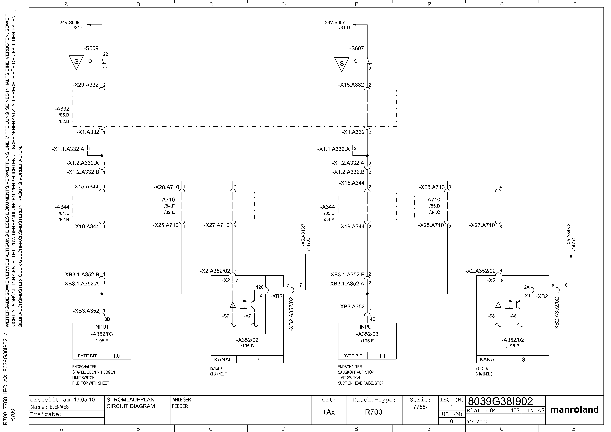

# +Ax — Sheet 84 of 403 — ANLEGER

**FEEDER**

> Part of the manroland **R700** printing press IEC/UL circuit diagrams.
> Drawing class: **Stromlaufplan / Circuit diagram** (DIN A3).
> Document `+Ax` covers the **Central control console** machine section.

## At a glance

| Field | Value |
|---|---|
| Document | `+Ax`  (8039G38I902) |
| Sheet | **84** of 403 |
| Section (DE) | ANLEGER |
| Section (EN) | FEEDER |
| Section type | CIRCUIT — Circuit diagram |
| Machine type | `R700` |
| Series | `7758` |
| Created | 17.05.10 |
| Replaces | — |
| Columns used | A, B, C, D, E, F, G, H |
| Path numbers | — |
| Labels on sheet | 141 |
| Cross-refs out | 18 |
| Cross-refs in | 50 |

**Previous:** [+Ax sheet 83](SHEET_0083.md) · **Next:** [+Ax sheet 85](SHEET_0085.md) · **Document TOC:** [_TOC.md](_TOC.md)  (+Ax) · **Master TOC:** [all sheets](../_MASTER_TOC.md)

## Sheet image (300 DPI, exact vector render)



_Rendered directly from the PDF vector layer at 300 DPI (1-bit), no OCR and no resampling. Use it to confirm anything ambiguous in the text below._

## Cross-references on this sheet

Each entry is a wire leaving this sheet. The printed token is `/sheet.column`; the link resolves to that sheet inside the same document.

| Ref | Target sheet | Col | Path | Destination on target | Target section | From col |
|---|---|---|---|---|---|---|
| `/31.C` | [+Ax sheet 31](SHEET_0031.md) | C | — | 24V.S609 | SPANNUNGSVERSORGUNG, SCHALTSCHRANKBELÜFTUNG | A |
| `/31.D` | [+Ax sheet 31](SHEET_0031.md) | D | — | 24V.S607 | SPANNUNGSVERSORGUNG, SCHALTSCHRANKBELÜFTUNG | E |
| `/85.B` | [+Ax sheet 85](SHEET_0085.md) | B | — | — | ANLEGER | A |
| `/82.B` | [+Ax sheet 82](SHEET_0082.md) | B | — | — | ANLEGER | A |
| `/84.F` | [+Ax sheet 84](SHEET_0084.md) | F | — | — | ANLEGER | B |
| `/82.E` | [+Ax sheet 82](SHEET_0082.md) | E | — | — | ANLEGER | B |
| `/85.D` | [+Ax sheet 85](SHEET_0085.md) | D | — | — | ANLEGER | F |
| `/84.C` | [+Ax sheet 84](SHEET_0084.md) | C | — | — | ANLEGER | F |
| `/84.E` | [+Ax sheet 84](SHEET_0084.md) | E | — | — | ANLEGER | A |
| `/82.B` | [+Ax sheet 82](SHEET_0082.md) | B | — | — | ANLEGER | A |
| `/85.B` | [+Ax sheet 85](SHEET_0085.md) | B | — | — | ANLEGER | E |
| `/84.A` | [+Ax sheet 84](SHEET_0084.md) | A | — | — | ANLEGER | E |
| `/147.C` | [+Ax sheet 147](SHEET_0147.md) | C | — | X5.A343:7 | ÜBERWACHUNGSRECHNER SICHERHEITSBUS | D |
| `/147.C` | [+Ax sheet 147](SHEET_0147.md) | C | — | X5.A343:8 | ÜBERWACHUNGSRECHNER SICHERHEITSBUS | H |
| `/195.F` | [+Ax sheet 195](SHEET_0195.md) | F | — | — | REFERENZMODUL | A |
| `/195.F` | [+Ax sheet 195](SHEET_0195.md) | F | — | — | REFERENZMODUL | E |
| `/195.B` | [+Ax sheet 195](SHEET_0195.md) | B | — | — | REFERENZMODUL | C |
| `/195.B` | [+Ax sheet 195](SHEET_0195.md) | B | — | — | REFERENZMODUL | G |

### Incoming references (sheets that point here)

Every other sheet that sends a wire to this one. `Back-ref` is the token printed on *that* sheet; `Path` is its line number.

| From sheet | Cols | Back-ref | Path | Refs | What continues there |
|---|---|---|---|---|---|
| [+Ax#31](SHEET_0031.md) | C, D | `/31.C`, `/31.D` | — | 2 | 24V.S607 |
| [+Ax#82](SHEET_0082.md) | B, E | `/82.B`, `/82.E` | — | 3 | A710 |
| [+Ax#84](SHEET_0084.md) | A, B, E, F | `/84.A`, `/84.B`, `/84.E`, `/84.F` | — | 4 | — |
| [+Ax#85](SHEET_0085.md) | B, D | `/85.B`, `/85.D` | — | 3 | A710 |
| [+Ax#147](SHEET_0147.md) | C | `/147.C` | — | 2 | X5.A343:7; X5.A343:8 |
| [+Ax#195](SHEET_0195.md) | B, F | `/195.B`, `/195.F` | — | 4 | — |
| [+Ax#207](SHEET_0207.md) | A, B, C | `/207.A`, `/207.B`, `/207.C` | — | 8 | — |
| [+Ax#218](SHEET_0218.md) | G | `/218.G` | — | 2 | — |
| [+Ax#219](SHEET_0219.md) | A | `/219.A` | — | 2 | — |
| [+Ax#223](SHEET_0223.md) | E, G, H | `/223.E`, `/223.G`, `/223.H` | — | 6 | — |
| [+Ax#252](SHEET_0252.md) | D, E | `/252.D`, `/252.E` | — | 2 | — |
| [+Ax#256](SHEET_0256.md) | C | `/256.C` | — | 1 | — |
| [+Ax#258](SHEET_0258.md) | G | `/258.G` | — | 2 | — |
| [+Ax#268](SHEET_0268.md) | B | `/268.B` | — | 2 | — |
| [+Ax#270](SHEET_0270.md) | G | `/270.G` | — | 2 | — |
| [+Ax#272](SHEET_0272.md) | E | `/272.E` | — | 4 | — |
| [+Ax#273](SHEET_0273.md) | C | `/273.C` | — | 1 | — |


## Devices on this sheet

| Tag | Class | Class meaning (IEC) | Col | Sub | Terminal | Sign |
|---|---|---|---|---|---|---|
| `A352/03` | A | Baugruppe / assembly, module, PC board | A | 03 | — | — |
| `S609` | S | Schalter / switch | A | — | — | — |
| `A344` | A | Baugruppe / assembly, module, PC board | A | — | — | — |
| `A332` | A | Baugruppe / assembly, module, PC board | A | — | — | — |
| `A710` | A | Baugruppe / assembly, module, PC board | B | — | — | — |
| `S7` | S | Schalter / switch | C | — | — | — |
| `A7` | A | Baugruppe / assembly, module, PC board | D | — | — | — |
| `X1` | X | Klemme / terminal, plug connector | D | — | — | — |
| `X2` | X | Klemme / terminal, plug connector | C | — | — | — |
| `XB2` | XB |  | D | — | — | — |
| `A352/02` | A | Baugruppe / assembly, module, PC board | C | 02 | — | — |
| `A352/03` | A | Baugruppe / assembly, module, PC board | E | 03 | — | — |
| `S607` | S | Schalter / switch | E | — | — | — |
| `A710` | A | Baugruppe / assembly, module, PC board | F | — | — | — |
| `S8` | S | Schalter / switch | G | — | — | — |
| `A8` | A | Baugruppe / assembly, module, PC board | G | — | — | — |
| `X1` | X | Klemme / terminal, plug connector | G | — | — | — |
| `X2` | X | Klemme / terminal, plug connector | G | — | — | — |
| `XB2` | XB |  | H | — | — | — |
| `A352/02` | A | Baugruppe / assembly, module, PC board | G | 02 | — | — |
| `A344` | A | Baugruppe / assembly, module, PC board | E | — | — | — |
| `1.0` | — | cross-device reference | B | — | — | — |
| `XB3.A352` | — | cross-device reference | A | — | — | — |
| `X15.A344` | — | cross-device reference | A | — | — | — |
| `X1.2.A332.B` | — | cross-device reference | A | — | — | — |
| `X1.2.A332.A` | — | cross-device reference | A | — | — | — |
| `X1.1.A332.A` | — | cross-device reference | A | — | — | — |
| `X1.A332` | — | cross-device reference | A | — | — | — |
| `X29.A332` | — | cross-device reference | A | — | — | — |
| `X19.A344` | — | cross-device reference | A | — | — | — |
| `X28.A710` | — | cross-device reference | B | — | — | — |
| `X27.A710` | — | cross-device reference | C | — | — | — |
| `X25.A710` | — | cross-device reference | B | — | — | — |
| `1.1` | — | cross-device reference | E | — | — | — |
| `XB3.A352` | — | cross-device reference | E | — | — | — |
| `X15.A344` | — | cross-device reference | E | — | — | — |
| `X1.A332` | — | cross-device reference | E | — | — | — |
| `X18.A332` | — | cross-device reference | E | — | — | — |
| `X1.2.A332.B` | — | cross-device reference | E | — | — | — |
| `X1.2.A332.A` | — | cross-device reference | E | — | — | — |
| `X1.1.A332.A` | — | cross-device reference | E | — | — | — |
| `X28.A710` | — | cross-device reference | F | — | — | — |
| `X27.A710` | — | cross-device reference | G | — | — | — |
| `X25.A710` | — | cross-device reference | F | — | — | — |
| `X19.A344` | — | cross-device reference | E | — | — | — |
| `XB3.1.A352.B` | — | cross-device reference | A | — | — | — |
| `XB3.1.A352.A` | — | cross-device reference | A | — | — | — |
| `XB3.1.A352.B` | — | cross-device reference | E | — | — | — |
| `XB3.1.A352.A` | — | cross-device reference | E | — | — | — |
| `X5.A343:8` | — | cross-device reference | H | — | 8 | — |
| `X5.A343:7` | — | cross-device reference | D | — | 7 | — |

## Potentials / nets

| Potential | Count | Columns | Attached devices | Terminals |
|---|---|---|---|---|
| `24V` | 2 | A, E | `S607`, `S609` | — |


A potential such as `L24+/4` or `M24+` is a named supply/return rail; every place it appears on this sheet is electrically common.

## Wire-end annotations (grouped as printed)

A wire that continues elsewhere is annotated with a small cluster: the destination description, the path/line number `#NN`, and the `/sheet.column` cross reference. Each row below is one such cluster exactly as it is grouped on the drawing.

| Col | Y | Path | Cross-ref | Text on the wire |
|---|---|---|---|---|
| A | 40.0 | — | `/31.C` | `24V.S609` |
| E | 40.0 | — | `/31.D` | `24V.S607` |
| A | 89.6 | — | — | `S609 22` |
| E | 89.6 | — | — | `S607 1` |
| C | 114.5 | — | — | `S S` |
| B | 130.0 | — | — | `21` |
| E | 130.0 | — | — | `2` |
| A | 160.5 | — | — | `X29.A332 2` |
| E | 160.5 | — | — | `X18.A332 2` |
| A | 207.2 | — | — | `A332` |
| A | 220.3 | — | `/85.B`, `/82.B` | — |
| A | 252.6 | — | — | `X1.A332 1` |
| E | 252.6 | — | — | `X1.A332 2` |
| A | 285.2 | — | — | `X1.1.A332.A 1` |
| E | 285.2 | — | — | `X1.1.A332.A 2` |
| A | 312.8 | — | — | `X1.2.A332.A 1` |
| E | 312.8 | — | — | `X1.2.A332.A 2` |
| A | 330.6 | — | — | `X1.2.A332.B 1` |
| E | 330.6 | — | — | `X1.2.A332.B 2` |
| E | 351.8 | — | — | `X15.A344 2` |
| A | 358.9 | — | — | `X15.A344 1` |
| C | 360.3 | — | — | `X28.A710 1 2` |
| F | 360.3 | — | — | `X28.A710 3 4` |
| B | 384.4 | — | — | `A710` |
| F | 384.4 | — | — | `A710` |
| B | 397.5 | — | `/84.F`, `/82.E` | — |
| F | 397.5 | — | `/85.D`, `/84.C` | — |
| A | 398.6 | — | — | `A344` |
| E | 398.6 | — | — | `A344` |
| A | 411.6 | — | `/84.E`, `/82.B` | — |
| E | 411.6 | — | `/85.B`, `/84.A` | — |
| C | 434.0 | — | — | `X25.A710 1 X27.A710 7` |
| F | 434.0 | — | — | `X25.A710 2 X27.A710 8` |
| D | 435.4 | — | `/147.C` | `X5.A343:7` |
| H | 435.4 | — | `/147.C` | `X5.A343:8` |
| A | 436.8 | — | — | `X19.A344 1` |
| E | 436.8 | — | — | `X19.A344 2` |
| C | 523.3 | — | — | `X2.A352/02 7` |
| G | 523.3 | — | — | `X2.A352/02 8` |
| A | 530.4 | — | — | `XB3.1.A352.B 1` |
| E | 530.4 | — | — | `XB3.1.A352.B 2` |
| C | 541.7 | — | — | `X2` |
| G | 541.7 | — | — | `X2` |
| D | 543.2 | — | — | `7 7` |
| G | 543.2 | — | — | `8 8` |
| A | 547.4 | — | — | `XB3.1.A352.A 1` |
| E | 547.4 | — | — | `XB3.1.A352.A 2` |
| D | 551.7 | — | — | `7` |
| H | 551.7 | — | — | `8` |
| D | 555.9 | — | — | `12C` |
| G | 555.9 | — | — | `12A` |
| D | 572.9 | — | — | `X1` |
| D | 572.9 | — | — | `XB2` |
| G | 572.9 | — | — | `X1` |
| H | 572.9 | — | — | `XB2` |
| D | 579.1 | — | — | `XB2.A352/02` |
| H | 579.1 | — | — | `XB2.A352/02` |
| E | 592.8 | — | — | `XB3.A352 2` |
| A | 601.2 | — | — | `XB3.A352 1` |
| C | 611.9 | — | — | `S7 A7` |
| G | 611.9 | — | — | `S8 A8` |
| B | 618.2 | — | — | `3B` |
| E | 618.2 | — | — | `4B` |
| A | 632.8 | — | — | `INPUT` |
| E | 632.8 | — | — | `INPUT` |
| A | 646.6 | — | — | `A352/03` |
| E | 646.6 | — | — | `A352/03` |
| C | 657.9 | — | — | `A352/02` |
| G | 657.9 | — | — | `A352/02` |
| A | 660.4 | — | `/195.F` | — |
| E | 660.4 | — | `/195.F` | — |
| C | 670.3 | — | `/195.B` | — |
| G | 670.3 | — | `/195.B` | — |
| A | 689.4 | — | — | `BYTE.BIT 1.0` |
| E | 689.4 | — | — | `BYTE.BIT 1.1` |
| C | 696.2 | — | — | `KANAL 7` |
| G | 696.2 | — | — | `KANAL 8` |
| A | 712.1 | — | — | `ENDSCHALTER:` |
| E | 712.1 | — | — | `ENDSCHALTER:` |
| C | 716.5 | — | — | `KANAL 7 CHANNEL 7` |
| G | 716.5 | — | — | `KANAL 8 CHANNEL 8` |
| A | 722.7 | — | — | `LIMIT SWITCH: PILE, TOP WITH SHEET STAPEL, OBEN MIT BOGEN` |
| E | 722.7 | — | — | `LIMIT SWITCH: SAUGKOPF AUF, STOP` |
| E | 744.0 | — | — | `SUCTION HEAD RAISE, STOP` |


## Reconstructed tables

This sheet carries tabular content (pin map / terminal assignment / index). The grid below was rebuilt from the drawing's own rule lines, so each row is exactly one physical row of the table.

### Table 1 — 6 data rows × 19 columns (at x=141.7, y=352.9)

| X15.A344 X19.A344 XB3.1.A352.B | 1 1 1 | X28.A710 A710 /84.F /82.E X25.A710 | 1 1 | X27.A710 X2.A352/02 | 2 7 7 |  |  | X5.A343:7 | A344 /85.B /84.A /147.C | X15.A344 X19.A344 XB3.1.A352.B | 2 2 2 | X28.A710 A710 /85.D /84.C X25.A710 | 3 2 | X27.A710 X2.A352/02 | 4 8 8 |  |  | X5.A343:8 |
|---|---|---|---|---|---|---|---|---|---|---|---|---|---|---|---|---|---|---|
| `XB3.1.A352.A` | `1` |  |  | `X2` | `7` | `12C` |  | `7 7` |  | `XB3.1.A352.A` | `2` |  |  | `X2` | `8` | `12A` |  | `8 8` |
| `XB3.A352` | `1 3B` |  |  | `S7` | `A7` | `X1` | `XB2` | `XB2.A352/02` |  | `XB3.A352` | `2 4B` |  |  | `S8` | `A8` | `X1` | `XB2` | `XB2.A352/02` |
| `INPUT` |  |  |  |  |  |  |  |  |  | `INPUT` |  |  |  |  |  |  |  |  |
|  | `A352/03 /195.F` |  |  |  | `A352/02 /195.B` |  |  |  |  |  | `A352/03 /195.F` |  |  |  | `A352/02 /195.B` |  |  |  |
| `BYTE.BIT` | `1.0` |  |  |  |  |  |  |  |  | `BYTE.BIT` | `1.1` |  |  |  |  |  |  |  |
|  |  |  |  | `KANAL` |  | `7` |  |  |  |  |  |  |  | `KANAL` |  | `8` |  |  |


## Notes and free text on this sheet

| Text | Col | Y (pt) |
|---|---|---|
| `3B` | B | 618.22 |
| `INPUT` | A | 632.76 |
| `BYTE.BIT` | A | 690.01 |
| `ENDSCHALTER:` | A | 712.11 |
| `STAPEL, OBEN MIT BOGEN` | A | 722.74 |
| `LIMIT SWITCH:` | A | 733.33 |
| `PILE, TOP WITH SHEET` | A | 743.97 |
| `KANAL 7` | C | 716.53 |
| `CHANNEL 7` | C | 726.47 |
| `12C` | D | 555.92 |
| `KANAL` | C | 696.2 |
| `X2.A352/02` | C | 523.3 |
| `XB2.A352/02` | D | 579.12 |
| `4B` | E | 618.22 |
| `INPUT` | E | 632.76 |
| `BYTE.BIT` | E | 690.01 |
| `ENDSCHALTER:` | E | 712.11 |
| `SAUGKOPF AUF, STOP` | E | 722.74 |
| `LIMIT SWITCH:` | E | 733.33 |
| `SUCTION HEAD RAISE, STOP` | E | 744.01 |
| `KANAL 8` | G | 716.53 |
| `CHANNEL 8` | G | 726.47 |
| `12A` | G | 555.88 |
| `KANAL` | G | 696.2 |
| `X2.A352/02` | G | 523.3 |
| `XB2.A352/02` | H | 579.12 |
| `S` | A | 114.47 |
| `S` | E | 118.73 |

## Complete label inventory (exact text from the drawing)

Every text object inside the drawing area of this sheet, in DIN reading order (column A→H, then top→bottom). This is the authoritative list: if a string is not here it is not printed on this sheet.

| Col | Y | X | Dir | Type | Text |
|---|---|---|---|---|---|
| A | 40.0 | 113.4 | → | potential | `24V.S609` |
| A | 49.9 | 143.7 | → | cross-reference | `/31.C` |
| A | 89.6 | 163.6 | → | device tag | `S609` |
| A | 114.5 | 144.7 | → | text | `S` |
| A | 160.5 | 141.7 | → | device ref | `X29.A332` |
| A | 207.2 | 106.9 | → | device tag | `A332` |
| A | 220.3 | 114.2 | → | cross-reference | `/85.B` |
| A | 232.7 | 114.2 | → | cross-reference | `/82.B` |
| A | 252.6 | 149.1 | → | device ref | `X1.A332` |
| A | 285.2 | 172.1 | → | number | `1` |
| A | 285.9 | 101.2 | → | device ref | `X1.1.A332.A` |
| A | 312.8 | 129.5 | → | device ref | `X1.2.A332.A` |
| A | 330.6 | 130.4 | → | device ref | `X1.2.A332.B` |
| A | 358.9 | 141.7 | → | device ref | `X15.A344` |
| A | 398.6 | 106.9 | → | device tag | `A344` |
| A | 411.6 | 114.5 | → | cross-reference | `/84.E` |
| A | 424.0 | 114.2 | → | cross-reference | `/82.B` |
| A | 436.8 | 143.1 | → | device ref | `X19.A344` |
| A | 530.4 | 123.3 | → | device ref | `XB3.1.A352.B` |
| A | 548.1 | 122.5 | → | device ref | `XB3.1.A352.A` |
| A | 601.3 | 142.0 | → | device ref | `XB3.A352` |
| A | 632.8 | 183.5 | → | text | `INPUT` |
| A | 646.6 | 177.0 | → | device tag | `A352/03` |
| A | 660.4 | 186.1 | → | cross-reference | `/195.F` |
| A | 690.0 | 151.7 | → | text | `BYTE.BIT` |
| A | 712.1 | 140.9 | → | text | `ENDSCHALTER:` |
| A | 722.7 | 141.4 | → | text | `STAPEL, OBEN MIT BOGEN` |
| A | 733.3 | 140.9 | → | text | `LIMIT SWITCH:` |
| A | 744.0 | 140.9 | → | text | `PILE, TOP WITH SHEET` |
| B | 101.7 | 201.0 | → | number | `22` |
| B | 130.0 | 201.0 | → | number | `21` |
| B | 161.9 | 201.0 | → | number | `2` |
| B | 254.0 | 200.4 | → | number | `1` |
| B | 315.0 | 200.4 | → | number | `1` |
| B | 332.0 | 200.4 | → | number | `1` |
| B | 360.3 | 200.4 | → | number | `1` |
| B | 360.3 | 299.1 | → | device ref | `X28.A710` |
| B | 384.4 | 312.4 | → | device tag | `A710` |
| B | 397.5 | 320.3 | → | cross-reference | `/84.F` |
| B | 409.9 | 320.0 | → | cross-reference | `/82.E` |
| B | 434.0 | 297.6 | → | device ref | `X25.A710` |
| B | 438.3 | 200.4 | → | number | `1` |
| B | 530.4 | 200.4 | → | number | `1` |
| B | 547.4 | 200.4 | → | number | `1` |
| B | 601.3 | 200.4 | → | number | `1` |
| B | 618.2 | 203.8 | → | text | `3B` |
| B | 689.4 | 219.7 | → | device ref | `1.0` |
| C | 360.3 | 356.3 | → | number | `1` |
| C | 360.3 | 456.1 | → | number | `2` |
| C | 434.0 | 396.9 | → | device ref | `X27.A710` |
| C | 438.3 | 356.3 | → | number | `1` |
| C | 438.3 | 456.1 | → | number | `7` |
| C | 523.3 | 389.5 | → | text | `X2.A352/02` |
| C | 523.3 | 456.1 | → | number | `7` |
| C | 541.7 | 432.0 | → | device tag | `X2` |
| C | 543.2 | 458.9 | → | number | `7` |
| C | 611.9 | 433.1 | → | device tag | `S7` |
| C | 657.9 | 460.5 | → | device tag | `A352/02` |
| C | 670.3 | 469.3 | → | cross-reference | `/195.B` |
| C | 696.2 | 417.3 | → | text | `KANAL` |
| C | 716.5 | 409.0 | → | text | `KANAL 7` |
| C | 726.5 | 409.3 | → | text | `CHANNEL 7` |
| D | 435.4 | 587.1 | ↕ | device ref | `X5.A343:7` |
| D | 463.2 | 597.0 | ↕ | cross-reference | `/147.C` |
| D | 551.7 | 583.7 | → | number | `7` |
| D | 553.1 | 558.1 | → | number | `7` |
| D | 555.9 | 498.9 | → | text | `12C` |
| D | 572.9 | 502.6 | → | device tag | `X1` |
| D | 572.9 | 527.0 | → | device tag | `XB2` |
| D | 579.1 | 563.0 | ↕ | text | `XB2.A352/02` |
| D | 611.9 | 475.7 | → | device tag | `A7` |
| D | 696.2 | 500.3 | → | number | `7` |
| E | 40.0 | 630.7 | → | potential | `24V.S607` |
| E | 49.9 | 661.0 | → | cross-reference | `/31.D` |
| E | 89.6 | 680.9 | → | device tag | `S607` |
| E | 101.7 | 717.7 | → | number | `1` |
| E | 118.7 | 662.0 | → | text | `S` |
| E | 130.0 | 718.3 | → | number | `2` |
| E | 160.5 | 659.1 | → | device ref | `X18.A332` |
| E | 161.9 | 718.3 | → | number | `2` |
| E | 252.6 | 666.4 | → | device ref | `X1.A332` |
| E | 254.0 | 718.3 | → | number | `2` |
| E | 285.2 | 690.0 | → | number | `2` |
| E | 285.9 | 618.5 | → | device ref | `X1.1.A332.A` |
| E | 312.8 | 646.9 | → | device ref | `X1.2.A332.A` |
| E | 315.0 | 718.3 | → | number | `2` |
| E | 330.6 | 647.7 | → | device ref | `X1.2.A332.B` |
| E | 332.0 | 718.3 | → | number | `2` |
| E | 351.8 | 660.5 | → | device ref | `X15.A344` |
| E | 360.3 | 718.3 | → | number | `2` |
| E | 398.6 | 624.2 | → | device tag | `A344` |
| E | 411.6 | 631.6 | → | cross-reference | `/85.B` |
| E | 424.0 | 631.3 | → | cross-reference | `/84.A` |
| E | 436.8 | 660.5 | → | device ref | `X19.A344` |
| E | 438.3 | 718.3 | → | number | `2` |
| E | 530.4 | 640.6 | → | device ref | `XB3.1.A352.B` |
| E | 530.4 | 718.3 | → | number | `2` |
| E | 547.4 | 718.3 | → | number | `2` |
| E | 548.1 | 639.8 | → | device ref | `XB3.1.A352.A` |
| E | 592.7 | 659.3 | → | device ref | `XB3.A352` |
| E | 601.3 | 718.3 | → | number | `2` |
| E | 618.2 | 721.1 | → | text | `4B` |
| E | 632.8 | 700.9 | → | text | `INPUT` |
| E | 646.6 | 694.3 | → | device tag | `A352/03` |
| E | 660.4 | 703.4 | → | cross-reference | `/195.F` |
| E | 689.4 | 737.9 | → | device ref | `1.1` |
| E | 690.0 | 669.0 | → | text | `BYTE.BIT` |
| E | 712.1 | 658.2 | → | text | `ENDSCHALTER:` |
| E | 722.7 | 658.8 | → | text | `SAUGKOPF AUF, STOP` |
| E | 733.3 | 658.2 | → | text | `LIMIT SWITCH:` |
| E | 744.0 | 658.8 | → | text | `SUCTION HEAD RAISE, STOP` |
| F | 360.3 | 816.4 | → | device ref | `X28.A710` |
| F | 360.3 | 874.2 | → | number | `3` |
| F | 384.4 | 829.7 | → | device tag | `A710` |
| F | 397.5 | 836.8 | → | cross-reference | `/85.D` |
| F | 409.9 | 836.8 | → | cross-reference | `/84.C` |
| F | 434.0 | 815.0 | → | device ref | `X25.A710` |
| F | 438.3 | 874.2 | → | number | `2` |
| G | 360.3 | 973.4 | → | number | `4` |
| G | 434.0 | 914.2 | → | device ref | `X27.A710` |
| G | 438.3 | 973.4 | → | number | `8` |
| G | 523.3 | 906.8 | → | text | `X2.A352/02` |
| G | 523.3 | 973.4 | → | number | `8` |
| G | 541.7 | 949.3 | → | device tag | `X2` |
| G | 543.2 | 976.3 | → | number | `8` |
| G | 555.9 | 1016.2 | → | text | `12A` |
| G | 572.9 | 1019.9 | → | device tag | `X1` |
| G | 611.9 | 950.5 | → | device tag | `S8` |
| G | 611.9 | 993.0 | → | device tag | `A8` |
| G | 657.9 | 977.8 | → | device tag | `A352/02` |
| G | 670.3 | 986.6 | → | cross-reference | `/195.B` |
| G | 696.2 | 934.6 | → | text | `KANAL` |
| G | 696.2 | 1017.5 | → | number | `8` |
| G | 716.5 | 926.4 | → | text | `KANAL 8` |
| G | 726.5 | 926.6 | → | text | `CHANNEL 8` |
| H | 435.4 | 1104.4 | ↕ | device ref | `X5.A343:8` |
| H | 463.2 | 1114.3 | ↕ | cross-reference | `/147.C` |
| H | 551.7 | 1101.0 | → | number | `8` |
| H | 553.1 | 1075.5 | → | number | `8` |
| H | 572.9 | 1044.3 | → | device tag | `XB2` |
| H | 579.1 | 1080.3 | ↕ | text | `XB2.A352/02` |

## Reading-order text block

The same content as a plain block, grouped by DIN column — convenient to paste or to match against a visual description.

```text
=== Column A ===
  40.0  113.4  net          24V.S609
  49.9  143.7  xref         /31.C
  89.6  163.6  devtag       S609
 114.5  144.7  text         S
 160.5  141.7  devref       X29.A332
 207.2  106.9  devtag       A332
 220.3  114.2  xref         /85.B
 232.7  114.2  xref         /82.B
 252.6  149.1  devref       X1.A332
 285.2  172.1  numeric      1
 285.9  101.2  devref       X1.1.A332.A
 312.8  129.5  devref       X1.2.A332.A
 330.6  130.4  devref       X1.2.A332.B
 358.9  141.7  devref       X15.A344
 398.6  106.9  devtag       A344
 411.6  114.5  xref         /84.E
 424.0  114.2  xref         /82.B
 436.8  143.1  devref       X19.A344
 530.4  123.3  devref       XB3.1.A352.B
 548.1  122.5  devref       XB3.1.A352.A
 601.3  142.0  devref       XB3.A352
 632.8  183.5  text         INPUT
 646.6  177.0  devtag       A352/03
 660.4  186.1  xref         /195.F
 690.0  151.7  text         BYTE.BIT
 712.1  140.9  text         ENDSCHALTER:
 722.7  141.4  text         STAPEL, OBEN MIT BOGEN
 733.3  140.9  text         LIMIT SWITCH:
 744.0  140.9  text         PILE, TOP WITH SHEET
=== Column B ===
 101.7  201.0  numeric      22
 130.0  201.0  numeric      21
 161.9  201.0  numeric      2
 254.0  200.4  numeric      1
 315.0  200.4  numeric      1
 332.0  200.4  numeric      1
 360.3  200.4  numeric      1
 360.3  299.1  devref       X28.A710
 384.4  312.4  devtag       A710
 397.5  320.3  xref         /84.F
 409.9  320.0  xref         /82.E
 434.0  297.6  devref       X25.A710
 438.3  200.4  numeric      1
 530.4  200.4  numeric      1
 547.4  200.4  numeric      1
 601.3  200.4  numeric      1
 618.2  203.8  text         3B
 689.4  219.7  devref       1.0
=== Column C ===
 360.3  356.3  numeric      1
 360.3  456.1  numeric      2
 434.0  396.9  devref       X27.A710
 438.3  356.3  numeric      1
 438.3  456.1  numeric      7
 523.3  389.5  text         X2.A352/02
 523.3  456.1  numeric      7
 541.7  432.0  devtag       X2
 543.2  458.9  numeric      7
 611.9  433.1  devtag       S7
 657.9  460.5  devtag       A352/02
 670.3  469.3  xref         /195.B
 696.2  417.3  text         KANAL
 716.5  409.0  text         KANAL 7
 726.5  409.3  text         CHANNEL 7
=== Column D ===
 435.4  587.1  devref       X5.A343:7
 463.2  597.0  xref         /147.C
 551.7  583.7  numeric      7
 553.1  558.1  numeric      7
 555.9  498.9  text         12C
 572.9  502.6  devtag       X1
 572.9  527.0  devtag       XB2
 579.1  563.0  text         XB2.A352/02
 611.9  475.7  devtag       A7
 696.2  500.3  numeric      7
=== Column E ===
  40.0  630.7  net          24V.S607
  49.9  661.0  xref         /31.D
  89.6  680.9  devtag       S607
 101.7  717.7  numeric      1
 118.7  662.0  text         S
 130.0  718.3  numeric      2
 160.5  659.1  devref       X18.A332
 161.9  718.3  numeric      2
 252.6  666.4  devref       X1.A332
 254.0  718.3  numeric      2
 285.2  690.0  numeric      2
 285.9  618.5  devref       X1.1.A332.A
 312.8  646.9  devref       X1.2.A332.A
 315.0  718.3  numeric      2
 330.6  647.7  devref       X1.2.A332.B
 332.0  718.3  numeric      2
 351.8  660.5  devref       X15.A344
 360.3  718.3  numeric      2
 398.6  624.2  devtag       A344
 411.6  631.6  xref         /85.B
 424.0  631.3  xref         /84.A
 436.8  660.5  devref       X19.A344
 438.3  718.3  numeric      2
 530.4  640.6  devref       XB3.1.A352.B
 530.4  718.3  numeric      2
 547.4  718.3  numeric      2
 548.1  639.8  devref       XB3.1.A352.A
 592.7  659.3  devref       XB3.A352
 601.3  718.3  numeric      2
 618.2  721.1  text         4B
 632.8  700.9  text         INPUT
 646.6  694.3  devtag       A352/03
 660.4  703.4  xref         /195.F
 689.4  737.9  devref       1.1
 690.0  669.0  text         BYTE.BIT
 712.1  658.2  text         ENDSCHALTER:
 722.7  658.8  text         SAUGKOPF AUF, STOP
 733.3  658.2  text         LIMIT SWITCH:
 744.0  658.8  text         SUCTION HEAD RAISE, STOP
=== Column F ===
 360.3  816.4  devref       X28.A710
 360.3  874.2  numeric      3
 384.4  829.7  devtag       A710
 397.5  836.8  xref         /85.D
 409.9  836.8  xref         /84.C
 434.0  815.0  devref       X25.A710
 438.3  874.2  numeric      2
=== Column G ===
 360.3  973.4  numeric      4
 434.0  914.2  devref       X27.A710
 438.3  973.4  numeric      8
 523.3  906.8  text         X2.A352/02
 523.3  973.4  numeric      8
 541.7  949.3  devtag       X2
 543.2  976.3  numeric      8
 555.9 1016.2  text         12A
 572.9 1019.9  devtag       X1
 611.9  950.5  devtag       S8
 611.9  993.0  devtag       A8
 657.9  977.8  devtag       A352/02
 670.3  986.6  xref         /195.B
 696.2  934.6  text         KANAL
 696.2 1017.5  numeric      8
 716.5  926.4  text         KANAL 8
 726.5  926.6  text         CHANNEL 8
=== Column H ===
 435.4 1104.4  devref       X5.A343:8
 463.2 1114.3  xref         /147.C
 551.7 1101.0  numeric      8
 553.1 1075.5  numeric      8
 572.9 1044.3  devtag       XB2
 579.1 1080.3  text         XB2.A352/02
```

---
_Generated from the PDF vector text layer; no OCR. Source: `R700_7758_IEC_AX_8039G38I902_p`, sheet 84._
