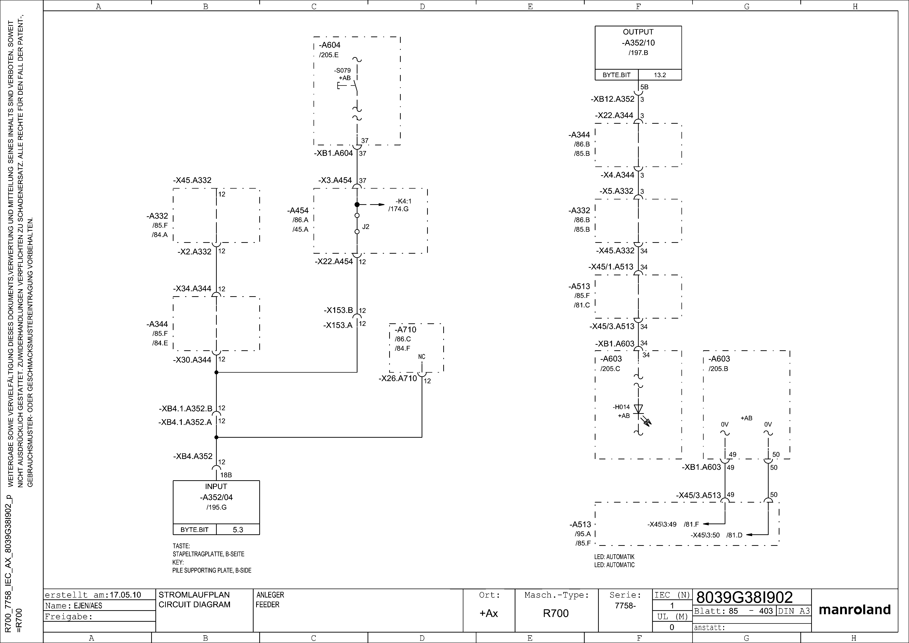

# +Ax — Sheet 85 of 403 — ANLEGER

**FEEDER**

> Part of the manroland **R700** printing press IEC/UL circuit diagrams.
> Drawing class: **Stromlaufplan / Circuit diagram** (DIN A3).
> Document `+Ax` covers the **Central control console** machine section.

## At a glance

| Field | Value |
|---|---|
| Document | `+Ax`  (8039G38I902) |
| Sheet | **85** of 403 |
| Section (DE) | ANLEGER |
| Section (EN) | FEEDER |
| Section type | CIRCUIT — Circuit diagram |
| Machine type | `R700` |
| Series | `7758` |
| Created | 17.05.10 |
| Replaces | — |
| Columns used | B, C, D, E, F, G |
| Path numbers | — |
| Labels on sheet | 115 |
| Cross-refs out | 24 |
| Cross-refs in | 49 |

**Previous:** [+Ax sheet 84](SHEET_0084.md) · **Next:** [+Ax sheet 86](SHEET_0086.md) · **Document TOC:** [_TOC.md](_TOC.md)  (+Ax) · **Master TOC:** [all sheets](../_MASTER_TOC.md)

## Sheet image (300 DPI, exact vector render)



_Rendered directly from the PDF vector layer at 300 DPI (1-bit), no OCR and no resampling. Use it to confirm anything ambiguous in the text below._

## Cross-references on this sheet

Each entry is a wire leaving this sheet. The printed token is `/sheet.column`; the link resolves to that sheet inside the same document.

| Ref | Target sheet | Col | Path | Destination on target | Target section | From col |
|---|---|---|---|---|---|---|
| `/205.E` | [+Ax sheet 205](SHEET_0205.md) | E | — | A604 | REFERENZMODUL | C |
| `/197.B` | [+Ax sheet 197](SHEET_0197.md) | B | — | — | REFERENZMODUL | F |
| `/86.B` | [+Ax sheet 86](SHEET_0086.md) | B | — | — | ANLEGER | E |
| `/85.B` | [+Ax sheet 85](SHEET_0085.md) | B | — | — | ANLEGER | E |
| `/174.G` | [+Ax sheet 174](SHEET_0174.md) | G | — | — | RESERVE | D |
| `/86.A` | [+Ax sheet 86](SHEET_0086.md) | A | — | — | ANLEGER | C |
| `/45.A` | [+Ax sheet 45](SHEET_0045.md) | A | — | — | HAUPTANTRIEB | C |
| `/86.B` | [+Ax sheet 86](SHEET_0086.md) | B | — | — | ANLEGER | E |
| `/85.B` | [+Ax sheet 85](SHEET_0085.md) | B | — | — | ANLEGER | E |
| `/85.F` | [+Ax sheet 85](SHEET_0085.md) | F | — | — | ANLEGER | B |
| `/84.A` | [+Ax sheet 84](SHEET_0084.md) | A | — | — | ANLEGER | B |
| `/85.F` | [+Ax sheet 85](SHEET_0085.md) | F | — | — | ANLEGER | E |
| `/81.C` | [+Ax sheet 81](SHEET_0081.md) | C | — | — | ANLEGER | E |
| `/86.C` | [+Ax sheet 86](SHEET_0086.md) | C | — | A710 | ANLEGER | D |
| `/84.F` | [+Ax sheet 84](SHEET_0084.md) | F | — | A710 | ANLEGER | D |
| `/85.F` | [+Ax sheet 85](SHEET_0085.md) | F | — | — | ANLEGER | B |
| `/84.E` | [+Ax sheet 84](SHEET_0084.md) | E | — | — | ANLEGER | B |
| `/205.C` | [+Ax sheet 205](SHEET_0205.md) | C | — | A603 | REFERENZMODUL | F |
| `/205.B` | [+Ax sheet 205](SHEET_0205.md) | B | — | A603 | REFERENZMODUL | G |
| `/195.G` | [+Ax sheet 195](SHEET_0195.md) | G | — | — | REFERENZMODUL | B |
| `/81.F` | [+Ax sheet 81](SHEET_0081.md) | F | — | X45\3:49 | ANLEGER | F |
| `/95.A` | [+Ax sheet 95](SHEET_0095.md) | A | — | — | ANLEGER | E |
| `/81.D` | [+Ax sheet 81](SHEET_0081.md) | D | — | X45\3:50 | ANLEGER | G |
| `/85.F` | [+Ax sheet 85](SHEET_0085.md) | F | — | — | ANLEGER | E |

### Incoming references (sheets that point here)

Every other sheet that sends a wire to this one. `Back-ref` is the token printed on *that* sheet; `Path` is its line number.

| From sheet | Cols | Back-ref | Path | Refs | What continues there |
|---|---|---|---|---|---|
| [+Ax#45](SHEET_0045.md) | A | `/45.A` | — | 1 | — |
| [+Ax#81](SHEET_0081.md) | C, D, E | `/81.C`, `/81.D`, `/81.E` | — | 3 | X45\3:50 X45\3:49 |
| [+Ax#84](SHEET_0084.md) | A, E, F | `/84.A`, `/84.E`, `/84.F` | — | 3 | — |
| [+Ax#85](SHEET_0085.md) | B, E | `/85.B`, `/85.E` | — | 6 | — |
| [+Ax#86](SHEET_0086.md) | A, B, C | `/86.A`, `/86.B`, `/86.C` | — | 4 | A710 |
| [+Ax#95](SHEET_0095.md) | A | `/95.A` | — | 1 | — |
| [+Ax#174](SHEET_0174.md) | G | `/174.G` | — | 1 | K4:1 |
| [+Ax#195](SHEET_0195.md) | G | `/195.G` | — | 1 | — |
| [+Ax#197](SHEET_0197.md) | B | `/197.B` | — | 1 | — |
| [+Ax#205](SHEET_0205.md) | B, C, D | `/205.B`, `/205.C`, `/205.D` | — | 3 | — |
| [+Ax#210](SHEET_0210.md) | B, D | `/210.B`, `/210.D` | — | 4 | — |
| [+Ax#217](SHEET_0217.md) | F | `/217.F` | — | 1 | — |
| [+Ax#225](SHEET_0225.md) | B | `/225.B` | — | 1 | — |
| [+Ax#226](SHEET_0226.md) | H | `/226.H` | — | 1 | — |
| [+Ax#227](SHEET_0227.md) | E, F, G | `/227.E`, `/227.F`, `/227.G` | — | 3 | — |
| [+Ax#230](SHEET_0230.md) | F | `/230.F` | — | 1 | — |
| [+Ax#248](SHEET_0248.md) | E | `/248.E` | — | 1 | — |
| [+Ax#262](SHEET_0262.md) | E | `/262.E` | — | 1 | — |
| [+Ax#263](SHEET_0263.md) | A | `/263.A` | — | 1 | — |
| [+Ax#269](SHEET_0269.md) | G | `/269.G` | — | 1 | — |
| [+Ax#274](SHEET_0274.md) | F | `/274.F` | — | 1 | — |
| [+Ax#278](SHEET_0278.md) | A | `/278.A` | — | 1 | — |
| [+Ax#282](SHEET_0282.md) | A, B, D, F | `/282.A`, `/282.B`, `/282.D`, `/282.F` | — | 6 | — |
| [+Ax#290](SHEET_0290.md) | C, E | `/290.C`, `/290.E` | — | 2 | — |


## Devices on this sheet

| Tag | Class | Class meaning (IEC) | Col | Sub | Terminal | Sign |
|---|---|---|---|---|---|---|
| `A352/04` | A | Baugruppe / assembly, module, PC board | B | 04 | — | — |
| `S079` | S | Schalter / switch | C | — | — | — |
| `A604` | A | Baugruppe / assembly, module, PC board | C | — | — | — |
| `A454` | A | Baugruppe / assembly, module, PC board | C | — | — | — |
| `A332` | A | Baugruppe / assembly, module, PC board | B | — | — | — |
| `A344` | A | Baugruppe / assembly, module, PC board | B | — | — | — |
| `A710` | A | Baugruppe / assembly, module, PC board | D | — | — | — |
| `A352/10` | A | Baugruppe / assembly, module, PC board | F | 10 | — | — |
| `A513` | A | Baugruppe / assembly, module, PC board | E | — | — | — |
| `A603` | A | Baugruppe / assembly, module, PC board | F | — | — | — |
| `A513` | A | Baugruppe / assembly, module, PC board | E | — | — | — |
| `A603` | A | Baugruppe / assembly, module, PC board | G | — | — | — |
| `A344` | A | Baugruppe / assembly, module, PC board | E | — | — | — |
| `A332` | A | Baugruppe / assembly, module, PC board | E | — | — | — |
| `K4:1` | K | Relais / relay, contactor | D | — | 1 | — |
| `J2` | J |  | C | — | — | — |
| `5.3` | — | cross-device reference | B | — | — | — |
| `XB4.A352` | — | cross-device reference | B | — | — | — |
| `XB1.A604` | — | cross-device reference | C | — | — | — |
| `X3.A454` | — | cross-device reference | C | — | — | — |
| `X22.A454` | — | cross-device reference | C | — | — | — |
| `X153.B` | — | cross-device reference | C | — | — | — |
| `X153.A` | — | cross-device reference | C | — | — | — |
| `X26.A710` | — | cross-device reference | D | — | — | — |
| `XB4.1.A352.B` | — | cross-device reference | B | — | — | — |
| `XB4.1.A352.A` | — | cross-device reference | B | — | — | — |
| `XB12.A352` | — | cross-device reference | F | — | — | — |
| `13.2` | — | cross-device reference | F | — | — | — |
| `X22.A344` | — | cross-device reference | F | — | — | — |
| `X4.A344` | — | cross-device reference | F | — | — | — |
| `X5.A332` | — | cross-device reference | F | — | — | — |
| `X45.A332` | — | cross-device reference | F | — | — | — |
| `X45/1.A513` | — | cross-device reference | F | — | — | — |
| `XB1.A603` | — | cross-device reference | F | — | — | — |
| `X45/3.A513` | — | cross-device reference | F | — | — | — |
| `XB1.A603` | — | cross-device reference | G | — | — | — |
| `X45/3.A513` | — | cross-device reference | G | — | — | — |
| `X45.A332` | — | cross-device reference | B | — | — | — |
| `X2.A332` | — | cross-device reference | B | — | — | — |
| `X34.A344` | — | cross-device reference | B | — | — | — |
| `X30.A344` | — | cross-device reference | B | — | — | — |

## Potentials / nets

| Potential | Count | Columns | Attached devices | Terminals |
|---|---|---|---|---|
| `0V` | 2 | G | — | — |
| `H014` | 1 | F | — | — |


A potential such as `L24+/4` or `M24+` is a named supply/return rail; every place it appears on this sheet is electrically common.

## Wire-end annotations (grouped as printed)

A wire that continues elsewhere is annotated with a small cluster: the destination description, the path/line number `#NN`, and the `/sheet.column` cross reference. Each row below is one such cluster exactly as it is grouped on the drawing.

| Col | Y | Path | Cross-ref | Text on the wire |
|---|---|---|---|---|
| F | 37.5 | — | — | `OUTPUT` |
| F | 51.3 | — | — | `A352/10` |
| C | 54.2 | — | `/205.E` | `A604` |
| F | 65.1 | — | `/197.B` | — |
| C | 88.6 | — | — | `S079` |
| F | 94.7 | — | — | `BYTE.BIT 13.2` |
| C | 98.6 | — | — | `+AB` |
| F | 110.1 | — | — | `5B` |
| F | 125.0 | — | — | `XB12.A352 3` |
| F | 146.3 | — | — | `X22.A344 3` |
| E | 171.8 | — | — | `A344` |
| C | 180.3 | — | — | `37` |
| E | 184.9 | — | `/86.B`, `/85.B` | — |
| C | 195.9 | — | — | `XB1.A604 37` |
| F | 224.2 | — | — | `X4.A344 3` |
| B | 231.3 | — | — | `X45.A332` |
| C | 231.3 | — | — | `X3.A454 37` |
| F | 245.5 | — | — | `X5.A332 3` |
| C | 250.5 | — | — | `12 K4:1` |
| D | 269.6 | — | `/174.G` | — |
| C | 271.0 | — | — | `A454` |
| E | 271.0 | — | — | `A332` |
| B | 278.1 | — | — | `A332` |
| C | 284.1 | — | `/86.A`, `/45.A` | — |
| E | 284.1 | — | `/86.B`, `/85.B` | — |
| B | 291.2 | — | `/85.F`, `/84.A` | — |
| C | 292.9 | — | — | `J2` |
| F | 323.4 | — | — | `X45.A332 34` |
| B | 324.9 | — | — | `X2.A332` |
| B | 324.9 | — | — | `12` |
| C | 337.6 | — | — | `X22.A454 12` |
| F | 344.7 | — | — | `X45/1.A513 34` |
| E | 370.2 | — | — | `A513` |
| B | 373.1 | — | — | `X34.A344` |
| B | 374.5 | — | — | `12` |
| E | 383.3 | — | `/85.F`, `/81.C` | — |
| C | 401.4 | — | — | `X153.B 12` |
| B | 419.8 | — | — | `A344` |
| C | 419.9 | — | — | `X153.A 12` |
| F | 422.7 | — | — | `X45/3.A513 34` |
| D | 426.9 | — | `/86.C`, `/84.F` | `A710` |
| B | 432.9 | — | `/85.F`, `/84.E` | — |
| F | 445.4 | — | — | `XB1.A603 34` |
| F | 460.9 | — | — | `34` |
| C | 464.1 | — | — | `X30.A344 NC` |
| F | 465.2 | — | `/205.C` | `A603` |
| G | 465.2 | — | `/205.B` | `A603` |
| B | 466.6 | — | — | `12` |
| D | 490.7 | — | — | `X26.A710 12` |
| F | 529.4 | — | — | `H014 +AB` |
| B | 530.4 | — | — | `XB4.1.A352.B 12` |
| G | 544.1 | — | — | `0V +AB 0V` |
| B | 547.4 | — | — | `XB4.1.A352.A 12` |
| G | 591.4 | — | — | `49 50` |
| B | 592.8 | — | — | `XB4.A352 12` |
| G | 606.9 | — | — | `XB1.A603 49 50` |
| B | 618.2 | — | — | `18B` |
| B | 632.8 | — | — | `INPUT` |
| G | 643.8 | — | — | `X45/3.A513 49 50` |
| B | 646.6 | — | — | `A352/04` |
| B | 660.4 | — | `/195.G` | — |
| E | 682.0 | — | — | `A513` |
| F | 682.7 | — | `/81.F` | `X45\3:49` |
| B | 689.4 | — | — | `BYTE.BIT 5.3` |
| E | 695.1 | — | `/95.A` | — |
| G | 696.9 | — | `/81.D` | `X45\3:50` |
| E | 707.5 | — | `/85.F` | — |
| B | 712.1 | — | — | `KEY: PILE SUPPORTING PLATE, B SIDE TASTE: STAPELTRAGPLATTE, B SEITE` |
| F | 726.3 | — | — | `LED: AUTOMATIK LED: AUTOMATIC` |


## Reconstructed tables

This sheet carries tabular content (pin map / terminal assignment / index). The grid below was rebuilt from the drawing's own rule lines, so each row is exactly one physical row of the table.

### Table 1 — 5 data rows × 6 columns (at x=226.8, y=48.2)

|  |  |  | A604 /205.E S079 +AB | 37 |  |
|---|---|---|---|---|---|
| `X45.A332 X2.A332 X34.A344 X30.A344` | `12 12 12 12` | `A454 /86.A /45.A` | `XB1.A604 X3.A454 X22.A454 X153.B X153.A` | `37 37 /174.G J2 12 12 12` | `K4:1 A710 /86.C /84.F NC` |
| `XB4.1.A352.B XB4.1.A352.A` | `12 12` |  |  | `X26.A710` |  |
| `XB4.A352` | `12 18B` |  |  |  |  |
| `INPUT` | `A352/04 /195.G` |  |  |  |  |
| `BYTE.BIT` | `5.3` |  |  |  |  |


### Table 2 — 3 data rows × 2 columns (at x=779.5, y=34.0)

| OUTPUT | A352/10 /197.B |
|---|---|
| `BYTE.BIT` | `13.2` |
| `XB12.A352 X22.A344 X4.A344 X5.A332 X45.A332 X45/1.A513 X45/3.A513 XB1.A603` | `5B 3 3 3 3 34 34 34 34` |
| `A603 /205.C H014 +AB` | `34` |


## Notes and free text on this sheet

| Text | Col | Y (pt) |
|---|---|---|
| `18B` | B | 618.24 |
| `INPUT` | B | 632.76 |
| `BYTE.BIT` | B | 690.01 |
| `TASTE:` | B | 712.06 |
| `STAPELTRAGPLATTE, B SEITE` | B | 722.74 |
| `KEY:` | B | 733.25 |
| `PILE SUPPORTING PLATE, B SIDE` | B | 744 |
| `+AB` | C | 98.56 |
| `5B` | F | 110.11 |
| `OUTPUT` | F | 37.46 |
| `BYTE.BIT` | F | 94.74 |
| `+AB` | F | 540.76 |
| `LED: AUTOMATIK` | F | 726.29 |
| `LED: AUTOMATIC` | F | 736.93 |
| `+AB` | G | 544.07 |
| `X45\3:50` | G | 696.9 |
| `X45\3:49` | F | 682.73 |
| `NC` | D | 464.05 |

## Complete label inventory (exact text from the drawing)

Every text object inside the drawing area of this sheet, in DIN reading order (column A→H, then top→bottom). This is the authoritative list: if a string is not here it is not printed on this sheet.

| Col | Y | X | Dir | Type | Text |
|---|---|---|---|---|---|
| B | 231.3 | 226.8 | → | device ref | `X45.A332` |
| B | 250.5 | 285.6 | → | number | `12` |
| B | 278.1 | 191.9 | → | device tag | `A332` |
| B | 291.2 | 199.8 | → | cross-reference | `/85.F` |
| B | 303.6 | 199.0 | → | cross-reference | `/84.A` |
| B | 324.9 | 232.7 | → | device ref | `X2.A332` |
| B | 324.9 | 285.4 | → | number | `12` |
| B | 373.1 | 226.8 | → | device ref | `X34.A344` |
| B | 374.5 | 285.4 | → | number | `12` |
| B | 419.8 | 191.9 | → | device tag | `A344` |
| B | 432.9 | 199.8 | → | cross-reference | `/85.F` |
| B | 445.3 | 199.6 | → | cross-reference | `/84.E` |
| B | 466.6 | 226.8 | → | device ref | `X30.A344` |
| B | 466.6 | 285.4 | → | number | `12` |
| B | 530.4 | 208.3 | → | device ref | `XB4.1.A352.B` |
| B | 530.4 | 285.4 | → | number | `12` |
| B | 547.4 | 285.4 | → | number | `12` |
| B | 548.1 | 207.5 | → | device ref | `XB4.1.A352.A` |
| B | 592.7 | 227.1 | → | device ref | `XB4.A352` |
| B | 601.3 | 285.4 | → | number | `12` |
| B | 618.2 | 288.3 | → | text | `18B` |
| B | 632.8 | 268.6 | → | text | `INPUT` |
| B | 646.6 | 262.1 | → | device tag | `A352/04` |
| B | 660.4 | 270.6 | → | cross-reference | `/195.G` |
| B | 689.4 | 305.0 | → | device ref | `5.3` |
| B | 690.0 | 236.7 | → | text | `BYTE.BIT` |
| B | 712.1 | 226.5 | → | text | `TASTE:` |
| B | 722.7 | 226.5 | → | text | `STAPELTRAGPLATTE, B SEITE` |
| B | 733.2 | 225.9 | → | text | `KEY:` |
| B | 744.0 | 225.9 | → | text | `PILE SUPPORTING PLATE, B SIDE` |
| C | 54.2 | 417.8 | → | device tag | `A604` |
| C | 67.9 | 418.1 | → | cross-reference | `/205.E` |
| C | 88.6 | 437.7 | → | device tag | `S079` |
| C | 98.6 | 443.9 | → | text | `+AB` |
| C | 180.3 | 473.1 | → | number | `37` |
| C | 195.9 | 411.3 | → | device ref | `XB1.A604` |
| C | 197.3 | 470.3 | → | number | `37` |
| C | 231.3 | 417.0 | → | device ref | `X3.A454` |
| C | 232.8 | 470.3 | → | number | `37` |
| C | 271.0 | 376.2 | → | device tag | `A454` |
| C | 284.1 | 383.2 | → | cross-reference | `/86.A` |
| C | 292.9 | 474.5 | → | device tag | `J2` |
| C | 296.5 | 383.2 | → | cross-reference | `/45.A` |
| C | 337.6 | 412.4 | → | device ref | `X22.A454` |
| C | 339.1 | 469.7 | → | number | `12` |
| C | 401.4 | 424.3 | → | device ref | `X153.B` |
| C | 402.8 | 469.7 | → | number | `12` |
| C | 419.9 | 469.7 | → | number | `12` |
| C | 421.3 | 423.5 | → | device ref | `X153.A` |
| D | 259.7 | 518.5 | → | device tag | `K4:1` |
| D | 269.6 | 508.8 | → | cross-reference | `/174.G` |
| D | 426.9 | 517.0 | → | device tag | `A710` |
| D | 440.0 | 517.3 | → | cross-reference | `/86.C` |
| D | 452.4 | 517.3 | → | cross-reference | `/84.F` |
| D | 464.0 | 547.9 | → | text | `NC` |
| D | 490.7 | 496.1 | → | device ref | `X26.A710` |
| D | 495.0 | 554.7 | → | number | `12` |
| E | 171.8 | 744.7 | → | device tag | `A344` |
| E | 184.9 | 752.0 | → | cross-reference | `/86.B` |
| E | 197.3 | 752.0 | → | cross-reference | `/85.B` |
| E | 271.0 | 744.7 | → | device tag | `A332` |
| E | 284.1 | 752.0 | → | cross-reference | `/86.B` |
| E | 296.5 | 752.0 | → | cross-reference | `/85.B` |
| E | 370.2 | 744.7 | → | device tag | `A513` |
| E | 383.3 | 752.6 | → | cross-reference | `/85.F` |
| E | 395.7 | 751.7 | → | cross-reference | `/81.C` |
| E | 682.0 | 746.1 | → | device tag | `A513` |
| E | 695.1 | 753.2 | → | cross-reference | `/95.A` |
| E | 707.5 | 754.0 | → | cross-reference | `/85.F` |
| F | 37.5 | 816.0 | → | text | `OUTPUT` |
| F | 51.3 | 814.8 | → | device tag | `A352/10` |
| F | 65.1 | 823.6 | → | cross-reference | `/197.B` |
| F | 94.7 | 789.4 | → | text | `BYTE.BIT` |
| F | 94.8 | 856.5 | → | device ref | `13.2` |
| F | 110.1 | 838.8 | → | text | `5B` |
| F | 125.0 | 773.9 | → | device ref | `XB12.A352` |
| F | 126.5 | 838.8 | → | number | `3` |
| F | 146.3 | 779.5 | → | device ref | `X22.A344` |
| F | 147.7 | 838.8 | → | number | `3` |
| F | 224.2 | 786.9 | → | device ref | `X4.A344` |
| F | 225.7 | 838.8 | → | number | `3` |
| F | 245.5 | 785.5 | → | device ref | `X5.A332` |
| F | 246.9 | 838.8 | → | number | `3` |
| F | 323.5 | 780.9 | → | device ref | `X45.A332` |
| F | 324.9 | 838.8 | → | number | `34` |
| F | 344.7 | 770.7 | → | device ref | `X45/1.A513` |
| F | 346.2 | 838.8 | → | number | `34` |
| F | 422.7 | 772.2 | → | device ref | `X45/3.A513` |
| F | 424.1 | 838.8 | → | number | `34` |
| F | 445.3 | 779.8 | → | device ref | `XB1.A603` |
| F | 445.4 | 838.8 | → | number | `34` |
| F | 461.0 | 841.6 | → | number | `34` |
| F | 465.2 | 786.3 | → | device tag | `A603` |
| F | 479.0 | 786.6 | → | cross-reference | `/205.C` |
| F | 529.4 | 802.8 | → | potential | `H014` |
| F | 540.8 | 809.6 | → | text | `+AB` |
| F | 682.7 | 848.1 | → | text | `X45\3:49` |
| F | 682.7 | 895.7 | → | cross-reference | `/81.F` |
| F | 726.3 | 778.7 | → | text | `LED: AUTOMATIK` |
| F | 736.9 | 778.7 | → | text | `LED: AUTOMATIC` |
| G | 465.2 | 928.1 | → | device tag | `A603` |
| G | 479.0 | 928.3 | → | cross-reference | `/205.B` |
| G | 544.1 | 970.2 | → | text | `+AB` |
| G | 552.1 | 944.5 | → | potential | `0V` |
| G | 552.1 | 1001.2 | → | potential | `0V` |
| G | 591.3 | 955.0 | → | number | `49` |
| G | 591.3 | 1011.7 | → | number | `50` |
| G | 606.9 | 893.2 | → | device ref | `XB1.A603` |
| G | 608.4 | 952.2 | → | number | `49` |
| G | 608.4 | 1008.9 | → | number | `50` |
| G | 643.8 | 885.5 | → | device ref | `X45/3.A513` |
| G | 643.8 | 952.2 | → | number | `49` |
| G | 643.8 | 1008.9 | → | number | `50` |
| G | 696.9 | 904.8 | → | text | `X45\3:50` |
| G | 696.9 | 951.6 | → | cross-reference | `/81.D` |

## Reading-order text block

The same content as a plain block, grouped by DIN column — convenient to paste or to match against a visual description.

```text
=== Column B ===
 231.3  226.8  devref       X45.A332
 250.5  285.6  numeric      12
 278.1  191.9  devtag       A332
 291.2  199.8  xref         /85.F
 303.6  199.0  xref         /84.A
 324.9  232.7  devref       X2.A332
 324.9  285.4  numeric      12
 373.1  226.8  devref       X34.A344
 374.5  285.4  numeric      12
 419.8  191.9  devtag       A344
 432.9  199.8  xref         /85.F
 445.3  199.6  xref         /84.E
 466.6  226.8  devref       X30.A344
 466.6  285.4  numeric      12
 530.4  208.3  devref       XB4.1.A352.B
 530.4  285.4  numeric      12
 547.4  285.4  numeric      12
 548.1  207.5  devref       XB4.1.A352.A
 592.7  227.1  devref       XB4.A352
 601.3  285.4  numeric      12
 618.2  288.3  text         18B
 632.8  268.6  text         INPUT
 646.6  262.1  devtag       A352/04
 660.4  270.6  xref         /195.G
 689.4  305.0  devref       5.3
 690.0  236.7  text         BYTE.BIT
 712.1  226.5  text         TASTE:
 722.7  226.5  text         STAPELTRAGPLATTE, B SEITE
 733.2  225.9  text         KEY:
 744.0  225.9  text         PILE SUPPORTING PLATE, B SIDE
=== Column C ===
  54.2  417.8  devtag       A604
  67.9  418.1  xref         /205.E
  88.6  437.7  devtag       S079
  98.6  443.9  text         +AB
 180.3  473.1  numeric      37
 195.9  411.3  devref       XB1.A604
 197.3  470.3  numeric      37
 231.3  417.0  devref       X3.A454
 232.8  470.3  numeric      37
 271.0  376.2  devtag       A454
 284.1  383.2  xref         /86.A
 292.9  474.5  devtag       J2
 296.5  383.2  xref         /45.A
 337.6  412.4  devref       X22.A454
 339.1  469.7  numeric      12
 401.4  424.3  devref       X153.B
 402.8  469.7  numeric      12
 419.9  469.7  numeric      12
 421.3  423.5  devref       X153.A
=== Column D ===
 259.7  518.5  devtag       K4:1
 269.6  508.8  xref         /174.G
 426.9  517.0  devtag       A710
 440.0  517.3  xref         /86.C
 452.4  517.3  xref         /84.F
 464.0  547.9  text         NC
 490.7  496.1  devref       X26.A710
 495.0  554.7  numeric      12
=== Column E ===
 171.8  744.7  devtag       A344
 184.9  752.0  xref         /86.B
 197.3  752.0  xref         /85.B
 271.0  744.7  devtag       A332
 284.1  752.0  xref         /86.B
 296.5  752.0  xref         /85.B
 370.2  744.7  devtag       A513
 383.3  752.6  xref         /85.F
 395.7  751.7  xref         /81.C
 682.0  746.1  devtag       A513
 695.1  753.2  xref         /95.A
 707.5  754.0  xref         /85.F
=== Column F ===
  37.5  816.0  text         OUTPUT
  51.3  814.8  devtag       A352/10
  65.1  823.6  xref         /197.B
  94.7  789.4  text         BYTE.BIT
  94.8  856.5  devref       13.2
 110.1  838.8  text         5B
 125.0  773.9  devref       XB12.A352
 126.5  838.8  numeric      3
 146.3  779.5  devref       X22.A344
 147.7  838.8  numeric      3
 224.2  786.9  devref       X4.A344
 225.7  838.8  numeric      3
 245.5  785.5  devref       X5.A332
 246.9  838.8  numeric      3
 323.5  780.9  devref       X45.A332
 324.9  838.8  numeric      34
 344.7  770.7  devref       X45/1.A513
 346.2  838.8  numeric      34
 422.7  772.2  devref       X45/3.A513
 424.1  838.8  numeric      34
 445.3  779.8  devref       XB1.A603
 445.4  838.8  numeric      34
 461.0  841.6  numeric      34
 465.2  786.3  devtag       A603
 479.0  786.6  xref         /205.C
 529.4  802.8  net          H014
 540.8  809.6  text         +AB
 682.7  848.1  text         X45\3:49
 682.7  895.7  xref         /81.F
 726.3  778.7  text         LED: AUTOMATIK
 736.9  778.7  text         LED: AUTOMATIC
=== Column G ===
 465.2  928.1  devtag       A603
 479.0  928.3  xref         /205.B
 544.1  970.2  text         +AB
 552.1  944.5  net          0V
 552.1 1001.2  net          0V
 591.3  955.0  numeric      49
 591.3 1011.7  numeric      50
 606.9  893.2  devref       XB1.A603
 608.4  952.2  numeric      49
 608.4 1008.9  numeric      50
 643.8  885.5  devref       X45/3.A513
 643.8  952.2  numeric      49
 643.8 1008.9  numeric      50
 696.9  904.8  text         X45\3:50
 696.9  951.6  xref         /81.D
```

---
_Generated from the PDF vector text layer; no OCR. Source: `R700_7758_IEC_AX_8039G38I902_p`, sheet 85._
