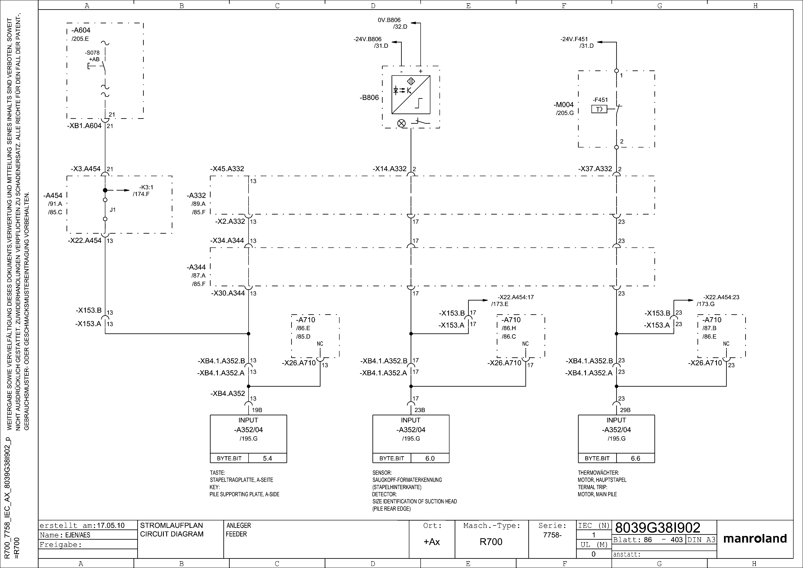

# +Ax — Sheet 86 of 403 — ANLEGER

**FEEDER**

> Part of the manroland **R700** printing press IEC/UL circuit diagrams.
> Drawing class: **Stromlaufplan / Circuit diagram** (DIN A3).
> Document `+Ax` covers the **Central control console** machine section.

## At a glance

| Field | Value |
|---|---|
| Document | `+Ax`  (8039G38I902) |
| Sheet | **86** of 403 |
| Section (DE) | ANLEGER |
| Section (EN) | FEEDER |
| Section type | CIRCUIT — Circuit diagram |
| Machine type | `R700` |
| Series | `7758` |
| Created | 17.05.10 |
| Replaces | — |
| Columns used | A, B, C, D, E, F, G, H |
| Path numbers | — |
| Labels on sheet | 137 |
| Cross-refs out | 23 |
| Cross-refs in | 56 |

**Previous:** [+Ax sheet 85](SHEET_0085.md) · **Next:** [+Ax sheet 87](SHEET_0087.md) · **Document TOC:** [_TOC.md](_TOC.md)  (+Ax) · **Master TOC:** [all sheets](../_MASTER_TOC.md)

## Sheet image (300 DPI, exact vector render)



_Rendered directly from the PDF vector layer at 300 DPI (1-bit), no OCR and no resampling. Use it to confirm anything ambiguous in the text below._

## Cross-references on this sheet

Each entry is a wire leaving this sheet. The printed token is `/sheet.column`; the link resolves to that sheet inside the same document.

| Ref | Target sheet | Col | Path | Destination on target | Target section | From col |
|---|---|---|---|---|---|---|
| `/32.D` | [+Ax sheet 32](SHEET_0032.md) | D | — | 0V.B806 | SPANNUNGSVERSORGUNG, SCHALTSCHRANKBELÜFTUNG | D |
| `/205.E` | [+Ax sheet 205](SHEET_0205.md) | E | — | A604 | REFERENZMODUL | A |
| `/31.D` | [+Ax sheet 31](SHEET_0031.md) | D | — | 24V.B806 24V.F451 | SPANNUNGSVERSORGUNG, SCHALTSCHRANKBELÜFTUNG | E |
| `/31.D` | [+Ax sheet 31](SHEET_0031.md) | D | — | 24V.B806 24V.F451 | SPANNUNGSVERSORGUNG, SCHALTSCHRANKBELÜFTUNG | E |
| `/205.G` | [+Ax sheet 205](SHEET_0205.md) | G | — | — | REFERENZMODUL | F |
| `/174.F` | [+Ax sheet 174](SHEET_0174.md) | F | — | — | RESERVE | B |
| `/91.A` | [+Ax sheet 91](SHEET_0091.md) | A | — | — | ANLEGER | A |
| `/85.C` | [+Ax sheet 85](SHEET_0085.md) | C | — | — | ANLEGER | A |
| `/89.A` | [+Ax sheet 89](SHEET_0089.md) | A | — | — | ANLEGER | B |
| `/85.F` | [+Ax sheet 85](SHEET_0085.md) | F | — | — | ANLEGER | B |
| `/87.A` | [+Ax sheet 87](SHEET_0087.md) | A | — | — | ANLEGER | B |
| `/85.F` | [+Ax sheet 85](SHEET_0085.md) | F | — | — | ANLEGER | B |
| `/173.E` | [+Ax sheet 173](SHEET_0173.md) | E | — | X22.A454:23 | RESERVE | G |
| `/173.G` | [+Ax sheet 173](SHEET_0173.md) | G | — | — | RESERVE | G |
| `/86.E` | [+Ax sheet 86](SHEET_0086.md) | E | — | A710 | ANLEGER | C |
| `/85.D` | [+Ax sheet 85](SHEET_0085.md) | D | — | A710 | ANLEGER | C |
| `/86.H` | [+Ax sheet 86](SHEET_0086.md) | H | — | A710 | ANLEGER | E |
| `/86.C` | [+Ax sheet 86](SHEET_0086.md) | C | — | A710 | ANLEGER | E |
| `/87.B` | [+Ax sheet 87](SHEET_0087.md) | B | — | A710 | ANLEGER | H |
| `/86.E` | [+Ax sheet 86](SHEET_0086.md) | E | — | A710 | ANLEGER | H |
| `/195.G` | [+Ax sheet 195](SHEET_0195.md) | G | — | — | REFERENZMODUL | C |
| `/195.G` | [+Ax sheet 195](SHEET_0195.md) | G | — | — | REFERENZMODUL | D |
| `/195.G` | [+Ax sheet 195](SHEET_0195.md) | G | — | — | REFERENZMODUL | G |

### Incoming references (sheets that point here)

Every other sheet that sends a wire to this one. `Back-ref` is the token printed on *that* sheet; `Path` is its line number.

| From sheet | Cols | Back-ref | Path | Refs | What continues there |
|---|---|---|---|---|---|
| [+Ax#31](SHEET_0031.md) | D | `/31.D` | — | 2 | 24V.B806 |
| [+Ax#32](SHEET_0032.md) | D | `/32.D` | — | 1 | 0V.B806 |
| [+Ax#85](SHEET_0085.md) | C, D, E | `/85.C`, `/85.D`, `/85.E` | — | 4 | A710 |
| [+Ax#86](SHEET_0086.md) | C, E, H | `/86.C`, `/86.E`, `/86.H` | — | 4 | A710 |
| [+Ax#87](SHEET_0087.md) | A, B | `/87.A`, `/87.B` | — | 2 | — |
| [+Ax#89](SHEET_0089.md) | A | `/89.A` | — | 1 | — |
| [+Ax#91](SHEET_0091.md) | A | `/91.A` | — | 1 | — |
| [+Ax#173](SHEET_0173.md) | E, G | `/173.E`, `/173.G` | — | 2 | X22.A454:17; X22.A454:23 |
| [+Ax#174](SHEET_0174.md) | F | `/174.F` | — | 1 | K3:1 |
| [+Ax#195](SHEET_0195.md) | G | `/195.G` | — | 3 | — |
| [+Ax#205](SHEET_0205.md) | D, G | `/205.D`, `/205.G` | — | 2 | — |
| [+Ax#210](SHEET_0210.md) | C | `/210.C` | — | 1 | — |
| [+Ax#217](SHEET_0217.md) | F | `/217.F` | — | 3 | — |
| [+Ax#225](SHEET_0225.md) | A | `/225.A` | — | 1 | — |
| [+Ax#227](SHEET_0227.md) | E, F, G | `/227.E`, `/227.F`, `/227.G` | — | 9 | — |
| [+Ax#251](SHEET_0251.md) | B | `/251.B` | — | 1 | — |
| [+Ax#263](SHEET_0263.md) | A | `/263.A` | — | 1 | — |
| [+Ax#269](SHEET_0269.md) | G | `/269.G` | — | 3 | — |
| [+Ax#274](SHEET_0274.md) | F | `/274.F` | — | 3 | — |
| [+Ax#278](SHEET_0278.md) | A | `/278.A` | — | 3 | — |
| [+Ax#279](SHEET_0279.md) | F | `/279.F` | — | 1 | — |
| [+Ax#282](SHEET_0282.md) | A | `/282.A` | — | 1 | — |
| [+Ax#290](SHEET_0290.md) | C, E | `/290.C`, `/290.E` | — | 6 | — |


## Devices on this sheet

| Tag | Class | Class meaning (IEC) | Col | Sub | Terminal | Sign |
|---|---|---|---|---|---|---|
| `A352/04` | A | Baugruppe / assembly, module, PC board | G | 04 | — | — |
| `A352/04` | A | Baugruppe / assembly, module, PC board | D | 04 | — | — |
| `F451` | F | Schutz / protection device (fuse, circuit breaker) | F | — | — | — |
| `B806` | B | Umformer / transducer, sensor | D | — | — | — |
| `A710` | A | Baugruppe / assembly, module, PC board | E | — | — | — |
| `A710` | A | Baugruppe / assembly, module, PC board | H | — | — | — |
| `A352/04` | A | Baugruppe / assembly, module, PC board | C | 04 | — | — |
| `S078` | S | Schalter / switch | A | — | — | — |
| `A604` | A | Baugruppe / assembly, module, PC board | A | — | — | — |
| `A454` | A | Baugruppe / assembly, module, PC board | A | — | — | — |
| `A332` | A | Baugruppe / assembly, module, PC board | B | — | — | — |
| `A344` | A | Baugruppe / assembly, module, PC board | B | — | — | — |
| `A710` | A | Baugruppe / assembly, module, PC board | C | — | — | — |
| `K3:1` | K | Relais / relay, contactor | B | — | 1 | — |
| `J1` | J |  | A | — | — | — |
| `6.6` | — | cross-device reference | G | — | — | — |
| `6.0` | — | cross-device reference | E | — | — | — |
| `X37.A332` | — | cross-device reference | F | — | — | — |
| `X153.A` | — | cross-device reference | G | — | — | — |
| `X153.B` | — | cross-device reference | G | — | — | — |
| `X14.A332` | — | cross-device reference | D | — | — | — |
| `X153.A` | — | cross-device reference | E | — | — | — |
| `X153.B` | — | cross-device reference | E | — | — | — |
| `X26.A710` | — | cross-device reference | E | — | — | — |
| `X26.A710` | — | cross-device reference | G | — | — | — |
| `XB4.1.A352.B` | — | cross-device reference | D | — | — | — |
| `XB4.1.A352.A` | — | cross-device reference | D | — | — | — |
| `XB4.1.A352.B` | — | cross-device reference | F | — | — | — |
| `XB4.1.A352.A` | — | cross-device reference | F | — | — | — |
| `5.4` | — | cross-device reference | C | — | — | — |
| `XB4.A352` | — | cross-device reference | B | — | — | — |
| `XB1.A604` | — | cross-device reference | A | — | — | — |
| `X3.A454` | — | cross-device reference | A | — | — | — |
| `X22.A454` | — | cross-device reference | A | — | — | — |
| `X2.A332` | — | cross-device reference | C | — | — | — |
| `X34.A344` | — | cross-device reference | B | — | — | — |
| `X30.A344` | — | cross-device reference | B | — | — | — |
| `X153.B` | — | cross-device reference | A | — | — | — |
| `X153.A` | — | cross-device reference | A | — | — | — |
| `X26.A710` | — | cross-device reference | C | — | — | — |
| `XB4.1.A352.B` | — | cross-device reference | B | — | — | — |
| `XB4.1.A352.A` | — | cross-device reference | B | — | — | — |
| `X22.A454:23` | — | cross-device reference | H | — | 23 | — |
| `X22.A454:17` | — | cross-device reference | E | — | 17 | — |
| `X45.A332` | — | cross-device reference | B | — | — | — |

## Potentials / nets

| Potential | Count | Columns | Attached devices | Terminals |
|---|---|---|---|---|
| `0V` | 1 | D | `B806` | — |
| `24V` | 2 | D, F | `B806`, `F451` | — |
| `M004` | 1 | F | — | — |


A potential such as `L24+/4` or `M24+` is a named supply/return rail; every place it appears on this sheet is electrically common.

## Wire-end annotations (grouped as printed)

A wire that continues elsewhere is annotated with a small cluster: the destination description, the path/line number `#NN`, and the `/sheet.column` cross reference. Each row below is one such cluster exactly as it is grouped on the drawing.

| Col | Y | Path | Cross-ref | Text on the wire |
|---|---|---|---|---|
| D | 25.8 | — | `/32.D` | `0V.B806` |
| A | 40.0 | — | `/205.E` | `A604` |
| E | 54.1 | — | `/31.D`, `/31.D` | `24V.B806 24V.F451` |
| A | 74.4 | — | — | `S078` |
| A | 84.4 | — | — | `+AB` |
| E | 100.9 | — | — | `+` |
| G | 108.0 | — | — | `1` |
| D | 139.9 | — | — | `B806` |
| F | 144.2 | — | — | `F451` |
| F | 150.6 | — | — | `M004` |
| F | 158.0 | — | — | `T` |
| F | 163.6 | — | `/205.G` | — |
| A | 166.2 | — | — | `21` |
| A | 181.7 | — | — | `XB1.A604 21` |
| G | 205.8 | — | — | `2` |
| A | 245.5 | — | — | `X3.A454 21` |
| B | 245.5 | — | — | `X45.A332` |
| D | 245.5 | — | — | `X14.A332 2` |
| F | 245.5 | — | — | `X37.A332 2` |
| C | 264.6 | — | — | `13` |
| B | 273.8 | — | — | `K3:1` |
| B | 283.7 | — | `/174.F` | — |
| A | 285.2 | — | — | `A454` |
| B | 285.2 | — | — | `A332` |
| A | 298.2 | — | `/91.A`, `/85.C` | — |
| B | 298.2 | — | `/89.A` | — |
| A | 307.1 | — | — | `J1` |
| B | 310.6 | — | `/85.F` | — |
| C | 323.5 | — | — | `X2.A332 13` |
| D | 324.9 | — | — | `17` |
| G | 324.9 | — | — | `23` |
| A | 351.8 | — | — | `X22.A454 13` |
| C | 351.8 | — | — | `X34.A344 13` |
| D | 353.2 | — | — | `17` |
| G | 353.2 | — | — | `23` |
| B | 391.5 | — | — | `A344` |
| B | 404.5 | — | `/87.A` | — |
| B | 416.9 | — | `/85.F` | — |
| C | 429.8 | — | — | `X30.A344 13` |
| D | 431.2 | — | — | `17` |
| G | 431.2 | — | — | `23` |
| G | 436.8 | — | `/173.E` | `X22.A454:23` |
| E | 436.8 | — | — | `X22.A454:17` |
| G | 446.7 | — | `/173.G` | — |
| A | 455.3 | — | — | `X153.B 13` |
| E | 459.5 | — | — | `X153.B 17` |
| G | 459.5 | — | — | `X153.B 23` |
| C | 469.4 | — | `/86.E`, `/85.D` | `A710` |
| E | 469.4 | — | `/86.H`, `/86.C` | `A710` |
| H | 469.4 | — | `/87.B`, `/86.E` | `A710` |
| A | 475.1 | — | — | `X153.A 13` |
| E | 476.5 | — | — | `X153.A 17` |
| G | 476.5 | — | — | `X153.A 23` |
| C | 506.6 | — | — | `NC` |
| G | 506.6 | — | — | `NC NC` |
| B | 530.4 | — | — | `XB4.1.A352.B 13` |
| D | 530.4 | — | — | `XB4.1.A352.B 17` |
| F | 530.4 | — | — | `XB4.1.A352.B 23` |
| C | 533.2 | — | — | `X26.A710 13` |
| E | 533.2 | — | — | `X26.A710 17` |
| H | 533.2 | — | — | `X26.A710 23` |
| B | 547.4 | — | — | `XB4.1.A352.A 13` |
| D | 547.4 | — | — | `XB4.1.A352.A 17` |
| F | 547.4 | — | — | `XB4.1.A352.A 23` |
| C | 578.6 | — | — | `XB4.A352 13` |
| D | 587.1 | — | — | `17` |
| G | 587.1 | — | — | `23` |
| C | 604.1 | — | — | `19B` |
| D | 604.1 | — | — | `23B` |
| G | 604.1 | — | — | `29B` |
| C | 618.6 | — | — | `INPUT` |
| D | 618.6 | — | — | `INPUT` |
| G | 618.6 | — | — | `INPUT` |
| C | 632.4 | — | — | `A352/04` |
| D | 632.4 | — | — | `A352/04` |
| G | 632.4 | — | — | `A352/04` |
| C | 646.2 | — | `/195.G` | — |
| D | 646.2 | — | `/195.G` | — |
| G | 646.2 | — | `/195.G` | — |
| C | 675.3 | — | — | `BYTE.BIT 5.4` |
| D | 675.3 | — | — | `BYTE.BIT 6.0` |
| G | 675.3 | — | — | `BYTE.BIT 6.6` |
| C | 697.9 | — | — | `KEY: PILE SUPPORTING PLATE, A SIDE TASTE: STAPELTRAGPLATTE, A SEITE` |
| D | 697.9 | — | — | `DETECTOR: (STAPELHINTERKANTE) SENSOR: SAUGKOPF FORMATERKENNUNG` |
| F | 697.9 | — | — | `MOTOR, HAUPTSTAPEL MOTOR, MAIN PILE THERMOWÄCHTER: TERMAL TRIP:` |
| D | 740.5 | — | — | `(PILE REAR EDGE) SIZE IDENTIFICATION OF SUCTION HEAD` |


## Reconstructed tables

This sheet carries tabular content (pin map / terminal assignment / index). The grid below was rebuilt from the drawing's own rule lines, so each row is exactly one physical row of the table.

### Table 1 — 7 data rows × 12 columns (at x=99.2, y=34.0)

| A604 /205.E S078 +AB |  |  |  |  |  | 24V.B806 | /31.D | /32.D |  |  | + |
|---|---|---|---|---|---|---|---|---|---|---|---|
|  |  |  |  |  |  | `B806` |  |  |  |  |  |
|  | `21` |  |  |  |  |  |  |  |  |  |  |
| `XB1.A604 X3.A454 X22.A454 X153.B X153.A` | `21 21 /174.F J1 13 13 13` | `K3:1 A332 /89.A /85.F A344 /87.A /85.F` | `X45.A332 X2.A332 X34.A344 X30.A344` | `13 13 13 13` | `A710 /86.E` |  | `X14.A332` |  |  | `2 17 17 17` |  |
|  |  |  | `XB4.1.A352.B XB4.1.A352.A` | `13 13` | `/85.D NC X26.A710` | `13` | `XB4.1.A352.B XB4.1.A352.A` |  |  | `17 17` |  |
|  |  |  | `XB4.A352` | `13 19B` |  |  |  |  |  | `17 23B` |  |
|  |  |  | `INPUT` | `A352/04 /195.G` |  |  |  |  | `INPUT` | `A352/04 /195.G` |  |
|  |  |  | `BYTE.BIT` | `5.4` |  |  | `BYTE.BIT` |  |  |  | `6.0` |


### Table 2 — 5 data rows × 4 columns (at x=779.5, y=104.9)

| M004 /205.G | F451 T | 1 2 |  |
|---|---|---|---|
|  | `X37.A332` | `2 23 23 23` | `X22.A454:23 /173.G X153.B 23 A710 23 X153.A /87.B` |
| `17` | `XB4.1.A352.B XB4.1.A352.A` | `23 23` | `/86.E NC X26.A710` |
|  |  | `23 29B` |  |
|  | `INPUT` | `A352/04 /195.G` |  |
|  | `BYTE.BIT` | `6.6` |  |


## Notes and free text on this sheet

| Text | Col | Y (pt) |
|---|---|---|
| `29B` | G | 604.07 |
| `INPUT` | G | 618.59 |
| `BYTE.BIT` | F | 675.84 |
| `THERMOWÄCHTER:` | F | 697.93 |
| `MOTOR, HAUPTSTAPEL` | F | 708.58 |
| `TERMAL TRIP:` | F | 719.2 |
| `MOTOR, MAIN PILE` | F | 729.84 |
| `23B` | D | 604.07 |
| `INPUT` | D | 618.59 |
| `BYTE.BIT` | D | 675.84 |
| `SENSOR:` | D | 697.92 |
| `SAUGKOPF FORMATERKENNUNG` | D | 708.6 |
| `(STAPELHINTERKANTE)` | D | 719.21 |
| `DETECTOR:` | D | 729.82 |
| `SIZE IDENTIFICATION OF SUCTION HEAD` | D | 740.48 |
| `(PILE REAR EDGE)` | D | 751.1 |
| `T` | F | 157.96 |
| `19B` | C | 604.07 |
| `INPUT` | C | 618.59 |
| `BYTE.BIT` | B | 675.84 |
| `TASTE:` | B | 697.88 |
| `STAPELTRAGPLATTE, A SEITE` | C | 708.56 |
| `KEY:` | B | 719.08 |
| `PILE SUPPORTING PLATE, A SIDE` | C | 729.83 |
| `+AB` | A | 84.38 |
| `NC` | F | 506.57 |
| `NC` | H | 506.57 |
| `NC` | C | 506.57 |

## Complete label inventory (exact text from the drawing)

Every text object inside the drawing area of this sheet, in DIN reading order (column A→H, then top→bottom). This is the authoritative list: if a string is not here it is not printed on this sheet.

| Col | Y | X | Dir | Type | Text |
|---|---|---|---|---|---|
| A | 40.0 | 106.0 | → | device tag | `A604` |
| A | 53.8 | 106.3 | → | cross-reference | `/205.E` |
| A | 74.4 | 125.9 | → | device tag | `S078` |
| A | 84.4 | 132.1 | → | text | `+AB` |
| A | 166.2 | 161.3 | → | number | `21` |
| A | 181.7 | 99.5 | → | device ref | `XB1.A604` |
| A | 183.2 | 158.5 | → | number | `21` |
| A | 245.5 | 105.2 | → | device ref | `X3.A454` |
| A | 246.9 | 158.5 | → | number | `21` |
| A | 285.2 | 64.3 | → | device tag | `A454` |
| A | 298.2 | 71.4 | → | cross-reference | `/91.A` |
| A | 307.1 | 162.7 | → | device tag | `J1` |
| A | 310.7 | 71.4 | → | cross-reference | `/85.C` |
| A | 351.8 | 100.6 | → | device ref | `X22.A454` |
| A | 353.2 | 157.9 | → | number | `13` |
| A | 455.3 | 112.5 | → | device ref | `X153.B` |
| A | 459.5 | 157.9 | → | number | `13` |
| A | 475.1 | 111.7 | → | device ref | `X153.A` |
| A | 476.5 | 157.9 | → | number | `13` |
| B | 245.5 | 311.8 | → | device ref | `X45.A332` |
| B | 273.8 | 206.6 | → | device tag | `K3:1` |
| B | 283.7 | 197.0 | → | cross-reference | `/174.F` |
| B | 285.2 | 276.9 | → | device tag | `A332` |
| B | 298.2 | 284.0 | → | cross-reference | `/89.A` |
| B | 310.7 | 284.9 | → | cross-reference | `/85.F` |
| B | 351.8 | 311.8 | → | device ref | `X34.A344` |
| B | 391.5 | 276.9 | → | device tag | `A344` |
| B | 404.5 | 284.0 | → | cross-reference | `/87.A` |
| B | 417.0 | 284.9 | → | cross-reference | `/85.F` |
| B | 429.8 | 313.2 | → | device ref | `X30.A344` |
| B | 530.4 | 293.4 | → | device ref | `XB4.1.A352.B` |
| B | 548.1 | 292.5 | → | device ref | `XB4.1.A352.A` |
| B | 578.6 | 312.1 | → | device ref | `XB4.A352` |
| B | 675.8 | 321.7 | → | text | `BYTE.BIT` |
| B | 697.9 | 311.5 | → | text | `TASTE:` |
| B | 719.1 | 311.0 | → | text | `KEY:` |
| C | 264.7 | 370.5 | → | number | `13` |
| C | 323.5 | 319.2 | → | device ref | `X2.A332` |
| C | 324.9 | 370.5 | → | number | `13` |
| C | 353.2 | 370.5 | → | number | `13` |
| C | 431.2 | 370.5 | → | number | `13` |
| C | 469.4 | 439.1 | → | device tag | `A710` |
| C | 482.5 | 439.4 | → | cross-reference | `/86.E` |
| C | 494.9 | 439.4 | → | cross-reference | `/85.D` |
| C | 506.6 | 469.9 | → | text | `NC` |
| C | 530.4 | 370.5 | → | number | `13` |
| C | 533.2 | 418.1 | → | device ref | `X26.A710` |
| C | 537.5 | 476.8 | → | number | `13` |
| C | 547.4 | 370.5 | → | number | `13` |
| C | 587.1 | 370.5 | → | number | `13` |
| C | 604.1 | 373.3 | → | text | `19B` |
| C | 618.6 | 353.6 | → | text | `INPUT` |
| C | 632.4 | 347.1 | → | device tag | `A352/04` |
| C | 646.2 | 355.6 | → | cross-reference | `/195.G` |
| C | 675.3 | 390.0 | → | device ref | `5.4` |
| C | 708.6 | 311.5 | → | text | `STAPELTRAGPLATTE, A SEITE` |
| C | 729.8 | 311.0 | → | text | `PILE SUPPORTING PLATE, A SIDE` |
| D | 25.8 | 560.4 | → | potential | `0V.B806` |
| D | 35.7 | 583.1 | → | cross-reference | `/32.D` |
| D | 54.1 | 524.4 | → | potential | `24V.B806` |
| D | 64.1 | 554.7 | → | cross-reference | `/31.D` |
| D | 139.9 | 533.5 | → | device tag | `B806` |
| D | 245.5 | 552.8 | → | device ref | `X14.A332` |
| D | 246.9 | 612.0 | → | number | `2` |
| D | 324.9 | 611.4 | → | number | `17` |
| D | 353.2 | 611.4 | → | number | `17` |
| D | 431.2 | 611.4 | → | number | `17` |
| D | 530.4 | 534.3 | → | device ref | `XB4.1.A352.B` |
| D | 530.4 | 611.4 | → | number | `17` |
| D | 547.4 | 611.4 | → | number | `17` |
| D | 548.1 | 533.5 | → | device ref | `XB4.1.A352.A` |
| D | 587.1 | 611.4 | → | number | `17` |
| D | 604.1 | 614.8 | → | text | `23B` |
| D | 618.6 | 594.6 | → | text | `INPUT` |
| D | 632.4 | 588.0 | → | device tag | `A352/04` |
| D | 646.2 | 596.6 | → | cross-reference | `/195.G` |
| D | 675.8 | 562.7 | → | text | `BYTE.BIT` |
| D | 697.9 | 552.5 | → | text | `SENSOR:` |
| D | 708.6 | 552.5 | → | text | `SAUGKOPF FORMATERKENNUNG` |
| D | 719.2 | 552.2 | → | text | `(STAPELHINTERKANTE)` |
| D | 729.8 | 551.9 | → | text | `DETECTOR:` |
| D | 740.5 | 552.5 | → | text | `SIZE IDENTIFICATION OF SUCTION HEAD` |
| D | 751.1 | 552.2 | → | text | `(PILE REAR EDGE)` |
| E | 100.9 | 620.6 | → | number | `+` |
| E | 436.8 | 738.1 | → | device ref | `X22.A454:17` |
| E | 446.7 | 728.5 | → | cross-reference | `/173.E` |
| E | 459.5 | 651.1 | → | device ref | `X153.B` |
| E | 459.5 | 696.5 | → | number | `17` |
| E | 469.4 | 743.8 | → | device tag | `A710` |
| E | 476.5 | 696.5 | → | number | `17` |
| E | 477.2 | 650.3 | → | device ref | `X153.A` |
| E | 482.5 | 744.1 | → | cross-reference | `/86.H` |
| E | 494.9 | 744.1 | → | cross-reference | `/86.C` |
| E | 533.2 | 722.8 | → | device ref | `X26.A710` |
| E | 675.3 | 631.0 | → | device ref | `6.0` |
| F | 54.2 | 831.1 | → | potential | `24V.F451` |
| F | 64.1 | 859.5 | → | cross-reference | `/31.D` |
| F | 144.2 | 879.0 | → | device tag | `F451` |
| F | 150.5 | 820.9 | → | potential | `M004` |
| F | 158.0 | 883.7 | → | text | `T` |
| F | 163.6 | 824.6 | → | cross-reference | `/205.G` |
| F | 245.5 | 857.5 | → | device ref | `X37.A332` |
| F | 506.6 | 774.7 | → | text | `NC` |
| F | 530.4 | 839.1 | → | device ref | `XB4.1.A352.B` |
| F | 537.5 | 781.5 | → | number | `17` |
| F | 548.1 | 838.2 | → | device ref | `XB4.1.A352.A` |
| F | 675.8 | 867.4 | → | text | `BYTE.BIT` |
| F | 697.9 | 857.2 | → | text | `THERMOWÄCHTER:` |
| F | 708.6 | 856.9 | → | text | `MOTOR, HAUPTSTAPEL` |
| F | 719.2 | 857.2 | → | text | `TERMAL TRIP:` |
| F | 729.8 | 856.9 | → | text | `MOTOR, MAIN PILE` |
| G | 108.0 | 919.0 | → | number | `1` |
| G | 205.8 | 919.6 | → | number | `2` |
| G | 246.9 | 916.7 | → | number | `2` |
| G | 324.9 | 916.7 | → | number | `23` |
| G | 353.2 | 916.7 | → | number | `23` |
| G | 431.2 | 916.7 | → | number | `23` |
| G | 446.7 | 1033.2 | → | cross-reference | `/173.G` |
| G | 459.5 | 955.8 | → | device ref | `X153.B` |
| G | 459.5 | 1001.8 | → | number | `23` |
| G | 476.5 | 1001.8 | → | number | `23` |
| G | 477.2 | 955.0 | → | device ref | `X153.A` |
| G | 530.4 | 916.7 | → | number | `23` |
| G | 533.2 | 1020.5 | → | device ref | `X26.A710` |
| G | 547.4 | 916.7 | → | number | `23` |
| G | 587.1 | 916.7 | → | number | `23` |
| G | 604.1 | 919.6 | → | text | `29B` |
| G | 618.6 | 899.3 | → | text | `INPUT` |
| G | 632.4 | 892.8 | → | device tag | `A352/04` |
| G | 646.2 | 901.3 | → | cross-reference | `/195.G` |
| G | 675.3 | 935.7 | → | device ref | `6.6` |
| H | 436.8 | 1042.9 | → | device ref | `X22.A454:23` |
| H | 469.4 | 1041.4 | → | device tag | `A710` |
| H | 482.5 | 1041.7 | → | cross-reference | `/87.B` |
| H | 494.9 | 1041.7 | → | cross-reference | `/86.E` |
| H | 506.6 | 1072.3 | → | text | `NC` |
| H | 537.5 | 1079.7 | → | number | `23` |

## Reading-order text block

The same content as a plain block, grouped by DIN column — convenient to paste or to match against a visual description.

```text
=== Column A ===
  40.0  106.0  devtag       A604
  53.8  106.3  xref         /205.E
  74.4  125.9  devtag       S078
  84.4  132.1  text         +AB
 166.2  161.3  numeric      21
 181.7   99.5  devref       XB1.A604
 183.2  158.5  numeric      21
 245.5  105.2  devref       X3.A454
 246.9  158.5  numeric      21
 285.2   64.3  devtag       A454
 298.2   71.4  xref         /91.A
 307.1  162.7  devtag       J1
 310.7   71.4  xref         /85.C
 351.8  100.6  devref       X22.A454
 353.2  157.9  numeric      13
 455.3  112.5  devref       X153.B
 459.5  157.9  numeric      13
 475.1  111.7  devref       X153.A
 476.5  157.9  numeric      13
=== Column B ===
 245.5  311.8  devref       X45.A332
 273.8  206.6  devtag       K3:1
 283.7  197.0  xref         /174.F
 285.2  276.9  devtag       A332
 298.2  284.0  xref         /89.A
 310.7  284.9  xref         /85.F
 351.8  311.8  devref       X34.A344
 391.5  276.9  devtag       A344
 404.5  284.0  xref         /87.A
 417.0  284.9  xref         /85.F
 429.8  313.2  devref       X30.A344
 530.4  293.4  devref       XB4.1.A352.B
 548.1  292.5  devref       XB4.1.A352.A
 578.6  312.1  devref       XB4.A352
 675.8  321.7  text         BYTE.BIT
 697.9  311.5  text         TASTE:
 719.1  311.0  text         KEY:
=== Column C ===
 264.7  370.5  numeric      13
 323.5  319.2  devref       X2.A332
 324.9  370.5  numeric      13
 353.2  370.5  numeric      13
 431.2  370.5  numeric      13
 469.4  439.1  devtag       A710
 482.5  439.4  xref         /86.E
 494.9  439.4  xref         /85.D
 506.6  469.9  text         NC
 530.4  370.5  numeric      13
 533.2  418.1  devref       X26.A710
 537.5  476.8  numeric      13
 547.4  370.5  numeric      13
 587.1  370.5  numeric      13
 604.1  373.3  text         19B
 618.6  353.6  text         INPUT
 632.4  347.1  devtag       A352/04
 646.2  355.6  xref         /195.G
 675.3  390.0  devref       5.4
 708.6  311.5  text         STAPELTRAGPLATTE, A SEITE
 729.8  311.0  text         PILE SUPPORTING PLATE, A SIDE
=== Column D ===
  25.8  560.4  net          0V.B806
  35.7  583.1  xref         /32.D
  54.1  524.4  net          24V.B806
  64.1  554.7  xref         /31.D
 139.9  533.5  devtag       B806
 245.5  552.8  devref       X14.A332
 246.9  612.0  numeric      2
 324.9  611.4  numeric      17
 353.2  611.4  numeric      17
 431.2  611.4  numeric      17
 530.4  534.3  devref       XB4.1.A352.B
 530.4  611.4  numeric      17
 547.4  611.4  numeric      17
 548.1  533.5  devref       XB4.1.A352.A
 587.1  611.4  numeric      17
 604.1  614.8  text         23B
 618.6  594.6  text         INPUT
 632.4  588.0  devtag       A352/04
 646.2  596.6  xref         /195.G
 675.8  562.7  text         BYTE.BIT
 697.9  552.5  text         SENSOR:
 708.6  552.5  text         SAUGKOPF FORMATERKENNUNG
 719.2  552.2  text         (STAPELHINTERKANTE)
 729.8  551.9  text         DETECTOR:
 740.5  552.5  text         SIZE IDENTIFICATION OF SUCTION HEAD
 751.1  552.2  text         (PILE REAR EDGE)
=== Column E ===
 100.9  620.6  numeric      +
 436.8  738.1  devref       X22.A454:17
 446.7  728.5  xref         /173.E
 459.5  651.1  devref       X153.B
 459.5  696.5  numeric      17
 469.4  743.8  devtag       A710
 476.5  696.5  numeric      17
 477.2  650.3  devref       X153.A
 482.5  744.1  xref         /86.H
 494.9  744.1  xref         /86.C
 533.2  722.8  devref       X26.A710
 675.3  631.0  devref       6.0
=== Column F ===
  54.2  831.1  net          24V.F451
  64.1  859.5  xref         /31.D
 144.2  879.0  devtag       F451
 150.5  820.9  net          M004
 158.0  883.7  text         T
 163.6  824.6  xref         /205.G
 245.5  857.5  devref       X37.A332
 506.6  774.7  text         NC
 530.4  839.1  devref       XB4.1.A352.B
 537.5  781.5  numeric      17
 548.1  838.2  devref       XB4.1.A352.A
 675.8  867.4  text         BYTE.BIT
 697.9  857.2  text         THERMOWÄCHTER:
 708.6  856.9  text         MOTOR, HAUPTSTAPEL
 719.2  857.2  text         TERMAL TRIP:
 729.8  856.9  text         MOTOR, MAIN PILE
=== Column G ===
 108.0  919.0  numeric      1
 205.8  919.6  numeric      2
 246.9  916.7  numeric      2
 324.9  916.7  numeric      23
 353.2  916.7  numeric      23
 431.2  916.7  numeric      23
 446.7 1033.2  xref         /173.G
 459.5  955.8  devref       X153.B
 459.5 1001.8  numeric      23
 476.5 1001.8  numeric      23
 477.2  955.0  devref       X153.A
 530.4  916.7  numeric      23
 533.2 1020.5  devref       X26.A710
 547.4  916.7  numeric      23
 587.1  916.7  numeric      23
 604.1  919.6  text         29B
 618.6  899.3  text         INPUT
 632.4  892.8  devtag       A352/04
 646.2  901.3  xref         /195.G
 675.3  935.7  devref       6.6
=== Column H ===
 436.8 1042.9  devref       X22.A454:23
 469.4 1041.4  devtag       A710
 482.5 1041.7  xref         /87.B
 494.9 1041.7  xref         /86.E
 506.6 1072.3  text         NC
 537.5 1079.7  numeric      23
```

---
_Generated from the PDF vector text layer; no OCR. Source: `R700_7758_IEC_AX_8039G38I902_p`, sheet 86._
