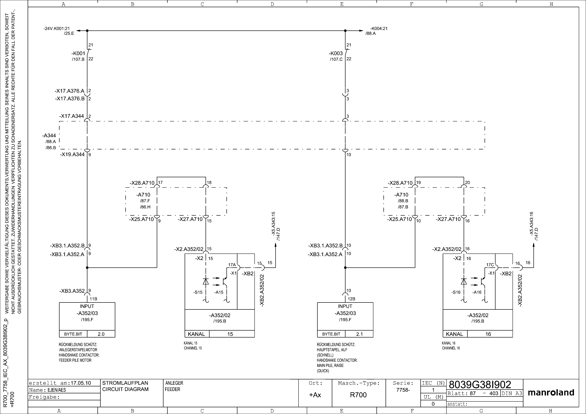

# +Ax — Sheet 87 of 403 — ANLEGER

**FEEDER**

> Part of the manroland **R700** printing press IEC/UL circuit diagrams.
> Drawing class: **Stromlaufplan / Circuit diagram** (DIN A3).
> Document `+Ax` covers the **Central control console** machine section.

## At a glance

| Field | Value |
|---|---|
| Document | `+Ax`  (8039G38I902) |
| Sheet | **87** of 403 |
| Section (DE) | ANLEGER |
| Section (EN) | FEEDER |
| Section type | CIRCUIT — Circuit diagram |
| Machine type | `R700` |
| Series | `7758` |
| Created | 17.05.10 |
| Replaces | — |
| Columns used | A, B, C, D, E, F, G, H |
| Path numbers | — |
| Labels on sheet | 120 |
| Cross-refs out | 16 |
| Cross-refs in | 42 |

**Previous:** [+Ax sheet 86](SHEET_0086.md) · **Next:** [+Ax sheet 88](SHEET_0088.md) · **Document TOC:** [_TOC.md](_TOC.md)  (+Ax) · **Master TOC:** [all sheets](../_MASTER_TOC.md)

## Sheet image (300 DPI, exact vector render)



_Rendered directly from the PDF vector layer at 300 DPI (1-bit), no OCR and no resampling. Use it to confirm anything ambiguous in the text below._

## Cross-references on this sheet

Each entry is a wire leaving this sheet. The printed token is `/sheet.column`; the link resolves to that sheet inside the same document.

| Ref | Target sheet | Col | Path | Destination on target | Target section | From col |
|---|---|---|---|---|---|---|
| `/25.E` | [+Ax sheet 25](SHEET_0025.md) | E | — | 24V.K001:21 K004:21 | SPANNUNGSVERSORGUNG, SCHALTSCHRANKBELÜFTUNG | C |
| `/88.A` | [+Ax sheet 88](SHEET_0088.md) | A | — | — | ANLEGER | E |
| `/107.B` | [+Ax sheet 107](SHEET_0107.md) | B | — | — | ANLEGER | A |
| `/107.C` | [+Ax sheet 107](SHEET_0107.md) | C | — | — | ANLEGER | E |
| `/88.A` | [+Ax sheet 88](SHEET_0088.md) | A | — | — | ANLEGER | A |
| `/86.B` | [+Ax sheet 86](SHEET_0086.md) | B | — | — | ANLEGER | A |
| `/88.B` | [+Ax sheet 88](SHEET_0088.md) | B | — | — | ANLEGER | F |
| `/87.B` | [+Ax sheet 87](SHEET_0087.md) | B | — | — | ANLEGER | F |
| `/87.F` | [+Ax sheet 87](SHEET_0087.md) | F | — | — | ANLEGER | B |
| `/86.H` | [+Ax sheet 86](SHEET_0086.md) | H | — | — | ANLEGER | B |
| `/147.D` | [+Ax sheet 147](SHEET_0147.md) | D | — | X5.A343:15 | ÜBERWACHUNGSRECHNER SICHERHEITSBUS | D |
| `/147.D` | [+Ax sheet 147](SHEET_0147.md) | D | — | X5.A343:16 | ÜBERWACHUNGSRECHNER SICHERHEITSBUS | H |
| `/195.F` | [+Ax sheet 195](SHEET_0195.md) | F | — | — | REFERENZMODUL | A |
| `/195.F` | [+Ax sheet 195](SHEET_0195.md) | F | — | — | REFERENZMODUL | E |
| `/195.B` | [+Ax sheet 195](SHEET_0195.md) | B | — | — | REFERENZMODUL | C |
| `/195.B` | [+Ax sheet 195](SHEET_0195.md) | B | — | — | REFERENZMODUL | G |

### Incoming references (sheets that point here)

Every other sheet that sends a wire to this one. `Back-ref` is the token printed on *that* sheet; `Path` is its line number.

| From sheet | Cols | Back-ref | Path | Refs | What continues there |
|---|---|---|---|---|---|
| [+Ax#25](SHEET_0025.md) | E | `/25.E` | — | 1 | 24V.K001:21 |
| [+Ax#86](SHEET_0086.md) | B, H | `/86.B`, `/86.H` | — | 2 | A710 |
| [+Ax#87](SHEET_0087.md) | B, F | `/87.B`, `/87.F` | — | 2 | — |
| [+Ax#88](SHEET_0088.md) | A, B, C | `/88.A`, `/88.B`, `/88.C` | — | 3 | K004:21 K006:21 |
| [+Ax#107](SHEET_0107.md) | B, C | `/107.B`, `/107.C` | — | 2 | — |
| [+Ax#147](SHEET_0147.md) | D | `/147.D` | — | 2 | X5.A343:15; X5.A343:16 |
| [+Ax#195](SHEET_0195.md) | B, F | `/195.B`, `/195.F` | — | 4 | — |
| [+Ax#218](SHEET_0218.md) | G | `/218.G` | — | 2 | — |
| [+Ax#219](SHEET_0219.md) | A | `/219.A` | — | 2 | — |
| [+Ax#223](SHEET_0223.md) | E, G, H | `/223.E`, `/223.G`, `/223.H` | — | 6 | — |
| [+Ax#255](SHEET_0255.md) | B, E, F | `/255.B`, `/255.E`, `/255.F` | — | 6 | — |
| [+Ax#258](SHEET_0258.md) | G | `/258.G` | — | 2 | — |
| [+Ax#268](SHEET_0268.md) | B | `/268.B` | — | 2 | — |
| [+Ax#270](SHEET_0270.md) | G | `/270.G` | — | 2 | — |
| [+Ax#272](SHEET_0272.md) | E | `/272.E` | — | 4 | — |


## Devices on this sheet

| Tag | Class | Class meaning (IEC) | Col | Sub | Terminal | Sign |
|---|---|---|---|---|---|---|
| `A352/03` | A | Baugruppe / assembly, module, PC board | A | 03 | — | — |
| `A352/03` | A | Baugruppe / assembly, module, PC board | E | 03 | — | — |
| `A710` | A | Baugruppe / assembly, module, PC board | B | — | — | — |
| `A710` | A | Baugruppe / assembly, module, PC board | F | — | — | — |
| `S16` | S | Schalter / switch | G | — | — | — |
| `A16` | A | Baugruppe / assembly, module, PC board | G | — | — | — |
| `X1` | X | Klemme / terminal, plug connector | G | — | — | — |
| `X2` | X | Klemme / terminal, plug connector | G | — | — | — |
| `XB2` | XB |  | G | — | — | — |
| `A352/02` | A | Baugruppe / assembly, module, PC board | G | 02 | — | — |
| `S15` | S | Schalter / switch | C | — | — | — |
| `A15` | A | Baugruppe / assembly, module, PC board | C | — | — | — |
| `X1` | X | Klemme / terminal, plug connector | C | — | — | — |
| `X2` | X | Klemme / terminal, plug connector | C | — | — | — |
| `XB2` | XB |  | D | — | — | — |
| `A352/02` | A | Baugruppe / assembly, module, PC board | C | 02 | — | — |
| `K001` | K | Relais / relay, contactor | A | — | — | — |
| `A344` | A | Baugruppe / assembly, module, PC board | A | — | — | — |
| `K003` | K | Relais / relay, contactor | E | — | — | — |
| `K004:21` | K | Relais / relay, contactor | F | — | 21 | — |
| `2.0` | — | cross-device reference | B | — | — | — |
| `XB3.A352` | — | cross-device reference | A | — | — | — |
| `2.1` | — | cross-device reference | E | — | — | — |
| `X28.A710` | — | cross-device reference | B | — | — | — |
| `X27.A710` | — | cross-device reference | C | — | — | — |
| `X25.A710` | — | cross-device reference | B | — | — | — |
| `XB3.1.A352.B` | — | cross-device reference | A | — | — | — |
| `XB3.1.A352.A` | — | cross-device reference | A | — | — | — |
| `XB3.1.A352.B` | — | cross-device reference | E | — | — | — |
| `XB3.1.A352.A` | — | cross-device reference | E | — | — | — |
| `X28.A710` | — | cross-device reference | F | — | — | — |
| `X27.A710` | — | cross-device reference | G | — | — | — |
| `X25.A710` | — | cross-device reference | F | — | — | — |
| `X17.A376.B` | — | cross-device reference | A | — | — | — |
| `X17.A376.A` | — | cross-device reference | A | — | — | — |
| `X19.A344` | — | cross-device reference | A | — | — | — |
| `X17.A344` | — | cross-device reference | A | — | — | — |
| `X5.A343:15` | — | cross-device reference | D | — | 15 | — |
| `X5.A343:16` | — | cross-device reference | H | — | 16 | — |

## Potentials / nets

| Potential | Count | Columns | Attached devices | Terminals |
|---|---|---|---|---|
| `24V` | 1 | A | `K001` | `21` |


A potential such as `L24+/4` or `M24+` is a named supply/return rail; every place it appears on this sheet is electrically common.

## Wire-end annotations (grouped as printed)

A wire that continues elsewhere is annotated with a small cluster: the destination description, the path/line number `#NN`, and the `/sheet.column` cross reference. Each row below is one such cluster exactly as it is grouped on the drawing.

| Col | Y | Path | Cross-ref | Text on the wire |
|---|---|---|---|---|
| C | 54.1 | — | `/25.E` | `24V.K001:21 K004:21` |
| E | 64.0 | — | `/88.A` | — |
| A | 87.5 | — | — | `21` |
| E | 87.5 | — | — | `21` |
| A | 103.8 | — | — | `K001 22` |
| E | 103.8 | — | — | `K003 22` |
| A | 116.8 | — | `/107.B` | — |
| E | 116.9 | — | `/107.C` | — |
| A | 180.3 | — | — | `X17.A376.A 2` |
| E | 180.3 | — | — | `3` |
| A | 195.9 | — | — | `X17.A376.B 2` |
| E | 197.3 | — | — | `3` |
| A | 231.3 | — | — | `X17.A344 2` |
| E | 232.8 | — | — | `3` |
| A | 271.0 | — | — | `A344` |
| A | 284.1 | — | `/88.A`, `/86.B` | — |
| A | 309.3 | — | — | `X19.A344 9` |
| E | 310.7 | — | — | `10` |
| C | 367.4 | — | — | `X28.A710 17 18` |
| F | 367.4 | — | — | `X28.A710 19 20` |
| B | 391.5 | — | — | `A710` |
| F | 391.5 | — | — | `A710` |
| F | 404.5 | — | `/88.B`, `/87.B` | — |
| B | 404.6 | — | `/87.F`, `/86.H` | — |
| D | 430.6 | — | `/147.D` | `X5.A343:15` |
| H | 430.6 | — | `/147.D` | `X5.A343:16` |
| C | 441.1 | — | — | `X25.A710 9 X27.A710 15` |
| F | 441.1 | — | — | `X25.A710 10 X27.A710 16` |
| A | 495.0 | — | — | `XB3.1.A352.B 9` |
| E | 495.0 | — | — | `XB3.1.A352.B 10` |
| C | 502.0 | — | — | `X2.A352/02 15` |
| G | 502.0 | — | — | `X2.A352/02 16` |
| A | 512.0 | — | — | `XB3.1.A352.A 9` |
| E | 512.0 | — | — | `XB3.1.A352.A 10` |
| C | 520.5 | — | — | `X2` |
| G | 520.5 | — | — | `X2` |
| C | 521.9 | — | — | `15 15` |
| G | 521.9 | — | — | `16 16` |
| D | 530.4 | — | — | `15` |
| H | 530.4 | — | — | `16` |
| C | 534.6 | — | — | `17A` |
| G | 534.7 | — | — | `17C` |
| C | 551.6 | — | — | `X1` |
| G | 551.6 | — | — | `X1` |
| D | 551.7 | — | — | `XB2` |
| G | 551.7 | — | — | `XB2` |
| D | 557.9 | — | — | `XB2.A352/02` |
| H | 557.9 | — | — | `XB2.A352/02` |
| A | 587.1 | — | — | `XB3.A352 9` |
| E | 587.1 | — | — | `10` |
| C | 590.6 | — | — | `S15 A15` |
| G | 590.6 | — | — | `S16 A16` |
| A | 604.1 | — | — | `11B` |
| E | 604.1 | — | — | `12B` |
| A | 618.6 | — | — | `INPUT` |
| E | 618.6 | — | — | `INPUT` |
| A | 632.4 | — | — | `A352/03` |
| E | 632.4 | — | — | `A352/03` |
| C | 636.7 | — | — | `A352/02` |
| G | 636.7 | — | — | `A352/02` |
| A | 646.2 | — | `/195.F` | — |
| E | 646.2 | — | `/195.F` | — |
| C | 649.0 | — | `/195.B` | — |
| G | 649.0 | — | `/195.B` | — |
| C | 674.9 | — | — | `KANAL 15` |
| G | 674.9 | — | — | `KANAL 16` |
| A | 675.3 | — | — | `BYTE.BIT 2.0` |
| E | 675.3 | — | — | `BYTE.BIT 2.1` |
| C | 695.3 | — | — | `KANAL 15 CHANNEL 15` |
| G | 695.3 | — | — | `KANAL 16 CHANNEL 16` |
| A | 698.0 | — | — | `RÜCKMELDUNG SCHÜTZ:` |
| E | 698.0 | — | — | `RÜCKMELDUNG SCHÜTZ: HAUPTSTAPEL, AUF HANDSHAKE CONTACTOR: (SCHNELL) MAIN PILE, RAISE (QUICK)` |
| A | 708.6 | — | — | `HANDSHAKE CONTACTOR: FEEDER PILE MOTOR ANLEGERSTAPELMOTOR` |


## Reconstructed tables

This sheet carries tabular content (pin map / terminal assignment / index). The grid below was rebuilt from the drawing's own rule lines, so each row is exactly one physical row of the table.

### Table 1 — 6 data rows × 19 columns (at x=120.5, y=62.4)

| /25.E K001 /107.B X17.A376.A X17.A376.B X17.A344 X19.A344 | 21 22 2 2 2 9 |  |  |  |  |  |  |  |  | K003 /107.C | /88.A 21 22 3 3 3 10 |  |  |  |  |  |  |  |
|---|---|---|---|---|---|---|---|---|---|---|---|---|---|---|---|---|---|---|
| `XB3.1.A352.B` | `9` | `X28.A710 A710 /87.F /86.H X25.A710` | `17 9` | `X27.A710 X2.A352/02` | `18 15 15` |  |  | `X5.A343:15` | `/147.D` | `XB3.1.A352.B` | `10` | `X28.A710 A710 /88.B /87.B X25.A710` | `19 10` | `X27.A710 X2.A352/02` | `20 16 16` |  |  | `X5.A343:16` |
| `XB3.1.A352.A` | `9` |  |  | `X2` | `15` | `17A` |  | `15 15` |  | `XB3.1.A352.A` | `10` |  |  | `X2` | `16` | `17C` |  | `16 16` |
| `XB3.A352` | `9 11B` |  |  | `S15` | `A15` | `X1` | `XB2` | `XB2.A352/02` |  |  | `10 12B` |  |  | `S16` | `A16` | `X1` | `XB2` | `XB2.A352/02` |
| `INPUT` |  |  |  |  |  |  |  |  |  | `INPUT` |  |  |  |  |  |  |  |  |
|  | `A352/03 /195.F` |  |  |  | `A352/02 /195.B` |  |  |  |  |  | `A352/03 /195.F` |  |  |  | `A352/02 /195.B` |  |  |  |
| `BYTE.BIT` | `2.0` |  |  | `KANAL` |  | `15` |  |  |  | `BYTE.BIT` | `2.1` |  |  | `KANAL` |  | `16` |  |  |


## Notes and free text on this sheet

| Text | Col | Y (pt) |
|---|---|---|
| `11B` | A | 604.07 |
| `INPUT` | A | 618.59 |
| `BYTE.BIT` | A | 675.84 |
| `RÜCKMELDUNG SCHÜTZ:` | A | 697.97 |
| `ANLEGERSTAPELMOTOR` | A | 708.6 |
| `HANDSHAKE CONTACTOR:` | A | 719.21 |
| `FEEDER PILE MOTOR` | A | 729.84 |
| `12B` | E | 604.07 |
| `INPUT` | E | 618.59 |
| `BYTE.BIT` | E | 675.84 |
| `RÜCKMELDUNG SCHÜTZ:` | E | 697.97 |
| `HAUPTSTAPEL, AUF` | E | 708.56 |
| `(SCHNELL)` | E | 719.23 |
| `HANDSHAKE CONTACTOR:` | E | 729.85 |
| `MAIN PILE, RAISE` | E | 740.45 |
| `(QUICK)` | E | 751.11 |
| `KANAL 16` | G | 695.27 |
| `CHANNEL 16` | G | 705.22 |
| `17C` | G | 534.66 |
| `KANAL` | G | 674.94 |
| `X2.A352/02` | G | 502.04 |
| `XB2.A352/02` | H | 557.86 |
| `KANAL 15` | C | 695.27 |
| `CHANNEL 15` | C | 705.22 |
| `17A` | C | 534.62 |
| `KANAL` | C | 674.94 |
| `X2.A352/02` | C | 502.04 |
| `XB2.A352/02` | D | 557.86 |

## Complete label inventory (exact text from the drawing)

Every text object inside the drawing area of this sheet, in DIN reading order (column A→H, then top→bottom). This is the authoritative list: if a string is not here it is not printed on this sheet.

| Col | Y | X | Dir | Type | Text |
|---|---|---|---|---|---|
| A | 54.1 | 88.4 | → | potential | `24V.K001:21` |
| A | 64.0 | 130.1 | → | cross-reference | `/25.E` |
| A | 87.5 | 179.7 | → | number | `21` |
| A | 103.8 | 145.1 | → | device tag | `K001` |
| A | 115.8 | 179.7 | → | number | `22` |
| A | 116.8 | 146.3 | → | cross-reference | `/107.B` |
| A | 180.3 | 111.1 | → | device ref | `X17.A376.A` |
| A | 180.3 | 179.7 | → | number | `2` |
| A | 195.9 | 112.0 | → | device ref | `X17.A376.B` |
| A | 197.3 | 179.7 | → | number | `2` |
| A | 231.3 | 120.5 | → | device ref | `X17.A344` |
| A | 232.8 | 179.7 | → | number | `2` |
| A | 271.0 | 85.6 | → | device tag | `A344` |
| A | 284.1 | 92.7 | → | cross-reference | `/88.A` |
| A | 296.5 | 93.0 | → | cross-reference | `/86.B` |
| A | 309.3 | 121.9 | → | device ref | `X19.A344` |
| A | 310.7 | 179.7 | → | number | `9` |
| A | 495.0 | 102.0 | → | device ref | `XB3.1.A352.B` |
| A | 495.0 | 179.7 | → | number | `9` |
| A | 512.0 | 179.7 | → | number | `9` |
| A | 512.7 | 101.2 | → | device ref | `XB3.1.A352.A` |
| A | 587.1 | 120.8 | → | device ref | `XB3.A352` |
| A | 587.1 | 179.7 | → | number | `9` |
| A | 604.1 | 182.0 | → | text | `11B` |
| A | 618.6 | 162.3 | → | text | `INPUT` |
| A | 632.4 | 155.8 | → | device tag | `A352/03` |
| A | 646.2 | 164.8 | → | cross-reference | `/195.F` |
| A | 675.8 | 130.4 | → | text | `BYTE.BIT` |
| A | 698.0 | 119.6 | → | text | `RÜCKMELDUNG SCHÜTZ:` |
| A | 708.6 | 120.5 | → | text | `ANLEGERSTAPELMOTOR` |
| A | 719.2 | 119.6 | → | text | `HANDSHAKE CONTACTOR:` |
| A | 729.8 | 119.6 | → | text | `FEEDER PILE MOTOR` |
| B | 367.4 | 263.6 | → | device ref | `X28.A710` |
| B | 367.4 | 320.9 | → | number | `17` |
| B | 391.5 | 276.9 | → | device tag | `A710` |
| B | 404.6 | 284.9 | → | cross-reference | `/87.F` |
| B | 417.0 | 284.6 | → | cross-reference | `/86.H` |
| B | 441.1 | 262.2 | → | device ref | `X25.A710` |
| B | 445.4 | 321.4 | → | number | `9` |
| B | 675.3 | 198.7 | → | device ref | `2.0` |
| C | 367.4 | 420.1 | → | number | `18` |
| C | 441.1 | 361.4 | → | device ref | `X27.A710` |
| C | 445.4 | 420.1 | → | number | `15` |
| C | 502.0 | 354.0 | → | text | `X2.A352/02` |
| C | 502.1 | 420.1 | → | number | `15` |
| C | 520.5 | 396.6 | → | device tag | `X2` |
| C | 521.9 | 422.9 | → | number | `15` |
| C | 534.6 | 463.5 | → | text | `17A` |
| C | 551.6 | 467.1 | → | device tag | `X1` |
| C | 590.6 | 392.9 | → | device tag | `S15` |
| C | 590.6 | 435.4 | → | device tag | `A15` |
| C | 636.7 | 425.1 | → | device tag | `A352/02` |
| C | 649.0 | 433.8 | → | cross-reference | `/195.B` |
| C | 674.9 | 381.8 | → | text | `KANAL` |
| C | 674.9 | 461.5 | → | number | `15` |
| C | 695.3 | 373.6 | → | text | `KANAL 15` |
| C | 705.2 | 373.9 | → | text | `CHANNEL 15` |
| D | 430.6 | 551.6 | ↕ | device ref | `X5.A343:15` |
| D | 463.2 | 561.5 | ↕ | cross-reference | `/147.D` |
| D | 530.4 | 543.4 | → | number | `15` |
| D | 531.8 | 522.1 | → | number | `15` |
| D | 551.7 | 491.5 | → | device tag | `XB2` |
| D | 557.9 | 527.6 | ↕ | text | `XB2.A352/02` |
| E | 64.0 | 742.7 | → | cross-reference | `/88.A` |
| E | 87.5 | 704.1 | → | number | `21` |
| E | 103.8 | 668.1 | → | device tag | `K003` |
| E | 115.8 | 704.1 | → | number | `22` |
| E | 116.9 | 670.4 | → | cross-reference | `/107.C` |
| E | 180.3 | 704.1 | → | number | `3` |
| E | 197.3 | 704.1 | → | number | `3` |
| E | 232.8 | 704.1 | → | number | `3` |
| E | 310.7 | 703.6 | → | number | `10` |
| E | 495.0 | 626.5 | → | device ref | `XB3.1.A352.B` |
| E | 495.0 | 703.6 | → | number | `10` |
| E | 512.0 | 703.6 | → | number | `10` |
| E | 512.7 | 625.6 | → | device ref | `XB3.1.A352.A` |
| E | 587.1 | 703.6 | → | number | `10` |
| E | 604.1 | 706.4 | → | text | `12B` |
| E | 618.6 | 686.7 | → | text | `INPUT` |
| E | 632.4 | 680.2 | → | device tag | `A352/03` |
| E | 646.2 | 689.2 | → | cross-reference | `/195.F` |
| E | 675.3 | 724.0 | → | device ref | `2.1` |
| E | 675.8 | 654.8 | → | text | `BYTE.BIT` |
| E | 698.0 | 644.0 | → | text | `RÜCKMELDUNG SCHÜTZ:` |
| E | 708.6 | 644.0 | → | text | `HAUPTSTAPEL, AUF` |
| E | 719.2 | 644.3 | → | text | `(SCHNELL)` |
| E | 729.8 | 644.0 | → | text | `HANDSHAKE CONTACTOR:` |
| E | 740.5 | 644.3 | → | text | `MAIN PILE, RAISE` |
| E | 751.1 | 644.3 | → | text | `(QUICK)` |
| F | 54.2 | 752.3 | → | device tag | `K004:21` |
| F | 367.4 | 788.0 | → | device ref | `X28.A710` |
| F | 367.4 | 845.3 | → | number | `19` |
| F | 391.5 | 801.4 | → | device tag | `A710` |
| F | 404.5 | 808.7 | → | cross-reference | `/88.B` |
| F | 416.9 | 808.7 | → | cross-reference | `/87.B` |
| F | 441.1 | 786.6 | → | device ref | `X25.A710` |
| F | 445.4 | 845.3 | → | number | `10` |
| G | 367.4 | 945.1 | → | number | `20` |
| G | 441.1 | 885.8 | → | device ref | `X27.A710` |
| G | 445.4 | 944.5 | → | number | `16` |
| G | 502.0 | 878.5 | → | text | `X2.A352/02` |
| G | 502.1 | 944.5 | → | number | `16` |
| G | 520.5 | 921.0 | → | device tag | `X2` |
| G | 521.9 | 947.3 | → | number | `16` |
| G | 534.7 | 987.9 | → | text | `17C` |
| G | 551.6 | 991.6 | → | device tag | `X1` |
| G | 551.7 | 1015.9 | → | device tag | `XB2` |
| G | 590.6 | 917.3 | → | device tag | `S16` |
| G | 590.6 | 959.8 | → | device tag | `A16` |
| G | 636.7 | 949.5 | → | device tag | `A352/02` |
| G | 649.0 | 958.3 | → | cross-reference | `/195.B` |
| G | 674.9 | 906.2 | → | text | `KANAL` |
| G | 674.9 | 985.9 | → | number | `16` |
| G | 695.3 | 898.0 | → | text | `KANAL 16` |
| G | 705.2 | 898.3 | → | text | `CHANNEL 16` |
| H | 430.6 | 1076.0 | ↕ | device ref | `X5.A343:16` |
| H | 463.2 | 1086.0 | ↕ | cross-reference | `/147.D` |
| H | 530.4 | 1067.8 | → | number | `16` |
| H | 531.8 | 1046.6 | → | number | `16` |
| H | 557.9 | 1052.0 | ↕ | text | `XB2.A352/02` |

## Reading-order text block

The same content as a plain block, grouped by DIN column — convenient to paste or to match against a visual description.

```text
=== Column A ===
  54.1   88.4  net          24V.K001:21
  64.0  130.1  xref         /25.E
  87.5  179.7  numeric      21
 103.8  145.1  devtag       K001
 115.8  179.7  numeric      22
 116.8  146.3  xref         /107.B
 180.3  111.1  devref       X17.A376.A
 180.3  179.7  numeric      2
 195.9  112.0  devref       X17.A376.B
 197.3  179.7  numeric      2
 231.3  120.5  devref       X17.A344
 232.8  179.7  numeric      2
 271.0   85.6  devtag       A344
 284.1   92.7  xref         /88.A
 296.5   93.0  xref         /86.B
 309.3  121.9  devref       X19.A344
 310.7  179.7  numeric      9
 495.0  102.0  devref       XB3.1.A352.B
 495.0  179.7  numeric      9
 512.0  179.7  numeric      9
 512.7  101.2  devref       XB3.1.A352.A
 587.1  120.8  devref       XB3.A352
 587.1  179.7  numeric      9
 604.1  182.0  text         11B
 618.6  162.3  text         INPUT
 632.4  155.8  devtag       A352/03
 646.2  164.8  xref         /195.F
 675.8  130.4  text         BYTE.BIT
 698.0  119.6  text         RÜCKMELDUNG SCHÜTZ:
 708.6  120.5  text         ANLEGERSTAPELMOTOR
 719.2  119.6  text         HANDSHAKE CONTACTOR:
 729.8  119.6  text         FEEDER PILE MOTOR
=== Column B ===
 367.4  263.6  devref       X28.A710
 367.4  320.9  numeric      17
 391.5  276.9  devtag       A710
 404.6  284.9  xref         /87.F
 417.0  284.6  xref         /86.H
 441.1  262.2  devref       X25.A710
 445.4  321.4  numeric      9
 675.3  198.7  devref       2.0
=== Column C ===
 367.4  420.1  numeric      18
 441.1  361.4  devref       X27.A710
 445.4  420.1  numeric      15
 502.0  354.0  text         X2.A352/02
 502.1  420.1  numeric      15
 520.5  396.6  devtag       X2
 521.9  422.9  numeric      15
 534.6  463.5  text         17A
 551.6  467.1  devtag       X1
 590.6  392.9  devtag       S15
 590.6  435.4  devtag       A15
 636.7  425.1  devtag       A352/02
 649.0  433.8  xref         /195.B
 674.9  381.8  text         KANAL
 674.9  461.5  numeric      15
 695.3  373.6  text         KANAL 15
 705.2  373.9  text         CHANNEL 15
=== Column D ===
 430.6  551.6  devref       X5.A343:15
 463.2  561.5  xref         /147.D
 530.4  543.4  numeric      15
 531.8  522.1  numeric      15
 551.7  491.5  devtag       XB2
 557.9  527.6  text         XB2.A352/02
=== Column E ===
  64.0  742.7  xref         /88.A
  87.5  704.1  numeric      21
 103.8  668.1  devtag       K003
 115.8  704.1  numeric      22
 116.9  670.4  xref         /107.C
 180.3  704.1  numeric      3
 197.3  704.1  numeric      3
 232.8  704.1  numeric      3
 310.7  703.6  numeric      10
 495.0  626.5  devref       XB3.1.A352.B
 495.0  703.6  numeric      10
 512.0  703.6  numeric      10
 512.7  625.6  devref       XB3.1.A352.A
 587.1  703.6  numeric      10
 604.1  706.4  text         12B
 618.6  686.7  text         INPUT
 632.4  680.2  devtag       A352/03
 646.2  689.2  xref         /195.F
 675.3  724.0  devref       2.1
 675.8  654.8  text         BYTE.BIT
 698.0  644.0  text         RÜCKMELDUNG SCHÜTZ:
 708.6  644.0  text         HAUPTSTAPEL, AUF
 719.2  644.3  text         (SCHNELL)
 729.8  644.0  text         HANDSHAKE CONTACTOR:
 740.5  644.3  text         MAIN PILE, RAISE
 751.1  644.3  text         (QUICK)
=== Column F ===
  54.2  752.3  devtag       K004:21
 367.4  788.0  devref       X28.A710
 367.4  845.3  numeric      19
 391.5  801.4  devtag       A710
 404.5  808.7  xref         /88.B
 416.9  808.7  xref         /87.B
 441.1  786.6  devref       X25.A710
 445.4  845.3  numeric      10
=== Column G ===
 367.4  945.1  numeric      20
 441.1  885.8  devref       X27.A710
 445.4  944.5  numeric      16
 502.0  878.5  text         X2.A352/02
 502.1  944.5  numeric      16
 520.5  921.0  devtag       X2
 521.9  947.3  numeric      16
 534.7  987.9  text         17C
 551.6  991.6  devtag       X1
 551.7 1015.9  devtag       XB2
 590.6  917.3  devtag       S16
 590.6  959.8  devtag       A16
 636.7  949.5  devtag       A352/02
 649.0  958.3  xref         /195.B
 674.9  906.2  text         KANAL
 674.9  985.9  numeric      16
 695.3  898.0  text         KANAL 16
 705.2  898.3  text         CHANNEL 16
=== Column H ===
 430.6 1076.0  devref       X5.A343:16
 463.2 1086.0  xref         /147.D
 530.4 1067.8  numeric      16
 531.8 1046.6  numeric      16
 557.9 1052.0  text         XB2.A352/02
```

---
_Generated from the PDF vector text layer; no OCR. Source: `R700_7758_IEC_AX_8039G38I902_p`, sheet 87._
