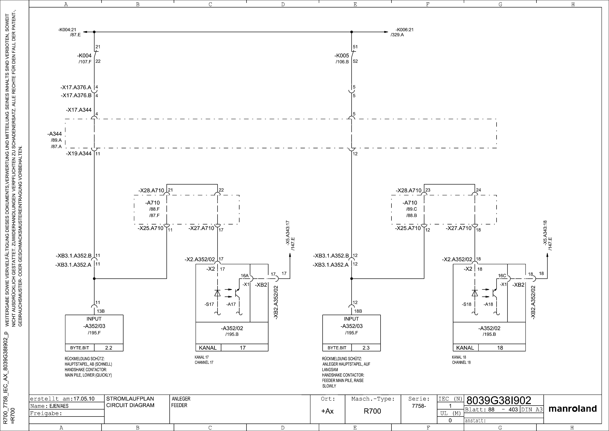

# +Ax — Sheet 88 of 403 — ANLEGER

**FEEDER**

> Part of the manroland **R700** printing press IEC/UL circuit diagrams.
> Drawing class: **Stromlaufplan / Circuit diagram** (DIN A3).
> Document `+Ax` covers the **Central control console** machine section.

## At a glance

| Field | Value |
|---|---|
| Document | `+Ax`  (8039G38I902) |
| Sheet | **88** of 403 |
| Section (DE) | ANLEGER |
| Section (EN) | FEEDER |
| Section type | CIRCUIT — Circuit diagram |
| Machine type | `R700` |
| Series | `7758` |
| Created | 17.05.10 |
| Replaces | — |
| Columns used | A, B, C, D, E, F, G, H |
| Path numbers | — |
| Labels on sheet | 119 |
| Cross-refs out | 16 |
| Cross-refs in | 42 |

**Previous:** [+Ax sheet 87](SHEET_0087.md) · **Next:** [+Ax sheet 89](SHEET_0089.md) · **Document TOC:** [_TOC.md](_TOC.md)  (+Ax) · **Master TOC:** [all sheets](../_MASTER_TOC.md)

## Sheet image (300 DPI, exact vector render)



_Rendered directly from the PDF vector layer at 300 DPI (1-bit), no OCR and no resampling. Use it to confirm anything ambiguous in the text below._

## Cross-references on this sheet

Each entry is a wire leaving this sheet. The printed token is `/sheet.column`; the link resolves to that sheet inside the same document.

| Ref | Target sheet | Col | Path | Destination on target | Target section | From col |
|---|---|---|---|---|---|---|
| `/87.E` | [+Ax sheet 87](SHEET_0087.md) | E | — | K004:21 K006:21 | ANLEGER | C |
| `/329.A` | [+Ax sheet 329](SHEET_0329.md) | A | — | — | OPTION: NONSTOP EINRICHTUNG MANUELL, ANLEGER | F |
| `/106.B` | [+Ax sheet 106](SHEET_0106.md) | B | — | — | ANLEGER | E |
| `/107.F` | [+Ax sheet 107](SHEET_0107.md) | F | — | — | ANLEGER | A |
| `/89.A` | [+Ax sheet 89](SHEET_0089.md) | A | — | — | ANLEGER | A |
| `/87.A` | [+Ax sheet 87](SHEET_0087.md) | A | — | — | ANLEGER | A |
| `/88.F` | [+Ax sheet 88](SHEET_0088.md) | F | — | — | ANLEGER | B |
| `/87.F` | [+Ax sheet 87](SHEET_0087.md) | F | — | — | ANLEGER | B |
| `/89.C` | [+Ax sheet 89](SHEET_0089.md) | C | — | — | ANLEGER | F |
| `/88.B` | [+Ax sheet 88](SHEET_0088.md) | B | — | — | ANLEGER | F |
| `/147.E` | [+Ax sheet 147](SHEET_0147.md) | E | — | X5.A343:17 | ÜBERWACHUNGSRECHNER SICHERHEITSBUS | D |
| `/147.E` | [+Ax sheet 147](SHEET_0147.md) | E | — | X5.A343:18 | ÜBERWACHUNGSRECHNER SICHERHEITSBUS | H |
| `/195.F` | [+Ax sheet 195](SHEET_0195.md) | F | — | — | REFERENZMODUL | A |
| `/195.F` | [+Ax sheet 195](SHEET_0195.md) | F | — | — | REFERENZMODUL | E |
| `/195.B` | [+Ax sheet 195](SHEET_0195.md) | B | — | — | REFERENZMODUL | C |
| `/195.B` | [+Ax sheet 195](SHEET_0195.md) | B | — | — | REFERENZMODUL | G |

### Incoming references (sheets that point here)

Every other sheet that sends a wire to this one. `Back-ref` is the token printed on *that* sheet; `Path` is its line number.

| From sheet | Cols | Back-ref | Path | Refs | What continues there |
|---|---|---|---|---|---|
| [+Ax#87](SHEET_0087.md) | A, E, F | `/87.A`, `/87.E`, `/87.F` | — | 3 | — |
| [+Ax#88](SHEET_0088.md) | B, F | `/88.B`, `/88.F` | — | 2 | — |
| [+Ax#89](SHEET_0089.md) | A, C | `/89.A`, `/89.C` | — | 2 | — |
| [+Ax#106](SHEET_0106.md) | B | `/106.B` | — | 1 | — |
| [+Ax#107](SHEET_0107.md) | F | `/107.F` | — | 1 | — |
| [+Ax#147](SHEET_0147.md) | E | `/147.E` | — | 2 | X5.A343:17; X5.A343:18 |
| [+Ax#195](SHEET_0195.md) | B, F | `/195.B`, `/195.F` | — | 4 | — |
| [+Ax#218](SHEET_0218.md) | G, H | `/218.G`, `/218.H` | — | 2 | — |
| [+Ax#219](SHEET_0219.md) | A, B | `/219.A`, `/219.B` | — | 2 | — |
| [+Ax#223](SHEET_0223.md) | E, G, H | `/223.E`, `/223.G`, `/223.H` | — | 6 | — |
| [+Ax#255](SHEET_0255.md) | B, E, F | `/255.B`, `/255.E`, `/255.F` | — | 6 | — |
| [+Ax#258](SHEET_0258.md) | G | `/258.G` | — | 2 | — |
| [+Ax#268](SHEET_0268.md) | B | `/268.B` | — | 2 | — |
| [+Ax#270](SHEET_0270.md) | G, H | `/270.G`, `/270.H` | — | 2 | — |
| [+Ax#272](SHEET_0272.md) | E | `/272.E` | — | 4 | — |
| [+Ax#329](SHEET_0329.md) | A | `/329.A` | — | 1 | K006:21 |


## Devices on this sheet

| Tag | Class | Class meaning (IEC) | Col | Sub | Terminal | Sign |
|---|---|---|---|---|---|---|
| `A344` | A | Baugruppe / assembly, module, PC board | A | — | — | — |
| `A352/03` | A | Baugruppe / assembly, module, PC board | A | 03 | — | — |
| `K004` | K | Relais / relay, contactor | A | — | — | — |
| `A710` | A | Baugruppe / assembly, module, PC board | B | — | — | — |
| `S17` | S | Schalter / switch | C | — | — | — |
| `A17` | A | Baugruppe / assembly, module, PC board | C | — | — | — |
| `X1` | X | Klemme / terminal, plug connector | C | — | — | — |
| `X2` | X | Klemme / terminal, plug connector | C | — | — | — |
| `XB2` | XB |  | D | — | — | — |
| `A352/02` | A | Baugruppe / assembly, module, PC board | C | 02 | — | — |
| `A352/03` | A | Baugruppe / assembly, module, PC board | E | 03 | — | — |
| `K005` | K | Relais / relay, contactor | E | — | — | — |
| `A710` | A | Baugruppe / assembly, module, PC board | F | — | — | — |
| `S18` | S | Schalter / switch | G | — | — | — |
| `A18` | A | Baugruppe / assembly, module, PC board | G | — | — | — |
| `X1` | X | Klemme / terminal, plug connector | G | — | — | — |
| `X2` | X | Klemme / terminal, plug connector | G | — | — | — |
| `XB2` | XB |  | G | — | — | — |
| `A352/02` | A | Baugruppe / assembly, module, PC board | G | 02 | — | — |
| `K006:21` | K | Relais / relay, contactor | F | — | 21 | — |
| `K004:21` | K | Relais / relay, contactor | A | — | 21 | — |
| `2.2` | — | cross-device reference | B | — | — | — |
| `X17.A376.B` | — | cross-device reference | A | — | — | — |
| `X17.A376.A` | — | cross-device reference | A | — | — | — |
| `X19.A344` | — | cross-device reference | A | — | — | — |
| `X17.A344` | — | cross-device reference | A | — | — | — |
| `X28.A710` | — | cross-device reference | B | — | — | — |
| `X27.A710` | — | cross-device reference | C | — | — | — |
| `X25.A710` | — | cross-device reference | B | — | — | — |
| `XB3.1.A352.B` | — | cross-device reference | A | — | — | — |
| `XB3.1.A352.A` | — | cross-device reference | A | — | — | — |
| `2.3` | — | cross-device reference | E | — | — | — |
| `X28.A710` | — | cross-device reference | F | — | — | — |
| `X27.A710` | — | cross-device reference | F | — | — | — |
| `X25.A710` | — | cross-device reference | F | — | — | — |
| `XB3.1.A352.B` | — | cross-device reference | E | — | — | — |
| `XB3.1.A352.A` | — | cross-device reference | E | — | — | — |
| `X5.A343:18` | — | cross-device reference | H | — | 18 | — |
| `X5.A343:17` | — | cross-device reference | D | — | 17 | — |

## Potentials / nets

_No named potentials on this sheet._

## Wire-end annotations (grouped as printed)

A wire that continues elsewhere is annotated with a small cluster: the destination description, the path/line number `#NN`, and the `/sheet.column` cross reference. Each row below is one such cluster exactly as it is grouped on the drawing.

| Col | Y | Path | Cross-ref | Text on the wire |
|---|---|---|---|---|
| C | 54.2 | — | `/87.E` | `K004:21 K006:21` |
| F | 64.0 | — | `/329.A` | — |
| A | 87.5 | — | — | `21` |
| E | 87.5 | — | — | `51` |
| A | 103.8 | — | — | `K004 22` |
| E | 103.8 | — | — | `K005 52` |
| A | 116.8 | — | `/107.F` | — |
| E | 116.8 | — | `/106.B` | — |
| A | 166.1 | — | — | `X17.A376.A 4` |
| E | 166.2 | — | — | `5` |
| A | 181.7 | — | — | `X17.A376.B 4` |
| E | 183.2 | — | — | `5` |
| A | 210.1 | — | — | `X17.A344 4` |
| E | 218.6 | — | — | `5` |
| A | 256.8 | — | — | `A344` |
| A | 269.9 | — | `/89.A`, `/87.A` | — |
| A | 295.1 | — | — | `X19.A344 11` |
| E | 296.5 | — | — | `12` |
| C | 367.4 | — | — | `X28.A710 21 22` |
| F | 367.4 | — | — | `X28.A710 23 24` |
| B | 391.5 | — | — | `A710` |
| F | 391.5 | — | — | `A710` |
| B | 404.6 | — | `/88.F`, `/87.F` | — |
| F | 404.6 | — | `/89.C`, `/88.B` | — |
| D | 430.6 | — | `/147.E` | `X5.A343:17` |
| H | 430.6 | — | `/147.E` | `X5.A343:18` |
| C | 441.1 | — | — | `X25.A710 11 X27.A710 17` |
| F | 441.1 | — | — | `X25.A710 12 X27.A710 18` |
| A | 495.0 | — | — | `XB3.1.A352.B 11` |
| E | 495.0 | — | — | `XB3.1.A352.B 12` |
| C | 502.0 | — | — | `X2.A352/02 17` |
| F | 502.0 | — | — | `X2.A352/02 18` |
| A | 512.0 | — | — | `XB3.1.A352.A 11` |
| E | 512.0 | — | — | `XB3.1.A352.A 12` |
| C | 520.5 | — | — | `X2` |
| G | 520.5 | — | — | `X2` |
| D | 521.9 | — | — | `17 17` |
| G | 521.9 | — | — | `18 18` |
| D | 530.4 | — | — | `17` |
| H | 530.4 | — | — | `18` |
| C | 534.6 | — | — | `16A` |
| G | 534.7 | — | — | `16C` |
| C | 551.6 | — | — | `X1` |
| G | 551.6 | — | — | `X1` |
| D | 551.7 | — | — | `XB2` |
| G | 551.7 | — | — | `XB2` |
| D | 557.9 | — | — | `XB2.A352/02` |
| G | 557.9 | — | — | `XB2.A352/02` |
| A | 587.1 | — | — | `11` |
| E | 587.1 | — | — | `12` |
| C | 590.6 | — | — | `S17 A17` |
| G | 590.6 | — | — | `S18 A18` |
| A | 604.1 | — | — | `13B` |
| E | 604.1 | — | — | `18B` |
| A | 618.6 | — | — | `INPUT` |
| E | 618.6 | — | — | `INPUT` |
| A | 632.4 | — | — | `A352/03` |
| E | 632.4 | — | — | `A352/03` |
| C | 636.7 | — | — | `A352/02` |
| G | 636.7 | — | — | `A352/02` |
| A | 646.2 | — | `/195.F` | — |
| E | 646.2 | — | `/195.F` | — |
| C | 649.0 | — | `/195.B` | — |
| G | 649.0 | — | `/195.B` | — |
| C | 674.9 | — | — | `KANAL 17` |
| G | 674.9 | — | — | `KANAL 18` |
| A | 675.3 | — | — | `BYTE.BIT 2.2` |
| E | 675.3 | — | — | `BYTE.BIT 2.3` |
| C | 695.3 | — | — | `KANAL 17 CHANNEL 17` |
| F | 695.3 | — | — | `KANAL 18 CHANNEL 18` |
| A | 698.0 | — | — | `RÜCKMELDUNG SCHÜTZ: HAUPTSTAPEL, AB (SCHNELL) HANDSHAKE CONTACTOR: MAIN PILE, LOWER (QUICKLY)` |
| E | 698.0 | — | — | `RÜCKMELDUNG SCHÜTZ:` |
| E | 708.6 | — | — | `LANGSAM HANDSHAKE CONTACTOR: FEEDER MAIN PILE, RAISE ANLEGER HAUPTSTAPEL, AUF` |
| E | 751.1 | — | — | `SLOWLY` |


## Reconstructed tables

This sheet carries tabular content (pin map / terminal assignment / index). The grid below was rebuilt from the drawing's own rule lines, so each row is exactly one physical row of the table.

### Table 1 — 6 data rows × 19 columns (at x=127.6, y=62.4)

| /87.E K004 /107.F X17.A376.A X17.A376.B X17.A344 X19.A344 | 21 22 4 4 4 11 |  |  |  |  |  |  |  |  | K005 /106.B | 51 52 5 5 5 12 | /329.A |  |  |  |  |  |  |
|---|---|---|---|---|---|---|---|---|---|---|---|---|---|---|---|---|---|---|
| `XB3.1.A352.B` | `11` | `X28.A710 A710 /88.F /87.F X25.A710` | `21 11` | `X27.A710 X2.A352/02` | `22 17 17` |  |  | `X5.A343:17` | `/147.E` | `XB3.1.A352.B` | `12` | `X28.A710 A710 /89.C /88.B X25.A710` | `23 12` | `X27.A710 X2.A352/02` | `24 18 18` |  |  | `X5.A343:18` |
| `XB3.1.A352.A` | `11` |  |  | `X2` | `17` | `16A` |  | `17 17` |  | `XB3.1.A352.A` | `12` |  |  | `X2` | `18` | `16C` |  | `18 18` |
|  | `11 13B` |  |  | `S17` | `A17` | `X1` | `XB2` | `XB2.A352/02` |  |  | `12 18B` |  |  | `S18` | `A18` | `X1` | `XB2` | `XB2.A352/02` |
| `INPUT` |  |  |  |  |  |  |  |  |  | `INPUT` |  |  |  |  |  |  |  |  |
|  | `A352/03 /195.F` |  |  |  | `A352/02 /195.B` |  |  |  |  |  | `A352/03 /195.F` |  |  |  | `A352/02 /195.B` |  |  |  |
| `BYTE.BIT` | `2.2` |  |  | `KANAL` |  | `17` |  |  |  | `BYTE.BIT` | `2.3` |  |  | `KANAL` |  | `18` |  |  |


## Notes and free text on this sheet

| Text | Col | Y (pt) |
|---|---|---|
| `13B` | A | 604.07 |
| `INPUT` | A | 618.59 |
| `BYTE.BIT` | A | 675.84 |
| `RÜCKMELDUNG SCHÜTZ:` | A | 697.97 |
| `HAUPTSTAPEL, AB (SCHNELL)` | A | 708.58 |
| `HANDSHAKE CONTACTOR:` | A | 719.21 |
| `MAIN PILE, LOWER (QUICKLY)` | A | 729.83 |
| `KANAL 17` | C | 695.27 |
| `CHANNEL 17` | C | 705.22 |
| `16A` | C | 534.62 |
| `KANAL` | C | 674.94 |
| `X2.A352/02` | C | 502.04 |
| `XB2.A352/02` | D | 557.86 |
| `18B` | E | 604.07 |
| `INPUT` | E | 618.59 |
| `BYTE.BIT` | E | 675.84 |
| `RÜCKMELDUNG SCHÜTZ:` | E | 697.97 |
| `ANLEGER HAUPTSTAPEL, AUF` | E | 708.58 |
| `LANGSAM` | E | 719.2 |
| `HANDSHAKE CONTACTOR:` | E | 729.85 |
| `FEEDER MAIN PILE, RAISE` | E | 740.46 |
| `SLOWLY` | E | 751.06 |
| `KANAL 18` | F | 695.27 |
| `CHANNEL 18` | F | 705.22 |
| `16C` | G | 534.66 |
| `KANAL` | G | 674.94 |
| `X2.A352/02` | F | 502.04 |
| `XB2.A352/02` | G | 557.86 |

## Complete label inventory (exact text from the drawing)

Every text object inside the drawing area of this sheet, in DIN reading order (column A→H, then top→bottom). This is the authoritative list: if a string is not here it is not printed on this sheet.

| Col | Y | X | Dir | Type | Text |
|---|---|---|---|---|---|
| A | 54.2 | 113.7 | → | device tag | `K004:21` |
| A | 64.0 | 137.2 | → | cross-reference | `/87.E` |
| A | 87.5 | 186.8 | → | number | `21` |
| A | 103.8 | 150.8 | → | device tag | `K004` |
| A | 115.8 | 186.8 | → | number | `22` |
| A | 116.8 | 153.9 | → | cross-reference | `/107.F` |
| A | 166.1 | 118.2 | → | device ref | `X17.A376.A` |
| A | 166.2 | 186.8 | → | number | `4` |
| A | 181.7 | 119.1 | → | device ref | `X17.A376.B` |
| A | 183.2 | 186.8 | → | number | `4` |
| A | 210.1 | 129.0 | → | device ref | `X17.A344` |
| A | 218.6 | 186.8 | → | number | `4` |
| A | 256.8 | 92.7 | → | device tag | `A344` |
| A | 269.9 | 99.8 | → | cross-reference | `/89.A` |
| A | 282.3 | 99.8 | → | cross-reference | `/87.A` |
| A | 295.1 | 129.0 | → | device ref | `X19.A344` |
| A | 296.5 | 186.2 | → | number | `11` |
| A | 495.0 | 109.1 | → | device ref | `XB3.1.A352.B` |
| A | 495.0 | 186.2 | → | number | `11` |
| A | 512.0 | 186.2 | → | number | `11` |
| A | 512.7 | 108.3 | → | device ref | `XB3.1.A352.A` |
| A | 587.1 | 186.2 | → | number | `11` |
| A | 604.1 | 189.1 | → | text | `13B` |
| A | 618.6 | 169.4 | → | text | `INPUT` |
| A | 632.4 | 162.9 | → | device tag | `A352/03` |
| A | 646.2 | 171.9 | → | cross-reference | `/195.F` |
| A | 675.8 | 137.5 | → | text | `BYTE.BIT` |
| A | 698.0 | 126.7 | → | text | `RÜCKMELDUNG SCHÜTZ:` |
| A | 708.6 | 126.7 | → | text | `HAUPTSTAPEL, AB (SCHNELL)` |
| A | 719.2 | 126.7 | → | text | `HANDSHAKE CONTACTOR:` |
| A | 729.8 | 127.0 | → | text | `MAIN PILE, LOWER (QUICKLY)` |
| B | 367.4 | 270.7 | → | device ref | `X28.A710` |
| B | 367.4 | 328.5 | → | number | `21` |
| B | 391.5 | 284.0 | → | device tag | `A710` |
| B | 404.6 | 292.0 | → | cross-reference | `/88.F` |
| B | 417.0 | 292.0 | → | cross-reference | `/87.F` |
| B | 441.1 | 269.3 | → | device ref | `X25.A710` |
| B | 445.4 | 328.0 | → | number | `11` |
| B | 675.3 | 205.8 | → | device ref | `2.2` |
| C | 367.4 | 427.7 | → | number | `22` |
| C | 441.1 | 368.5 | → | device ref | `X27.A710` |
| C | 445.4 | 427.2 | → | number | `17` |
| C | 502.0 | 361.1 | → | text | `X2.A352/02` |
| C | 502.1 | 427.2 | → | number | `17` |
| C | 520.5 | 403.7 | → | device tag | `X2` |
| C | 521.9 | 430.0 | → | number | `17` |
| C | 534.6 | 470.6 | → | text | `16A` |
| C | 551.6 | 474.2 | → | device tag | `X1` |
| C | 590.6 | 400.0 | → | device tag | `S17` |
| C | 590.6 | 442.5 | → | device tag | `A17` |
| C | 636.7 | 432.1 | → | device tag | `A352/02` |
| C | 649.0 | 440.9 | → | cross-reference | `/195.B` |
| C | 674.9 | 388.9 | → | text | `KANAL` |
| C | 674.9 | 468.6 | → | number | `17` |
| C | 695.3 | 380.7 | → | text | `KANAL 17` |
| C | 705.2 | 381.0 | → | text | `CHANNEL 17` |
| D | 430.6 | 558.7 | ↕ | device ref | `X5.A343:17` |
| D | 463.5 | 568.6 | ↕ | cross-reference | `/147.E` |
| D | 530.4 | 550.5 | → | number | `17` |
| D | 531.8 | 529.2 | → | number | `17` |
| D | 551.7 | 498.6 | → | device tag | `XB2` |
| D | 557.9 | 534.6 | ↕ | text | `XB2.A352/02` |
| E | 87.5 | 690.0 | → | number | `51` |
| E | 103.8 | 654.0 | → | device tag | `K005` |
| E | 115.8 | 690.0 | → | number | `52` |
| E | 116.8 | 656.5 | → | cross-reference | `/106.B` |
| E | 166.2 | 690.0 | → | number | `5` |
| E | 183.2 | 690.0 | → | number | `5` |
| E | 218.6 | 690.0 | → | number | `5` |
| E | 296.5 | 689.4 | → | number | `12` |
| E | 495.0 | 612.3 | → | device ref | `XB3.1.A352.B` |
| E | 495.0 | 689.4 | → | number | `12` |
| E | 512.0 | 689.4 | → | number | `12` |
| E | 512.7 | 611.4 | → | device ref | `XB3.1.A352.A` |
| E | 587.1 | 689.4 | → | number | `12` |
| E | 604.1 | 692.2 | → | text | `18B` |
| E | 618.6 | 672.5 | → | text | `INPUT` |
| E | 632.4 | 666.0 | → | device tag | `A352/03` |
| E | 646.2 | 675.1 | → | cross-reference | `/195.F` |
| E | 675.3 | 708.9 | → | device ref | `2.3` |
| E | 675.8 | 640.6 | → | text | `BYTE.BIT` |
| E | 698.0 | 629.9 | → | text | `RÜCKMELDUNG SCHÜTZ:` |
| E | 708.6 | 630.7 | → | text | `ANLEGER HAUPTSTAPEL, AUF` |
| E | 719.2 | 629.9 | → | text | `LANGSAM` |
| E | 729.8 | 629.9 | → | text | `HANDSHAKE CONTACTOR:` |
| E | 740.5 | 629.9 | → | text | `FEEDER MAIN PILE, RAISE` |
| E | 751.1 | 630.4 | → | text | `SLOWLY` |
| F | 54.2 | 773.6 | → | device tag | `K006:21` |
| F | 64.0 | 763.9 | → | cross-reference | `/329.A` |
| F | 367.4 | 773.9 | → | device ref | `X28.A710` |
| F | 367.4 | 831.7 | → | number | `23` |
| F | 391.5 | 787.2 | → | device tag | `A710` |
| F | 404.6 | 794.3 | → | cross-reference | `/89.C` |
| F | 416.9 | 794.6 | → | cross-reference | `/88.B` |
| F | 441.1 | 772.4 | → | device ref | `X25.A710` |
| F | 441.1 | 871.7 | → | device ref | `X27.A710` |
| F | 445.4 | 831.1 | → | number | `12` |
| F | 502.0 | 864.3 | → | text | `X2.A352/02` |
| F | 695.3 | 883.8 | → | text | `KANAL 18` |
| F | 705.2 | 884.1 | → | text | `CHANNEL 18` |
| G | 367.4 | 930.9 | → | number | `24` |
| G | 445.4 | 930.3 | → | number | `18` |
| G | 502.1 | 930.3 | → | number | `18` |
| G | 520.5 | 906.8 | → | device tag | `X2` |
| G | 521.9 | 933.2 | → | number | `18` |
| G | 531.8 | 1032.4 | → | number | `18` |
| G | 534.7 | 973.7 | → | text | `16C` |
| G | 551.6 | 977.4 | → | device tag | `X1` |
| G | 551.7 | 1001.8 | → | device tag | `XB2` |
| G | 557.9 | 1037.8 | ↕ | text | `XB2.A352/02` |
| G | 590.6 | 903.1 | → | device tag | `S18` |
| G | 590.6 | 945.6 | → | device tag | `A18` |
| G | 636.7 | 935.3 | → | device tag | `A352/02` |
| G | 649.0 | 944.1 | → | cross-reference | `/195.B` |
| G | 674.9 | 892.1 | → | text | `KANAL` |
| G | 674.9 | 971.7 | → | number | `18` |
| H | 430.6 | 1061.9 | ↕ | device ref | `X5.A343:18` |
| H | 463.5 | 1071.8 | ↕ | cross-reference | `/147.E` |
| H | 530.4 | 1053.6 | → | number | `18` |

## Reading-order text block

The same content as a plain block, grouped by DIN column — convenient to paste or to match against a visual description.

```text
=== Column A ===
  54.2  113.7  devtag       K004:21
  64.0  137.2  xref         /87.E
  87.5  186.8  numeric      21
 103.8  150.8  devtag       K004
 115.8  186.8  numeric      22
 116.8  153.9  xref         /107.F
 166.1  118.2  devref       X17.A376.A
 166.2  186.8  numeric      4
 181.7  119.1  devref       X17.A376.B
 183.2  186.8  numeric      4
 210.1  129.0  devref       X17.A344
 218.6  186.8  numeric      4
 256.8   92.7  devtag       A344
 269.9   99.8  xref         /89.A
 282.3   99.8  xref         /87.A
 295.1  129.0  devref       X19.A344
 296.5  186.2  numeric      11
 495.0  109.1  devref       XB3.1.A352.B
 495.0  186.2  numeric      11
 512.0  186.2  numeric      11
 512.7  108.3  devref       XB3.1.A352.A
 587.1  186.2  numeric      11
 604.1  189.1  text         13B
 618.6  169.4  text         INPUT
 632.4  162.9  devtag       A352/03
 646.2  171.9  xref         /195.F
 675.8  137.5  text         BYTE.BIT
 698.0  126.7  text         RÜCKMELDUNG SCHÜTZ:
 708.6  126.7  text         HAUPTSTAPEL, AB (SCHNELL)
 719.2  126.7  text         HANDSHAKE CONTACTOR:
 729.8  127.0  text         MAIN PILE, LOWER (QUICKLY)
=== Column B ===
 367.4  270.7  devref       X28.A710
 367.4  328.5  numeric      21
 391.5  284.0  devtag       A710
 404.6  292.0  xref         /88.F
 417.0  292.0  xref         /87.F
 441.1  269.3  devref       X25.A710
 445.4  328.0  numeric      11
 675.3  205.8  devref       2.2
=== Column C ===
 367.4  427.7  numeric      22
 441.1  368.5  devref       X27.A710
 445.4  427.2  numeric      17
 502.0  361.1  text         X2.A352/02
 502.1  427.2  numeric      17
 520.5  403.7  devtag       X2
 521.9  430.0  numeric      17
 534.6  470.6  text         16A
 551.6  474.2  devtag       X1
 590.6  400.0  devtag       S17
 590.6  442.5  devtag       A17
 636.7  432.1  devtag       A352/02
 649.0  440.9  xref         /195.B
 674.9  388.9  text         KANAL
 674.9  468.6  numeric      17
 695.3  380.7  text         KANAL 17
 705.2  381.0  text         CHANNEL 17
=== Column D ===
 430.6  558.7  devref       X5.A343:17
 463.5  568.6  xref         /147.E
 530.4  550.5  numeric      17
 531.8  529.2  numeric      17
 551.7  498.6  devtag       XB2
 557.9  534.6  text         XB2.A352/02
=== Column E ===
  87.5  690.0  numeric      51
 103.8  654.0  devtag       K005
 115.8  690.0  numeric      52
 116.8  656.5  xref         /106.B
 166.2  690.0  numeric      5
 183.2  690.0  numeric      5
 218.6  690.0  numeric      5
 296.5  689.4  numeric      12
 495.0  612.3  devref       XB3.1.A352.B
 495.0  689.4  numeric      12
 512.0  689.4  numeric      12
 512.7  611.4  devref       XB3.1.A352.A
 587.1  689.4  numeric      12
 604.1  692.2  text         18B
 618.6  672.5  text         INPUT
 632.4  666.0  devtag       A352/03
 646.2  675.1  xref         /195.F
 675.3  708.9  devref       2.3
 675.8  640.6  text         BYTE.BIT
 698.0  629.9  text         RÜCKMELDUNG SCHÜTZ:
 708.6  630.7  text         ANLEGER HAUPTSTAPEL, AUF
 719.2  629.9  text         LANGSAM
 729.8  629.9  text         HANDSHAKE CONTACTOR:
 740.5  629.9  text         FEEDER MAIN PILE, RAISE
 751.1  630.4  text         SLOWLY
=== Column F ===
  54.2  773.6  devtag       K006:21
  64.0  763.9  xref         /329.A
 367.4  773.9  devref       X28.A710
 367.4  831.7  numeric      23
 391.5  787.2  devtag       A710
 404.6  794.3  xref         /89.C
 416.9  794.6  xref         /88.B
 441.1  772.4  devref       X25.A710
 441.1  871.7  devref       X27.A710
 445.4  831.1  numeric      12
 502.0  864.3  text         X2.A352/02
 695.3  883.8  text         KANAL 18
 705.2  884.1  text         CHANNEL 18
=== Column G ===
 367.4  930.9  numeric      24
 445.4  930.3  numeric      18
 502.1  930.3  numeric      18
 520.5  906.8  devtag       X2
 521.9  933.2  numeric      18
 531.8 1032.4  numeric      18
 534.7  973.7  text         16C
 551.6  977.4  devtag       X1
 551.7 1001.8  devtag       XB2
 557.9 1037.8  text         XB2.A352/02
 590.6  903.1  devtag       S18
 590.6  945.6  devtag       A18
 636.7  935.3  devtag       A352/02
 649.0  944.1  xref         /195.B
 674.9  892.1  text         KANAL
 674.9  971.7  numeric      18
=== Column H ===
 430.6 1061.9  devref       X5.A343:18
 463.5 1071.8  xref         /147.E
 530.4 1053.6  numeric      18
```

---
_Generated from the PDF vector text layer; no OCR. Source: `R700_7758_IEC_AX_8039G38I902_p`, sheet 88._
