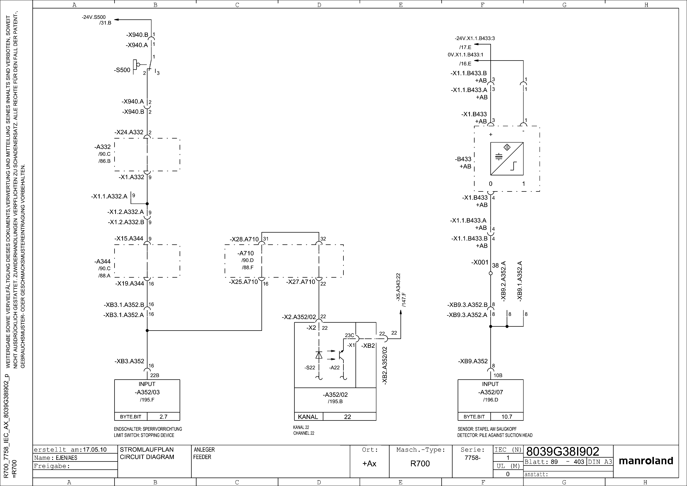

# +Ax — Sheet 89 of 403 — ANLEGER

**FEEDER**

> Part of the manroland **R700** printing press IEC/UL circuit diagrams.
> Drawing class: **Stromlaufplan / Circuit diagram** (DIN A3).
> Document `+Ax` covers the **Central control console** machine section.

## At a glance

| Field | Value |
|---|---|
| Document | `+Ax`  (8039G38I902) |
| Sheet | **89** of 403 |
| Section (DE) | ANLEGER |
| Section (EN) | FEEDER |
| Section type | CIRCUIT — Circuit diagram |
| Machine type | `R700` |
| Series | `7758` |
| Created | 17.05.10 |
| Replaces | — |
| Columns used | A, B, C, D, E, F, G |
| Path numbers | — |
| Labels on sheet | 128 |
| Cross-refs out | 13 |
| Cross-refs in | 48 |

**Previous:** [+Ax sheet 88](SHEET_0088.md) · **Next:** [+Ax sheet 90](SHEET_0090.md) · **Document TOC:** [_TOC.md](_TOC.md)  (+Ax) · **Master TOC:** [all sheets](../_MASTER_TOC.md)

## Sheet image (300 DPI, exact vector render)



_Rendered directly from the PDF vector layer at 300 DPI (1-bit), no OCR and no resampling. Use it to confirm anything ambiguous in the text below._

## Cross-references on this sheet

Each entry is a wire leaving this sheet. The printed token is `/sheet.column`; the link resolves to that sheet inside the same document.

| Ref | Target sheet | Col | Path | Destination on target | Target section | From col |
|---|---|---|---|---|---|---|
| `/31.B` | [+Ax sheet 31](SHEET_0031.md) | B | — | 24V.S500 | SPANNUNGSVERSORGUNG, SCHALTSCHRANKBELÜFTUNG | A |
| `/17.E` | [+Ax sheet 17](SHEET_0017.md) | E | — | 0V.X1.1.B433:1 | SPANNUNGSVERSORGUNG, SCHALTSCHRANKBELÜFTUNG | F |
| `/16.E` | [+Ax sheet 16](SHEET_0016.md) | E | — | — | SPANNUNGSVERSORGUNG, SCHALTSCHRANKBELÜFTUNG | F |
| `/90.C` | [+Ax sheet 90](SHEET_0090.md) | C | — | — | ANLEGER | A |
| `/86.B` | [+Ax sheet 86](SHEET_0086.md) | B | — | — | ANLEGER | A |
| `/90.D` | [+Ax sheet 90](SHEET_0090.md) | D | — | — | ANLEGER | C |
| `/88.F` | [+Ax sheet 88](SHEET_0088.md) | F | — | — | ANLEGER | C |
| `/90.C` | [+Ax sheet 90](SHEET_0090.md) | C | — | — | ANLEGER | A |
| `/88.A` | [+Ax sheet 88](SHEET_0088.md) | A | — | — | ANLEGER | A |
| `/147.F` | [+Ax sheet 147](SHEET_0147.md) | F | — | X5.A343:22 | ÜBERWACHUNGSRECHNER SICHERHEITSBUS | E |
| `/195.F` | [+Ax sheet 195](SHEET_0195.md) | F | — | — | REFERENZMODUL | B |
| `/196.D` | [+Ax sheet 196](SHEET_0196.md) | D | — | — | REFERENZMODUL | F |
| `/195.B` | [+Ax sheet 195](SHEET_0195.md) | B | — | — | REFERENZMODUL | D |

### Incoming references (sheets that point here)

Every other sheet that sends a wire to this one. `Back-ref` is the token printed on *that* sheet; `Path` is its line number.

| From sheet | Cols | Back-ref | Path | Refs | What continues there |
|---|---|---|---|---|---|
| [+Ax#16](SHEET_0016.md) | E | `/16.E` | — | 1 | — |
| [+Ax#17](SHEET_0017.md) | E | `/17.E` | — | 1 | — |
| [+Ax#31](SHEET_0031.md) | B | `/31.B` | — | 1 | — |
| [+Ax#86](SHEET_0086.md) | B | `/86.B` | — | 1 | — |
| [+Ax#88](SHEET_0088.md) | A, F | `/88.A`, `/88.F` | — | 2 | — |
| [+Ax#90](SHEET_0090.md) | C, D | `/90.C`, `/90.D` | — | 3 | — |
| [+Ax#147](SHEET_0147.md) | F | `/147.F` | — | 1 | X5.A343:22 |
| [+Ax#195](SHEET_0195.md) | B, F | `/195.B`, `/195.F` | — | 2 | — |
| [+Ax#196](SHEET_0196.md) | D | `/196.D` | — | 1 | — |
| [+Ax#207](SHEET_0207.md) | A, B, C | `/207.A`, `/207.B`, `/207.C` | — | 4 | — |
| [+Ax#213](SHEET_0213.md) | G | `/213.G` | — | 10 | — |
| [+Ax#218](SHEET_0218.md) | H | `/218.H` | — | 1 | — |
| [+Ax#219](SHEET_0219.md) | B | `/219.B` | — | 1 | — |
| [+Ax#223](SHEET_0223.md) | E, G, H | `/223.E`, `/223.G`, `/223.H` | — | 3 | — |
| [+Ax#241](SHEET_0241.md) | B, C, F, G, H | `/241.B`, `/241.C`, `/241.F`, `/241.G`, `/241.H` | — | 5 | — |
| [+Ax#252](SHEET_0252.md) | E | `/252.E` | — | 1 | — |
| [+Ax#258](SHEET_0258.md) | G | `/258.G` | — | 1 | — |
| [+Ax#266](SHEET_0266.md) | A | `/266.A` | — | 1 | — |
| [+Ax#268](SHEET_0268.md) | B | `/268.B` | — | 1 | — |
| [+Ax#270](SHEET_0270.md) | H | `/270.H` | — | 1 | — |
| [+Ax#272](SHEET_0272.md) | F | `/272.F` | — | 2 | — |
| [+Ax#296](SHEET_0296.md) | F | `/296.F` | — | 4 | — |


## Devices on this sheet

| Tag | Class | Class meaning (IEC) | Col | Sub | Terminal | Sign |
|---|---|---|---|---|---|---|
| `B433` | B | Umformer / transducer, sensor | F | — | — | — |
| `X001` | X | Klemme / terminal, plug connector | F | — | — | — |
| `A332` | A | Baugruppe / assembly, module, PC board | A | — | — | — |
| `S500` | S | Schalter / switch | B | — | — | — |
| `A344` | A | Baugruppe / assembly, module, PC board | A | — | — | — |
| `A710` | A | Baugruppe / assembly, module, PC board | C | — | — | — |
| `S22` | S | Schalter / switch | D | — | — | — |
| `A22` | A | Baugruppe / assembly, module, PC board | D | — | — | — |
| `X1` | X | Klemme / terminal, plug connector | D | — | — | — |
| `X2` | X | Klemme / terminal, plug connector | D | — | — | — |
| `XB2` | XB |  | E | — | — | — |
| `A352/02` | A | Baugruppe / assembly, module, PC board | D | 02 | — | — |
| `A352/07` | A | Baugruppe / assembly, module, PC board | F | 07 | — | — |
| `A352/03` | A | Baugruppe / assembly, module, PC board | B | 03 | — | — |
| `XB9.3.A352.B` | — | cross-device reference | F | — | — | — |
| `XB9.3.A352.A` | — | cross-device reference | F | — | — | — |
| `XB9.2.A352.A` | — | cross-device reference | F | — | — | — |
| `XB9.1.A352.A` | — | cross-device reference | F | — | — | — |
| `X1.1.B433.A` | — | cross-device reference | F | — | — | — |
| `X1.1.B433.B` | — | cross-device reference | F | — | — | — |
| `X1.B433` | — | cross-device reference | F | — | — | — |
| `X1.B433` | — | cross-device reference | F | — | — | — |
| `X1.1.B433.B` | — | cross-device reference | F | — | — | — |
| `X1.1.B433.A` | — | cross-device reference | F | — | — | — |
| `X19.A344` | — | cross-device reference | B | — | — | — |
| `X1.A332` | — | cross-device reference | B | — | — | — |
| `X24.A332` | — | cross-device reference | B | — | — | — |
| `X15.A344` | — | cross-device reference | B | — | — | — |
| `X1.2.A332.B` | — | cross-device reference | B | — | — | — |
| `X1.2.A332.A` | — | cross-device reference | B | — | — | — |
| `X1.1.A332.A` | — | cross-device reference | A | — | — | — |
| `X940.B` | — | cross-device reference | B | — | — | — |
| `X940.A` | — | cross-device reference | B | — | — | — |
| `X940.B` | — | cross-device reference | B | — | — | — |
| `X940.A` | — | cross-device reference | B | — | — | — |
| `XB3.1.A352.B` | — | cross-device reference | B | — | — | — |
| `XB3.1.A352.A` | — | cross-device reference | B | — | — | — |
| `X28.A710` | — | cross-device reference | C | — | — | — |
| `X27.A710` | — | cross-device reference | D | — | — | — |
| `X25.A710` | — | cross-device reference | C | — | — | — |
| `10.7` | — | cross-device reference | F | — | — | — |
| `XB9.A352` | — | cross-device reference | F | — | — | — |
| `2.7` | — | cross-device reference | B | — | — | — |
| `XB3.A352` | — | cross-device reference | B | — | — | — |
| `X5.A343:22` | — | cross-device reference | E | — | 22 | — |

## Potentials / nets

| Potential | Count | Columns | Attached devices | Terminals |
|---|---|---|---|---|
| `0V` | 1 | F | `1`, `B433`, `X1` | `1` |
| `24V` | 2 | A, F | `1`, `B433`, `S500`, `X1` | `3` |


A potential such as `L24+/4` or `M24+` is a named supply/return rail; every place it appears on this sheet is electrically common.

## Wire-end annotations (grouped as printed)

A wire that continues elsewhere is annotated with a small cluster: the destination description, the path/line number `#NN`, and the `/sheet.column` cross reference. Each row below is one such cluster exactly as it is grouped on the drawing.

| Col | Y | Path | Cross-ref | Text on the wire |
|---|---|---|---|---|
| A | 25.8 | — | `/31.B` | `24V.S500` |
| B | 55.6 | — | — | `X940.B 1` |
| F | 62.6 | — | — | `24V.X1.1.B433:3` |
| B | 72.6 | — | — | `X940.A 1` |
| F | 78.2 | — | `/17.E` | `0V.X1.1.B433:1` |
| B | 94.6 | — | — | `1` |
| F | 106.5 | — | `/16.E` | — |
| B | 116.5 | — | — | `S500 3` |
| F | 122.2 | — | — | `X1.1.B433.B 3` |
| B | 122.9 | — | — | `2` |
| G | 133.6 | — | — | `1` |
| F | 134.9 | — | — | `+AB` |
| F | 150.6 | — | — | `X1.1.B433.A 3` |
| G | 150.6 | — | — | `1` |
| F | 163.9 | — | — | `+AB` |
| B | 171.1 | — | — | `X940.A 2` |
| B | 188.8 | — | — | `X940.B 2` |
| F | 193.1 | — | — | `X1.B433 3` |
| F | 204.4 | — | — | `+AB 1` |
| B | 224.2 | — | — | `X24.A332 2` |
| F | 228.5 | — | — | `+` |
| A | 249.8 | — | — | `A332` |
| A | 262.8 | — | `/90.C`, `/86.B` | — |
| F | 271.0 | — | — | `B433` |
| F | 283.7 | — | — | `+AB` |
| B | 302.2 | — | — | `X1.A332 9` |
| F | 313.5 | — | — | `0` |
| G | 313.5 | — | — | `1` |
| A | 334.8 | — | — | `X1.1.A332.A 9` |
| F | 337.6 | — | — | `X1.B433 4` |
| F | 350.3 | — | — | `+AB` |
| B | 362.4 | — | — | `X1.2.A332.A 9` |
| F | 377.3 | — | — | `X1.1.B433.A 4` |
| B | 380.2 | — | — | `X1.2.A332.B 9` |
| F | 390.0 | — | — | `+AB` |
| B | 408.5 | — | — | `X15.A344 9` |
| F | 408.5 | — | — | `X1.1.B433.B 4` |
| C | 409.9 | — | — | `X28.A710 31 32` |
| F | 421.2 | — | — | `+AB` |
| C | 434.0 | — | — | `A710` |
| C | 447.1 | — | `/90.D` | — |
| A | 448.2 | — | — | `A344` |
| F | 449.4 | — | — | `X001 38` |
| F | 452.4 | — | — | `XB9.2.A352.A` |
| F | 452.4 | — | — | `XB9.1.A352.A` |
| C | 459.5 | — | `/88.F` | — |
| A | 461.3 | — | `/90.C`, `/88.A` | — |
| E | 473.1 | — | `/147.F` | `X5.A343:22` |
| C | 483.6 | — | — | `X25.A710 16 X27.A710 22` |
| B | 486.4 | — | — | `X19.A344 16` |
| B | 523.3 | — | — | `XB3.1.A352.B 16` |
| F | 523.3 | — | — | `XB9.3.A352.B 8` |
| B | 540.3 | — | — | `XB3.1.A352.A 16` |
| F | 540.3 | — | — | `XB9.3.A352.A 8 8` |
| G | 540.3 | — | — | `8` |
| D | 544.6 | — | — | `X2.A352/02 22` |
| D | 563.0 | — | — | `X2` |
| D | 564.4 | — | — | `22 22` |
| E | 572.9 | — | — | `22` |
| D | 577.2 | — | — | `23C` |
| D | 594.1 | — | — | `X1` |
| E | 594.2 | — | — | `XB2` |
| E | 600.4 | — | — | `XB2.A352/02` |
| B | 621.1 | — | — | `XB3.A352 16` |
| F | 621.1 | — | — | `XB9.A352 8` |
| D | 633.1 | — | — | `S22 A22` |
| B | 646.6 | — | — | `22B` |
| F | 646.6 | — | — | `10B` |
| B | 661.1 | — | — | `INPUT` |
| F | 661.1 | — | — | `INPUT` |
| B | 675.0 | — | — | `A352/03` |
| F | 675.0 | — | — | `A352/07` |
| D | 679.2 | — | — | `A352/02` |
| B | 688.7 | — | `/195.F` | — |
| F | 688.8 | — | `/196.D` | — |
| D | 691.6 | — | `/195.B` | — |
| D | 717.4 | — | — | `KANAL 22` |
| B | 717.8 | — | — | `BYTE.BIT 2.7` |
| F | 717.8 | — | — | `BYTE.BIT 10.7` |
| D | 737.8 | — | — | `KANAL 22 CHANNEL 22` |
| B | 740.5 | — | — | `ENDSCHALTER: SPERRVORRICHTUNG LIMIT SWITCH: STOPPING DEVICE` |
| F | 740.5 | — | — | `DETECTOR: PILE AGAINST SUCTION HEAD SENSOR: STAPEL AM SAUGKOPF` |


## Reconstructed tables

This sheet carries tabular content (pin map / terminal assignment / index). The grid below was rebuilt from the drawing's own rule lines, so each row is exactly one physical row of the table.

### Table 1 — 3 data rows × 5 columns (at x=198.4, y=34.0)

| S500 X940.A X940.B X24.A332 X1.A332 X1.2.A332.A X1.2.A332.B X15.A344 X19.A344 XB3.1.A352.B XB3.1.A352.A | 9 | X940.B X940.A 2 | 2 2 2 9 9 9 9 16 16 16 | 1 1 1 3 |
|---|---|---|---|---|
| `XB3.A352` |  |  | `16` | `22B` |
|  |  | `INPUT` | `A352/03 /195.F` |  |
| `BYTE.BIT` |  |  |  | `2.7` |


### Table 2 — 8 data rows × 9 columns (at x=453.5, y=104.9)

|  |  |  |  |  |  |  | /16.E X1.1.B433.B +AB X1.1.B433.A +AB X1.B433 +AB | 3 3 3 + |
|---|---|---|---|---|---|---|---|---|
|  |  |  |  |  |  |  | `B433 +AB` |  |
|  |  |  |  |  |  |  | `0 X1.B433 +AB X1.1.B433.A +AB` | `4 4` |
| `31 16` | `X27.A710 X2.A352/02` | `32 22 22` |  |  | `X5.A343:22` | `/147.F` | `X1.1.B433.B +AB X001 XB9.3.A352.B XB9.3.A352.A` | `4 XB9.2.A352.A XB9.1.A352.A 38 8 8 8` |
|  | `X2` | `22` |  |  |  |  |  |  |
|  | `S22` | `A22` | `23C X1` | `XB2` | `22 22 XB2.A352/02` |  | `XB9.A352` | `8 10B` |
|  |  |  |  |  |  |  | `INPUT` |  |
|  |  | `A352/02 /195.B` |  |  |  |  |  | `A352/07 /196.D` |
|  | `KANAL` |  | `22` |  |  |  | `BYTE.BIT` | `10.7` |


## Notes and free text on this sheet

| Text | Col | Y (pt) |
|---|---|---|
| `+AB` | F | 163.93 |
| `KANAL 22` | D | 737.78 |
| `CHANNEL 22` | D | 747.73 |
| `23C` | D | 577.18 |
| `KANAL` | D | 717.46 |
| `X2.A352/02` | D | 544.56 |
| `XB2.A352/02` | E | 600.38 |
| `10B` | F | 646.59 |
| `INPUT` | F | 661.11 |
| `BYTE.BIT` | F | 718.36 |
| `SENSOR: STAPEL AM SAUGKOPF` | F | 740.46 |
| `DETECTOR: PILE AGAINST SUCTION HEAD` | F | 751.1 |
| `22B` | B | 646.59 |
| `INPUT` | B | 661.11 |
| `BYTE.BIT` | B | 718.36 |
| `ENDSCHALTER: SPERRVORRICHTUNG` | B | 740.48 |
| `LIMIT SWITCH: STOPPING DEVICE` | B | 751.07 |

## Complete label inventory (exact text from the drawing)

Every text object inside the drawing area of this sheet, in DIN reading order (column A→H, then top→bottom). This is the authoritative list: if a string is not here it is not printed on this sheet.

| Col | Y | X | Dir | Type | Text |
|---|---|---|---|---|---|
| A | 25.8 | 141.7 | → | potential | `24V.S500` |
| A | 35.7 | 172.3 | → | cross-reference | `/31.B` |
| A | 249.8 | 163.6 | → | device tag | `A332` |
| A | 262.8 | 170.6 | → | cross-reference | `/90.C` |
| A | 275.2 | 170.9 | → | cross-reference | `/86.B` |
| A | 335.5 | 157.9 | → | device ref | `X1.1.A332.A` |
| A | 448.2 | 163.6 | → | device tag | `A344` |
| A | 461.3 | 170.6 | → | cross-reference | `/90.C` |
| A | 473.6 | 170.6 | → | cross-reference | `/88.A` |
| B | 55.6 | 218.8 | → | device ref | `X940.B` |
| B | 55.6 | 264.2 | → | number | `1` |
| B | 72.6 | 264.2 | → | number | `1` |
| B | 73.3 | 218.0 | → | device ref | `X940.A` |
| B | 94.6 | 264.2 | → | number | `1` |
| B | 116.5 | 197.6 | → | device tag | `S500` |
| B | 122.9 | 248.0 | → | number | `2` |
| B | 122.9 | 271.8 | → | number | `3` |
| B | 171.1 | 210.9 | → | device ref | `X940.A` |
| B | 173.2 | 257.7 | → | number | `2` |
| B | 188.8 | 211.7 | → | device ref | `X940.B` |
| B | 190.2 | 257.7 | → | number | `2` |
| B | 224.2 | 198.4 | → | device ref | `X24.A332` |
| B | 225.7 | 257.7 | → | number | `2` |
| B | 302.2 | 205.8 | → | device ref | `X1.A332` |
| B | 303.6 | 257.7 | → | number | `9` |
| B | 334.8 | 229.3 | → | number | `9` |
| B | 362.4 | 186.2 | → | device ref | `X1.2.A332.A` |
| B | 364.6 | 257.7 | → | number | `9` |
| B | 380.2 | 187.1 | → | device ref | `X1.2.A332.B` |
| B | 381.6 | 257.7 | → | number | `9` |
| B | 408.5 | 198.4 | → | device ref | `X15.A344` |
| B | 409.9 | 257.7 | → | number | `9` |
| B | 486.4 | 199.8 | → | device ref | `X19.A344` |
| B | 487.9 | 257.1 | → | number | `16` |
| B | 523.3 | 180.0 | → | device ref | `XB3.1.A352.B` |
| B | 523.3 | 257.1 | → | number | `16` |
| B | 540.3 | 257.1 | → | number | `16` |
| B | 541.0 | 179.1 | → | device ref | `XB3.1.A352.A` |
| B | 621.1 | 198.7 | → | device ref | `XB3.A352` |
| B | 629.6 | 257.1 | → | number | `16` |
| B | 646.6 | 260.5 | → | text | `22B` |
| B | 661.1 | 240.2 | → | text | `INPUT` |
| B | 675.0 | 233.7 | → | device tag | `A352/03` |
| B | 688.7 | 242.8 | → | cross-reference | `/195.F` |
| B | 717.8 | 276.7 | → | device ref | `2.7` |
| B | 718.4 | 208.3 | → | text | `BYTE.BIT` |
| B | 740.5 | 197.6 | → | text | `ENDSCHALTER: SPERRVORRICHTUNG` |
| B | 751.1 | 197.6 | → | text | `LIMIT SWITCH: STOPPING DEVICE` |
| C | 409.9 | 398.3 | → | device ref | `X28.A710` |
| C | 409.9 | 456.1 | → | number | `31` |
| C | 434.0 | 411.6 | → | device tag | `A710` |
| C | 447.1 | 418.7 | → | cross-reference | `/90.D` |
| C | 459.5 | 419.5 | → | cross-reference | `/88.F` |
| C | 483.6 | 396.9 | → | device ref | `X25.A710` |
| C | 487.9 | 455.5 | → | number | `16` |
| D | 409.9 | 555.3 | → | number | `32` |
| D | 483.6 | 496.1 | → | device ref | `X27.A710` |
| D | 487.9 | 555.3 | → | number | `22` |
| D | 544.6 | 488.7 | → | text | `X2.A352/02` |
| D | 544.6 | 555.3 | → | number | `22` |
| D | 563.0 | 531.2 | → | device tag | `X2` |
| D | 564.4 | 558.1 | → | number | `22` |
| D | 577.2 | 598.1 | → | text | `23C` |
| D | 594.2 | 601.8 | → | device tag | `X1` |
| D | 633.1 | 527.8 | → | device tag | `S22` |
| D | 633.1 | 570.3 | → | device tag | `A22` |
| D | 679.2 | 559.7 | → | device tag | `A352/02` |
| D | 691.6 | 568.5 | → | cross-reference | `/195.B` |
| D | 717.4 | 596.6 | → | number | `22` |
| D | 717.5 | 516.5 | → | text | `KANAL` |
| D | 737.8 | 508.3 | → | text | `KANAL 22` |
| D | 747.7 | 508.5 | → | text | `CHANNEL 22` |
| E | 473.1 | 686.3 | ↕ | device ref | `X5.A343:22` |
| E | 506.6 | 696.2 | ↕ | cross-reference | `/147.F` |
| E | 572.9 | 678.3 | → | number | `22` |
| E | 574.3 | 657.4 | → | number | `22` |
| E | 594.2 | 626.2 | → | device tag | `XB2` |
| E | 600.4 | 662.2 | ↕ | text | `XB2.A352/02` |
| F | 62.6 | 788.3 | → | potential | `24V.X1.1.B433:3` |
| F | 78.2 | 796.3 | → | cross-reference | `/17.E` |
| F | 91.0 | 776.1 | → | potential | `0V.X1.1.B433:1` |
| F | 106.5 | 796.3 | → | cross-reference | `/16.E` |
| F | 122.2 | 780.9 | → | device ref | `X1.1.B433.B` |
| F | 133.6 | 852.9 | → | number | `3` |
| F | 134.9 | 823.5 | → | text | `+AB` |
| F | 150.6 | 852.9 | → | number | `3` |
| F | 151.3 | 781.5 | → | device ref | `X1.1.B433.A` |
| F | 163.9 | 824.9 | → | text | `+AB` |
| F | 193.1 | 799.7 | → | device ref | `X1.B433` |
| F | 204.4 | 852.9 | → | number | `3` |
| F | 205.7 | 823.5 | → | text | `+AB` |
| F | 228.5 | 847.4 | → | number | `+` |
| F | 271.0 | 788.6 | → | device tag | `B433` |
| F | 283.7 | 796.5 | → | text | `+AB` |
| F | 313.5 | 847.4 | → | number | `0` |
| F | 337.6 | 801.1 | → | device ref | `X1.B433` |
| F | 339.1 | 852.9 | → | number | `4` |
| F | 350.3 | 824.9 | → | text | `+AB` |
| F | 377.3 | 780.1 | → | device ref | `X1.1.B433.A` |
| F | 390.0 | 823.5 | → | text | `+AB` |
| F | 392.9 | 852.9 | → | number | `4` |
| F | 408.5 | 782.4 | → | device ref | `X1.1.B433.B` |
| F | 409.9 | 852.9 | → | number | `4` |
| F | 421.2 | 824.9 | → | text | `+AB` |
| F | 449.4 | 816.9 | → | device tag | `X001` |
| F | 452.4 | 867.7 | ↕ | device ref | `XB9.2.A352.A` |
| F | 452.4 | 896.1 | ↕ | device ref | `XB9.1.A352.A` |
| F | 455.2 | 852.7 | → | number | `38` |
| F | 523.3 | 775.3 | → | device ref | `XB9.3.A352.B` |
| F | 523.3 | 852.9 | → | number | `8` |
| F | 540.3 | 852.9 | → | number | `8` |
| F | 540.3 | 881.3 | → | number | `8` |
| F | 541.0 | 774.4 | → | device ref | `XB9.3.A352.A` |
| F | 621.1 | 794.0 | → | device ref | `XB9.A352` |
| F | 629.6 | 852.9 | → | number | `8` |
| F | 646.6 | 855.2 | → | text | `10B` |
| F | 661.1 | 835.5 | → | text | `INPUT` |
| F | 675.0 | 829.0 | → | device tag | `A352/07` |
| F | 688.8 | 837.6 | → | cross-reference | `/196.D` |
| F | 717.8 | 869.0 | → | device ref | `10.7` |
| F | 718.4 | 803.6 | → | text | `BYTE.BIT` |
| F | 740.5 | 793.4 | → | text | `SENSOR: STAPEL AM SAUGKOPF` |
| F | 751.1 | 792.9 | → | text | `DETECTOR: PILE AGAINST SUCTION HEAD` |
| G | 133.6 | 909.1 | → | number | `1` |
| G | 150.6 | 909.1 | → | number | `1` |
| G | 204.4 | 909.1 | → | number | `1` |
| G | 313.5 | 904.5 | → | number | `1` |
| G | 540.3 | 909.6 | → | number | `8` |

## Reading-order text block

The same content as a plain block, grouped by DIN column — convenient to paste or to match against a visual description.

```text
=== Column A ===
  25.8  141.7  net          24V.S500
  35.7  172.3  xref         /31.B
 249.8  163.6  devtag       A332
 262.8  170.6  xref         /90.C
 275.2  170.9  xref         /86.B
 335.5  157.9  devref       X1.1.A332.A
 448.2  163.6  devtag       A344
 461.3  170.6  xref         /90.C
 473.6  170.6  xref         /88.A
=== Column B ===
  55.6  218.8  devref       X940.B
  55.6  264.2  numeric      1
  72.6  264.2  numeric      1
  73.3  218.0  devref       X940.A
  94.6  264.2  numeric      1
 116.5  197.6  devtag       S500
 122.9  248.0  numeric      2
 122.9  271.8  numeric      3
 171.1  210.9  devref       X940.A
 173.2  257.7  numeric      2
 188.8  211.7  devref       X940.B
 190.2  257.7  numeric      2
 224.2  198.4  devref       X24.A332
 225.7  257.7  numeric      2
 302.2  205.8  devref       X1.A332
 303.6  257.7  numeric      9
 334.8  229.3  numeric      9
 362.4  186.2  devref       X1.2.A332.A
 364.6  257.7  numeric      9
 380.2  187.1  devref       X1.2.A332.B
 381.6  257.7  numeric      9
 408.5  198.4  devref       X15.A344
 409.9  257.7  numeric      9
 486.4  199.8  devref       X19.A344
 487.9  257.1  numeric      16
 523.3  180.0  devref       XB3.1.A352.B
 523.3  257.1  numeric      16
 540.3  257.1  numeric      16
 541.0  179.1  devref       XB3.1.A352.A
 621.1  198.7  devref       XB3.A352
 629.6  257.1  numeric      16
 646.6  260.5  text         22B
 661.1  240.2  text         INPUT
 675.0  233.7  devtag       A352/03
 688.7  242.8  xref         /195.F
 717.8  276.7  devref       2.7
 718.4  208.3  text         BYTE.BIT
 740.5  197.6  text         ENDSCHALTER: SPERRVORRICHTUNG
 751.1  197.6  text         LIMIT SWITCH: STOPPING DEVICE
=== Column C ===
 409.9  398.3  devref       X28.A710
 409.9  456.1  numeric      31
 434.0  411.6  devtag       A710
 447.1  418.7  xref         /90.D
 459.5  419.5  xref         /88.F
 483.6  396.9  devref       X25.A710
 487.9  455.5  numeric      16
=== Column D ===
 409.9  555.3  numeric      32
 483.6  496.1  devref       X27.A710
 487.9  555.3  numeric      22
 544.6  488.7  text         X2.A352/02
 544.6  555.3  numeric      22
 563.0  531.2  devtag       X2
 564.4  558.1  numeric      22
 577.2  598.1  text         23C
 594.2  601.8  devtag       X1
 633.1  527.8  devtag       S22
 633.1  570.3  devtag       A22
 679.2  559.7  devtag       A352/02
 691.6  568.5  xref         /195.B
 717.4  596.6  numeric      22
 717.5  516.5  text         KANAL
 737.8  508.3  text         KANAL 22
 747.7  508.5  text         CHANNEL 22
=== Column E ===
 473.1  686.3  devref       X5.A343:22
 506.6  696.2  xref         /147.F
 572.9  678.3  numeric      22
 574.3  657.4  numeric      22
 594.2  626.2  devtag       XB2
 600.4  662.2  text         XB2.A352/02
=== Column F ===
  62.6  788.3  net          24V.X1.1.B433:3
  78.2  796.3  xref         /17.E
  91.0  776.1  net          0V.X1.1.B433:1
 106.5  796.3  xref         /16.E
 122.2  780.9  devref       X1.1.B433.B
 133.6  852.9  numeric      3
 134.9  823.5  text         +AB
 150.6  852.9  numeric      3
 151.3  781.5  devref       X1.1.B433.A
 163.9  824.9  text         +AB
 193.1  799.7  devref       X1.B433
 204.4  852.9  numeric      3
 205.7  823.5  text         +AB
 228.5  847.4  numeric      +
 271.0  788.6  devtag       B433
 283.7  796.5  text         +AB
 313.5  847.4  numeric      0
 337.6  801.1  devref       X1.B433
 339.1  852.9  numeric      4
 350.3  824.9  text         +AB
 377.3  780.1  devref       X1.1.B433.A
 390.0  823.5  text         +AB
 392.9  852.9  numeric      4
 408.5  782.4  devref       X1.1.B433.B
 409.9  852.9  numeric      4
 421.2  824.9  text         +AB
 449.4  816.9  devtag       X001
 452.4  867.7  devref       XB9.2.A352.A
 452.4  896.1  devref       XB9.1.A352.A
 455.2  852.7  numeric      38
 523.3  775.3  devref       XB9.3.A352.B
 523.3  852.9  numeric      8
 540.3  852.9  numeric      8
 540.3  881.3  numeric      8
 541.0  774.4  devref       XB9.3.A352.A
 621.1  794.0  devref       XB9.A352
 629.6  852.9  numeric      8
 646.6  855.2  text         10B
 661.1  835.5  text         INPUT
 675.0  829.0  devtag       A352/07
 688.8  837.6  xref         /196.D
 717.8  869.0  devref       10.7
 718.4  803.6  text         BYTE.BIT
 740.5  793.4  text         SENSOR: STAPEL AM SAUGKOPF
 751.1  792.9  text         DETECTOR: PILE AGAINST SUCTION HEAD
=== Column G ===
 133.6  909.1  numeric      1
 150.6  909.1  numeric      1
 204.4  909.1  numeric      1
 313.5  904.5  numeric      1
 540.3  909.6  numeric      8
```

---
_Generated from the PDF vector text layer; no OCR. Source: `R700_7758_IEC_AX_8039G38I902_p`, sheet 89._
