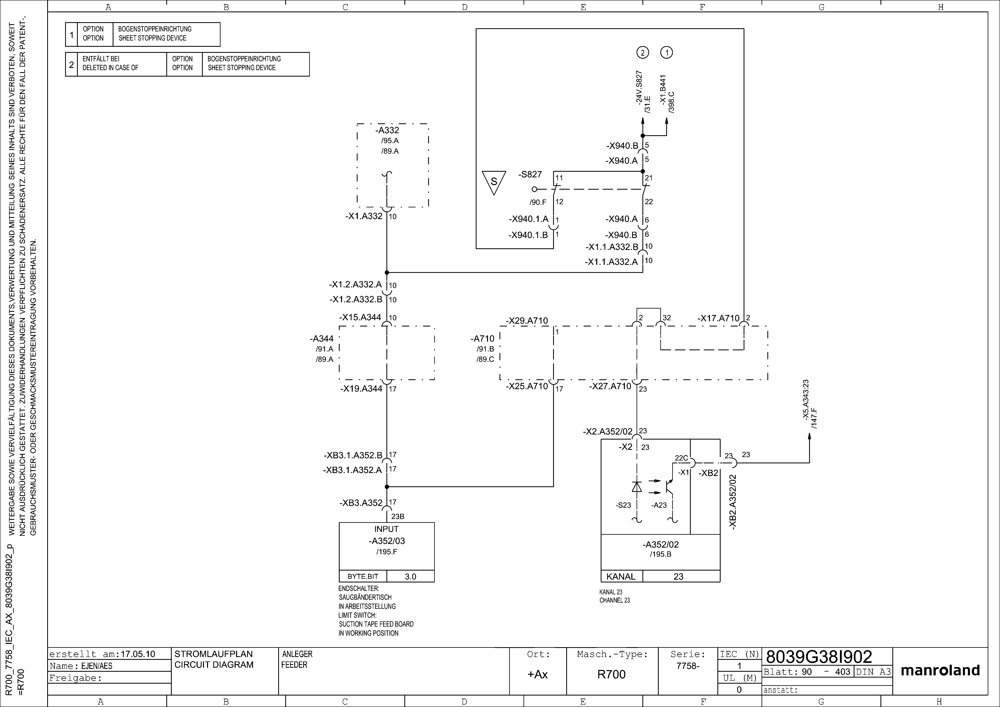

# +Ax — Sheet 90 of 403 — ANLEGER

**FEEDER**

> Part of the manroland **R700** printing press IEC/UL circuit diagrams.
> Drawing class: **Stromlaufplan / Circuit diagram** (DIN A3).
> Document `+Ax` covers the **Central control console** machine section.

## At a glance

| Field | Value |
|---|---|
| Document | `+Ax`  (8039G38I902) |
| Sheet | **90** of 403 |
| Section (DE) | ANLEGER |
| Section (EN) | FEEDER |
| Section type | CIRCUIT — Circuit diagram |
| Machine type | `R700` |
| Series | `7758` |
| Created | 17.05.10 |
| Replaces | — |
| Columns used | A, B, C, D, E, F, G |
| Path numbers | — |
| Labels on sheet | 108 |
| Cross-refs out | 12 |
| Cross-refs in | 36 |

**Previous:** [+Ax sheet 89](SHEET_0089.md) · **Next:** [+Ax sheet 91](SHEET_0091.md) · **Document TOC:** [_TOC.md](_TOC.md)  (+Ax) · **Master TOC:** [all sheets](../_MASTER_TOC.md)

## Sheet image (300 DPI, exact vector render)



_Rendered directly from the PDF vector layer at 300 DPI (1-bit), no OCR and no resampling. Use it to confirm anything ambiguous in the text below._

## Cross-references on this sheet

Each entry is a wire leaving this sheet. The printed token is `/sheet.column`; the link resolves to that sheet inside the same document.

| Ref | Target sheet | Col | Path | Destination on target | Target section | From col |
|---|---|---|---|---|---|---|
| `/31.E` | [+Ax sheet 31](SHEET_0031.md) | E | — | 24V.S827 | SPANNUNGSVERSORGUNG, SCHALTSCHRANKBELÜFTUNG | F |
| `/398.C` | [+Ax sheet 398](SHEET_0398.md) | C | — | X1.B441 | OPTION: BOGENSTOPPEINRICHTUNG | F |
| `/95.A` | [+Ax sheet 95](SHEET_0095.md) | A | — | — | ANLEGER | C |
| `/89.A` | [+Ax sheet 89](SHEET_0089.md) | A | — | — | ANLEGER | C |
| `/90.F` | [+Ax sheet 90](SHEET_0090.md) | F | — | 22 | ANLEGER | E |
| `/91.A` | [+Ax sheet 91](SHEET_0091.md) | A | — | — | ANLEGER | C |
| `/89.A` | [+Ax sheet 89](SHEET_0089.md) | A | — | — | ANLEGER | C |
| `/91.B` | [+Ax sheet 91](SHEET_0091.md) | B | — | — | ANLEGER | D |
| `/89.C` | [+Ax sheet 89](SHEET_0089.md) | C | — | — | ANLEGER | D |
| `/147.F` | [+Ax sheet 147](SHEET_0147.md) | F | — | X5.A343:23 | ÜBERWACHUNGSRECHNER SICHERHEITSBUS | G |
| `/195.F` | [+Ax sheet 195](SHEET_0195.md) | F | — | — | REFERENZMODUL | C |
| `/195.B` | [+Ax sheet 195](SHEET_0195.md) | B | — | — | REFERENZMODUL | F |

### Incoming references (sheets that point here)

Every other sheet that sends a wire to this one. `Back-ref` is the token printed on *that* sheet; `Path` is its line number.

| From sheet | Cols | Back-ref | Path | Refs | What continues there |
|---|---|---|---|---|---|
| [+Ax#31](SHEET_0031.md) | E | `/31.E` | — | 1 | 24V.S827 |
| [+Ax#89](SHEET_0089.md) | A, C | `/89.A`, `/89.C` | — | 3 | — |
| [+Ax#90](SHEET_0090.md) | E | `/90.E` | — | 1 | 22 |
| [+Ax#91](SHEET_0091.md) | A, B | `/91.A`, `/91.B` | — | 2 | — |
| [+Ax#95](SHEET_0095.md) | A | `/95.A` | — | 1 | — |
| [+Ax#147](SHEET_0147.md) | F | `/147.F` | — | 1 | X5.A343:23 |
| [+Ax#195](SHEET_0195.md) | B, F | `/195.B`, `/195.F` | — | 2 | — |
| [+Ax#207](SHEET_0207.md) | A, B, C | `/207.A`, `/207.B`, `/207.C` | — | 5 | — |
| [+Ax#218](SHEET_0218.md) | H | `/218.H` | — | 1 | — |
| [+Ax#219](SHEET_0219.md) | B | `/219.B` | — | 1 | — |
| [+Ax#223](SHEET_0223.md) | E, G, H | `/223.E`, `/223.G`, `/223.H` | — | 3 | — |
| [+Ax#252](SHEET_0252.md) | E | `/252.E` | — | 1 | — |
| [+Ax#255](SHEET_0255.md) | H | `/255.H` | — | 1 | — |
| [+Ax#258](SHEET_0258.md) | G | `/258.G` | — | 1 | — |
| [+Ax#268](SHEET_0268.md) | B | `/268.B` | — | 1 | — |
| [+Ax#270](SHEET_0270.md) | H | `/270.H` | — | 1 | — |
| [+Ax#273](SHEET_0273.md) | G, H | `/273.G`, `/273.H` | — | 3 | — |
| [+Ax#296](SHEET_0296.md) | F, G | `/296.F`, `/296.G` | — | 6 | STROMPFAD PIN 1 2 |
| [+Ax#398](SHEET_0398.md) | B | `/398.B` | — | 1 | X1.B441 |


## Devices on this sheet

| Tag | Class | Class meaning (IEC) | Col | Sub | Terminal | Sign |
|---|---|---|---|---|---|---|
| `A352/03` | A | Baugruppe / assembly, module, PC board | C | 03 | — | — |
| `S23` | S | Schalter / switch | E | — | — | — |
| `A23` | A | Baugruppe / assembly, module, PC board | F | — | — | — |
| `X1` | X | Klemme / terminal, plug connector | F | — | — | — |
| `X2` | X | Klemme / terminal, plug connector | E | — | — | — |
| `XB2` | XB |  | F | — | — | — |
| `A352/02` | A | Baugruppe / assembly, module, PC board | F | 02 | — | — |
| `A344` | A | Baugruppe / assembly, module, PC board | C | — | — | — |
| `A710` | A | Baugruppe / assembly, module, PC board | D | — | — | — |
| `S827` | S | Schalter / switch | E | — | — | — |
| `A332` | A | Baugruppe / assembly, module, PC board | C | — | — | — |
| `3.0` | — | cross-device reference | D | — | — | — |
| `XB3.A352` | — | cross-device reference | C | — | — | — |
| `XB3.1.A352.B` | — | cross-device reference | C | — | — | — |
| `XB3.1.A352.A` | — | cross-device reference | C | — | — | — |
| `X15.A344` | — | cross-device reference | C | — | — | — |
| `X1.2.A332.B` | — | cross-device reference | C | — | — | — |
| `X1.2.A332.A` | — | cross-device reference | C | — | — | — |
| `X19.A344` | — | cross-device reference | C | — | — | — |
| `X17.A710` | — | cross-device reference | F | — | — | — |
| `X27.A710` | — | cross-device reference | E | — | — | — |
| `X25.A710` | — | cross-device reference | E | — | — | — |
| `X1.1.A332.A` | — | cross-device reference | E | — | — | — |
| `X1.1.A332.B` | — | cross-device reference | E | — | — | — |
| `X940.A` | — | cross-device reference | E | — | — | — |
| `X940.B` | — | cross-device reference | E | — | — | — |
| `X940.B` | — | cross-device reference | E | — | — | — |
| `X940.A` | — | cross-device reference | E | — | — | — |
| `X940.1.B` | — | cross-device reference | E | — | — | — |
| `X940.1.A` | — | cross-device reference | E | — | — | — |
| `X1.A332` | — | cross-device reference | C | — | — | — |
| `X1.B441` | — | cross-device reference | F | — | — | — |
| `X5.A343:23` | — | cross-device reference | G | — | 23 | — |
| `X29.A710` | — | cross-device reference | E | — | — | — |

## Potentials / nets

| Potential | Count | Columns | Attached devices | Terminals |
|---|---|---|---|---|
| `24V` | 1 | E | `S827` | — |


A potential such as `L24+/4` or `M24+` is a named supply/return rail; every place it appears on this sheet is electrically common.

## Wire-end annotations (grouped as printed)

A wire that continues elsewhere is annotated with a small cluster: the destination description, the path/line number `#NN`, and the `/sheet.column` cross reference. Each row below is one such cluster exactly as it is grouped on the drawing.

| Col | Y | Path | Cross-ref | Text on the wire |
|---|---|---|---|---|
| A | 31.8 | — | — | `1 OPTION OPTION BOGENSTOPPEINRICHTUNG` |
| A | 42.4 | — | — | `SHEET STOPPING DEVICE` |
| F | 59.3 | — | — | `2 1` |
| A | 67.2 | — | — | `2 ENTFÄLLT BEI DELETED IN CASE OF` |
| B | 67.2 | — | — | `OPTION OPTION` |
| B | 67.2 | — | — | `BOGENSTOPPEINRICHTUNG` |
| B | 77.9 | — | — | `SHEET STOPPING DEVICE` |
| F | 83.6 | — | `/31.E` | `24V.S827` |
| F | 88.4 | — | `/398.C` | `X1.B441` |
| C | 150.5 | — | — | `A332` |
| C | 163.6 | — | `/95.A`, `/89.A` | — |
| E | 169.0 | — | — | `X940.B 5` |
| E | 186.0 | — | — | `X940.A 5` |
| E | 203.0 | — | — | `S827` |
| E | 208.0 | — | — | `11` |
| F | 208.0 | — | — | `21` |
| D | 210.8 | — | — | `S` |
| E | 236.3 | — | `/90.F` | `22` |
| E | 236.3 | — | — | `12` |
| D | 252.6 | — | — | `X1.A332 10 X940.1.A 1` |
| E | 256.1 | — | — | `X940.A 6` |
| E | 275.3 | — | — | `X940.1.B 1` |
| E | 275.3 | — | — | `X940.B 6` |
| E | 289.4 | — | — | `X1.1.A332.B 10` |
| E | 306.5 | — | — | `X1.1.A332.A 10` |
| C | 334.1 | — | — | `X1.2.A332.A 10` |
| C | 351.8 | — | — | `X1.2.A332.B 10` |
| C | 373.1 | — | — | `X15.A344 10` |
| F | 374.5 | — | — | `2 32 X17.A710 2` |
| E | 377.3 | — | — | `X29.A710` |
| E | 391.5 | — | — | `1` |
| C | 398.6 | — | — | `A344` |
| D | 398.6 | — | — | `A710` |
| C | 411.6 | — | `/91.A`, `/89.A` | — |
| D | 411.6 | — | `/91.B`, `/89.C` | — |
| G | 451.8 | — | `/147.F` | `X5.A343:23` |
| E | 455.3 | — | — | `X25.A710 17 X27.A710 23` |
| C | 458.1 | — | — | `X19.A344 17` |
| E | 509.1 | — | — | `X2.A352/02 23` |
| E | 527.6 | — | — | `X2` |
| F | 529.0 | — | — | `23 23` |
| C | 537.5 | — | — | `XB3.1.A352.B 17` |
| F | 537.5 | — | — | `23` |
| F | 541.8 | — | — | `22C` |
| C | 554.5 | — | — | `XB3.1.A352.A 17` |
| F | 558.7 | — | — | `X1` |
| F | 558.7 | — | — | `XB2` |
| F | 565.0 | — | — | `XB2.A352/02` |
| C | 594.2 | — | — | `XB3.A352 17` |
| E | 597.7 | — | — | `S23 A23` |
| C | 611.1 | — | — | `23B` |
| C | 625.7 | — | — | `INPUT` |
| C | 639.5 | — | — | `A352/03` |
| F | 643.8 | — | — | `A352/02` |
| C | 653.3 | — | `/195.F` | — |
| F | 656.1 | — | `/195.B` | — |
| F | 682.0 | — | — | `KANAL 23` |
| C | 682.4 | — | — | `BYTE.BIT 3.0` |
| C | 697.9 | — | — | `ENDSCHALTER:` |
| E | 702.4 | — | — | `KANAL 23 CHANNEL 23` |
| C | 708.6 | — | — | `IN ARBEITSSTELLUNG LIMIT SWITCH: SAUGBÄNDERTISCH` |
| C | 740.5 | — | — | `IN WORKING POSITION SUCTION TAPE FEED BOARD` |


## Reconstructed tables

This sheet carries tabular content (pin map / terminal assignment / index). The grid below was rebuilt from the drawing's own rule lines, so each row is exactly one physical row of the table.

### Table 1 — 8 data rows × 2 columns (at x=403.9, y=34.0) — **A332 /95.A /89.A**

| X1.A332 | 10 |
|---|---|
| `X1.2.A332.A X1.2.A332.B X15.A344` | `10 10 10` |
| `X19.A344` | `17` |
| `XB3.1.A352.B` | `17` |
| `XB3.1.A352.A` | `17` |
| `XB3.A352` | `17 23B` |
| `INPUT` |  |
|  | `A352/03 /195.F` |
| `BYTE.BIT` | `3.0` |


### Table 2 — 10 data rows × 8 columns (at x=566.9, y=34.0)

|  |  | X940.B X940.A | 1 2 24V.S827 X1.B441 /398.C /31.E 5 5 |  |  |  |  |
|---|---|---|---|---|---|---|---|
| `S827 S` | `11` |  | `21` |  |  |  |  |
| `/90.F X940.1.A X940.1.B` | `12 1 1` | `X940.A X940.B X1.1.A332.B` | `22 6 6 10` |  |  |  |  |
|  |  | `X1.1.A332.A` | `10` |  |  |  |  |
| `X29.A710 A710 /91.B` | `1` |  | `2 32` |  | `X17.A710` |  | `2` |
| `/89.C X25.A710` | `17` | `X27.A710 X2.A352/02` | `23 23` |  |  |  | `X5.A343:23` |
|  |  | `X2` | `23` | `22C` |  | `23` | `23` |
|  |  |  |  | `X1` | `XB2` |  |  |
|  |  | `S23` | `A23` |  |  | `XB2.A352/02` |  |
|  |  |  | `A352/02 /195.B` |  |  |  |  |
|  |  | `KANAL` |  | `23` |  |  |  |


## Notes and free text on this sheet

| Text | Col | Y (pt) |
|---|---|---|
| `23B` | C | 611.15 |
| `INPUT` | C | 625.68 |
| `BYTE.BIT` | C | 682.93 |
| `ENDSCHALTER:` | C | 697.94 |
| `SAUGBÄNDERTISCH` | C | 708.58 |
| `IN ARBEITSSTELLUNG` | C | 719.2 |
| `LIMIT SWITCH:` | C | 729.79 |
| `SUCTION TAPE FEED BOARD` | C | 740.48 |
| `IN WORKING POSITION` | C | 751.07 |
| `KANAL 23` | E | 702.36 |
| `CHANNEL 23` | E | 712.3 |
| `22C` | F | 541.75 |
| `KANAL` | E | 682.03 |
| `X2.A352/02` | E | 509.13 |
| `XB2.A352/02` | F | 564.95 |
| `S` | D | 210.85 |
| `ENTFÄLLT BEI` | A | 67.2 |
| `DELETED IN CASE OF` | A | 77.86 |
| `OPTION` | B | 67.21 |
| `BOGENSTOPPEINRICHTUNG` | B | 67.24 |
| `SHEET STOPPING DEVICE` | B | 77.86 |
| `OPTION` | A | 31.78 |
| `BOGENSTOPPEINRICHTUNG` | A | 31.81 |
| `SHEET STOPPING DEVICE` | A | 42.43 |

## Complete label inventory (exact text from the drawing)

Every text object inside the drawing area of this sheet, in DIN reading order (column A→H, then top→bottom). This is the authoritative list: if a string is not here it is not printed on this sheet.

| Col | Y | X | Dir | Type | Text |
|---|---|---|---|---|---|
| A | 31.8 | 98.9 | → | text | `OPTION` |
| A | 31.8 | 140.9 | → | text | `BOGENSTOPPEINRICHTUNG` |
| A | 37.1 | 82.5 | → | number | `1` |
| A | 42.4 | 98.9 | → | text | `OPTION` |
| A | 42.4 | 141.4 | → | text | `SHEET STOPPING DEVICE` |
| A | 67.2 | 98.4 | → | text | `ENTFÄLLT BEI` |
| A | 72.6 | 82.2 | → | number | `2` |
| A | 77.9 | 98.4 | → | text | `DELETED IN CASE OF` |
| B | 67.2 | 205.2 | → | text | `OPTION` |
| B | 67.2 | 247.2 | → | text | `BOGENSTOPPEINRICHTUNG` |
| B | 77.8 | 205.2 | → | text | `OPTION` |
| B | 77.9 | 247.7 | → | text | `SHEET STOPPING DEVICE` |
| C | 150.5 | 447.0 | → | device tag | `A332` |
| C | 163.6 | 454.1 | → | cross-reference | `/95.A` |
| C | 176.0 | 454.1 | → | cross-reference | `/89.A` |
| C | 252.6 | 411.3 | → | device ref | `X1.A332` |
| C | 254.0 | 462.6 | → | number | `10` |
| C | 334.1 | 391.7 | → | device ref | `X1.2.A332.A` |
| C | 336.2 | 462.6 | → | number | `10` |
| C | 351.8 | 392.6 | → | device ref | `X1.2.A332.B` |
| C | 353.2 | 462.6 | → | number | `10` |
| C | 373.1 | 403.9 | → | device ref | `X15.A344` |
| C | 374.5 | 462.6 | → | number | `10` |
| C | 398.6 | 369.1 | → | device tag | `A344` |
| C | 411.6 | 376.2 | → | cross-reference | `/91.A` |
| C | 424.0 | 376.2 | → | cross-reference | `/89.A` |
| C | 458.1 | 405.4 | → | device ref | `X19.A344` |
| C | 459.5 | 462.6 | → | number | `17` |
| C | 537.5 | 385.5 | → | device ref | `XB3.1.A352.B` |
| C | 537.5 | 462.6 | → | number | `17` |
| C | 554.5 | 462.6 | → | number | `17` |
| C | 555.2 | 384.7 | → | device ref | `XB3.1.A352.A` |
| C | 594.2 | 404.2 | → | device ref | `XB3.A352` |
| C | 594.2 | 462.6 | → | number | `17` |
| C | 611.2 | 466.0 | → | text | `23B` |
| C | 625.7 | 445.7 | → | text | `INPUT` |
| C | 639.5 | 439.2 | → | device tag | `A352/03` |
| C | 653.3 | 448.3 | → | cross-reference | `/195.F` |
| C | 682.9 | 413.9 | → | text | `BYTE.BIT` |
| C | 697.9 | 403.1 | → | text | `ENDSCHALTER:` |
| C | 708.6 | 403.7 | → | text | `SAUGBÄNDERTISCH` |
| C | 719.2 | 403.1 | → | text | `IN ARBEITSSTELLUNG` |
| C | 729.8 | 403.1 | → | text | `LIMIT SWITCH:` |
| C | 740.5 | 403.7 | → | text | `SUCTION TAPE FEED BOARD` |
| C | 751.1 | 403.1 | → | text | `IN WORKING POSITION` |
| D | 210.9 | 584.1 | → | text | `S` |
| D | 398.6 | 560.4 | → | device tag | `A710` |
| D | 411.6 | 567.8 | → | cross-reference | `/91.B` |
| D | 424.1 | 567.5 | → | cross-reference | `/89.C` |
| D | 682.3 | 482.2 | → | device ref | `3.0` |
| E | 83.6 | 757.1 | ↕ | potential | `24V.S827` |
| E | 169.0 | 722.0 | → | device ref | `X940.B` |
| E | 186.7 | 721.1 | → | device ref | `X940.A` |
| E | 203.0 | 617.1 | → | device tag | `S827` |
| E | 208.0 | 661.0 | → | number | `11` |
| E | 236.3 | 661.0 | → | number | `12` |
| E | 237.0 | 630.7 | → | cross-reference | `/90.F` |
| E | 256.1 | 606.0 | → | device ref | `X940.1.A` |
| E | 256.1 | 721.1 | → | device ref | `X940.A` |
| E | 258.3 | 661.0 | → | number | `1` |
| E | 275.3 | 605.5 | → | device ref | `X940.1.B` |
| E | 275.3 | 661.0 | → | number | `1` |
| E | 275.3 | 720.6 | → | device ref | `X940.B` |
| E | 289.5 | 697.3 | → | device ref | `X1.1.A332.B` |
| E | 307.2 | 696.5 | → | device ref | `X1.1.A332.A` |
| E | 374.5 | 760.8 | → | number | `2` |
| E | 377.3 | 602.4 | → | device ref | `X29.A710` |
| E | 391.5 | 661.0 | → | number | `1` |
| E | 455.3 | 602.4 | → | device ref | `X25.A710` |
| E | 455.3 | 701.6 | → | device ref | `X27.A710` |
| E | 459.5 | 661.0 | → | number | `17` |
| E | 509.1 | 694.2 | → | text | `X2.A352/02` |
| E | 527.6 | 736.7 | → | device tag | `X2` |
| E | 597.7 | 733.0 | → | device tag | `S23` |
| E | 682.0 | 722.0 | → | text | `KANAL` |
| E | 702.4 | 713.8 | → | text | `KANAL 23` |
| E | 712.3 | 714.0 | → | text | `CHANNEL 23` |
| F | 59.3 | 791.9 | → | number | `1` |
| F | 59.8 | 763.4 | → | number | `2` |
| F | 88.4 | 785.5 | ↕ | device ref | `X1.B441` |
| F | 108.9 | 795.4 | ↕ | cross-reference | `/398.C` |
| F | 114.0 | 767.0 | ↕ | cross-reference | `/31.E` |
| F | 169.0 | 767.9 | → | number | `5` |
| F | 186.0 | 767.9 | → | number | `5` |
| F | 208.0 | 767.9 | → | number | `21` |
| F | 236.3 | 767.9 | → | number | `22` |
| F | 258.3 | 767.9 | → | number | `6` |
| F | 275.3 | 767.9 | → | number | `6` |
| F | 289.5 | 767.3 | → | number | `10` |
| F | 306.5 | 767.3 | → | number | `10` |
| F | 374.5 | 789.2 | → | number | `32` |
| F | 374.5 | 830.6 | → | device ref | `X17.A710` |
| F | 374.5 | 888.4 | → | number | `2` |
| F | 459.5 | 760.8 | → | number | `23` |
| F | 509.1 | 760.8 | → | number | `23` |
| F | 529.0 | 763.7 | → | number | `23` |
| F | 537.5 | 883.6 | → | number | `23` |
| F | 538.9 | 862.9 | → | number | `23` |
| F | 541.7 | 803.6 | → | text | `22C` |
| F | 558.7 | 807.3 | → | device tag | `X1` |
| F | 558.7 | 831.7 | → | device tag | `XB2` |
| F | 564.9 | 867.7 | ↕ | text | `XB2.A352/02` |
| F | 597.7 | 775.6 | → | device tag | `A23` |
| F | 643.8 | 765.2 | → | device tag | `A352/02` |
| F | 656.1 | 774.0 | → | cross-reference | `/195.B` |
| F | 682.0 | 802.1 | → | number | `23` |
| G | 451.8 | 955.6 | ↕ | device ref | `X5.A343:23` |
| G | 485.3 | 965.5 | ↕ | cross-reference | `/147.F` |

## Reading-order text block

The same content as a plain block, grouped by DIN column — convenient to paste or to match against a visual description.

```text
=== Column A ===
  31.8   98.9  text         OPTION
  31.8  140.9  text         BOGENSTOPPEINRICHTUNG
  37.1   82.5  numeric      1
  42.4   98.9  text         OPTION
  42.4  141.4  text         SHEET STOPPING DEVICE
  67.2   98.4  text         ENTFÄLLT BEI
  72.6   82.2  numeric      2
  77.9   98.4  text         DELETED IN CASE OF
=== Column B ===
  67.2  205.2  text         OPTION
  67.2  247.2  text         BOGENSTOPPEINRICHTUNG
  77.8  205.2  text         OPTION
  77.9  247.7  text         SHEET STOPPING DEVICE
=== Column C ===
 150.5  447.0  devtag       A332
 163.6  454.1  xref         /95.A
 176.0  454.1  xref         /89.A
 252.6  411.3  devref       X1.A332
 254.0  462.6  numeric      10
 334.1  391.7  devref       X1.2.A332.A
 336.2  462.6  numeric      10
 351.8  392.6  devref       X1.2.A332.B
 353.2  462.6  numeric      10
 373.1  403.9  devref       X15.A344
 374.5  462.6  numeric      10
 398.6  369.1  devtag       A344
 411.6  376.2  xref         /91.A
 424.0  376.2  xref         /89.A
 458.1  405.4  devref       X19.A344
 459.5  462.6  numeric      17
 537.5  385.5  devref       XB3.1.A352.B
 537.5  462.6  numeric      17
 554.5  462.6  numeric      17
 555.2  384.7  devref       XB3.1.A352.A
 594.2  404.2  devref       XB3.A352
 594.2  462.6  numeric      17
 611.2  466.0  text         23B
 625.7  445.7  text         INPUT
 639.5  439.2  devtag       A352/03
 653.3  448.3  xref         /195.F
 682.9  413.9  text         BYTE.BIT
 697.9  403.1  text         ENDSCHALTER:
 708.6  403.7  text         SAUGBÄNDERTISCH
 719.2  403.1  text         IN ARBEITSSTELLUNG
 729.8  403.1  text         LIMIT SWITCH:
 740.5  403.7  text         SUCTION TAPE FEED BOARD
 751.1  403.1  text         IN WORKING POSITION
=== Column D ===
 210.9  584.1  text         S
 398.6  560.4  devtag       A710
 411.6  567.8  xref         /91.B
 424.1  567.5  xref         /89.C
 682.3  482.2  devref       3.0
=== Column E ===
  83.6  757.1  net          24V.S827
 169.0  722.0  devref       X940.B
 186.7  721.1  devref       X940.A
 203.0  617.1  devtag       S827
 208.0  661.0  numeric      11
 236.3  661.0  numeric      12
 237.0  630.7  xref         /90.F
 256.1  606.0  devref       X940.1.A
 256.1  721.1  devref       X940.A
 258.3  661.0  numeric      1
 275.3  605.5  devref       X940.1.B
 275.3  661.0  numeric      1
 275.3  720.6  devref       X940.B
 289.5  697.3  devref       X1.1.A332.B
 307.2  696.5  devref       X1.1.A332.A
 374.5  760.8  numeric      2
 377.3  602.4  devref       X29.A710
 391.5  661.0  numeric      1
 455.3  602.4  devref       X25.A710
 455.3  701.6  devref       X27.A710
 459.5  661.0  numeric      17
 509.1  694.2  text         X2.A352/02
 527.6  736.7  devtag       X2
 597.7  733.0  devtag       S23
 682.0  722.0  text         KANAL
 702.4  713.8  text         KANAL 23
 712.3  714.0  text         CHANNEL 23
=== Column F ===
  59.3  791.9  numeric      1
  59.8  763.4  numeric      2
  88.4  785.5  devref       X1.B441
 108.9  795.4  xref         /398.C
 114.0  767.0  xref         /31.E
 169.0  767.9  numeric      5
 186.0  767.9  numeric      5
 208.0  767.9  numeric      21
 236.3  767.9  numeric      22
 258.3  767.9  numeric      6
 275.3  767.9  numeric      6
 289.5  767.3  numeric      10
 306.5  767.3  numeric      10
 374.5  789.2  numeric      32
 374.5  830.6  devref       X17.A710
 374.5  888.4  numeric      2
 459.5  760.8  numeric      23
 509.1  760.8  numeric      23
 529.0  763.7  numeric      23
 537.5  883.6  numeric      23
 538.9  862.9  numeric      23
 541.7  803.6  text         22C
 558.7  807.3  devtag       X1
 558.7  831.7  devtag       XB2
 564.9  867.7  text         XB2.A352/02
 597.7  775.6  devtag       A23
 643.8  765.2  devtag       A352/02
 656.1  774.0  xref         /195.B
 682.0  802.1  numeric      23
=== Column G ===
 451.8  955.6  devref       X5.A343:23
 485.3  965.5  xref         /147.F
```

---
_Generated from the PDF vector text layer; no OCR. Source: `R700_7758_IEC_AX_8039G38I902_p`, sheet 90._
