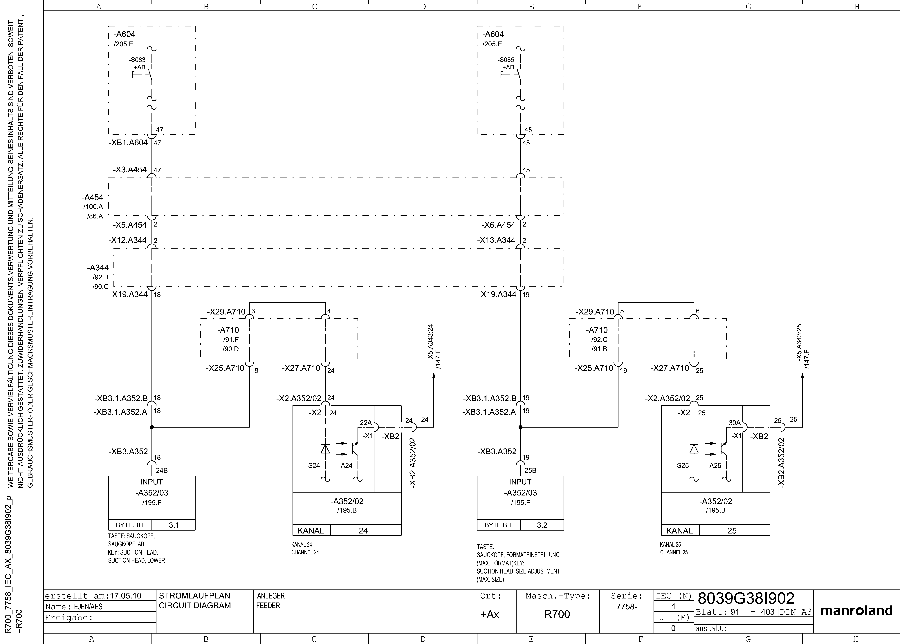

# +Ax — Sheet 91 of 403 — ANLEGER

**FEEDER**

> Part of the manroland **R700** printing press IEC/UL circuit diagrams.
> Drawing class: **Stromlaufplan / Circuit diagram** (DIN A3).
> Document `+Ax` covers the **Central control console** machine section.

## At a glance

| Field | Value |
|---|---|
| Document | `+Ax`  (8039G38I902) |
| Sheet | **91** of 403 |
| Section (DE) | ANLEGER |
| Section (EN) | FEEDER |
| Section type | CIRCUIT — Circuit diagram |
| Machine type | `R700` |
| Series | `7758` |
| Created | 17.05.10 |
| Replaces | — |
| Columns used | A, B, C, D, E, F, G, H |
| Path numbers | — |
| Labels on sheet | 127 |
| Cross-refs out | 16 |
| Cross-refs in | 44 |

**Previous:** [+Ax sheet 90](SHEET_0090.md) · **Next:** [+Ax sheet 92](SHEET_0092.md) · **Document TOC:** [_TOC.md](_TOC.md)  (+Ax) · **Master TOC:** [all sheets](../_MASTER_TOC.md)

## Sheet image (300 DPI, exact vector render)



_Rendered directly from the PDF vector layer at 300 DPI (1-bit), no OCR and no resampling. Use it to confirm anything ambiguous in the text below._

## Cross-references on this sheet

Each entry is a wire leaving this sheet. The printed token is `/sheet.column`; the link resolves to that sheet inside the same document.

| Ref | Target sheet | Col | Path | Destination on target | Target section | From col |
|---|---|---|---|---|---|---|
| `/205.E` | [+Ax sheet 205](SHEET_0205.md) | E | — | A604 | REFERENZMODUL | A |
| `/205.E` | [+Ax sheet 205](SHEET_0205.md) | E | — | A604 | REFERENZMODUL | E |
| `/100.A` | [+Ax sheet 100](SHEET_0100.md) | A | — | — | ANLEGER | A |
| `/86.A` | [+Ax sheet 86](SHEET_0086.md) | A | — | — | ANLEGER | A |
| `/92.B` | [+Ax sheet 92](SHEET_0092.md) | B | — | — | ANLEGER | A |
| `/90.C` | [+Ax sheet 90](SHEET_0090.md) | C | — | — | ANLEGER | A |
| `/147.F` | [+Ax sheet 147](SHEET_0147.md) | F | — | X5.A343:24 | ÜBERWACHUNGSRECHNER SICHERHEITSBUS | D |
| `/147.F` | [+Ax sheet 147](SHEET_0147.md) | F | — | X5.A343:25 | ÜBERWACHUNGSRECHNER SICHERHEITSBUS | H |
| `/91.F` | [+Ax sheet 91](SHEET_0091.md) | F | — | — | ANLEGER | B |
| `/90.D` | [+Ax sheet 90](SHEET_0090.md) | D | — | — | ANLEGER | B |
| `/92.C` | [+Ax sheet 92](SHEET_0092.md) | C | — | — | ANLEGER | F |
| `/91.B` | [+Ax sheet 91](SHEET_0091.md) | B | — | — | ANLEGER | F |
| `/195.F` | [+Ax sheet 195](SHEET_0195.md) | F | — | — | REFERENZMODUL | A |
| `/195.F` | [+Ax sheet 195](SHEET_0195.md) | F | — | — | REFERENZMODUL | E |
| `/195.B` | [+Ax sheet 195](SHEET_0195.md) | B | — | — | REFERENZMODUL | C |
| `/195.B` | [+Ax sheet 195](SHEET_0195.md) | B | — | — | REFERENZMODUL | G |

### Incoming references (sheets that point here)

Every other sheet that sends a wire to this one. `Back-ref` is the token printed on *that* sheet; `Path` is its line number.

| From sheet | Cols | Back-ref | Path | Refs | What continues there |
|---|---|---|---|---|---|
| [+Ax#86](SHEET_0086.md) | A | `/86.A` | — | 1 | — |
| [+Ax#90](SHEET_0090.md) | C, D | `/90.C`, `/90.D` | — | 2 | — |
| [+Ax#91](SHEET_0091.md) | B, F | `/91.B`, `/91.F` | — | 2 | — |
| [+Ax#92](SHEET_0092.md) | B, C | `/92.B`, `/92.C` | — | 2 | — |
| [+Ax#100](SHEET_0100.md) | A | `/100.A` | — | 1 | — |
| [+Ax#147](SHEET_0147.md) | F | `/147.F` | — | 2 | X5.A343:24; X5.A343:25 |
| [+Ax#195](SHEET_0195.md) | B, F | `/195.B`, `/195.F` | — | 4 | — |
| [+Ax#205](SHEET_0205.md) | D | `/205.D` | — | 2 | — |
| [+Ax#210](SHEET_0210.md) | D | `/210.D` | — | 2 | — |
| [+Ax#218](SHEET_0218.md) | H | `/218.H` | — | 2 | — |
| [+Ax#219](SHEET_0219.md) | B | `/219.B` | — | 2 | — |
| [+Ax#223](SHEET_0223.md) | E, G, H | `/223.E`, `/223.G`, `/223.H` | — | 6 | — |
| [+Ax#225](SHEET_0225.md) | B | `/225.B` | — | 2 | — |
| [+Ax#232](SHEET_0232.md) | E | `/232.E` | — | 1 | — |
| [+Ax#234](SHEET_0234.md) | C | `/234.C` | — | 1 | — |
| [+Ax#248](SHEET_0248.md) | C | `/248.C` | — | 1 | — |
| [+Ax#249](SHEET_0249.md) | F | `/249.F` | — | 1 | — |
| [+Ax#258](SHEET_0258.md) | G | `/258.G` | — | 2 | — |
| [+Ax#268](SHEET_0268.md) | B | `/268.B` | — | 2 | — |
| [+Ax#270](SHEET_0270.md) | H | `/270.H` | — | 2 | — |
| [+Ax#273](SHEET_0273.md) | G | `/273.G` | — | 4 | — |


## Devices on this sheet

| Tag | Class | Class meaning (IEC) | Col | Sub | Terminal | Sign |
|---|---|---|---|---|---|---|
| `S085` | S | Schalter / switch | E | — | — | — |
| `A604` | A | Baugruppe / assembly, module, PC board | E | — | — | — |
| `A352/03` | A | Baugruppe / assembly, module, PC board | E | 03 | — | — |
| `S083` | S | Schalter / switch | A | — | — | — |
| `A604` | A | Baugruppe / assembly, module, PC board | A | — | — | — |
| `A352/03` | A | Baugruppe / assembly, module, PC board | A | 03 | — | — |
| `S24` | S | Schalter / switch | C | — | — | — |
| `A24` | A | Baugruppe / assembly, module, PC board | C | — | — | — |
| `X1` | X | Klemme / terminal, plug connector | C | — | — | — |
| `X2` | X | Klemme / terminal, plug connector | C | — | — | — |
| `XB2` | XB |  | D | — | — | — |
| `A352/02` | A | Baugruppe / assembly, module, PC board | C | 02 | — | — |
| `A710` | A | Baugruppe / assembly, module, PC board | B | — | — | — |
| `A344` | A | Baugruppe / assembly, module, PC board | A | — | — | — |
| `A454` | A | Baugruppe / assembly, module, PC board | A | — | — | — |
| `S25` | S | Schalter / switch | F | — | — | — |
| `A25` | A | Baugruppe / assembly, module, PC board | G | — | — | — |
| `X1` | X | Klemme / terminal, plug connector | G | — | — | — |
| `X2` | X | Klemme / terminal, plug connector | F | — | — | — |
| `XB2` | XB |  | G | — | — | — |
| `A352/02` | A | Baugruppe / assembly, module, PC board | G | 02 | — | — |
| `A710` | A | Baugruppe / assembly, module, PC board | F | — | — | — |
| `3.2` | — | cross-device reference | E | — | — | — |
| `XB3.A352` | — | cross-device reference | E | — | — | — |
| `XB1.A604` | — | cross-device reference | A | — | — | — |
| `3.1` | — | cross-device reference | B | — | — | — |
| `XB3.A352` | — | cross-device reference | A | — | — | — |
| `XB3.1.A352.B` | — | cross-device reference | A | — | — | — |
| `XB3.1.A352.A` | — | cross-device reference | A | — | — | — |
| `X29.A710` | — | cross-device reference | B | — | — | — |
| `X27.A710` | — | cross-device reference | C | — | — | — |
| `X25.A710` | — | cross-device reference | B | — | — | — |
| `X13.A344` | — | cross-device reference | E | — | — | — |
| `X6.A454` | — | cross-device reference | E | — | — | — |
| `X19.A344` | — | cross-device reference | E | — | — | — |
| `X12.A344` | — | cross-device reference | A | — | — | — |
| `X5.A454` | — | cross-device reference | A | — | — | — |
| `X3.A454` | — | cross-device reference | A | — | — | — |
| `X19.A344` | — | cross-device reference | A | — | — | — |
| `XB3.1.A352.B` | — | cross-device reference | E | — | — | — |
| `XB3.1.A352.A` | — | cross-device reference | E | — | — | — |
| `X29.A710` | — | cross-device reference | F | — | — | — |
| `X27.A710` | — | cross-device reference | F | — | — | — |
| `X25.A710` | — | cross-device reference | F | — | — | — |
| `X5.A343:24` | — | cross-device reference | D | — | 24 | — |
| `X5.A343:25` | — | cross-device reference | G | — | 25 | — |

## Potentials / nets

_No named potentials on this sheet._

## Wire-end annotations (grouped as printed)

A wire that continues elsewhere is annotated with a small cluster: the destination description, the path/line number `#NN`, and the `/sheet.column` cross reference. Each row below is one such cluster exactly as it is grouped on the drawing.

| Col | Y | Path | Cross-ref | Text on the wire |
|---|---|---|---|---|
| A | 40.0 | — | `/205.E` | `A604` |
| E | 40.0 | — | `/205.E` | `A604` |
| A | 74.4 | — | — | `S083` |
| E | 74.4 | — | — | `S085` |
| A | 84.4 | — | — | `+AB` |
| E | 84.4 | — | — | `+AB` |
| B | 166.2 | — | — | `47` |
| E | 166.2 | — | — | `45` |
| A | 181.7 | — | — | `XB1.A604 47` |
| E | 183.2 | — | — | `45` |
| A | 217.2 | — | — | `X3.A454 47` |
| E | 218.6 | — | — | `45` |
| A | 253.3 | — | — | `A454` |
| A | 266.4 | — | `/100.A` | — |
| A | 278.8 | — | `/86.A` | — |
| A | 289.4 | — | — | `X5.A454 2` |
| E | 289.4 | — | — | `X6.A454 2` |
| A | 309.3 | — | — | `X12.A344 2` |
| E | 309.3 | — | — | `X13.A344 2` |
| A | 345.4 | — | — | `A344` |
| A | 358.5 | — | `/92.B`, `/90.C` | — |
| A | 380.1 | — | — | `X19.A344 18` |
| E | 380.1 | — | — | `X19.A344 19` |
| C | 402.8 | — | — | `X29.A710 3 4` |
| F | 402.8 | — | — | `X29.A710 5 6` |
| D | 423.5 | — | `/147.F` | `X5.A343:24` |
| H | 423.5 | — | `/147.F` | `X5.A343:25` |
| B | 426.9 | — | — | `A710` |
| F | 426.9 | — | — | `A710` |
| B | 440.0 | — | `/91.F`, `/90.D` | — |
| F | 440.0 | — | `/92.C`, `/91.B` | — |
| C | 476.5 | — | — | `X25.A710 18 X27.A710 24` |
| F | 476.5 | — | — | `X25.A710 19 X27.A710 25` |
| A | 516.2 | — | — | `XB3.1.A352.B 18` |
| C | 516.2 | — | — | `X2.A352/02 24` |
| E | 516.2 | — | — | `XB3.1.A352.B 19` |
| F | 516.2 | — | — | `X2.A352/02 25` |
| A | 533.2 | — | — | `XB3.1.A352.A 18` |
| F | 533.2 | — | — | `XB3.1.A352.A 19 25 25` |
| C | 534.7 | — | — | `X2` |
| F | 534.7 | — | — | `X2` |
| D | 536.1 | — | — | `24 24` |
| D | 544.6 | — | — | `24` |
| G | 544.6 | — | — | `25` |
| C | 548.8 | — | — | `22A` |
| G | 548.8 | — | — | `30A` |
| C | 565.8 | — | — | `X1` |
| D | 565.8 | — | — | `XB2` |
| G | 565.8 | — | — | `X1` |
| G | 565.8 | — | — | `XB2` |
| D | 572.0 | — | — | `XB2.A352/02` |
| G | 572.0 | — | — | `XB2.A352/02` |
| A | 585.7 | — | — | `XB3.A352 18` |
| E | 585.7 | — | — | `XB3.A352 19` |
| C | 604.8 | — | — | `S24 A24` |
| G | 604.8 | — | — | `S25 A25` |
| B | 611.1 | — | — | `24B` |
| E | 611.1 | — | — | `25B` |
| A | 625.7 | — | — | `INPUT` |
| E | 625.7 | — | — | `INPUT` |
| A | 639.5 | — | — | `A352/03` |
| E | 639.5 | — | — | `A352/03` |
| C | 650.9 | — | — | `A352/02` |
| G | 650.9 | — | — | `A352/02` |
| A | 653.3 | — | `/195.F` | — |
| E | 653.3 | — | `/195.F` | — |
| C | 663.2 | — | `/195.B` | — |
| G | 663.2 | — | `/195.B` | — |
| A | 682.4 | — | — | `BYTE.BIT 3.1` |
| E | 682.4 | — | — | `BYTE.BIT 3.2` |
| C | 689.1 | — | — | `KANAL 24` |
| G | 689.1 | — | — | `KANAL 25` |
| A | 697.9 | — | — | `KEY: SUCTION HEAD, TASTE: SAUGKOPF, SAUGKOPF, AB` |
| C | 709.5 | — | — | `KANAL 24 CHANNEL 24` |
| F | 709.5 | — | — | `KANAL 25 CHANNEL 25` |
| E | 712.1 | — | — | `(MAX. FORMAT)KEY: (MAX. SIZE) TASTE: SAUGKOPF, FORMATEINSTELLUNG SUCTION HEAD, SIZE ADJUSTMENT` |
| A | 729.8 | — | — | `SUCTION HEAD, LOWER` |


## Reconstructed tables

This sheet carries tabular content (pin map / terminal assignment / index). The grid below was rebuilt from the drawing's own rule lines, so each row is exactly one physical row of the table.

### Table 1 — 8 data rows × 19 columns (at x=141.7, y=34.0)

| A604 /205.E S083 +AB | 47 |  |  |  |  |  |  |  |  | A604 /205.E S085 +AB | 45 |  |  |  |  |  |  |  |
|---|---|---|---|---|---|---|---|---|---|---|---|---|---|---|---|---|---|---|
| `XB1.A604 X3.A454 X5.A454 X12.A344 X19.A344` | `47 47 2 2 18` |  |  |  |  |  |  |  |  | `X6.A454 X13.A344 X19.A344` | `45 45 2 2 19` |  |  |  |  |  |  |  |
| `XB3.1.A352.B` | `18` | `X29.A710 A710 /91.F /90.D X25.A710` | `3 18` | `X27.A710 X2.A352/02` | `4 24 24` |  |  | `X5.A343:24` | `/147.F` | `XB3.1.A352.B` | `19` | `X29.A710 A710 /92.C /91.B X25.A710` | `5 19` | `X27.A710 X2.A352/02` | `6 25 25` |  |  | `X5.A343:25` |
| `XB3.1.A352.A` | `18` |  |  | `X2` | `24` | `22A` |  | `24 24` |  | `XB3.1.A352.A` | `19` |  |  | `X2` | `25` | `30A` |  | `25 25` |
| `XB3.A352` | `18 24B` |  |  | `S24` | `A24` | `X1` | `XB2` | `XB2.A352/02` |  | `XB3.A352` | `19 25B` |  |  | `S25` | `A25` | `X1` | `XB2` | `XB2.A352/02` |
| `INPUT` |  |  |  |  |  |  |  |  |  | `INPUT` |  |  |  |  |  |  |  |  |
|  | `A352/03 /195.F` |  |  |  | `A352/02 /195.B` |  |  |  |  |  | `A352/03 /195.F` |  |  |  | `A352/02 /195.B` |  |  |  |
| `BYTE.BIT` | `3.1` |  |  |  |  |  |  |  |  | `BYTE.BIT` | `3.2` |  |  |  |  |  |  |  |
|  |  |  |  | `KANAL` |  | `24` |  |  |  |  |  |  |  | `KANAL` |  | `25` |  |  |


## Notes and free text on this sheet

| Text | Col | Y (pt) |
|---|---|---|
| `+AB` | E | 84.38 |
| `25B` | E | 611.15 |
| `INPUT` | E | 625.68 |
| `BYTE.BIT` | E | 682.93 |
| `TASTE:` | E | 712.06 |
| `SAUGKOPF, FORMATEINSTELLUNG` | E | 722.76 |
| `(MAX. FORMAT)KEY:` | E | 733.38 |
| `SUCTION HEAD, SIZE ADJUSTMENT` | E | 744.02 |
| `(MAX. SIZE)` | E | 754.62 |
| `+AB` | A | 84.38 |
| `24B` | B | 611.15 |
| `INPUT` | A | 625.68 |
| `BYTE.BIT` | A | 682.93 |
| `TASTE: SAUGKOPF,` | A | 697.92 |
| `SAUGKOPF, AB` | A | 708.56 |
| `KEY: SUCTION HEAD,` | A | 719.19 |
| `SUCTION HEAD, LOWER` | A | 729.83 |
| `KANAL 24` | C | 709.45 |
| `CHANNEL 24` | C | 719.39 |
| `22A` | C | 548.79 |
| `KANAL` | C | 689.12 |
| `X2.A352/02` | C | 516.21 |
| `XB2.A352/02` | D | 572.03 |
| `KANAL 25` | F | 709.45 |
| `CHANNEL 25` | F | 719.39 |
| `30A` | G | 548.79 |
| `KANAL` | F | 689.12 |
| `X2.A352/02` | F | 516.21 |
| `XB2.A352/02` | G | 572.03 |

## Complete label inventory (exact text from the drawing)

Every text object inside the drawing area of this sheet, in DIN reading order (column A→H, then top→bottom). This is the authoritative list: if a string is not here it is not printed on this sheet.

| Col | Y | X | Dir | Type | Text |
|---|---|---|---|---|---|
| A | 40.0 | 148.5 | → | device tag | `A604` |
| A | 53.8 | 148.8 | → | cross-reference | `/205.E` |
| A | 74.4 | 168.4 | → | device tag | `S083` |
| A | 84.4 | 174.6 | → | text | `+AB` |
| A | 181.7 | 142.0 | → | device ref | `XB1.A604` |
| A | 217.2 | 147.7 | → | device ref | `X3.A454` |
| A | 253.3 | 106.9 | → | device tag | `A454` |
| A | 266.4 | 109.1 | → | cross-reference | `/100.A` |
| A | 278.8 | 114.0 | → | cross-reference | `/86.A` |
| A | 289.4 | 147.7 | → | device ref | `X5.A454` |
| A | 309.3 | 141.7 | → | device ref | `X12.A344` |
| A | 345.4 | 114.0 | → | device tag | `A344` |
| A | 358.5 | 121.3 | → | cross-reference | `/92.B` |
| A | 370.9 | 121.0 | → | cross-reference | `/90.C` |
| A | 380.1 | 143.1 | → | device ref | `X19.A344` |
| A | 516.2 | 123.3 | → | device ref | `XB3.1.A352.B` |
| A | 533.9 | 122.5 | → | device ref | `XB3.1.A352.A` |
| A | 585.7 | 142.0 | → | device ref | `XB3.A352` |
| A | 625.7 | 183.5 | → | text | `INPUT` |
| A | 639.5 | 177.0 | → | device tag | `A352/03` |
| A | 653.3 | 186.1 | → | cross-reference | `/195.F` |
| A | 682.9 | 151.7 | → | text | `BYTE.BIT` |
| A | 697.9 | 141.4 | → | text | `TASTE: SAUGKOPF,` |
| A | 708.6 | 141.4 | → | text | `SAUGKOPF, AB` |
| A | 719.2 | 140.9 | → | text | `KEY: SUCTION HEAD,` |
| A | 729.8 | 141.4 | → | text | `SUCTION HEAD, LOWER` |
| B | 166.2 | 203.8 | → | number | `47` |
| B | 183.2 | 201.0 | → | number | `47` |
| B | 218.6 | 201.0 | → | number | `47` |
| B | 289.5 | 201.0 | → | number | `2` |
| B | 310.7 | 201.0 | → | number | `2` |
| B | 381.6 | 200.4 | → | number | `18` |
| B | 402.8 | 270.7 | → | device ref | `X29.A710` |
| B | 402.8 | 328.5 | → | number | `3` |
| B | 426.9 | 284.0 | → | device tag | `A710` |
| B | 440.0 | 292.0 | → | cross-reference | `/91.F` |
| B | 452.4 | 291.1 | → | cross-reference | `/90.D` |
| B | 476.5 | 269.3 | → | device ref | `X25.A710` |
| B | 480.8 | 328.0 | → | number | `18` |
| B | 516.2 | 200.4 | → | number | `18` |
| B | 533.2 | 200.4 | → | number | `18` |
| B | 594.2 | 200.4 | → | number | `18` |
| B | 611.2 | 203.8 | → | text | `24B` |
| B | 682.3 | 220.8 | → | device ref | `3.1` |
| C | 402.8 | 427.7 | → | number | `4` |
| C | 476.5 | 368.5 | → | device ref | `X27.A710` |
| C | 480.8 | 427.7 | → | number | `24` |
| C | 516.2 | 361.1 | → | text | `X2.A352/02` |
| C | 516.2 | 427.7 | → | number | `24` |
| C | 534.7 | 403.7 | → | device tag | `X2` |
| C | 536.1 | 430.6 | → | number | `24` |
| C | 548.8 | 470.6 | → | text | `22A` |
| C | 565.8 | 474.2 | → | device tag | `X1` |
| C | 604.8 | 400.0 | → | device tag | `S24` |
| C | 604.8 | 442.5 | → | device tag | `A24` |
| C | 650.9 | 432.1 | → | device tag | `A352/02` |
| C | 663.2 | 440.9 | → | cross-reference | `/195.B` |
| C | 689.1 | 388.9 | → | text | `KANAL` |
| C | 689.1 | 469.0 | → | number | `24` |
| C | 709.4 | 380.7 | → | text | `KANAL 24` |
| C | 719.4 | 381.0 | → | text | `CHANNEL 24` |
| D | 423.5 | 558.7 | ↕ | device ref | `X5.A343:24` |
| D | 456.9 | 568.6 | ↕ | cross-reference | `/147.F` |
| D | 544.6 | 550.5 | → | number | `24` |
| D | 546.0 | 529.8 | → | number | `24` |
| D | 565.8 | 498.6 | → | device tag | `XB2` |
| D | 572.0 | 534.6 | ↕ | text | `XB2.A352/02` |
| E | 40.0 | 630.4 | → | device tag | `A604` |
| E | 53.8 | 630.7 | → | cross-reference | `/205.E` |
| E | 74.4 | 650.3 | → | device tag | `S085` |
| E | 84.4 | 656.5 | → | text | `+AB` |
| E | 166.2 | 685.7 | → | number | `45` |
| E | 183.2 | 682.9 | → | number | `45` |
| E | 218.6 | 682.9 | → | number | `45` |
| E | 289.4 | 629.6 | → | device ref | `X6.A454` |
| E | 289.5 | 682.9 | → | number | `2` |
| E | 309.3 | 623.6 | → | device ref | `X13.A344` |
| E | 310.7 | 682.9 | → | number | `2` |
| E | 380.1 | 625.0 | → | device ref | `X19.A344` |
| E | 381.6 | 682.3 | → | number | `19` |
| E | 516.2 | 605.2 | → | device ref | `XB3.1.A352.B` |
| E | 516.2 | 682.3 | → | number | `19` |
| E | 533.2 | 682.3 | → | number | `19` |
| E | 533.9 | 604.3 | → | device ref | `XB3.1.A352.A` |
| E | 585.7 | 623.9 | → | device ref | `XB3.A352` |
| E | 594.2 | 682.3 | → | number | `19` |
| E | 611.2 | 685.7 | → | text | `25B` |
| E | 625.7 | 665.4 | → | text | `INPUT` |
| E | 639.5 | 658.9 | → | device tag | `A352/03` |
| E | 653.3 | 668.0 | → | cross-reference | `/195.F` |
| E | 682.3 | 701.9 | → | device ref | `3.2` |
| E | 682.9 | 633.5 | → | text | `BYTE.BIT` |
| E | 712.1 | 623.3 | → | text | `TASTE:` |
| E | 722.8 | 623.3 | → | text | `SAUGKOPF, FORMATEINSTELLUNG` |
| E | 733.4 | 623.1 | → | text | `(MAX. FORMAT)KEY:` |
| E | 744.0 | 623.3 | → | text | `SUCTION HEAD, SIZE ADJUSTMENT` |
| E | 754.6 | 623.1 | → | text | `(MAX. SIZE)` |
| F | 402.8 | 752.6 | → | device ref | `X29.A710` |
| F | 402.8 | 810.4 | → | number | `5` |
| F | 426.9 | 765.9 | → | device tag | `A710` |
| F | 440.0 | 773.0 | → | cross-reference | `/92.C` |
| F | 452.4 | 773.3 | → | cross-reference | `/91.B` |
| F | 476.5 | 751.2 | → | device ref | `X25.A710` |
| F | 476.5 | 850.4 | → | device ref | `X27.A710` |
| F | 480.8 | 809.9 | → | number | `19` |
| F | 516.2 | 843.0 | → | text | `X2.A352/02` |
| F | 534.7 | 885.5 | → | device tag | `X2` |
| F | 604.8 | 881.9 | → | device tag | `S25` |
| F | 689.1 | 870.8 | → | text | `KANAL` |
| F | 709.4 | 862.6 | → | text | `KANAL 25` |
| F | 719.4 | 862.9 | → | text | `CHANNEL 25` |
| G | 402.8 | 909.6 | → | number | `6` |
| G | 423.5 | 1040.6 | ↕ | device ref | `X5.A343:25` |
| G | 480.8 | 909.6 | → | number | `25` |
| G | 516.2 | 909.6 | → | number | `25` |
| G | 536.1 | 912.5 | → | number | `25` |
| G | 544.6 | 1032.4 | → | number | `25` |
| G | 546.0 | 1011.7 | → | number | `25` |
| G | 548.8 | 952.4 | → | text | `30A` |
| G | 565.8 | 956.1 | → | device tag | `X1` |
| G | 565.8 | 980.5 | → | device tag | `XB2` |
| G | 572.0 | 1016.5 | ↕ | text | `XB2.A352/02` |
| G | 604.8 | 924.4 | → | device tag | `A25` |
| G | 650.9 | 914.0 | → | device tag | `A352/02` |
| G | 663.2 | 922.8 | → | cross-reference | `/195.B` |
| G | 689.1 | 950.9 | → | number | `25` |
| H | 456.9 | 1050.5 | ↕ | cross-reference | `/147.F` |

## Reading-order text block

The same content as a plain block, grouped by DIN column — convenient to paste or to match against a visual description.

```text
=== Column A ===
  40.0  148.5  devtag       A604
  53.8  148.8  xref         /205.E
  74.4  168.4  devtag       S083
  84.4  174.6  text         +AB
 181.7  142.0  devref       XB1.A604
 217.2  147.7  devref       X3.A454
 253.3  106.9  devtag       A454
 266.4  109.1  xref         /100.A
 278.8  114.0  xref         /86.A
 289.4  147.7  devref       X5.A454
 309.3  141.7  devref       X12.A344
 345.4  114.0  devtag       A344
 358.5  121.3  xref         /92.B
 370.9  121.0  xref         /90.C
 380.1  143.1  devref       X19.A344
 516.2  123.3  devref       XB3.1.A352.B
 533.9  122.5  devref       XB3.1.A352.A
 585.7  142.0  devref       XB3.A352
 625.7  183.5  text         INPUT
 639.5  177.0  devtag       A352/03
 653.3  186.1  xref         /195.F
 682.9  151.7  text         BYTE.BIT
 697.9  141.4  text         TASTE: SAUGKOPF,
 708.6  141.4  text         SAUGKOPF, AB
 719.2  140.9  text         KEY: SUCTION HEAD,
 729.8  141.4  text         SUCTION HEAD, LOWER
=== Column B ===
 166.2  203.8  numeric      47
 183.2  201.0  numeric      47
 218.6  201.0  numeric      47
 289.5  201.0  numeric      2
 310.7  201.0  numeric      2
 381.6  200.4  numeric      18
 402.8  270.7  devref       X29.A710
 402.8  328.5  numeric      3
 426.9  284.0  devtag       A710
 440.0  292.0  xref         /91.F
 452.4  291.1  xref         /90.D
 476.5  269.3  devref       X25.A710
 480.8  328.0  numeric      18
 516.2  200.4  numeric      18
 533.2  200.4  numeric      18
 594.2  200.4  numeric      18
 611.2  203.8  text         24B
 682.3  220.8  devref       3.1
=== Column C ===
 402.8  427.7  numeric      4
 476.5  368.5  devref       X27.A710
 480.8  427.7  numeric      24
 516.2  361.1  text         X2.A352/02
 516.2  427.7  numeric      24
 534.7  403.7  devtag       X2
 536.1  430.6  numeric      24
 548.8  470.6  text         22A
 565.8  474.2  devtag       X1
 604.8  400.0  devtag       S24
 604.8  442.5  devtag       A24
 650.9  432.1  devtag       A352/02
 663.2  440.9  xref         /195.B
 689.1  388.9  text         KANAL
 689.1  469.0  numeric      24
 709.4  380.7  text         KANAL 24
 719.4  381.0  text         CHANNEL 24
=== Column D ===
 423.5  558.7  devref       X5.A343:24
 456.9  568.6  xref         /147.F
 544.6  550.5  numeric      24
 546.0  529.8  numeric      24
 565.8  498.6  devtag       XB2
 572.0  534.6  text         XB2.A352/02
=== Column E ===
  40.0  630.4  devtag       A604
  53.8  630.7  xref         /205.E
  74.4  650.3  devtag       S085
  84.4  656.5  text         +AB
 166.2  685.7  numeric      45
 183.2  682.9  numeric      45
 218.6  682.9  numeric      45
 289.4  629.6  devref       X6.A454
 289.5  682.9  numeric      2
 309.3  623.6  devref       X13.A344
 310.7  682.9  numeric      2
 380.1  625.0  devref       X19.A344
 381.6  682.3  numeric      19
 516.2  605.2  devref       XB3.1.A352.B
 516.2  682.3  numeric      19
 533.2  682.3  numeric      19
 533.9  604.3  devref       XB3.1.A352.A
 585.7  623.9  devref       XB3.A352
 594.2  682.3  numeric      19
 611.2  685.7  text         25B
 625.7  665.4  text         INPUT
 639.5  658.9  devtag       A352/03
 653.3  668.0  xref         /195.F
 682.3  701.9  devref       3.2
 682.9  633.5  text         BYTE.BIT
 712.1  623.3  text         TASTE:
 722.8  623.3  text         SAUGKOPF, FORMATEINSTELLUNG
 733.4  623.1  text         (MAX. FORMAT)KEY:
 744.0  623.3  text         SUCTION HEAD, SIZE ADJUSTMENT
 754.6  623.1  text         (MAX. SIZE)
=== Column F ===
 402.8  752.6  devref       X29.A710
 402.8  810.4  numeric      5
 426.9  765.9  devtag       A710
 440.0  773.0  xref         /92.C
 452.4  773.3  xref         /91.B
 476.5  751.2  devref       X25.A710
 476.5  850.4  devref       X27.A710
 480.8  809.9  numeric      19
 516.2  843.0  text         X2.A352/02
 534.7  885.5  devtag       X2
 604.8  881.9  devtag       S25
 689.1  870.8  text         KANAL
 709.4  862.6  text         KANAL 25
 719.4  862.9  text         CHANNEL 25
=== Column G ===
 402.8  909.6  numeric      6
 423.5 1040.6  devref       X5.A343:25
 480.8  909.6  numeric      25
 516.2  909.6  numeric      25
 536.1  912.5  numeric      25
 544.6 1032.4  numeric      25
 546.0 1011.7  numeric      25
 548.8  952.4  text         30A
 565.8  956.1  devtag       X1
 565.8  980.5  devtag       XB2
 572.0 1016.5  text         XB2.A352/02
 604.8  924.4  devtag       A25
 650.9  914.0  devtag       A352/02
 663.2  922.8  xref         /195.B
 689.1  950.9  numeric      25
=== Column H ===
 456.9 1050.5  xref         /147.F
```

---
_Generated from the PDF vector text layer; no OCR. Source: `R700_7758_IEC_AX_8039G38I902_p`, sheet 91._
