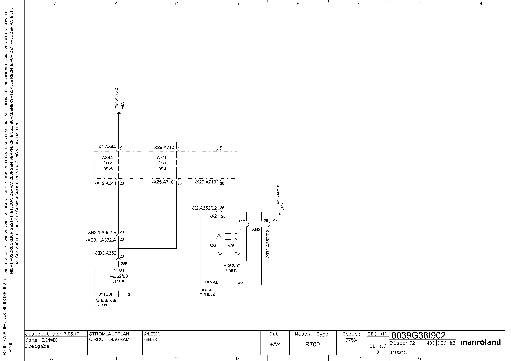

# +Ax — Sheet 92 of 403 — ANLEGER

**FEEDER**

> Part of the manroland **R700** printing press IEC/UL circuit diagrams.
> Drawing class: **Stromlaufplan / Circuit diagram** (DIN A3).
> Document `+Ax` covers the **Central control console** machine section.

## At a glance

| Field | Value |
|---|---|
| Document | `+Ax`  (8039G38I902) |
| Sheet | **92** of 403 |
| Section (DE) | ANLEGER |
| Section (EN) | FEEDER |
| Section type | CIRCUIT — Circuit diagram |
| Machine type | `R700` |
| Series | `7758` |
| Created | 17.05.10 |
| Replaces | — |
| Columns used | B, C, D, E |
| Path numbers | — |
| Labels on sheet | 53 |
| Cross-refs out | 7 |
| Cross-refs in | 18 |

**Previous:** [+Ax sheet 91](SHEET_0091.md) · **Next:** [+Ax sheet 93](SHEET_0093.md) · **Document TOC:** [_TOC.md](_TOC.md)  (+Ax) · **Master TOC:** [all sheets](../_MASTER_TOC.md)

## Sheet image (300 DPI, exact vector render)



_Rendered directly from the PDF vector layer at 300 DPI (1-bit), no OCR and no resampling. Use it to confirm anything ambiguous in the text below._

## Cross-references on this sheet

Each entry is a wire leaving this sheet. The printed token is `/sheet.column`; the link resolves to that sheet inside the same document.

| Ref | Target sheet | Col | Path | Destination on target | Target section | From col |
|---|---|---|---|---|---|---|
| `/93.A` | [+Ax sheet 93](SHEET_0093.md) | A | — | — | ANLEGER | B |
| `/91.A` | [+Ax sheet 91](SHEET_0091.md) | A | — | — | ANLEGER | B |
| `/93.B` | [+Ax sheet 93](SHEET_0093.md) | B | — | — | ANLEGER | C |
| `/91.F` | [+Ax sheet 91](SHEET_0091.md) | F | — | — | ANLEGER | C |
| `/147.F` | [+Ax sheet 147](SHEET_0147.md) | F | — | X5.A343:26 | ÜBERWACHUNGSRECHNER SICHERHEITSBUS | E |
| `/195.B` | [+Ax sheet 195](SHEET_0195.md) | B | — | — | REFERENZMODUL | D |
| `/195.F` | [+Ax sheet 195](SHEET_0195.md) | F | — | — | REFERENZMODUL | B |

### Incoming references (sheets that point here)

Every other sheet that sends a wire to this one. `Back-ref` is the token printed on *that* sheet; `Path` is its line number.

| From sheet | Cols | Back-ref | Path | Refs | What continues there |
|---|---|---|---|---|---|
| [+Ax#91](SHEET_0091.md) | A, F | `/91.A`, `/91.F` | — | 2 | — |
| [+Ax#93](SHEET_0093.md) | A, B | `/93.A`, `/93.B` | — | 2 | — |
| [+Ax#147](SHEET_0147.md) | F | `/147.F` | — | 1 | X5.A343:26 |
| [+Ax#195](SHEET_0195.md) | B, F | `/195.B`, `/195.F` | — | 2 | — |
| [+Ax#207](SHEET_0207.md) | F | `/207.F` | — | 1 | — |
| [+Ax#218](SHEET_0218.md) | H | `/218.H` | — | 1 | — |
| [+Ax#219](SHEET_0219.md) | B | `/219.B` | — | 1 | — |
| [+Ax#223](SHEET_0223.md) | E, G, H | `/223.E`, `/223.G`, `/223.H` | — | 3 | — |
| [+Ax#258](SHEET_0258.md) | G | `/258.G` | — | 1 | — |
| [+Ax#268](SHEET_0268.md) | B | `/268.B` | — | 1 | — |
| [+Ax#270](SHEET_0270.md) | H | `/270.H` | — | 1 | — |
| [+Ax#273](SHEET_0273.md) | G | `/273.G` | — | 2 | — |


## Devices on this sheet

| Tag | Class | Class meaning (IEC) | Col | Sub | Terminal | Sign |
|---|---|---|---|---|---|---|
| `S26` | S | Schalter / switch | D | — | — | — |
| `A26` | A | Baugruppe / assembly, module, PC board | D | — | — | — |
| `X1` | X | Klemme / terminal, plug connector | D | — | — | — |
| `X2` | X | Klemme / terminal, plug connector | D | — | — | — |
| `XB2` | XB |  | D | — | — | — |
| `A352/02` | A | Baugruppe / assembly, module, PC board | D | 02 | — | — |
| `A710` | A | Baugruppe / assembly, module, PC board | C | — | — | — |
| `A352/03` | A | Baugruppe / assembly, module, PC board | B | 03 | — | — |
| `A344` | A | Baugruppe / assembly, module, PC board | B | — | — | — |
| `X27.A710` | — | cross-device reference | C | — | — | — |
| `X25.A710` | — | cross-device reference | C | — | — | — |
| `X29.A710` | — | cross-device reference | C | — | — | — |
| `X1.A344` | — | cross-device reference | B | — | — | — |
| `3.3` | — | cross-device reference | B | — | — | — |
| `XB3.A352` | — | cross-device reference | B | — | — | — |
| `XB1.A596:2` | — | cross-device reference | B | — | 2 | — |
| `X19.A344` | — | cross-device reference | B | — | — | — |
| `XB3.1.A352.B` | — | cross-device reference | B | — | — | — |
| `XB3.1.A352.A` | — | cross-device reference | B | — | — | — |
| `X5.A343:26` | — | cross-device reference | E | — | 26 | — |

## Potentials / nets

_No named potentials on this sheet._

## Wire-end annotations (grouped as printed)

A wire that continues elsewhere is annotated with a small cluster: the destination description, the path/line number `#NN`, and the `/sheet.column` cross reference. Each row below is one such cluster exactly as it is grouped on the drawing.

| Col | Y | Path | Cross-ref | Text on the wire |
|---|---|---|---|---|
| B | 205.5 | — | — | `XB1.A596:2` |
| B | 238.4 | — | — | `+BA` |
| B | 337.6 | — | — | `X1.A344 2` |
| C | 339.0 | — | — | `X29.A710 7 8` |
| B | 363.1 | — | — | `A344` |
| C | 363.1 | — | — | `A710` |
| B | 376.2 | — | `/93.A`, `/91.A` | — |
| C | 376.2 | — | `/93.B` | — |
| C | 388.6 | — | `/91.F` | — |
| C | 419.8 | — | — | `X25.A710 20 X27.A710 26` |
| B | 422.7 | — | — | `X19.A344 20` |
| E | 430.6 | — | `/147.F` | `X5.A343:26` |
| D | 480.8 | — | — | `X2.A352/02 26` |
| D | 499.2 | — | — | `X2` |
| D | 500.6 | — | — | `26 26` |
| E | 509.1 | — | — | `26` |
| D | 513.4 | — | — | `30C` |
| D | 530.4 | — | — | `X1` |
| D | 530.4 | — | — | `XB2` |
| E | 536.6 | — | — | `XB2.A352/02` |
| B | 537.5 | — | — | `XB3.1.A352.B 20` |
| B | 554.5 | — | — | `XB3.1.A352.A 20` |
| D | 569.4 | — | — | `S26 A26` |
| B | 585.7 | — | — | `XB3.A352 20` |
| B | 611.1 | — | — | `26B` |
| D | 615.4 | — | — | `A352/02` |
| B | 625.7 | — | — | `INPUT` |
| D | 627.8 | — | `/195.B` | — |
| B | 639.5 | — | — | `A352/03` |
| B | 653.3 | — | `/195.F` | — |
| D | 653.7 | — | — | `KANAL 26` |
| D | 674.0 | — | — | `KANAL 26 CHANNEL 26` |
| B | 682.4 | — | — | `BYTE.BIT 3.3` |
| B | 697.9 | — | — | `KEY: RUN TASTE: BETRIEB` |


## Reconstructed tables

This sheet carries tabular content (pin map / terminal assignment / index). The grid below was rebuilt from the drawing's own rule lines, so each row is exactly one physical row of the table.

### Table 1 — 7 data rows × 8 columns (at x=219.7, y=331.7)

| X1.A344 A344 /93.A /91.A X19.A344 | 2 20 | X29.A710 A710 /93.B /91.F X25.A710 | 7 20 | X27.A710 X2.A352/02 | 8 26 26 |  |  |
|---|---|---|---|---|---|---|---|
| `XB3.1.A352.B XB3.1.A352.A` | `20 20` |  |  | `X2 S26` | `26 A26` | `30C X1` | `XB2` |
| `XB3.A352` | `20` |  |  |  |  |  |  |
|  | `26B` |  |  |  | `A352/02` |  |  |
| `INPUT` | `A352/03` |  |  |  | `/195.B` |  |  |
|  | `/195.F` |  |  | `KANAL` |  | `26` |  |
|  |  |  |  | `KANAL 26` |  |  |  |
| `BYTE.BIT` | `3.3` |  |  | `CHANNEL 26` |  |  |  |


## Notes and free text on this sheet

| Text | Col | Y (pt) |
|---|---|---|
| `KANAL 26` | C | 674.01 |
| `CHANNEL 26` | D | 683.96 |
| `30C` | D | 513.4 |
| `KANAL` | D | 653.68 |
| `X2.A352/02` | C | 480.78 |
| `XB2.A352/02` | E | 536.6 |
| `26B` | B | 611.15 |
| `INPUT` | B | 625.68 |
| `BYTE.BIT` | B | 682.93 |
| `TASTE: BETRIEB` | B | 697.92 |
| `KEY: RUN` | B | 708.54 |
| `+BA` | B | 238.39 |

## Complete label inventory (exact text from the drawing)

Every text object inside the drawing area of this sheet, in DIN reading order (column A→H, then top→bottom). This is the authoritative list: if a string is not here it is not printed on this sheet.

| Col | Y | X | Dir | Type | Text |
|---|---|---|---|---|---|
| B | 205.5 | 267.4 | ↕ | device ref | `XB1.A596:2` |
| B | 238.4 | 281.6 | ↕ | text | `+BA` |
| B | 337.6 | 225.6 | → | device ref | `X1.A344` |
| B | 339.1 | 278.9 | → | number | `2` |
| B | 363.1 | 234.4 | → | device tag | `A344` |
| B | 376.2 | 241.5 | → | cross-reference | `/93.A` |
| B | 388.6 | 241.5 | → | cross-reference | `/91.A` |
| B | 422.7 | 221.1 | → | device ref | `X19.A344` |
| B | 424.1 | 278.9 | → | number | `20` |
| B | 537.5 | 201.3 | → | device ref | `XB3.1.A352.B` |
| B | 537.5 | 278.9 | → | number | `20` |
| B | 554.5 | 278.9 | → | number | `20` |
| B | 555.2 | 200.4 | → | device ref | `XB3.1.A352.A` |
| B | 585.7 | 220.0 | → | device ref | `XB3.A352` |
| B | 594.2 | 278.9 | → | number | `20` |
| B | 611.2 | 281.8 | → | text | `26B` |
| B | 625.7 | 261.5 | → | text | `INPUT` |
| B | 639.5 | 255.0 | → | device tag | `A352/03` |
| B | 653.3 | 264.0 | → | cross-reference | `/195.F` |
| B | 682.3 | 297.9 | → | device ref | `3.3` |
| B | 682.9 | 229.6 | → | text | `BYTE.BIT` |
| B | 697.9 | 219.4 | → | text | `TASTE: BETRIEB` |
| B | 708.5 | 218.8 | → | text | `KEY: RUN` |
| C | 339.0 | 355.7 | → | device ref | `X29.A710` |
| C | 339.1 | 413.6 | → | number | `7` |
| C | 363.1 | 362.0 | → | device tag | `A710` |
| C | 376.2 | 369.4 | → | cross-reference | `/93.B` |
| C | 388.6 | 369.9 | → | cross-reference | `/91.F` |
| C | 419.8 | 354.3 | → | device ref | `X25.A710` |
| C | 419.8 | 453.5 | → | device ref | `X27.A710` |
| C | 424.1 | 413.6 | → | number | `20` |
| C | 480.8 | 446.2 | → | text | `X2.A352/02` |
| C | 674.0 | 465.7 | → | text | `KANAL 26` |
| D | 339.1 | 512.8 | → | number | `8` |
| D | 424.1 | 512.8 | → | number | `26` |
| D | 480.8 | 512.8 | → | number | `26` |
| D | 499.2 | 488.7 | → | device tag | `X2` |
| D | 500.6 | 515.6 | → | number | `26` |
| D | 510.6 | 614.8 | → | number | `26` |
| D | 513.4 | 555.6 | → | text | `30C` |
| D | 530.4 | 559.3 | → | device tag | `X1` |
| D | 530.4 | 583.7 | → | device tag | `XB2` |
| D | 569.4 | 485.0 | → | device tag | `S26` |
| D | 569.4 | 527.5 | → | device tag | `A26` |
| D | 615.4 | 517.2 | → | device tag | `A352/02` |
| D | 627.8 | 526.0 | → | cross-reference | `/195.B` |
| D | 653.7 | 474.0 | → | text | `KANAL` |
| D | 653.7 | 554.0 | → | number | `26` |
| D | 684.0 | 466.0 | → | text | `CHANNEL 26` |
| E | 430.6 | 643.7 | ↕ | device ref | `X5.A343:26` |
| E | 464.0 | 653.7 | ↕ | cross-reference | `/147.F` |
| E | 509.1 | 635.5 | → | number | `26` |
| E | 536.6 | 619.7 | ↕ | text | `XB2.A352/02` |

## Reading-order text block

The same content as a plain block, grouped by DIN column — convenient to paste or to match against a visual description.

```text
=== Column B ===
 205.5  267.4  devref       XB1.A596:2
 238.4  281.6  text         +BA
 337.6  225.6  devref       X1.A344
 339.1  278.9  numeric      2
 363.1  234.4  devtag       A344
 376.2  241.5  xref         /93.A
 388.6  241.5  xref         /91.A
 422.7  221.1  devref       X19.A344
 424.1  278.9  numeric      20
 537.5  201.3  devref       XB3.1.A352.B
 537.5  278.9  numeric      20
 554.5  278.9  numeric      20
 555.2  200.4  devref       XB3.1.A352.A
 585.7  220.0  devref       XB3.A352
 594.2  278.9  numeric      20
 611.2  281.8  text         26B
 625.7  261.5  text         INPUT
 639.5  255.0  devtag       A352/03
 653.3  264.0  xref         /195.F
 682.3  297.9  devref       3.3
 682.9  229.6  text         BYTE.BIT
 697.9  219.4  text         TASTE: BETRIEB
 708.5  218.8  text         KEY: RUN
=== Column C ===
 339.0  355.7  devref       X29.A710
 339.1  413.6  numeric      7
 363.1  362.0  devtag       A710
 376.2  369.4  xref         /93.B
 388.6  369.9  xref         /91.F
 419.8  354.3  devref       X25.A710
 419.8  453.5  devref       X27.A710
 424.1  413.6  numeric      20
 480.8  446.2  text         X2.A352/02
 674.0  465.7  text         KANAL 26
=== Column D ===
 339.1  512.8  numeric      8
 424.1  512.8  numeric      26
 480.8  512.8  numeric      26
 499.2  488.7  devtag       X2
 500.6  515.6  numeric      26
 510.6  614.8  numeric      26
 513.4  555.6  text         30C
 530.4  559.3  devtag       X1
 530.4  583.7  devtag       XB2
 569.4  485.0  devtag       S26
 569.4  527.5  devtag       A26
 615.4  517.2  devtag       A352/02
 627.8  526.0  xref         /195.B
 653.7  474.0  text         KANAL
 653.7  554.0  numeric      26
 684.0  466.0  text         CHANNEL 26
=== Column E ===
 430.6  643.7  devref       X5.A343:26
 464.0  653.7  xref         /147.F
 509.1  635.5  numeric      26
 536.6  619.7  text         XB2.A352/02
```

---
_Generated from the PDF vector text layer; no OCR. Source: `R700_7758_IEC_AX_8039G38I902_p`, sheet 92._
