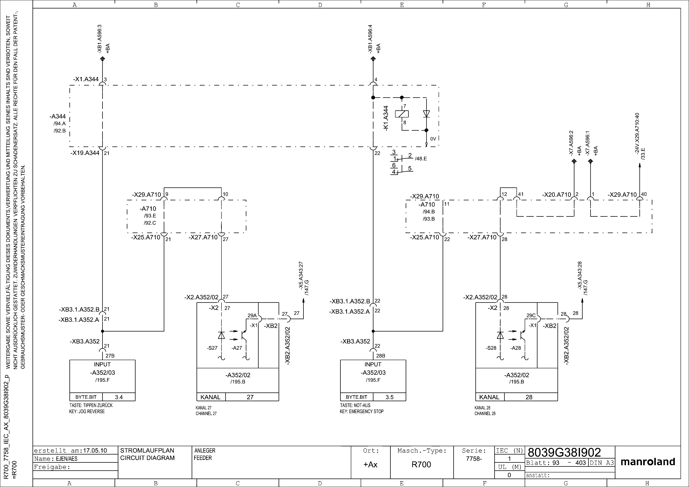

# +Ax — Sheet 93 of 403 — ANLEGER

**FEEDER**

> Part of the manroland **R700** printing press IEC/UL circuit diagrams.
> Drawing class: **Stromlaufplan / Circuit diagram** (DIN A3).
> Document `+Ax` covers the **Central control console** machine section.

## At a glance

| Field | Value |
|---|---|
| Document | `+Ax`  (8039G38I902) |
| Sheet | **93** of 403 |
| Section (DE) | ANLEGER |
| Section (EN) | FEEDER |
| Section type | CIRCUIT — Circuit diagram |
| Machine type | `R700` |
| Series | `7758` |
| Created | 17.05.10 |
| Replaces | — |
| Columns used | A, B, C, D, E, F, G, H |
| Path numbers | — |
| Labels on sheet | 124 |
| Cross-refs out | 14 |
| Cross-refs in | 40 |

**Previous:** [+Ax sheet 92](SHEET_0092.md) · **Next:** [+Ax sheet 94](SHEET_0094.md) · **Document TOC:** [_TOC.md](_TOC.md)  (+Ax) · **Master TOC:** [all sheets](../_MASTER_TOC.md)

## Sheet image (300 DPI, exact vector render)



_Rendered directly from the PDF vector layer at 300 DPI (1-bit), no OCR and no resampling. Use it to confirm anything ambiguous in the text below._

## Cross-references on this sheet

Each entry is a wire leaving this sheet. The printed token is `/sheet.column`; the link resolves to that sheet inside the same document.

| Ref | Target sheet | Col | Path | Destination on target | Target section | From col |
|---|---|---|---|---|---|---|
| `/33.E` | [+Ax sheet 33](SHEET_0033.md) | E | — | 24V.X29.A710:40 | SPANNUNGSVERSORGUNG, SCHALTSCHRANKBELÜFTUNG | H |
| `/94.A` | [+Ax sheet 94](SHEET_0094.md) | A | — | — | ANLEGER | A |
| `/92.B` | [+Ax sheet 92](SHEET_0092.md) | B | — | — | ANLEGER | A |
| `/48.E` | [+Ax sheet 48](SHEET_0048.md) | E | — | — | NOT AUS | E |
| `/94.B` | [+Ax sheet 94](SHEET_0094.md) | B | — | — | ANLEGER | E |
| `/93.B` | [+Ax sheet 93](SHEET_0093.md) | B | — | — | ANLEGER | E |
| `/93.E` | [+Ax sheet 93](SHEET_0093.md) | E | — | — | ANLEGER | B |
| `/92.C` | [+Ax sheet 92](SHEET_0092.md) | C | — | — | ANLEGER | B |
| `/147.G` | [+Ax sheet 147](SHEET_0147.md) | G | — | X5.A343:27 | ÜBERWACHUNGSRECHNER SICHERHEITSBUS | D |
| `/147.G` | [+Ax sheet 147](SHEET_0147.md) | G | — | X5.A343:28 | ÜBERWACHUNGSRECHNER SICHERHEITSBUS | G |
| `/195.F` | [+Ax sheet 195](SHEET_0195.md) | F | — | — | REFERENZMODUL | A |
| `/195.F` | [+Ax sheet 195](SHEET_0195.md) | F | — | — | REFERENZMODUL | E |
| `/195.B` | [+Ax sheet 195](SHEET_0195.md) | B | — | — | REFERENZMODUL | C |
| `/195.B` | [+Ax sheet 195](SHEET_0195.md) | B | — | — | REFERENZMODUL | F |

### Incoming references (sheets that point here)

Every other sheet that sends a wire to this one. `Back-ref` is the token printed on *that* sheet; `Path` is its line number.

| From sheet | Cols | Back-ref | Path | Refs | What continues there |
|---|---|---|---|---|---|
| [+Ax#33](SHEET_0033.md) | D | `/33.D` | — | 1 | — |
| [+Ax#48](SHEET_0048.md) | E | `/48.E` | — | 1 | — |
| [+Ax#92](SHEET_0092.md) | B, C | `/92.B`, `/92.C` | — | 2 | — |
| [+Ax#93](SHEET_0093.md) | B, E | `/93.B`, `/93.E` | — | 2 | — |
| [+Ax#94](SHEET_0094.md) | A, B | `/94.A`, `/94.B` | — | 2 | — |
| [+Ax#147](SHEET_0147.md) | G | `/147.G` | — | 2 | X5.A343:27; X5.A343:28 |
| [+Ax#195](SHEET_0195.md) | B, F | `/195.B`, `/195.F` | — | 4 | — |
| [+Ax#207](SHEET_0207.md) | F | `/207.F` | — | 2 | — |
| [+Ax#218](SHEET_0218.md) | H | `/218.H` | — | 2 | — |
| [+Ax#219](SHEET_0219.md) | B | `/219.B` | — | 2 | — |
| [+Ax#223](SHEET_0223.md) | E, G, H | `/223.E`, `/223.G`, `/223.H` | — | 6 | — |
| [+Ax#258](SHEET_0258.md) | G | `/258.G` | — | 2 | — |
| [+Ax#260](SHEET_0260.md) | H | `/260.H` | — | 2 | — |
| [+Ax#268](SHEET_0268.md) | B | `/268.B` | — | 2 | — |
| [+Ax#270](SHEET_0270.md) | H | `/270.H` | — | 2 | — |
| [+Ax#273](SHEET_0273.md) | G, H | `/273.G`, `/273.H` | — | 6 | — |


## Devices on this sheet

| Tag | Class | Class meaning (IEC) | Col | Sub | Terminal | Sign |
|---|---|---|---|---|---|---|
| `A352/03` | A | Baugruppe / assembly, module, PC board | A | 03 | — | — |
| `A344` | A | Baugruppe / assembly, module, PC board | A | — | — | — |
| `S28` | S | Schalter / switch | F | — | — | — |
| `A28` | A | Baugruppe / assembly, module, PC board | F | — | — | — |
| `X1` | X | Klemme / terminal, plug connector | G | — | — | — |
| `X2` | X | Klemme / terminal, plug connector | F | — | — | — |
| `XB2` | XB |  | G | — | — | — |
| `A352/02` | A | Baugruppe / assembly, module, PC board | F | 02 | — | — |
| `A710` | A | Baugruppe / assembly, module, PC board | E | — | — | — |
| `A352/03` | A | Baugruppe / assembly, module, PC board | E | 03 | — | — |
| `S27` | S | Schalter / switch | C | — | — | — |
| `A27` | A | Baugruppe / assembly, module, PC board | C | — | — | — |
| `X1` | X | Klemme / terminal, plug connector | C | — | — | — |
| `X2` | X | Klemme / terminal, plug connector | C | — | — | — |
| `XB2` | XB |  | C | — | — | — |
| `A352/02` | A | Baugruppe / assembly, module, PC board | C | 02 | — | — |
| `A710` | A | Baugruppe / assembly, module, PC board | B | — | — | — |
| `3.4` | — | cross-device reference | B | — | — | — |
| `XB3.A352` | — | cross-device reference | A | — | — | — |
| `XB3.1.A352.B` | — | cross-device reference | A | — | — | — |
| `XB3.1.A352.A` | — | cross-device reference | A | — | — | — |
| `X1.A344` | — | cross-device reference | A | — | — | — |
| `X19.A344` | — | cross-device reference | A | — | — | — |
| `XB1.A596:3` | — | cross-device reference | A | — | 3 | — |
| `X20.A710` | — | cross-device reference | G | — | — | — |
| `X29.A710` | — | cross-device reference | H | — | — | — |
| `X27.A710` | — | cross-device reference | F | — | — | — |
| `X25.A710` | — | cross-device reference | E | — | — | — |
| `3.5` | — | cross-device reference | E | — | — | — |
| `XB3.A352` | — | cross-device reference | D | — | — | — |
| `XB3.1.A352.B` | — | cross-device reference | D | — | — | — |
| `XB3.1.A352.A` | — | cross-device reference | D | — | — | — |
| `X29.A710` | — | cross-device reference | B | — | — | — |
| `X27.A710` | — | cross-device reference | C | — | — | — |
| `X25.A710` | — | cross-device reference | B | — | — | — |
| `K1.A344` | — | cross-device reference | E | — | — | — |
| `XB1.A596:4` | — | cross-device reference | E | — | 4 | — |
| `X7.A596:2` | — | cross-device reference | G | — | 2 | — |
| `X7.A596:1` | — | cross-device reference | G | — | 1 | — |
| `X5.A343:28` | — | cross-device reference | G | — | 28 | — |
| `X5.A343:27` | — | cross-device reference | D | — | 27 | — |
| `X29.A710` | — | cross-device reference | E | — | — | — |

## Potentials / nets

| Potential | Count | Columns | Attached devices | Terminals |
|---|---|---|---|---|
| `0V` | 1 | E | — | — |
| `24V` | 1 | H | `A710`, `X29` | `40` |


A potential such as `L24+/4` or `M24+` is a named supply/return rail; every place it appears on this sheet is electrically common.

## Wire-end annotations (grouped as printed)

A wire that continues elsewhere is annotated with a small cluster: the destination description, the path/line number `#NN`, and the `/sheet.column` cross reference. Each row below is one such cluster exactly as it is grouped on the drawing.

| Col | Y | Path | Cross-ref | Text on the wire |
|---|---|---|---|---|
| A | 42.5 | — | — | `XB1.A596:3` |
| E | 42.5 | — | — | `XB1.A596:4` |
| A | 75.4 | — | — | `+BA` |
| E | 75.4 | — | — | `+BA` |
| A | 132.1 | — | — | `X1.A344 3` |
| E | 133.6 | — | — | `4` |
| E | 179.6 | — | — | `7` |
| E | 182.3 | — | — | `K1.A344` |
| H | 195.0 | — | `/33.E` | `24V.X29.A710:40` |
| A | 196.6 | — | — | `A344` |
| E | 208.0 | — | — | `8` |
| A | 209.7 | — | `/94.A`, `/92.B` | — |
| G | 225.6 | — | — | `X7.A596:2` |
| G | 225.6 | — | — | `X7.A596:1` |
| E | 236.5 | — | — | `0V` |
| G | 252.6 | — | — | `+BA` |
| G | 252.6 | — | — | `+BA` |
| E | 258.2 | — | — | `3 6 4 1` |
| A | 259.7 | — | — | `X19.A344 21` |
| E | 261.1 | — | — | `22` |
| E | 263.9 | — | — | `2` |
| E | 270.2 | — | `/48.E` | — |
| E | 286.6 | — | — | `5` |
| B | 332.0 | — | — | `X29.A710 9 10` |
| F | 332.0 | — | — | `12` |
| G | 332.0 | — | — | `41 X20.A710 2 1 X29.A710 40` |
| E | 334.8 | — | — | `X29.A710` |
| E | 349.0 | — | — | `A710 11` |
| B | 356.1 | — | — | `A710` |
| E | 362.0 | — | `/94.B`, `/93.B` | — |
| B | 369.1 | — | `/93.E`, `/92.C` | — |
| B | 405.7 | — | — | `X25.A710 21 X27.A710 27` |
| F | 405.7 | — | — | `X25.A710 22 X27.A710 28` |
| D | 451.8 | — | `/147.G` | `X5.A343:27` |
| G | 451.8 | — | `/147.G` | `X5.A343:28` |
| C | 509.1 | — | — | `X2.A352/02 27` |
| F | 509.1 | — | — | `X2.A352/02 28` |
| D | 516.2 | — | — | `XB3.1.A352.B 22` |
| C | 527.6 | — | — | `X2` |
| F | 527.6 | — | — | `X2` |
| D | 529.0 | — | — | `27 27 XB3.1.A352.A 22` |
| G | 529.0 | — | — | `28 28` |
| A | 530.4 | — | — | `XB3.1.A352.B 21` |
| D | 537.5 | — | — | `27` |
| G | 537.5 | — | — | `28` |
| C | 541.7 | — | — | `29A` |
| G | 541.8 | — | — | `29C` |
| A | 547.4 | — | — | `XB3.1.A352.A 21` |
| C | 558.7 | — | — | `X1` |
| C | 558.7 | — | — | `XB2` |
| G | 558.7 | — | — | `X1` |
| G | 558.7 | — | — | `XB2` |
| D | 565.0 | — | — | `XB2.A352/02` |
| G | 565.0 | — | — | `XB2.A352/02` |
| A | 585.7 | — | — | `XB3.A352 21` |
| D | 585.7 | — | — | `XB3.A352 22` |
| C | 597.7 | — | — | `S27 A27` |
| F | 597.7 | — | — | `S28 A28` |
| A | 611.1 | — | — | `27B` |
| E | 611.1 | — | — | `28B` |
| A | 625.7 | — | — | `INPUT` |
| E | 625.7 | — | — | `INPUT` |
| A | 639.5 | — | — | `A352/03` |
| E | 639.5 | — | — | `A352/03` |
| C | 643.8 | — | — | `A352/02` |
| F | 643.8 | — | — | `A352/02` |
| A | 653.3 | — | `/195.F` | — |
| E | 653.3 | — | `/195.F` | — |
| C | 656.1 | — | `/195.B` | — |
| F | 656.1 | — | `/195.B` | — |
| C | 682.0 | — | — | `KANAL 27` |
| F | 682.0 | — | — | `KANAL 28` |
| A | 682.4 | — | — | `BYTE.BIT 3.4` |
| E | 682.4 | — | — | `BYTE.BIT 3.5` |
| A | 697.9 | — | — | `KEY: JOG REVERSE TASTE: TIPPEN ZURÜCK` |
| E | 697.9 | — | — | `KEY: EMERGENCY STOP TASTE: NOT AUS` |
| C | 702.4 | — | — | `KANAL 27 CHANNEL 27` |
| F | 702.4 | — | — | `KANAL 28 CHANNEL 28` |


## Reconstructed tables

This sheet carries tabular content (pin map / terminal assignment / index). The grid below was rebuilt from the drawing's own rule lines, so each row is exactly one physical row of the table.

### Table 1 — 8 data rows × 24 columns (at x=120.5, y=168.7)

|  |  |  |  |  |  |  |  |  |  |  | K1.A344 | 7 8 |  |  |  |  |  |  |  |  |  |  |  |
|---|---|---|---|---|---|---|---|---|---|---|---|---|---|---|---|---|---|---|---|---|---|---|---|
| `X19.A344` | `21` |  |  |  |  |  |  |  |  |  | `3 22 1 6 4` |  | `2 /48.E 5` | `0V` |  |  |  |  |  | `X7.A596:2` | `+BA` | `X7.A596:1` | `24V.X29.A710:40 +BA` |
|  |  | `X29.A710 A710 /93.E` | `9` |  | `10` |  |  |  |  |  |  |  | `X29.A710` | `A710 /94.B` | `11` |  | `12 41` |  | `X20.A710` |  | `2` |  | `X29.A710 1` |
|  |  | `/92.C X25.A710` | `21` | `X27.A710 X2.A352/02` | `27 27` |  |  | `X5.A343:27` | `/147.G` | `XB3.1.A352.B` | `22` |  | `X25.A710` | `/93.B` | `22` | `X27.A710 X2.A352/02` | `28 28` |  |  |  | `X5.A343:28` | `/147.G` |  |
| `XB3.1.A352.B XB3.1.A352.A` | `21 21` |  |  | `X2` | `27` | `29A X1` | `XB2` | `27 27` |  | `XB3.1.A352.A` | `22` |  |  |  |  | `X2` | `28` | `29C X1` | `XB2` | `28` | `28` |  |  |
| `XB3.A352` | `21 27B` |  |  | `S27` | `A27` |  |  | `XB2.A352/02` |  | `XB3.A352` | `22 28B` |  |  |  |  | `S28` | `A28` |  |  | `XB2.A352/02` |  |  |  |
| `INPUT` |  |  |  |  |  |  |  |  |  | `INPUT` |  |  |  |  |  |  |  |  |  |  |  |  |  |
|  | `A352/03 /195.F` |  |  |  | `A352/02 /195.B` |  |  |  |  |  | `A352/03 /195.F` |  |  |  |  |  | `A352/02 /195.B` |  |  |  |  |  |  |
| `BYTE.BIT` | `3.4` |  |  | `KANAL` |  | `27` |  |  |  | `BYTE.BIT` | `3.5` |  |  |  |  | `KANAL` |  | `28` |  |  |  |  |  |


## Notes and free text on this sheet

| Text | Col | Y (pt) |
|---|---|---|
| `27B` | A | 611.15 |
| `INPUT` | A | 625.68 |
| `BYTE.BIT` | A | 682.93 |
| `TASTE: TIPPEN ZURÜCK` | A | 697.94 |
| `KEY: JOG REVERSE` | A | 708.55 |
| `+BA` | A | 75.4 |
| `KANAL 28` | F | 702.36 |
| `CHANNEL 28` | F | 712.3 |
| `29C` | G | 541.75 |
| `KANAL` | F | 682.03 |
| `X2.A352/02` | F | 509.13 |
| `XB2.A352/02` | G | 564.95 |
| `28B` | E | 611.15 |
| `INPUT` | E | 625.68 |
| `BYTE.BIT` | D | 682.93 |
| `TASTE: NOT AUS` | D | 697.93 |
| `KEY: EMERGENCY STOP` | E | 708.57 |
| `KANAL 27` | C | 702.36 |
| `CHANNEL 27` | C | 712.3 |
| `29A` | C | 541.7 |
| `KANAL` | C | 682.03 |
| `X2.A352/02` | C | 509.13 |
| `XB2.A352/02` | D | 564.95 |
| `+BA` | E | 75.4 |
| `+BA` | G | 252.57 |

## Complete label inventory (exact text from the drawing)

Every text object inside the drawing area of this sheet, in DIN reading order (column A→H, then top→bottom). This is the authoritative list: if a string is not here it is not printed on this sheet.

| Col | Y | X | Dir | Type | Text |
|---|---|---|---|---|---|
| A | 42.5 | 168.2 | ↕ | device ref | `XB1.A596:3` |
| A | 75.4 | 182.4 | ↕ | text | `+BA` |
| A | 132.1 | 126.4 | → | device ref | `X1.A344` |
| A | 133.6 | 179.7 | → | number | `3` |
| A | 196.6 | 85.6 | → | device tag | `A344` |
| A | 209.7 | 92.7 | → | cross-reference | `/94.A` |
| A | 222.1 | 93.0 | → | cross-reference | `/92.B` |
| A | 259.7 | 121.9 | → | device ref | `X19.A344` |
| A | 261.1 | 179.7 | → | number | `21` |
| A | 530.4 | 102.0 | → | device ref | `XB3.1.A352.B` |
| A | 530.4 | 179.7 | → | number | `21` |
| A | 547.4 | 179.7 | → | number | `21` |
| A | 548.1 | 101.2 | → | device ref | `XB3.1.A352.A` |
| A | 585.7 | 120.8 | → | device ref | `XB3.A352` |
| A | 594.2 | 179.7 | → | number | `21` |
| A | 611.2 | 182.6 | → | text | `27B` |
| A | 625.7 | 162.3 | → | text | `INPUT` |
| A | 639.5 | 155.8 | → | device tag | `A352/03` |
| A | 653.3 | 164.8 | → | cross-reference | `/195.F` |
| A | 682.9 | 130.4 | → | text | `BYTE.BIT` |
| A | 697.9 | 120.2 | → | text | `TASTE: TIPPEN ZURÜCK` |
| A | 708.5 | 119.6 | → | text | `KEY: JOG REVERSE` |
| B | 332.0 | 228.2 | → | device ref | `X29.A710` |
| B | 332.0 | 286.0 | → | number | `9` |
| B | 356.1 | 241.5 | → | device tag | `A710` |
| B | 369.1 | 249.2 | → | cross-reference | `/93.E` |
| B | 381.5 | 248.6 | → | cross-reference | `/92.C` |
| B | 405.7 | 226.8 | → | device ref | `X25.A710` |
| B | 409.9 | 286.0 | → | number | `21` |
| B | 682.3 | 198.7 | → | device ref | `3.4` |
| C | 332.0 | 384.7 | → | number | `10` |
| C | 405.7 | 326.0 | → | device ref | `X27.A710` |
| C | 409.9 | 385.2 | → | number | `27` |
| C | 509.1 | 318.6 | → | text | `X2.A352/02` |
| C | 509.1 | 385.2 | → | number | `27` |
| C | 527.6 | 361.1 | → | device tag | `X2` |
| C | 529.0 | 388.1 | → | number | `27` |
| C | 541.7 | 428.0 | → | text | `29A` |
| C | 558.7 | 431.7 | → | device tag | `X1` |
| C | 558.7 | 456.1 | → | device tag | `XB2` |
| C | 597.7 | 357.4 | → | device tag | `S27` |
| C | 597.7 | 400.0 | → | device tag | `A27` |
| C | 643.8 | 389.6 | → | device tag | `A352/02` |
| C | 656.1 | 398.4 | → | cross-reference | `/195.B` |
| C | 682.0 | 346.4 | → | text | `KANAL` |
| C | 682.0 | 426.5 | → | number | `27` |
| C | 702.4 | 338.2 | → | text | `KANAL 27` |
| C | 712.3 | 338.5 | → | text | `CHANNEL 27` |
| D | 451.8 | 516.2 | ↕ | device ref | `X5.A343:27` |
| D | 483.9 | 526.1 | ↕ | cross-reference | `/147.G` |
| D | 516.2 | 569.8 | → | device ref | `XB3.1.A352.B` |
| D | 533.9 | 568.9 | → | device ref | `XB3.1.A352.A` |
| D | 537.5 | 508.0 | → | number | `27` |
| D | 538.9 | 487.3 | → | number | `27` |
| D | 564.9 | 492.1 | ↕ | text | `XB2.A352/02` |
| D | 585.7 | 588.5 | → | device ref | `XB3.A352` |
| D | 682.9 | 598.1 | → | text | `BYTE.BIT` |
| D | 697.9 | 587.9 | → | text | `TASTE: NOT AUS` |
| E | 42.5 | 635.9 | ↕ | device ref | `XB1.A596:4` |
| E | 75.4 | 650.1 | ↕ | text | `+BA` |
| E | 133.6 | 647.4 | → | number | `4` |
| E | 179.6 | 697.0 | → | number | `7` |
| E | 182.3 | 662.2 | ↕ | device ref | `K1.A344` |
| E | 208.0 | 697.0 | → | number | `8` |
| E | 236.5 | 743.8 | → | potential | `0V` |
| E | 258.2 | 677.8 | → | number | `3` |
| E | 261.1 | 647.4 | → | number | `22` |
| E | 263.9 | 705.5 | → | number | `2` |
| E | 269.6 | 679.2 | → | number | `1` |
| E | 270.2 | 717.2 | → | cross-reference | `/48.E` |
| E | 280.9 | 677.8 | → | number | `6` |
| E | 286.6 | 705.3 | → | number | `5` |
| E | 292.2 | 677.8 | → | number | `4` |
| E | 334.8 | 708.7 | → | device ref | `X29.A710` |
| E | 349.0 | 723.4 | → | device tag | `A710` |
| E | 362.0 | 730.8 | → | cross-reference | `/94.B` |
| E | 374.4 | 730.8 | → | cross-reference | `/93.B` |
| E | 405.7 | 708.7 | → | device ref | `X25.A710` |
| E | 516.2 | 647.4 | → | number | `22` |
| E | 533.2 | 647.4 | → | number | `22` |
| E | 594.2 | 647.4 | → | number | `22` |
| E | 611.2 | 650.3 | → | text | `28B` |
| E | 625.7 | 630.0 | → | text | `INPUT` |
| E | 639.5 | 623.5 | → | device tag | `A352/03` |
| E | 653.3 | 632.6 | → | cross-reference | `/195.F` |
| E | 682.3 | 666.4 | → | device ref | `3.5` |
| E | 708.6 | 587.3 | → | text | `KEY: EMERGENCY STOP` |
| F | 332.0 | 866.6 | → | number | `12` |
| F | 332.0 | 895.5 | → | number | `41` |
| F | 349.0 | 767.3 | → | number | `11` |
| F | 405.7 | 807.9 | → | device ref | `X27.A710` |
| F | 409.9 | 767.9 | → | number | `22` |
| F | 409.9 | 867.1 | → | number | `28` |
| F | 509.1 | 800.5 | → | text | `X2.A352/02` |
| F | 509.1 | 867.1 | → | number | `28` |
| F | 527.6 | 843.0 | → | device tag | `X2` |
| F | 529.0 | 870.0 | → | number | `28` |
| F | 597.7 | 839.3 | → | device tag | `S28` |
| F | 597.7 | 881.9 | → | device tag | `A28` |
| F | 643.8 | 871.5 | → | device tag | `A352/02` |
| F | 656.1 | 880.3 | → | cross-reference | `/195.B` |
| F | 682.0 | 828.3 | → | text | `KANAL` |
| F | 702.4 | 820.1 | → | text | `KANAL 28` |
| F | 712.3 | 820.3 | → | text | `CHANNEL 28` |
| G | 225.6 | 983.2 | ↕ | device ref | `X7.A596:2` |
| G | 225.6 | 1011.5 | ↕ | device ref | `X7.A596:1` |
| G | 252.6 | 997.3 | ↕ | text | `+BA` |
| G | 252.6 | 1025.7 | ↕ | text | `+BA` |
| G | 332.0 | 936.9 | → | device ref | `X20.A710` |
| G | 332.0 | 994.7 | → | number | `2` |
| G | 332.0 | 1022.5 | → | number | `1` |
| G | 451.8 | 998.1 | ↕ | device ref | `X5.A343:28` |
| G | 483.9 | 1008.0 | ↕ | cross-reference | `/147.G` |
| G | 537.5 | 989.9 | → | number | `28` |
| G | 538.9 | 969.2 | → | number | `28` |
| G | 541.7 | 909.9 | → | text | `29C` |
| G | 558.7 | 913.6 | → | device tag | `X1` |
| G | 558.7 | 938.0 | → | device tag | `XB2` |
| G | 564.9 | 974.0 | ↕ | text | `XB2.A352/02` |
| G | 682.0 | 908.4 | → | number | `28` |
| H | 195.0 | 1097.3 | ↕ | potential | `24V.X29.A710:40` |
| H | 255.7 | 1107.2 | ↕ | cross-reference | `/33.E` |
| H | 332.0 | 1050.2 | → | device ref | `X29.A710` |
| H | 332.0 | 1108.1 | → | number | `40` |

## Reading-order text block

The same content as a plain block, grouped by DIN column — convenient to paste or to match against a visual description.

```text
=== Column A ===
  42.5  168.2  devref       XB1.A596:3
  75.4  182.4  text         +BA
 132.1  126.4  devref       X1.A344
 133.6  179.7  numeric      3
 196.6   85.6  devtag       A344
 209.7   92.7  xref         /94.A
 222.1   93.0  xref         /92.B
 259.7  121.9  devref       X19.A344
 261.1  179.7  numeric      21
 530.4  102.0  devref       XB3.1.A352.B
 530.4  179.7  numeric      21
 547.4  179.7  numeric      21
 548.1  101.2  devref       XB3.1.A352.A
 585.7  120.8  devref       XB3.A352
 594.2  179.7  numeric      21
 611.2  182.6  text         27B
 625.7  162.3  text         INPUT
 639.5  155.8  devtag       A352/03
 653.3  164.8  xref         /195.F
 682.9  130.4  text         BYTE.BIT
 697.9  120.2  text         TASTE: TIPPEN ZURÜCK
 708.5  119.6  text         KEY: JOG REVERSE
=== Column B ===
 332.0  228.2  devref       X29.A710
 332.0  286.0  numeric      9
 356.1  241.5  devtag       A710
 369.1  249.2  xref         /93.E
 381.5  248.6  xref         /92.C
 405.7  226.8  devref       X25.A710
 409.9  286.0  numeric      21
 682.3  198.7  devref       3.4
=== Column C ===
 332.0  384.7  numeric      10
 405.7  326.0  devref       X27.A710
 409.9  385.2  numeric      27
 509.1  318.6  text         X2.A352/02
 509.1  385.2  numeric      27
 527.6  361.1  devtag       X2
 529.0  388.1  numeric      27
 541.7  428.0  text         29A
 558.7  431.7  devtag       X1
 558.7  456.1  devtag       XB2
 597.7  357.4  devtag       S27
 597.7  400.0  devtag       A27
 643.8  389.6  devtag       A352/02
 656.1  398.4  xref         /195.B
 682.0  346.4  text         KANAL
 682.0  426.5  numeric      27
 702.4  338.2  text         KANAL 27
 712.3  338.5  text         CHANNEL 27
=== Column D ===
 451.8  516.2  devref       X5.A343:27
 483.9  526.1  xref         /147.G
 516.2  569.8  devref       XB3.1.A352.B
 533.9  568.9  devref       XB3.1.A352.A
 537.5  508.0  numeric      27
 538.9  487.3  numeric      27
 564.9  492.1  text         XB2.A352/02
 585.7  588.5  devref       XB3.A352
 682.9  598.1  text         BYTE.BIT
 697.9  587.9  text         TASTE: NOT AUS
=== Column E ===
  42.5  635.9  devref       XB1.A596:4
  75.4  650.1  text         +BA
 133.6  647.4  numeric      4
 179.6  697.0  numeric      7
 182.3  662.2  devref       K1.A344
 208.0  697.0  numeric      8
 236.5  743.8  net          0V
 258.2  677.8  numeric      3
 261.1  647.4  numeric      22
 263.9  705.5  numeric      2
 269.6  679.2  numeric      1
 270.2  717.2  xref         /48.E
 280.9  677.8  numeric      6
 286.6  705.3  numeric      5
 292.2  677.8  numeric      4
 334.8  708.7  devref       X29.A710
 349.0  723.4  devtag       A710
 362.0  730.8  xref         /94.B
 374.4  730.8  xref         /93.B
 405.7  708.7  devref       X25.A710
 516.2  647.4  numeric      22
 533.2  647.4  numeric      22
 594.2  647.4  numeric      22
 611.2  650.3  text         28B
 625.7  630.0  text         INPUT
 639.5  623.5  devtag       A352/03
 653.3  632.6  xref         /195.F
 682.3  666.4  devref       3.5
 708.6  587.3  text         KEY: EMERGENCY STOP
=== Column F ===
 332.0  866.6  numeric      12
 332.0  895.5  numeric      41
 349.0  767.3  numeric      11
 405.7  807.9  devref       X27.A710
 409.9  767.9  numeric      22
 409.9  867.1  numeric      28
 509.1  800.5  text         X2.A352/02
 509.1  867.1  numeric      28
 527.6  843.0  devtag       X2
 529.0  870.0  numeric      28
 597.7  839.3  devtag       S28
 597.7  881.9  devtag       A28
 643.8  871.5  devtag       A352/02
 656.1  880.3  xref         /195.B
 682.0  828.3  text         KANAL
 702.4  820.1  text         KANAL 28
 712.3  820.3  text         CHANNEL 28
=== Column G ===
 225.6  983.2  devref       X7.A596:2
 225.6 1011.5  devref       X7.A596:1
 252.6  997.3  text         +BA
 252.6 1025.7  text         +BA
 332.0  936.9  devref       X20.A710
 332.0  994.7  numeric      2
 332.0 1022.5  numeric      1
 451.8  998.1  devref       X5.A343:28
 483.9 1008.0  xref         /147.G
 537.5  989.9  numeric      28
 538.9  969.2  numeric      28
 541.7  909.9  text         29C
 558.7  913.6  devtag       X1
 558.7  938.0  devtag       XB2
 564.9  974.0  text         XB2.A352/02
 682.0  908.4  numeric      28
=== Column H ===
 195.0 1097.3  net          24V.X29.A710:40
 255.7 1107.2  xref         /33.E
 332.0 1050.2  devref       X29.A710
 332.0 1108.1  numeric      40
```

---
_Generated from the PDF vector text layer; no OCR. Source: `R700_7758_IEC_AX_8039G38I902_p`, sheet 93._
