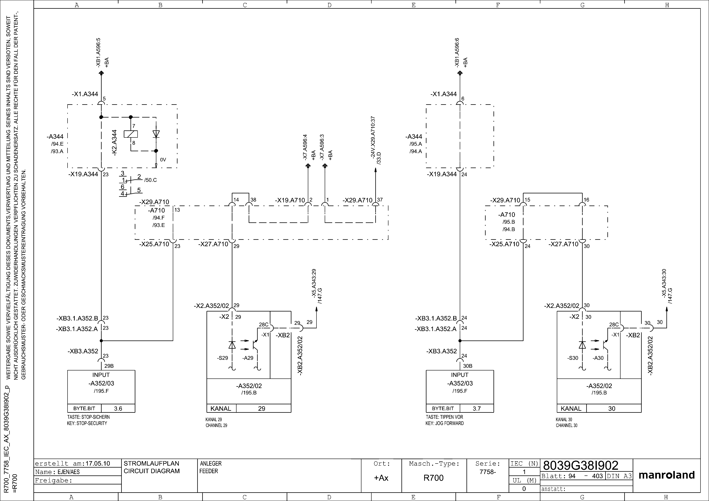

# +Ax — Sheet 94 of 403 — ANLEGER

**FEEDER**

> Part of the manroland **R700** printing press IEC/UL circuit diagrams.
> Drawing class: **Stromlaufplan / Circuit diagram** (DIN A3).
> Document `+Ax` covers the **Central control console** machine section.

## At a glance

| Field | Value |
|---|---|
| Document | `+Ax`  (8039G38I902) |
| Sheet | **94** of 403 |
| Section (DE) | ANLEGER |
| Section (EN) | FEEDER |
| Section type | CIRCUIT — Circuit diagram |
| Machine type | `R700` |
| Series | `7758` |
| Created | 17.05.10 |
| Replaces | — |
| Columns used | A, B, C, D, E, F, G, H |
| Path numbers | — |
| Labels on sheet | 129 |
| Cross-refs out | 16 |
| Cross-refs in | 42 |

**Previous:** [+Ax sheet 93](SHEET_0093.md) · **Next:** [+Ax sheet 95](SHEET_0095.md) · **Document TOC:** [_TOC.md](_TOC.md)  (+Ax) · **Master TOC:** [all sheets](../_MASTER_TOC.md)

## Sheet image (300 DPI, exact vector render)



_Rendered directly from the PDF vector layer at 300 DPI (1-bit), no OCR and no resampling. Use it to confirm anything ambiguous in the text below._

## Cross-references on this sheet

Each entry is a wire leaving this sheet. The printed token is `/sheet.column`; the link resolves to that sheet inside the same document.

| Ref | Target sheet | Col | Path | Destination on target | Target section | From col |
|---|---|---|---|---|---|---|
| `/33.D` | [+Ax sheet 33](SHEET_0033.md) | D | — | 24V.X29.A710:37 | SPANNUNGSVERSORGUNG, SCHALTSCHRANKBELÜFTUNG | E |
| `/94.E` | [+Ax sheet 94](SHEET_0094.md) | E | — | — | ANLEGER | A |
| `/93.A` | [+Ax sheet 93](SHEET_0093.md) | A | — | — | ANLEGER | A |
| `/95.A` | [+Ax sheet 95](SHEET_0095.md) | A | — | — | ANLEGER | E |
| `/94.A` | [+Ax sheet 94](SHEET_0094.md) | A | — | — | ANLEGER | E |
| `/50.C` | [+Ax sheet 50](SHEET_0050.md) | C | — | — | STOP SICHERN | B |
| `/94.F` | [+Ax sheet 94](SHEET_0094.md) | F | — | — | ANLEGER | B |
| `/93.E` | [+Ax sheet 93](SHEET_0093.md) | E | — | — | ANLEGER | B |
| `/95.B` | [+Ax sheet 95](SHEET_0095.md) | B | — | — | ANLEGER | F |
| `/94.B` | [+Ax sheet 94](SHEET_0094.md) | B | — | — | ANLEGER | F |
| `/147.G` | [+Ax sheet 147](SHEET_0147.md) | G | — | X5.A343:29 | ÜBERWACHUNGSRECHNER SICHERHEITSBUS | D |
| `/147.G` | [+Ax sheet 147](SHEET_0147.md) | G | — | X5.A343:30 | ÜBERWACHUNGSRECHNER SICHERHEITSBUS | H |
| `/195.F` | [+Ax sheet 195](SHEET_0195.md) | F | — | — | REFERENZMODUL | A |
| `/195.F` | [+Ax sheet 195](SHEET_0195.md) | F | — | — | REFERENZMODUL | F |
| `/195.B` | [+Ax sheet 195](SHEET_0195.md) | B | — | — | REFERENZMODUL | C |
| `/195.B` | [+Ax sheet 195](SHEET_0195.md) | B | — | — | REFERENZMODUL | G |

### Incoming references (sheets that point here)

Every other sheet that sends a wire to this one. `Back-ref` is the token printed on *that* sheet; `Path` is its line number.

| From sheet | Cols | Back-ref | Path | Refs | What continues there |
|---|---|---|---|---|---|
| [+Ax#33](SHEET_0033.md) | D | `/33.D` | — | 1 | — |
| [+Ax#50](SHEET_0050.md) | C | `/50.C` | — | 1 | — |
| [+Ax#93](SHEET_0093.md) | A, E | `/93.A`, `/93.E` | — | 2 | — |
| [+Ax#94](SHEET_0094.md) | A, B, E, F | `/94.A`, `/94.B`, `/94.E`, `/94.F` | — | 4 | — |
| [+Ax#95](SHEET_0095.md) | A, B | `/95.A`, `/95.B` | — | 2 | — |
| [+Ax#147](SHEET_0147.md) | G | `/147.G` | — | 2 | X5.A343:29; X5.A343:30 |
| [+Ax#195](SHEET_0195.md) | B, F | `/195.B`, `/195.F` | — | 4 | — |
| [+Ax#207](SHEET_0207.md) | F | `/207.F` | — | 2 | — |
| [+Ax#218](SHEET_0218.md) | H | `/218.H` | — | 2 | — |
| [+Ax#219](SHEET_0219.md) | B | `/219.B` | — | 2 | — |
| [+Ax#223](SHEET_0223.md) | E, G, H | `/223.E`, `/223.G`, `/223.H` | — | 6 | — |
| [+Ax#258](SHEET_0258.md) | G | `/258.G` | — | 2 | — |
| [+Ax#259](SHEET_0259.md) | F | `/259.F` | — | 2 | — |
| [+Ax#268](SHEET_0268.md) | B | `/268.B` | — | 2 | — |
| [+Ax#270](SHEET_0270.md) | H | `/270.H` | — | 2 | — |
| [+Ax#273](SHEET_0273.md) | G, H | `/273.G`, `/273.H` | — | 6 | — |


## Devices on this sheet

| Tag | Class | Class meaning (IEC) | Col | Sub | Terminal | Sign |
|---|---|---|---|---|---|---|
| `A352/03` | A | Baugruppe / assembly, module, PC board | A | 03 | — | — |
| `A344` | A | Baugruppe / assembly, module, PC board | A | — | — | — |
| `A352/03` | A | Baugruppe / assembly, module, PC board | F | 03 | — | — |
| `S29` | S | Schalter / switch | C | — | — | — |
| `A29` | A | Baugruppe / assembly, module, PC board | C | — | — | — |
| `X1` | X | Klemme / terminal, plug connector | C | — | — | — |
| `X2` | X | Klemme / terminal, plug connector | C | — | — | — |
| `XB2` | XB |  | C | — | — | — |
| `A352/02` | A | Baugruppe / assembly, module, PC board | C | 02 | — | — |
| `A710` | A | Baugruppe / assembly, module, PC board | B | — | — | — |
| `S30` | S | Schalter / switch | G | — | — | — |
| `A30` | A | Baugruppe / assembly, module, PC board | G | — | — | — |
| `X1` | X | Klemme / terminal, plug connector | G | — | — | — |
| `X2` | X | Klemme / terminal, plug connector | G | — | — | — |
| `XB2` | XB |  | H | — | — | — |
| `A352/02` | A | Baugruppe / assembly, module, PC board | G | 02 | — | — |
| `A710` | A | Baugruppe / assembly, module, PC board | F | — | — | — |
| `A344` | A | Baugruppe / assembly, module, PC board | E | — | — | — |
| `3.6` | — | cross-device reference | A | — | — | — |
| `XB3.A352` | — | cross-device reference | A | — | — | — |
| `X1.A344` | — | cross-device reference | A | — | — | — |
| `K2.A344` | — | cross-device reference | A | — | — | — |
| `X19.A344` | — | cross-device reference | A | — | — | — |
| `XB1.A596:5` | — | cross-device reference | A | — | 5 | — |
| `3.7` | — | cross-device reference | F | — | — | — |
| `XB3.A352` | — | cross-device reference | E | — | — | — |
| `X1.A344` | — | cross-device reference | E | — | — | — |
| `X19.A344` | — | cross-device reference | E | — | — | — |
| `XB1.A596:6` | — | cross-device reference | F | — | 6 | — |
| `X19.A710` | — | cross-device reference | D | — | — | — |
| `X29.A710` | — | cross-device reference | D | — | — | — |
| `X27.A710` | — | cross-device reference | C | — | — | — |
| `X25.A710` | — | cross-device reference | B | — | — | — |
| `X7.A596:4` | — | cross-device reference | D | — | 4 | — |
| `X7.A596:3` | — | cross-device reference | D | — | 3 | — |
| `XB3.1.A352.B` | — | cross-device reference | A | — | — | — |
| `XB3.1.A352.A` | — | cross-device reference | A | — | — | — |
| `XB3.1.A352.B` | — | cross-device reference | E | — | — | — |
| `XB3.1.A352.A` | — | cross-device reference | E | — | — | — |
| `X29.A710` | — | cross-device reference | F | — | — | — |
| `X27.A710` | — | cross-device reference | G | — | — | — |
| `X25.A710` | — | cross-device reference | F | — | — | — |
| `X5.A343:30` | — | cross-device reference | H | — | 30 | — |
| `X5.A343:29` | — | cross-device reference | D | — | 29 | — |
| `X29.A710` | — | cross-device reference | B | — | — | — |

## Potentials / nets

| Potential | Count | Columns | Attached devices | Terminals |
|---|---|---|---|---|
| `0V` | 1 | B | — | — |
| `24V` | 1 | E | `A710`, `X29` | `37` |


A potential such as `L24+/4` or `M24+` is a named supply/return rail; every place it appears on this sheet is electrically common.

## Wire-end annotations (grouped as printed)

A wire that continues elsewhere is annotated with a small cluster: the destination description, the path/line number `#NN`, and the `/sheet.column` cross reference. Each row below is one such cluster exactly as it is grouped on the drawing.

| Col | Y | Path | Cross-ref | Text on the wire |
|---|---|---|---|---|
| A | 63.8 | — | — | `XB1.A596:5` |
| F | 63.8 | — | — | `XB1.A596:6` |
| A | 96.7 | — | — | `+BA` |
| F | 96.7 | — | — | `+BA` |
| A | 153.4 | — | — | `X1.A344 5` |
| E | 153.4 | — | — | `X1.A344 6` |
| E | 195.0 | — | `/33.D` | `24V.X29.A710:37` |
| B | 208.0 | — | — | `7` |
| A | 217.7 | — | — | `K2.A344` |
| A | 224.9 | — | — | `A344` |
| E | 224.9 | — | — | `A344` |
| D | 225.6 | — | — | `X7.A596:4` |
| D | 225.6 | — | — | `X7.A596:3` |
| B | 236.3 | — | — | `8` |
| A | 238.0 | — | `/94.E`, `/93.A` | — |
| E | 238.0 | — | `/95.A`, `/94.A` | — |
| D | 252.6 | — | — | `+BA` |
| D | 252.6 | — | — | `+BA` |
| B | 264.9 | — | — | `0V` |
| B | 286.6 | — | — | `3 6 4 1` |
| A | 288.0 | — | — | `X19.A344 23` |
| E | 288.0 | — | — | `X19.A344 24` |
| B | 292.2 | — | — | `2` |
| B | 298.6 | — | `/50.C` | — |
| B | 314.9 | — | — | `5` |
| C | 332.0 | — | — | `14` |
| D | 332.0 | — | — | `38 X19.A710 2 1 X29.A710 37` |
| F | 332.0 | — | — | `X29.A710 15 16` |
| B | 334.8 | — | — | `X29.A710` |
| B | 349.0 | — | — | `A710 13` |
| F | 356.1 | — | — | `A710` |
| B | 362.0 | — | `/94.F`, `/93.E` | — |
| F | 369.1 | — | `/95.B`, `/94.B` | — |
| B | 405.7 | — | — | `X25.A710 23 X27.A710 29` |
| F | 405.7 | — | — | `X25.A710 24 X27.A710 30` |
| D | 451.8 | — | `/147.G` | `X5.A343:29` |
| H | 451.8 | — | `/147.G` | `X5.A343:30` |
| C | 509.1 | — | — | `X2.A352/02 29` |
| G | 509.1 | — | — | `X2.A352/02 30` |
| C | 527.6 | — | — | `X2` |
| G | 527.6 | — | — | `X2` |
| C | 529.0 | — | — | `29 29` |
| G | 529.0 | — | — | `30 30` |
| A | 530.4 | — | — | `XB3.1.A352.B 23` |
| E | 530.4 | — | — | `XB3.1.A352.B 24` |
| D | 537.5 | — | — | `29` |
| H | 537.5 | — | — | `30` |
| C | 541.8 | — | — | `28C` |
| G | 541.8 | — | — | `28C` |
| A | 547.4 | — | — | `XB3.1.A352.A 23` |
| E | 547.4 | — | — | `XB3.1.A352.A 24` |
| C | 558.7 | — | — | `X1` |
| C | 558.7 | — | — | `XB2` |
| G | 558.7 | — | — | `X1` |
| H | 558.7 | — | — | `XB2` |
| D | 565.0 | — | — | `XB2.A352/02` |
| H | 565.0 | — | — | `XB2.A352/02` |
| A | 585.7 | — | — | `XB3.A352 23` |
| E | 585.7 | — | — | `XB3.A352 24` |
| C | 597.7 | — | — | `S29 A29` |
| G | 597.7 | — | — | `S30 A30` |
| A | 611.1 | — | — | `29B` |
| F | 611.1 | — | — | `30B` |
| A | 625.7 | — | — | `INPUT` |
| F | 625.7 | — | — | `INPUT` |
| A | 639.5 | — | — | `A352/03` |
| F | 639.5 | — | — | `A352/03` |
| C | 643.8 | — | — | `A352/02` |
| G | 643.8 | — | — | `A352/02` |
| A | 653.3 | — | `/195.F` | — |
| F | 653.3 | — | `/195.F` | — |
| C | 656.1 | — | `/195.B` | — |
| G | 656.1 | — | `/195.B` | — |
| C | 682.0 | — | — | `KANAL 29` |
| G | 682.0 | — | — | `KANAL 30` |
| A | 682.4 | — | — | `BYTE.BIT 3.6` |
| F | 682.4 | — | — | `BYTE.BIT 3.7` |
| A | 697.9 | — | — | `KEY: STOP SECURITY TASTE: STOP SICHERN` |
| E | 697.9 | — | — | `KEY: JOG FORWARD TASTE: TIPPEN VOR` |
| C | 702.4 | — | — | `KANAL 29 CHANNEL 29` |
| G | 702.4 | — | — | `KANAL 30 CHANNEL 30` |


## Reconstructed tables

This sheet carries tabular content (pin map / terminal assignment / index). The grid below was rebuilt from the drawing's own rule lines, so each row is exactly one physical row of the table.

### Table 1 — 8 data rows × 24 columns (at x=113.4, y=197.0)

|  | K2.A344 | 7 8 |  |  |  |  |  |  |  | X7.A596:4 |  | X7.A596:3 | 24V.X29.A710:37 | A344 /95.A |  |  |  |  |  |  |  |  |  |
|---|---|---|---|---|---|---|---|---|---|---|---|---|---|---|---|---|---|---|---|---|---|---|---|
| `X19.A344` | `3 23 1 6` |  | `2 /50.C 5` | `0V` |  |  |  |  |  |  | `+BA` |  | `+BA` | `/94.A /33.D` | `X19.A344` | `24` |  |  |  |  |  |  |  |
|  | `4` |  | `X29.A710` | `A710 /94.F` | `13` |  | `14 38` |  | `X19.A710` |  | `2` |  | `X29.A710 1` | `37` |  |  | `X29.A710 A710 /95.B` | `15` |  | `16` |  |  |  |
|  |  |  | `X25.A710` | `/93.E` | `23` | `X27.A710 X2.A352/02` | `29 29` |  |  |  | `X5.A343:29` | `/147.G` |  |  |  |  | `/94.B X25.A710` | `24` | `X27.A710 X2.A352/02` | `30 30` |  |  | `X5.A343:30` |
| `XB3.1.A352.B XB3.1.A352.A` | `23 23` |  |  |  |  | `X2` | `29` | `28C X1` | `XB2` | `29` | `29` |  |  |  | `XB3.1.A352.B XB3.1.A352.A` | `24 24` |  |  | `X2` | `30` | `28C X1` | `XB2` | `30 30` |
| `XB3.A352` | `23 29B` |  |  |  |  | `S29` | `A29` |  |  | `XB2.A352/02` |  |  |  |  | `XB3.A352` | `24 30B` |  |  | `S30` | `A30` |  |  | `XB2.A352/02` |
| `INPUT` |  |  |  |  |  |  |  |  |  |  |  |  |  |  | `INPUT` |  |  |  |  |  |  |  |  |
|  | `A352/03 /195.F` |  |  |  |  |  | `A352/02 /195.B` |  |  |  |  |  |  |  |  | `A352/03 /195.F` |  |  |  | `A352/02 /195.B` |  |  |  |
| `BYTE.BIT` | `3.6` |  |  |  |  | `KANAL` |  | `29` |  |  |  |  |  |  | `BYTE.BIT` | `3.7` |  |  | `KANAL` |  | `30` |  |  |


## Notes and free text on this sheet

| Text | Col | Y (pt) |
|---|---|---|
| `29B` | A | 611.15 |
| `INPUT` | A | 625.68 |
| `BYTE.BIT` | A | 682.93 |
| `TASTE: STOP SICHERN` | A | 697.94 |
| `KEY: STOP SECURITY` | A | 708.57 |
| `+BA` | A | 96.66 |
| `30B` | F | 611.15 |
| `INPUT` | F | 625.68 |
| `BYTE.BIT` | E | 682.93 |
| `TASTE: TIPPEN VOR` | E | 697.93 |
| `KEY: JOG FORWARD` | E | 708.54 |
| `+BA` | F | 96.66 |
| `KANAL 29` | C | 702.36 |
| `CHANNEL 29` | C | 712.3 |
| `28C` | C | 541.75 |
| `KANAL` | C | 682.03 |
| `X2.A352/02` | C | 509.13 |
| `XB2.A352/02` | D | 564.95 |
| `+BA` | D | 252.57 |
| `KANAL 30` | G | 702.36 |
| `CHANNEL 30` | G | 712.3 |
| `28C` | G | 541.75 |
| `KANAL` | G | 682.03 |
| `X2.A352/02` | G | 509.13 |
| `XB2.A352/02` | H | 564.95 |

## Complete label inventory (exact text from the drawing)

Every text object inside the drawing area of this sheet, in DIN reading order (column A→H, then top→bottom). This is the authoritative list: if a string is not here it is not printed on this sheet.

| Col | Y | X | Dir | Type | Text |
|---|---|---|---|---|---|
| A | 63.8 | 161.1 | ↕ | device ref | `XB1.A596:5` |
| A | 96.7 | 175.3 | ↕ | text | `+BA` |
| A | 153.4 | 120.8 | → | device ref | `X1.A344` |
| A | 161.9 | 172.6 | → | number | `5` |
| A | 217.7 | 187.4 | ↕ | device ref | `K2.A344` |
| A | 224.9 | 78.5 | → | device tag | `A344` |
| A | 238.0 | 86.2 | → | cross-reference | `/94.E` |
| A | 250.4 | 85.6 | → | cross-reference | `/93.A` |
| A | 288.0 | 114.8 | → | device ref | `X19.A344` |
| A | 289.5 | 172.6 | → | number | `23` |
| A | 530.4 | 95.0 | → | device ref | `XB3.1.A352.B` |
| A | 530.4 | 172.6 | → | number | `23` |
| A | 547.4 | 172.6 | → | number | `23` |
| A | 548.1 | 94.1 | → | device ref | `XB3.1.A352.A` |
| A | 585.7 | 113.7 | → | device ref | `XB3.A352` |
| A | 594.2 | 172.6 | → | number | `23` |
| A | 611.2 | 175.5 | → | text | `29B` |
| A | 625.7 | 155.2 | → | text | `INPUT` |
| A | 639.5 | 148.7 | → | device tag | `A352/03` |
| A | 653.3 | 157.7 | → | cross-reference | `/195.F` |
| A | 682.3 | 191.6 | → | device ref | `3.6` |
| A | 682.9 | 123.3 | → | text | `BYTE.BIT` |
| A | 697.9 | 113.1 | → | text | `TASTE: STOP SICHERN` |
| A | 708.6 | 112.5 | → | text | `KEY: STOP SECURITY` |
| B | 208.0 | 222.2 | → | number | `7` |
| B | 236.3 | 222.2 | → | number | `8` |
| B | 264.9 | 269.0 | → | potential | `0V` |
| B | 286.6 | 203.0 | → | number | `3` |
| B | 292.2 | 230.7 | → | number | `2` |
| B | 297.9 | 204.4 | → | number | `1` |
| B | 298.6 | 242.4 | → | cross-reference | `/50.C` |
| B | 309.2 | 203.0 | → | number | `6` |
| B | 314.9 | 230.5 | → | number | `5` |
| B | 320.6 | 203.0 | → | number | `4` |
| B | 334.8 | 233.9 | → | device ref | `X29.A710` |
| B | 349.0 | 248.6 | → | device tag | `A710` |
| B | 349.0 | 292.5 | → | number | `13` |
| B | 362.0 | 256.5 | → | cross-reference | `/94.F` |
| B | 374.4 | 256.3 | → | cross-reference | `/93.E` |
| B | 405.7 | 233.9 | → | device ref | `X25.A710` |
| B | 409.9 | 293.1 | → | number | `23` |
| C | 332.0 | 391.7 | → | number | `14` |
| C | 332.0 | 420.7 | → | number | `38` |
| C | 405.7 | 333.1 | → | device ref | `X27.A710` |
| C | 409.9 | 392.3 | → | number | `29` |
| C | 509.1 | 325.7 | → | text | `X2.A352/02` |
| C | 509.1 | 392.3 | → | number | `29` |
| C | 527.6 | 368.2 | → | device tag | `X2` |
| C | 529.0 | 395.1 | → | number | `29` |
| C | 541.7 | 435.1 | → | text | `28C` |
| C | 558.7 | 438.8 | → | device tag | `X1` |
| C | 558.7 | 463.2 | → | device tag | `XB2` |
| C | 597.7 | 364.5 | → | device tag | `S29` |
| C | 597.7 | 407.1 | → | device tag | `A29` |
| C | 643.8 | 396.7 | → | device tag | `A352/02` |
| C | 656.1 | 405.5 | → | cross-reference | `/195.B` |
| C | 682.0 | 353.5 | → | text | `KANAL` |
| C | 682.0 | 433.6 | → | number | `29` |
| C | 702.4 | 345.3 | → | text | `KANAL 29` |
| C | 712.3 | 345.5 | → | text | `CHANNEL 29` |
| D | 225.6 | 508.4 | ↕ | device ref | `X7.A596:4` |
| D | 225.6 | 536.7 | ↕ | device ref | `X7.A596:3` |
| D | 252.6 | 522.5 | ↕ | text | `+BA` |
| D | 252.6 | 550.9 | ↕ | text | `+BA` |
| D | 332.0 | 462.0 | → | device ref | `X19.A710` |
| D | 332.0 | 519.9 | → | number | `2` |
| D | 332.0 | 547.7 | → | number | `1` |
| D | 332.0 | 575.4 | → | device ref | `X29.A710` |
| D | 451.8 | 523.3 | ↕ | device ref | `X5.A343:29` |
| D | 483.9 | 533.2 | ↕ | cross-reference | `/147.G` |
| D | 537.5 | 515.1 | → | number | `29` |
| D | 538.9 | 494.4 | → | number | `29` |
| D | 564.9 | 499.2 | ↕ | text | `XB2.A352/02` |
| E | 153.4 | 723.1 | → | device ref | `X1.A344` |
| E | 195.0 | 622.5 | ↕ | potential | `24V.X29.A710:37` |
| E | 224.9 | 680.9 | → | device tag | `A344` |
| E | 238.0 | 688.0 | → | cross-reference | `/95.A` |
| E | 250.4 | 688.0 | → | cross-reference | `/94.A` |
| E | 255.4 | 632.4 | ↕ | cross-reference | `/33.D` |
| E | 288.0 | 717.2 | → | device ref | `X19.A344` |
| E | 332.0 | 633.3 | → | number | `37` |
| E | 530.4 | 697.3 | → | device ref | `XB3.1.A352.B` |
| E | 548.1 | 696.5 | → | device ref | `XB3.1.A352.A` |
| E | 585.7 | 716.0 | → | device ref | `XB3.A352` |
| E | 682.9 | 725.7 | → | text | `BYTE.BIT` |
| E | 697.9 | 715.5 | → | text | `TASTE: TIPPEN VOR` |
| E | 708.5 | 714.9 | → | text | `KEY: JOG FORWARD` |
| F | 63.8 | 763.5 | ↕ | device ref | `XB1.A596:6` |
| F | 96.7 | 777.6 | ↕ | text | `+BA` |
| F | 161.9 | 775.0 | → | number | `6` |
| F | 289.5 | 775.0 | → | number | `24` |
| F | 332.0 | 823.5 | → | device ref | `X29.A710` |
| F | 332.0 | 880.7 | → | number | `15` |
| F | 356.1 | 836.8 | → | device tag | `A710` |
| F | 369.1 | 844.2 | → | cross-reference | `/95.B` |
| F | 381.5 | 844.2 | → | cross-reference | `/94.B` |
| F | 405.7 | 822.0 | → | device ref | `X25.A710` |
| F | 409.9 | 881.3 | → | number | `24` |
| F | 530.4 | 775.0 | → | number | `24` |
| F | 547.4 | 775.0 | → | number | `24` |
| F | 594.2 | 775.0 | → | number | `24` |
| F | 611.2 | 777.8 | → | text | `30B` |
| F | 625.7 | 757.6 | → | text | `INPUT` |
| F | 639.5 | 751.0 | → | device tag | `A352/03` |
| F | 653.3 | 760.1 | → | cross-reference | `/195.F` |
| F | 682.3 | 794.0 | → | device ref | `3.7` |
| G | 332.0 | 979.9 | → | number | `16` |
| G | 405.7 | 921.3 | → | device ref | `X27.A710` |
| G | 409.9 | 980.5 | → | number | `30` |
| G | 509.1 | 913.9 | → | text | `X2.A352/02` |
| G | 509.1 | 980.5 | → | number | `30` |
| G | 527.6 | 956.4 | → | device tag | `X2` |
| G | 529.0 | 983.3 | → | number | `30` |
| G | 541.7 | 1023.3 | → | text | `28C` |
| G | 558.7 | 1027.0 | → | device tag | `X1` |
| G | 597.7 | 952.7 | → | device tag | `S30` |
| G | 597.7 | 995.2 | → | device tag | `A30` |
| G | 643.8 | 984.9 | → | device tag | `A352/02` |
| G | 656.1 | 993.7 | → | cross-reference | `/195.B` |
| G | 682.0 | 941.7 | → | text | `KANAL` |
| G | 682.0 | 1021.6 | → | number | `30` |
| G | 702.4 | 933.4 | → | text | `KANAL 30` |
| G | 712.3 | 933.7 | → | text | `CHANNEL 30` |
| H | 451.8 | 1111.5 | ↕ | device ref | `X5.A343:30` |
| H | 483.9 | 1121.4 | ↕ | cross-reference | `/147.G` |
| H | 537.5 | 1103.2 | → | number | `30` |
| H | 538.9 | 1082.6 | → | number | `30` |
| H | 558.7 | 1051.4 | → | device tag | `XB2` |
| H | 564.9 | 1087.4 | ↕ | text | `XB2.A352/02` |

## Reading-order text block

The same content as a plain block, grouped by DIN column — convenient to paste or to match against a visual description.

```text
=== Column A ===
  63.8  161.1  devref       XB1.A596:5
  96.7  175.3  text         +BA
 153.4  120.8  devref       X1.A344
 161.9  172.6  numeric      5
 217.7  187.4  devref       K2.A344
 224.9   78.5  devtag       A344
 238.0   86.2  xref         /94.E
 250.4   85.6  xref         /93.A
 288.0  114.8  devref       X19.A344
 289.5  172.6  numeric      23
 530.4   95.0  devref       XB3.1.A352.B
 530.4  172.6  numeric      23
 547.4  172.6  numeric      23
 548.1   94.1  devref       XB3.1.A352.A
 585.7  113.7  devref       XB3.A352
 594.2  172.6  numeric      23
 611.2  175.5  text         29B
 625.7  155.2  text         INPUT
 639.5  148.7  devtag       A352/03
 653.3  157.7  xref         /195.F
 682.3  191.6  devref       3.6
 682.9  123.3  text         BYTE.BIT
 697.9  113.1  text         TASTE: STOP SICHERN
 708.6  112.5  text         KEY: STOP SECURITY
=== Column B ===
 208.0  222.2  numeric      7
 236.3  222.2  numeric      8
 264.9  269.0  net          0V
 286.6  203.0  numeric      3
 292.2  230.7  numeric      2
 297.9  204.4  numeric      1
 298.6  242.4  xref         /50.C
 309.2  203.0  numeric      6
 314.9  230.5  numeric      5
 320.6  203.0  numeric      4
 334.8  233.9  devref       X29.A710
 349.0  248.6  devtag       A710
 349.0  292.5  numeric      13
 362.0  256.5  xref         /94.F
 374.4  256.3  xref         /93.E
 405.7  233.9  devref       X25.A710
 409.9  293.1  numeric      23
=== Column C ===
 332.0  391.7  numeric      14
 332.0  420.7  numeric      38
 405.7  333.1  devref       X27.A710
 409.9  392.3  numeric      29
 509.1  325.7  text         X2.A352/02
 509.1  392.3  numeric      29
 527.6  368.2  devtag       X2
 529.0  395.1  numeric      29
 541.7  435.1  text         28C
 558.7  438.8  devtag       X1
 558.7  463.2  devtag       XB2
 597.7  364.5  devtag       S29
 597.7  407.1  devtag       A29
 643.8  396.7  devtag       A352/02
 656.1  405.5  xref         /195.B
 682.0  353.5  text         KANAL
 682.0  433.6  numeric      29
 702.4  345.3  text         KANAL 29
 712.3  345.5  text         CHANNEL 29
=== Column D ===
 225.6  508.4  devref       X7.A596:4
 225.6  536.7  devref       X7.A596:3
 252.6  522.5  text         +BA
 252.6  550.9  text         +BA
 332.0  462.0  devref       X19.A710
 332.0  519.9  numeric      2
 332.0  547.7  numeric      1
 332.0  575.4  devref       X29.A710
 451.8  523.3  devref       X5.A343:29
 483.9  533.2  xref         /147.G
 537.5  515.1  numeric      29
 538.9  494.4  numeric      29
 564.9  499.2  text         XB2.A352/02
=== Column E ===
 153.4  723.1  devref       X1.A344
 195.0  622.5  net          24V.X29.A710:37
 224.9  680.9  devtag       A344
 238.0  688.0  xref         /95.A
 250.4  688.0  xref         /94.A
 255.4  632.4  xref         /33.D
 288.0  717.2  devref       X19.A344
 332.0  633.3  numeric      37
 530.4  697.3  devref       XB3.1.A352.B
 548.1  696.5  devref       XB3.1.A352.A
 585.7  716.0  devref       XB3.A352
 682.9  725.7  text         BYTE.BIT
 697.9  715.5  text         TASTE: TIPPEN VOR
 708.5  714.9  text         KEY: JOG FORWARD
=== Column F ===
  63.8  763.5  devref       XB1.A596:6
  96.7  777.6  text         +BA
 161.9  775.0  numeric      6
 289.5  775.0  numeric      24
 332.0  823.5  devref       X29.A710
 332.0  880.7  numeric      15
 356.1  836.8  devtag       A710
 369.1  844.2  xref         /95.B
 381.5  844.2  xref         /94.B
 405.7  822.0  devref       X25.A710
 409.9  881.3  numeric      24
 530.4  775.0  numeric      24
 547.4  775.0  numeric      24
 594.2  775.0  numeric      24
 611.2  777.8  text         30B
 625.7  757.6  text         INPUT
 639.5  751.0  devtag       A352/03
 653.3  760.1  xref         /195.F
 682.3  794.0  devref       3.7
=== Column G ===
 332.0  979.9  numeric      16
 405.7  921.3  devref       X27.A710
 409.9  980.5  numeric      30
 509.1  913.9  text         X2.A352/02
 509.1  980.5  numeric      30
 527.6  956.4  devtag       X2
 529.0  983.3  numeric      30
 541.7 1023.3  text         28C
 558.7 1027.0  devtag       X1
 597.7  952.7  devtag       S30
 597.7  995.2  devtag       A30
 643.8  984.9  devtag       A352/02
 656.1  993.7  xref         /195.B
 682.0  941.7  text         KANAL
 682.0 1021.6  numeric      30
 702.4  933.4  text         KANAL 30
 712.3  933.7  text         CHANNEL 30
=== Column H ===
 451.8 1111.5  devref       X5.A343:30
 483.9 1121.4  xref         /147.G
 537.5 1103.2  numeric      30
 538.9 1082.6  numeric      30
 558.7 1051.4  devtag       XB2
 564.9 1087.4  text         XB2.A352/02
```

---
_Generated from the PDF vector text layer; no OCR. Source: `R700_7758_IEC_AX_8039G38I902_p`, sheet 94._
