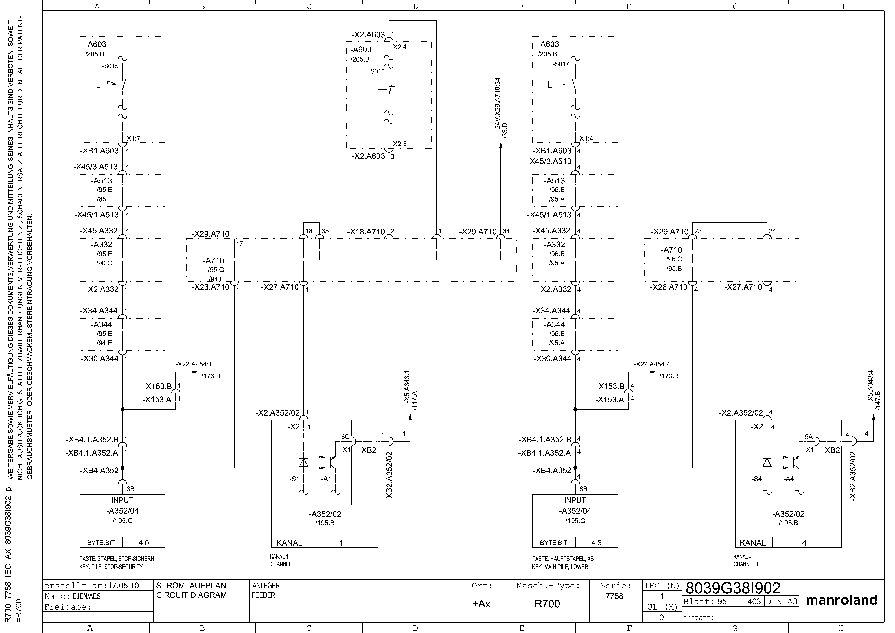

# +Ax — Sheet 95 of 403 — ANLEGER

**FEEDER**

> Part of the manroland **R700** printing press IEC/UL circuit diagrams.
> Drawing class: **Stromlaufplan / Circuit diagram** (DIN A3).
> Document `+Ax` covers the **Central control console** machine section.

## At a glance

| Field | Value |
|---|---|
| Document | `+Ax`  (8039G38I902) |
| Sheet | **95** of 403 |
| Section (DE) | ANLEGER |
| Section (EN) | FEEDER |
| Section type | CIRCUIT — Circuit diagram |
| Machine type | `R700` |
| Series | `7758` |
| Created | 17.05.10 |
| Replaces | — |
| Columns used | A, B, C, D, E, F, G, H |
| Path numbers | — |
| Labels on sheet | 171 |
| Cross-refs out | 28 |
| Cross-refs in | 70 |

**Previous:** [+Ax sheet 94](SHEET_0094.md) · **Next:** [+Ax sheet 96](SHEET_0096.md) · **Document TOC:** [_TOC.md](_TOC.md)  (+Ax) · **Master TOC:** [all sheets](../_MASTER_TOC.md)

## Sheet image (300 DPI, exact vector render)



_Rendered directly from the PDF vector layer at 300 DPI (1-bit), no OCR and no resampling. Use it to confirm anything ambiguous in the text below._

## Cross-references on this sheet

Each entry is a wire leaving this sheet. The printed token is `/sheet.column`; the link resolves to that sheet inside the same document.

| Ref | Target sheet | Col | Path | Destination on target | Target section | From col |
|---|---|---|---|---|---|---|
| `/205.B` | [+Ax sheet 205](SHEET_0205.md) | B | — | A603 | REFERENZMODUL | A |
| `/205.B` | [+Ax sheet 205](SHEET_0205.md) | B | — | A603 | REFERENZMODUL | E |
| `/205.B` | [+Ax sheet 205](SHEET_0205.md) | B | — | A603 | REFERENZMODUL | C |
| `/33.D` | [+Ax sheet 33](SHEET_0033.md) | D | — | 24V.X29.A710:34 | SPANNUNGSVERSORGUNG, SCHALTSCHRANKBELÜFTUNG | E |
| `/95.E` | [+Ax sheet 95](SHEET_0095.md) | E | — | — | ANLEGER | A |
| `/85.F` | [+Ax sheet 85](SHEET_0085.md) | F | — | — | ANLEGER | A |
| `/96.B` | [+Ax sheet 96](SHEET_0096.md) | B | — | — | ANLEGER | E |
| `/95.A` | [+Ax sheet 95](SHEET_0095.md) | A | — | — | ANLEGER | E |
| `/95.E` | [+Ax sheet 95](SHEET_0095.md) | E | — | — | ANLEGER | A |
| `/90.C` | [+Ax sheet 90](SHEET_0090.md) | C | — | — | ANLEGER | A |
| `/96.B` | [+Ax sheet 96](SHEET_0096.md) | B | — | — | ANLEGER | E |
| `/95.A` | [+Ax sheet 95](SHEET_0095.md) | A | — | — | ANLEGER | E |
| `/96.C` | [+Ax sheet 96](SHEET_0096.md) | C | — | — | ANLEGER | F |
| `/95.B` | [+Ax sheet 95](SHEET_0095.md) | B | — | — | ANLEGER | F |
| `/95.G` | [+Ax sheet 95](SHEET_0095.md) | G | — | — | ANLEGER | B |
| `/94.F` | [+Ax sheet 94](SHEET_0094.md) | F | — | — | ANLEGER | B |
| `/95.E` | [+Ax sheet 95](SHEET_0095.md) | E | — | — | ANLEGER | A |
| `/94.E` | [+Ax sheet 94](SHEET_0094.md) | E | — | — | ANLEGER | A |
| `/96.B` | [+Ax sheet 96](SHEET_0096.md) | B | — | — | ANLEGER | E |
| `/95.A` | [+Ax sheet 95](SHEET_0095.md) | A | — | — | ANLEGER | E |
| `/147.A` | [+Ax sheet 147](SHEET_0147.md) | A | — | X5.A343:1 | ÜBERWACHUNGSRECHNER SICHERHEITSBUS | D |
| `/147.B` | [+Ax sheet 147](SHEET_0147.md) | B | — | X5.A343:4 | ÜBERWACHUNGSRECHNER SICHERHEITSBUS | H |
| `/173.B` | [+Ax sheet 173](SHEET_0173.md) | B | — | — | RESERVE | B |
| `/173.B` | [+Ax sheet 173](SHEET_0173.md) | B | — | — | RESERVE | F |
| `/195.G` | [+Ax sheet 195](SHEET_0195.md) | G | — | — | REFERENZMODUL | A |
| `/195.G` | [+Ax sheet 195](SHEET_0195.md) | G | — | — | REFERENZMODUL | F |
| `/195.B` | [+Ax sheet 195](SHEET_0195.md) | B | — | — | REFERENZMODUL | C |
| `/195.B` | [+Ax sheet 195](SHEET_0195.md) | B | — | — | REFERENZMODUL | G |

### Incoming references (sheets that point here)

Every other sheet that sends a wire to this one. `Back-ref` is the token printed on *that* sheet; `Path` is its line number.

| From sheet | Cols | Back-ref | Path | Refs | What continues there |
|---|---|---|---|---|---|
| [+Ax#33](SHEET_0033.md) | D | `/33.D` | — | 1 | — |
| [+Ax#85](SHEET_0085.md) | E | `/85.E` | — | 1 | — |
| [+Ax#90](SHEET_0090.md) | C | `/90.C` | — | 1 | — |
| [+Ax#94](SHEET_0094.md) | E, F | `/94.E`, `/94.F` | — | 2 | — |
| [+Ax#95](SHEET_0095.md) | A, B, E, F | `/95.A`, `/95.B`, `/95.E`, `/95.F` | — | 8 | — |
| [+Ax#96](SHEET_0096.md) | B, C | `/96.B`, `/96.C` | — | 4 | — |
| [+Ax#147](SHEET_0147.md) | A, B | `/147.A`, `/147.B` | — | 2 | X5.A343:1; X5.A343:4 |
| [+Ax#173](SHEET_0173.md) | B | `/173.B` | — | 2 | X22.A454:1; X22.A454:4 |
| [+Ax#195](SHEET_0195.md) | B, G | `/195.B`, `/195.G` | — | 4 | — |
| [+Ax#205](SHEET_0205.md) | B | `/205.B` | — | 3 | — |
| [+Ax#210](SHEET_0210.md) | A | `/210.A` | — | 2 | — |
| [+Ax#217](SHEET_0217.md) | F | `/217.F` | — | 2 | — |
| [+Ax#218](SHEET_0218.md) | G | `/218.G` | — | 2 | — |
| [+Ax#219](SHEET_0219.md) | A | `/219.A` | — | 2 | — |
| [+Ax#221](SHEET_0221.md) | B | `/221.B` | — | 2 | — |
| [+Ax#227](SHEET_0227.md) | E, F, G | `/227.E`, `/227.F`, `/227.G` | — | 6 | — |
| [+Ax#257](SHEET_0257.md) | G | `/257.G` | — | 2 | — |
| [+Ax#269](SHEET_0269.md) | G | `/269.G` | — | 2 | — |
| [+Ax#270](SHEET_0270.md) | G | `/270.G` | — | 2 | — |
| [+Ax#273](SHEET_0273.md) | G, H | `/273.G`, `/273.H` | — | 6 | — |
| [+Ax#274](SHEET_0274.md) | F | `/274.F` | — | 2 | — |
| [+Ax#278](SHEET_0278.md) | A | `/278.A` | — | 2 | — |
| [+Ax#282](SHEET_0282.md) | A, C, E | `/282.A`, `/282.C`, `/282.E` | — | 6 | — |
| [+Ax#290](SHEET_0290.md) | C, E | `/290.C`, `/290.E` | — | 4 | — |


## Devices on this sheet

| Tag | Class | Class meaning (IEC) | Col | Sub | Terminal | Sign |
|---|---|---|---|---|---|---|
| `A352/04` | A | Baugruppe / assembly, module, PC board | F | 04 | — | — |
| `A344` | A | Baugruppe / assembly, module, PC board | E | — | — | — |
| `X1:4` | X | Klemme / terminal, plug connector | F | — | 4 | — |
| `S017` | S | Schalter / switch | E | — | — | — |
| `A603` | A | Baugruppe / assembly, module, PC board | E | — | — | — |
| `A513` | A | Baugruppe / assembly, module, PC board | E | — | — | — |
| `A332` | A | Baugruppe / assembly, module, PC board | E | — | — | — |
| `A710` | A | Baugruppe / assembly, module, PC board | F | — | — | — |
| `S4` | S | Schalter / switch | G | — | — | — |
| `A4` | A | Baugruppe / assembly, module, PC board | H | — | — | — |
| `X1` | X | Klemme / terminal, plug connector | H | — | — | — |
| `X2` | X | Klemme / terminal, plug connector | G | — | — | — |
| `XB2` | XB |  | H | — | — | — |
| `A352/02` | A | Baugruppe / assembly, module, PC board | G | 02 | — | — |
| `A352/04` | A | Baugruppe / assembly, module, PC board | A | 04 | — | — |
| `A344` | A | Baugruppe / assembly, module, PC board | A | — | — | — |
| `A513` | A | Baugruppe / assembly, module, PC board | A | — | — | — |
| `A332` | A | Baugruppe / assembly, module, PC board | A | — | — | — |
| `X1:7` | X | Klemme / terminal, plug connector | A | — | 7 | — |
| `S015` | S | Schalter / switch | A | — | — | — |
| `A603` | A | Baugruppe / assembly, module, PC board | A | — | — | — |
| `A710` | A | Baugruppe / assembly, module, PC board | B | — | — | — |
| `S1` | S | Schalter / switch | C | — | — | — |
| `A1` | A | Baugruppe / assembly, module, PC board | C | — | — | — |
| `X1` | X | Klemme / terminal, plug connector | C | — | — | — |
| `X2` | X | Klemme / terminal, plug connector | C | — | — | — |
| `XB2` | XB |  | D | — | — | — |
| `A352/02` | A | Baugruppe / assembly, module, PC board | C | 02 | — | — |
| `X2:3` | X | Klemme / terminal, plug connector | D | — | 3 | — |
| `X2:4` | X | Klemme / terminal, plug connector | D | — | 4 | — |
| `S015` | S | Schalter / switch | D | — | — | — |
| `A603` | A | Baugruppe / assembly, module, PC board | C | — | — | — |
| `4.3` | — | cross-device reference | F | — | — | — |
| `XB4.A352` | — | cross-device reference | E | — | — | — |
| `X30.A344` | — | cross-device reference | E | — | — | — |
| `X34.A344` | — | cross-device reference | E | — | — | — |
| `X153.B` | — | cross-device reference | F | — | — | — |
| `X153.A` | — | cross-device reference | F | — | — | — |
| `X45/1.A513` | — | cross-device reference | E | — | — | — |
| `X45/3.A513` | — | cross-device reference | E | — | — | — |
| `XB1.A603` | — | cross-device reference | E | — | — | — |
| `X45.A332` | — | cross-device reference | E | — | — | — |
| `X2.A332` | — | cross-device reference | E | — | — | — |
| `XB4.1.A352.B` | — | cross-device reference | E | — | — | — |
| `XB4.1.A352.A` | — | cross-device reference | E | — | — | — |
| `X29.A710` | — | cross-device reference | F | — | — | — |
| `X27.A710` | — | cross-device reference | G | — | — | — |
| `X26.A710` | — | cross-device reference | F | — | — | — |
| `4.0` | — | cross-device reference | A | — | — | — |
| `XB4.A352` | — | cross-device reference | A | — | — | — |
| `X30.A344` | — | cross-device reference | A | — | — | — |
| `X34.A344` | — | cross-device reference | A | — | — | — |
| `X153.B` | — | cross-device reference | B | — | — | — |
| `X153.A` | — | cross-device reference | B | — | — | — |
| `XB4.1.A352.B` | — | cross-device reference | A | — | — | — |
| `XB4.1.A352.A` | — | cross-device reference | A | — | — | — |
| `X45/1.A513` | — | cross-device reference | A | — | — | — |
| `X45/3.A513` | — | cross-device reference | A | — | — | — |
| `XB1.A603` | — | cross-device reference | A | — | — | — |
| `X45.A332` | — | cross-device reference | A | — | — | — |
| `X26.A710` | — | cross-device reference | B | — | — | — |
| `X2.A332` | — | cross-device reference | A | — | — | — |
| `X27.A710` | — | cross-device reference | C | — | — | — |
| `X18.A710` | — | cross-device reference | D | — | — | — |
| `X2.A603` | — | cross-device reference | D | — | — | — |
| `X2.A603` | — | cross-device reference | D | — | — | — |
| `X29.A710` | — | cross-device reference | E | — | — | — |
| `X22.A454:1` | — | cross-device reference | B | — | 1 | — |
| `X22.A454:4` | — | cross-device reference | F | — | 4 | — |
| `X5.A343:1` | — | cross-device reference | D | — | 1 | — |
| `X5.A343:4` | — | cross-device reference | H | — | 4 | — |
| `X29.A710` | — | cross-device reference | B | — | — | — |

## Potentials / nets

| Potential | Count | Columns | Attached devices | Terminals |
|---|---|---|---|---|
| `24V` | 1 | E | `A710`, `X29` | `34` |


A potential such as `L24+/4` or `M24+` is a named supply/return rail; every place it appears on this sheet is electrically common.

## Wire-end annotations (grouped as printed)

A wire that continues elsewhere is annotated with a small cluster: the destination description, the path/line number `#NN`, and the `/sheet.column` cross reference. Each row below is one such cluster exactly as it is grouped on the drawing.

| Col | Y | Path | Cross-ref | Text on the wire |
|---|---|---|---|---|
| D | 41.4 | — | — | `X2.A603 4` |
| A | 54.2 | — | `/205.B` | `A603` |
| E | 54.2 | — | `/205.B` | `A603` |
| D | 58.4 | — | — | `X2:4` |
| C | 61.2 | — | `/205.B` | `A603` |
| E | 81.5 | — | — | `S017` |
| A | 84.4 | — | — | `S015` |
| D | 91.5 | — | — | `S015` |
| E | 102.9 | — | `/33.D` | `24V.X29.A710:34` |
| A | 180.3 | — | — | `X1:7` |
| F | 180.3 | — | — | `X1:4` |
| D | 187.3 | — | — | `X2:3` |
| A | 195.9 | — | — | `XB1.A603 7` |
| E | 195.9 | — | — | `XB1.A603 4` |
| D | 203.0 | — | — | `X2.A603 3` |
| E | 210.1 | — | — | `X45/3.A513 4` |
| A | 217.2 | — | — | `X45/3.A513 7` |
| A | 235.6 | — | — | `A513` |
| E | 235.6 | — | — | `A513` |
| A | 248.6 | — | `/95.E`, `/85.F` | — |
| E | 248.6 | — | `/96.B`, `/95.A` | — |
| A | 280.9 | — | — | `X45/1.A513 7` |
| E | 280.9 | — | — | `X45/1.A513 4` |
| A | 302.2 | — | — | `X45.A332 7` |
| E | 302.2 | — | — | `X45.A332 4` |
| C | 303.6 | — | — | `18` |
| D | 303.6 | — | — | `35 X29.A710 34` |
| D | 303.6 | — | — | `X18.A710 2` |
| D | 303.6 | — | — | `1` |
| G | 303.6 | — | — | `X29.A710 23 24` |
| B | 306.4 | — | — | `X29.A710` |
| A | 320.6 | — | — | `A332` |
| B | 320.6 | — | — | `17` |
| E | 320.6 | — | — | `A332` |
| F | 327.7 | — | — | `A710` |
| A | 333.7 | — | `/95.E`, `/90.C` | — |
| E | 333.7 | — | `/96.B`, `/95.A` | — |
| F | 340.8 | — | `/96.C`, `/95.B` | — |
| B | 341.9 | — | — | `A710` |
| B | 354.9 | — | `/95.G` | — |
| B | 367.4 | — | `/94.F` | — |
| B | 377.3 | — | — | `X2.A332 1 X26.A710 1` |
| C | 377.3 | — | — | `X27.A710 1` |
| G | 377.3 | — | — | `X26.A710 4 X27.A710 4` |
| E | 380.1 | — | — | `X2.A332 4` |
| A | 408.5 | — | — | `X34.A344 1` |
| E | 408.5 | — | — | `X34.A344 4` |
| A | 426.9 | — | — | `A344` |
| E | 426.9 | — | — | `A344` |
| A | 440.0 | — | `/95.E`, `/94.E` | — |
| E | 440.0 | — | `/96.B`, `/95.A` | — |
| A | 472.3 | — | — | `X30.A344 1` |
| E | 472.3 | — | — | `X30.A344 4` |
| B | 480.8 | — | — | `X22.A454:1` |
| F | 480.8 | — | — | `X22.A454:4` |
| D | 492.1 | — | `/147.A` | `X5.A343:1` |
| H | 492.1 | — | `/147.B` | `X5.A343:4` |
| B | 496.3 | — | `/173.B` | — |
| F | 496.3 | — | `/173.B` | — |
| B | 509.1 | — | — | `X153.B 1` |
| F | 509.1 | — | — | `X153.B 4` |
| B | 526.1 | — | — | `X153.A 1` |
| F | 526.1 | — | — | `X153.A 4` |
| C | 544.6 | — | — | `X2.A352/02 1` |
| G | 544.6 | — | — | `X2.A352/02 4` |
| C | 563.0 | — | — | `X2` |
| G | 563.0 | — | — | `X2` |
| C | 564.4 | — | — | `1 1` |
| H | 564.4 | — | — | `4 4` |
| D | 572.9 | — | — | `1` |
| H | 572.9 | — | — | `4` |
| H | 577.1 | — | — | `5A` |
| C | 577.2 | — | — | `6C` |
| A | 580.0 | — | — | `XB4.1.A352.B 1` |
| E | 580.0 | — | — | `XB4.1.A352.B 4` |
| C | 594.1 | — | — | `X1` |
| H | 594.1 | — | — | `X1` |
| D | 594.2 | — | — | `XB2` |
| H | 594.2 | — | — | `XB2` |
| A | 597.0 | — | — | `XB4.1.A352.A 1` |
| E | 597.0 | — | — | `XB4.1.A352.A 4` |
| D | 600.4 | — | — | `XB2.A352/02` |
| H | 600.4 | — | — | `XB2.A352/02` |
| A | 621.1 | — | — | `XB4.A352 1` |
| E | 621.1 | — | — | `XB4.A352 4` |
| C | 633.1 | — | — | `S1 A1` |
| G | 633.1 | — | — | `S4 A4` |
| A | 646.6 | — | — | `3B` |
| F | 646.6 | — | — | `6B` |
| A | 661.1 | — | — | `INPUT` |
| E | 661.1 | — | — | `INPUT` |
| A | 675.0 | — | — | `A352/04` |
| F | 675.0 | — | — | `A352/04` |
| C | 679.2 | — | — | `A352/02` |
| G | 679.2 | — | — | `A352/02` |
| A | 688.7 | — | `/195.G` | — |
| F | 688.7 | — | `/195.G` | — |
| C | 691.6 | — | `/195.B` | — |
| G | 691.6 | — | `/195.B` | — |
| C | 717.4 | — | — | `KANAL 1` |
| G | 717.4 | — | — | `KANAL 4` |
| A | 717.8 | — | — | `BYTE.BIT 4.0` |
| E | 717.8 | — | — | `BYTE.BIT 4.3` |
| C | 737.8 | — | — | `KANAL 1 CHANNEL 1` |
| G | 737.8 | — | — | `KANAL 4 CHANNEL 4` |
| A | 740.5 | — | — | `KEY: PILE, STOP SECURITY TASTE: STAPEL, STOP SICHERN` |
| E | 740.5 | — | — | `KEY: MAIN PILE, LOWER TASTE: HAUPTSTAPEL, AB` |


## Reconstructed tables

This sheet carries tabular content (pin map / terminal assignment / index). The grid below was rebuilt from the drawing's own rule lines, so each row is exactly one physical row of the table.

### Table 1 — 9 data rows × 7 columns (at x=106.3, y=26.9)

| A603 /205.B S015 | X1:7 |  |  |  |  |  |
|---|---|---|---|---|---|---|
| `XB1.A603 X45/3.A513 A513 /95.E /85.F X45/1.A513` | `7 7 7` |  |  |  |  |  |
| `X45.A332 A332 /95.E` | `7` | `X29.A710` | `17` |  | `18 35` |  |
| `/90.C X2.A332 X34.A344 A344 /95.E /94.E X30.A344` | `1 1 1 X153.B X153.A` | `A710 /95.G /94.F X26.A710 X22.A454:1 /173.B 1 1` | `1` | `X27.A710` | `1` |  |
|  |  |  |  | `X2.A352/02` | `1` |  |
| `XB4.1.A352.B XB4.1.A352.A` | `1 1` |  |  | `X2` | `1` | `6C X1` |
| `XB4.A352` | `1 3B` |  |  | `S1` | `A1` |  |
| `INPUT` |  |  |  |  |  |  |
|  | `A352/04 /195.G` |  |  |  | `A352/02 /195.B` |  |
| `BYTE.BIT` | `4.0` |  |  | `KANAL` |  | `1` |


### Table 2 — 7 data rows × 4 columns (at x=467.7, y=26.9)

| X2.A603 |  | 4 |  |
|---|---|---|---|
| `A603 /205.B S015` |  | `X2:4` |  |
|  |  | `X2:3` |  |
| `X2.A603` |  | `3` |  |
| `X18.A710` |  | `2` |  |
|  |  | `X5.A343:1` | `/147.A` |
| `XB2` | `1` | `1` |  |
|  |  | `XB2.A352/02` |  |


### Table 3 — 9 data rows × 11 columns (at x=581.1, y=26.9)

| 24V.X29.A710:34 | /33.D | A603 /205.B S017 | X1:4 |  |  |  |  |  |  |  |
|---|---|---|---|---|---|---|---|---|---|---|
|  |  | `XB1.A603 X45/3.A513 A513 /96.B /95.A X45/1.A513` | `4 4 4` |  |  |  |  |  |  |  |
| `X29.A710 1` | `34` | `X45.A332 A332 /96.B` | `4` | `X29.A710 A710 /96.C` | `23` |  | `24` |  |  |  |
|  |  | `/95.A X2.A332 X34.A344 A344 /96.B /95.A X30.A344` | `4 4 4 X153.B X153.A` | `/95.B X26.A710 X22.A454:4 /173.B 4 4` | `4` | `X27.A710` | `4` |  |  | `X5.A343:4` |
|  |  |  |  |  |  | `X2.A352/02` | `4` |  |  |  |
|  |  | `XB4.1.A352.B XB4.1.A352.A` | `4 4` |  |  | `X2` | `4` | `5A X1` | `XB2` | `4 4` |
|  |  | `XB4.A352` | `4 6B` |  |  | `S4` | `A4` |  |  | `XB2.A352/02` |
|  |  | `INPUT` |  |  |  |  |  |  |  |  |
|  |  |  | `A352/04 /195.G` |  |  |  | `A352/02 /195.B` |  |  |  |
|  |  | `BYTE.BIT` | `4.3` |  |  | `KANAL` |  | `4` |  |  |


## Notes and free text on this sheet

| Text | Col | Y (pt) |
|---|---|---|
| `6B` | F | 646.57 |
| `INPUT` | E | 661.11 |
| `BYTE.BIT` | E | 718.36 |
| `TASTE: HAUPTSTAPEL, AB` | E | 740.45 |
| `KEY: MAIN PILE, LOWER` | E | 751.06 |
| `KANAL 4` | G | 737.79 |
| `CHANNEL 4` | G | 747.73 |
| `5A` | H | 577.12 |
| `KANAL` | G | 717.46 |
| `X2.A352/02` | G | 544.56 |
| `XB2.A352/02` | H | 600.38 |
| `3B` | A | 646.57 |
| `INPUT` | A | 661.11 |
| `BYTE.BIT` | A | 718.36 |
| `TASTE: STAPEL, STOP SICHERN` | A | 740.45 |
| `KEY: PILE, STOP SECURITY` | A | 751.08 |
| `KANAL 1` | C | 737.75 |
| `CHANNEL 1` | C | 747.71 |
| `6C` | C | 577.18 |
| `KANAL` | C | 717.46 |
| `X2.A352/02` | C | 544.56 |
| `XB2.A352/02` | D | 600.38 |

## Complete label inventory (exact text from the drawing)

Every text object inside the drawing area of this sheet, in DIN reading order (column A→H, then top→bottom). This is the authoritative list: if a string is not here it is not printed on this sheet.

| Col | Y | X | Dir | Type | Text |
|---|---|---|---|---|---|
| A | 54.2 | 113.1 | → | device tag | `A603` |
| A | 67.9 | 113.4 | → | cross-reference | `/205.B` |
| A | 84.4 | 135.8 | → | device tag | `S015` |
| A | 180.3 | 168.7 | → | device tag | `X1:7` |
| A | 195.9 | 106.6 | → | device ref | `XB1.A603` |
| A | 197.3 | 165.5 | → | number | `7` |
| A | 217.2 | 97.5 | → | device ref | `X45/3.A513` |
| A | 218.6 | 165.5 | → | number | `7` |
| A | 235.6 | 121.0 | → | device tag | `A513` |
| A | 248.6 | 128.7 | → | cross-reference | `/95.E` |
| A | 261.0 | 129.0 | → | cross-reference | `/85.F` |
| A | 280.9 | 98.9 | → | device ref | `X45/1.A513` |
| A | 282.4 | 165.5 | → | number | `7` |
| A | 302.2 | 106.3 | → | device ref | `X45.A332` |
| A | 303.6 | 165.5 | → | number | `7` |
| A | 320.6 | 121.0 | → | device tag | `A332` |
| A | 333.7 | 128.7 | → | cross-reference | `/95.E` |
| A | 346.1 | 128.1 | → | cross-reference | `/90.C` |
| A | 380.2 | 113.7 | → | device ref | `X2.A332` |
| A | 381.6 | 165.0 | → | number | `1` |
| A | 408.5 | 106.3 | → | device ref | `X34.A344` |
| A | 409.9 | 165.0 | → | number | `1` |
| A | 426.9 | 121.0 | → | device tag | `A344` |
| A | 440.0 | 128.7 | → | cross-reference | `/95.E` |
| A | 452.4 | 128.7 | → | cross-reference | `/94.E` |
| A | 472.3 | 107.7 | → | device ref | `X30.A344` |
| A | 473.7 | 165.0 | → | number | `1` |
| A | 580.0 | 87.9 | → | device ref | `XB4.1.A352.B` |
| A | 580.0 | 165.0 | → | number | `1` |
| A | 597.0 | 165.0 | → | number | `1` |
| A | 597.7 | 87.0 | → | device ref | `XB4.1.A352.A` |
| A | 621.1 | 106.6 | → | device ref | `XB4.A352` |
| A | 629.6 | 165.0 | → | number | `1` |
| A | 646.6 | 168.4 | → | text | `3B` |
| A | 661.1 | 148.1 | → | text | `INPUT` |
| A | 675.0 | 141.6 | → | device tag | `A352/04` |
| A | 688.7 | 150.1 | → | cross-reference | `/195.G` |
| A | 717.8 | 184.5 | → | device ref | `4.0` |
| A | 718.4 | 116.2 | → | text | `BYTE.BIT` |
| A | 740.5 | 106.0 | → | text | `TASTE: STAPEL, STOP SICHERN` |
| A | 751.1 | 105.4 | → | text | `KEY: PILE, STOP SECURITY` |
| B | 306.4 | 255.1 | → | device ref | `X29.A710` |
| B | 320.6 | 313.8 | → | number | `17` |
| B | 341.9 | 269.9 | → | device tag | `A710` |
| B | 355.0 | 276.7 | → | cross-reference | `/95.G` |
| B | 367.3 | 277.8 | → | cross-reference | `/94.F` |
| B | 377.3 | 255.1 | → | device ref | `X26.A710` |
| B | 381.6 | 313.8 | → | number | `1` |
| B | 480.8 | 233.6 | → | device ref | `X22.A454:1` |
| B | 496.3 | 267.9 | → | cross-reference | `/173.B` |
| B | 509.1 | 190.5 | → | device ref | `X153.B` |
| B | 509.1 | 235.8 | → | number | `1` |
| B | 526.2 | 235.8 | → | number | `1` |
| B | 526.9 | 189.6 | → | device ref | `X153.A` |
| C | 61.2 | 466.0 | → | device tag | `A603` |
| C | 75.0 | 466.3 | → | cross-reference | `/205.B` |
| C | 303.6 | 405.9 | → | number | `18` |
| C | 303.6 | 427.7 | → | number | `35` |
| C | 377.3 | 347.2 | → | device ref | `X27.A710` |
| C | 381.6 | 405.9 | → | number | `1` |
| C | 544.6 | 339.9 | → | text | `X2.A352/02` |
| C | 544.6 | 405.9 | → | number | `1` |
| C | 563.0 | 382.4 | → | device tag | `X2` |
| C | 564.4 | 408.8 | → | number | `1` |
| C | 577.2 | 454.1 | → | text | `6C` |
| C | 594.2 | 453.0 | → | device tag | `X1` |
| C | 633.1 | 384.9 | → | device tag | `S1` |
| C | 633.1 | 427.5 | → | device tag | `A1` |
| C | 679.2 | 410.9 | → | device tag | `A352/02` |
| C | 691.6 | 419.7 | → | cross-reference | `/195.B` |
| C | 717.4 | 451.0 | → | number | `1` |
| C | 717.5 | 367.7 | → | text | `KANAL` |
| C | 737.8 | 359.4 | → | text | `KANAL 1` |
| C | 747.7 | 359.7 | → | text | `CHANNEL 1` |
| D | 41.4 | 468.0 | → | device ref | `X2.A603` |
| D | 41.4 | 519.9 | → | number | `4` |
| D | 58.4 | 523.0 | → | device tag | `X2:4` |
| D | 91.4 | 490.1 | → | device tag | `S015` |
| D | 187.4 | 523.0 | → | device tag | `X2:3` |
| D | 203.0 | 468.0 | → | device ref | `X2.A603` |
| D | 204.4 | 519.9 | → | number | `3` |
| D | 303.6 | 462.0 | → | device ref | `X18.A710` |
| D | 303.6 | 519.9 | → | number | `2` |
| D | 303.6 | 583.1 | → | number | `1` |
| D | 492.1 | 537.4 | ↕ | device ref | `X5.A343:1` |
| D | 520.2 | 547.4 | ↕ | cross-reference | `/147.A` |
| D | 572.9 | 535.5 | → | number | `1` |
| D | 574.3 | 508.0 | → | number | `1` |
| D | 594.2 | 477.4 | → | device tag | `XB2` |
| D | 600.4 | 513.4 | ↕ | text | `XB2.A352/02` |
| E | 54.2 | 715.5 | → | device tag | `A603` |
| E | 67.9 | 715.7 | → | cross-reference | `/205.B` |
| E | 81.5 | 735.3 | → | device tag | `S017` |
| E | 102.9 | 657.9 | ↕ | potential | `24V.X29.A710:34` |
| E | 163.3 | 667.8 | ↕ | cross-reference | `/33.D` |
| E | 195.9 | 708.9 | → | device ref | `XB1.A603` |
| E | 210.1 | 701.3 | → | device ref | `X45/3.A513` |
| E | 235.6 | 723.4 | → | device tag | `A513` |
| E | 248.6 | 730.8 | → | cross-reference | `/96.B` |
| E | 261.0 | 730.5 | → | cross-reference | `/95.A` |
| E | 280.9 | 701.3 | → | device ref | `X45/1.A513` |
| E | 302.2 | 708.7 | → | device ref | `X45.A332` |
| E | 303.6 | 610.9 | → | device ref | `X29.A710` |
| E | 303.6 | 668.7 | → | number | `34` |
| E | 320.6 | 723.4 | → | device tag | `A332` |
| E | 333.7 | 730.8 | → | cross-reference | `/96.B` |
| E | 346.1 | 730.5 | → | cross-reference | `/95.A` |
| E | 380.2 | 716.0 | → | device ref | `X2.A332` |
| E | 408.5 | 708.7 | → | device ref | `X34.A344` |
| E | 426.9 | 723.4 | → | device tag | `A344` |
| E | 440.0 | 730.8 | → | cross-reference | `/96.B` |
| E | 452.4 | 730.5 | → | cross-reference | `/95.A` |
| E | 472.3 | 710.1 | → | device ref | `X30.A344` |
| E | 580.0 | 690.2 | → | device ref | `XB4.1.A352.B` |
| E | 597.7 | 689.4 | → | device ref | `XB4.1.A352.A` |
| E | 621.1 | 708.9 | → | device ref | `XB4.A352` |
| E | 661.1 | 750.5 | → | text | `INPUT` |
| E | 718.4 | 718.6 | → | text | `BYTE.BIT` |
| E | 740.4 | 708.4 | → | text | `TASTE: HAUPTSTAPEL, AB` |
| E | 751.1 | 707.8 | → | text | `KEY: MAIN PILE, LOWER` |
| F | 180.3 | 771.0 | → | device tag | `X1:4` |
| F | 197.3 | 767.9 | → | number | `4` |
| F | 218.6 | 767.9 | → | number | `4` |
| F | 282.4 | 767.9 | → | number | `4` |
| F | 303.6 | 767.9 | → | number | `4` |
| F | 303.6 | 866.0 | → | device ref | `X29.A710` |
| F | 327.7 | 879.3 | → | device tag | `A710` |
| F | 340.8 | 886.4 | → | cross-reference | `/96.C` |
| F | 353.2 | 886.7 | → | cross-reference | `/95.B` |
| F | 377.3 | 864.6 | → | device ref | `X26.A710` |
| F | 381.6 | 767.9 | → | number | `4` |
| F | 409.9 | 767.9 | → | number | `4` |
| F | 473.7 | 767.9 | → | number | `4` |
| F | 480.8 | 843.0 | → | device ref | `X22.A454:4` |
| F | 496.3 | 877.3 | → | cross-reference | `/173.B` |
| F | 509.1 | 792.9 | → | device ref | `X153.B` |
| F | 509.1 | 838.8 | → | number | `4` |
| F | 526.2 | 838.8 | → | number | `4` |
| F | 526.9 | 792.0 | → | device ref | `X153.A` |
| F | 580.0 | 767.9 | → | number | `4` |
| F | 597.0 | 767.9 | → | number | `4` |
| F | 629.6 | 767.9 | → | number | `4` |
| F | 646.6 | 770.7 | → | text | `6B` |
| F | 675.0 | 744.0 | → | device tag | `A352/04` |
| F | 688.7 | 752.5 | → | cross-reference | `/195.G` |
| F | 717.8 | 786.9 | → | device ref | `4.3` |
| G | 303.6 | 923.8 | → | number | `23` |
| G | 303.6 | 1023.0 | → | number | `24` |
| G | 377.3 | 963.8 | → | device ref | `X27.A710` |
| G | 381.6 | 923.8 | → | number | `4` |
| G | 381.6 | 1023.0 | → | number | `4` |
| G | 544.6 | 956.4 | → | text | `X2.A352/02` |
| G | 544.6 | 1023.0 | → | number | `4` |
| G | 563.0 | 998.9 | → | device tag | `X2` |
| G | 564.4 | 1025.9 | → | number | `4` |
| G | 633.1 | 1000.1 | → | device tag | `S4` |
| G | 679.2 | 1027.4 | → | device tag | `A352/02` |
| G | 691.6 | 1036.2 | → | cross-reference | `/195.B` |
| G | 717.5 | 984.2 | → | text | `KANAL` |
| G | 737.8 | 976.0 | → | text | `KANAL 4` |
| G | 747.7 | 976.3 | → | text | `CHANNEL 4` |
| H | 492.1 | 1154.0 | ↕ | device ref | `X5.A343:4` |
| H | 520.2 | 1163.9 | ↕ | cross-reference | `/147.B` |
| H | 572.9 | 1150.6 | → | number | `4` |
| H | 574.3 | 1125.1 | → | number | `4` |
| H | 577.1 | 1070.6 | → | text | `5A` |
| H | 594.2 | 1069.5 | → | device tag | `X1` |
| H | 594.2 | 1093.9 | → | device tag | `XB2` |
| H | 600.4 | 1129.9 | ↕ | text | `XB2.A352/02` |
| H | 633.1 | 1042.6 | → | device tag | `A4` |
| H | 717.4 | 1067.2 | → | number | `4` |

## Reading-order text block

The same content as a plain block, grouped by DIN column — convenient to paste or to match against a visual description.

```text
=== Column A ===
  54.2  113.1  devtag       A603
  67.9  113.4  xref         /205.B
  84.4  135.8  devtag       S015
 180.3  168.7  devtag       X1:7
 195.9  106.6  devref       XB1.A603
 197.3  165.5  numeric      7
 217.2   97.5  devref       X45/3.A513
 218.6  165.5  numeric      7
 235.6  121.0  devtag       A513
 248.6  128.7  xref         /95.E
 261.0  129.0  xref         /85.F
 280.9   98.9  devref       X45/1.A513
 282.4  165.5  numeric      7
 302.2  106.3  devref       X45.A332
 303.6  165.5  numeric      7
 320.6  121.0  devtag       A332
 333.7  128.7  xref         /95.E
 346.1  128.1  xref         /90.C
 380.2  113.7  devref       X2.A332
 381.6  165.0  numeric      1
 408.5  106.3  devref       X34.A344
 409.9  165.0  numeric      1
 426.9  121.0  devtag       A344
 440.0  128.7  xref         /95.E
 452.4  128.7  xref         /94.E
 472.3  107.7  devref       X30.A344
 473.7  165.0  numeric      1
 580.0   87.9  devref       XB4.1.A352.B
 580.0  165.0  numeric      1
 597.0  165.0  numeric      1
 597.7   87.0  devref       XB4.1.A352.A
 621.1  106.6  devref       XB4.A352
 629.6  165.0  numeric      1
 646.6  168.4  text         3B
 661.1  148.1  text         INPUT
 675.0  141.6  devtag       A352/04
 688.7  150.1  xref         /195.G
 717.8  184.5  devref       4.0
 718.4  116.2  text         BYTE.BIT
 740.5  106.0  text         TASTE: STAPEL, STOP SICHERN
 751.1  105.4  text         KEY: PILE, STOP SECURITY
=== Column B ===
 306.4  255.1  devref       X29.A710
 320.6  313.8  numeric      17
 341.9  269.9  devtag       A710
 355.0  276.7  xref         /95.G
 367.3  277.8  xref         /94.F
 377.3  255.1  devref       X26.A710
 381.6  313.8  numeric      1
 480.8  233.6  devref       X22.A454:1
 496.3  267.9  xref         /173.B
 509.1  190.5  devref       X153.B
 509.1  235.8  numeric      1
 526.2  235.8  numeric      1
 526.9  189.6  devref       X153.A
=== Column C ===
  61.2  466.0  devtag       A603
  75.0  466.3  xref         /205.B
 303.6  405.9  numeric      18
 303.6  427.7  numeric      35
 377.3  347.2  devref       X27.A710
 381.6  405.9  numeric      1
 544.6  339.9  text         X2.A352/02
 544.6  405.9  numeric      1
 563.0  382.4  devtag       X2
 564.4  408.8  numeric      1
 577.2  454.1  text         6C
 594.2  453.0  devtag       X1
 633.1  384.9  devtag       S1
 633.1  427.5  devtag       A1
 679.2  410.9  devtag       A352/02
 691.6  419.7  xref         /195.B
 717.4  451.0  numeric      1
 717.5  367.7  text         KANAL
 737.8  359.4  text         KANAL 1
 747.7  359.7  text         CHANNEL 1
=== Column D ===
  41.4  468.0  devref       X2.A603
  41.4  519.9  numeric      4
  58.4  523.0  devtag       X2:4
  91.4  490.1  devtag       S015
 187.4  523.0  devtag       X2:3
 203.0  468.0  devref       X2.A603
 204.4  519.9  numeric      3
 303.6  462.0  devref       X18.A710
 303.6  519.9  numeric      2
 303.6  583.1  numeric      1
 492.1  537.4  devref       X5.A343:1
 520.2  547.4  xref         /147.A
 572.9  535.5  numeric      1
 574.3  508.0  numeric      1
 594.2  477.4  devtag       XB2
 600.4  513.4  text         XB2.A352/02
=== Column E ===
  54.2  715.5  devtag       A603
  67.9  715.7  xref         /205.B
  81.5  735.3  devtag       S017
 102.9  657.9  net          24V.X29.A710:34
 163.3  667.8  xref         /33.D
 195.9  708.9  devref       XB1.A603
 210.1  701.3  devref       X45/3.A513
 235.6  723.4  devtag       A513
 248.6  730.8  xref         /96.B
 261.0  730.5  xref         /95.A
 280.9  701.3  devref       X45/1.A513
 302.2  708.7  devref       X45.A332
 303.6  610.9  devref       X29.A710
 303.6  668.7  numeric      34
 320.6  723.4  devtag       A332
 333.7  730.8  xref         /96.B
 346.1  730.5  xref         /95.A
 380.2  716.0  devref       X2.A332
 408.5  708.7  devref       X34.A344
 426.9  723.4  devtag       A344
 440.0  730.8  xref         /96.B
 452.4  730.5  xref         /95.A
 472.3  710.1  devref       X30.A344
 580.0  690.2  devref       XB4.1.A352.B
 597.7  689.4  devref       XB4.1.A352.A
 621.1  708.9  devref       XB4.A352
 661.1  750.5  text         INPUT
 718.4  718.6  text         BYTE.BIT
 740.4  708.4  text         TASTE: HAUPTSTAPEL, AB
 751.1  707.8  text         KEY: MAIN PILE, LOWER
=== Column F ===
 180.3  771.0  devtag       X1:4
 197.3  767.9  numeric      4
 218.6  767.9  numeric      4
 282.4  767.9  numeric      4
 303.6  767.9  numeric      4
 303.6  866.0  devref       X29.A710
 327.7  879.3  devtag       A710
 340.8  886.4  xref         /96.C
 353.2  886.7  xref         /95.B
 377.3  864.6  devref       X26.A710
 381.6  767.9  numeric      4
 409.9  767.9  numeric      4
 473.7  767.9  numeric      4
 480.8  843.0  devref       X22.A454:4
 496.3  877.3  xref         /173.B
 509.1  792.9  devref       X153.B
 509.1  838.8  numeric      4
 526.2  838.8  numeric      4
 526.9  792.0  devref       X153.A
 580.0  767.9  numeric      4
 597.0  767.9  numeric      4
 629.6  767.9  numeric      4
 646.6  770.7  text         6B
 675.0  744.0  devtag       A352/04
 688.7  752.5  xref         /195.G
 717.8  786.9  devref       4.3
=== Column G ===
 303.6  923.8  numeric      23
 303.6 1023.0  numeric      24
 377.3  963.8  devref       X27.A710
 381.6  923.8  numeric      4
 381.6 1023.0  numeric      4
 544.6  956.4  text         X2.A352/02
 544.6 1023.0  numeric      4
 563.0  998.9  devtag       X2
 564.4 1025.9  numeric      4
 633.1 1000.1  devtag       S4
 679.2 1027.4  devtag       A352/02
 691.6 1036.2  xref         /195.B
 717.5  984.2  text         KANAL
 737.8  976.0  text         KANAL 4
 747.7  976.3  text         CHANNEL 4
=== Column H ===
 492.1 1154.0  devref       X5.A343:4
 520.2 1163.9  xref         /147.B
 572.9 1150.6  numeric      4
 574.3 1125.1  numeric      4
 577.1 1070.6  text         5A
 594.2 1069.5  devtag       X1
 594.2 1093.9  devtag       XB2
 600.4 1129.9  text         XB2.A352/02
 633.1 1042.6  devtag       A4
 717.4 1067.2  numeric      4
```

---
_Generated from the PDF vector text layer; no OCR. Source: `R700_7758_IEC_AX_8039G38I902_p`, sheet 95._
