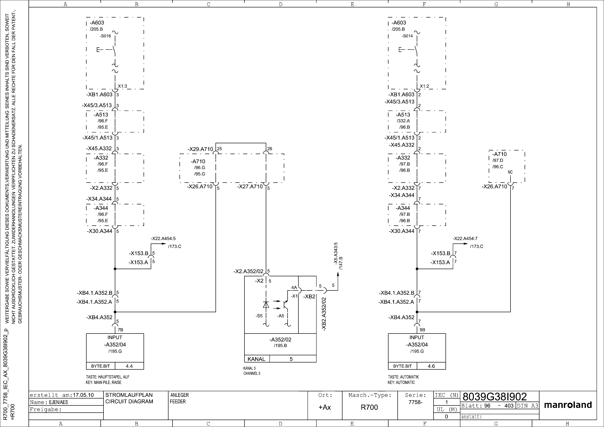

# +Ax — Sheet 96 of 403 — ANLEGER

**FEEDER**

> Part of the manroland **R700** printing press IEC/UL circuit diagrams.
> Drawing class: **Stromlaufplan / Circuit diagram** (DIN A3).
> Document `+Ax` covers the **Central control console** machine section.

## At a glance

| Field | Value |
|---|---|
| Document | `+Ax`  (8039G38I902) |
| Sheet | **96** of 403 |
| Section (DE) | ANLEGER |
| Section (EN) | FEEDER |
| Section type | CIRCUIT — Circuit diagram |
| Machine type | `R700` |
| Series | `7758` |
| Created | 17.05.10 |
| Replaces | — |
| Columns used | A, B, C, D, E, F, G |
| Path numbers | — |
| Labels on sheet | 130 |
| Cross-refs out | 24 |
| Cross-refs in | 55 |

**Previous:** [+Ax sheet 95](SHEET_0095.md) · **Next:** [+Ax sheet 97](SHEET_0097.md) · **Document TOC:** [_TOC.md](_TOC.md)  (+Ax) · **Master TOC:** [all sheets](../_MASTER_TOC.md)

## Sheet image (300 DPI, exact vector render)



_Rendered directly from the PDF vector layer at 300 DPI (1-bit), no OCR and no resampling. Use it to confirm anything ambiguous in the text below._

## Cross-references on this sheet

Each entry is a wire leaving this sheet. The printed token is `/sheet.column`; the link resolves to that sheet inside the same document.

| Ref | Target sheet | Col | Path | Destination on target | Target section | From col |
|---|---|---|---|---|---|---|
| `/205.B` | [+Ax sheet 205](SHEET_0205.md) | B | — | A603 | REFERENZMODUL | A |
| `/205.B` | [+Ax sheet 205](SHEET_0205.md) | B | — | A603 | REFERENZMODUL | F |
| `/96.F` | [+Ax sheet 96](SHEET_0096.md) | F | — | — | ANLEGER | B |
| `/95.E` | [+Ax sheet 95](SHEET_0095.md) | E | — | — | ANLEGER | B |
| `/332.A` | [+Ax sheet 332](SHEET_0332.md) | A | — | — | OPTION: NONSTOP EINRICHTUNG MANUELL, ANLEGER | F |
| `/96.B` | [+Ax sheet 96](SHEET_0096.md) | B | — | — | ANLEGER | F |
| `/97.D` | [+Ax sheet 97](SHEET_0097.md) | D | — | A710 | ANLEGER | G |
| `/96.C` | [+Ax sheet 96](SHEET_0096.md) | C | — | A710 | ANLEGER | G |
| `/97.B` | [+Ax sheet 97](SHEET_0097.md) | B | — | — | ANLEGER | F |
| `/96.B` | [+Ax sheet 96](SHEET_0096.md) | B | — | — | ANLEGER | F |
| `/96.F` | [+Ax sheet 96](SHEET_0096.md) | F | — | — | ANLEGER | B |
| `/95.E` | [+Ax sheet 95](SHEET_0095.md) | E | — | — | ANLEGER | B |
| `/96.G` | [+Ax sheet 96](SHEET_0096.md) | G | — | — | ANLEGER | C |
| `/95.G` | [+Ax sheet 95](SHEET_0095.md) | G | — | — | ANLEGER | C |
| `/97.B` | [+Ax sheet 97](SHEET_0097.md) | B | — | — | ANLEGER | F |
| `/96.B` | [+Ax sheet 96](SHEET_0096.md) | B | — | — | ANLEGER | F |
| `/96.F` | [+Ax sheet 96](SHEET_0096.md) | F | — | — | ANLEGER | B |
| `/95.E` | [+Ax sheet 95](SHEET_0095.md) | E | — | — | ANLEGER | B |
| `/147.B` | [+Ax sheet 147](SHEET_0147.md) | B | — | X5.A343:5 | ÜBERWACHUNGSRECHNER SICHERHEITSBUS | E |
| `/173.C` | [+Ax sheet 173](SHEET_0173.md) | C | — | — | RESERVE | C |
| `/173.C` | [+Ax sheet 173](SHEET_0173.md) | C | — | — | RESERVE | G |
| `/195.B` | [+Ax sheet 195](SHEET_0195.md) | B | — | — | REFERENZMODUL | D |
| `/195.G` | [+Ax sheet 195](SHEET_0195.md) | G | — | — | REFERENZMODUL | B |
| `/195.G` | [+Ax sheet 195](SHEET_0195.md) | G | — | — | REFERENZMODUL | F |

### Incoming references (sheets that point here)

Every other sheet that sends a wire to this one. `Back-ref` is the token printed on *that* sheet; `Path` is its line number.

| From sheet | Cols | Back-ref | Path | Refs | What continues there |
|---|---|---|---|---|---|
| [+Ax#95](SHEET_0095.md) | E, F | `/95.E`, `/95.F` | — | 4 | — |
| [+Ax#96](SHEET_0096.md) | B, C, F, G | `/96.B`, `/96.C`, `/96.F`, `/96.G` | — | 8 | A710 |
| [+Ax#97](SHEET_0097.md) | B, D | `/97.B`, `/97.D` | — | 3 | A710 |
| [+Ax#147](SHEET_0147.md) | B | `/147.B` | — | 1 | X5.A343:5 |
| [+Ax#173](SHEET_0173.md) | C | `/173.C` | — | 2 | X22.A454:5; X22.A454:7 |
| [+Ax#195](SHEET_0195.md) | B, G | `/195.B`, `/195.G` | — | 3 | — |
| [+Ax#205](SHEET_0205.md) | B | `/205.B` | — | 2 | — |
| [+Ax#210](SHEET_0210.md) | A | `/210.A` | — | 2 | — |
| [+Ax#217](SHEET_0217.md) | F | `/217.F` | — | 2 | — |
| [+Ax#218](SHEET_0218.md) | G | `/218.G` | — | 1 | — |
| [+Ax#219](SHEET_0219.md) | A | `/219.A` | — | 1 | — |
| [+Ax#227](SHEET_0227.md) | E, F, G | `/227.E`, `/227.F`, `/227.G` | — | 6 | — |
| [+Ax#269](SHEET_0269.md) | G | `/269.G` | — | 2 | — |
| [+Ax#270](SHEET_0270.md) | G | `/270.G` | — | 1 | — |
| [+Ax#273](SHEET_0273.md) | G, H | `/273.G`, `/273.H` | — | 2 | — |
| [+Ax#274](SHEET_0274.md) | F | `/274.F` | — | 2 | — |
| [+Ax#278](SHEET_0278.md) | A | `/278.A` | — | 2 | — |
| [+Ax#282](SHEET_0282.md) | A, C, E | `/282.A`, `/282.C`, `/282.E` | — | 6 | — |
| [+Ax#290](SHEET_0290.md) | C, E | `/290.C`, `/290.E` | — | 4 | — |
| [+Ax#332](SHEET_0332.md) | A | `/332.A` | — | 1 | — |


## Devices on this sheet

| Tag | Class | Class meaning (IEC) | Col | Sub | Terminal | Sign |
|---|---|---|---|---|---|---|
| `A352/04` | A | Baugruppe / assembly, module, PC board | B | 04 | — | — |
| `A344` | A | Baugruppe / assembly, module, PC board | A | — | — | — |
| `X1:3` | X | Klemme / terminal, plug connector | B | — | 3 | — |
| `S016` | S | Schalter / switch | B | — | — | — |
| `A603` | A | Baugruppe / assembly, module, PC board | A | — | — | — |
| `A513` | A | Baugruppe / assembly, module, PC board | A | — | — | — |
| `A332` | A | Baugruppe / assembly, module, PC board | A | — | — | — |
| `S5` | S | Schalter / switch | D | — | — | — |
| `A5` | A | Baugruppe / assembly, module, PC board | D | — | — | — |
| `X1` | X | Klemme / terminal, plug connector | D | — | — | — |
| `X2` | X | Klemme / terminal, plug connector | D | — | — | — |
| `XB2` | XB |  | D | — | — | — |
| `A352/02` | A | Baugruppe / assembly, module, PC board | D | 02 | — | — |
| `A710` | A | Baugruppe / assembly, module, PC board | C | — | — | — |
| `A352/04` | A | Baugruppe / assembly, module, PC board | F | 04 | — | — |
| `X1:2` | X | Klemme / terminal, plug connector | F | — | 2 | — |
| `S014` | S | Schalter / switch | F | — | — | — |
| `A603` | A | Baugruppe / assembly, module, PC board | F | — | — | — |
| `A344` | A | Baugruppe / assembly, module, PC board | F | — | — | — |
| `A513` | A | Baugruppe / assembly, module, PC board | F | — | — | — |
| `A332` | A | Baugruppe / assembly, module, PC board | F | — | — | — |
| `A710` | A | Baugruppe / assembly, module, PC board | G | — | — | — |
| `4.4` | — | cross-device reference | B | — | — | — |
| `XB4.A352` | — | cross-device reference | A | — | — | — |
| `X153.B` | — | cross-device reference | B | — | — | — |
| `X153.A` | — | cross-device reference | B | — | — | — |
| `X30.A344` | — | cross-device reference | A | — | — | — |
| `X34.A344` | — | cross-device reference | A | — | — | — |
| `X2.A332` | — | cross-device reference | B | — | — | — |
| `X45/1.A513` | — | cross-device reference | A | — | — | — |
| `X45/3.A513` | — | cross-device reference | A | — | — | — |
| `XB1.A603` | — | cross-device reference | A | — | — | — |
| `X45.A332` | — | cross-device reference | A | — | — | — |
| `XB4.1.A352.B` | — | cross-device reference | A | — | — | — |
| `XB4.1.A352.A` | — | cross-device reference | A | — | — | — |
| `X29.A710` | — | cross-device reference | C | — | — | — |
| `X27.A710` | — | cross-device reference | D | — | — | — |
| `X26.A710` | — | cross-device reference | C | — | — | — |
| `4.6` | — | cross-device reference | F | — | — | — |
| `XB4.A352` | — | cross-device reference | F | — | — | — |
| `X153.B` | — | cross-device reference | F | — | — | — |
| `X153.A` | — | cross-device reference | F | — | — | — |
| `X30.A344` | — | cross-device reference | F | — | — | — |
| `X34.A344` | — | cross-device reference | F | — | — | — |
| `X2.A332` | — | cross-device reference | F | — | — | — |
| `X45/1.A513` | — | cross-device reference | F | — | — | — |
| `X45/3.A513` | — | cross-device reference | F | — | — | — |
| `XB1.A603` | — | cross-device reference | F | — | — | — |
| `X45.A332` | — | cross-device reference | F | — | — | — |
| `X26.A710` | — | cross-device reference | G | — | — | — |
| `XB4.1.A352.B` | — | cross-device reference | F | — | — | — |
| `XB4.1.A352.A` | — | cross-device reference | F | — | — | — |
| `X22.A454:5` | — | cross-device reference | B | — | 5 | — |
| `X22.A454:7` | — | cross-device reference | G | — | 7 | — |
| `X5.A343:5` | — | cross-device reference | E | — | 5 | — |

## Potentials / nets

_No named potentials on this sheet._

## Wire-end annotations (grouped as printed)

A wire that continues elsewhere is annotated with a small cluster: the destination description, the path/line number `#NN`, and the `/sheet.column` cross reference. Each row below is one such cluster exactly as it is grouped on the drawing.

| Col | Y | Path | Cross-ref | Text on the wire |
|---|---|---|---|---|
| A | 40.0 | — | `/205.B` | `A603` |
| F | 40.0 | — | `/205.B` | `A603` |
| B | 67.3 | — | — | `S016` |
| F | 67.3 | — | — | `S014` |
| B | 166.1 | — | — | `X1:3` |
| F | 166.1 | — | — | `X1:2` |
| B | 181.7 | — | — | `XB1.A603 3` |
| F | 181.7 | — | — | `XB1.A603 2` |
| F | 195.9 | — | — | `X45/3.A513 2` |
| A | 203.0 | — | — | `X45/3.A513 3` |
| A | 221.4 | — | — | `A513` |
| F | 221.4 | — | — | `A513` |
| B | 234.5 | — | `/96.F`, `/95.E` | — |
| F | 234.5 | — | `/332.A` | — |
| F | 246.9 | — | `/96.B` | — |
| A | 266.8 | — | — | `X45/1.A513 3` |
| F | 266.8 | — | — | `X45/1.A513 2` |
| F | 280.9 | — | — | `X45.A332 2` |
| B | 288.0 | — | — | `X45.A332 3` |
| C | 289.4 | — | — | `X29.A710 25 26` |
| G | 299.4 | — | `/97.D`, `/96.C` | `A710` |
| A | 306.4 | — | — | `A332` |
| F | 306.4 | — | — | `A332` |
| C | 313.5 | — | — | `A710` |
| B | 319.5 | — | `/96.F`, `/95.E` | — |
| F | 319.5 | — | `/97.B`, `/96.B` | — |
| C | 326.6 | — | `/96.G`, `/95.G` | — |
| G | 336.5 | — | — | `NC` |
| C | 363.1 | — | — | `X26.A710 5 X27.A710 5` |
| G | 363.1 | — | — | `X26.A710 7` |
| B | 366.0 | — | — | `X2.A332 5` |
| F | 366.0 | — | — | `X2.A332 7` |
| F | 380.1 | — | — | `X34.A344 7` |
| B | 387.2 | — | — | `X34.A344 5` |
| A | 405.7 | — | — | `A344` |
| F | 405.7 | — | — | `A344` |
| B | 418.7 | — | `/96.F`, `/95.E` | — |
| F | 418.7 | — | `/97.B`, `/96.B` | — |
| B | 451.0 | — | — | `X30.A344 5` |
| F | 451.0 | — | — | `X30.A344 7` |
| B | 466.6 | — | — | `X22.A454:5` |
| G | 466.6 | — | — | `X22.A454:7` |
| E | 477.9 | — | `/147.B` | `X5.A343:5` |
| C | 482.2 | — | `/173.C` | — |
| G | 482.2 | — | `/173.C` | — |
| B | 495.0 | — | — | `X153.B 5` |
| F | 495.0 | — | — | `X153.B 7` |
| B | 512.0 | — | — | `X153.A 5` |
| F | 512.0 | — | — | `X153.A 7` |
| D | 530.4 | — | — | `X2.A352/02 5` |
| D | 548.8 | — | — | `X2` |
| D | 550.2 | — | — | `5 5` |
| E | 558.8 | — | — | `5` |
| D | 563.0 | — | — | `4A` |
| A | 572.9 | — | — | `XB4.1.A352.B 5` |
| F | 572.9 | — | — | `XB4.1.A352.B 7` |
| D | 580.0 | — | — | `X1` |
| D | 580.0 | — | — | `XB2` |
| E | 586.2 | — | — | `XB2.A352/02` |
| A | 589.9 | — | — | `XB4.1.A352.A 5` |
| F | 589.9 | — | — | `XB4.1.A352.A 7` |
| D | 619.0 | — | — | `S5 A5` |
| B | 621.1 | — | — | `XB4.A352 5` |
| F | 621.1 | — | — | `XB4.A352 7` |
| B | 646.6 | — | — | `7B` |
| F | 646.6 | — | — | `9B` |
| B | 661.1 | — | — | `INPUT` |
| F | 661.1 | — | — | `INPUT` |
| D | 665.0 | — | — | `A352/02` |
| B | 675.0 | — | — | `A352/04` |
| F | 675.0 | — | — | `A352/04` |
| D | 677.4 | — | `/195.B` | — |
| B | 688.7 | — | `/195.G` | — |
| F | 688.7 | — | `/195.G` | — |
| D | 703.3 | — | — | `KANAL 5` |
| B | 717.8 | — | — | `BYTE.BIT 4.4` |
| F | 717.8 | — | — | `BYTE.BIT 4.6` |
| D | 723.6 | — | — | `KANAL 5 CHANNEL 5` |
| B | 740.5 | — | — | `KEY: MAIN PILE, RAISE TASTE: HAUPTSTAPEL, AUF` |
| F | 740.5 | — | — | `KEY: AUTOMATIC TASTE: AUTOMATIK` |


## Reconstructed tables

This sheet carries tabular content (pin map / terminal assignment / index). The grid below was rebuilt from the drawing's own rule lines, so each row is exactly one physical row of the table.

### Table 1 — 5 data rows × 2 columns (at x=170.1, y=34.0)

| A603 /205.B S016 | X1:3 |
|---|---|
| `XB1.A603 X45/3.A513 A513 /96.F /95.E X45/1.A513 X45.A332 A332 /96.F /95.E X2.A332 X34.A344 A344 /96.F /95.E X30.A344` | `3 3 3 3 5 5 5 X153.B X153.A` |
| `XB4.1.A352.B XB4.1.A352.A` | `5 5` |
| `XB4.A352` | `5 7B` |
| `INPUT` | `A352/04 /195.G` |
| `BYTE.BIT` | `4.4` |


### Table 2 — 8 data rows × 9 columns (at x=425.2, y=34.0)

|  |  |  |  |  |  |  | A603 /205.B S014 | X1:2 |
|---|---|---|---|---|---|---|---|---|
|  |  |  |  |  |  |  | `XB1.A603 X45/3.A513 A513 /332.A /96.B X45/1.A513` | `2 2 2` |
| `25 5` | `X27.A710` | `26 5` |  |  | `X5.A343:5` | `/147.B` | `X45.A332 A332 /97.B /96.B X2.A332 X34.A344 A344 /97.B /96.B X30.A344` | `2 7 7 7 X153.B X153.A` |
|  | `X2.A352/02` | `5` |  |  |  |  |  |  |
|  | `X2` | `5` | `4A X1` | `XB2` | `5 5` |  | `XB4.1.A352.B XB4.1.A352.A` | `7 7` |
|  | `S5` | `A5` |  |  | `XB2.A352/02` |  | `XB4.A352` | `7 9B` |
|  |  | `A352/02 /195.B` |  |  |  |  | `INPUT` | `A352/04 /195.G` |
|  | `KANAL` |  | `5` |  |  |  |  |  |
|  | `KANAL 5` |  |  |  |  |  | `BYTE.BIT` | `4.6` |


## Notes and free text on this sheet

| Text | Col | Y (pt) |
|---|---|---|
| `7B` | B | 646.57 |
| `INPUT` | B | 661.11 |
| `BYTE.BIT` | A | 718.36 |
| `TASTE: HAUPTSTAPEL, AUF` | B | 740.45 |
| `KEY: MAIN PILE, RAISE` | B | 751.06 |
| `KANAL 5` | D | 723.62 |
| `CHANNEL 5` | D | 733.56 |
| `4A` | D | 562.95 |
| `KANAL` | D | 703.29 |
| `X2.A352/02` | D | 530.39 |
| `XB2.A352/02` | E | 586.21 |
| `9B` | F | 646.57 |
| `INPUT` | F | 661.11 |
| `BYTE.BIT` | F | 718.36 |
| `TASTE: AUTOMATIK` | F | 740.46 |
| `KEY: AUTOMATIC` | F | 751.09 |
| `NC` | G | 336.49 |

## Complete label inventory (exact text from the drawing)

Every text object inside the drawing area of this sheet, in DIN reading order (column A→H, then top→bottom). This is the authoritative list: if a string is not here it is not printed on this sheet.

| Col | Y | X | Dir | Type | Text |
|---|---|---|---|---|---|
| A | 40.0 | 176.9 | → | device tag | `A603` |
| A | 53.8 | 177.2 | → | cross-reference | `/205.B` |
| A | 181.7 | 170.4 | → | device ref | `XB1.A603` |
| A | 203.0 | 161.3 | → | device ref | `X45/3.A513` |
| A | 221.4 | 184.8 | → | device tag | `A513` |
| A | 266.8 | 162.7 | → | device ref | `X45/1.A513` |
| A | 288.0 | 170.1 | → | device ref | `X45.A332` |
| A | 306.4 | 184.8 | → | device tag | `A332` |
| A | 387.2 | 170.1 | → | device ref | `X34.A344` |
| A | 405.7 | 184.8 | → | device tag | `A344` |
| A | 451.0 | 171.5 | → | device ref | `X30.A344` |
| A | 572.9 | 151.7 | → | device ref | `XB4.1.A352.B` |
| A | 590.6 | 150.8 | → | device ref | `XB4.1.A352.A` |
| A | 621.1 | 170.4 | → | device ref | `XB4.A352` |
| A | 718.4 | 180.0 | → | text | `BYTE.BIT` |
| B | 67.4 | 196.7 | → | device tag | `S016` |
| B | 166.1 | 232.4 | → | device tag | `X1:3` |
| B | 183.2 | 229.3 | → | number | `3` |
| B | 204.4 | 229.3 | → | number | `3` |
| B | 234.5 | 192.8 | → | cross-reference | `/96.F` |
| B | 246.9 | 192.5 | → | cross-reference | `/95.E` |
| B | 268.2 | 229.3 | → | number | `3` |
| B | 289.5 | 229.3 | → | number | `3` |
| B | 319.5 | 192.8 | → | cross-reference | `/96.F` |
| B | 331.9 | 192.5 | → | cross-reference | `/95.E` |
| B | 366.0 | 177.4 | → | device ref | `X2.A332` |
| B | 367.4 | 229.3 | → | number | `5` |
| B | 388.7 | 229.3 | → | number | `5` |
| B | 418.7 | 192.8 | → | cross-reference | `/96.F` |
| B | 431.1 | 192.5 | → | cross-reference | `/95.E` |
| B | 452.5 | 229.3 | → | number | `5` |
| B | 466.6 | 297.4 | → | device ref | `X22.A454:5` |
| B | 495.0 | 254.3 | → | device ref | `X153.B` |
| B | 495.0 | 300.2 | → | number | `5` |
| B | 512.0 | 300.2 | → | number | `5` |
| B | 512.7 | 253.4 | → | device ref | `X153.A` |
| B | 572.9 | 229.3 | → | number | `5` |
| B | 589.9 | 229.3 | → | number | `5` |
| B | 629.6 | 229.3 | → | number | `5` |
| B | 646.6 | 232.2 | → | text | `7B` |
| B | 661.1 | 211.9 | → | text | `INPUT` |
| B | 675.0 | 205.4 | → | device tag | `A352/04` |
| B | 688.7 | 213.9 | → | cross-reference | `/195.G` |
| B | 717.8 | 248.3 | → | device ref | `4.4` |
| B | 740.5 | 169.8 | → | text | `TASTE: HAUPTSTAPEL, AUF` |
| B | 751.1 | 169.2 | → | text | `KEY: MAIN PILE, RAISE` |
| C | 289.4 | 369.9 | → | device ref | `X29.A710` |
| C | 289.5 | 427.7 | → | number | `25` |
| C | 313.5 | 376.2 | → | device tag | `A710` |
| C | 326.6 | 383.0 | → | cross-reference | `/96.G` |
| C | 339.0 | 383.0 | → | cross-reference | `/95.G` |
| C | 363.1 | 368.5 | → | device ref | `X26.A710` |
| C | 367.4 | 427.7 | → | number | `5` |
| C | 482.2 | 331.7 | → | cross-reference | `/173.C` |
| D | 289.5 | 527.0 | → | number | `26` |
| D | 363.1 | 467.7 | → | device ref | `X27.A710` |
| D | 367.4 | 527.0 | → | number | `5` |
| D | 530.4 | 460.3 | → | text | `X2.A352/02` |
| D | 530.4 | 527.0 | → | number | `5` |
| D | 548.8 | 502.9 | → | device tag | `X2` |
| D | 550.2 | 529.8 | → | number | `5` |
| D | 562.9 | 574.6 | → | text | `4A` |
| D | 580.0 | 573.4 | → | device tag | `X1` |
| D | 580.0 | 597.8 | → | device tag | `XB2` |
| D | 619.0 | 504.0 | → | device tag | `S5` |
| D | 619.0 | 546.5 | → | device tag | `A5` |
| D | 665.0 | 531.4 | → | device tag | `A352/02` |
| D | 677.4 | 540.1 | → | cross-reference | `/195.B` |
| D | 703.3 | 488.1 | → | text | `KANAL` |
| D | 703.3 | 571.0 | → | number | `5` |
| D | 723.6 | 479.9 | → | text | `KANAL 5` |
| D | 733.6 | 480.2 | → | text | `CHANNEL 5` |
| E | 477.9 | 657.9 | ↕ | device ref | `X5.A343:5` |
| E | 506.0 | 667.8 | ↕ | cross-reference | `/147.B` |
| E | 558.7 | 654.5 | → | number | `5` |
| E | 560.2 | 629.0 | → | number | `5` |
| E | 586.2 | 633.9 | ↕ | text | `XB2.A352/02` |
| F | 40.0 | 772.2 | → | device tag | `A603` |
| F | 53.8 | 772.4 | → | cross-reference | `/205.B` |
| F | 67.4 | 792.0 | → | device tag | `S014` |
| F | 166.1 | 827.7 | → | device tag | `X1:2` |
| F | 181.7 | 765.6 | → | device ref | `XB1.A603` |
| F | 183.2 | 824.6 | → | number | `2` |
| F | 195.9 | 758.0 | → | device ref | `X45/3.A513` |
| F | 204.4 | 824.6 | → | number | `2` |
| F | 221.4 | 780.1 | → | device tag | `A513` |
| F | 234.5 | 782.4 | → | cross-reference | `/332.A` |
| F | 246.9 | 787.5 | → | cross-reference | `/96.B` |
| F | 266.8 | 758.0 | → | device ref | `X45/1.A513` |
| F | 268.2 | 824.6 | → | number | `2` |
| F | 280.9 | 766.8 | → | device ref | `X45.A332` |
| F | 289.5 | 824.6 | → | number | `2` |
| F | 306.4 | 780.1 | → | device tag | `A332` |
| F | 319.5 | 787.5 | → | cross-reference | `/97.B` |
| F | 331.9 | 787.5 | → | cross-reference | `/96.B` |
| F | 366.0 | 772.7 | → | device ref | `X2.A332` |
| F | 367.4 | 824.6 | → | number | `7` |
| F | 380.1 | 766.8 | → | device ref | `X34.A344` |
| F | 388.7 | 824.6 | → | number | `7` |
| F | 405.7 | 780.1 | → | device tag | `A344` |
| F | 418.7 | 787.5 | → | cross-reference | `/97.B` |
| F | 431.1 | 787.5 | → | cross-reference | `/96.B` |
| F | 451.0 | 766.8 | → | device ref | `X30.A344` |
| F | 452.5 | 824.6 | → | number | `7` |
| F | 495.0 | 849.5 | → | device ref | `X153.B` |
| F | 495.0 | 895.5 | → | number | `7` |
| F | 512.0 | 895.5 | → | number | `7` |
| F | 512.7 | 848.7 | → | device ref | `X153.A` |
| F | 572.9 | 746.9 | → | device ref | `XB4.1.A352.B` |
| F | 572.9 | 824.6 | → | number | `7` |
| F | 589.9 | 824.6 | → | number | `7` |
| F | 590.6 | 746.1 | → | device ref | `XB4.1.A352.A` |
| F | 621.1 | 765.6 | → | device ref | `XB4.A352` |
| F | 629.6 | 824.6 | → | number | `7` |
| F | 646.6 | 827.4 | → | text | `9B` |
| F | 661.1 | 807.2 | → | text | `INPUT` |
| F | 675.0 | 800.6 | → | device tag | `A352/04` |
| F | 688.7 | 809.1 | → | cross-reference | `/195.G` |
| F | 717.8 | 843.6 | → | device ref | `4.6` |
| F | 718.4 | 775.3 | → | text | `BYTE.BIT` |
| F | 740.5 | 765.1 | → | text | `TASTE: AUTOMATIK` |
| F | 751.1 | 764.5 | → | text | `KEY: AUTOMATIC` |
| G | 299.4 | 970.6 | → | device tag | `A710` |
| G | 312.4 | 970.9 | → | cross-reference | `/97.D` |
| G | 324.8 | 970.9 | → | cross-reference | `/96.C` |
| G | 336.5 | 1001.4 | → | text | `NC` |
| G | 363.1 | 949.6 | → | device ref | `X26.A710` |
| G | 367.4 | 1008.9 | → | number | `7` |
| G | 466.6 | 892.6 | → | device ref | `X22.A454:7` |
| G | 482.2 | 926.9 | → | cross-reference | `/173.C` |

## Reading-order text block

The same content as a plain block, grouped by DIN column — convenient to paste or to match against a visual description.

```text
=== Column A ===
  40.0  176.9  devtag       A603
  53.8  177.2  xref         /205.B
 181.7  170.4  devref       XB1.A603
 203.0  161.3  devref       X45/3.A513
 221.4  184.8  devtag       A513
 266.8  162.7  devref       X45/1.A513
 288.0  170.1  devref       X45.A332
 306.4  184.8  devtag       A332
 387.2  170.1  devref       X34.A344
 405.7  184.8  devtag       A344
 451.0  171.5  devref       X30.A344
 572.9  151.7  devref       XB4.1.A352.B
 590.6  150.8  devref       XB4.1.A352.A
 621.1  170.4  devref       XB4.A352
 718.4  180.0  text         BYTE.BIT
=== Column B ===
  67.4  196.7  devtag       S016
 166.1  232.4  devtag       X1:3
 183.2  229.3  numeric      3
 204.4  229.3  numeric      3
 234.5  192.8  xref         /96.F
 246.9  192.5  xref         /95.E
 268.2  229.3  numeric      3
 289.5  229.3  numeric      3
 319.5  192.8  xref         /96.F
 331.9  192.5  xref         /95.E
 366.0  177.4  devref       X2.A332
 367.4  229.3  numeric      5
 388.7  229.3  numeric      5
 418.7  192.8  xref         /96.F
 431.1  192.5  xref         /95.E
 452.5  229.3  numeric      5
 466.6  297.4  devref       X22.A454:5
 495.0  254.3  devref       X153.B
 495.0  300.2  numeric      5
 512.0  300.2  numeric      5
 512.7  253.4  devref       X153.A
 572.9  229.3  numeric      5
 589.9  229.3  numeric      5
 629.6  229.3  numeric      5
 646.6  232.2  text         7B
 661.1  211.9  text         INPUT
 675.0  205.4  devtag       A352/04
 688.7  213.9  xref         /195.G
 717.8  248.3  devref       4.4
 740.5  169.8  text         TASTE: HAUPTSTAPEL, AUF
 751.1  169.2  text         KEY: MAIN PILE, RAISE
=== Column C ===
 289.4  369.9  devref       X29.A710
 289.5  427.7  numeric      25
 313.5  376.2  devtag       A710
 326.6  383.0  xref         /96.G
 339.0  383.0  xref         /95.G
 363.1  368.5  devref       X26.A710
 367.4  427.7  numeric      5
 482.2  331.7  xref         /173.C
=== Column D ===
 289.5  527.0  numeric      26
 363.1  467.7  devref       X27.A710
 367.4  527.0  numeric      5
 530.4  460.3  text         X2.A352/02
 530.4  527.0  numeric      5
 548.8  502.9  devtag       X2
 550.2  529.8  numeric      5
 562.9  574.6  text         4A
 580.0  573.4  devtag       X1
 580.0  597.8  devtag       XB2
 619.0  504.0  devtag       S5
 619.0  546.5  devtag       A5
 665.0  531.4  devtag       A352/02
 677.4  540.1  xref         /195.B
 703.3  488.1  text         KANAL
 703.3  571.0  numeric      5
 723.6  479.9  text         KANAL 5
 733.6  480.2  text         CHANNEL 5
=== Column E ===
 477.9  657.9  devref       X5.A343:5
 506.0  667.8  xref         /147.B
 558.7  654.5  numeric      5
 560.2  629.0  numeric      5
 586.2  633.9  text         XB2.A352/02
=== Column F ===
  40.0  772.2  devtag       A603
  53.8  772.4  xref         /205.B
  67.4  792.0  devtag       S014
 166.1  827.7  devtag       X1:2
 181.7  765.6  devref       XB1.A603
 183.2  824.6  numeric      2
 195.9  758.0  devref       X45/3.A513
 204.4  824.6  numeric      2
 221.4  780.1  devtag       A513
 234.5  782.4  xref         /332.A
 246.9  787.5  xref         /96.B
 266.8  758.0  devref       X45/1.A513
 268.2  824.6  numeric      2
 280.9  766.8  devref       X45.A332
 289.5  824.6  numeric      2
 306.4  780.1  devtag       A332
 319.5  787.5  xref         /97.B
 331.9  787.5  xref         /96.B
 366.0  772.7  devref       X2.A332
 367.4  824.6  numeric      7
 380.1  766.8  devref       X34.A344
 388.7  824.6  numeric      7
 405.7  780.1  devtag       A344
 418.7  787.5  xref         /97.B
 431.1  787.5  xref         /96.B
 451.0  766.8  devref       X30.A344
 452.5  824.6  numeric      7
 495.0  849.5  devref       X153.B
 495.0  895.5  numeric      7
 512.0  895.5  numeric      7
 512.7  848.7  devref       X153.A
 572.9  746.9  devref       XB4.1.A352.B
 572.9  824.6  numeric      7
 589.9  824.6  numeric      7
 590.6  746.1  devref       XB4.1.A352.A
 621.1  765.6  devref       XB4.A352
 629.6  824.6  numeric      7
 646.6  827.4  text         9B
 661.1  807.2  text         INPUT
 675.0  800.6  devtag       A352/04
 688.7  809.1  xref         /195.G
 717.8  843.6  devref       4.6
 718.4  775.3  text         BYTE.BIT
 740.5  765.1  text         TASTE: AUTOMATIK
 751.1  764.5  text         KEY: AUTOMATIC
=== Column G ===
 299.4  970.6  devtag       A710
 312.4  970.9  xref         /97.D
 324.8  970.9  xref         /96.C
 336.5 1001.4  text         NC
 363.1  949.6  devref       X26.A710
 367.4 1008.9  numeric      7
 466.6  892.6  devref       X22.A454:7
 482.2  926.9  xref         /173.C
```

---
_Generated from the PDF vector text layer; no OCR. Source: `R700_7758_IEC_AX_8039G38I902_p`, sheet 96._
