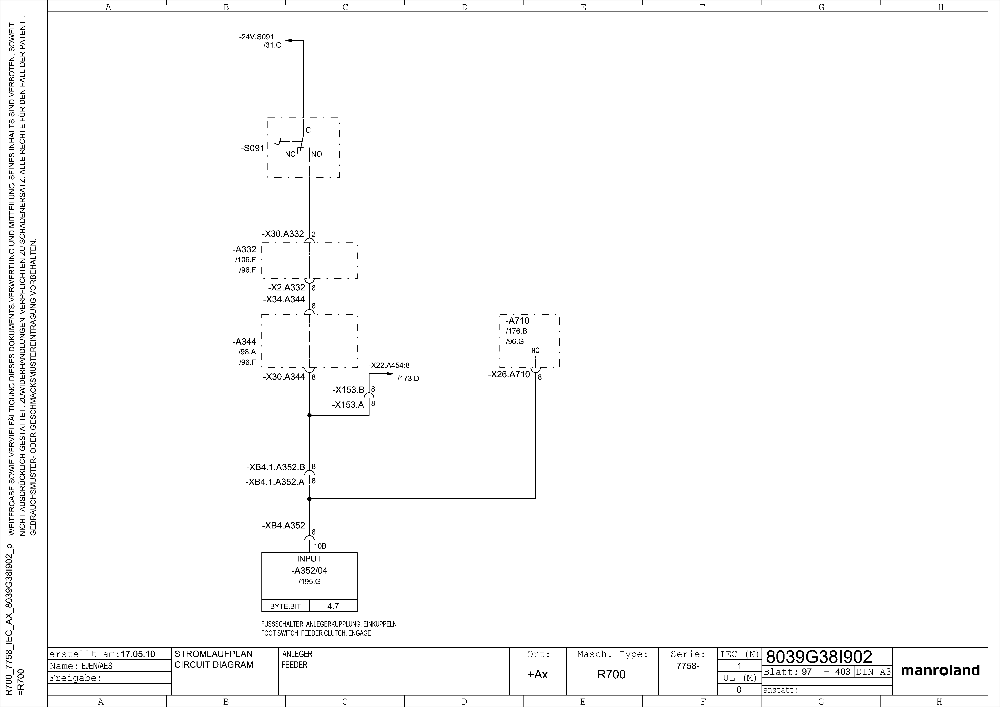

# +Ax — Sheet 97 of 403 — ANLEGER

**FEEDER**

> Part of the manroland **R700** printing press IEC/UL circuit diagrams.
> Drawing class: **Stromlaufplan / Circuit diagram** (DIN A3).
> Document `+Ax` covers the **Central control console** machine section.

## At a glance

| Field | Value |
|---|---|
| Document | `+Ax`  (8039G38I902) |
| Sheet | **97** of 403 |
| Section (DE) | ANLEGER |
| Section (EN) | FEEDER |
| Section type | CIRCUIT — Circuit diagram |
| Machine type | `R700` |
| Series | `7758` |
| Created | 17.05.10 |
| Replaces | — |
| Columns used | B, C, D, E |
| Path numbers | — |
| Labels on sheet | 46 |
| Cross-refs out | 9 |
| Cross-refs in | 19 |

**Previous:** [+Ax sheet 96](SHEET_0096.md) · **Next:** [+Ax sheet 98](SHEET_0098.md) · **Document TOC:** [_TOC.md](_TOC.md)  (+Ax) · **Master TOC:** [all sheets](../_MASTER_TOC.md)

## Sheet image (300 DPI, exact vector render)



_Rendered directly from the PDF vector layer at 300 DPI (1-bit), no OCR and no resampling. Use it to confirm anything ambiguous in the text below._

## Cross-references on this sheet

Each entry is a wire leaving this sheet. The printed token is `/sheet.column`; the link resolves to that sheet inside the same document.

| Ref | Target sheet | Col | Path | Destination on target | Target section | From col |
|---|---|---|---|---|---|---|
| `/31.C` | [+Ax sheet 31](SHEET_0031.md) | C | — | 24V.S091 | SPANNUNGSVERSORGUNG, SCHALTSCHRANKBELÜFTUNG | B |
| `/106.F` | [+Ax sheet 106](SHEET_0106.md) | F | — | — | ANLEGER | B |
| `/96.F` | [+Ax sheet 96](SHEET_0096.md) | F | — | — | ANLEGER | B |
| `/176.B` | [+Ax sheet 176](SHEET_0176.md) | B | — | A710 | RESERVE | D |
| `/96.G` | [+Ax sheet 96](SHEET_0096.md) | G | — | A710 | ANLEGER | D |
| `/98.A` | [+Ax sheet 98](SHEET_0098.md) | A | — | — | ANLEGER | B |
| `/96.F` | [+Ax sheet 96](SHEET_0096.md) | F | — | — | ANLEGER | B |
| `/173.D` | [+Ax sheet 173](SHEET_0173.md) | D | — | — | RESERVE | D |
| `/195.G` | [+Ax sheet 195](SHEET_0195.md) | G | — | — | REFERENZMODUL | C |

### Incoming references (sheets that point here)

Every other sheet that sends a wire to this one. `Back-ref` is the token printed on *that* sheet; `Path` is its line number.

| From sheet | Cols | Back-ref | Path | Refs | What continues there |
|---|---|---|---|---|---|
| [+Ax#31](SHEET_0031.md) | C | `/31.C` | — | 1 | — |
| [+Ax#96](SHEET_0096.md) | F, G | `/96.F`, `/96.G` | — | 3 | A710 |
| [+Ax#98](SHEET_0098.md) | A | `/98.A` | — | 1 | — |
| [+Ax#106](SHEET_0106.md) | F | `/106.F` | — | 1 | — |
| [+Ax#173](SHEET_0173.md) | D | `/173.D` | — | 1 | X22.A454:8 |
| [+Ax#176](SHEET_0176.md) | B | `/176.B` | — | 1 | — |
| [+Ax#195](SHEET_0195.md) | G | `/195.G` | — | 1 | — |
| [+Ax#217](SHEET_0217.md) | F | `/217.F` | — | 1 | — |
| [+Ax#227](SHEET_0227.md) | E, F, G | `/227.E`, `/227.F`, `/227.G` | — | 3 | — |
| [+Ax#269](SHEET_0269.md) | G | `/269.G` | — | 1 | — |
| [+Ax#274](SHEET_0274.md) | F | `/274.F` | — | 2 | — |
| [+Ax#278](SHEET_0278.md) | A | `/278.A` | — | 1 | — |
| [+Ax#290](SHEET_0290.md) | C, E | `/290.C`, `/290.E` | — | 2 | — |


## Devices on this sheet

| Tag | Class | Class meaning (IEC) | Col | Sub | Terminal | Sign |
|---|---|---|---|---|---|---|
| `A352/04` | A | Baugruppe / assembly, module, PC board | C | 04 | — | — |
| `S091` | S | Schalter / switch | B | — | — | — |
| `A344` | A | Baugruppe / assembly, module, PC board | B | — | — | — |
| `A332` | A | Baugruppe / assembly, module, PC board | B | — | — | — |
| `A710` | A | Baugruppe / assembly, module, PC board | D | — | — | — |
| `4.7` | — | cross-device reference | C | — | — | — |
| `XB4.A352` | — | cross-device reference | B | — | — | — |
| `X34.A344` | — | cross-device reference | B | — | — | — |
| `X2.A332` | — | cross-device reference | C | — | — | — |
| `X30.A332` | — | cross-device reference | B | — | — | — |
| `X153.B` | — | cross-device reference | C | — | — | — |
| `X153.A` | — | cross-device reference | C | — | — | — |
| `XB4.1.A352.B` | — | cross-device reference | B | — | — | — |
| `XB4.1.A352.A` | — | cross-device reference | B | — | — | — |
| `X30.A344` | — | cross-device reference | B | — | — | — |
| `X26.A710` | — | cross-device reference | D | — | — | — |
| `X22.A454:8` | — | cross-device reference | C | — | 8 | — |

## Potentials / nets

| Potential | Count | Columns | Attached devices | Terminals |
|---|---|---|---|---|
| `24V` | 1 | B | `S091` | — |


A potential such as `L24+/4` or `M24+` is a named supply/return rail; every place it appears on this sheet is electrically common.

## Wire-end annotations (grouped as printed)

A wire that continues elsewhere is annotated with a small cluster: the destination description, the path/line number `#NN`, and the `/sheet.column` cross reference. Each row below is one such cluster exactly as it is grouped on the drawing.

| Col | Y | Path | Cross-ref | Text on the wire |
|---|---|---|---|---|
| B | 40.0 | — | `/31.C` | `24V.S091` |
| C | 151.3 | — | — | `C` |
| B | 171.8 | — | — | `S091 NO` |
| C | 179.6 | — | — | `NC` |
| C | 273.9 | — | — | `X30.A332 2` |
| B | 292.3 | — | — | `A332` |
| B | 305.4 | — | `/106.F` | — |
| B | 317.7 | — | `/96.F` | — |
| C | 337.6 | — | — | `X2.A332 8` |
| C | 351.8 | — | — | `X34.A344 8` |
| D | 377.3 | — | `/176.B`, `/96.G` | `A710` |
| B | 402.1 | — | — | `A344` |
| E | 414.4 | — | — | `NC` |
| B | 415.2 | — | `/98.A` | — |
| B | 427.6 | — | `/96.F` | — |
| C | 431.1 | — | — | `X22.A454:8` |
| C | 441.1 | — | — | `X30.A344 8 X26.A710 8` |
| D | 446.8 | — | `/173.D` | — |
| C | 459.5 | — | — | `X153.B 8` |
| C | 476.5 | — | — | `X153.A 8` |
| B | 551.7 | — | — | `XB4.1.A352.B 8` |
| B | 568.7 | — | — | `XB4.1.A352.A 8` |
| C | 621.1 | — | — | `XB4.A352 8` |
| C | 646.6 | — | — | `10B` |
| C | 661.1 | — | — | `INPUT` |
| C | 675.0 | — | — | `A352/04` |
| C | 688.7 | — | `/195.G` | — |
| C | 717.8 | — | — | `BYTE.BIT 4.7` |
| C | 740.5 | — | — | `FUSSSCHALTER: ANLEGERKUPPLUNG, EINKUPPELN FOOT SWITCH: FEEDER CLUTCH, ENGAGE` |


## Reconstructed tables

This sheet carries tabular content (pin map / terminal assignment / index). The grid below was rebuilt from the drawing's own rule lines, so each row is exactly one physical row of the table.

### Table 1 — 3 data rows × 3 columns (at x=311.8, y=494.6)

| XB4.1.A352.B XB4.1.A352.A |  | 8 8 |
|---|---|---|
| `XB4.A352` |  | `8 10B` |
|  | `INPUT` | `A352/04 /195.G` |
| `BYTE.BIT` |  | `4.7` |


## Notes and free text on this sheet

| Text | Col | Y (pt) |
|---|---|---|
| `10B` | C | 646.59 |
| `INPUT` | C | 661.11 |
| `BYTE.BIT` | B | 718.36 |
| `FUSSSCHALTER: ANLEGERKUPPLUNG, EINKUPPELN` | C | 740.47 |
| `FOOT SWITCH: FEEDER CLUTCH, ENGAGE` | C | 751.09 |
| `NC` | C | 179.63 |
| `C` | C | 151.28 |
| `NO` | C | 179.61 |
| `NC` | E | 414.44 |

## Complete label inventory (exact text from the drawing)

Every text object inside the drawing area of this sheet, in DIN reading order (column A→H, then top→bottom). This is the authoritative list: if a string is not here it is not printed on this sheet.

| Col | Y | X | Dir | Type | Text |
|---|---|---|---|---|---|
| B | 40.0 | 284.9 | → | potential | `24V.S091` |
| B | 49.9 | 313.8 | → | cross-reference | `/31.C` |
| B | 171.8 | 286.9 | → | device tag | `S091` |
| B | 273.8 | 311.8 | → | device ref | `X30.A332` |
| B | 292.3 | 276.9 | → | device tag | `A332` |
| B | 305.4 | 280.1 | → | cross-reference | `/106.F` |
| B | 317.7 | 284.9 | → | cross-reference | `/96.F` |
| B | 351.8 | 313.2 | → | device ref | `X34.A344` |
| B | 402.1 | 276.9 | → | device tag | `A344` |
| B | 415.2 | 284.0 | → | cross-reference | `/98.A` |
| B | 427.6 | 284.9 | → | cross-reference | `/96.F` |
| B | 443.9 | 313.2 | → | device ref | `X30.A344` |
| B | 551.7 | 293.4 | → | device ref | `XB4.1.A352.B` |
| B | 569.4 | 292.5 | → | device ref | `XB4.1.A352.A` |
| B | 621.1 | 312.1 | → | device ref | `XB4.A352` |
| B | 718.4 | 321.7 | → | text | `BYTE.BIT` |
| C | 151.3 | 364.0 | → | text | `C` |
| C | 179.6 | 339.3 | → | text | `NC` |
| C | 179.6 | 370.5 | → | text | `NO` |
| C | 275.3 | 371.1 | → | number | `2` |
| C | 337.6 | 319.2 | → | device ref | `X2.A332` |
| C | 339.1 | 371.1 | → | number | `8` |
| C | 360.3 | 371.1 | → | number | `8` |
| C | 431.2 | 439.1 | → | device ref | `X22.A454:8` |
| C | 445.4 | 371.1 | → | number | `8` |
| C | 459.5 | 396.0 | → | device ref | `X153.B` |
| C | 459.5 | 441.9 | → | number | `8` |
| C | 476.5 | 441.9 | → | number | `8` |
| C | 477.2 | 395.1 | → | device ref | `X153.A` |
| C | 551.7 | 371.1 | → | number | `8` |
| C | 568.7 | 371.1 | → | number | `8` |
| C | 629.6 | 371.1 | → | number | `8` |
| C | 646.6 | 373.3 | → | text | `10B` |
| C | 661.1 | 353.6 | → | text | `INPUT` |
| C | 675.0 | 347.1 | → | device tag | `A352/04` |
| C | 688.7 | 355.6 | → | cross-reference | `/195.G` |
| C | 717.8 | 390.0 | → | device ref | `4.7` |
| C | 740.5 | 311.0 | → | text | `FUSSSCHALTER: ANLEGERKUPPLUNG, EINKUPPELN` |
| C | 751.1 | 311.0 | → | text | `FOOT SWITCH: FEEDER CLUTCH, ENGAGE` |
| D | 377.3 | 602.1 | → | device tag | `A710` |
| D | 390.4 | 602.4 | → | cross-reference | `/176.B` |
| D | 402.8 | 602.4 | → | cross-reference | `/96.G` |
| D | 441.1 | 581.1 | → | device ref | `X26.A710` |
| D | 446.7 | 473.4 | → | cross-reference | `/173.D` |
| E | 414.4 | 632.9 | → | text | `NC` |
| E | 445.4 | 640.3 | → | number | `8` |

## Reading-order text block

The same content as a plain block, grouped by DIN column — convenient to paste or to match against a visual description.

```text
=== Column B ===
  40.0  284.9  net          24V.S091
  49.9  313.8  xref         /31.C
 171.8  286.9  devtag       S091
 273.8  311.8  devref       X30.A332
 292.3  276.9  devtag       A332
 305.4  280.1  xref         /106.F
 317.7  284.9  xref         /96.F
 351.8  313.2  devref       X34.A344
 402.1  276.9  devtag       A344
 415.2  284.0  xref         /98.A
 427.6  284.9  xref         /96.F
 443.9  313.2  devref       X30.A344
 551.7  293.4  devref       XB4.1.A352.B
 569.4  292.5  devref       XB4.1.A352.A
 621.1  312.1  devref       XB4.A352
 718.4  321.7  text         BYTE.BIT
=== Column C ===
 151.3  364.0  text         C
 179.6  339.3  text         NC
 179.6  370.5  text         NO
 275.3  371.1  numeric      2
 337.6  319.2  devref       X2.A332
 339.1  371.1  numeric      8
 360.3  371.1  numeric      8
 431.2  439.1  devref       X22.A454:8
 445.4  371.1  numeric      8
 459.5  396.0  devref       X153.B
 459.5  441.9  numeric      8
 476.5  441.9  numeric      8
 477.2  395.1  devref       X153.A
 551.7  371.1  numeric      8
 568.7  371.1  numeric      8
 629.6  371.1  numeric      8
 646.6  373.3  text         10B
 661.1  353.6  text         INPUT
 675.0  347.1  devtag       A352/04
 688.7  355.6  xref         /195.G
 717.8  390.0  devref       4.7
 740.5  311.0  text         FUSSSCHALTER: ANLEGERKUPPLUNG, EINKUPPELN
 751.1  311.0  text         FOOT SWITCH: FEEDER CLUTCH, ENGAGE
=== Column D ===
 377.3  602.1  devtag       A710
 390.4  602.4  xref         /176.B
 402.8  602.4  xref         /96.G
 441.1  581.1  devref       X26.A710
 446.7  473.4  xref         /173.D
=== Column E ===
 414.4  632.9  text         NC
 445.4  640.3  numeric      8
```

---
_Generated from the PDF vector text layer; no OCR. Source: `R700_7758_IEC_AX_8039G38I902_p`, sheet 97._
