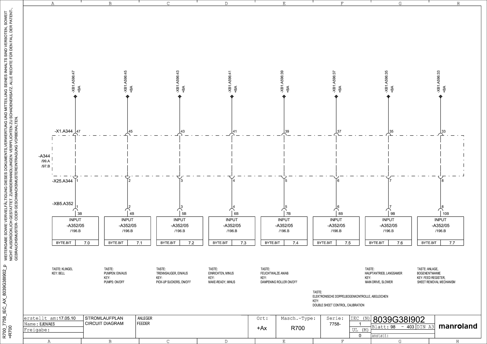

# +Ax — Sheet 98 of 403 — ANLEGER

**FEEDER**

> Part of the manroland **R700** printing press IEC/UL circuit diagrams.
> Drawing class: **Stromlaufplan / Circuit diagram** (DIN A3).
> Document `+Ax` covers the **Central control console** machine section.

## At a glance

| Field | Value |
|---|---|
| Document | `+Ax`  (8039G38I902) |
| Sheet | **98** of 403 |
| Section (DE) | ANLEGER |
| Section (EN) | FEEDER |
| Section type | CIRCUIT — Circuit diagram |
| Machine type | `R700` |
| Series | `7758` |
| Created | 17.05.10 |
| Replaces | — |
| Columns used | A, B, C, D, E, F, G, H |
| Path numbers | — |
| Labels on sheet | 124 |
| Cross-refs out | 10 |
| Cross-refs in | 34 |

**Previous:** [+Ax sheet 97](SHEET_0097.md) · **Next:** [+Ax sheet 99](SHEET_0099.md) · **Document TOC:** [_TOC.md](_TOC.md)  (+Ax) · **Master TOC:** [all sheets](../_MASTER_TOC.md)

## Sheet image (300 DPI, exact vector render)



_Rendered directly from the PDF vector layer at 300 DPI (1-bit), no OCR and no resampling. Use it to confirm anything ambiguous in the text below._

## Cross-references on this sheet

Each entry is a wire leaving this sheet. The printed token is `/sheet.column`; the link resolves to that sheet inside the same document.

| Ref | Target sheet | Col | Path | Destination on target | Target section | From col |
|---|---|---|---|---|---|---|
| `/99.A` | [+Ax sheet 99](SHEET_0099.md) | A | — | — | ANLEGER | A |
| `/97.B` | [+Ax sheet 97](SHEET_0097.md) | B | — | — | ANLEGER | A |
| `/196.B` | [+Ax sheet 196](SHEET_0196.md) | B | — | — | REFERENZMODUL | A |
| `/196.B` | [+Ax sheet 196](SHEET_0196.md) | B | — | — | REFERENZMODUL | B |
| `/196.B` | [+Ax sheet 196](SHEET_0196.md) | B | — | — | REFERENZMODUL | C |
| `/196.B` | [+Ax sheet 196](SHEET_0196.md) | B | — | — | REFERENZMODUL | D |
| `/196.B` | [+Ax sheet 196](SHEET_0196.md) | B | — | — | REFERENZMODUL | E |
| `/196.B` | [+Ax sheet 196](SHEET_0196.md) | B | — | — | REFERENZMODUL | F |
| `/196.B` | [+Ax sheet 196](SHEET_0196.md) | B | — | — | REFERENZMODUL | G |
| `/196.B` | [+Ax sheet 196](SHEET_0196.md) | B | — | — | REFERENZMODUL | H |

### Incoming references (sheets that point here)

Every other sheet that sends a wire to this one. `Back-ref` is the token printed on *that* sheet; `Path` is its line number.

| From sheet | Cols | Back-ref | Path | Refs | What continues there |
|---|---|---|---|---|---|
| [+Ax#97](SHEET_0097.md) | B | `/97.B` | — | 1 | — |
| [+Ax#99](SHEET_0099.md) | A | `/99.A` | — | 1 | — |
| [+Ax#196](SHEET_0196.md) | B | `/196.B` | — | 8 | — |
| [+Ax#207](SHEET_0207.md) | G | `/207.G` | — | 8 | — |
| [+Ax#231](SHEET_0231.md) | C | `/231.C` | — | 8 | — |
| [+Ax#267](SHEET_0267.md) | E | `/267.E` | — | 8 | — |


## Devices on this sheet

| Tag | Class | Class meaning (IEC) | Col | Sub | Terminal | Sign |
|---|---|---|---|---|---|---|
| `A352/05` | A | Baugruppe / assembly, module, PC board | B | 05 | — | — |
| `A352/05` | A | Baugruppe / assembly, module, PC board | C | 05 | — | — |
| `A352/05` | A | Baugruppe / assembly, module, PC board | D | 05 | — | — |
| `A352/05` | A | Baugruppe / assembly, module, PC board | E | 05 | — | — |
| `A352/05` | A | Baugruppe / assembly, module, PC board | F | 05 | — | — |
| `A352/05` | A | Baugruppe / assembly, module, PC board | G | 05 | — | — |
| `A352/05` | A | Baugruppe / assembly, module, PC board | H | 05 | — | — |
| `A352/05` | A | Baugruppe / assembly, module, PC board | A | 05 | — | — |
| `A344` | A | Baugruppe / assembly, module, PC board | A | — | — | — |
| `7.1` | — | cross-device reference | C | — | — | — |
| `7.2` | — | cross-device reference | C | — | — | — |
| `7.3` | — | cross-device reference | D | — | — | — |
| `7.4` | — | cross-device reference | E | — | — | — |
| `7.5` | — | cross-device reference | F | — | — | — |
| `7.6` | — | cross-device reference | G | — | — | — |
| `7.7` | — | cross-device reference | H | — | — | — |
| `X25.A344` | — | cross-device reference | A | — | — | — |
| `7.0` | — | cross-device reference | B | — | — | — |
| `X1.A344` | — | cross-device reference | A | — | — | — |
| `XB5.A352` | — | cross-device reference | A | — | — | — |
| `XB1.A596:47` | — | cross-device reference | A | — | 47 | — |
| `XB1.A596:45` | — | cross-device reference | B | — | 45 | — |
| `XB1.A596:43` | — | cross-device reference | C | — | 43 | — |
| `XB1.A596:41` | — | cross-device reference | D | — | 41 | — |
| `XB1.A596:39` | — | cross-device reference | E | — | 39 | — |
| `XB1.A596:37` | — | cross-device reference | F | — | 37 | — |
| `XB1.A596:35` | — | cross-device reference | G | — | 35 | — |
| `XB1.A596:33` | — | cross-device reference | H | — | 33 | — |

## Potentials / nets

_No named potentials on this sheet._

## Wire-end annotations (grouped as printed)

A wire that continues elsewhere is annotated with a small cluster: the destination description, the path/line number `#NN`, and the `/sheet.column` cross reference. Each row below is one such cluster exactly as it is grouped on the drawing.

| Col | Y | Path | Cross-ref | Text on the wire |
|---|---|---|---|---|
| A | 172.3 | — | — | `XB1.A596:47` |
| B | 172.3 | — | — | `XB1.A596:45` |
| C | 172.3 | — | — | `XB1.A596:43` |
| D | 172.3 | — | — | `XB1.A596:41` |
| E | 172.3 | — | — | `XB1.A596:39` |
| F | 172.3 | — | — | `XB1.A596:37` |
| G | 172.3 | — | — | `XB1.A596:35` |
| H | 172.3 | — | — | `XB1.A596:33` |
| A | 210.1 | — | — | `+BA` |
| B | 210.1 | — | — | `+BA` |
| C | 210.1 | — | — | `+BA` |
| D | 210.1 | — | — | `+BA` |
| E | 210.1 | — | — | `+BA` |
| F | 210.1 | — | — | `+BA` |
| G | 210.1 | — | — | `+BA` |
| H | 210.1 | — | — | `+BA` |
| D | 316.4 | — | — | `X1.A344 47 45 43 41 39 37 35 33` |
| A | 377.3 | — | — | `A344` |
| A | 390.4 | — | `/99.A`, `/97.B` | — |
| A | 438.3 | — | — | `X25.A344 1` |
| B | 438.3 | — | — | `2` |
| C | 438.3 | — | — | `3` |
| D | 438.3 | — | — | `4` |
| E | 438.3 | — | — | `5` |
| F | 438.3 | — | — | `6` |
| G | 438.3 | — | — | `7` |
| H | 438.3 | — | — | `8` |
| A | 493.5 | — | — | `XB5.A352 1` |
| E | 502.1 | — | — | `2 3 4 5 6 7 8` |
| A | 519.0 | — | — | `3B` |
| B | 519.0 | — | — | `4B` |
| C | 519.0 | — | — | `5B` |
| D | 519.0 | — | — | `6B` |
| E | 519.0 | — | — | `7B` |
| F | 519.0 | — | — | `8B` |
| G | 519.0 | — | — | `9B` |
| H | 519.0 | — | — | `10B` |
| A | 533.5 | — | — | `INPUT` |
| B | 533.5 | — | — | `INPUT` |
| C | 533.5 | — | — | `INPUT` |
| D | 533.5 | — | — | `INPUT` |
| E | 533.5 | — | — | `INPUT` |
| F | 533.5 | — | — | `INPUT` |
| G | 533.5 | — | — | `INPUT` |
| H | 533.5 | — | — | `INPUT` |
| A | 547.4 | — | — | `A352/05` |
| B | 547.4 | — | — | `A352/05` |
| C | 547.4 | — | — | `A352/05` |
| D | 547.4 | — | — | `A352/05` |
| E | 547.4 | — | — | `A352/05` |
| F | 547.4 | — | — | `A352/05` |
| G | 547.4 | — | — | `A352/05` |
| H | 547.4 | — | — | `A352/05` |
| A | 561.2 | — | `/196.B` | — |
| B | 561.2 | — | `/196.B` | — |
| C | 561.2 | — | `/196.B` | — |
| D | 561.2 | — | `/196.B` | — |
| E | 561.2 | — | `/196.B` | — |
| F | 561.2 | — | `/196.B` | — |
| G | 561.2 | — | `/196.B` | — |
| H | 561.2 | — | `/196.B` | — |
| A | 590.2 | — | — | `BYTE.BIT 7.0` |
| B | 590.2 | — | — | `BYTE.BIT 7.1` |
| C | 590.2 | — | — | `BYTE.BIT 7.2` |
| D | 590.2 | — | — | `BYTE.BIT 7.3` |
| E | 590.2 | — | — | `BYTE.BIT 7.4` |
| F | 590.2 | — | — | `BYTE.BIT 7.5` |
| G | 590.2 | — | — | `BYTE.BIT 7.6` |
| H | 590.2 | — | — | `BYTE.BIT 7.7` |
| A | 655.4 | — | — | `KEY: BELL TASTE: KLINGEL` |
| B | 655.4 | — | — | `PUMPEN: EIN/AUS KEY: PUMPS: ON/OFF TASTE:` |
| C | 655.4 | — | — | `KEY: PICK UP SUCKERS, ON/OFF TASTE: TRENNSAUGER, EIN/AUS` |
| D | 655.4 | — | — | `EINRICHTEN, MINUS KEY: MAKE READY, MINUS TASTE:` |
| E | 655.4 | — | — | `FEUCHTWALZE AN/AB KEY: DAMPENING ROLLER ON/OFF TASTE:` |
| G | 655.4 | — | — | `HAUPTANTRIEB, LANGSAMER KEY: MAIN DRIVE, SLOWER TASTE:` |
| H | 655.4 | — | — | `BOGENENTNAHME KEY: FEED REGISTER, TASTE: ANLAGE,` |
| H | 687.3 | — | — | `SHEET REMOVAL MECHANISM` |
| F | 712.1 | — | — | `ELEKTRONISCHE DOPPELBOGENKONTROLLE, ABGLEICHEN KEY: DOUBLE SHEET CONTROL, CALIBRATION TASTE:` |


## Reconstructed tables

This sheet carries tabular content (pin map / terminal assignment / index). The grid below was rebuilt from the drawing's own rule lines, so each row is exactly one physical row of the table.

### Table 1 — 1 data rows × 2 columns (at x=127.6, y=530.1)

| INPUT | A352/05 /196.B |
|---|---|
| `BYTE.BIT` | `7.0` |


### Table 2 — 1 data rows × 2 columns (at x=255.1, y=530.1)

| INPUT | A352/05 /196.B |
|---|---|
| `BYTE.BIT` | `7.1` |


### Table 3 — 1 data rows × 2 columns (at x=382.7, y=530.1)

| INPUT | A352/05 /196.B |
|---|---|
| `BYTE.BIT` | `7.2` |


### Table 4 — 1 data rows × 2 columns (at x=510.2, y=530.1)

| INPUT | A352/05 /196.B |
|---|---|
| `BYTE.BIT` | `7.3` |


### Table 5 — 1 data rows × 2 columns (at x=637.8, y=530.1)

| INPUT | A352/05 /196.B |
|---|---|
| `BYTE.BIT` | `7.4` |


### Table 6 — 1 data rows × 2 columns (at x=765.4, y=530.1)

| INPUT | A352/05 /196.B |
|---|---|
| `BYTE.BIT` | `7.5` |


### Table 7 — 1 data rows × 2 columns (at x=892.9, y=530.1)

| INPUT | A352/05 /196.B |
|---|---|
| `BYTE.BIT` | `7.6` |


### Table 8 — 1 data rows × 2 columns (at x=1020.5, y=530.1)

| INPUT | A352/05 /196.B |
|---|---|
| `BYTE.BIT` | `7.7` |


## Notes and free text on this sheet

| Text | Col | Y (pt) |
|---|---|---|
| `4B` | B | 519.01 |
| `INPUT` | B | 533.55 |
| `BYTE.BIT` | B | 590.8 |
| `TASTE:` | B | 655.36 |
| `PUMPEN: EIN/AUS` | B | 666.04 |
| `KEY:` | B | 676.56 |
| `PUMPS: ON/OFF` | B | 687.32 |
| `5B` | C | 519.01 |
| `INPUT` | C | 533.55 |
| `BYTE.BIT` | C | 590.8 |
| `TASTE:` | C | 655.36 |
| `TRENNSAUGER, EIN/AUS` | C | 666.06 |
| `KEY:` | C | 676.56 |
| `PICK UP SUCKERS, ON/OFF` | C | 687.32 |
| `6B` | D | 519.01 |
| `INPUT` | D | 533.55 |
| `BYTE.BIT` | D | 590.8 |
| `TASTE:` | D | 655.36 |
| `EINRICHTEN, MINUS` | D | 666.06 |
| `KEY:` | D | 676.56 |
| `MAKE READY, MINUS` | D | 687.33 |
| `7B` | E | 519.01 |
| `INPUT` | E | 533.55 |
| `BYTE.BIT` | E | 590.8 |
| `TASTE:` | E | 655.36 |
| `FEUCHTWALZE AN/AB` | E | 666.03 |
| `KEY:` | E | 676.56 |
| `DAMPENING ROLLER ON/OFF` | E | 687.34 |
| `8B` | F | 519.01 |
| `INPUT` | F | 533.55 |
| `BYTE.BIT` | F | 590.8 |
| `TASTE:` | F | 712.06 |
| `ELEKTRONISCHE DOPPELBOGENKONTROLLE, ABGLEICHEN` | F | 722.76 |
| `KEY:` | F | 733.25 |
| `DOUBLE SHEET CONTROL, CALIBRATION` | F | 744.02 |
| `9B` | G | 519.01 |
| `INPUT` | G | 533.55 |
| `BYTE.BIT` | G | 590.8 |
| `HAUPTANTRIEB, LANGSAMER` | G | 666.06 |
| `MAIN DRIVE, SLOWER` | G | 687.3 |
| `10B` | H | 519.03 |
| `INPUT` | H | 533.55 |
| `TASTE: ANLAGE,` | G | 655.4 |
| `BOGENENTNAHME` | G | 666.07 |
| `KEY: FEED REGISTER,` | H | 676.66 |
| `SHEET REMOVAL MECHANISM` | H | 687.34 |
| `3B` | A | 519.01 |
| `INPUT` | A | 533.55 |
| `BYTE.BIT` | A | 590.8 |
| `TASTE: KLINGEL` | A | 655.41 |
| `KEY: BELL` | A | 666.01 |
| `+BA` | A | 210.05 |
| `+BA` | B | 210.05 |
| `+BA` | C | 210.05 |
| `+BA` | D | 210.05 |
| `+BA` | E | 210.05 |
| `+BA` | F | 210.05 |
| `+BA` | G | 210.05 |
| `+BA` | H | 210.05 |

## Complete label inventory (exact text from the drawing)

Every text object inside the drawing area of this sheet, in DIN reading order (column A→H, then top→bottom). This is the authoritative list: if a string is not here it is not printed on this sheet.

| Col | Y | X | Dir | Type | Text |
|---|---|---|---|---|---|
| A | 172.3 | 175.3 | ↕ | device ref | `XB1.A596:47` |
| A | 210.0 | 189.5 | ↕ | text | `+BA` |
| A | 316.4 | 133.5 | → | device ref | `X1.A344` |
| A | 317.8 | 186.8 | → | number | `47` |
| A | 377.3 | 94.1 | → | device tag | `A344` |
| A | 390.4 | 101.2 | → | cross-reference | `/99.A` |
| A | 402.8 | 101.5 | → | cross-reference | `/97.B` |
| A | 438.3 | 127.6 | → | device ref | `X25.A344` |
| A | 438.3 | 186.2 | → | number | `1` |
| A | 493.5 | 127.8 | → | device ref | `XB5.A352` |
| A | 502.1 | 186.2 | → | number | `1` |
| A | 519.0 | 189.6 | → | text | `3B` |
| A | 533.6 | 169.4 | → | text | `INPUT` |
| A | 547.4 | 162.9 | → | device tag | `A352/05` |
| A | 561.2 | 171.6 | → | cross-reference | `/196.B` |
| A | 590.8 | 137.5 | → | text | `BYTE.BIT` |
| A | 655.4 | 127.3 | → | text | `TASTE: KLINGEL` |
| A | 666.0 | 126.7 | → | text | `KEY: BELL` |
| B | 172.3 | 302.9 | ↕ | device ref | `XB1.A596:45` |
| B | 210.0 | 317.0 | ↕ | text | `+BA` |
| B | 317.8 | 314.4 | → | number | `45` |
| B | 438.3 | 314.4 | → | number | `2` |
| B | 502.1 | 314.4 | → | number | `2` |
| B | 519.0 | 317.2 | → | text | `4B` |
| B | 533.6 | 296.9 | → | text | `INPUT` |
| B | 547.4 | 290.4 | → | device tag | `A352/05` |
| B | 561.2 | 299.2 | → | cross-reference | `/196.B` |
| B | 590.2 | 205.8 | → | device ref | `7.0` |
| B | 590.8 | 265.0 | → | text | `BYTE.BIT` |
| B | 655.4 | 254.8 | → | text | `TASTE:` |
| B | 666.0 | 254.3 | → | text | `PUMPEN: EIN/AUS` |
| B | 676.6 | 254.3 | → | text | `KEY:` |
| B | 687.3 | 254.3 | → | text | `PUMPS: ON/OFF` |
| C | 172.3 | 430.4 | ↕ | device ref | `XB1.A596:43` |
| C | 210.0 | 444.6 | ↕ | text | `+BA` |
| C | 317.8 | 441.9 | → | number | `43` |
| C | 438.3 | 441.9 | → | number | `3` |
| C | 502.1 | 441.9 | → | number | `3` |
| C | 519.0 | 444.8 | → | text | `5B` |
| C | 533.6 | 424.5 | → | text | `INPUT` |
| C | 547.4 | 418.0 | → | device tag | `A352/05` |
| C | 561.2 | 426.8 | → | cross-reference | `/196.B` |
| C | 590.2 | 334.2 | → | device ref | `7.1` |
| C | 590.2 | 460.9 | → | device ref | `7.2` |
| C | 590.8 | 392.6 | → | text | `BYTE.BIT` |
| C | 655.4 | 382.4 | → | text | `TASTE:` |
| C | 666.1 | 382.4 | → | text | `TRENNSAUGER, EIN/AUS` |
| C | 676.6 | 381.8 | → | text | `KEY:` |
| C | 687.3 | 381.8 | → | text | `PICK UP SUCKERS, ON/OFF` |
| D | 172.3 | 558.0 | ↕ | device ref | `XB1.A596:41` |
| D | 210.0 | 572.1 | ↕ | text | `+BA` |
| D | 317.8 | 569.5 | → | number | `41` |
| D | 438.3 | 569.5 | → | number | `4` |
| D | 502.1 | 569.5 | → | number | `4` |
| D | 519.0 | 572.3 | → | text | `6B` |
| D | 533.6 | 552.0 | → | text | `INPUT` |
| D | 547.4 | 545.5 | → | device tag | `A352/05` |
| D | 561.2 | 554.3 | → | cross-reference | `/196.B` |
| D | 590.2 | 588.5 | → | device ref | `7.3` |
| D | 590.8 | 520.2 | → | text | `BYTE.BIT` |
| D | 655.4 | 510.0 | → | text | `TASTE:` |
| D | 666.1 | 509.4 | → | text | `EINRICHTEN, MINUS` |
| D | 676.6 | 509.4 | → | text | `KEY:` |
| D | 687.3 | 509.7 | → | text | `MAKE READY, MINUS` |
| E | 172.3 | 685.6 | ↕ | device ref | `XB1.A596:39` |
| E | 210.0 | 699.7 | ↕ | text | `+BA` |
| E | 317.8 | 697.0 | → | number | `39` |
| E | 438.3 | 697.0 | → | number | `5` |
| E | 502.1 | 697.0 | → | number | `5` |
| E | 519.0 | 699.9 | → | text | `7B` |
| E | 533.6 | 679.6 | → | text | `INPUT` |
| E | 547.4 | 673.1 | → | device tag | `A352/05` |
| E | 561.2 | 681.9 | → | cross-reference | `/196.B` |
| E | 590.2 | 716.0 | → | device ref | `7.4` |
| E | 590.8 | 647.7 | → | text | `BYTE.BIT` |
| E | 655.4 | 637.5 | → | text | `TASTE:` |
| E | 666.0 | 636.9 | → | text | `FEUCHTWALZE AN/AB` |
| E | 676.6 | 636.9 | → | text | `KEY:` |
| E | 687.3 | 636.9 | → | text | `DAMPENING ROLLER ON/OFF` |
| F | 172.3 | 813.1 | ↕ | device ref | `XB1.A596:37` |
| F | 210.0 | 827.3 | ↕ | text | `+BA` |
| F | 317.8 | 824.6 | → | number | `37` |
| F | 438.3 | 824.6 | → | number | `6` |
| F | 502.1 | 824.6 | → | number | `6` |
| F | 519.0 | 827.4 | → | text | `8B` |
| F | 533.6 | 807.2 | → | text | `INPUT` |
| F | 547.4 | 800.6 | → | device tag | `A352/05` |
| F | 561.2 | 809.4 | → | cross-reference | `/196.B` |
| F | 590.2 | 843.6 | → | device ref | `7.5` |
| F | 590.8 | 775.3 | → | text | `BYTE.BIT` |
| F | 655.4 | 892.6 | → | text | `TASTE:` |
| F | 676.6 | 892.1 | → | text | `KEY:` |
| F | 712.1 | 765.1 | → | text | `TASTE:` |
| F | 722.8 | 764.5 | → | text | `ELEKTRONISCHE DOPPELBOGENKONTROLLE, ABGLEICHEN` |
| F | 733.2 | 764.5 | → | text | `KEY:` |
| F | 744.0 | 764.5 | → | text | `DOUBLE SHEET CONTROL, CALIBRATION` |
| G | 172.3 | 940.7 | ↕ | device ref | `XB1.A596:35` |
| G | 210.0 | 954.8 | ↕ | text | `+BA` |
| G | 317.8 | 952.2 | → | number | `35` |
| G | 438.3 | 952.2 | → | number | `7` |
| G | 502.1 | 952.2 | → | number | `7` |
| G | 519.0 | 955.0 | → | text | `9B` |
| G | 533.6 | 934.7 | → | text | `INPUT` |
| G | 547.4 | 928.2 | → | device tag | `A352/05` |
| G | 561.2 | 937.0 | → | cross-reference | `/196.B` |
| G | 590.2 | 971.1 | → | device ref | `7.6` |
| G | 590.8 | 902.8 | → | text | `BYTE.BIT` |
| G | 590.8 | 1030.4 | → | text | `BYTE.BIT` |
| G | 655.4 | 1020.2 | → | text | `TASTE: ANLAGE,` |
| G | 666.1 | 892.1 | → | text | `HAUPTANTRIEB, LANGSAMER` |
| G | 666.1 | 1019.6 | → | text | `BOGENENTNAHME` |
| G | 687.3 | 892.3 | → | text | `MAIN DRIVE, SLOWER` |
| H | 172.3 | 1068.2 | ↕ | device ref | `XB1.A596:33` |
| H | 210.0 | 1082.4 | ↕ | text | `+BA` |
| H | 317.8 | 1079.7 | → | number | `33` |
| H | 438.3 | 1079.7 | → | number | `8` |
| H | 502.1 | 1079.7 | → | number | `8` |
| H | 519.0 | 1082.0 | → | text | `10B` |
| H | 533.6 | 1062.3 | → | text | `INPUT` |
| H | 547.4 | 1055.8 | → | device tag | `A352/05` |
| H | 561.2 | 1064.6 | → | cross-reference | `/196.B` |
| H | 590.2 | 1098.7 | → | device ref | `7.7` |
| H | 676.7 | 1019.6 | → | text | `KEY: FEED REGISTER,` |
| H | 687.3 | 1020.2 | → | text | `SHEET REMOVAL MECHANISM` |

## Reading-order text block

The same content as a plain block, grouped by DIN column — convenient to paste or to match against a visual description.

```text
=== Column A ===
 172.3  175.3  devref       XB1.A596:47
 210.0  189.5  text         +BA
 316.4  133.5  devref       X1.A344
 317.8  186.8  numeric      47
 377.3   94.1  devtag       A344
 390.4  101.2  xref         /99.A
 402.8  101.5  xref         /97.B
 438.3  127.6  devref       X25.A344
 438.3  186.2  numeric      1
 493.5  127.8  devref       XB5.A352
 502.1  186.2  numeric      1
 519.0  189.6  text         3B
 533.6  169.4  text         INPUT
 547.4  162.9  devtag       A352/05
 561.2  171.6  xref         /196.B
 590.8  137.5  text         BYTE.BIT
 655.4  127.3  text         TASTE: KLINGEL
 666.0  126.7  text         KEY: BELL
=== Column B ===
 172.3  302.9  devref       XB1.A596:45
 210.0  317.0  text         +BA
 317.8  314.4  numeric      45
 438.3  314.4  numeric      2
 502.1  314.4  numeric      2
 519.0  317.2  text         4B
 533.6  296.9  text         INPUT
 547.4  290.4  devtag       A352/05
 561.2  299.2  xref         /196.B
 590.2  205.8  devref       7.0
 590.8  265.0  text         BYTE.BIT
 655.4  254.8  text         TASTE:
 666.0  254.3  text         PUMPEN: EIN/AUS
 676.6  254.3  text         KEY:
 687.3  254.3  text         PUMPS: ON/OFF
=== Column C ===
 172.3  430.4  devref       XB1.A596:43
 210.0  444.6  text         +BA
 317.8  441.9  numeric      43
 438.3  441.9  numeric      3
 502.1  441.9  numeric      3
 519.0  444.8  text         5B
 533.6  424.5  text         INPUT
 547.4  418.0  devtag       A352/05
 561.2  426.8  xref         /196.B
 590.2  334.2  devref       7.1
 590.2  460.9  devref       7.2
 590.8  392.6  text         BYTE.BIT
 655.4  382.4  text         TASTE:
 666.1  382.4  text         TRENNSAUGER, EIN/AUS
 676.6  381.8  text         KEY:
 687.3  381.8  text         PICK UP SUCKERS, ON/OFF
=== Column D ===
 172.3  558.0  devref       XB1.A596:41
 210.0  572.1  text         +BA
 317.8  569.5  numeric      41
 438.3  569.5  numeric      4
 502.1  569.5  numeric      4
 519.0  572.3  text         6B
 533.6  552.0  text         INPUT
 547.4  545.5  devtag       A352/05
 561.2  554.3  xref         /196.B
 590.2  588.5  devref       7.3
 590.8  520.2  text         BYTE.BIT
 655.4  510.0  text         TASTE:
 666.1  509.4  text         EINRICHTEN, MINUS
 676.6  509.4  text         KEY:
 687.3  509.7  text         MAKE READY, MINUS
=== Column E ===
 172.3  685.6  devref       XB1.A596:39
 210.0  699.7  text         +BA
 317.8  697.0  numeric      39
 438.3  697.0  numeric      5
 502.1  697.0  numeric      5
 519.0  699.9  text         7B
 533.6  679.6  text         INPUT
 547.4  673.1  devtag       A352/05
 561.2  681.9  xref         /196.B
 590.2  716.0  devref       7.4
 590.8  647.7  text         BYTE.BIT
 655.4  637.5  text         TASTE:
 666.0  636.9  text         FEUCHTWALZE AN/AB
 676.6  636.9  text         KEY:
 687.3  636.9  text         DAMPENING ROLLER ON/OFF
=== Column F ===
 172.3  813.1  devref       XB1.A596:37
 210.0  827.3  text         +BA
 317.8  824.6  numeric      37
 438.3  824.6  numeric      6
 502.1  824.6  numeric      6
 519.0  827.4  text         8B
 533.6  807.2  text         INPUT
 547.4  800.6  devtag       A352/05
 561.2  809.4  xref         /196.B
 590.2  843.6  devref       7.5
 590.8  775.3  text         BYTE.BIT
 655.4  892.6  text         TASTE:
 676.6  892.1  text         KEY:
 712.1  765.1  text         TASTE:
 722.8  764.5  text         ELEKTRONISCHE DOPPELBOGENKONTROLLE, ABGLEICHEN
 733.2  764.5  text         KEY:
 744.0  764.5  text         DOUBLE SHEET CONTROL, CALIBRATION
=== Column G ===
 172.3  940.7  devref       XB1.A596:35
 210.0  954.8  text         +BA
 317.8  952.2  numeric      35
 438.3  952.2  numeric      7
 502.1  952.2  numeric      7
 519.0  955.0  text         9B
 533.6  934.7  text         INPUT
 547.4  928.2  devtag       A352/05
 561.2  937.0  xref         /196.B
 590.2  971.1  devref       7.6
 590.8  902.8  text         BYTE.BIT
 590.8 1030.4  text         BYTE.BIT
 655.4 1020.2  text         TASTE: ANLAGE,
 666.1  892.1  text         HAUPTANTRIEB, LANGSAMER
 666.1 1019.6  text         BOGENENTNAHME
 687.3  892.3  text         MAIN DRIVE, SLOWER
=== Column H ===
 172.3 1068.2  devref       XB1.A596:33
 210.0 1082.4  text         +BA
 317.8 1079.7  numeric      33
 438.3 1079.7  numeric      8
 502.1 1079.7  numeric      8
 519.0 1082.0  text         10B
 533.6 1062.3  text         INPUT
 547.4 1055.8  devtag       A352/05
 561.2 1064.6  xref         /196.B
 590.2 1098.7  devref       7.7
 676.7 1019.6  text         KEY: FEED REGISTER,
 687.3 1020.2  text         SHEET REMOVAL MECHANISM
```

---
_Generated from the PDF vector text layer; no OCR. Source: `R700_7758_IEC_AX_8039G38I902_p`, sheet 98._
