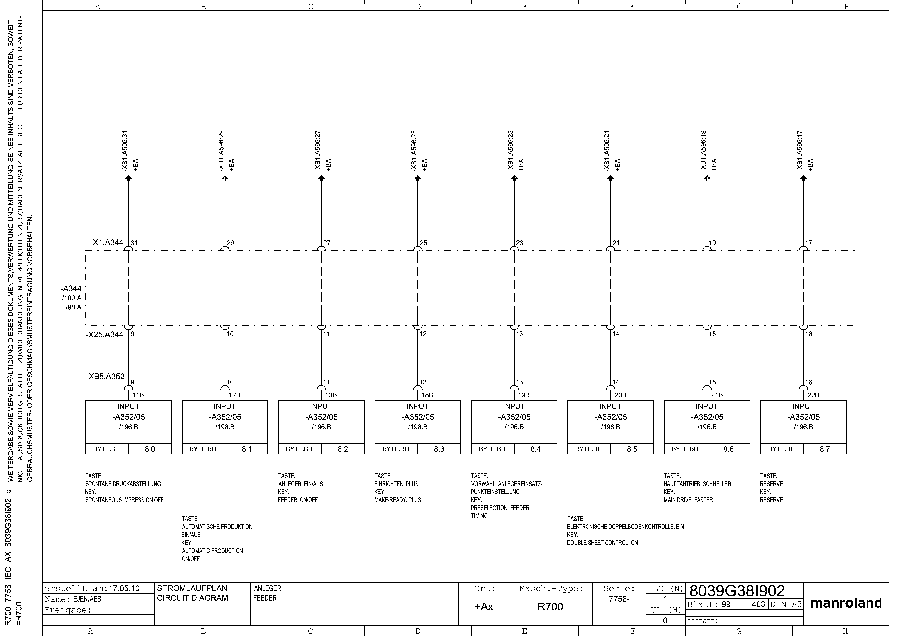

# +Ax — Sheet 99 of 403 — ANLEGER

**FEEDER**

> Part of the manroland **R700** printing press IEC/UL circuit diagrams.
> Drawing class: **Stromlaufplan / Circuit diagram** (DIN A3).
> Document `+Ax` covers the **Central control console** machine section.

## At a glance

| Field | Value |
|---|---|
| Document | `+Ax`  (8039G38I902) |
| Sheet | **99** of 403 |
| Section (DE) | ANLEGER |
| Section (EN) | FEEDER |
| Section type | CIRCUIT — Circuit diagram |
| Machine type | `R700` |
| Series | `7758` |
| Created | 17.05.10 |
| Replaces | — |
| Columns used | A, B, C, D, E, F, G, H |
| Path numbers | — |
| Labels on sheet | 130 |
| Cross-refs out | 10 |
| Cross-refs in | 34 |

**Previous:** [+Ax sheet 98](SHEET_0098.md) · **Next:** [+Ax sheet 100](SHEET_0100.md) · **Document TOC:** [_TOC.md](_TOC.md)  (+Ax) · **Master TOC:** [all sheets](../_MASTER_TOC.md)

## Sheet image (300 DPI, exact vector render)



_Rendered directly from the PDF vector layer at 300 DPI (1-bit), no OCR and no resampling. Use it to confirm anything ambiguous in the text below._

## Cross-references on this sheet

Each entry is a wire leaving this sheet. The printed token is `/sheet.column`; the link resolves to that sheet inside the same document.

| Ref | Target sheet | Col | Path | Destination on target | Target section | From col |
|---|---|---|---|---|---|---|
| `/100.A` | [+Ax sheet 100](SHEET_0100.md) | A | — | — | ANLEGER | A |
| `/98.A` | [+Ax sheet 98](SHEET_0098.md) | A | — | — | ANLEGER | A |
| `/196.B` | [+Ax sheet 196](SHEET_0196.md) | B | — | — | REFERENZMODUL | A |
| `/196.B` | [+Ax sheet 196](SHEET_0196.md) | B | — | — | REFERENZMODUL | B |
| `/196.B` | [+Ax sheet 196](SHEET_0196.md) | B | — | — | REFERENZMODUL | C |
| `/196.B` | [+Ax sheet 196](SHEET_0196.md) | B | — | — | REFERENZMODUL | D |
| `/196.B` | [+Ax sheet 196](SHEET_0196.md) | B | — | — | REFERENZMODUL | E |
| `/196.B` | [+Ax sheet 196](SHEET_0196.md) | B | — | — | REFERENZMODUL | F |
| `/196.B` | [+Ax sheet 196](SHEET_0196.md) | B | — | — | REFERENZMODUL | G |
| `/196.B` | [+Ax sheet 196](SHEET_0196.md) | B | — | — | REFERENZMODUL | H |

### Incoming references (sheets that point here)

Every other sheet that sends a wire to this one. `Back-ref` is the token printed on *that* sheet; `Path` is its line number.

| From sheet | Cols | Back-ref | Path | Refs | What continues there |
|---|---|---|---|---|---|
| [+Ax#98](SHEET_0098.md) | A | `/98.A` | — | 1 | — |
| [+Ax#100](SHEET_0100.md) | A | `/100.A` | — | 1 | — |
| [+Ax#196](SHEET_0196.md) | B | `/196.B` | — | 8 | — |
| [+Ax#207](SHEET_0207.md) | F, G | `/207.F`, `/207.G` | — | 8 | — |
| [+Ax#231](SHEET_0231.md) | C | `/231.C` | — | 8 | — |
| [+Ax#267](SHEET_0267.md) | E | `/267.E` | — | 8 | — |


## Devices on this sheet

| Tag | Class | Class meaning (IEC) | Col | Sub | Terminal | Sign |
|---|---|---|---|---|---|---|
| `A352/05` | A | Baugruppe / assembly, module, PC board | B | 05 | — | — |
| `A352/05` | A | Baugruppe / assembly, module, PC board | C | 05 | — | — |
| `A352/05` | A | Baugruppe / assembly, module, PC board | D | 05 | — | — |
| `A352/05` | A | Baugruppe / assembly, module, PC board | E | 05 | — | — |
| `A352/05` | A | Baugruppe / assembly, module, PC board | F | 05 | — | — |
| `A352/05` | A | Baugruppe / assembly, module, PC board | G | 05 | — | — |
| `A352/05` | A | Baugruppe / assembly, module, PC board | H | 05 | — | — |
| `A352/05` | A | Baugruppe / assembly, module, PC board | A | 05 | — | — |
| `A344` | A | Baugruppe / assembly, module, PC board | A | — | — | — |
| `8.1` | — | cross-device reference | B | — | — | — |
| `8.2` | — | cross-device reference | C | — | — | — |
| `8.3` | — | cross-device reference | D | — | — | — |
| `8.4` | — | cross-device reference | E | — | — | — |
| `8.5` | — | cross-device reference | F | — | — | — |
| `8.6` | — | cross-device reference | G | — | — | — |
| `8.7` | — | cross-device reference | H | — | — | — |
| `X25.A344` | — | cross-device reference | A | — | — | — |
| `8.0` | — | cross-device reference | A | — | — | — |
| `X1.A344` | — | cross-device reference | A | — | — | — |
| `XB5.A352` | — | cross-device reference | A | — | — | — |
| `XB1.A596:31` | — | cross-device reference | A | — | 31 | — |
| `XB1.A596:29` | — | cross-device reference | B | — | 29 | — |
| `XB1.A596:27` | — | cross-device reference | C | — | 27 | — |
| `XB1.A596:25` | — | cross-device reference | D | — | 25 | — |
| `XB1.A596:23` | — | cross-device reference | E | — | 23 | — |
| `XB1.A596:21` | — | cross-device reference | F | — | 21 | — |
| `XB1.A596:19` | — | cross-device reference | G | — | 19 | — |
| `XB1.A596:17` | — | cross-device reference | H | — | 17 | — |

## Potentials / nets

_No named potentials on this sheet._

## Wire-end annotations (grouped as printed)

A wire that continues elsewhere is annotated with a small cluster: the destination description, the path/line number `#NN`, and the `/sheet.column` cross reference. Each row below is one such cluster exactly as it is grouped on the drawing.

| Col | Y | Path | Cross-ref | Text on the wire |
|---|---|---|---|---|
| A | 172.3 | — | — | `XB1.A596:31` |
| B | 172.3 | — | — | `XB1.A596:29` |
| C | 172.3 | — | — | `XB1.A596:27` |
| D | 172.3 | — | — | `XB1.A596:25` |
| E | 172.3 | — | — | `XB1.A596:23` |
| F | 172.3 | — | — | `XB1.A596:21` |
| G | 172.3 | — | — | `XB1.A596:19` |
| H | 172.3 | — | — | `XB1.A596:17` |
| A | 210.1 | — | — | `+BA` |
| B | 210.1 | — | — | `+BA` |
| C | 210.1 | — | — | `+BA` |
| D | 210.1 | — | — | `+BA` |
| E | 210.1 | — | — | `+BA` |
| F | 210.1 | — | — | `+BA` |
| G | 210.1 | — | — | `+BA` |
| H | 210.1 | — | — | `+BA` |
| D | 316.4 | — | — | `X1.A344 31 29 27 25 23 21 19 17` |
| A | 377.3 | — | — | `A344` |
| A | 390.4 | — | `/100.A` | — |
| A | 402.8 | — | `/98.A` | — |
| A | 438.3 | — | — | `X25.A344 9` |
| B | 438.3 | — | — | `10` |
| C | 438.3 | — | — | `11` |
| D | 438.3 | — | — | `12` |
| E | 438.3 | — | — | `13` |
| F | 438.3 | — | — | `14` |
| G | 438.3 | — | — | `15` |
| H | 438.3 | — | — | `16` |
| A | 493.5 | — | — | `XB5.A352 9` |
| E | 502.1 | — | — | `10 11 12 13 14 15 16` |
| A | 519.0 | — | — | `11B` |
| B | 519.0 | — | — | `12B` |
| C | 519.0 | — | — | `13B` |
| D | 519.0 | — | — | `18B` |
| E | 519.0 | — | — | `19B` |
| F | 519.0 | — | — | `20B` |
| G | 519.0 | — | — | `21B` |
| H | 519.0 | — | — | `22B` |
| A | 533.5 | — | — | `INPUT` |
| B | 533.5 | — | — | `INPUT` |
| C | 533.5 | — | — | `INPUT` |
| D | 533.5 | — | — | `INPUT` |
| E | 533.5 | — | — | `INPUT` |
| F | 533.5 | — | — | `INPUT` |
| G | 533.5 | — | — | `INPUT` |
| H | 533.5 | — | — | `INPUT` |
| A | 547.4 | — | — | `A352/05` |
| B | 547.4 | — | — | `A352/05` |
| C | 547.4 | — | — | `A352/05` |
| D | 547.4 | — | — | `A352/05` |
| E | 547.4 | — | — | `A352/05` |
| F | 547.4 | — | — | `A352/05` |
| G | 547.4 | — | — | `A352/05` |
| H | 547.4 | — | — | `A352/05` |
| A | 561.2 | — | `/196.B` | — |
| B | 561.2 | — | `/196.B` | — |
| C | 561.2 | — | `/196.B` | — |
| D | 561.2 | — | `/196.B` | — |
| E | 561.2 | — | `/196.B` | — |
| F | 561.2 | — | `/196.B` | — |
| G | 561.2 | — | `/196.B` | — |
| H | 561.2 | — | `/196.B` | — |
| A | 590.2 | — | — | `BYTE.BIT 8.0` |
| B | 590.2 | — | — | `BYTE.BIT 8.1` |
| C | 590.2 | — | — | `BYTE.BIT 8.2` |
| D | 590.2 | — | — | `BYTE.BIT 8.3` |
| E | 590.2 | — | — | `BYTE.BIT 8.4` |
| F | 590.2 | — | — | `BYTE.BIT 8.5` |
| G | 590.2 | — | — | `BYTE.BIT 8.6` |
| H | 590.2 | — | — | `BYTE.BIT 8.7` |
| A | 627.0 | — | — | `KEY: TASTE: SPONTANE DRUCKABSTELLUNG` |
| C | 627.0 | — | — | `KEY: FEEDER: ON/OFF TASTE: ANLEGER: EIN/AUS` |
| D | 627.0 | — | — | `EINRICHTEN, PLUS KEY: MAKE READY, PLUS TASTE:` |
| E | 627.0 | — | — | `PUNKTEINSTELLUNG KEY: PRESELECTION, FEEDER TASTE: VORWAHL, ANLEGEREINSATZ` |
| G | 627.0 | — | — | `HAUPTANTRIEB, SCHNELLER KEY: MAIN DRIVE, FASTER TASTE:` |
| G | 627.0 | — | — | `RESERVE KEY: RESERVE TASTE:` |
| A | 659.0 | — | — | `SPONTANEOUS IMPRESSION OFF` |
| E | 680.2 | — | — | `TIMING` |
| B | 683.7 | — | — | `EIN/AUS KEY: TASTE: AUTOMATISCHE PRODUKTION` |
| F | 683.7 | — | — | `ELEKTRONISCHE DOPPELBOGENKONTROLLE, EIN KEY: DOUBLE SHEET CONTROL, ON TASTE:` |
| B | 726.3 | — | — | `ON/OFF AUTOMATIC PRODUCTION` |


## Reconstructed tables

This sheet carries tabular content (pin map / terminal assignment / index). The grid below was rebuilt from the drawing's own rule lines, so each row is exactly one physical row of the table.

### Table 1 — 1 data rows × 2 columns (at x=113.4, y=530.1)

| INPUT | A352/05 /196.B |
|---|---|
| `BYTE.BIT` | `8.0` |


### Table 2 — 1 data rows × 2 columns (at x=240.9, y=530.1)

| INPUT | A352/05 /196.B |
|---|---|
| `BYTE.BIT` | `8.1` |


### Table 3 — 1 data rows × 2 columns (at x=368.5, y=530.1)

| INPUT | A352/05 /196.B |
|---|---|
| `BYTE.BIT` | `8.2` |


### Table 4 — 1 data rows × 2 columns (at x=496.1, y=530.1)

| INPUT | A352/05 /196.B |
|---|---|
| `BYTE.BIT` | `8.3` |


### Table 5 — 1 data rows × 2 columns (at x=623.6, y=530.1)

| INPUT | A352/05 /196.B |
|---|---|
| `BYTE.BIT` | `8.4` |


### Table 6 — 1 data rows × 2 columns (at x=751.2, y=530.1)

| INPUT | A352/05 /196.B |
|---|---|
| `BYTE.BIT` | `8.5` |


### Table 7 — 1 data rows × 2 columns (at x=878.7, y=530.1)

| INPUT | A352/05 /196.B |
|---|---|
| `BYTE.BIT` | `8.6` |


### Table 8 — 1 data rows × 2 columns (at x=1006.3, y=530.1)

| INPUT | A352/05 /196.B |
|---|---|
| `BYTE.BIT` | `8.7` |


## Notes and free text on this sheet

| Text | Col | Y (pt) |
|---|---|---|
| `12B` | B | 519.03 |
| `INPUT` | B | 533.55 |
| `BYTE.BIT` | B | 590.8 |
| `TASTE:` | B | 683.71 |
| `AUTOMATISCHE PRODUKTION` | B | 694.42 |
| `EIN/AUS` | B | 704.99 |
| `KEY:` | B | 715.54 |
| `AUTOMATIC PRODUCTION` | B | 726.32 |
| `ON/OFF` | B | 736.94 |
| `13B` | C | 519.03 |
| `INPUT` | C | 533.55 |
| `BYTE.BIT` | C | 590.8 |
| `TASTE:` | C | 627.02 |
| `ANLEGER: EIN/AUS` | C | 637.71 |
| `KEY:` | C | 648.21 |
| `FEEDER: ON/OFF` | C | 658.97 |
| `18B` | D | 519.03 |
| `INPUT` | D | 533.55 |
| `BYTE.BIT` | D | 590.8 |
| `TASTE:` | D | 627.02 |
| `EINRICHTEN, PLUS` | D | 637.71 |
| `KEY:` | D | 648.21 |
| `MAKE READY, PLUS` | D | 658.97 |
| `19B` | E | 519.03 |
| `INPUT` | E | 533.55 |
| `BYTE.BIT` | E | 590.8 |
| `TASTE:` | E | 627.02 |
| `VORWAHL, ANLEGEREINSATZ` | E | 637.7 |
| `PUNKTEINSTELLUNG` | E | 648.35 |
| `KEY:` | E | 658.84 |
| `PRESELECTION, FEEDER` | E | 669.6 |
| `TIMING` | E | 680.24 |
| `20B` | F | 519.03 |
| `INPUT` | F | 533.55 |
| `BYTE.BIT` | F | 590.8 |
| `ELEKTRONISCHE DOPPELBOGENKONTROLLE, EIN` | F | 694.41 |
| `DOUBLE SHEET CONTROL, ON` | F | 715.68 |
| `21B` | G | 519.03 |
| `INPUT` | G | 533.55 |
| `TASTE:` | F | 627.02 |
| `HAUPTANTRIEB, SCHNELLER` | G | 637.72 |
| `KEY:` | F | 648.21 |
| `MAIN DRIVE, FASTER` | G | 658.97 |
| `22B` | H | 519.03 |
| `INPUT` | H | 533.55 |
| `BYTE.BIT` | G | 590.8 |
| `TASTE:` | G | 627.02 |
| `RESERVE` | G | 637.67 |
| `KEY:` | G | 648.21 |
| `11B` | A | 519.03 |
| `INPUT` | A | 533.55 |
| `BYTE.BIT` | A | 590.8 |
| `TASTE:` | A | 627.02 |
| `SPONTANE DRUCKABSTELLUNG` | A | 637.72 |
| `KEY:` | A | 648.21 |
| `SPONTANEOUS IMPRESSION OFF` | A | 658.98 |
| `+BA` | A | 210.05 |
| `+BA` | B | 210.05 |
| `+BA` | C | 210.05 |
| `+BA` | D | 210.05 |
| `+BA` | E | 210.05 |
| `+BA` | F | 210.05 |
| `+BA` | G | 210.05 |
| `+BA` | H | 210.05 |

## Complete label inventory (exact text from the drawing)

Every text object inside the drawing area of this sheet, in DIN reading order (column A→H, then top→bottom). This is the authoritative list: if a string is not here it is not printed on this sheet.

| Col | Y | X | Dir | Type | Text |
|---|---|---|---|---|---|
| A | 172.3 | 161.1 | ↕ | device ref | `XB1.A596:31` |
| A | 210.0 | 175.3 | ↕ | text | `+BA` |
| A | 316.4 | 119.3 | → | device ref | `X1.A344` |
| A | 317.8 | 172.6 | → | number | `31` |
| A | 377.3 | 79.9 | → | device tag | `A344` |
| A | 390.4 | 82.2 | → | cross-reference | `/100.A` |
| A | 402.8 | 87.0 | → | cross-reference | `/98.A` |
| A | 438.3 | 113.4 | → | device ref | `X25.A344` |
| A | 438.3 | 172.6 | → | number | `9` |
| A | 493.5 | 113.7 | → | device ref | `XB5.A352` |
| A | 502.1 | 172.6 | → | number | `9` |
| A | 519.0 | 174.9 | → | text | `11B` |
| A | 533.6 | 155.2 | → | text | `INPUT` |
| A | 547.4 | 148.7 | → | device tag | `A352/05` |
| A | 561.2 | 157.5 | → | cross-reference | `/196.B` |
| A | 590.2 | 191.6 | → | device ref | `8.0` |
| A | 590.8 | 123.3 | → | text | `BYTE.BIT` |
| A | 627.0 | 113.1 | → | text | `TASTE:` |
| A | 637.7 | 113.1 | → | text | `SPONTANE DRUCKABSTELLUNG` |
| A | 648.2 | 112.5 | → | text | `KEY:` |
| A | 659.0 | 113.1 | → | text | `SPONTANEOUS IMPRESSION OFF` |
| B | 172.3 | 288.7 | ↕ | device ref | `XB1.A596:29` |
| B | 210.0 | 302.8 | ↕ | text | `+BA` |
| B | 317.8 | 300.2 | → | number | `29` |
| B | 438.3 | 299.6 | → | number | `10` |
| B | 502.1 | 299.6 | → | number | `10` |
| B | 519.0 | 302.5 | → | text | `12B` |
| B | 533.6 | 282.8 | → | text | `INPUT` |
| B | 547.4 | 276.2 | → | device tag | `A352/05` |
| B | 561.2 | 285.0 | → | cross-reference | `/196.B` |
| B | 590.2 | 320.0 | → | device ref | `8.1` |
| B | 590.8 | 250.9 | → | text | `BYTE.BIT` |
| B | 683.7 | 240.7 | → | text | `TASTE:` |
| B | 694.4 | 240.9 | → | text | `AUTOMATISCHE PRODUKTION` |
| B | 705.0 | 240.1 | → | text | `EIN/AUS` |
| B | 715.5 | 240.1 | → | text | `KEY:` |
| B | 726.3 | 240.9 | → | text | `AUTOMATIC PRODUCTION` |
| B | 736.9 | 240.7 | → | text | `ON/OFF` |
| C | 172.3 | 416.3 | ↕ | device ref | `XB1.A596:27` |
| C | 210.0 | 430.4 | ↕ | text | `+BA` |
| C | 317.8 | 427.7 | → | number | `27` |
| C | 438.3 | 427.2 | → | number | `11` |
| C | 502.1 | 427.2 | → | number | `11` |
| C | 519.0 | 430.0 | → | text | `13B` |
| C | 533.6 | 410.3 | → | text | `INPUT` |
| C | 547.4 | 403.8 | → | device tag | `A352/05` |
| C | 561.2 | 412.6 | → | cross-reference | `/196.B` |
| C | 590.2 | 446.7 | → | device ref | `8.2` |
| C | 590.8 | 378.4 | → | text | `BYTE.BIT` |
| C | 627.0 | 368.2 | → | text | `TASTE:` |
| C | 637.7 | 368.5 | → | text | `ANLEGER: EIN/AUS` |
| C | 648.2 | 367.7 | → | text | `KEY:` |
| C | 659.0 | 367.7 | → | text | `FEEDER: ON/OFF` |
| D | 172.3 | 543.8 | ↕ | device ref | `XB1.A596:25` |
| D | 210.0 | 558.0 | ↕ | text | `+BA` |
| D | 317.8 | 555.3 | → | number | `25` |
| D | 438.3 | 554.7 | → | number | `12` |
| D | 502.1 | 554.7 | → | number | `12` |
| D | 519.0 | 557.6 | → | text | `18B` |
| D | 533.6 | 537.9 | → | text | `INPUT` |
| D | 547.4 | 531.4 | → | device tag | `A352/05` |
| D | 561.2 | 540.1 | → | cross-reference | `/196.B` |
| D | 590.2 | 574.3 | → | device ref | `8.3` |
| D | 590.8 | 506.0 | → | text | `BYTE.BIT` |
| D | 627.0 | 495.8 | → | text | `TASTE:` |
| D | 637.7 | 495.2 | → | text | `EINRICHTEN, PLUS` |
| D | 648.2 | 495.2 | → | text | `KEY:` |
| D | 659.0 | 495.5 | → | text | `MAKE READY, PLUS` |
| E | 172.3 | 671.4 | ↕ | device ref | `XB1.A596:23` |
| E | 210.0 | 685.5 | ↕ | text | `+BA` |
| E | 317.8 | 682.9 | → | number | `23` |
| E | 438.3 | 682.3 | → | number | `13` |
| E | 502.1 | 682.3 | → | number | `13` |
| E | 519.0 | 685.1 | → | text | `19B` |
| E | 533.6 | 665.4 | → | text | `INPUT` |
| E | 547.4 | 658.9 | → | device tag | `A352/05` |
| E | 561.2 | 667.7 | → | cross-reference | `/196.B` |
| E | 590.2 | 701.9 | → | device ref | `8.4` |
| E | 590.8 | 633.5 | → | text | `BYTE.BIT` |
| E | 627.0 | 623.3 | → | text | `TASTE:` |
| E | 637.7 | 623.6 | → | text | `VORWAHL, ANLEGEREINSATZ` |
| E | 648.3 | 622.8 | → | text | `PUNKTEINSTELLUNG` |
| E | 658.8 | 622.8 | → | text | `KEY:` |
| E | 669.6 | 622.8 | → | text | `PRESELECTION, FEEDER` |
| E | 680.2 | 623.3 | → | text | `TIMING` |
| E | 683.7 | 750.9 | → | text | `TASTE:` |
| E | 704.9 | 750.3 | → | text | `KEY:` |
| F | 172.3 | 798.9 | ↕ | device ref | `XB1.A596:21` |
| F | 210.0 | 813.1 | ↕ | text | `+BA` |
| F | 317.8 | 810.4 | → | number | `21` |
| F | 438.3 | 809.9 | → | number | `14` |
| F | 502.1 | 809.9 | → | number | `14` |
| F | 519.0 | 813.3 | → | text | `20B` |
| F | 533.6 | 793.0 | → | text | `INPUT` |
| F | 547.4 | 786.5 | → | device tag | `A352/05` |
| F | 561.2 | 795.3 | → | cross-reference | `/196.B` |
| F | 590.2 | 829.4 | → | device ref | `8.5` |
| F | 590.8 | 761.1 | → | text | `BYTE.BIT` |
| F | 590.8 | 888.7 | → | text | `BYTE.BIT` |
| F | 627.0 | 878.5 | → | text | `TASTE:` |
| F | 648.2 | 877.9 | → | text | `KEY:` |
| F | 694.4 | 750.3 | → | text | `ELEKTRONISCHE DOPPELBOGENKONTROLLE, EIN` |
| F | 715.7 | 750.3 | → | text | `DOUBLE SHEET CONTROL, ON` |
| G | 172.3 | 926.5 | ↕ | device ref | `XB1.A596:19` |
| G | 210.0 | 940.6 | ↕ | text | `+BA` |
| G | 317.8 | 937.4 | → | number | `19` |
| G | 438.3 | 937.4 | → | number | `15` |
| G | 502.1 | 937.4 | → | number | `15` |
| G | 519.0 | 940.8 | → | text | `21B` |
| G | 533.6 | 920.6 | → | text | `INPUT` |
| G | 547.4 | 914.0 | → | device tag | `A352/05` |
| G | 561.2 | 922.8 | → | cross-reference | `/196.B` |
| G | 590.2 | 957.0 | → | device ref | `8.6` |
| G | 590.8 | 1016.2 | → | text | `BYTE.BIT` |
| G | 627.0 | 1006.0 | → | text | `TASTE:` |
| G | 637.7 | 877.9 | → | text | `HAUPTANTRIEB, SCHNELLER` |
| G | 637.7 | 1005.4 | → | text | `RESERVE` |
| G | 648.2 | 1005.4 | → | text | `KEY:` |
| G | 658.9 | 1005.4 | → | text | `RESERVE` |
| G | 659.0 | 878.2 | → | text | `MAIN DRIVE, FASTER` |
| H | 172.3 | 1054.1 | ↕ | device ref | `XB1.A596:17` |
| H | 210.0 | 1068.2 | ↕ | text | `+BA` |
| H | 317.8 | 1065.0 | → | number | `17` |
| H | 438.3 | 1065.0 | → | number | `16` |
| H | 502.1 | 1065.0 | → | number | `16` |
| H | 519.0 | 1068.4 | → | text | `22B` |
| H | 533.6 | 1048.1 | → | text | `INPUT` |
| H | 547.4 | 1041.6 | → | device tag | `A352/05` |
| H | 561.2 | 1050.4 | → | cross-reference | `/196.B` |
| H | 590.2 | 1084.5 | → | device ref | `8.7` |

## Reading-order text block

The same content as a plain block, grouped by DIN column — convenient to paste or to match against a visual description.

```text
=== Column A ===
 172.3  161.1  devref       XB1.A596:31
 210.0  175.3  text         +BA
 316.4  119.3  devref       X1.A344
 317.8  172.6  numeric      31
 377.3   79.9  devtag       A344
 390.4   82.2  xref         /100.A
 402.8   87.0  xref         /98.A
 438.3  113.4  devref       X25.A344
 438.3  172.6  numeric      9
 493.5  113.7  devref       XB5.A352
 502.1  172.6  numeric      9
 519.0  174.9  text         11B
 533.6  155.2  text         INPUT
 547.4  148.7  devtag       A352/05
 561.2  157.5  xref         /196.B
 590.2  191.6  devref       8.0
 590.8  123.3  text         BYTE.BIT
 627.0  113.1  text         TASTE:
 637.7  113.1  text         SPONTANE DRUCKABSTELLUNG
 648.2  112.5  text         KEY:
 659.0  113.1  text         SPONTANEOUS IMPRESSION OFF
=== Column B ===
 172.3  288.7  devref       XB1.A596:29
 210.0  302.8  text         +BA
 317.8  300.2  numeric      29
 438.3  299.6  numeric      10
 502.1  299.6  numeric      10
 519.0  302.5  text         12B
 533.6  282.8  text         INPUT
 547.4  276.2  devtag       A352/05
 561.2  285.0  xref         /196.B
 590.2  320.0  devref       8.1
 590.8  250.9  text         BYTE.BIT
 683.7  240.7  text         TASTE:
 694.4  240.9  text         AUTOMATISCHE PRODUKTION
 705.0  240.1  text         EIN/AUS
 715.5  240.1  text         KEY:
 726.3  240.9  text         AUTOMATIC PRODUCTION
 736.9  240.7  text         ON/OFF
=== Column C ===
 172.3  416.3  devref       XB1.A596:27
 210.0  430.4  text         +BA
 317.8  427.7  numeric      27
 438.3  427.2  numeric      11
 502.1  427.2  numeric      11
 519.0  430.0  text         13B
 533.6  410.3  text         INPUT
 547.4  403.8  devtag       A352/05
 561.2  412.6  xref         /196.B
 590.2  446.7  devref       8.2
 590.8  378.4  text         BYTE.BIT
 627.0  368.2  text         TASTE:
 637.7  368.5  text         ANLEGER: EIN/AUS
 648.2  367.7  text         KEY:
 659.0  367.7  text         FEEDER: ON/OFF
=== Column D ===
 172.3  543.8  devref       XB1.A596:25
 210.0  558.0  text         +BA
 317.8  555.3  numeric      25
 438.3  554.7  numeric      12
 502.1  554.7  numeric      12
 519.0  557.6  text         18B
 533.6  537.9  text         INPUT
 547.4  531.4  devtag       A352/05
 561.2  540.1  xref         /196.B
 590.2  574.3  devref       8.3
 590.8  506.0  text         BYTE.BIT
 627.0  495.8  text         TASTE:
 637.7  495.2  text         EINRICHTEN, PLUS
 648.2  495.2  text         KEY:
 659.0  495.5  text         MAKE READY, PLUS
=== Column E ===
 172.3  671.4  devref       XB1.A596:23
 210.0  685.5  text         +BA
 317.8  682.9  numeric      23
 438.3  682.3  numeric      13
 502.1  682.3  numeric      13
 519.0  685.1  text         19B
 533.6  665.4  text         INPUT
 547.4  658.9  devtag       A352/05
 561.2  667.7  xref         /196.B
 590.2  701.9  devref       8.4
 590.8  633.5  text         BYTE.BIT
 627.0  623.3  text         TASTE:
 637.7  623.6  text         VORWAHL, ANLEGEREINSATZ
 648.3  622.8  text         PUNKTEINSTELLUNG
 658.8  622.8  text         KEY:
 669.6  622.8  text         PRESELECTION, FEEDER
 680.2  623.3  text         TIMING
 683.7  750.9  text         TASTE:
 704.9  750.3  text         KEY:
=== Column F ===
 172.3  798.9  devref       XB1.A596:21
 210.0  813.1  text         +BA
 317.8  810.4  numeric      21
 438.3  809.9  numeric      14
 502.1  809.9  numeric      14
 519.0  813.3  text         20B
 533.6  793.0  text         INPUT
 547.4  786.5  devtag       A352/05
 561.2  795.3  xref         /196.B
 590.2  829.4  devref       8.5
 590.8  761.1  text         BYTE.BIT
 590.8  888.7  text         BYTE.BIT
 627.0  878.5  text         TASTE:
 648.2  877.9  text         KEY:
 694.4  750.3  text         ELEKTRONISCHE DOPPELBOGENKONTROLLE, EIN
 715.7  750.3  text         DOUBLE SHEET CONTROL, ON
=== Column G ===
 172.3  926.5  devref       XB1.A596:19
 210.0  940.6  text         +BA
 317.8  937.4  numeric      19
 438.3  937.4  numeric      15
 502.1  937.4  numeric      15
 519.0  940.8  text         21B
 533.6  920.6  text         INPUT
 547.4  914.0  devtag       A352/05
 561.2  922.8  xref         /196.B
 590.2  957.0  devref       8.6
 590.8 1016.2  text         BYTE.BIT
 627.0 1006.0  text         TASTE:
 637.7  877.9  text         HAUPTANTRIEB, SCHNELLER
 637.7 1005.4  text         RESERVE
 648.2 1005.4  text         KEY:
 658.9 1005.4  text         RESERVE
 659.0  878.2  text         MAIN DRIVE, FASTER
=== Column H ===
 172.3 1054.1  devref       XB1.A596:17
 210.0 1068.2  text         +BA
 317.8 1065.0  numeric      17
 438.3 1065.0  numeric      16
 502.1 1065.0  numeric      16
 519.0 1068.4  text         22B
 533.6 1048.1  text         INPUT
 547.4 1041.6  devtag       A352/05
 561.2 1050.4  xref         /196.B
 590.2 1084.5  devref       8.7
```

---
_Generated from the PDF vector text layer; no OCR. Source: `R700_7758_IEC_AX_8039G38I902_p`, sheet 99._
