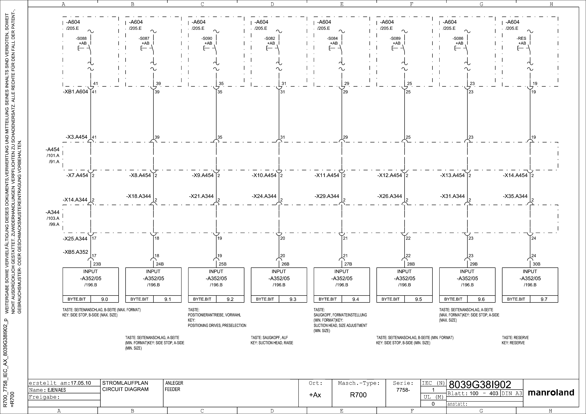

# +Ax — Sheet 100 of 403 — ANLEGER

**FEEDER**

> Part of the manroland **R700** printing press IEC/UL circuit diagrams.
> Drawing class: **Stromlaufplan / Circuit diagram** (DIN A3).
> Document `+Ax` covers the **Central control console** machine section.

## At a glance

| Field | Value |
|---|---|
| Document | `+Ax`  (8039G38I902) |
| Sheet | **100** of 403 |
| Section (DE) | ANLEGER |
| Section (EN) | FEEDER |
| Section type | CIRCUIT — Circuit diagram |
| Machine type | `R700` |
| Series | `7758` |
| Created | 17.05.10 |
| Replaces | — |
| Columns used | A, B, C, D, E, F, G, H |
| Path numbers | — |
| Labels on sheet | 185 |
| Cross-refs out | 20 |
| Cross-refs in | 68 |

**Previous:** [+Ax sheet 99](SHEET_0099.md) · **Next:** [+Ax sheet 101](SHEET_0101.md) · **Document TOC:** [_TOC.md](_TOC.md)  (+Ax) · **Master TOC:** [all sheets](../_MASTER_TOC.md)

## Sheet image (300 DPI, exact vector render)



_Rendered directly from the PDF vector layer at 300 DPI (1-bit), no OCR and no resampling. Use it to confirm anything ambiguous in the text below._

## Cross-references on this sheet

Each entry is a wire leaving this sheet. The printed token is `/sheet.column`; the link resolves to that sheet inside the same document.

| Ref | Target sheet | Col | Path | Destination on target | Target section | From col |
|---|---|---|---|---|---|---|
| `/205.E` | [+Ax sheet 205](SHEET_0205.md) | E | — | A604 | REFERENZMODUL | A |
| `/205.E` | [+Ax sheet 205](SHEET_0205.md) | E | — | A604 | REFERENZMODUL | B |
| `/205.E` | [+Ax sheet 205](SHEET_0205.md) | E | — | A604 | REFERENZMODUL | C |
| `/205.E` | [+Ax sheet 205](SHEET_0205.md) | E | — | A604 | REFERENZMODUL | D |
| `/205.E` | [+Ax sheet 205](SHEET_0205.md) | E | — | A604 | REFERENZMODUL | E |
| `/205.E` | [+Ax sheet 205](SHEET_0205.md) | E | — | A604 | REFERENZMODUL | F |
| `/205.E` | [+Ax sheet 205](SHEET_0205.md) | E | — | A604 | REFERENZMODUL | G |
| `/205.E` | [+Ax sheet 205](SHEET_0205.md) | E | — | A604 | REFERENZMODUL | G |
| `/101.A` | [+Ax sheet 101](SHEET_0101.md) | A | — | — | ANLEGER | A |
| `/91.A` | [+Ax sheet 91](SHEET_0091.md) | A | — | — | ANLEGER | A |
| `/103.A` | [+Ax sheet 103](SHEET_0103.md) | A | — | — | ANLEGER | A |
| `/99.A` | [+Ax sheet 99](SHEET_0099.md) | A | — | — | ANLEGER | A |
| `/196.B` | [+Ax sheet 196](SHEET_0196.md) | B | — | — | REFERENZMODUL | A |
| `/196.B` | [+Ax sheet 196](SHEET_0196.md) | B | — | — | REFERENZMODUL | B |
| `/196.B` | [+Ax sheet 196](SHEET_0196.md) | B | — | — | REFERENZMODUL | C |
| `/196.B` | [+Ax sheet 196](SHEET_0196.md) | B | — | — | REFERENZMODUL | D |
| `/196.B` | [+Ax sheet 196](SHEET_0196.md) | B | — | — | REFERENZMODUL | E |
| `/196.B` | [+Ax sheet 196](SHEET_0196.md) | B | — | — | REFERENZMODUL | F |
| `/196.B` | [+Ax sheet 196](SHEET_0196.md) | B | — | — | REFERENZMODUL | G |
| `/196.B` | [+Ax sheet 196](SHEET_0196.md) | B | — | — | REFERENZMODUL | H |

### Incoming references (sheets that point here)

Every other sheet that sends a wire to this one. `Back-ref` is the token printed on *that* sheet; `Path` is its line number.

| From sheet | Cols | Back-ref | Path | Refs | What continues there |
|---|---|---|---|---|---|
| [+Ax#91](SHEET_0091.md) | A | `/91.A` | — | 1 | — |
| [+Ax#99](SHEET_0099.md) | A | `/99.A` | — | 1 | — |
| [+Ax#101](SHEET_0101.md) | A | `/101.A` | — | 1 | — |
| [+Ax#103](SHEET_0103.md) | A | `/103.A` | — | 1 | — |
| [+Ax#196](SHEET_0196.md) | B | `/196.B` | — | 8 | — |
| [+Ax#205](SHEET_0205.md) | D | `/205.D` | — | 8 | — |
| [+Ax#210](SHEET_0210.md) | C, D | `/210.C`, `/210.D` | — | 8 | — |
| [+Ax#225](SHEET_0225.md) | A, B | `/225.A`, `/225.B` | — | 8 | — |
| [+Ax#231](SHEET_0231.md) | C | `/231.C` | — | 8 | — |
| [+Ax#236](SHEET_0236.md) | C | `/236.C` | — | 1 | — |
| [+Ax#239](SHEET_0239.md) | A | `/239.A` | — | 1 | — |
| [+Ax#242](SHEET_0242.md) | F | `/242.F` | — | 1 | — |
| [+Ax#245](SHEET_0245.md) | F | `/245.F` | — | 1 | — |
| [+Ax#247](SHEET_0247.md) | F | `/247.F` | — | 1 | — |
| [+Ax#249](SHEET_0249.md) | A | `/249.A` | — | 1 | — |
| [+Ax#250](SHEET_0250.md) | C | `/250.C` | — | 1 | — |
| [+Ax#251](SHEET_0251.md) | B, F | `/251.B`, `/251.F` | — | 2 | — |
| [+Ax#256](SHEET_0256.md) | E | `/256.E` | — | 1 | — |
| [+Ax#261](SHEET_0261.md) | B | `/261.B` | — | 1 | — |
| [+Ax#266](SHEET_0266.md) | A | `/266.A` | — | 1 | — |
| [+Ax#267](SHEET_0267.md) | E | `/267.E` | — | 8 | — |
| [+Ax#268](SHEET_0268.md) | E | `/268.E` | — | 1 | — |
| [+Ax#273](SHEET_0273.md) | C | `/273.C` | — | 1 | — |
| [+Ax#275](SHEET_0275.md) | A | `/275.A` | — | 1 | — |
| [+Ax#278](SHEET_0278.md) | E | `/278.E` | — | 1 | — |


## Devices on this sheet

| Tag | Class | Class meaning (IEC) | Col | Sub | Terminal | Sign |
|---|---|---|---|---|---|---|
| `A344` | A | Baugruppe / assembly, module, PC board | A | — | — | — |
| `A352/05` | A | Baugruppe / assembly, module, PC board | B | 05 | — | — |
| `A352/05` | A | Baugruppe / assembly, module, PC board | C | 05 | — | — |
| `A352/05` | A | Baugruppe / assembly, module, PC board | D | 05 | — | — |
| `A352/05` | A | Baugruppe / assembly, module, PC board | E | 05 | — | — |
| `A352/05` | A | Baugruppe / assembly, module, PC board | F | 05 | — | — |
| `A352/05` | A | Baugruppe / assembly, module, PC board | G | 05 | — | — |
| `A352/05` | A | Baugruppe / assembly, module, PC board | H | 05 | — | — |
| `A352/05` | A | Baugruppe / assembly, module, PC board | A | 05 | — | — |
| `A454` | A | Baugruppe / assembly, module, PC board | A | — | — | — |
| `S088` | S | Schalter / switch | A | — | — | — |
| `A604` | A | Baugruppe / assembly, module, PC board | A | — | — | — |
| `S087` | S | Schalter / switch | B | — | — | — |
| `A604` | A | Baugruppe / assembly, module, PC board | B | — | — | — |
| `S090` | S | Schalter / switch | C | — | — | — |
| `A604` | A | Baugruppe / assembly, module, PC board | C | — | — | — |
| `S082` | S | Schalter / switch | D | — | — | — |
| `A604` | A | Baugruppe / assembly, module, PC board | D | — | — | — |
| `S084` | S | Schalter / switch | E | — | — | — |
| `A604` | A | Baugruppe / assembly, module, PC board | E | — | — | — |
| `S089` | S | Schalter / switch | F | — | — | — |
| `A604` | A | Baugruppe / assembly, module, PC board | F | — | — | — |
| `S086` | S | Schalter / switch | G | — | — | — |
| `A604` | A | Baugruppe / assembly, module, PC board | G | — | — | — |
| `A604` | A | Baugruppe / assembly, module, PC board | G | — | — | — |
| `X25.A344` | — | cross-device reference | A | — | — | — |
| `X14.A344` | — | cross-device reference | A | — | — | — |
| `X18.A344` | — | cross-device reference | B | — | — | — |
| `X21.A344` | — | cross-device reference | C | — | — | — |
| `X24.A344` | — | cross-device reference | D | — | — | — |
| `X29.A344` | — | cross-device reference | E | — | — | — |
| `X26.A344` | — | cross-device reference | F | — | — | — |
| `X31.A344` | — | cross-device reference | G | — | — | — |
| `X35.A344` | — | cross-device reference | G | — | — | — |
| `9.1` | — | cross-device reference | C | — | — | — |
| `9.2` | — | cross-device reference | C | — | — | — |
| `9.3` | — | cross-device reference | D | — | — | — |
| `9.4` | — | cross-device reference | E | — | — | — |
| `9.5` | — | cross-device reference | F | — | — | — |
| `9.6` | — | cross-device reference | G | — | — | — |
| `9.7` | — | cross-device reference | H | — | — | — |
| `9.0` | — | cross-device reference | B | — | — | — |
| `XB5.A352` | — | cross-device reference | A | — | — | — |
| `X8.A454` | — | cross-device reference | B | — | — | — |
| `X9.A454` | — | cross-device reference | C | — | — | — |
| `X10.A454` | — | cross-device reference | D | — | — | — |
| `X11.A454` | — | cross-device reference | E | — | — | — |
| `X12.A454` | — | cross-device reference | F | — | — | — |
| `X13.A454` | — | cross-device reference | G | — | — | — |
| `X14.A454` | — | cross-device reference | G | — | — | — |
| `X7.A454` | — | cross-device reference | A | — | — | — |
| `X3.A454` | — | cross-device reference | A | — | — | — |
| `XB1.A604` | — | cross-device reference | A | — | — | — |

## Potentials / nets

_No named potentials on this sheet._

## Wire-end annotations (grouped as printed)

A wire that continues elsewhere is annotated with a small cluster: the destination description, the path/line number `#NN`, and the `/sheet.column` cross reference. Each row below is one such cluster exactly as it is grouped on the drawing.

| Col | Y | Path | Cross-ref | Text on the wire |
|---|---|---|---|---|
| A | 40.0 | — | `/205.E` | `A604` |
| B | 40.0 | — | `/205.E` | `A604` |
| C | 40.0 | — | `/205.E` | `A604` |
| D | 40.0 | — | `/205.E` | `A604` |
| E | 40.0 | — | `/205.E` | `A604` |
| F | 40.0 | — | `/205.E` | `A604` |
| G | 40.0 | — | `/205.E` | `A604` |
| G | 40.0 | — | `/205.E` | `A604` |
| A | 74.4 | — | — | `S088` |
| B | 74.4 | — | — | `S087` |
| C | 74.4 | — | — | `S090` |
| D | 74.4 | — | — | `S082` |
| E | 74.4 | — | — | `S084` |
| F | 74.4 | — | — | `S089` |
| G | 74.4 | — | — | `S086` |
| H | 74.4 | — | — | `RES` |
| A | 84.4 | — | — | `+AB` |
| B | 84.4 | — | — | `+AB` |
| C | 84.4 | — | — | `+AB` |
| D | 84.4 | — | — | `+AB` |
| E | 84.4 | — | — | `+AB` |
| F | 84.4 | — | — | `+AB` |
| G | 84.4 | — | — | `+AB` |
| H | 84.4 | — | — | `+AB` |
| A | 166.2 | — | — | `41` |
| B | 166.2 | — | — | `39` |
| C | 166.2 | — | — | `35` |
| D | 166.2 | — | — | `31` |
| E | 166.2 | — | — | `29` |
| F | 166.2 | — | — | `25` |
| G | 166.2 | — | — | `23` |
| H | 166.2 | — | — | `19` |
| D | 181.7 | — | — | `XB1.A604 41 39 35 31 29 25 23 19` |
| D | 273.9 | — | — | `X3.A454 41 39 35 31 29 25 23 19` |
| A | 299.4 | — | — | `A454` |
| A | 312.4 | — | `/101.A` | — |
| A | 324.8 | — | `/91.A` | — |
| D | 351.8 | — | — | `X7.A454 2 X8.A454 2 X9.A454 2 X10.A454 2 X11.A454 2 X12.A454 2 X13.A454 2 X14.A454 2` |
| B | 394.3 | — | — | `X14.A344 2 X18.A344 2` |
| C | 394.3 | — | — | `X21.A344 2` |
| D | 394.3 | — | — | `X24.A344 2` |
| E | 394.3 | — | — | `X29.A344 2` |
| F | 394.3 | — | — | `X26.A344 2` |
| G | 394.3 | — | — | `X31.A344 2` |
| H | 394.3 | — | — | `X35.A344 2` |
| A | 426.9 | — | — | `A344` |
| A | 440.0 | — | `/103.A` | — |
| A | 452.4 | — | `/99.A` | — |
| D | 480.8 | — | — | `X25.A344 17 18 19 20 21 22 23 24` |
| A | 507.7 | — | — | `XB5.A352 17` |
| E | 516.2 | — | — | `18 19 20 21 22 23 24` |
| A | 533.2 | — | — | `23B` |
| B | 533.2 | — | — | `24B` |
| C | 533.2 | — | — | `25B` |
| D | 533.2 | — | — | `26B` |
| E | 533.2 | — | — | `27B` |
| F | 533.2 | — | — | `28B` |
| G | 533.2 | — | — | `29B` |
| H | 533.2 | — | — | `30B` |
| A | 547.7 | — | — | `INPUT` |
| B | 547.7 | — | — | `INPUT` |
| C | 547.7 | — | — | `INPUT` |
| D | 547.7 | — | — | `INPUT` |
| E | 547.7 | — | — | `INPUT` |
| F | 547.7 | — | — | `INPUT` |
| G | 547.7 | — | — | `INPUT` |
| H | 547.7 | — | — | `INPUT` |
| A | 561.6 | — | — | `A352/05` |
| B | 561.6 | — | — | `A352/05` |
| C | 561.6 | — | — | `A352/05` |
| D | 561.6 | — | — | `A352/05` |
| E | 561.6 | — | — | `A352/05` |
| F | 561.6 | — | — | `A352/05` |
| G | 561.6 | — | — | `A352/05` |
| H | 561.6 | — | — | `A352/05` |
| A | 575.3 | — | `/196.B` | — |
| B | 575.3 | — | `/196.B` | — |
| C | 575.3 | — | `/196.B` | — |
| D | 575.3 | — | `/196.B` | — |
| E | 575.3 | — | `/196.B` | — |
| F | 575.3 | — | `/196.B` | — |
| G | 575.3 | — | `/196.B` | — |
| H | 575.3 | — | `/196.B` | — |
| A | 604.4 | — | — | `BYTE.BIT 9.0` |
| B | 604.4 | — | — | `BYTE.BIT 9.1` |
| C | 604.4 | — | — | `BYTE.BIT 9.2` |
| D | 604.4 | — | — | `BYTE.BIT 9.3` |
| E | 604.4 | — | — | `BYTE.BIT 9.4` |
| F | 604.4 | — | — | `BYTE.BIT 9.5` |
| G | 604.4 | — | — | `BYTE.BIT 9.6` |
| H | 604.4 | — | — | `BYTE.BIT 9.7` |
| C | 627.0 | — | — | `POSITIONIERANTRIEBE, VORWAHL KEY: POSITIONING DRIVES, PRESELECTION TASTE:` |
| E | 627.0 | — | — | `(MIN. FORMAT)KEY: (MIN. SIZE) TASTE: SAUGKOPF, FORMATEINSTELLUNG SUCTION HEAD, SIZE ADJUSTMENT` |
| B | 627.1 | — | — | `KEY: SIDE STOP, B SIDE (MAX. SIZE) TASTE: SEITENANSCHLAG, B SEITE (MAX. FORMAT)` |
| G | 627.1 | — | — | `(MAX. FORMAT)KEY: SIDE STOP, A SIDE (MAX. SIZE) TASTE: SEITENANSCHLAG, A SEITE` |
| B | 683.8 | — | — | `(MIN. FORMAT)KEY: SIDE STOP, A SIDE (MIN. SIZE) TASTE: SEITENANSCHLAG, A SEITE` |
| D | 683.8 | — | — | `KEY: SUCTION HEAD, RAISE TASTE: SAUGKOPF, AUF` |
| F | 683.8 | — | — | `KEY: SIDE STOP, B SIDE (MIN. SIZE) TASTE: SEITENANSCHLAG, B SEITE (MIN. FORMAT)` |
| G | 683.8 | — | — | `KEY: RESERVE TASTE: RESERVE` |


## Reconstructed tables

This sheet carries tabular content (pin map / terminal assignment / index). The grid below was rebuilt from the drawing's own rule lines, so each row is exactly one physical row of the table.

### Table 1 — 3 data rows × 2 columns (at x=127.6, y=34.0)

| A604 /205.E S088 +AB | 41 |
|---|---|
| `XB1.A604 X3.A454 X7.A454 X14.A344 X25.A344 XB5.A352` | `41 41 2 2 17 17 23B` |
| `INPUT` | `A352/05 /196.B` |
| `BYTE.BIT` | `9.0` |


### Table 2 — 3 data rows × 2 columns (at x=255.1, y=34.0)

| A604 /205.E S087 +AB | 39 |
|---|---|
| `X8.A454 X18.A344` | `39 39 2 2 18 18 24B` |
| `INPUT` | `A352/05 /196.B` |
| `BYTE.BIT` | `9.1` |


### Table 3 — 3 data rows × 2 columns (at x=382.7, y=34.0)

| A604 /205.E S090 +AB | 35 |
|---|---|
| `X9.A454 X21.A344` | `35 35 2 2 19 19 25B` |
| `INPUT` | `A352/05 /196.B` |
| `BYTE.BIT` | `9.2` |


### Table 4 — 3 data rows × 2 columns (at x=510.2, y=34.0)

| A604 /205.E S082 +AB | 31 |
|---|---|
| `X10.A454 X24.A344` | `31 31 2 2 20 20 26B` |
| `INPUT` | `A352/05 /196.B` |
| `BYTE.BIT` | `9.3` |


### Table 5 — 3 data rows × 2 columns (at x=637.8, y=34.0)

| A604 /205.E S084 +AB | 29 |
|---|---|
| `X11.A454 X29.A344` | `29 29 2 2 21 21 27B` |
| `INPUT` | `A352/05 /196.B` |
| `BYTE.BIT` | `9.4` |


### Table 6 — 3 data rows × 2 columns (at x=765.4, y=34.0)

| A604 /205.E S089 +AB | 25 |
|---|---|
| `X12.A454 X26.A344` | `25 25 2 2 22 22 28B` |
| `INPUT` | `A352/05 /196.B` |
| `BYTE.BIT` | `9.5` |


### Table 7 — 3 data rows × 2 columns (at x=892.9, y=34.0)

| A604 /205.E S086 +AB | 23 |
|---|---|
| `X13.A454 X31.A344` | `23 23 2 2 23 23 29B` |
| `INPUT` | `A352/05 /196.B` |
| `BYTE.BIT` | `9.6` |


### Table 8 — 3 data rows × 2 columns (at x=1020.5, y=34.0)

| A604 /205.E RES +AB | 19 |
|---|---|
| `X14.A454 X35.A344` | `19 19 2 2 24 24 30B` |
| `INPUT` | `A352/05 /196.B` |
| `BYTE.BIT` | `9.7` |


## Notes and free text on this sheet

| Text | Col | Y (pt) |
|---|---|---|
| `24B` | B | 533.2 |
| `INPUT` | B | 547.72 |
| `BYTE.BIT` | B | 604.97 |
| `TASTE: SEITENANSCHLAG, A SEITE` | B | 683.76 |
| `(MIN. FORMAT)KEY: SIDE STOP, A SIDE` | B | 694.4 |
| `(MIN. SIZE)` | B | 705.02 |
| `25B` | C | 533.2 |
| `INPUT` | C | 547.72 |
| `BYTE.BIT` | C | 604.97 |
| `TASTE:` | C | 627.02 |
| `POSITIONIERANTRIEBE, VORWAHL` | C | 637.69 |
| `KEY:` | C | 648.21 |
| `POSITIONING DRIVES, PRESELECTION` | C | 658.97 |
| `26B` | D | 533.2 |
| `INPUT` | D | 547.72 |
| `BYTE.BIT` | D | 604.97 |
| `TASTE: SAUGKOPF, AUF` | D | 683.76 |
| `KEY: SUCTION HEAD, RAISE` | D | 694.39 |
| `27B` | E | 533.2 |
| `INPUT` | E | 547.72 |
| `BYTE.BIT` | E | 604.97 |
| `TASTE:` | E | 627.02 |
| `SAUGKOPF, FORMATEINSTELLUNG` | E | 637.72 |
| `(MIN. FORMAT)KEY:` | E | 648.35 |
| `SUCTION HEAD, SIZE ADJUSTMENT` | E | 658.98 |
| `(MIN. SIZE)` | E | 669.59 |
| `28B` | F | 533.2 |
| `INPUT` | F | 547.72 |
| `BYTE.BIT` | F | 604.97 |
| `TASTE: SEITENANSCHLAG, B SEITE (MIN. FORMAT)` | F | 683.77 |
| `KEY: SIDE STOP, B SIDE (MIN. SIZE)` | F | 694.38 |
| `29B` | G | 533.2 |
| `INPUT` | G | 547.72 |
| `BYTE.BIT` | G | 604.97 |
| `TASTE: SEITENANSCHLAG, A SEITE` | G | 627.07 |
| `(MAX. FORMAT)KEY: SIDE STOP, A SIDE` | G | 637.7 |
| `(MAX. SIZE)` | G | 648.32 |
| `30B` | H | 533.2 |
| `INPUT` | H | 547.72 |
| `TASTE: RESERVE` | G | 683.75 |
| `KEY: RESERVE` | G | 694.36 |
| `23B` | A | 533.2 |
| `INPUT` | A | 547.72 |
| `BYTE.BIT` | A | 604.97 |
| `TASTE: SEITENANSCHLAG, B SEITE (MAX. FORMAT)` | B | 627.08 |
| `KEY: SIDE STOP, B SIDE (MAX. SIZE)` | A | 637.69 |
| `+AB` | A | 84.38 |
| `+AB` | B | 84.38 |
| `+AB` | C | 84.38 |
| `+AB` | D | 84.38 |
| `+AB` | E | 84.38 |
| `+AB` | F | 84.38 |
| `+AB` | G | 84.38 |
| `RES` | H | 74.44 |
| `+AB` | H | 84.38 |

## Complete label inventory (exact text from the drawing)

Every text object inside the drawing area of this sheet, in DIN reading order (column A→H, then top→bottom). This is the authoritative list: if a string is not here it is not printed on this sheet.

| Col | Y | X | Dir | Type | Text |
|---|---|---|---|---|---|
| A | 40.0 | 134.4 | → | device tag | `A604` |
| A | 53.8 | 134.6 | → | cross-reference | `/205.E` |
| A | 74.4 | 154.2 | → | device tag | `S088` |
| A | 84.4 | 160.4 | → | text | `+AB` |
| A | 166.2 | 189.6 | → | number | `41` |
| A | 181.7 | 127.8 | → | device ref | `XB1.A604` |
| A | 183.2 | 186.8 | → | number | `41` |
| A | 273.9 | 133.5 | → | device ref | `X3.A454` |
| A | 275.3 | 186.8 | → | number | `41` |
| A | 299.4 | 92.7 | → | device tag | `A454` |
| A | 312.4 | 95.0 | → | cross-reference | `/101.A` |
| A | 324.8 | 99.8 | → | cross-reference | `/91.A` |
| A | 351.8 | 134.9 | → | device ref | `X7.A454` |
| A | 353.2 | 186.8 | → | number | `2` |
| A | 401.4 | 127.6 | → | device ref | `X14.A344` |
| A | 402.8 | 186.8 | → | number | `2` |
| A | 426.9 | 92.7 | → | device tag | `A344` |
| A | 440.0 | 95.0 | → | cross-reference | `/103.A` |
| A | 452.4 | 99.8 | → | cross-reference | `/99.A` |
| A | 480.8 | 127.6 | → | device ref | `X25.A344` |
| A | 480.8 | 186.2 | → | number | `17` |
| A | 507.7 | 127.8 | → | device ref | `XB5.A352` |
| A | 516.2 | 186.2 | → | number | `17` |
| A | 533.2 | 189.6 | → | text | `23B` |
| A | 547.7 | 169.4 | → | text | `INPUT` |
| A | 561.6 | 162.9 | → | device tag | `A352/05` |
| A | 575.3 | 171.6 | → | cross-reference | `/196.B` |
| A | 605.0 | 137.5 | → | text | `BYTE.BIT` |
| A | 637.7 | 126.7 | → | text | `KEY: SIDE STOP, B SIDE (MAX. SIZE)` |
| B | 40.0 | 261.9 | → | device tag | `A604` |
| B | 53.8 | 262.2 | → | cross-reference | `/205.E` |
| B | 74.4 | 281.8 | → | device tag | `S087` |
| B | 84.4 | 288.0 | → | text | `+AB` |
| B | 166.2 | 317.2 | → | number | `39` |
| B | 183.2 | 314.4 | → | number | `39` |
| B | 275.3 | 314.4 | → | number | `39` |
| B | 351.8 | 262.5 | → | device ref | `X8.A454` |
| B | 353.2 | 314.4 | → | number | `2` |
| B | 394.3 | 256.5 | → | device ref | `X18.A344` |
| B | 402.8 | 314.4 | → | number | `2` |
| B | 480.8 | 313.8 | → | number | `18` |
| B | 516.2 | 313.8 | → | number | `18` |
| B | 533.2 | 317.2 | → | text | `24B` |
| B | 547.7 | 296.9 | → | text | `INPUT` |
| B | 561.6 | 290.4 | → | device tag | `A352/05` |
| B | 575.3 | 299.2 | → | cross-reference | `/196.B` |
| B | 604.4 | 205.8 | → | device ref | `9.0` |
| B | 605.0 | 265.0 | → | text | `BYTE.BIT` |
| B | 627.1 | 127.3 | → | text | `TASTE: SEITENANSCHLAG, B SEITE (MAX. FORMAT)` |
| B | 683.8 | 254.8 | → | text | `TASTE: SEITENANSCHLAG, A SEITE` |
| B | 694.4 | 254.6 | → | text | `(MIN. FORMAT)KEY: SIDE STOP, A SIDE` |
| B | 705.0 | 254.6 | → | text | `(MIN. SIZE)` |
| C | 40.0 | 389.5 | → | device tag | `A604` |
| C | 53.8 | 389.8 | → | cross-reference | `/205.E` |
| C | 74.4 | 409.3 | → | device tag | `S090` |
| C | 84.4 | 415.6 | → | text | `+AB` |
| C | 166.2 | 444.8 | → | number | `35` |
| C | 183.2 | 441.9 | → | number | `35` |
| C | 275.3 | 441.9 | → | number | `35` |
| C | 351.8 | 390.0 | → | device ref | `X9.A454` |
| C | 353.2 | 441.9 | → | number | `2` |
| C | 394.3 | 384.1 | → | device ref | `X21.A344` |
| C | 402.8 | 441.9 | → | number | `2` |
| C | 480.8 | 441.4 | → | number | `19` |
| C | 516.2 | 441.4 | → | number | `19` |
| C | 533.2 | 444.8 | → | text | `25B` |
| C | 547.7 | 424.5 | → | text | `INPUT` |
| C | 561.6 | 418.0 | → | device tag | `A352/05` |
| C | 575.3 | 426.8 | → | cross-reference | `/196.B` |
| C | 604.4 | 334.2 | → | device ref | `9.1` |
| C | 604.4 | 460.9 | → | device ref | `9.2` |
| C | 605.0 | 392.6 | → | text | `BYTE.BIT` |
| C | 627.0 | 382.4 | → | text | `TASTE:` |
| C | 637.7 | 381.8 | → | text | `POSITIONIERANTRIEBE, VORWAHL` |
| C | 648.2 | 381.8 | → | text | `KEY:` |
| C | 659.0 | 381.8 | → | text | `POSITIONING DRIVES, PRESELECTION` |
| D | 40.0 | 517.0 | → | device tag | `A604` |
| D | 53.8 | 517.3 | → | cross-reference | `/205.E` |
| D | 74.4 | 537.2 | → | device tag | `S082` |
| D | 84.4 | 543.1 | → | text | `+AB` |
| D | 166.2 | 572.3 | → | number | `31` |
| D | 183.2 | 569.5 | → | number | `31` |
| D | 275.3 | 569.5 | → | number | `31` |
| D | 351.8 | 511.7 | → | device ref | `X10.A454` |
| D | 353.2 | 569.5 | → | number | `2` |
| D | 394.3 | 511.7 | → | device ref | `X24.A344` |
| D | 402.8 | 569.5 | → | number | `2` |
| D | 480.8 | 569.5 | → | number | `20` |
| D | 516.2 | 569.5 | → | number | `20` |
| D | 533.2 | 572.3 | → | text | `26B` |
| D | 547.7 | 552.0 | → | text | `INPUT` |
| D | 561.6 | 545.5 | → | device tag | `A352/05` |
| D | 575.3 | 554.3 | → | cross-reference | `/196.B` |
| D | 604.4 | 588.5 | → | device ref | `9.3` |
| D | 605.0 | 520.2 | → | text | `BYTE.BIT` |
| D | 683.8 | 510.0 | → | text | `TASTE: SAUGKOPF, AUF` |
| D | 694.4 | 509.4 | → | text | `KEY: SUCTION HEAD, RAISE` |
| E | 40.0 | 644.6 | → | device tag | `A604` |
| E | 53.8 | 644.9 | → | cross-reference | `/205.E` |
| E | 74.4 | 664.4 | → | device tag | `S084` |
| E | 84.4 | 670.7 | → | text | `+AB` |
| E | 166.2 | 699.9 | → | number | `29` |
| E | 183.2 | 697.0 | → | number | `29` |
| E | 275.3 | 697.0 | → | number | `29` |
| E | 351.8 | 639.2 | → | device ref | `X11.A454` |
| E | 353.2 | 697.0 | → | number | `2` |
| E | 394.3 | 639.2 | → | device ref | `X29.A344` |
| E | 402.8 | 697.0 | → | number | `2` |
| E | 480.8 | 697.0 | → | number | `21` |
| E | 516.2 | 697.0 | → | number | `21` |
| E | 533.2 | 699.9 | → | text | `27B` |
| E | 547.7 | 679.6 | → | text | `INPUT` |
| E | 561.6 | 673.1 | → | device tag | `A352/05` |
| E | 575.3 | 681.9 | → | cross-reference | `/196.B` |
| E | 604.4 | 716.0 | → | device ref | `9.4` |
| E | 605.0 | 647.7 | → | text | `BYTE.BIT` |
| E | 627.0 | 637.5 | → | text | `TASTE:` |
| E | 637.7 | 637.5 | → | text | `SAUGKOPF, FORMATEINSTELLUNG` |
| E | 648.3 | 637.2 | → | text | `(MIN. FORMAT)KEY:` |
| E | 659.0 | 637.5 | → | text | `SUCTION HEAD, SIZE ADJUSTMENT` |
| E | 669.6 | 637.2 | → | text | `(MIN. SIZE)` |
| F | 40.0 | 772.2 | → | device tag | `A604` |
| F | 53.8 | 772.4 | → | cross-reference | `/205.E` |
| F | 74.4 | 792.0 | → | device tag | `S089` |
| F | 84.4 | 798.2 | → | text | `+AB` |
| F | 166.2 | 827.4 | → | number | `25` |
| F | 183.2 | 824.6 | → | number | `25` |
| F | 275.3 | 824.6 | → | number | `25` |
| F | 351.8 | 766.8 | → | device ref | `X12.A454` |
| F | 353.2 | 824.6 | → | number | `2` |
| F | 394.3 | 766.8 | → | device ref | `X26.A344` |
| F | 402.8 | 824.6 | → | number | `2` |
| F | 480.8 | 824.6 | → | number | `22` |
| F | 516.2 | 824.6 | → | number | `22` |
| F | 533.2 | 827.4 | → | text | `28B` |
| F | 547.7 | 807.2 | → | text | `INPUT` |
| F | 561.6 | 800.6 | → | device tag | `A352/05` |
| F | 575.3 | 809.4 | → | cross-reference | `/196.B` |
| F | 604.4 | 843.6 | → | device ref | `9.5` |
| F | 605.0 | 775.3 | → | text | `BYTE.BIT` |
| F | 683.8 | 765.1 | → | text | `TASTE: SEITENANSCHLAG, B SEITE (MIN. FORMAT)` |
| F | 694.4 | 764.5 | → | text | `KEY: SIDE STOP, B SIDE (MIN. SIZE)` |
| G | 40.0 | 899.7 | → | device tag | `A604` |
| G | 40.0 | 1027.3 | → | device tag | `A604` |
| G | 53.8 | 900.0 | → | cross-reference | `/205.E` |
| G | 53.8 | 1027.6 | → | cross-reference | `/205.E` |
| G | 74.4 | 919.6 | → | device tag | `S086` |
| G | 84.4 | 925.8 | → | text | `+AB` |
| G | 166.2 | 955.0 | → | number | `23` |
| G | 183.2 | 952.2 | → | number | `23` |
| G | 275.3 | 952.2 | → | number | `23` |
| G | 351.8 | 894.3 | → | device ref | `X13.A454` |
| G | 351.8 | 1021.9 | → | device ref | `X14.A454` |
| G | 353.2 | 952.2 | → | number | `2` |
| G | 394.3 | 894.3 | → | device ref | `X31.A344` |
| G | 394.3 | 1021.9 | → | device ref | `X35.A344` |
| G | 402.8 | 952.2 | → | number | `2` |
| G | 480.8 | 952.2 | → | number | `23` |
| G | 516.2 | 952.2 | → | number | `23` |
| G | 533.2 | 955.0 | → | text | `29B` |
| G | 547.7 | 934.7 | → | text | `INPUT` |
| G | 561.6 | 928.2 | → | device tag | `A352/05` |
| G | 575.3 | 937.0 | → | cross-reference | `/196.B` |
| G | 604.4 | 971.1 | → | device ref | `9.6` |
| G | 605.0 | 902.8 | → | text | `BYTE.BIT` |
| G | 605.0 | 1030.4 | → | text | `BYTE.BIT` |
| G | 627.1 | 892.6 | → | text | `TASTE: SEITENANSCHLAG, A SEITE` |
| G | 637.7 | 892.3 | → | text | `(MAX. FORMAT)KEY: SIDE STOP, A SIDE` |
| G | 648.3 | 892.3 | → | text | `(MAX. SIZE)` |
| G | 683.7 | 1020.2 | → | text | `TASTE: RESERVE` |
| G | 694.4 | 1019.6 | → | text | `KEY: RESERVE` |
| H | 74.4 | 1049.7 | → | text | `RES` |
| H | 84.4 | 1053.4 | → | text | `+AB` |
| H | 166.2 | 1082.0 | → | number | `19` |
| H | 183.2 | 1079.1 | → | number | `19` |
| H | 275.3 | 1079.1 | → | number | `19` |
| H | 353.2 | 1079.7 | → | number | `2` |
| H | 402.8 | 1079.7 | → | number | `2` |
| H | 480.8 | 1079.7 | → | number | `24` |
| H | 516.2 | 1079.7 | → | number | `24` |
| H | 533.2 | 1082.6 | → | text | `30B` |
| H | 547.7 | 1062.3 | → | text | `INPUT` |
| H | 561.6 | 1055.8 | → | device tag | `A352/05` |
| H | 575.3 | 1064.6 | → | cross-reference | `/196.B` |
| H | 604.4 | 1098.7 | → | device ref | `9.7` |

## Reading-order text block

The same content as a plain block, grouped by DIN column — convenient to paste or to match against a visual description.

```text
=== Column A ===
  40.0  134.4  devtag       A604
  53.8  134.6  xref         /205.E
  74.4  154.2  devtag       S088
  84.4  160.4  text         +AB
 166.2  189.6  numeric      41
 181.7  127.8  devref       XB1.A604
 183.2  186.8  numeric      41
 273.9  133.5  devref       X3.A454
 275.3  186.8  numeric      41
 299.4   92.7  devtag       A454
 312.4   95.0  xref         /101.A
 324.8   99.8  xref         /91.A
 351.8  134.9  devref       X7.A454
 353.2  186.8  numeric      2
 401.4  127.6  devref       X14.A344
 402.8  186.8  numeric      2
 426.9   92.7  devtag       A344
 440.0   95.0  xref         /103.A
 452.4   99.8  xref         /99.A
 480.8  127.6  devref       X25.A344
 480.8  186.2  numeric      17
 507.7  127.8  devref       XB5.A352
 516.2  186.2  numeric      17
 533.2  189.6  text         23B
 547.7  169.4  text         INPUT
 561.6  162.9  devtag       A352/05
 575.3  171.6  xref         /196.B
 605.0  137.5  text         BYTE.BIT
 637.7  126.7  text         KEY: SIDE STOP, B SIDE (MAX. SIZE)
=== Column B ===
  40.0  261.9  devtag       A604
  53.8  262.2  xref         /205.E
  74.4  281.8  devtag       S087
  84.4  288.0  text         +AB
 166.2  317.2  numeric      39
 183.2  314.4  numeric      39
 275.3  314.4  numeric      39
 351.8  262.5  devref       X8.A454
 353.2  314.4  numeric      2
 394.3  256.5  devref       X18.A344
 402.8  314.4  numeric      2
 480.8  313.8  numeric      18
 516.2  313.8  numeric      18
 533.2  317.2  text         24B
 547.7  296.9  text         INPUT
 561.6  290.4  devtag       A352/05
 575.3  299.2  xref         /196.B
 604.4  205.8  devref       9.0
 605.0  265.0  text         BYTE.BIT
 627.1  127.3  text         TASTE: SEITENANSCHLAG, B SEITE (MAX. FORMAT)
 683.8  254.8  text         TASTE: SEITENANSCHLAG, A SEITE
 694.4  254.6  text         (MIN. FORMAT)KEY: SIDE STOP, A SIDE
 705.0  254.6  text         (MIN. SIZE)
=== Column C ===
  40.0  389.5  devtag       A604
  53.8  389.8  xref         /205.E
  74.4  409.3  devtag       S090
  84.4  415.6  text         +AB
 166.2  444.8  numeric      35
 183.2  441.9  numeric      35
 275.3  441.9  numeric      35
 351.8  390.0  devref       X9.A454
 353.2  441.9  numeric      2
 394.3  384.1  devref       X21.A344
 402.8  441.9  numeric      2
 480.8  441.4  numeric      19
 516.2  441.4  numeric      19
 533.2  444.8  text         25B
 547.7  424.5  text         INPUT
 561.6  418.0  devtag       A352/05
 575.3  426.8  xref         /196.B
 604.4  334.2  devref       9.1
 604.4  460.9  devref       9.2
 605.0  392.6  text         BYTE.BIT
 627.0  382.4  text         TASTE:
 637.7  381.8  text         POSITIONIERANTRIEBE, VORWAHL
 648.2  381.8  text         KEY:
 659.0  381.8  text         POSITIONING DRIVES, PRESELECTION
=== Column D ===
  40.0  517.0  devtag       A604
  53.8  517.3  xref         /205.E
  74.4  537.2  devtag       S082
  84.4  543.1  text         +AB
 166.2  572.3  numeric      31
 183.2  569.5  numeric      31
 275.3  569.5  numeric      31
 351.8  511.7  devref       X10.A454
 353.2  569.5  numeric      2
 394.3  511.7  devref       X24.A344
 402.8  569.5  numeric      2
 480.8  569.5  numeric      20
 516.2  569.5  numeric      20
 533.2  572.3  text         26B
 547.7  552.0  text         INPUT
 561.6  545.5  devtag       A352/05
 575.3  554.3  xref         /196.B
 604.4  588.5  devref       9.3
 605.0  520.2  text         BYTE.BIT
 683.8  510.0  text         TASTE: SAUGKOPF, AUF
 694.4  509.4  text         KEY: SUCTION HEAD, RAISE
=== Column E ===
  40.0  644.6  devtag       A604
  53.8  644.9  xref         /205.E
  74.4  664.4  devtag       S084
  84.4  670.7  text         +AB
 166.2  699.9  numeric      29
 183.2  697.0  numeric      29
 275.3  697.0  numeric      29
 351.8  639.2  devref       X11.A454
 353.2  697.0  numeric      2
 394.3  639.2  devref       X29.A344
 402.8  697.0  numeric      2
 480.8  697.0  numeric      21
 516.2  697.0  numeric      21
 533.2  699.9  text         27B
 547.7  679.6  text         INPUT
 561.6  673.1  devtag       A352/05
 575.3  681.9  xref         /196.B
 604.4  716.0  devref       9.4
 605.0  647.7  text         BYTE.BIT
 627.0  637.5  text         TASTE:
 637.7  637.5  text         SAUGKOPF, FORMATEINSTELLUNG
 648.3  637.2  text         (MIN. FORMAT)KEY:
 659.0  637.5  text         SUCTION HEAD, SIZE ADJUSTMENT
 669.6  637.2  text         (MIN. SIZE)
=== Column F ===
  40.0  772.2  devtag       A604
  53.8  772.4  xref         /205.E
  74.4  792.0  devtag       S089
  84.4  798.2  text         +AB
 166.2  827.4  numeric      25
 183.2  824.6  numeric      25
 275.3  824.6  numeric      25
 351.8  766.8  devref       X12.A454
 353.2  824.6  numeric      2
 394.3  766.8  devref       X26.A344
 402.8  824.6  numeric      2
 480.8  824.6  numeric      22
 516.2  824.6  numeric      22
 533.2  827.4  text         28B
 547.7  807.2  text         INPUT
 561.6  800.6  devtag       A352/05
 575.3  809.4  xref         /196.B
 604.4  843.6  devref       9.5
 605.0  775.3  text         BYTE.BIT
 683.8  765.1  text         TASTE: SEITENANSCHLAG, B SEITE (MIN. FORMAT)
 694.4  764.5  text         KEY: SIDE STOP, B SIDE (MIN. SIZE)
=== Column G ===
  40.0  899.7  devtag       A604
  40.0 1027.3  devtag       A604
  53.8  900.0  xref         /205.E
  53.8 1027.6  xref         /205.E
  74.4  919.6  devtag       S086
  84.4  925.8  text         +AB
 166.2  955.0  numeric      23
 183.2  952.2  numeric      23
 275.3  952.2  numeric      23
 351.8  894.3  devref       X13.A454
 351.8 1021.9  devref       X14.A454
 353.2  952.2  numeric      2
 394.3  894.3  devref       X31.A344
 394.3 1021.9  devref       X35.A344
 402.8  952.2  numeric      2
 480.8  952.2  numeric      23
 516.2  952.2  numeric      23
 533.2  955.0  text         29B
 547.7  934.7  text         INPUT
 561.6  928.2  devtag       A352/05
 575.3  937.0  xref         /196.B
 604.4  971.1  devref       9.6
 605.0  902.8  text         BYTE.BIT
 605.0 1030.4  text         BYTE.BIT
 627.1  892.6  text         TASTE: SEITENANSCHLAG, A SEITE
 637.7  892.3  text         (MAX. FORMAT)KEY: SIDE STOP, A SIDE
 648.3  892.3  text         (MAX. SIZE)
 683.7 1020.2  text         TASTE: RESERVE
 694.4 1019.6  text         KEY: RESERVE
=== Column H ===
  74.4 1049.7  text         RES
  84.4 1053.4  text         +AB
 166.2 1082.0  numeric      19
 183.2 1079.1  numeric      19
 275.3 1079.1  numeric      19
 353.2 1079.7  numeric      2
 402.8 1079.7  numeric      2
 480.8 1079.7  numeric      24
 516.2 1079.7  numeric      24
 533.2 1082.6  text         30B
 547.7 1062.3  text         INPUT
 561.6 1055.8  devtag       A352/05
 575.3 1064.6  xref         /196.B
 604.4 1098.7  devref       9.7
```

---
_Generated from the PDF vector text layer; no OCR. Source: `R700_7758_IEC_AX_8039G38I902_p`, sheet 100._
