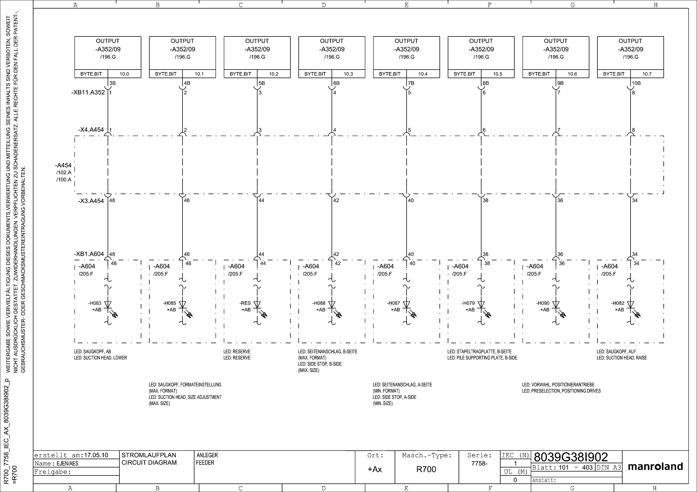

# +Ax — Sheet 101 of 403 — ANLEGER

**FEEDER**

> Part of the manroland **R700** printing press IEC/UL circuit diagrams.
> Drawing class: **Stromlaufplan / Circuit diagram** (DIN A3).
> Document `+Ax` covers the **Central control console** machine section.

## At a glance

| Field | Value |
|---|---|
| Document | `+Ax`  (8039G38I902) |
| Sheet | **101** of 403 |
| Section (DE) | ANLEGER |
| Section (EN) | FEEDER |
| Section type | CIRCUIT — Circuit diagram |
| Machine type | `R700` |
| Series | `7758` |
| Created | 17.05.10 |
| Replaces | — |
| Columns used | A, B, C, D, E, F, G, H |
| Path numbers | — |
| Labels on sheet | 149 |
| Cross-refs out | 18 |
| Cross-refs in | 50 |

**Previous:** [+Ax sheet 100](SHEET_0100.md) · **Next:** [+Ax sheet 102](SHEET_0102.md) · **Document TOC:** [_TOC.md](_TOC.md)  (+Ax) · **Master TOC:** [all sheets](../_MASTER_TOC.md)

## Sheet image (300 DPI, exact vector render)



_Rendered directly from the PDF vector layer at 300 DPI (1-bit), no OCR and no resampling. Use it to confirm anything ambiguous in the text below._

## Cross-references on this sheet

Each entry is a wire leaving this sheet. The printed token is `/sheet.column`; the link resolves to that sheet inside the same document.

| Ref | Target sheet | Col | Path | Destination on target | Target section | From col |
|---|---|---|---|---|---|---|
| `/196.G` | [+Ax sheet 196](SHEET_0196.md) | G | — | — | REFERENZMODUL | A |
| `/196.G` | [+Ax sheet 196](SHEET_0196.md) | G | — | — | REFERENZMODUL | B |
| `/196.G` | [+Ax sheet 196](SHEET_0196.md) | G | — | — | REFERENZMODUL | C |
| `/196.G` | [+Ax sheet 196](SHEET_0196.md) | G | — | — | REFERENZMODUL | D |
| `/196.G` | [+Ax sheet 196](SHEET_0196.md) | G | — | — | REFERENZMODUL | E |
| `/196.G` | [+Ax sheet 196](SHEET_0196.md) | G | — | — | REFERENZMODUL | F |
| `/196.G` | [+Ax sheet 196](SHEET_0196.md) | G | — | — | REFERENZMODUL | G |
| `/196.G` | [+Ax sheet 196](SHEET_0196.md) | G | — | — | REFERENZMODUL | H |
| `/102.A` | [+Ax sheet 102](SHEET_0102.md) | A | — | — | ANLEGER | A |
| `/100.A` | [+Ax sheet 100](SHEET_0100.md) | A | — | — | ANLEGER | A |
| `/205.F` | [+Ax sheet 205](SHEET_0205.md) | F | — | A604 | REFERENZMODUL | A |
| `/205.F` | [+Ax sheet 205](SHEET_0205.md) | F | — | A604 | REFERENZMODUL | B |
| `/205.F` | [+Ax sheet 205](SHEET_0205.md) | F | — | A604 | REFERENZMODUL | C |
| `/205.F` | [+Ax sheet 205](SHEET_0205.md) | F | — | A604 | REFERENZMODUL | D |
| `/205.F` | [+Ax sheet 205](SHEET_0205.md) | F | — | A604 | REFERENZMODUL | E |
| `/205.F` | [+Ax sheet 205](SHEET_0205.md) | F | — | A604 | REFERENZMODUL | F |
| `/205.F` | [+Ax sheet 205](SHEET_0205.md) | F | — | A604 | REFERENZMODUL | G |
| `/205.F` | [+Ax sheet 205](SHEET_0205.md) | F | — | A604 | REFERENZMODUL | G |

### Incoming references (sheets that point here)

Every other sheet that sends a wire to this one. `Back-ref` is the token printed on *that* sheet; `Path` is its line number.

| From sheet | Cols | Back-ref | Path | Refs | What continues there |
|---|---|---|---|---|---|
| [+Ax#100](SHEET_0100.md) | A | `/100.A` | — | 1 | — |
| [+Ax#102](SHEET_0102.md) | A | `/102.A` | — | 1 | — |
| [+Ax#196](SHEET_0196.md) | G | `/196.G` | — | 8 | — |
| [+Ax#205](SHEET_0205.md) | F | `/205.F` | — | 8 | — |
| [+Ax#210](SHEET_0210.md) | D | `/210.D` | — | 8 | — |
| [+Ax#225](SHEET_0225.md) | B | `/225.B` | — | 8 | — |
| [+Ax#229](SHEET_0229.md) | B | `/229.B` | — | 8 | — |
| [+Ax#246](SHEET_0246.md) | H | `/246.H` | — | 8 | — |


## Devices on this sheet

| Tag | Class | Class meaning (IEC) | Col | Sub | Terminal | Sign |
|---|---|---|---|---|---|---|
| `A352/09` | A | Baugruppe / assembly, module, PC board | A | 09 | — | — |
| `A352/09` | A | Baugruppe / assembly, module, PC board | B | 09 | — | — |
| `A352/09` | A | Baugruppe / assembly, module, PC board | C | 09 | — | — |
| `A352/09` | A | Baugruppe / assembly, module, PC board | D | 09 | — | — |
| `A352/09` | A | Baugruppe / assembly, module, PC board | E | 09 | — | — |
| `A352/09` | A | Baugruppe / assembly, module, PC board | F | 09 | — | — |
| `A352/09` | A | Baugruppe / assembly, module, PC board | G | 09 | — | — |
| `A352/09` | A | Baugruppe / assembly, module, PC board | H | 09 | — | — |
| `A454` | A | Baugruppe / assembly, module, PC board | A | — | — | — |
| `A604` | A | Baugruppe / assembly, module, PC board | A | — | — | — |
| `A604` | A | Baugruppe / assembly, module, PC board | B | — | — | — |
| `A604` | A | Baugruppe / assembly, module, PC board | C | — | — | — |
| `A604` | A | Baugruppe / assembly, module, PC board | D | — | — | — |
| `A604` | A | Baugruppe / assembly, module, PC board | E | — | — | — |
| `A604` | A | Baugruppe / assembly, module, PC board | F | — | — | — |
| `A604` | A | Baugruppe / assembly, module, PC board | G | — | — | — |
| `A604` | A | Baugruppe / assembly, module, PC board | G | — | — | — |
| `XB11.A352` | — | cross-device reference | A | — | — | — |
| `10.0` | — | cross-device reference | B | — | — | — |
| `10.1` | — | cross-device reference | C | — | — | — |
| `10.2` | — | cross-device reference | C | — | — | — |
| `10.3` | — | cross-device reference | D | — | — | — |
| `10.4` | — | cross-device reference | E | — | — | — |
| `10.5` | — | cross-device reference | F | — | — | — |
| `10.6` | — | cross-device reference | G | — | — | — |
| `10.7` | — | cross-device reference | H | — | — | — |
| `X4.A454` | — | cross-device reference | A | — | — | — |
| `X3.A454` | — | cross-device reference | A | — | — | — |
| `XB1.A604` | — | cross-device reference | A | — | — | — |

## Potentials / nets

| Potential | Count | Columns | Attached devices | Terminals |
|---|---|---|---|---|
| `H079` | 1 | F | — | — |
| `H082` | 1 | H | — | — |
| `H083` | 1 | A | — | — |
| `H085` | 1 | B | — | — |
| `H087` | 1 | E | — | — |
| `H088` | 1 | D | — | — |
| `H090` | 1 | G | — | — |


A potential such as `L24+/4` or `M24+` is a named supply/return rail; every place it appears on this sheet is electrically common.

## Wire-end annotations (grouped as printed)

A wire that continues elsewhere is annotated with a small cluster: the destination description, the path/line number `#NN`, and the `/sheet.column` cross reference. Each row below is one such cluster exactly as it is grouped on the drawing.

| Col | Y | Path | Cross-ref | Text on the wire |
|---|---|---|---|---|
| A | 65.8 | — | — | `OUTPUT` |
| B | 65.8 | — | — | `OUTPUT` |
| C | 65.8 | — | — | `OUTPUT` |
| D | 65.8 | — | — | `OUTPUT` |
| E | 65.8 | — | — | `OUTPUT` |
| F | 65.8 | — | — | `OUTPUT` |
| G | 65.8 | — | — | `OUTPUT` |
| H | 65.8 | — | — | `OUTPUT` |
| A | 79.7 | — | — | `A352/09` |
| B | 79.7 | — | — | `A352/09` |
| C | 79.7 | — | — | `A352/09` |
| D | 79.7 | — | — | `A352/09` |
| E | 79.7 | — | — | `A352/09` |
| F | 79.7 | — | — | `A352/09` |
| G | 79.7 | — | — | `A352/09` |
| H | 79.7 | — | — | `A352/09` |
| A | 93.5 | — | `/196.G` | — |
| B | 93.5 | — | `/196.G` | — |
| C | 93.5 | — | `/196.G` | — |
| D | 93.5 | — | `/196.G` | — |
| E | 93.5 | — | `/196.G` | — |
| F | 93.5 | — | `/196.G` | — |
| G | 93.5 | — | `/196.G` | — |
| H | 93.5 | — | `/196.G` | — |
| A | 123.1 | — | — | `BYTE.BIT 10.0` |
| B | 123.1 | — | — | `BYTE.BIT 10.1` |
| C | 123.1 | — | — | `BYTE.BIT 10.2` |
| D | 123.1 | — | — | `BYTE.BIT 10.3` |
| E | 123.1 | — | — | `BYTE.BIT 10.4` |
| F | 123.1 | — | — | `BYTE.BIT 10.5` |
| G | 123.1 | — | — | `BYTE.BIT 10.6` |
| H | 123.1 | — | — | `BYTE.BIT 10.7` |
| A | 138.5 | — | — | `3B` |
| B | 138.5 | — | — | `4B` |
| C | 138.5 | — | — | `5B` |
| D | 138.5 | — | — | `6B` |
| E | 138.5 | — | — | `7B` |
| F | 138.5 | — | — | `8B` |
| G | 138.5 | — | — | `9B` |
| H | 138.5 | — | — | `10B` |
| D | 153.4 | — | — | `XB11.A352 1 2 3 4 5 6 7 8` |
| D | 217.2 | — | — | `X4.A454 1 2 3 4 5 6 7 8` |
| A | 278.1 | — | — | `A454` |
| A | 291.2 | — | `/102.A`, `/100.A` | — |
| D | 339.1 | — | — | `X3.A454 48 46 44 42 40 38 36 34` |
| D | 429.8 | — | — | `XB1.A604 48 46 44 42 40 38 36 34` |
| A | 446.8 | — | — | `48` |
| B | 446.8 | — | — | `46` |
| C | 446.8 | — | — | `44` |
| D | 446.8 | — | — | `42` |
| E | 446.8 | — | — | `40` |
| F | 446.8 | — | — | `38` |
| G | 446.8 | — | — | `36` |
| H | 446.8 | — | — | `34` |
| A | 451.0 | — | `/205.F` | `A604` |
| B | 451.0 | — | `/205.F` | `A604` |
| C | 451.0 | — | `/205.F` | `A604` |
| D | 451.0 | — | `/205.F` | `A604` |
| E | 451.0 | — | `/205.F` | `A604` |
| F | 451.0 | — | `/205.F` | `A604` |
| G | 451.0 | — | `/205.F` | `A604` |
| G | 451.0 | — | `/205.F` | `A604` |
| A | 515.2 | — | — | `H083 +AB` |
| B | 515.2 | — | — | `H085 +AB` |
| C | 515.2 | — | — | `RES +AB` |
| D | 515.2 | — | — | `H088 +AB` |
| E | 515.2 | — | — | `H087 +AB` |
| F | 515.2 | — | — | `H079 +AB` |
| G | 515.2 | — | — | `H090 +AB` |
| H | 515.2 | — | — | `H082 +AB` |
| A | 598.7 | — | — | `LED: SAUGKOPF, AB LED: SUCTION HEAD, LOWER` |
| C | 598.7 | — | — | `LED: RESERVE LED: RESERVE` |
| D | 598.7 | — | — | `LED: SEITENANSCHLAG, B SEITE LED: SIDE STOP, B SIDE (MAX. FORMAT) (MAX. SIZE)` |
| F | 598.7 | — | — | `LED: STAPELTRAGPLATTE, B SEITE LED: PILE SUPPORTING PLATE, B SIDE` |
| H | 598.7 | — | — | `LED: SAUGKOPF, AUF LED: SUCTION HEAD, RAISE` |
| B | 655.4 | — | — | `LED: SAUGKOPF, FORMATEINSTELLUNG LED: SUCTION HEAD, SIZE ADJUSTMENT (MAX. FORMAT) (MAX. SIZE)` |
| E | 655.4 | — | — | `LED: SEITENANSCHLAG, A SEITE LED: SIDE STOP, A SIDE (MIN. FORMAT) (MIN. SIZE)` |
| G | 655.4 | — | — | `LED: VORWAHL, POSITIONIERANTRIEBE LED: PRESELECTION, POSITIONING DRIVES` |


## Reconstructed tables

This sheet carries tabular content (pin map / terminal assignment / index). The grid below was rebuilt from the drawing's own rule lines, so each row is exactly one physical row of the table.

### Table 1 — 3 data rows × 2 columns (at x=127.6, y=62.4)

| OUTPUT | A352/09 /196.G |
|---|---|
| `BYTE.BIT` | `10.0` |
| `XB11.A352 X4.A454 X3.A454 XB1.A604` | `3B 1 1 48 48` |
| `A604 /205.F H083 +AB` | `48` |


### Table 2 — 3 data rows × 2 columns (at x=255.1, y=62.4)

| OUTPUT | A352/09 /196.G |
|---|---|
| `BYTE.BIT` | `10.1` |
|  | `4B 2 2 46 46` |
| `A604 /205.F H085 +AB` | `46` |


### Table 3 — 3 data rows × 2 columns (at x=382.7, y=62.4)

| OUTPUT | A352/09 /196.G |
|---|---|
| `BYTE.BIT` | `10.2` |
|  | `5B 3 3 44 44` |
| `A604 /205.F RES +AB` | `44` |


### Table 4 — 3 data rows × 2 columns (at x=510.2, y=62.4)

| OUTPUT | A352/09 /196.G |
|---|---|
| `BYTE.BIT` | `10.3` |
|  | `6B 4 4 42 42` |
| `A604 /205.F H088 +AB` | `42` |


### Table 5 — 3 data rows × 2 columns (at x=637.8, y=62.4)

| OUTPUT | A352/09 /196.G |
|---|---|
| `BYTE.BIT` | `10.4` |
|  | `7B 5 5 40 40` |
| `A604 /205.F H087 +AB` | `40` |


### Table 6 — 3 data rows × 2 columns (at x=765.4, y=62.4)

| OUTPUT | A352/09 /196.G |
|---|---|
| `BYTE.BIT` | `10.5` |
|  | `8B 6 6 38 38` |
| `A604 /205.F H079 +AB` | `38` |


### Table 7 — 3 data rows × 2 columns (at x=892.9, y=62.4)

| OUTPUT | A352/09 /196.G |
|---|---|
| `BYTE.BIT` | `10.6` |
|  | `9B 7 7 36 36` |
| `A604 /205.F H090 +AB` | `36` |


### Table 8 — 3 data rows × 2 columns (at x=1020.5, y=62.4)

| OUTPUT | A352/09 /196.G |
|---|---|
| `BYTE.BIT` | `10.7` |
|  | `10B 8 8 34 34` |
| `A604 /205.F H082 +AB` | `34` |


## Notes and free text on this sheet

| Text | Col | Y (pt) |
|---|---|---|
| `3B` | A | 138.46 |
| `OUTPUT` | A | 65.81 |
| `BYTE.BIT` | A | 123.08 |
| `LED: SAUGKOPF, AB` | A | 598.71 |
| `LED: SUCTION HEAD, LOWER` | A | 609.35 |
| `4B` | B | 138.46 |
| `OUTPUT` | B | 65.81 |
| `BYTE.BIT` | B | 123.08 |
| `LED: SAUGKOPF, FORMATEINSTELLUNG` | B | 655.43 |
| `(MAX. FORMAT)` | B | 666.07 |
| `LED: SUCTION HEAD, SIZE ADJUSTMENT` | B | 676.69 |
| `(MAX. SIZE)` | B | 687.3 |
| `5B` | C | 138.46 |
| `OUTPUT` | C | 65.81 |
| `BYTE.BIT` | C | 123.08 |
| `LED: RESERVE` | C | 598.71 |
| `6B` | D | 138.46 |
| `OUTPUT` | D | 65.81 |
| `BYTE.BIT` | D | 123.08 |
| `LED: SEITENANSCHLAG, B SEITE` | D | 598.72 |
| `(MAX. FORMAT)` | D | 609.38 |
| `LED: SIDE STOP, B SIDE` | D | 619.97 |
| `(MAX. SIZE)` | D | 630.61 |
| `7B` | E | 138.46 |
| `OUTPUT` | E | 65.81 |
| `BYTE.BIT` | E | 123.08 |
| `LED: SEITENANSCHLAG, A SEITE` | E | 655.41 |
| `(MIN. FORMAT)` | E | 666.08 |
| `LED: SIDE STOP, A SIDE` | E | 676.67 |
| `(MIN. SIZE)` | E | 687.31 |
| `8B` | F | 138.46 |
| `OUTPUT` | F | 65.81 |
| `BYTE.BIT` | F | 123.08 |
| `LED: STAPELTRAGPLATTE, B SEITE` | F | 598.72 |
| `LED: PILE SUPPORTING PLATE, B SIDE` | F | 609.35 |
| `9B` | G | 138.46 |
| `OUTPUT` | G | 65.81 |
| `BYTE.BIT` | G | 123.08 |
| `LED: VORWAHL, POSITIONIERANTRIEBE` | G | 655.41 |
| `LED: PRESELECTION, POSITIONING DRIVES` | G | 666.05 |
| `10B` | H | 138.48 |
| `OUTPUT` | H | 65.81 |
| `LED: SAUGKOPF, AUF` | H | 598.72 |
| `LED: SUCTION HEAD, RAISE` | H | 609.36 |
| `+AB` | A | 526.59 |
| `+AB` | B | 526.59 |
| `+AB` | C | 526.59 |
| `RES` | C | 515.23 |
| `+AB` | D | 526.59 |
| `+AB` | E | 526.59 |
| `+AB` | F | 526.59 |
| `+AB` | G | 526.59 |
| `+AB` | H | 526.59 |

## Complete label inventory (exact text from the drawing)

Every text object inside the drawing area of this sheet, in DIN reading order (column A→H, then top→bottom). This is the authoritative list: if a string is not here it is not printed on this sheet.

| Col | Y | X | Dir | Type | Text |
|---|---|---|---|---|---|
| A | 65.8 | 164.0 | → | text | `OUTPUT` |
| A | 79.7 | 162.9 | → | device tag | `A352/09` |
| A | 93.5 | 171.4 | → | cross-reference | `/196.G` |
| A | 123.1 | 137.5 | → | text | `BYTE.BIT` |
| A | 138.5 | 186.8 | → | text | `3B` |
| A | 153.4 | 121.9 | → | device ref | `XB11.A352` |
| A | 154.8 | 186.2 | → | number | `1` |
| A | 217.2 | 133.5 | → | device ref | `X4.A454` |
| A | 218.6 | 186.2 | → | number | `1` |
| A | 278.1 | 94.1 | → | device tag | `A454` |
| A | 291.2 | 96.4 | → | cross-reference | `/102.A` |
| A | 303.6 | 96.4 | → | cross-reference | `/100.A` |
| A | 339.0 | 133.5 | → | device ref | `X3.A454` |
| A | 339.1 | 186.8 | → | number | `48` |
| A | 429.8 | 126.4 | → | device ref | `XB1.A604` |
| A | 431.2 | 186.8 | → | number | `48` |
| A | 446.8 | 189.6 | → | number | `48` |
| A | 451.0 | 134.4 | → | device tag | `A604` |
| A | 464.8 | 134.6 | → | cross-reference | `/205.F` |
| A | 515.2 | 150.8 | → | potential | `H083` |
| A | 526.6 | 157.6 | → | text | `+AB` |
| A | 598.7 | 126.7 | → | text | `LED: SAUGKOPF, AB` |
| A | 609.4 | 126.7 | → | text | `LED: SUCTION HEAD, LOWER` |
| B | 65.8 | 291.5 | → | text | `OUTPUT` |
| B | 79.7 | 290.4 | → | device tag | `A352/09` |
| B | 93.5 | 298.9 | → | cross-reference | `/196.G` |
| B | 123.1 | 204.4 | → | device ref | `10.0` |
| B | 123.1 | 265.0 | → | text | `BYTE.BIT` |
| B | 138.5 | 314.4 | → | text | `4B` |
| B | 154.8 | 314.4 | → | number | `2` |
| B | 218.6 | 314.4 | → | number | `2` |
| B | 339.1 | 314.4 | → | number | `46` |
| B | 431.2 | 314.4 | → | number | `46` |
| B | 446.8 | 317.2 | → | number | `46` |
| B | 451.0 | 261.9 | → | device tag | `A604` |
| B | 464.8 | 262.2 | → | cross-reference | `/205.F` |
| B | 515.2 | 278.4 | → | potential | `H085` |
| B | 526.6 | 285.2 | → | text | `+AB` |
| B | 655.4 | 254.3 | → | text | `LED: SAUGKOPF, FORMATEINSTELLUNG` |
| B | 666.1 | 254.6 | → | text | `(MAX. FORMAT)` |
| B | 676.7 | 254.3 | → | text | `LED: SUCTION HEAD, SIZE ADJUSTMENT` |
| B | 687.3 | 254.6 | → | text | `(MAX. SIZE)` |
| C | 65.8 | 419.1 | → | text | `OUTPUT` |
| C | 79.7 | 418.0 | → | device tag | `A352/09` |
| C | 93.5 | 426.5 | → | cross-reference | `/196.G` |
| C | 123.1 | 332.5 | → | device ref | `10.1` |
| C | 123.1 | 392.6 | → | text | `BYTE.BIT` |
| C | 123.1 | 459.6 | → | device ref | `10.2` |
| C | 138.5 | 441.9 | → | text | `5B` |
| C | 154.8 | 441.9 | → | number | `3` |
| C | 218.6 | 441.9 | → | number | `3` |
| C | 339.1 | 441.9 | → | number | `44` |
| C | 431.2 | 441.9 | → | number | `44` |
| C | 446.8 | 444.8 | → | number | `44` |
| C | 451.0 | 389.5 | → | device tag | `A604` |
| C | 464.8 | 389.8 | → | cross-reference | `/205.F` |
| C | 515.2 | 409.0 | → | text | `RES` |
| C | 526.6 | 412.7 | → | text | `+AB` |
| C | 598.7 | 381.8 | → | text | `LED: RESERVE` |
| C | 609.3 | 381.8 | → | text | `LED: RESERVE` |
| D | 65.8 | 546.7 | → | text | `OUTPUT` |
| D | 79.7 | 545.5 | → | device tag | `A352/09` |
| D | 93.5 | 554.0 | → | cross-reference | `/196.G` |
| D | 123.1 | 520.2 | → | text | `BYTE.BIT` |
| D | 123.1 | 587.1 | → | device ref | `10.3` |
| D | 138.5 | 569.5 | → | text | `6B` |
| D | 154.8 | 569.5 | → | number | `4` |
| D | 218.6 | 569.5 | → | number | `4` |
| D | 339.1 | 569.5 | → | number | `42` |
| D | 431.2 | 569.5 | → | number | `42` |
| D | 446.8 | 572.3 | → | number | `42` |
| D | 451.0 | 517.0 | → | device tag | `A604` |
| D | 464.8 | 517.3 | → | cross-reference | `/205.F` |
| D | 515.2 | 533.5 | → | potential | `H088` |
| D | 526.6 | 540.3 | → | text | `+AB` |
| D | 598.7 | 509.4 | → | text | `LED: SEITENANSCHLAG, B SEITE` |
| D | 609.4 | 509.7 | → | text | `(MAX. FORMAT)` |
| D | 620.0 | 509.4 | → | text | `LED: SIDE STOP, B SIDE` |
| D | 630.6 | 509.7 | → | text | `(MAX. SIZE)` |
| E | 65.8 | 674.2 | → | text | `OUTPUT` |
| E | 79.7 | 673.1 | → | device tag | `A352/09` |
| E | 93.5 | 681.6 | → | cross-reference | `/196.G` |
| E | 123.1 | 647.7 | → | text | `BYTE.BIT` |
| E | 123.1 | 714.6 | → | device ref | `10.4` |
| E | 138.5 | 697.0 | → | text | `7B` |
| E | 154.8 | 697.0 | → | number | `5` |
| E | 218.6 | 697.0 | → | number | `5` |
| E | 339.1 | 697.0 | → | number | `40` |
| E | 431.2 | 697.0 | → | number | `40` |
| E | 446.8 | 699.9 | → | number | `40` |
| E | 451.0 | 644.6 | → | device tag | `A604` |
| E | 464.8 | 644.9 | → | cross-reference | `/205.F` |
| E | 515.2 | 661.0 | → | potential | `H087` |
| E | 526.6 | 667.8 | → | text | `+AB` |
| E | 655.4 | 636.9 | → | text | `LED: SEITENANSCHLAG, A SEITE` |
| E | 666.1 | 637.2 | → | text | `(MIN. FORMAT)` |
| E | 676.7 | 636.9 | → | text | `LED: SIDE STOP, A SIDE` |
| E | 687.3 | 637.2 | → | text | `(MIN. SIZE)` |
| F | 65.8 | 801.8 | → | text | `OUTPUT` |
| F | 79.7 | 800.6 | → | device tag | `A352/09` |
| F | 93.5 | 809.1 | → | cross-reference | `/196.G` |
| F | 123.1 | 775.3 | → | text | `BYTE.BIT` |
| F | 123.1 | 842.2 | → | device ref | `10.5` |
| F | 138.5 | 824.6 | → | text | `8B` |
| F | 154.8 | 824.6 | → | number | `6` |
| F | 218.6 | 824.6 | → | number | `6` |
| F | 339.1 | 824.6 | → | number | `38` |
| F | 431.2 | 824.6 | → | number | `38` |
| F | 446.8 | 827.4 | → | number | `38` |
| F | 451.0 | 772.2 | → | device tag | `A604` |
| F | 464.8 | 772.4 | → | cross-reference | `/205.F` |
| F | 515.2 | 788.6 | → | potential | `H079` |
| F | 526.6 | 795.4 | → | text | `+AB` |
| F | 598.7 | 764.5 | → | text | `LED: STAPELTRAGPLATTE, B SEITE` |
| F | 609.4 | 764.5 | → | text | `LED: PILE SUPPORTING PLATE, B SIDE` |
| G | 65.8 | 929.3 | → | text | `OUTPUT` |
| G | 79.7 | 928.2 | → | device tag | `A352/09` |
| G | 93.5 | 936.7 | → | cross-reference | `/196.G` |
| G | 123.1 | 902.8 | → | text | `BYTE.BIT` |
| G | 123.1 | 969.7 | → | device ref | `10.6` |
| G | 123.1 | 1030.4 | → | text | `BYTE.BIT` |
| G | 138.5 | 952.2 | → | text | `9B` |
| G | 154.8 | 952.2 | → | number | `7` |
| G | 218.6 | 952.2 | → | number | `7` |
| G | 339.1 | 952.2 | → | number | `36` |
| G | 431.2 | 952.2 | → | number | `36` |
| G | 446.8 | 955.0 | → | number | `36` |
| G | 451.0 | 899.7 | → | device tag | `A604` |
| G | 451.0 | 1027.3 | → | device tag | `A604` |
| G | 464.8 | 900.0 | → | cross-reference | `/205.F` |
| G | 464.8 | 1027.6 | → | cross-reference | `/205.F` |
| G | 515.2 | 916.2 | → | potential | `H090` |
| G | 526.6 | 923.0 | → | text | `+AB` |
| G | 655.4 | 892.1 | → | text | `LED: VORWAHL, POSITIONIERANTRIEBE` |
| G | 666.1 | 892.1 | → | text | `LED: PRESELECTION, POSITIONING DRIVES` |
| H | 65.8 | 1056.9 | → | text | `OUTPUT` |
| H | 79.7 | 1055.8 | → | device tag | `A352/09` |
| H | 93.5 | 1064.3 | → | cross-reference | `/196.G` |
| H | 123.1 | 1097.3 | → | device ref | `10.7` |
| H | 138.5 | 1079.1 | → | text | `10B` |
| H | 154.8 | 1079.7 | → | number | `8` |
| H | 218.6 | 1079.7 | → | number | `8` |
| H | 339.1 | 1079.7 | → | number | `34` |
| H | 431.2 | 1079.7 | → | number | `34` |
| H | 446.8 | 1082.6 | → | number | `34` |
| H | 515.2 | 1044.0 | → | potential | `H082` |
| H | 526.6 | 1050.5 | → | text | `+AB` |
| H | 598.7 | 1019.6 | → | text | `LED: SAUGKOPF, AUF` |
| H | 609.4 | 1019.6 | → | text | `LED: SUCTION HEAD, RAISE` |

## Reading-order text block

The same content as a plain block, grouped by DIN column — convenient to paste or to match against a visual description.

```text
=== Column A ===
  65.8  164.0  text         OUTPUT
  79.7  162.9  devtag       A352/09
  93.5  171.4  xref         /196.G
 123.1  137.5  text         BYTE.BIT
 138.5  186.8  text         3B
 153.4  121.9  devref       XB11.A352
 154.8  186.2  numeric      1
 217.2  133.5  devref       X4.A454
 218.6  186.2  numeric      1
 278.1   94.1  devtag       A454
 291.2   96.4  xref         /102.A
 303.6   96.4  xref         /100.A
 339.0  133.5  devref       X3.A454
 339.1  186.8  numeric      48
 429.8  126.4  devref       XB1.A604
 431.2  186.8  numeric      48
 446.8  189.6  numeric      48
 451.0  134.4  devtag       A604
 464.8  134.6  xref         /205.F
 515.2  150.8  net          H083
 526.6  157.6  text         +AB
 598.7  126.7  text         LED: SAUGKOPF, AB
 609.4  126.7  text         LED: SUCTION HEAD, LOWER
=== Column B ===
  65.8  291.5  text         OUTPUT
  79.7  290.4  devtag       A352/09
  93.5  298.9  xref         /196.G
 123.1  204.4  devref       10.0
 123.1  265.0  text         BYTE.BIT
 138.5  314.4  text         4B
 154.8  314.4  numeric      2
 218.6  314.4  numeric      2
 339.1  314.4  numeric      46
 431.2  314.4  numeric      46
 446.8  317.2  numeric      46
 451.0  261.9  devtag       A604
 464.8  262.2  xref         /205.F
 515.2  278.4  net          H085
 526.6  285.2  text         +AB
 655.4  254.3  text         LED: SAUGKOPF, FORMATEINSTELLUNG
 666.1  254.6  text         (MAX. FORMAT)
 676.7  254.3  text         LED: SUCTION HEAD, SIZE ADJUSTMENT
 687.3  254.6  text         (MAX. SIZE)
=== Column C ===
  65.8  419.1  text         OUTPUT
  79.7  418.0  devtag       A352/09
  93.5  426.5  xref         /196.G
 123.1  332.5  devref       10.1
 123.1  392.6  text         BYTE.BIT
 123.1  459.6  devref       10.2
 138.5  441.9  text         5B
 154.8  441.9  numeric      3
 218.6  441.9  numeric      3
 339.1  441.9  numeric      44
 431.2  441.9  numeric      44
 446.8  444.8  numeric      44
 451.0  389.5  devtag       A604
 464.8  389.8  xref         /205.F
 515.2  409.0  text         RES
 526.6  412.7  text         +AB
 598.7  381.8  text         LED: RESERVE
 609.3  381.8  text         LED: RESERVE
=== Column D ===
  65.8  546.7  text         OUTPUT
  79.7  545.5  devtag       A352/09
  93.5  554.0  xref         /196.G
 123.1  520.2  text         BYTE.BIT
 123.1  587.1  devref       10.3
 138.5  569.5  text         6B
 154.8  569.5  numeric      4
 218.6  569.5  numeric      4
 339.1  569.5  numeric      42
 431.2  569.5  numeric      42
 446.8  572.3  numeric      42
 451.0  517.0  devtag       A604
 464.8  517.3  xref         /205.F
 515.2  533.5  net          H088
 526.6  540.3  text         +AB
 598.7  509.4  text         LED: SEITENANSCHLAG, B SEITE
 609.4  509.7  text         (MAX. FORMAT)
 620.0  509.4  text         LED: SIDE STOP, B SIDE
 630.6  509.7  text         (MAX. SIZE)
=== Column E ===
  65.8  674.2  text         OUTPUT
  79.7  673.1  devtag       A352/09
  93.5  681.6  xref         /196.G
 123.1  647.7  text         BYTE.BIT
 123.1  714.6  devref       10.4
 138.5  697.0  text         7B
 154.8  697.0  numeric      5
 218.6  697.0  numeric      5
 339.1  697.0  numeric      40
 431.2  697.0  numeric      40
 446.8  699.9  numeric      40
 451.0  644.6  devtag       A604
 464.8  644.9  xref         /205.F
 515.2  661.0  net          H087
 526.6  667.8  text         +AB
 655.4  636.9  text         LED: SEITENANSCHLAG, A SEITE
 666.1  637.2  text         (MIN. FORMAT)
 676.7  636.9  text         LED: SIDE STOP, A SIDE
 687.3  637.2  text         (MIN. SIZE)
=== Column F ===
  65.8  801.8  text         OUTPUT
  79.7  800.6  devtag       A352/09
  93.5  809.1  xref         /196.G
 123.1  775.3  text         BYTE.BIT
 123.1  842.2  devref       10.5
 138.5  824.6  text         8B
 154.8  824.6  numeric      6
 218.6  824.6  numeric      6
 339.1  824.6  numeric      38
 431.2  824.6  numeric      38
 446.8  827.4  numeric      38
 451.0  772.2  devtag       A604
 464.8  772.4  xref         /205.F
 515.2  788.6  net          H079
 526.6  795.4  text         +AB
 598.7  764.5  text         LED: STAPELTRAGPLATTE, B SEITE
 609.4  764.5  text         LED: PILE SUPPORTING PLATE, B SIDE
=== Column G ===
  65.8  929.3  text         OUTPUT
  79.7  928.2  devtag       A352/09
  93.5  936.7  xref         /196.G
 123.1  902.8  text         BYTE.BIT
 123.1  969.7  devref       10.6
 123.1 1030.4  text         BYTE.BIT
 138.5  952.2  text         9B
 154.8  952.2  numeric      7
 218.6  952.2  numeric      7
 339.1  952.2  numeric      36
 431.2  952.2  numeric      36
 446.8  955.0  numeric      36
 451.0  899.7  devtag       A604
 451.0 1027.3  devtag       A604
 464.8  900.0  xref         /205.F
 464.8 1027.6  xref         /205.F
 515.2  916.2  net          H090
 526.6  923.0  text         +AB
 655.4  892.1  text         LED: VORWAHL, POSITIONIERANTRIEBE
 666.1  892.1  text         LED: PRESELECTION, POSITIONING DRIVES
=== Column H ===
  65.8 1056.9  text         OUTPUT
  79.7 1055.8  devtag       A352/09
  93.5 1064.3  xref         /196.G
 123.1 1097.3  devref       10.7
 138.5 1079.1  text         10B
 154.8 1079.7  numeric      8
 218.6 1079.7  numeric      8
 339.1 1079.7  numeric      34
 431.2 1079.7  numeric      34
 446.8 1082.6  numeric      34
 515.2 1044.0  net          H082
 526.6 1050.5  text         +AB
 598.7 1019.6  text         LED: SAUGKOPF, AUF
 609.4 1019.6  text         LED: SUCTION HEAD, RAISE
```

---
_Generated from the PDF vector text layer; no OCR. Source: `R700_7758_IEC_AX_8039G38I902_p`, sheet 101._
