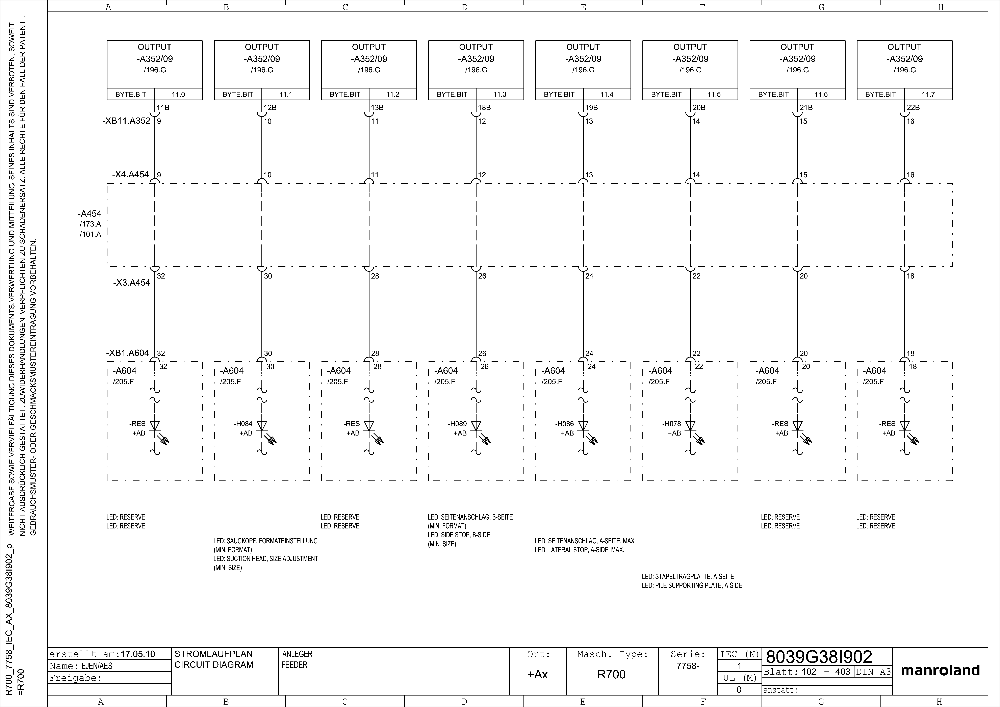

# +Ax — Sheet 102 of 403 — ANLEGER

**FEEDER**

> Part of the manroland **R700** printing press IEC/UL circuit diagrams.
> Drawing class: **Stromlaufplan / Circuit diagram** (DIN A3).
> Document `+Ax` covers the **Central control console** machine section.

## At a glance

| Field | Value |
|---|---|
| Document | `+Ax`  (8039G38I902) |
| Sheet | **102** of 403 |
| Section (DE) | ANLEGER |
| Section (EN) | FEEDER |
| Section type | CIRCUIT — Circuit diagram |
| Machine type | `R700` |
| Series | `7758` |
| Created | 17.05.10 |
| Replaces | — |
| Columns used | A, B, C, D, E, F, G, H |
| Path numbers | — |
| Labels on sheet | 147 |
| Cross-refs out | 18 |
| Cross-refs in | 50 |

**Previous:** [+Ax sheet 101](SHEET_0101.md) · **Next:** [+Ax sheet 103](SHEET_0103.md) · **Document TOC:** [_TOC.md](_TOC.md)  (+Ax) · **Master TOC:** [all sheets](../_MASTER_TOC.md)

## Sheet image (300 DPI, exact vector render)



_Rendered directly from the PDF vector layer at 300 DPI (1-bit), no OCR and no resampling. Use it to confirm anything ambiguous in the text below._

## Cross-references on this sheet

Each entry is a wire leaving this sheet. The printed token is `/sheet.column`; the link resolves to that sheet inside the same document.

| Ref | Target sheet | Col | Path | Destination on target | Target section | From col |
|---|---|---|---|---|---|---|
| `/196.G` | [+Ax sheet 196](SHEET_0196.md) | G | — | — | REFERENZMODUL | A |
| `/196.G` | [+Ax sheet 196](SHEET_0196.md) | G | — | — | REFERENZMODUL | B |
| `/196.G` | [+Ax sheet 196](SHEET_0196.md) | G | — | — | REFERENZMODUL | C |
| `/196.G` | [+Ax sheet 196](SHEET_0196.md) | G | — | — | REFERENZMODUL | D |
| `/196.G` | [+Ax sheet 196](SHEET_0196.md) | G | — | — | REFERENZMODUL | E |
| `/196.G` | [+Ax sheet 196](SHEET_0196.md) | G | — | — | REFERENZMODUL | F |
| `/196.G` | [+Ax sheet 196](SHEET_0196.md) | G | — | — | REFERENZMODUL | G |
| `/196.G` | [+Ax sheet 196](SHEET_0196.md) | G | — | — | REFERENZMODUL | H |
| `/173.A` | [+Ax sheet 173](SHEET_0173.md) | A | — | — | RESERVE | A |
| `/101.A` | [+Ax sheet 101](SHEET_0101.md) | A | — | — | ANLEGER | A |
| `/205.F` | [+Ax sheet 205](SHEET_0205.md) | F | — | A604 | REFERENZMODUL | A |
| `/205.F` | [+Ax sheet 205](SHEET_0205.md) | F | — | A604 | REFERENZMODUL | B |
| `/205.F` | [+Ax sheet 205](SHEET_0205.md) | F | — | A604 | REFERENZMODUL | C |
| `/205.F` | [+Ax sheet 205](SHEET_0205.md) | F | — | A604 | REFERENZMODUL | D |
| `/205.F` | [+Ax sheet 205](SHEET_0205.md) | F | — | A604 | REFERENZMODUL | E |
| `/205.F` | [+Ax sheet 205](SHEET_0205.md) | F | — | A604 | REFERENZMODUL | F |
| `/205.F` | [+Ax sheet 205](SHEET_0205.md) | F | — | A604 | REFERENZMODUL | G |
| `/205.F` | [+Ax sheet 205](SHEET_0205.md) | F | — | A604 | REFERENZMODUL | G |

### Incoming references (sheets that point here)

Every other sheet that sends a wire to this one. `Back-ref` is the token printed on *that* sheet; `Path` is its line number.

| From sheet | Cols | Back-ref | Path | Refs | What continues there |
|---|---|---|---|---|---|
| [+Ax#101](SHEET_0101.md) | A | `/101.A` | — | 1 | — |
| [+Ax#173](SHEET_0173.md) | A | `/173.A` | — | 1 | — |
| [+Ax#196](SHEET_0196.md) | G | `/196.G` | — | 8 | — |
| [+Ax#205](SHEET_0205.md) | F | `/205.F` | — | 8 | — |
| [+Ax#210](SHEET_0210.md) | C, D | `/210.C`, `/210.D` | — | 8 | — |
| [+Ax#225](SHEET_0225.md) | A, B | `/225.A`, `/225.B` | — | 8 | — |
| [+Ax#229](SHEET_0229.md) | B | `/229.B` | — | 8 | — |
| [+Ax#246](SHEET_0246.md) | H | `/246.H` | — | 8 | — |


## Devices on this sheet

| Tag | Class | Class meaning (IEC) | Col | Sub | Terminal | Sign |
|---|---|---|---|---|---|---|
| `A352/09` | A | Baugruppe / assembly, module, PC board | A | 09 | — | — |
| `A352/09` | A | Baugruppe / assembly, module, PC board | B | 09 | — | — |
| `A352/09` | A | Baugruppe / assembly, module, PC board | C | 09 | — | — |
| `A352/09` | A | Baugruppe / assembly, module, PC board | D | 09 | — | — |
| `A352/09` | A | Baugruppe / assembly, module, PC board | E | 09 | — | — |
| `A352/09` | A | Baugruppe / assembly, module, PC board | F | 09 | — | — |
| `A352/09` | A | Baugruppe / assembly, module, PC board | G | 09 | — | — |
| `A352/09` | A | Baugruppe / assembly, module, PC board | H | 09 | — | — |
| `A454` | A | Baugruppe / assembly, module, PC board | A | — | — | — |
| `A604` | A | Baugruppe / assembly, module, PC board | A | — | — | — |
| `A604` | A | Baugruppe / assembly, module, PC board | C | — | — | — |
| `A604` | A | Baugruppe / assembly, module, PC board | G | — | — | — |
| `A604` | A | Baugruppe / assembly, module, PC board | G | — | — | — |
| `A604` | A | Baugruppe / assembly, module, PC board | B | — | — | — |
| `A604` | A | Baugruppe / assembly, module, PC board | D | — | — | — |
| `A604` | A | Baugruppe / assembly, module, PC board | E | — | — | — |
| `A604` | A | Baugruppe / assembly, module, PC board | F | — | — | — |
| `X3.A454` | — | cross-device reference | A | — | — | — |
| `XB11.A352` | — | cross-device reference | A | — | — | — |
| `11.0` | — | cross-device reference | B | — | — | — |
| `11.1` | — | cross-device reference | C | — | — | — |
| `11.2` | — | cross-device reference | C | — | — | — |
| `11.3` | — | cross-device reference | D | — | — | — |
| `11.4` | — | cross-device reference | E | — | — | — |
| `11.5` | — | cross-device reference | F | — | — | — |
| `11.6` | — | cross-device reference | G | — | — | — |
| `11.7` | — | cross-device reference | H | — | — | — |
| `X4.A454` | — | cross-device reference | A | — | — | — |
| `XB1.A604` | — | cross-device reference | A | — | — | — |

## Potentials / nets

| Potential | Count | Columns | Attached devices | Terminals |
|---|---|---|---|---|
| `H078` | 1 | F | — | — |
| `H084` | 1 | B | — | — |
| `H086` | 1 | E | — | — |
| `H089` | 1 | D | — | — |


A potential such as `L24+/4` or `M24+` is a named supply/return rail; every place it appears on this sheet is electrically common.

## Wire-end annotations (grouped as printed)

A wire that continues elsewhere is annotated with a small cluster: the destination description, the path/line number `#NN`, and the `/sheet.column` cross reference. Each row below is one such cluster exactly as it is grouped on the drawing.

| Col | Y | Path | Cross-ref | Text on the wire |
|---|---|---|---|---|
| A | 51.6 | — | — | `OUTPUT` |
| B | 51.6 | — | — | `OUTPUT` |
| C | 51.6 | — | — | `OUTPUT` |
| D | 51.6 | — | — | `OUTPUT` |
| E | 51.6 | — | — | `OUTPUT` |
| F | 51.6 | — | — | `OUTPUT` |
| G | 51.6 | — | — | `OUTPUT` |
| H | 51.6 | — | — | `OUTPUT` |
| A | 65.5 | — | — | `A352/09` |
| B | 65.5 | — | — | `A352/09` |
| C | 65.5 | — | — | `A352/09` |
| D | 65.5 | — | — | `A352/09` |
| E | 65.5 | — | — | `A352/09` |
| F | 65.5 | — | — | `A352/09` |
| G | 65.5 | — | — | `A352/09` |
| H | 65.5 | — | — | `A352/09` |
| A | 79.3 | — | `/196.G` | — |
| B | 79.3 | — | `/196.G` | — |
| C | 79.3 | — | `/196.G` | — |
| D | 79.3 | — | `/196.G` | — |
| E | 79.3 | — | `/196.G` | — |
| F | 79.3 | — | `/196.G` | — |
| G | 79.3 | — | `/196.G` | — |
| H | 79.3 | — | `/196.G` | — |
| A | 108.9 | — | — | `BYTE.BIT 11.0` |
| B | 108.9 | — | — | `BYTE.BIT 11.1` |
| C | 108.9 | — | — | `BYTE.BIT 11.2` |
| D | 108.9 | — | — | `BYTE.BIT 11.3` |
| E | 108.9 | — | — | `BYTE.BIT 11.4` |
| F | 108.9 | — | — | `BYTE.BIT 11.5` |
| G | 108.9 | — | — | `BYTE.BIT 11.6` |
| H | 108.9 | — | — | `BYTE.BIT 11.7` |
| A | 124.3 | — | — | `11B` |
| B | 124.3 | — | — | `12B` |
| C | 124.3 | — | — | `13B` |
| D | 124.3 | — | — | `18B` |
| E | 124.3 | — | — | `19B` |
| F | 124.3 | — | — | `20B` |
| G | 124.3 | — | — | `21B` |
| H | 124.3 | — | — | `22B` |
| D | 139.2 | — | — | `XB11.A352 9 10 11 12 13 14 15 16` |
| D | 203.0 | — | — | `X4.A454 9 10 11 12 13 14 15 16` |
| A | 249.8 | — | — | `A454` |
| A | 262.8 | — | `/173.A`, `/101.A` | — |
| D | 324.9 | — | — | `X3.A454 32 30 28 26 24 22 20 18` |
| D | 415.6 | — | — | `XB1.A604 32 30 28 26 24 22 20 18` |
| A | 432.6 | — | — | `32` |
| B | 432.6 | — | — | `30` |
| C | 432.6 | — | — | `28` |
| D | 432.6 | — | — | `26` |
| E | 432.6 | — | — | `24` |
| F | 432.6 | — | — | `22` |
| G | 432.6 | — | — | `20` |
| H | 432.6 | — | — | `18` |
| A | 436.8 | — | `/205.F` | `A604` |
| B | 436.8 | — | `/205.F` | `A604` |
| C | 436.8 | — | `/205.F` | `A604` |
| D | 436.8 | — | `/205.F` | `A604` |
| E | 436.8 | — | `/205.F` | `A604` |
| F | 436.8 | — | `/205.F` | `A604` |
| G | 436.8 | — | `/205.F` | `A604` |
| G | 436.8 | — | `/205.F` | `A604` |
| B | 501.0 | — | — | `H084 +AB` |
| D | 501.0 | — | — | `H089 +AB` |
| E | 501.0 | — | — | `H086 +AB` |
| F | 501.0 | — | — | `H078 +AB` |
| A | 501.1 | — | — | `RES +AB` |
| C | 501.1 | — | — | `RES +AB` |
| G | 501.1 | — | — | `RES +AB` |
| H | 501.1 | — | — | `RES +AB` |
| A | 612.9 | — | — | `LED: RESERVE LED: RESERVE` |
| C | 612.9 | — | — | `LED: RESERVE LED: RESERVE` |
| D | 612.9 | — | — | `LED: SEITENANSCHLAG, B SEITE LED: SIDE STOP, B SIDE (MIN. FORMAT) (MIN. SIZE)` |
| G | 612.9 | — | — | `LED: RESERVE LED: RESERVE` |
| G | 612.9 | — | — | `LED: RESERVE LED: RESERVE` |
| E | 641.2 | — | — | `LED: SEITENANSCHLAG, A SEITE, MAX. LED: LATERAL STOP, A SIDE, MAX.` |
| B | 641.3 | — | — | `LED: SAUGKOPF, FORMATEINSTELLUNG LED: SUCTION HEAD, SIZE ADJUSTMENT (MIN. FORMAT) (MIN. SIZE)` |
| F | 683.8 | — | — | `LED: STAPELTRAGPLATTE, A SEITE LED: PILE SUPPORTING PLATE, A SIDE` |


## Reconstructed tables

This sheet carries tabular content (pin map / terminal assignment / index). The grid below was rebuilt from the drawing's own rule lines, so each row is exactly one physical row of the table.

### Table 1 — 3 data rows × 2 columns (at x=127.6, y=48.2)

| OUTPUT | A352/09 /196.G |
|---|---|
| `BYTE.BIT` | `11.0` |
| `XB11.A352 X4.A454 X3.A454 XB1.A604` | `11B 9 9 32 32` |
| `A604 /205.F RES +AB` | `32` |


### Table 2 — 3 data rows × 2 columns (at x=255.1, y=48.2)

| OUTPUT | A352/09 /196.G |
|---|---|
| `BYTE.BIT` | `11.1` |
|  | `12B 10 10 30 30` |
| `A604 /205.F H084 +AB` | `30` |


### Table 3 — 3 data rows × 2 columns (at x=382.7, y=48.2)

| OUTPUT | A352/09 /196.G |
|---|---|
| `BYTE.BIT` | `11.2` |
|  | `13B 11 11 28 28` |
| `A604 /205.F RES +AB` | `28` |


### Table 4 — 3 data rows × 2 columns (at x=510.2, y=48.2)

| OUTPUT | A352/09 /196.G |
|---|---|
| `BYTE.BIT` | `11.3` |
|  | `18B 12 12 26 26` |
| `A604 /205.F H089 +AB` | `26` |


### Table 5 — 3 data rows × 2 columns (at x=637.8, y=48.2)

| OUTPUT | A352/09 /196.G |
|---|---|
| `BYTE.BIT` | `11.4` |
|  | `19B 13 13 24 24` |
| `A604 /205.F H086 +AB` | `24` |


### Table 6 — 3 data rows × 2 columns (at x=765.4, y=48.2)

| OUTPUT | A352/09 /196.G |
|---|---|
| `BYTE.BIT` | `11.5` |
|  | `20B 14 14 22 22` |
| `A604 /205.F H078 +AB` | `22` |


### Table 7 — 3 data rows × 2 columns (at x=892.9, y=48.2)

| OUTPUT | A352/09 /196.G |
|---|---|
| `BYTE.BIT` | `11.6` |
|  | `21B 15 15 20 20` |
| `A604 /205.F RES +AB` | `20` |


### Table 8 — 3 data rows × 2 columns (at x=1020.5, y=48.2)

| OUTPUT | A352/09 /196.G |
|---|---|
| `BYTE.BIT` | `11.7` |
|  | `22B 16 16 18 18` |
| `A604 /205.F RES +AB` | `18` |


## Notes and free text on this sheet

| Text | Col | Y (pt) |
|---|---|---|
| `11B` | A | 124.3 |
| `OUTPUT` | A | 51.64 |
| `BYTE.BIT` | A | 108.91 |
| `LED: RESERVE` | A | 612.88 |
| `12B` | B | 124.3 |
| `OUTPUT` | B | 51.64 |
| `BYTE.BIT` | B | 108.91 |
| `LED: SAUGKOPF, FORMATEINSTELLUNG` | B | 641.26 |
| `(MIN. FORMAT)` | B | 651.9 |
| `LED: SUCTION HEAD, SIZE ADJUSTMENT` | B | 662.52 |
| `(MIN. SIZE)` | B | 673.13 |
| `13B` | C | 124.3 |
| `OUTPUT` | C | 51.64 |
| `BYTE.BIT` | C | 108.91 |
| `LED: RESERVE` | C | 612.88 |
| `18B` | D | 124.3 |
| `OUTPUT` | D | 51.64 |
| `BYTE.BIT` | D | 108.91 |
| `LED: SEITENANSCHLAG, B SEITE` | D | 612.89 |
| `(MIN. FORMAT)` | D | 623.56 |
| `LED: SIDE STOP, B SIDE` | D | 634.15 |
| `(MIN. SIZE)` | D | 644.79 |
| `19B` | E | 124.3 |
| `OUTPUT` | E | 51.64 |
| `BYTE.BIT` | E | 108.91 |
| `LED: SEITENANSCHLAG, A SEITE, MAX.` | E | 641.24 |
| `LED: LATERAL STOP, A SIDE, MAX.` | E | 651.87 |
| `20B` | F | 124.3 |
| `OUTPUT` | F | 51.64 |
| `BYTE.BIT` | F | 108.91 |
| `LED: STAPELTRAGPLATTE, A SEITE` | F | 683.76 |
| `LED: PILE SUPPORTING PLATE, A SIDE` | F | 694.39 |
| `21B` | G | 124.3 |
| `OUTPUT` | G | 51.64 |
| `BYTE.BIT` | G | 108.91 |
| `LED: RESERVE` | G | 612.88 |
| `22B` | H | 124.3 |
| `OUTPUT` | H | 51.64 |
| `+AB` | A | 512.41 |
| `RES` | A | 501.05 |
| `+AB` | C | 512.41 |
| `RES` | C | 501.05 |
| `+AB` | G | 512.41 |
| `RES` | G | 501.05 |
| `+AB` | H | 512.41 |
| `RES` | H | 501.05 |
| `+AB` | B | 512.41 |
| `+AB` | D | 512.41 |
| `+AB` | E | 512.41 |
| `+AB` | F | 512.41 |

## Complete label inventory (exact text from the drawing)

Every text object inside the drawing area of this sheet, in DIN reading order (column A→H, then top→bottom). This is the authoritative list: if a string is not here it is not printed on this sheet.

| Col | Y | X | Dir | Type | Text |
|---|---|---|---|---|---|
| A | 51.6 | 164.0 | → | text | `OUTPUT` |
| A | 65.5 | 162.9 | → | device tag | `A352/09` |
| A | 79.3 | 171.4 | → | cross-reference | `/196.G` |
| A | 108.9 | 137.5 | → | text | `BYTE.BIT` |
| A | 124.3 | 186.2 | → | text | `11B` |
| A | 139.2 | 121.9 | → | device ref | `XB11.A352` |
| A | 140.6 | 186.8 | → | number | `9` |
| A | 203.0 | 133.5 | → | device ref | `X4.A454` |
| A | 204.4 | 186.8 | → | number | `9` |
| A | 249.8 | 92.7 | → | device tag | `A454` |
| A | 262.8 | 95.0 | → | cross-reference | `/173.A` |
| A | 275.2 | 95.0 | → | cross-reference | `/101.A` |
| A | 324.9 | 186.8 | → | number | `32` |
| A | 332.0 | 134.9 | → | device ref | `X3.A454` |
| A | 415.6 | 126.4 | → | device ref | `XB1.A604` |
| A | 417.0 | 186.8 | → | number | `32` |
| A | 432.6 | 189.6 | → | number | `32` |
| A | 436.8 | 134.4 | → | device tag | `A604` |
| A | 450.6 | 134.6 | → | cross-reference | `/205.F` |
| A | 501.1 | 153.9 | → | text | `RES` |
| A | 512.4 | 157.6 | → | text | `+AB` |
| A | 612.9 | 126.7 | → | text | `LED: RESERVE` |
| A | 623.5 | 126.7 | → | text | `LED: RESERVE` |
| B | 51.6 | 291.5 | → | text | `OUTPUT` |
| B | 65.5 | 290.4 | → | device tag | `A352/09` |
| B | 79.3 | 298.9 | → | cross-reference | `/196.G` |
| B | 108.9 | 204.4 | → | device ref | `11.0` |
| B | 108.9 | 265.0 | → | text | `BYTE.BIT` |
| B | 124.3 | 313.8 | → | text | `12B` |
| B | 140.6 | 313.8 | → | number | `10` |
| B | 204.4 | 313.8 | → | number | `10` |
| B | 324.9 | 314.4 | → | number | `30` |
| B | 417.0 | 314.4 | → | number | `30` |
| B | 432.6 | 317.2 | → | number | `30` |
| B | 436.8 | 261.9 | → | device tag | `A604` |
| B | 450.6 | 262.2 | → | cross-reference | `/205.F` |
| B | 501.0 | 278.4 | → | potential | `H084` |
| B | 512.4 | 285.2 | → | text | `+AB` |
| B | 641.3 | 254.3 | → | text | `LED: SAUGKOPF, FORMATEINSTELLUNG` |
| B | 651.9 | 254.6 | → | text | `(MIN. FORMAT)` |
| B | 662.5 | 254.3 | → | text | `LED: SUCTION HEAD, SIZE ADJUSTMENT` |
| B | 673.1 | 254.6 | → | text | `(MIN. SIZE)` |
| C | 51.6 | 419.1 | → | text | `OUTPUT` |
| C | 65.5 | 418.0 | → | device tag | `A352/09` |
| C | 79.3 | 426.5 | → | cross-reference | `/196.G` |
| C | 108.9 | 332.5 | → | device ref | `11.1` |
| C | 108.9 | 392.6 | → | text | `BYTE.BIT` |
| C | 108.9 | 459.6 | → | device ref | `11.2` |
| C | 124.3 | 441.4 | → | text | `13B` |
| C | 140.6 | 441.4 | → | number | `11` |
| C | 204.4 | 441.4 | → | number | `11` |
| C | 324.9 | 441.9 | → | number | `28` |
| C | 417.0 | 441.9 | → | number | `28` |
| C | 432.6 | 444.8 | → | number | `28` |
| C | 436.8 | 389.5 | → | device tag | `A604` |
| C | 450.6 | 389.8 | → | cross-reference | `/205.F` |
| C | 501.1 | 409.0 | → | text | `RES` |
| C | 512.4 | 412.7 | → | text | `+AB` |
| C | 612.9 | 381.8 | → | text | `LED: RESERVE` |
| C | 623.5 | 381.8 | → | text | `LED: RESERVE` |
| D | 51.6 | 546.7 | → | text | `OUTPUT` |
| D | 65.5 | 545.5 | → | device tag | `A352/09` |
| D | 79.3 | 554.0 | → | cross-reference | `/196.G` |
| D | 108.9 | 520.2 | → | text | `BYTE.BIT` |
| D | 108.9 | 587.1 | → | device ref | `11.3` |
| D | 124.3 | 568.9 | → | text | `18B` |
| D | 140.6 | 568.9 | → | number | `12` |
| D | 204.4 | 568.9 | → | number | `12` |
| D | 324.9 | 569.5 | → | number | `26` |
| D | 417.0 | 569.5 | → | number | `26` |
| D | 432.6 | 572.3 | → | number | `26` |
| D | 436.8 | 517.0 | → | device tag | `A604` |
| D | 450.6 | 517.3 | → | cross-reference | `/205.F` |
| D | 501.0 | 533.5 | → | potential | `H089` |
| D | 512.4 | 540.3 | → | text | `+AB` |
| D | 612.9 | 509.4 | → | text | `LED: SEITENANSCHLAG, B SEITE` |
| D | 623.6 | 509.7 | → | text | `(MIN. FORMAT)` |
| D | 634.1 | 509.4 | → | text | `LED: SIDE STOP, B SIDE` |
| D | 644.8 | 509.7 | → | text | `(MIN. SIZE)` |
| E | 51.6 | 674.2 | → | text | `OUTPUT` |
| E | 65.5 | 673.1 | → | device tag | `A352/09` |
| E | 79.3 | 681.6 | → | cross-reference | `/196.G` |
| E | 108.9 | 647.7 | → | text | `BYTE.BIT` |
| E | 108.9 | 714.6 | → | device ref | `11.4` |
| E | 124.3 | 696.5 | → | text | `19B` |
| E | 140.6 | 696.5 | → | number | `13` |
| E | 204.4 | 696.5 | → | number | `13` |
| E | 324.9 | 697.0 | → | number | `24` |
| E | 417.0 | 697.0 | → | number | `24` |
| E | 432.6 | 699.9 | → | number | `24` |
| E | 436.8 | 644.6 | → | device tag | `A604` |
| E | 450.6 | 644.9 | → | cross-reference | `/205.F` |
| E | 501.0 | 661.0 | → | potential | `H086` |
| E | 512.4 | 667.8 | → | text | `+AB` |
| E | 641.2 | 636.9 | → | text | `LED: SEITENANSCHLAG, A SEITE, MAX.` |
| E | 651.9 | 636.9 | → | text | `LED: LATERAL STOP, A SIDE, MAX.` |
| F | 51.6 | 801.8 | → | text | `OUTPUT` |
| F | 65.5 | 800.6 | → | device tag | `A352/09` |
| F | 79.3 | 809.1 | → | cross-reference | `/196.G` |
| F | 108.9 | 775.3 | → | text | `BYTE.BIT` |
| F | 108.9 | 842.2 | → | device ref | `11.5` |
| F | 124.3 | 824.6 | → | text | `20B` |
| F | 140.6 | 824.0 | → | number | `14` |
| F | 204.4 | 824.0 | → | number | `14` |
| F | 324.9 | 824.6 | → | number | `22` |
| F | 417.0 | 824.6 | → | number | `22` |
| F | 432.6 | 827.4 | → | number | `22` |
| F | 436.8 | 772.2 | → | device tag | `A604` |
| F | 450.6 | 772.4 | → | cross-reference | `/205.F` |
| F | 501.0 | 788.6 | → | potential | `H078` |
| F | 512.4 | 795.4 | → | text | `+AB` |
| F | 683.8 | 764.5 | → | text | `LED: STAPELTRAGPLATTE, A SEITE` |
| F | 694.4 | 764.5 | → | text | `LED: PILE SUPPORTING PLATE, A SIDE` |
| G | 51.6 | 929.3 | → | text | `OUTPUT` |
| G | 65.5 | 928.2 | → | device tag | `A352/09` |
| G | 79.3 | 936.7 | → | cross-reference | `/196.G` |
| G | 108.9 | 902.8 | → | text | `BYTE.BIT` |
| G | 108.9 | 969.7 | → | device ref | `11.6` |
| G | 108.9 | 1030.4 | → | text | `BYTE.BIT` |
| G | 124.3 | 952.2 | → | text | `21B` |
| G | 140.6 | 951.6 | → | number | `15` |
| G | 204.4 | 951.6 | → | number | `15` |
| G | 324.9 | 952.2 | → | number | `20` |
| G | 417.0 | 952.2 | → | number | `20` |
| G | 432.6 | 955.0 | → | number | `20` |
| G | 436.8 | 899.7 | → | device tag | `A604` |
| G | 436.8 | 1027.3 | → | device tag | `A604` |
| G | 450.6 | 900.0 | → | cross-reference | `/205.F` |
| G | 450.6 | 1027.6 | → | cross-reference | `/205.F` |
| G | 501.1 | 919.3 | → | text | `RES` |
| G | 512.4 | 923.0 | → | text | `+AB` |
| G | 612.9 | 906.2 | → | text | `LED: RESERVE` |
| G | 612.9 | 1019.6 | → | text | `LED: RESERVE` |
| G | 623.5 | 906.2 | → | text | `LED: RESERVE` |
| G | 623.5 | 1019.6 | → | text | `LED: RESERVE` |
| H | 51.6 | 1056.9 | → | text | `OUTPUT` |
| H | 65.5 | 1055.8 | → | device tag | `A352/09` |
| H | 79.3 | 1064.3 | → | cross-reference | `/196.G` |
| H | 108.9 | 1097.3 | → | device ref | `11.7` |
| H | 124.3 | 1079.7 | → | text | `22B` |
| H | 140.6 | 1079.1 | → | number | `16` |
| H | 204.4 | 1079.1 | → | number | `16` |
| H | 324.9 | 1079.1 | → | number | `18` |
| H | 417.0 | 1079.1 | → | number | `18` |
| H | 432.6 | 1082.0 | → | number | `18` |
| H | 501.1 | 1046.8 | → | text | `RES` |
| H | 512.4 | 1050.5 | → | text | `+AB` |

## Reading-order text block

The same content as a plain block, grouped by DIN column — convenient to paste or to match against a visual description.

```text
=== Column A ===
  51.6  164.0  text         OUTPUT
  65.5  162.9  devtag       A352/09
  79.3  171.4  xref         /196.G
 108.9  137.5  text         BYTE.BIT
 124.3  186.2  text         11B
 139.2  121.9  devref       XB11.A352
 140.6  186.8  numeric      9
 203.0  133.5  devref       X4.A454
 204.4  186.8  numeric      9
 249.8   92.7  devtag       A454
 262.8   95.0  xref         /173.A
 275.2   95.0  xref         /101.A
 324.9  186.8  numeric      32
 332.0  134.9  devref       X3.A454
 415.6  126.4  devref       XB1.A604
 417.0  186.8  numeric      32
 432.6  189.6  numeric      32
 436.8  134.4  devtag       A604
 450.6  134.6  xref         /205.F
 501.1  153.9  text         RES
 512.4  157.6  text         +AB
 612.9  126.7  text         LED: RESERVE
 623.5  126.7  text         LED: RESERVE
=== Column B ===
  51.6  291.5  text         OUTPUT
  65.5  290.4  devtag       A352/09
  79.3  298.9  xref         /196.G
 108.9  204.4  devref       11.0
 108.9  265.0  text         BYTE.BIT
 124.3  313.8  text         12B
 140.6  313.8  numeric      10
 204.4  313.8  numeric      10
 324.9  314.4  numeric      30
 417.0  314.4  numeric      30
 432.6  317.2  numeric      30
 436.8  261.9  devtag       A604
 450.6  262.2  xref         /205.F
 501.0  278.4  net          H084
 512.4  285.2  text         +AB
 641.3  254.3  text         LED: SAUGKOPF, FORMATEINSTELLUNG
 651.9  254.6  text         (MIN. FORMAT)
 662.5  254.3  text         LED: SUCTION HEAD, SIZE ADJUSTMENT
 673.1  254.6  text         (MIN. SIZE)
=== Column C ===
  51.6  419.1  text         OUTPUT
  65.5  418.0  devtag       A352/09
  79.3  426.5  xref         /196.G
 108.9  332.5  devref       11.1
 108.9  392.6  text         BYTE.BIT
 108.9  459.6  devref       11.2
 124.3  441.4  text         13B
 140.6  441.4  numeric      11
 204.4  441.4  numeric      11
 324.9  441.9  numeric      28
 417.0  441.9  numeric      28
 432.6  444.8  numeric      28
 436.8  389.5  devtag       A604
 450.6  389.8  xref         /205.F
 501.1  409.0  text         RES
 512.4  412.7  text         +AB
 612.9  381.8  text         LED: RESERVE
 623.5  381.8  text         LED: RESERVE
=== Column D ===
  51.6  546.7  text         OUTPUT
  65.5  545.5  devtag       A352/09
  79.3  554.0  xref         /196.G
 108.9  520.2  text         BYTE.BIT
 108.9  587.1  devref       11.3
 124.3  568.9  text         18B
 140.6  568.9  numeric      12
 204.4  568.9  numeric      12
 324.9  569.5  numeric      26
 417.0  569.5  numeric      26
 432.6  572.3  numeric      26
 436.8  517.0  devtag       A604
 450.6  517.3  xref         /205.F
 501.0  533.5  net          H089
 512.4  540.3  text         +AB
 612.9  509.4  text         LED: SEITENANSCHLAG, B SEITE
 623.6  509.7  text         (MIN. FORMAT)
 634.1  509.4  text         LED: SIDE STOP, B SIDE
 644.8  509.7  text         (MIN. SIZE)
=== Column E ===
  51.6  674.2  text         OUTPUT
  65.5  673.1  devtag       A352/09
  79.3  681.6  xref         /196.G
 108.9  647.7  text         BYTE.BIT
 108.9  714.6  devref       11.4
 124.3  696.5  text         19B
 140.6  696.5  numeric      13
 204.4  696.5  numeric      13
 324.9  697.0  numeric      24
 417.0  697.0  numeric      24
 432.6  699.9  numeric      24
 436.8  644.6  devtag       A604
 450.6  644.9  xref         /205.F
 501.0  661.0  net          H086
 512.4  667.8  text         +AB
 641.2  636.9  text         LED: SEITENANSCHLAG, A SEITE, MAX.
 651.9  636.9  text         LED: LATERAL STOP, A SIDE, MAX.
=== Column F ===
  51.6  801.8  text         OUTPUT
  65.5  800.6  devtag       A352/09
  79.3  809.1  xref         /196.G
 108.9  775.3  text         BYTE.BIT
 108.9  842.2  devref       11.5
 124.3  824.6  text         20B
 140.6  824.0  numeric      14
 204.4  824.0  numeric      14
 324.9  824.6  numeric      22
 417.0  824.6  numeric      22
 432.6  827.4  numeric      22
 436.8  772.2  devtag       A604
 450.6  772.4  xref         /205.F
 501.0  788.6  net          H078
 512.4  795.4  text         +AB
 683.8  764.5  text         LED: STAPELTRAGPLATTE, A SEITE
 694.4  764.5  text         LED: PILE SUPPORTING PLATE, A SIDE
=== Column G ===
  51.6  929.3  text         OUTPUT
  65.5  928.2  devtag       A352/09
  79.3  936.7  xref         /196.G
 108.9  902.8  text         BYTE.BIT
 108.9  969.7  devref       11.6
 108.9 1030.4  text         BYTE.BIT
 124.3  952.2  text         21B
 140.6  951.6  numeric      15
 204.4  951.6  numeric      15
 324.9  952.2  numeric      20
 417.0  952.2  numeric      20
 432.6  955.0  numeric      20
 436.8  899.7  devtag       A604
 436.8 1027.3  devtag       A604
 450.6  900.0  xref         /205.F
 450.6 1027.6  xref         /205.F
 501.1  919.3  text         RES
 512.4  923.0  text         +AB
 612.9  906.2  text         LED: RESERVE
 612.9 1019.6  text         LED: RESERVE
 623.5  906.2  text         LED: RESERVE
 623.5 1019.6  text         LED: RESERVE
=== Column H ===
  51.6 1056.9  text         OUTPUT
  65.5 1055.8  devtag       A352/09
  79.3 1064.3  xref         /196.G
 108.9 1097.3  devref       11.7
 124.3 1079.7  text         22B
 140.6 1079.1  numeric      16
 204.4 1079.1  numeric      16
 324.9 1079.1  numeric      18
 417.0 1079.1  numeric      18
 432.6 1082.0  numeric      18
 501.1 1046.8  text         RES
 512.4 1050.5  text         +AB
```

---
_Generated from the PDF vector text layer; no OCR. Source: `R700_7758_IEC_AX_8039G38I902_p`, sheet 102._
